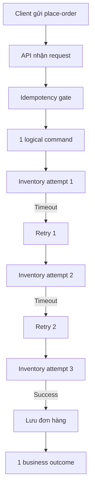

# Phân biệt một yêu cầu logic với các lần thử lại hoặc gọi phụ thuộc

Một yêu cầu nghiệp vụ có thể đi qua nhiều lần gọi mạng trước khi hoàn tất. Ví dụ, khách hàng gửi một yêu cầu đặt hàng; dịch vụ gọi kho hàng, nhận timeout, thử lại hai lần rồi mới đặt chỗ thành công. Ở góc nhìn nghiệp vụ, đó vẫn là một yêu cầu đặt hàng. Ở góc nhìn hạ tầng, đã có ba lần thử gọi kho hàng.

Nếu tăng counter nghiệp vụ ở mỗi lần gọi phụ thuộc, dashboard sẽ báo ba yêu cầu đặt hàng dù khách hàng chỉ gửi một ý định. Nếu chỉ đếm một lần ở cấp nghiệp vụ và bỏ qua các lần gọi phụ thuộc, đội vận hành lại không thấy retry đang làm tăng tải lên hệ thống phía sau. Cách đo đúng là tách các lớp sự kiện và đặt tên metric theo ngữ nghĩa của từng lớp.

Trong module `OBSERVABILITY_INSTRUMENTATION_MICROMETER`, việc phân biệt yêu cầu logic, lần giao nhận HTTP, lần gọi phụ thuộc và lần thử lại giúp đo chính xác nhu cầu nghiệp vụ, độ tin cậy của dependency, latency mà người dùng trải nghiệm và chi phí phát sinh do retry.

## 1. Một luồng nghiệp vụ có nhiều loại lần gọi

Hãy xét một yêu cầu `place-order`:

1. Client gửi yêu cầu đặt hàng đến API.
2. Ứng dụng nhận yêu cầu và xác định đây là một command mới.
3. Ứng dụng gọi dịch vụ inventory để giữ hàng.
4. Lần gọi đầu timeout; ứng dụng thử lại.
5. Lần gọi thứ hai cũng timeout; ứng dụng thử lại lần cuối.
6. Lần gọi thứ ba thành công, đơn hàng được lưu và trả kết quả.

Luồng này có nhiều con số khác nhau:

| Khái niệm | Số lần trong ví dụ | Đo điều gì? |
| --- | ---: | --- |
| HTTP delivery | 1 | Một lần request đến API |
| Logical business command | 1 | Một ý định đặt hàng được hệ thống chấp nhận xử lý |
| Inventory dependency call | 3 | Ba lần gọi vật lý đến dịch vụ kho |
| Retry attempt | 2 | Hai lần gọi phát sinh sau lần đầu |
| Business outcome | 1 | Một kết quả cuối cùng của yêu cầu đặt hàng |



Mỗi con số trả lời một câu hỏi khác nhau. Không có một counter duy nhất nào có thể đại diện chính xác cho tất cả.

## 2. Xác định ranh giới của một yêu cầu logic

Một yêu cầu logic là đơn vị công việc mà nghiệp vụ muốn xem như một ý định xử lý. Nó thường bắt đầu khi ứng dụng chấp nhận một command mới và kết thúc khi command có kết quả cuối cùng, chẳng hạn thành công, bị từ chối hoặc thất bại sau khi hết chính sách retry.

Ranh giới này phải được định nghĩa rõ theo nghiệp vụ:

- Với API đặt hàng, một command đặt hàng mới có thể là một yêu cầu logic.
- Với xử lý thanh toán, một lệnh authorize có thể là một yêu cầu logic dù gateway được gọi nhiều lần.
- Với consumer, một event nghiệp vụ đã được chấp nhận xử lý có thể là một yêu cầu logic dù broker giao lại message nhiều lần.
- Với batch, một batch có thể là một yêu cầu logic, còn mỗi bản ghi bên trong là một đơn vị nghiệp vụ riêng nếu yêu cầu báo cáo cần đếm từng bản ghi.

Không nên định nghĩa ranh giới chỉ dựa trên số lần một method Java được gọi. Method có thể được gọi lại do retry nội bộ, do client gửi lại HTTP request, do message broker redelivery hoặc do một workflow gọi cùng service nhiều lần.

### Phân biệt delivery và intent

Một client có thể gửi lại cùng HTTP request vì không nhận được response. Ở tầng HTTP, đó là hai lần delivery. Ở tầng nghiệp vụ, chúng có thể là cùng một ý định nếu client gửi cùng idempotency key và server thực hiện deduplication.

Không thể xác định hai request là cùng ý định chỉ vì body giống nhau. Khách hàng có thể hợp lệ khi đặt hai đơn hàng giống hệt nhau. Muốn gộp các lần gửi lại, ứng dụng cần một hợp đồng idempotency rõ ràng, ví dụ header `Idempotency-Key`, cùng phạm vi tenant/operation và thời gian lưu kết quả.

Nếu không có idempotency key hoặc cơ chế deduplication tương đương, hãy coi mỗi lần request đến là một yêu cầu riêng ở ranh giới ứng dụng. Metrics không thể tự suy luận ý định của người dùng từ payload.

## 3. Đo ba lớp riêng biệt

Một schema metrics rõ ràng thường có ít nhất ba lớp:

| Lớp | Ví dụ metric | Khi nào tăng? |
| --- | --- | --- |
| Giao nhận/transport | `http.server.requests` | Mỗi HTTP request được server xử lý; Spring Boot thường đã tự instrument |
| Yêu cầu logic/nghiệp vụ | `business.order.commands.accepted`, `business.order.command.results` | Một lần khi command mới được chấp nhận; một lần khi có kết quả cuối cùng |
| Lần gọi phụ thuộc | `dependency.calls`, `dependency.retry.attempts` | Mỗi lần gọi vật lý; retry được ghi riêng khi thực sự lên lịch lần thử tiếp theo |

Ngoài counter, nên đo thời lượng ở hai cấp:

- `business.order.processing.duration`: thời gian toàn bộ command, bao gồm thời gian gọi phụ thuộc và thời gian chờ backoff giữa các lần thử.
- `dependency.call.duration`: thời gian của từng lần gọi phụ thuộc, không bao gồm khoảng backoff sau khi lần gọi đã kết thúc.

Hai timer này giúp trả lời hai câu hỏi khác nhau: người dùng phải chờ bao lâu để hoàn tất một yêu cầu logic, và mỗi lần gọi hệ thống phía sau mất bao lâu.

## 4. Đặt counter nghiệp vụ ở ranh giới command

Counter nghiệp vụ nên tăng một lần cho mỗi command mới được chấp nhận theo quy tắc idempotency. Nếu cần đo kết quả, ghi một outcome duy nhất khi command kết thúc:

```java
public OrderResult submit(String idempotencyKey, OrderCommand command) {
    return idempotencyService.executeOnce(
            "place-order",
            idempotencyKey,
            () -> processNewCommand(command));
}
```

`executeOnce` ở đây là abstraction do ứng dụng xây dựng hoặc lấy từ thư viện idempotency. Hợp đồng của nó là chỉ chạy supplier cho lần đầu một key được chấp nhận; request lặp lại có thể nhận kết quả đã lưu hoặc trạng thái đang xử lý. Cần triển khai deduplication nguyên tử và bền vững nếu nhiều instance có thể nhận cùng key.

Phần xử lý command mới có thể ghi metrics như sau:

```java
import io.micrometer.core.instrument.MeterRegistry;
import io.micrometer.core.instrument.Timer;

public OrderResult processNewCommand(OrderCommand command) {
    registry.counter("business.order.commands.accepted").increment();

    Timer.Sample sample = Timer.start(registry);
    String outcome = "error";
    try {
        OrderResult result = performOrder(command);
        outcome = "success";
        return result;
    } catch (BusinessRejectedException ex) {
        outcome = "rejected";
        throw ex;
    } catch (DependencyTimeoutException ex) {
        outcome = "timeout";
        throw ex;
    } finally {
        sample.stop(registry.timer(
                "business.order.processing.duration",
                "outcome", outcome));
        registry.counter(
                "business.order.command.results",
                "outcome", outcome).increment();
    }
}
```

Ví dụ giả định `processNewCommand` chỉ được gọi sau khi idempotency gate đã chấp nhận một command mới. Counter `accepted` tăng một lần tại ranh giới đó. Counter `command.results` tăng một lần cho kết quả cuối cùng, kể cả khi kết quả là `rejected`, `timeout` hoặc `error`.

Tên `command.results` có chủ đích vì nó đếm các kết quả cuối cùng, không chỉ đếm đơn hàng được tạo thành công. Nếu cần đếm số đơn hàng thực sự được tạo, hãy dùng metric riêng như `business.orders.created` và tăng nó sau khi transaction đã commit hoặc khi event tạo đơn hàng được xác nhận bền vững.

Không tăng `business.orders.created` trước khi transaction commit. Nếu transaction rollback, metric sẽ báo có đơn hàng được tạo dù dữ liệu không tồn tại. Với xử lý bất đồng bộ, transactional outbox hoặc event consumer idempotent giúp gắn metric với sự kiện đã được lưu bền vững.

## 5. Đo mỗi lần gọi phụ thuộc riêng

Một dependency call là một lần gọi vật lý đến hệ thống khác. Nếu chính sách retry gọi inventory ba lần, counter dependency phải tăng ba lần. Có thể phân biệt lần đầu và lần retry bằng tag `attempt_kind` với hai giá trị hữu hạn:

```java
private <T> T callInventory(Callable<T> operation) throws Exception {
    for (int attempt = 1; ; attempt++) {
        String attemptKind = attempt == 1 ? "initial" : "retry";
        Timer.Sample sample = Timer.start(registry);
        String outcome = "error";
        RetryableDependencyException retryable = null;

        try {
            T result = operation.call();
            outcome = "success";
            return result;
        } catch (RetryableDependencyException ex) {
            retryable = ex;
            outcome = ex instanceof DependencyTimeoutException
                    ? "timeout" : "retryable_error";
        } catch (Exception ex) {
            outcome = "error";
            throw ex;
        } finally {
            sample.stop(registry.timer(
                    "dependency.call.duration",
                    "dependency", "inventory",
                    "operation", "reserve",
                    "outcome", outcome));

            registry.counter(
                    "dependency.calls",
                    "dependency", "inventory",
                    "operation", "reserve",
                    "attempt_kind", attemptKind,
                    "outcome", outcome).increment();
        }

        if (attempt >= maxAttempts) {
            throw retryable;
        }

        registry.counter(
                "dependency.retry.attempts",
                "dependency", "inventory",
                "operation", "reserve").increment();

        backoff.pause(attempt);
    }
}
```

Trong ví dụ, `maxAttempts` là tổng số lần gọi tối đa, bao gồm lần đầu. `RetryableDependencyException`, `DependencyTimeoutException`, `backoff` và `registry` là các thành phần do ứng dụng cung cấp. Chỉ nhóm lỗi được xác định là retryable mới đi đến lần thử tiếp theo; lỗi không retry được được ném lại ngay.

`Timer.Sample` của dependency được dừng trong `finally` trước khi chờ backoff. Do đó `dependency.call.duration` đo từng lần gọi mạng. `business.order.processing.duration` ở cấp ngoài bao gồm cả thời gian backoff và các xử lý khác, phản ánh thời gian hoàn tất command mà người dùng trải nghiệm.

`dependency.calls` tăng cho mọi lần gọi thực tế. `dependency.retry.attempts` tăng khi ứng dụng quyết định lên lịch một lần retry tiếp theo. Với ví dụ ba lần gọi, `dependency.calls` là 3, `dependency.retry.attempts` là 2, và `attempt_kind` có một lần `initial` cùng hai lần `retry`.

## 6. Không dùng số thứ tự attempt làm tag

Tag `attempt_kind=initial|retry` có số giá trị nhỏ và ổn định. Không dùng `attempt=1`, `attempt=2`, `attempt=3` nếu số lần retry có thể tăng tùy cấu hình hoặc tình huống. Cũng không đưa idempotency key, request ID, order ID hoặc exception message vào tag.

Schema tag gợi ý:

| Metric | Tag nên dùng | Tag nên tránh |
| --- | --- | --- |
| `business.order.command.results` | `outcome=success|rejected|timeout|error` | `order_id`, `idempotency_key` |
| `dependency.calls` | `dependency=inventory`, `operation=reserve`, `attempt_kind=initial|retry`, `outcome=...` | `attempt=1`, `request_id`, URL đầy đủ |
| `dependency.call.duration` | `dependency`, `operation`, `outcome` | exception message, trace ID |
| `business.order.processing.duration` | `outcome`, `channel` nếu vocabulary hữu hạn | customer ID, order ID |

Tag phải được chuẩn hóa trước khi ghi. Với HTTP client, dùng tên dependency và operation cố định như `inventory`/`reserve`; không dùng host động, URL có path ID hoặc tên method sinh từ input.

## 7. Client retry, message redelivery và idempotency

Retry không chỉ xuất hiện trong một vòng lặp nội bộ. Có thể có nhiều lớp thử lại:

- Client gửi lại HTTP request vì timeout hoặc mất response.
- API gateway hoặc load balancer retry request.
- Service retry khi gọi dependency.
- Message broker giao lại message vì consumer chưa ack.
- Consumer retry xử lý message sau lỗi tạm thời.

Nếu nhiều lớp cùng retry, một ý định nghiệp vụ có thể tạo ra nhiều HTTP delivery, nhiều lần xử lý và rất nhiều dependency call. Metrics cần đặt ở từng ranh giới để thấy được nơi phát sinh tải.

Với API, `http.server.requests` do Spring Boot/MVC instrumentation tạo thường đếm mỗi request đến server. Nếu client retry ba lần, metric HTTP có thể tăng ba lần. `business.order.commands.accepted` chỉ tăng một lần nếu cả ba delivery dùng cùng idempotency key và idempotency gate trả lại kết quả cũ cho các delivery sau.

Với message consumer, phân biệt `messaging.deliveries` (mỗi lần broker giao) và `business.events.processed` (mỗi event nghiệp vụ được xử lý thành công duy nhất theo event ID). Nếu broker redeliver cùng message, delivery counter tăng nhưng business event counter không tăng lần nữa sau khi deduplication xác nhận event đã xử lý.

Idempotency phải được bảo đảm bởi logic lưu trữ và transaction của ứng dụng. Metrics chỉ quan sát kết quả; chúng không ngăn duplicate side effect. Với thao tác gọi dependency có side effect, hãy dùng idempotency key được truyền xuống dependency nếu API hỗ trợ, hoặc thiết kế bước ghi nhận/đối soát để retry không tạo tác động trùng.

## 8. Phân biệt retry và nhiều dependency call hợp lệ

Không phải mọi dependency call sau lần đầu đều là retry. Một yêu cầu đặt hàng có thể gọi inventory một lần, pricing một lần và payment một lần. Đây là ba dependency call hợp lệ của một workflow, không phải hai lần retry.

Định nghĩa retry là một lần thực hiện lại cùng một thao tác phụ thuộc do lần trước thất bại theo chính sách retry. Các lời gọi đến dependency khác nhau hoặc các operation khác nhau cần được phân biệt bằng tag `dependency` và `operation`.

Ví dụ:

| Logical operation | Dependency | Operation | Số lần gọi | Số retry |
| --- | --- | ---: | ---: | ---: |
| `place-order` | `inventory` | `reserve` | 3 | 2 |
| `place-order` | `pricing` | `quote` | 1 | 0 |
| `place-order` | `payment` | `authorize` | 1 | 0 |

Nếu chỉ đếm tổng số dependency calls, workflow có sáu lần gọi; nếu đếm retry, chỉ có hai lần. Không nên gọi cả sáu là sáu yêu cầu đặt hàng.

## 9. Đọc metrics để tìm chi phí retry

Với Prometheus, counter Micrometer thường được công bố dưới dạng metric có hậu tố `_total`. Một số truy vấn có thể dùng để phân tích:

**Tốc độ hoàn tất command theo outcome:**

```promql
sum by (outcome) (
  rate(business_order_command_results_total[5m])
)
```

**Tốc độ gọi dependency theo loại lần thử:**

```promql
sum by (dependency, attempt_kind) (
  rate(dependency_calls_total[5m])
)
```

**Tỷ lệ lần gọi là retry trong phạm vi dependency đã chọn:**

```promql
sum(rate(dependency_calls_total{attempt_kind="retry"}[5m]))
/
sum(rate(dependency_calls_total[5m]))
```

Tỷ lệ trên mô tả tỷ trọng physical call được gắn `attempt_kind=retry`; nó không phải tỷ lệ logical request thất bại. Nếu mẫu số bằng 0 hoặc không có dữ liệu, dashboard cần xử lý no-data.

**Số dependency call trung bình trên mỗi command được chấp nhận:**

```promql
sum(rate(dependency_calls_total{dependency="inventory",operation="reserve"}[5m]))
/
sum(rate(business_order_commands_accepted_total[5m]))
```

Truy vấn này chỉ có ý nghĩa nếu mẫu số và tử số cùng phạm vi nghiệp vụ, cùng service và cùng cửa sổ thời gian. Nếu một command có thể không gọi inventory hoặc có nhiều inventory operation, hãy diễn giải tỷ lệ như mức sử dụng trung bình chứ không coi là số retry chính xác.

**p95 thời gian hoàn tất yêu cầu logic:**

```promql
histogram_quantile(
  0.95,
  sum by (le) (
    rate(business_order_processing_duration_seconds_bucket[5m])
  )
)
```

**p95 của từng lần gọi inventory:**

```promql
histogram_quantile(
  0.95,
  sum by (le, outcome) (
    rate(dependency_call_duration_seconds_bucket{
      dependency="inventory",
      operation="reserve"
    }[5m])
  )
)
```

Nếu p95 logical duration tăng nhưng p95 từng dependency call ổn định, hãy kiểm tra số lần retry, backoff, hàng đợi hoặc xử lý nội bộ. Nếu cả hai cùng tăng, dependency có thể đang chậm trực tiếp. Cần đối chiếu thêm trace để xác định từng span và khoảng chờ.

## 10. Đo business event sau commit

Một command được chấp nhận chưa chắc tạo ra một business event. Ví dụ, lệnh đặt hàng có thể bị từ chối vì hết hàng hoặc transaction có thể rollback. Nếu metric muốn biểu diễn số đơn hàng đã tạo, hãy tăng counter tại thời điểm trạng thái đã bền vững.

Với transaction đồng bộ, có thể dùng callback after-commit hoặc application event được phát sau commit. Với hệ thống event-driven, transactional outbox giúp lưu event cùng transaction nghiệp vụ; consumer chỉ tăng `business.orders.created` sau khi xử lý event và deduplicate thành công.

Hãy phân biệt các metric:

- `business.order.commands.accepted`: command mới được nhận để xử lý.
- `business.order.command.results`: command đạt outcome cuối cùng.
- `business.orders.created`: đơn hàng được tạo và commit thành công.
- `dependency.calls`: số lần gọi hệ thống phụ thuộc.
- `dependency.retry.attempts`: số lần retry thực sự được lên lịch.

Tên metric phải thể hiện chính xác thời điểm và ý nghĩa tăng. Không dùng một tên chung như `orders.count` cho các khái niệm khác nhau.

## 11. Kiểm thử một command với nhiều dependency attempts

Unit test nên chứng minh một logical command có thể tạo nhiều dependency calls nhưng chỉ có một kết quả nghiệp vụ. Ví dụ dưới đây mô tả một fake inventory client timeout ở lần đầu và thành công ở lần thứ hai:

```java
import static org.assertj.core.api.Assertions.assertThat;

import java.util.concurrent.atomic.AtomicInteger;

import io.micrometer.core.instrument.simple.SimpleMeterRegistry;
import org.junit.jupiter.api.Test;

class OrderMetricsTest {
    @Test
    void countsOneLogicalResultAndTwoDependencyAttempts() throws Exception {
        try (SimpleMeterRegistry registry = new SimpleMeterRegistry()) {
            AtomicInteger calls = new AtomicInteger();
            InventoryClient inventory = command -> {
                if (calls.incrementAndGet() == 1) {
                    throw new DependencyTimeoutException("temporary timeout");
                }
                return Reservation.accepted();
            };

            OrderService service = new OrderService(registry, inventory, 2);
            service.processNewCommand(new OrderCommand("sku-1"));

            assertThat(registry.get("business.order.command.results")
                    .tag("outcome", "success")
                    .counter()
                    .count()).isEqualTo(1.0);

            assertThat(registry.get("dependency.calls")
                    .tag("dependency", "inventory")
                    .tag("operation", "reserve")
                    .tag("attempt_kind", "initial")
                    .tag("outcome", "timeout")
                    .counter()
                    .count()).isEqualTo(1.0);

            assertThat(registry.get("dependency.calls")
                    .tag("dependency", "inventory")
                    .tag("operation", "reserve")
                    .tag("attempt_kind", "retry")
                    .tag("outcome", "success")
                    .counter()
                    .count()).isEqualTo(1.0);

            assertThat(registry.get("dependency.retry.attempts")
                    .tag("dependency", "inventory")
                    .tag("operation", "reserve")
                    .counter()
                    .count()).isEqualTo(1.0);
        }
    }
}
```

`OrderService`, `InventoryClient`, `Reservation`, `OrderCommand` và exception trong ví dụ là các kiểu minh họa tương ứng với phần triển khai trước đó. Test kiểm tra schema metrics và số lần tăng; có thể bổ sung assertion cho `business.order.processing.duration` và `dependency.call.duration` nếu cần kiểm tra timer.

Ngoài test trên, nên có các trường hợp:

- Dependency thành công ngay lần đầu: một call, không có retry.
- Dependency lỗi không retry được: một call, không có retry.
- Hết `maxAttempts`: số call bằng giới hạn, số retry bằng số lần gọi trừ một.
- Client gửi lại cùng idempotency key: HTTP delivery tăng nhưng logical command chỉ được chấp nhận một lần.
- Hai idempotency key khác nhau với cùng payload: hai command logic độc lập nếu hợp đồng nghiệp vụ cho phép.
- Message broker redelivery: delivery count tăng, event processed không tăng lần nữa sau deduplication.

## 12. Những lỗi thường gặp

| Lỗi | Hệ quả | Cách xử lý |
| --- | --- | --- |
| Tăng business counter trong callback dependency | Retry làm số yêu cầu nghiệp vụ tăng giả | Tăng counter logic ở ranh giới command một lần |
| Chỉ có business counter, không có attempt counter | Không thấy dependency bị gọi lại nhiều lần | Đo riêng mỗi physical call và retry |
| Gộp HTTP delivery với logical intent | Client retry làm tăng số yêu cầu logic | Đo HTTP ở transport; dùng idempotency gate cho command |
| Dùng body giống nhau để deduplicate | Hai ý định hợp lệ có thể bị gộp nhầm | Dùng idempotency key theo hợp đồng rõ ràng |
| Gọi mọi dependency call là retry | Đếm nhầm các bước workflow khác nhau | Phân biệt dependency và operation; retry là lặp lại cùng thao tác sau lỗi |
| Timer dependency bao gồm cả backoff | Độ trễ một lần gọi bị phóng đại | Dừng timer trước khi chờ backoff; timer logic bao gồm backoff |
| Dùng số thứ tự attempt làm tag | Cardinality tăng theo số lần thử | Dùng `attempt_kind=initial|retry` hoặc metric riêng |
| Tăng business event trước transaction commit | Rollback vẫn làm metric tăng | Ghi sau commit hoặc qua transactional outbox |
| Retry thao tác có side effect mà không idempotent | Có thể tạo tác động nghiệp vụ trùng | Dùng idempotency key/deduplication ở dependency hoặc quy trình đối soát |
| Đưa idempotency key vào tag | Tạo một series cho từng yêu cầu | Giữ key trong log/trace có kiểm soát, không dùng làm metric tag |

## 13. Quy trình thiết kế metrics cho retry

Khi một workflow có thể retry hoặc gọi nhiều dependency, hãy thực hiện theo trình tự:

1. Định nghĩa một logical operation theo ngôn ngữ nghiệp vụ và chọn điểm bắt đầu/kết thúc.
2. Xác định mỗi lần delivery HTTP/message và cách deduplicate cùng một ý định.
3. Chọn metric riêng cho command accepted, command outcome và business event đã commit.
4. Ghi một dependency call cho mỗi lần gọi vật lý, kể cả lần đầu và lần retry.
5. Ghi retry counter khi thực sự lên lịch lần thử tiếp theo; thống nhất `maxAttempts` là tổng số lần gọi hay số lần retry.
6. Đo timer toàn bộ logical operation và timer từng dependency attempt riêng biệt.
7. Chỉ dùng tag có tập giá trị hữu hạn như dependency, operation, outcome và attempt kind.
8. Kiểm thử trường hợp thành công ngay, retry thành công, hết retry, client redelivery và idempotency replay.
9. Dùng PromQL để so sánh throughput nghiệp vụ, dependency attempts, retry ratio và latency ở hai cấp.

Một yêu cầu logic có thể tạo nhiều lần gọi phụ thuộc, nhưng các lần gọi đó không làm phát sinh thêm ý định nghiệp vụ. Khi đo riêng transport delivery, logical command, business event và dependency attempt, metrics cho thấy cả nhu cầu thực của nghiệp vụ lẫn chi phí kỹ thuật của retry. Điều này giúp đội vận hành nhận ra khi nào hệ thống đang xử lý nhiều việc hơn, khi nào một việc đang tốn nhiều lần thử hơn và phần thời gian tăng thêm đến từ đâu.
