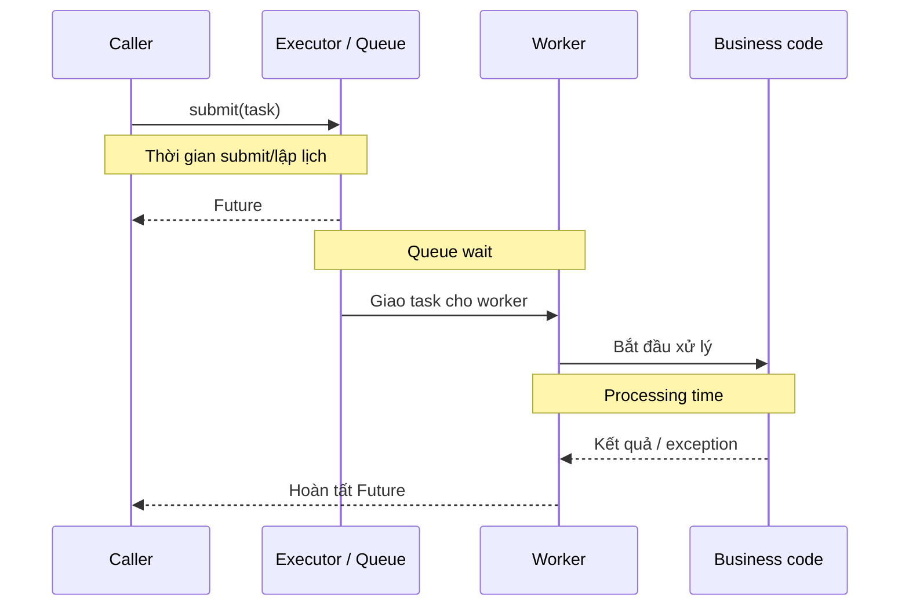

# Phân biệt thời gian lập lịch, chờ thực thi và thời gian xử lý

Trong module `OBSERVABILITY_INSTRUMENTATION_MICROMETER`, tác vụ bất đồng bộ thường đi qua executor, queue hoặc scheduler trước khi code nghiệp vụ thực sự chạy. Nếu chỉ đo thời gian bên trong method xử lý, metrics không cho biết tác vụ đã phải chờ bao lâu trước khi có worker nhận. Ngược lại, nếu chỉ đo từ lúc submit đến lúc hoàn tất, ta không biết độ trễ đến từ queue hay từ chính công việc.

Để chẩn đoán hệ thống async, cần tách ít nhất bốn khoảng thời gian: thời gian gọi API submit/lập lịch, thời gian chờ từ lúc đưa tác vụ vào executor đến lúc worker bắt đầu, thời gian xử lý trên worker và tổng thời gian từ lúc submit đến lúc hoàn tất. Với tác vụ chạy theo lịch, còn cần phân biệt thời điểm dự kiến chạy với thời điểm scheduler thực sự bắt đầu.

## 1. Một tác vụ async đi qua những mốc nào?

Một tác vụ được gửi vào thread pool không nhất thiết chạy ngay. Executor có thể phải xếp tác vụ vào queue cho đến khi một worker rảnh. Khi worker bắt đầu, code nghiệp vụ mới thực thi; sau đó kết quả hoặc exception được chuyển về `Future`/`CompletableFuture`.



Các mốc nên ghi nhận:

- `submittedAt`: thời điểm caller bắt đầu gửi tác vụ.
- `startedAt`: thời điểm worker bắt đầu chạy task.
- `completedAt`: thời điểm xử lý kết thúc, kể cả khi ném exception.

Từ ba mốc này có thể tính queue wait, processing time và end-to-end duration. Thời gian submit là một phép đo riêng quanh lời gọi `execute()`, `submit()` hoặc `schedule()`.

## 2. Định nghĩa từng khoảng thời gian

| Khoảng đo | Bắt đầu | Kết thúc | Trả lời câu hỏi |
| --- | --- | --- | --- |
| Submission/scheduling duration | Caller bắt đầu gọi API submit/schedule | API trả về hoặc ném lỗi | Mất bao lâu để đưa tác vụ vào executor/scheduler? |
| Queue wait | Tác vụ được đưa vào queue | Worker bắt đầu chạy | Tác vụ phải chờ bao lâu để có worker? |
| Processing duration | Worker bắt đầu chạy | Logic xử lý kết thúc | Bản thân công việc mất bao lâu? |
| End-to-end duration | Caller gửi tác vụ | Tác vụ hoàn tất | Người gọi phải chờ bao lâu từ lúc gửi đến khi có kết quả? |

Với một executor queue thông thường, end-to-end duration xấp xỉ queue wait cộng processing duration và phần overhead rất nhỏ quanh việc submit/dispatch. Nếu có thêm retry, callback hoặc nhiều giai đoạn, cần xác định rõ ranh giới đo để tránh cộng thiếu hoặc đếm trùng.

Các khái niệm này có ý nghĩa khác nhau. Queue wait cao thường gợi ý thiếu worker, queue quá dài hoặc tác vụ bị ưu tiên thấp. Processing duration cao gợi ý code, database, I/O hoặc dependency chậm. Submission duration cao có thể chỉ ra executor bị nghẽn ngay trong thao tác submit, queue policy chạy caller thread hoặc chi phí tạo task lớn.

## 3. Đo thời gian submit không đồng nghĩa với đo thời gian xử lý

Ví dụ:

```java
long started = System.nanoTime();
CompletableFuture<Result> future =
    CompletableFuture.supplyAsync(() -> service.process(command), executor);
long submitted = System.nanoTime();

submissionTimer.record(submitted - started, TimeUnit.NANOSECONDS);
```

Timer này đo thời gian `supplyAsync(...)` mất để gửi task vào executor và trả về `CompletableFuture`. Nó thường rất ngắn, vì caller không đợi task hoàn tất.

Không đo như sau rồi gọi đó là processing duration:

```java
submissionTimer.record(() ->
    CompletableFuture.supplyAsync(() -> service.process(command), executor));
```

`Timer.record(Supplier)` kết thúc khi supplier trả về `CompletableFuture`, không chờ computation bên trong hoàn tất. Để đo processing duration, timer phải được dừng bên trong task sau khi code nghiệp vụ thực sự chạy xong.

## 4. Đo queue wait, processing và end-to-end bằng Timer

Một cách trực tiếp là ghi lại thời điểm monotonic trước khi submit, sau đó đo queue wait khi worker bắt đầu và processing duration trong worker:

```java
import io.micrometer.core.instrument.MeterRegistry;
import io.micrometer.core.instrument.Timer;
import org.springframework.stereotype.Component;

import java.util.concurrent.CompletableFuture;
import java.util.concurrent.Executor;
import java.util.concurrent.RejectedExecutionException;
import java.util.concurrent.TimeUnit;
import java.util.function.Supplier;

@Component
public class AsyncTaskMetrics {
    private final Timer submission;
    private final Timer queueWait;
    private final Timer processing;
    private final Timer endToEnd;

    public AsyncTaskMetrics(MeterRegistry registry) {
        this.submission = Timer.builder("jobs.submit.duration")
            .description("Time spent submitting a job to the executor")
            .register(registry);
        this.queueWait = Timer.builder("jobs.queue.wait")
            .description("Time a job waits before a worker starts it")
            .register(registry);
        this.processing = Timer.builder("jobs.processing.duration")
            .description("Time spent executing a job on a worker")
            .register(registry);
        this.endToEnd = Timer.builder("jobs.end.to.end")
            .description("Time from job submission until completion")
            .register(registry);
    }

    public <T> CompletableFuture<T> submit(
            Supplier<T> operation,
            Executor executor) {
        long submittedAt = System.nanoTime();
        try {
            CompletableFuture<T> future = CompletableFuture.supplyAsync(() -> {
                long startedAt = System.nanoTime();
                queueWait.record(startedAt - submittedAt, TimeUnit.NANOSECONDS);
                try {
                    return processing.record(operation);
                } finally {
                    endToEnd.record(
                        System.nanoTime() - submittedAt,
                        TimeUnit.NANOSECONDS);
                }
            }, executor);

            submission.record(
                System.nanoTime() - submittedAt,
                TimeUnit.NANOSECONDS);
            return future;
        } catch (RejectedExecutionException exception) {
            submission.record(
                System.nanoTime() - submittedAt,
                TimeUnit.NANOSECONDS);
            throw exception;
        }
    }
}
```

Ví dụ giả định `executor` là thread pool bất đồng bộ. `submittedAt` được chụp trước khi gọi `supplyAsync`; worker dùng cùng mốc đó để tính queue wait và end-to-end. `processing.record(operation)` chỉ đo phần thực thi của supplier trên worker. `finally` bảo đảm end-to-end được ghi nhận cả khi operation ném exception.

Trong hệ thống thực tế, nên đăng ký các timer một lần trong bean sống lâu như ví dụ. Nếu muốn phân biệt loại job, thêm tag có tập giá trị nhỏ như `job_type=report|invoice`; không thêm `jobId`, user ID hoặc request ID làm tag.

## 5. Vì sao dùng System.nanoTime() để đo khoảng thời gian?

Đo thời lượng cần đồng hồ monotonic, chỉ dùng để so sánh khoảng cách thời gian. `System.nanoTime()` phù hợp để lấy hiệu giữa hai mốc trong cùng tiến trình. Không dùng `System.currentTimeMillis()` để đo queue wait hoặc processing duration vì đồng hồ wall-clock có thể bị điều chỉnh bởi đồng bộ thời gian hoặc thao tác quản trị.

Các giá trị từ `System.nanoTime()` không phải timestamp ngày giờ và không có ý nghĩa khi so sánh giữa hai JVM khác nhau. Chỉ lấy hiệu giữa các mốc được chụp trong cùng môi trường chạy. Sau đó truyền hiệu cùng đơn vị `TimeUnit.NANOSECONDS` vào `Timer.record(...)`.

Micrometer `Timer` lưu duration và chuyển đổi sang đơn vị phù hợp với registry khi export. Không tự chia hoặc nhân thêm hệ số nếu builder/exporter đã xử lý đơn vị. Nếu dùng `Timer.Sample`, sample có thể được bắt đầu tại caller và dừng trong worker để đo end-to-end, nhưng queue wait và processing vẫn cần các mốc riêng.

## 6. Submission duration và queue wait có thể khác nhau thế nào?

`Executor.execute()` hoặc `submit()` thường chỉ đưa task vào hàng đợi và trả về. Tuy nhiên, submission duration không phải lúc nào cũng chỉ là chi phí enqueue:

- Executor có thể tạo worker mới, nên submit bao gồm chi phí tạo thread.
- Queue có thể đầy và chính sách từ chối ném `RejectedExecutionException`.
- `CallerRunsPolicy` có thể chạy task ngay trên thread caller, khiến submit bị kéo dài và queue wait gần bằng 0.
- Executor tùy chỉnh có thể thực thi đồng bộ hoặc có thao tác chặn trong `execute()`.

Do đó, hãy quan sát submission duration cùng queue wait, active worker count, queue size và rejection count. Một submit nhanh không chứng minh task được xử lý nhanh; queue wait có thể vẫn rất cao.

## 7. Scheduled task cần thêm thời điểm dự kiến chạy

Với `ScheduledExecutorService`, một tác vụ có thể được lên lịch chạy sau một khoảng delay. Cần phân biệt thời gian chờ có chủ đích với độ trễ scheduler:

- **Scheduled delay:** khoảng thời gian ứng dụng chủ động yêu cầu đợi trước khi task được phép chạy.
- **Scheduler lag:** thời gian từ deadline dự kiến đến lúc task thực sự bắt đầu.
- **Processing duration:** thời gian task chạy sau khi bắt đầu.
- **End-to-end duration:** từ lúc đăng ký lịch đến lúc task hoàn tất; bao gồm scheduled delay, scheduler lag và processing.

Ví dụ đo scheduler lag:

```java
long scheduledAt = System.nanoTime();
long dueAt = scheduledAt + delay.toNanos();

ScheduledFuture<?> handle = scheduler.schedule(() -> {
    long actualStart = System.nanoTime();
    long lag = Math.max(0L, actualStart - dueAt);
    schedulerLagTimer.record(lag, TimeUnit.NANOSECONDS);

    processingTimer.record(() -> jobService.run());
}, delay.toNanos(), TimeUnit.NANOSECONDS);
```

`scheduledAt` đến `dueAt` là delay được yêu cầu, không phải độ trễ. `actualStart - dueAt` đo scheduler lag, tức task bắt đầu muộn hơn deadline bao lâu. Nếu cần đo tổng thời gian từ khi schedule đến khi hoàn tất, ghi thêm mốc `scheduledAt` và record trong `finally` của task.

Nếu tác vụ định kỳ chạy theo fixed rate, một lần xử lý kéo dài có thể làm lần tiếp theo trễ hoặc chồng lấn tùy API scheduler và cấu hình. Theo dõi scheduler lag và processing duration riêng sẽ giúp nhận ra nguyên nhân.

## 8. Với Spring @Async, đo ở ranh giới nào?

`@Async` chuyển lời gọi method sang executor do Spring quản lý. Method caller thường nhận `Future` hoặc `CompletableFuture` trước khi công việc hoàn tất. Vì vậy, timer đặt quanh lời gọi từ caller có thể chỉ đo thời gian gửi task hoặc lấy Future.

Đo processing bên trong method async:

```java
import io.micrometer.core.instrument.MeterRegistry;
import io.micrometer.core.instrument.Timer;
import org.springframework.scheduling.annotation.Async;
import org.springframework.stereotype.Service;

import java.util.concurrent.CompletableFuture;

@Service
public class ReportWorker {
    private final Timer processingTimer;
    private final ReportService reportService;

    public ReportWorker(MeterRegistry registry, ReportService reportService) {
        this.processingTimer = Timer.builder("reports.processing.duration")
            .register(registry);
        this.reportService = reportService;
    }

    @Async("reportExecutor")
    public CompletableFuture<Report> generate(String reportId) {
        Report report = processingTimer.record(
            () -> reportService.generate(reportId));
        return CompletableFuture.completedFuture(report);
    }
}
```

Timer trong method đo phần xử lý sau khi worker bắt đầu chạy. Nó không bao gồm thời gian task nằm trong queue của executor. Muốn đo queue wait, cần instrument executor hoặc điểm submit để lưu `submittedAt` và đo khi worker bắt đầu.

Để bật xử lý `@Async`, cấu hình Spring cần có `@EnableAsync` và một executor bean tên `reportExecutor`:

```java
import org.springframework.context.annotation.Configuration;
import org.springframework.scheduling.annotation.EnableAsync;

@Configuration
@EnableAsync
public class AsyncConfiguration {
}
```

`@Observed` trên method async cũng cần được diễn giải theo thời điểm aspect bắt đầu và kết thúc lời gọi được proxy intercept. Với method trả `CompletableFuture`, đừng mặc định rằng duration luôn bao trùm toàn bộ thời gian hoàn tất future. Hãy xác minh semantics của phiên bản Spring/Micrometer đang dùng và instrument bên trong task nếu cần thời gian thực thi thực tế.

## 9. Dùng TaskDecorator để đo queue wait trong ThreadPoolTaskExecutor

Spring `TaskDecorator` có thể bọc `Runnable` trước khi executor thực thi. Đây là một điểm phù hợp để chụp thời điểm task được chuẩn bị đưa vào executor và đo lúc worker bắt đầu:

```java
import io.micrometer.core.instrument.MeterRegistry;
import io.micrometer.core.instrument.Timer;
import org.springframework.core.task.TaskDecorator;

import java.util.concurrent.TimeUnit;

public class QueueWaitTaskDecorator implements TaskDecorator {
    private final Timer queueWaitTimer;

    public QueueWaitTaskDecorator(MeterRegistry registry) {
        this.queueWaitTimer = Timer.builder("async.executor.queue.wait")
            .register(registry);
    }

    @Override
    public Runnable decorate(Runnable task) {
        long decoratedAt = System.nanoTime();
        return () -> {
            queueWaitTimer.record(
                System.nanoTime() - decoratedAt,
                TimeUnit.NANOSECONDS);
            task.run();
        };
    }
}
```

Gắn decorator vào `ThreadPoolTaskExecutor`:

```java
import org.springframework.context.annotation.Bean;
import org.springframework.context.annotation.Configuration;
import org.springframework.scheduling.concurrent.ThreadPoolTaskExecutor;

@Configuration
public class ExecutorConfiguration {

@Bean
ThreadPoolTaskExecutor reportExecutor(
        QueueWaitTaskDecorator decorator) {
    ThreadPoolTaskExecutor executor = new ThreadPoolTaskExecutor();
    executor.setCorePoolSize(4);
    executor.setMaxPoolSize(8);
    executor.setQueueCapacity(500);
    executor.setTaskDecorator(decorator);
    executor.setThreadNamePrefix("report-");
    return executor;
}
}
```

Mốc `decoratedAt` gần với thời điểm task được đưa vào executor, nhưng chính xác đến đâu phụ thuộc cách executor tạo và bọc task. Với các wrapper lồng nhau hoặc task được decorate trước khi thực sự enqueue, metric có thể bao gồm thêm một phần overhead. Hãy kiểm tra implementation executor của phiên bản Spring đang dùng và gọi metric này là queue wait/dispatch wait theo đúng ranh giới đã đo.

Decorator có thể dùng để truyền context hoặc trace context, nhưng việc đo thời gian không tự động bảo đảm context propagation. Cấu hình context propagation riêng nếu task cần mang theo Observation hoặc trace từ caller sang worker.

## 10. Queue size và active workers bổ sung cho duration

Duration cho biết một task đã chờ hoặc chạy bao lâu; Gauge về queue size và active worker count cho biết trạng thái executor tại thời điểm lấy mẫu. Kết hợp chúng giúp phân biệt queue bị dồn với xử lý chậm.

Ví dụ nếu ứng dụng tự quản lý `ThreadPoolExecutor`:

```java
import io.micrometer.core.instrument.Gauge;
import io.micrometer.core.instrument.MeterRegistry;
import java.util.concurrent.ThreadPoolExecutor;

Gauge.builder("async.executor.queue.size", executor,
        pool -> pool.getQueue().size())
    .register(registry);

Gauge.builder("async.executor.active", executor,
        ThreadPoolExecutor::getActiveCount)
    .register(registry);
```

Các gauge này cần quan sát đúng executor đang chạy task. Giữ executor sống trong bean quản lý và không tạo meter cho từng request. Queue size là snapshot; nó có thể thay đổi ngay sau khi đọc và không thay thế queue wait timer.

Diễn giải kết hợp:

| Queue size | Queue wait | Processing | Khả năng cần điều tra |
| --- | --- | --- | --- |
| Cao | Cao | Bình thường | Thiếu worker hoặc burst vượt năng lực xử lý |
| Thấp | Thấp | Cao | Bản thân công việc hoặc dependency chậm |
| Cao | Cao | Cao | Worker vừa chậm vừa không đủ năng lực; queue backlog tích tụ |
| Thấp | Cao | Bình thường | Có thể do scheduler, worker availability hoặc task priority |
| Thấp | Thấp | Thấp | Hệ thống đang xử lý bình thường hoặc ít tải |

## 11. Theo dõi tác vụ đang chạy bằng LongTaskTimer

`Timer` thường ghi nhận một mẫu khi công việc hoàn tất. Nếu task chạy nhiều phút, ta có thể chưa thấy mẫu duration hoàn tất trong lúc task đang bị treo. `LongTaskTimer` bổ sung góc nhìn số tác vụ hiện hoạt động và thời gian chúng đã chạy.

```java
import io.micrometer.core.instrument.LongTaskTimer;

LongTaskTimer activeJobs = LongTaskTimer.builder("jobs.active")
    .description("Number and duration of currently running jobs")
    .register(registry);

LongTaskTimer.Sample sample = activeJobs.start();
try {
    jobService.execute(job);
} finally {
    sample.stop();
}
```

Đặt `start()` khi worker thực sự bắt đầu xử lý, không đặt tại thời điểm submit nếu mục tiêu là đếm tác vụ đang chạy. Nếu bắt đầu từ lúc enqueue, queue wait cũng bị tính vào thời lượng active và `activeTasks()` sẽ bao gồm cả tác vụ chưa chiếm worker.

Có thể dùng đồng thời:

- Queue wait `Timer`: thời gian trước khi worker nhận task.
- `LongTaskTimer`: task đang chạy và thời gian active hiện tại.
- Processing `Timer`: thời lượng sau khi task hoàn tất.
- End-to-end `Timer`: tổng thời gian từ submit đến hoàn tất.

## 12. Xử lý rejection, cancellation và exception

Không phải mọi task được submit đều đi đến trạng thái worker bắt đầu và hoàn tất bình thường.

- **Rejected:** executor từ chối task vì shutdown, queue đầy hoặc policy. Ghi một counter `async.executor.rejected` và không ghi queue wait/processing như thể task đã chạy.
- **Cancelled trước khi bắt đầu:** task có thể bị hủy khi còn trong queue. Không có `startedAt`, vì vậy không có queue wait hoặc processing hoàn chỉnh. Có thể ghi counter cancellation và thời gian từ submit đến cancel nếu nghiệp vụ cần.
- **Cancelled khi đang chạy:** task có thể bị interrupt hoặc chỉ đánh dấu cancel tùy implementation. Đảm bảo `finally` trong worker dừng timer/LongTaskTimer.
- **Exception:** processing timer vẫn cần ghi duration; phân loại kết quả bằng tag hữu hạn như `result=success|failure` nếu có thể xác định an toàn.

Không gắn task ID hoặc exception message làm tag. Chi tiết một task cụ thể nên nằm trong log hoặc trace, còn metrics chỉ dùng nhóm kết quả có cardinality thấp.

## 13. PromQL cho queue wait và processing duration

Giả sử Prometheus registry xuất Timer thành các series `_seconds_sum` và `_seconds_count`. Độ trễ queue trung bình trong 5 phút:

```promql
sum(rate(async_executor_queue_wait_seconds_sum[5m]))
/
sum(rate(async_executor_queue_wait_seconds_count[5m]))
```

Processing duration trung bình:

```promql
sum(rate(jobs_processing_duration_seconds_sum[5m]))
/
sum(rate(jobs_processing_duration_seconds_count[5m]))
```

End-to-end duration trung bình:

```promql
sum(rate(jobs_end_to_end_seconds_sum[5m]))
/
sum(rate(jobs_end_to_end_seconds_count[5m]))
```

Nếu cần p95 queue wait hoặc processing duration, bật histogram cho Timer rồi truy vấn bucket:

```promql
histogram_quantile(
  0.95,
  sum by (le) (
    rate(async_executor_queue_wait_seconds_bucket[5m])
  )
)
```

Tên metric là ví dụ theo quy tắc chuẩn hóa; hãy xác nhận tại `/actuator/prometheus`. Nếu phân tách theo `executor` hoặc `job_type`, giữ cùng label trong `sum by` và bảo đảm các giá trị tag có tập hữu hạn. Nếu không có task hoàn tất trong cửa sổ, mẫu số bằng 0 hoặc không có dữ liệu; dashboard nên thể hiện No data thay vì gán latency bằng 0.

## 14. Kiểm thử thời gian async ổn định

Không nên dựa vào `Thread.sleep()` dài để khẳng định queue wait hoặc processing duration. Dùng `CountDownLatch` để giữ worker bận, xếp task thứ hai vào queue, rồi thả worker:

```java
import org.assertj.core.api.Assertions;
import java.util.concurrent.CompletableFuture;
import java.util.concurrent.CountDownLatch;
import java.util.concurrent.ExecutorService;
import java.util.concurrent.Executors;

ExecutorService executor = Executors.newSingleThreadExecutor();
CountDownLatch workerStarted = new CountDownLatch(1);
CountDownLatch releaseWorker = new CountDownLatch(1);

executor.submit(() -> {
    workerStarted.countDown();
    releaseWorker.await();
    return null;
});

try {
    workerStarted.await();
    CompletableFuture<Result> queued = metrics.submit(
        () -> service.process(command), executor);

    releaseWorker.countDown();
    Result result = queued.join();

    Assertions.assertThat(result).isNotNull();
    Assertions.assertThat(registry.get("jobs.queue.wait").timer().count()).isEqualTo(1);
    Assertions.assertThat(registry.get("jobs.processing.duration").timer().count()).isEqualTo(1);
    Assertions.assertThat(registry.get("jobs.end.to.end").timer().count()).isEqualTo(1);
} finally {
    releaseWorker.countDown();
    executor.shutdownNow();
}
```

Test minh họa cần dọn executor trong `finally` hoặc dùng lifecycle của test để gọi `shutdownNow()`. Trong test thực tế, kiểm tra thêm rejection, exception và cancellation. Không khẳng định một số mili giây cố định vì thời gian scheduling phụ thuộc hệ điều hành và tải máy; xác minh số mẫu và thứ tự mốc là ổn định hơn.

## 15. Những lỗi thường gặp

| Hiện tượng | Nguyên nhân nên kiểm tra |
| --- | --- |
| Async timer rất ngắn dù job chạy lâu | Timer chỉ bao quanh lời gọi submit hoặc lúc tạo Future |
| Queue wait cao nhưng processing bình thường | Backlog, worker thiếu, task priority hoặc burst traffic |
| Processing cao nhưng queue wait thấp | Code xử lý, database, remote call hoặc lock chậm |
| End-to-end không bằng queue wait + processing | Các timer có ranh giới khác nhau, submission/dispatch overhead hoặc callback/retry chưa được tính nhất quán |
| Không có queue wait cho task bị hủy | Task bị cancel trước khi worker bắt đầu |
| Submission duration tăng đột biến | Executor tạo thread, queue policy chặn hoặc CallerRunsPolicy chạy task trên caller |
| Scheduler lag tăng | Scheduler thread bị chiếm lâu, task trước chạy quá hạn hoặc scheduler thiếu năng lực |
| LongTaskTimer active count cao mãi | Sample không được stop trong mọi nhánh kết thúc |
| Metrics tăng cardinality | Dùng job ID, request ID hoặc tên task tùy ý làm tag |

Khi điều tra, đối chiếu queue size, active workers, rejection count, queue wait, processing duration và end-to-end duration trên cùng khoảng thời gian. Nếu chỉ xem end-to-end, khó biết nghẽn nằm ở executor hay ở logic nghiệp vụ.

## 16. Nguyên tắc áp dụng

Đặt mốc thời gian tại đúng ranh giới: caller submit, task vào executor, worker bắt đầu và task hoàn tất. Đo submission duration quanh API submit; đo queue wait từ enqueue đến worker start; đo processing trong worker; đo end-to-end từ submit đến completion. Với scheduled task, tách delay được yêu cầu khỏi scheduler lag sau deadline.

Dùng đồng hồ monotonic để tính duration, `Timer` cho các lần hoàn tất và `LongTaskTimer` cho công việc còn chạy. Với Spring `@Async`, instrument trong worker nếu cần processing time và instrument executor nếu cần queue wait. Theo dõi thêm queue size, active worker, rejection và cancellation; dùng tag có cardinality thấp. Cuối cùng, kiểm thử bằng latch hoặc executor có thể điều khiển để xác minh ranh giới đo thay vì phụ thuộc vào thời gian sleep cố định.
