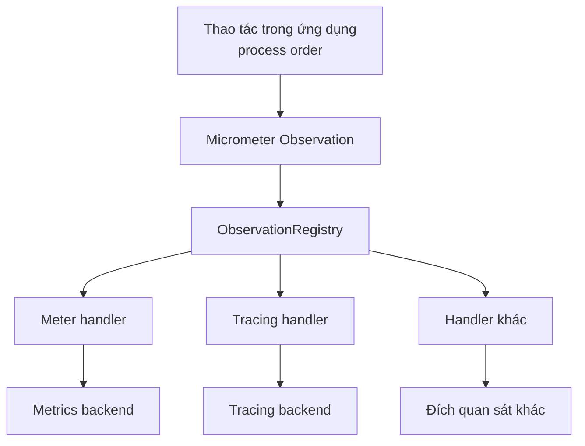

# Observation là gì và vì sao cần mô tả một thao tác quan sát được

Trong một ứng dụng Java, một thao tác nghiệp vụ hoặc kỹ thuật có thể cần nhiều tín hiệu quan sát cùng lúc. Khi xử lý một request checkout, đội vận hành có thể muốn biết số lần checkout, thời gian xử lý, tỷ lệ lỗi và trace nào liên quan đến lần thực thi đó. Nếu mỗi tín hiệu được instrument theo một cách riêng, tên gọi và ngữ cảnh dễ bị lệch nhau, còn mã nghiệp vụ phải biết quá nhiều chi tiết về backend.

**Micrometer Observation** cung cấp một abstraction để mô tả vòng đời của một thao tác có thể quan sát. Ứng dụng mô tả thao tác một lần; các handler được gắn vào `ObservationRegistry` có thể chuyển thông tin đó thành metrics, tracing hoặc tín hiệu khác.

Observation không phải là một backend lưu trữ và cũng không tự động bảo đảm mọi thao tác đều tạo metric hoặc span. Kết quả phụ thuộc registry, handler, convention và các thư viện tích hợp đang được cấu hình.

## 1. Từ một thao tác đến nhiều tín hiệu quan sát

Hãy xét thao tác xử lý đơn hàng. Một lần thực hiện có thể trả lời nhiều câu hỏi:

- Có bao nhiêu đơn hàng được xử lý?
- Thời gian xử lý trung bình và p95 là bao nhiêu?
- Lần xử lý nào thất bại?
- Lỗi xảy ra ở bước nào?
- Request này gọi những service hoặc database nào?
- Trace nào chứa thao tác xử lý đơn hàng đó?

Metrics và tracing nhìn cùng một hoạt động từ hai góc độ:

| Tín hiệu | Mục đích | Phạm vi dữ liệu |
|---|---|---|
| Metrics | Theo dõi xu hướng, tỷ lệ, phân bố và trạng thái tổng hợp | Nhiều lần thực hiện được tổng hợp theo tên và tag |
| Tracing | Điều tra đường đi và thời gian của một lần thực hiện | Một trace gồm các span liên quan |
| Logging | Ghi chi tiết sự kiện và thông tin chẩn đoán | Các bản ghi theo thời điểm |
| Observation | Mô tả thao tác và vòng đời để các handler tạo tín hiệu phù hợp | Một abstraction chung trước khi chuyển thành tín hiệu |

Nếu một đoạn code tự tạo Timer ở một nơi, tạo span ở nơi khác và ghi log ở nơi thứ ba, các tín hiệu có thể dùng tên, tag hoặc ngữ cảnh khác nhau. Observation giúp đặt ranh giới của thao tác ở một nơi, sau đó để các handler phản ứng với cùng vòng đời.



Observation giúp thống nhất instrumentation. Nó không thay thế việc thiết kế metric name, tag, span attribute hay chính sách lưu trữ của từng backend.

## 2. Observation là một đơn vị công việc có vòng đời

Một Observation mô tả một lần thực hiện của một thao tác. Nó thường có các giai đoạn:

1. Tạo observation với tên và registry.
2. Bổ sung ngữ cảnh, low-cardinality key-value hoặc high-cardinality key-value.
3. Bắt đầu observation.
4. Mở scope nếu các thao tác lồng nhau cần truy cập observation hiện tại.
5. Ghi nhận lỗi nếu thao tác thất bại.
6. Dừng observation để handler hoàn tất việc ghi nhận.

Ví dụ một lần xử lý đơn hàng có thể được mô tả bằng tên `business.order.process`. Mỗi lần gọi tạo một Observation riêng, nhưng nhiều lần thực hiện có thể được tổng hợp thành cùng một metric ở backend.

Observation thường được dùng quanh một ranh giới có ý nghĩa: xử lý HTTP request, gọi HTTP client, truy vấn database, gửi message hoặc thực hiện một bước nghiệp vụ. Không nên tạo Observation cho từng phép gán biến hoặc từng dòng code nhỏ vì điều đó tạo nhiều tín hiệu mà không giúp ích cho điều tra.

## 3. Các thành phần cốt lõi

| Thành phần | Vai trò |
|---|---|
| `Observation` | Đại diện cho một lần thực hiện của thao tác có thể quan sát |
| `ObservationRegistry` | Điểm đăng ký và điều phối các handler, convention, filter và predicate |
| `Observation.Context` | Giữ dữ liệu ngữ cảnh của một Observation |
| `ObservationConvention` | Chuẩn hóa tên, contextual name và các key-value theo loại thao tác |
| `ObservationHandler` | Nhận các callback trong vòng đời để tạo metrics, span hoặc tín hiệu khác |
| `Observation.Scope` | Đặt Observation hiện tại vào ngữ cảnh thực thi để các thao tác lồng nhau có thể tìm thấy |
| `ObservationPredicate` | Quyết định có tạo Observation cho một context hay không |
| `ObservationFilter` | Bổ sung hoặc biến đổi context trước khi handler xử lý theo quy trình của registry |

Các thành phần này tách trách nhiệm rõ ràng. Mã nghiệp vụ mô tả thao tác; context giữ thông tin; convention thống nhất cách đặt tên và phân loại; handler chuyển vòng đời thành tín hiệu.

## 4. ObservationRegistry là điểm kết nối

`ObservationRegistry` chứa cấu hình cần thiết để Observation tìm được các handler và convention tương ứng. Trong một ứng dụng Spring Boot, registry thường được framework cấu hình và cung cấp dưới dạng bean.

Trong ứng dụng độc lập, có thể tạo registry:

```java
import io.micrometer.observation.ObservationRegistry;

ObservationRegistry observationRegistry =
    ObservationRegistry.create();
```

Registry vừa tạo chưa đồng nghĩa với việc đã có metrics exporter hoặc tracing exporter. Nếu không có handler phù hợp, Observation vẫn có thể được sử dụng như abstraction của ứng dụng nhưng sẽ không tự gửi dữ liệu đến backend.

Trong Spring Boot, nên inject `ObservationRegistry` vào component thay vì tạo registry mới trong từng service. Registry do framework quản lý có thể đã được gắn các handler và cấu hình phù hợp với các dependency hiện có.

## 5. Tạo Observation cho một thao tác

Cách ngắn gọn là dùng `Observation.createNotStarted(...)` rồi gọi `observe(...)`. Phương thức này quản lý vòng đời cho khối công việc:

```java
import io.micrometer.observation.Observation;
import io.micrometer.observation.ObservationRegistry;

import org.springframework.stereotype.Service;

@Service
public class OrderProcessor {

    private final ObservationRegistry observationRegistry;
    private final OrderService orderService;

    public OrderProcessor(
            ObservationRegistry observationRegistry,
            OrderService orderService
    ) {
        this.observationRegistry = observationRegistry;
        this.orderService = orderService;
    }

    public OrderResult process(Order order) {
        return Observation.createNotStarted(
                "business.order.process",
                observationRegistry
            )
            .contextualName("process-order")
            .lowCardinalityKeyValue("channel", order.channel())
            .observe(() -> orderService.process(order));
    }
}
```

Trong ví dụ:

- `business.order.process` là tên ổn định của observation.
- `process-order` là contextual name dễ đọc trong công cụ tracing.
- `channel` là chiều phân loại có tập giá trị giới hạn.
- `observe(...)` bắt đầu, mở scope trong lúc chạy, ghi nhận lỗi và dừng observation theo lifecycle của API.

Nếu phương thức xử lý trả về giá trị, `observe(Supplier<T>)` trả lại kết quả đó. Nếu chỉ thực hiện thao tác không trả về giá trị, có thể dùng overload nhận `Runnable`.

## 6. Tự quản lý lifecycle khi cần kiểm soát chi tiết

Trong một số trường hợp, cần giữ Observation qua nhiều bước hoặc tự quản lý thời điểm bắt đầu và kết thúc. Khi đó, có thể điều khiển lifecycle tường minh:

```java
import io.micrometer.observation.Observation;
import io.micrometer.observation.ObservationRegistry;

public class ManualOrderInstrumentation {

    private final ObservationRegistry registry;

    public ManualOrderInstrumentation(ObservationRegistry registry) {
        this.registry = registry;
    }

    public void process() {
        Observation observation =
            Observation.createNotStarted("business.order.process", registry);

        observation.lowCardinalityKeyValue("channel", "web");
        observation.start();

        try (Observation.Scope scope = observation.openScope()) {
            // Thực hiện công việc nghiệp vụ.
            processOrder();
        } catch (RuntimeException | Error error) {
            observation.error(error);
            throw error;
        } finally {
            observation.stop();
        }
    }

    private void processOrder() {
        // Business operation
    }
}
```

Cần phân biệt ba thao tác:

- `start()` bắt đầu vòng đời Observation.
- `openScope()` đặt Observation thành observation hiện tại trong scope thực thi.
- `stop()` kết thúc vòng đời và thông báo cho handler.

Đóng scope không thay thế `stop()`. Ngược lại, dừng Observation cũng không phải lý do để bỏ qua việc đóng scope. Dùng try-with-resources để scope luôn được đóng, kể cả khi có exception.

Với luồng đồng bộ đơn giản, `observe(...)` thường ít lỗi hơn vì API quản lý lifecycle giúp ứng dụng.

## 7. Context lưu thông tin của thao tác

`Observation.Context` giữ thông tin gắn với một lần thực hiện. Handler và convention có thể đọc context để biết thao tác thuộc loại nào, kết quả ra sao hoặc cần thêm thuộc tính gì.

Ví dụ, context của một HTTP server observation có thể chứa thông tin request/response; context của một thao tác nghiệp vụ tùy chỉnh có thể chứa loại đơn hàng hoặc kết quả xử lý.

Context không nên trở thành nơi chứa toàn bộ đối tượng nghiệp vụ lớn. Chỉ giữ thông tin cần cho convention và handler. Tránh lưu payload nhạy cảm, token, thông tin thanh toán hoặc dữ liệu cá nhân nếu tín hiệu có thể được export ra ngoài.

Khi cần context có kiểu dữ liệu riêng, có thể tạo lớp con của `Observation.Context` để biểu diễn dữ liệu đặc thù cho thao tác. Convention và handler tương ứng có thể kiểm tra kiểu context để xử lý đúng.

## 8. Low-cardinality và high-cardinality key-value

Observation phân biệt hai nhóm key-value vì metrics và tracing có yêu cầu khác nhau.

| Loại | Ý nghĩa | Ví dụ |
|---|---|---|
| Low-cardinality | Giá trị có tập hữu hạn, ổn định, thích hợp làm tag metrics | `channel=web`, `operation=refund`, `result=success` |
| High-cardinality | Giá trị có thể thay đổi gần như mỗi lần thực hiện, thường chỉ phù hợp cho trace | `order.id=ORD-...`, `customer.id=...`, `request.id=...` |

Ví dụ:

```java
Observation.createNotStarted("business.order.process", registry)
    .lowCardinalityKeyValue("channel", "web")
    .lowCardinalityKeyValue("result", "success")
    .highCardinalityKeyValue("order.id", order.id())
    .observe(() -> processOrder(order));
```

Low-cardinality key-value có thể được dùng làm dimensions cho metrics. High-cardinality key-value được thiết kế cho tín hiệu như tracing, nơi việc điều tra một lần thực hiện cụ thể có ý nghĩa. Handler metrics mặc định không đưa high-cardinality values thành tag metrics.

Không chuyển ID đơn hàng hoặc khách hàng thành low-cardinality tag. Nếu có hàng triệu ID, số time series có thể tăng theo số ID và gây chi phí lớn cho backend. Hãy dùng trace hoặc log để tìm một đơn hàng cụ thể.

## 9. Tên observation và contextual name

Tên observation cần ổn định, có ngữ nghĩa và có thể được dùng làm định danh cho instrumentation. Contextual name thường ngắn, dễ đọc và phù hợp để hiển thị trong trace.

Ví dụ:

| Thuộc tính | Giá trị | Mục đích |
|---|---|---|
| Observation name | `business.order.process` | Tên ổn định cho instrumentation và metrics |
| Contextual name | `process-order` | Tên hiển thị trong trace |
| Low-cardinality key | `channel=web` | Phân nhóm metrics và span |
| High-cardinality key | `order.id=ORD-123` | Điều tra lần thực hiện cụ thể trong trace nếu handler hỗ trợ |

Không đưa ID hoặc dữ liệu thay đổi theo mỗi lần chạy vào observation name. Tên động tạo ra nhiều meter name khác nhau và làm cardinality tăng mạnh.

Đặt tên theo quy ước chung, chẳng hạn nhóm theo domain và thao tác: `business.order.process`, `business.payment.authorize`, `inventory.reservation.create`.

## 10. ObservationConvention chuẩn hóa cách mô tả thao tác

Một loại thao tác có thể được instrument ở nhiều nơi hoặc nhiều module. Nếu mỗi nơi tự chọn tên và tag, dữ liệu sẽ không đồng nhất. `ObservationConvention` giúp chuẩn hóa:

- Observation name.
- Contextual name.
- Low-cardinality key-values.
- High-cardinality key-values.

Convention có thể áp dụng cho một loại context cụ thể. Ví dụ mọi lần xử lý đơn hàng đều dùng cùng tên metric và các tag `channel`, `order.type`, `result`. Mã nghiệp vụ chỉ cung cấp context cần thiết, còn convention quyết định cách chuyển context thành các thuộc tính quan sát.

Khi viết convention, cần giữ tên và tag ổn định giữa các phiên bản ứng dụng. Thay đổi key hoặc semantics có thể làm dashboard và alert cũ không còn khớp. Chỉ thêm low-cardinality key nếu giá trị có tập hữu hạn và có ý nghĩa phân tích.

## 11. ObservationHandler chuyển lifecycle thành tín hiệu

`ObservationHandler` nhận callback khi Observation bắt đầu, gặp lỗi, mở/đóng scope hoặc dừng. Các handler khác nhau có thể phản ứng với cùng một Observation.

Ví dụ:

- Meter handler ghi Timer hoặc meter liên quan.
- Tracing handler tạo và hoàn tất span.
- Handler tùy chỉnh có thể gửi thông tin đến một hệ thống khác hoặc phục vụ kiểm thử.

Handler kiểm tra context mà nó hỗ trợ. Một handler chỉ xử lý những context phù hợp với loại instrumentation của nó.

Observation API không tự quyết định backend. Nếu muốn có metrics, cần có meter handler và registry/exporter tương ứng. Nếu muốn có distributed trace, cần tracing handler và cấu hình tracing bridge/exporter phù hợp.

## 12. Quan hệ giữa Observation và metrics

Một Observation có thể được chuyển thành Timer hoặc các meter khác thông qua handler metrics. Khi nhiều lần thực hiện cùng một loại observation, backend có thể tổng hợp count, total duration, max và histogram nếu cấu hình phù hợp.

Ví dụ, tên observation `business.order.process` có thể tạo ra meter đo thời gian xử lý. Các low-cardinality key như `channel` hoặc `result` có thể được dùng để phân nhóm.

Cần nhớ:

- Observation mô tả một lần thực hiện.
- Timer tổng hợp thời lượng của nhiều lần thực hiện.
- Counter đếm sự kiện.
- Histogram mô tả phân bố giá trị.
- Gauge đọc trạng thái hiện tại.

Observation không thay đổi semantics của meter. Nếu cần số lượng đơn đã thanh toán, phải xác định rõ event và ghi Counter đúng thời điểm nghiệp vụ. Không mặc định rằng mọi Observation đều tương đương một business event thành công.

## 13. Quan hệ giữa Observation và tracing

Tracing quan sát một lần thực hiện qua một hoặc nhiều service. Một Observation có thể trở thành span khi tracing handler được cấu hình.

Contextual name giúp span dễ đọc. Low-cardinality values cung cấp thuộc tính có thể dùng để lọc hoặc nhóm trace; high-cardinality values có thể giúp tìm một lần thực hiện cụ thể.

Khi một Observation được mở scope, các instrumentation lồng nhau có thể nhận biết observation hiện tại và tạo quan hệ cha-con phù hợp. Ví dụ observation xử lý đơn hàng có thể bao quanh observation gọi payment provider và observation truy vấn database.

Observation không tự động biến mọi lời gọi Java thành span. Các thư viện cần có instrumentation tương ứng hoặc ứng dụng cần instrument thủ công ở ranh giới quan trọng.

## 14. Observation lồng nhau và scope hiện tại

Một thao tác lớn có thể gọi nhiều thao tác nhỏ. Ví dụ:

```text
business.order.process
  ├── business.inventory.reserve
  ├── business.payment.authorize
  └── business.notification.send
```

Khi observation cha mở scope trong lúc xử lý, các observation con được tạo trong cùng ngữ cảnh có thể gắn quan hệ với observation hiện tại, tùy handler và cơ chế context propagation.

Scope thường gắn với thread thực thi hiện tại. Khi đóng scope, observation trước đó được khôi phục. Luôn đóng scope đúng cách, đặc biệt khi có exception hoặc khi dùng nhiều scope lồng nhau.

Không giữ scope mở lâu hơn thao tác thực tế. Scope là cơ chế gắn ngữ cảnh cho đoạn thực thi, không phải cơ chế quản lý vòng đời tác vụ nền.

## 15. Spring Boot tích hợp Observation

Spring Boot 3 sử dụng Micrometer Observation trong nhiều instrumentation được hỗ trợ. Khi Actuator và các thư viện tích hợp phù hợp có mặt, framework có thể tự cấu hình ObservationRegistry cùng các handler cho metrics hoặc tracing.

Ví dụ, một ứng dụng có thể inject registry:

```java
import io.micrometer.observation.ObservationRegistry;
import org.springframework.stereotype.Component;

@Component
public class PaymentInstrumentation {

    private final ObservationRegistry observationRegistry;

    public PaymentInstrumentation(
            ObservationRegistry observationRegistry
    ) {
        this.observationRegistry = observationRegistry;
    }

    public PaymentResult authorize(PaymentRequest request) {
        return Observation.createNotStarted(
                "business.payment.authorize",
                observationRegistry
            )
            .lowCardinalityKeyValue("provider", request.provider())
            .observe(() -> callPaymentProvider(request));
    }

    private PaymentResult callPaymentProvider(PaymentRequest request) {
        // Invoke payment provider
        return PaymentResult.approved();
    }
}
```

Tên và tag của built-in observations do framework hoặc thư viện tích hợp quyết định. Custom observation nên bổ sung ngữ cảnh nghiệp vụ còn thiếu, không tạo một observation khác trùng với instrumentation tự động đang bao quanh cùng thao tác nếu không có mục đích rõ ràng.

Khả năng tự động instrument HTTP server, HTTP client, datasource hoặc messaging phụ thuộc phiên bản Spring Boot, loại client/server và dependency đang dùng. Hãy kiểm tra runtime và tài liệu đúng phiên bản trước khi giả định một thành phần đã được instrument.

## 16. ObservationRegistry và handler trong ứng dụng độc lập

Trong ứng dụng không dùng Spring Boot, cần tự tạo registry và gắn các handler mong muốn. Ví dụ dưới đây minh họa việc đăng ký một handler nhận lifecycle:

```java
import io.micrometer.observation.Observation;
import io.micrometer.observation.ObservationHandler;
import io.micrometer.observation.ObservationRegistry;

import java.util.concurrent.atomic.AtomicInteger;

public class ObservationLifecycleExample {

    public static void main(String[] args) {
        AtomicInteger started = new AtomicInteger();
        AtomicInteger stopped = new AtomicInteger();

        ObservationRegistry registry = ObservationRegistry.create();

        registry.observationConfig().observationHandler(
            new ObservationHandler<Observation.Context>() {
                @Override
                public boolean supportsContext(Observation.Context context) {
                    return true;
                }

                @Override
                public void onStart(Observation.Context context) {
                    started.incrementAndGet();
                }

                @Override
                public void onStop(Observation.Context context) {
                    stopped.incrementAndGet();
                }
            }
        );

        Observation.createNotStarted("demo.operation", registry)
            .observe(() -> doWork());

        System.out.println("started=" + started.get());
        System.out.println("stopped=" + stopped.get());
    }

    private static void doWork() {
        // Work to observe
    }
}
```

Handler ví dụ chỉ đếm callback để minh họa lifecycle. Nó không export metrics hay trace. Để tạo tín hiệu thực, cần đăng ký handler chuyên dụng và cấu hình registry/exporter tương ứng.

Trong ứng dụng độc lập, cần quản lý vòng đời của registry và các exporter do ứng dụng tạo. Trong Spring Boot, ưu tiên dùng registry và handler do framework quản lý.

## 17. Predicate và Filter giúp kiểm soát Observation

Không phải thao tác nào cũng cần tạo Observation. `ObservationPredicate` có thể quyết định có cho phép tạo observation dựa trên tên hoặc context. Điều này hữu ích khi muốn bỏ qua một số instrumentation quá chi tiết hoặc không cần thiết.

`ObservationFilter` có thể biến đổi context trước khi handler xử lý. Ví dụ có thể chuẩn hóa một key-value hoặc bổ sung thông tin chung đã được xác định.

Dù dùng predicate hay filter, hãy bảo đảm quy tắc nhất quán. Nếu một service loại bỏ observation còn service khác vẫn tạo, trace hoặc metrics có thể thiếu một phần thông tin. Không dùng filter để đưa giá trị có cardinality cao thành tag metrics.

## 18. Context propagation qua thread và reactive boundary

Scope của Observation gắn với ngữ cảnh thực thi hiện tại. Trong code đồng bộ, scope được mở và đóng trên cùng luồng thường dễ kiểm soát. Nhưng với executor, callback bất đồng bộ hoặc reactive pipeline, công việc có thể tiếp tục trên thread khác.

Không nên giả định scope tự động đi theo mọi lần chuyển thread. Nếu context không được truyền đúng, observation con có thể mất quan hệ với observation cha hoặc log/tracing không còn thông tin liên quan.

Các hệ thống dùng Micrometer Context Propagation và tích hợp Reactor có thể hỗ trợ truyền context qua các boundary phù hợp. Cấu hình và cách bật propagation phụ thuộc stack ứng dụng và phiên bản. Hãy dùng cơ chế context propagation được framework hỗ trợ, hoặc truyền context một cách tường minh khi tự quản lý executor.

Nguyên tắc thực hành:

- Mở scope quanh đoạn code thực sự chạy trong context đó.
- Đóng scope ở đúng thread và đúng thời điểm.
- Không giữ scope qua thời gian chờ hoặc qua callback nếu không có cơ chế propagation.
- Kiểm thử trace cha-con khi thao tác chuyển thread.
- Phân biệt context của Observation với payload nghiệp vụ cần truyền giữa service.

## 19. Kiểm thử Observation

Có thể kiểm thử custom handler bằng một registry độc lập và xác nhận lifecycle callback. Ví dụ ở phần trước kiểm tra số lần `onStart` và `onStop` được gọi. Nên bổ sung các trường hợp:

- Thao tác thành công: Observation được bắt đầu và dừng.
- Thao tác ném exception: handler nhận được lỗi và Observation vẫn được dừng.
- Scope được đóng sau khi thao tác kết thúc.
- Low-cardinality key-value có giá trị đúng.
- High-cardinality key-value không xuất hiện như metric tag.
- Predicate loại bỏ đúng observation được chỉ định.
- Observation con được gắn đúng context khi có propagation.

Với Spring Boot integration test, có thể inject `ObservationRegistry` và kiểm tra handler hoặc exporter thực tế. Với metrics, xác nhận meter name, tag và count/duration ở registry. Với tracing, kiểm tra span name, attributes, error status và quan hệ parent-child.

Test không nên chỉ khẳng định rằng một Observation object được tạo. Cần kiểm tra tín hiệu mong muốn có thực sự được handler phát ra.

## 20. Những lỗi thường gặp

| Lỗi | Hậu quả | Cách xử lý |
|---|---|---|
| Nghĩ Observation tự export metrics | Không có handler hoặc exporter thì backend không nhận dữ liệu | Kiểm tra registry, handler và exporter |
| Tạo Observation quá nhỏ hoặc quá nhiều | Nhiều span/metric không có giá trị điều tra | Chọn ranh giới thao tác có ý nghĩa |
| Dùng ID làm low-cardinality key | Cardinality metrics tăng mạnh | Đưa ID vào high-cardinality trace attribute hoặc log |
| Dùng tên observation động | Tạo nhiều metric name khác nhau | Dùng tên ổn định và tag có giới hạn |
| Quên ghi lỗi trong lifecycle thủ công | Handler không nhận đúng trạng thái lỗi | Gọi `error(...)` rồi vẫn `stop()` |
| Chỉ đóng scope mà quên stop | Observation không hoàn tất | Quản lý scope và lifecycle riêng biệt |
| Giả định scope tự qua thread | Mất current observation hoặc parent-child | Dùng Context Propagation phù hợp |
| Tạo Observation trùng với auto-instrumentation | Double count hoặc trace lồng không cần thiết | Xác định instrumentation đã có trước khi thêm |
| Đưa dữ liệu nhạy cảm vào context | Có thể bị export qua trace/log | Chỉ giữ thuộc tính an toàn và cần thiết |
| Tự tạo registry trong từng bean | Handler và cấu hình bị phân mảnh | Inject ObservationRegistry do Spring quản lý |

## 21. Checklist thiết kế Observation

- [ ] Thao tác được quan sát có ranh giới bắt đầu và kết thúc rõ ràng.
- [ ] Tên observation ổn định và có ý nghĩa.
- [ ] Context chỉ chứa dữ liệu cần cho handler và convention.
- [ ] Low-cardinality values có tập giá trị hữu hạn.
- [ ] High-cardinality values không trở thành metric tags.
- [ ] Handler cần thiết đã được gắn vào ObservationRegistry.
- [ ] Metrics và tracing backend đã được cấu hình riêng.
- [ ] Scope được mở và đóng đúng vòng đời.
- [ ] Exception được ghi nhận và Observation luôn được dừng.
- [ ] Context propagation được xử lý khi chuyển thread hoặc reactive boundary.
- [ ] Không trùng lặp với built-in instrumentation.
- [ ] Test xác nhận cả lifecycle lẫn tín hiệu được export.

Observation cung cấp một cách thống nhất để mô tả thao tác trong ứng dụng. ObservationRegistry điều phối convention và handler; context giữ thông tin; scope làm observation hiện tại có thể được nhận biết trong đoạn thực thi; handler chuyển lifecycle thành metrics, tracing hoặc tín hiệu khác. Khi chọn đúng ranh giới, tên ổn định và key-value có cardinality phù hợp, một lần instrument có thể hỗ trợ nhiều góc nhìn quan sát mà không buộc mã nghiệp vụ phụ thuộc trực tiếp vào từng backend.

## Tài liệu tham khảo

- [Micrometer Observation Concepts](https://docs.micrometer.io/micrometer/reference/observation.html) — abstraction Observation, registry, context, convention và handler.
- [Micrometer Observation API](https://docs.micrometer.io/micrometer/reference/observation/instrumenting.html) — cách instrument thao tác và quản lý lifecycle.
- [Micrometer Context Propagation](https://docs.micrometer.io/context-propagation/reference/) — truyền context qua thread và reactive boundary.
- [Spring Boot Actuator Observability](https://docs.spring.io/spring-boot/reference/actuator/observability.html) — tích hợp Observation, metrics và tracing trong Spring Boot.

