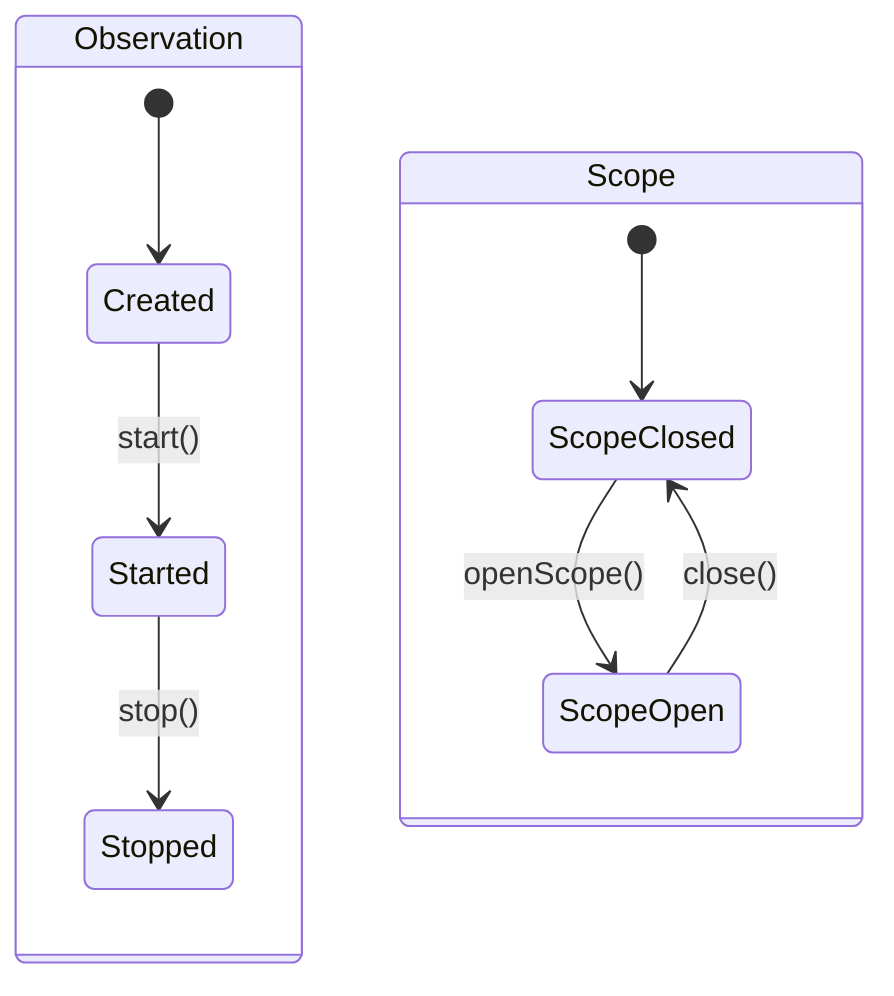

# Vòng đời tạo, start, stop và trạng thái không thực hiện quan sát

Micrometer Observation mô tả một đơn vị công việc cần được quan sát, chẳng hạn xử lý một đơn hàng, gọi một dịch vụ từ xa hoặc đọc dữ liệu từ cache. Một observation có vòng đời từ lúc được tạo, bắt đầu, chạy trong scope hiện tại, phát sinh event hoặc error, cho đến khi dừng. Các handler đã đăng ký trên `ObservationRegistry` phản ứng với những mốc này để tạo metrics, trace hoặc hành vi tùy biến.

API cho phép hai cách sử dụng. Với công việc đơn giản, `observe(...)` tự quản lý start, scope, error và stop. Khi cần điều khiển từng mốc, có thể tạo observation chưa bắt đầu, gọi `start()`, mở `Scope`, báo lỗi bằng `error(...)` và luôn gọi `stop()` trong `finally`.

Trong module `OBSERVABILITY_INSTRUMENTATION_MICROMETER`, hiểu đúng vòng đời giúp timer được ghi đủ một lần, trace context được gắn đúng trong lúc xử lý, exception được phản ánh vào observation và tài nguyên scope không bị rò rỉ. Observation bị tắt bằng predicate vẫn cho phép code nghiệp vụ chạy bình thường; chỉ phần quan sát được chuyển thành no-op.

## 1. Các trạng thái và mốc trong vòng đời

Vòng đời observation và vòng đời scope liên quan với nhau nhưng là hai khái niệm riêng:



| Mốc | API | Ý nghĩa |
| --- | --- | --- |
| Tạo | `Observation.createNotStarted(...)` | Tạo observation và context nhưng chưa phát lifecycle start |
| Bắt đầu | `start()` | Bắt đầu đo và gọi handler `onStart` |
| Mở scope | `openScope()` | Đặt observation thành observation hiện tại trong execution context, thường dựa trên ThreadLocal |
| Phát event | `event(...)` | Thông báo một sự kiện xảy ra trong lúc quan sát |
| Báo lỗi | `error(Throwable)` | Gắn exception vào context và thông báo handler `onError` |
| Đóng scope | `Scope.close()` | Khôi phục observation trước đó và dọn context gắn với scope |
| Dừng | `stop()` | Hoàn tất observation; filter chạy trước handler `onStop` |

`Scope.close()` không dừng observation. `Observation.stop()` cũng không thay thế việc đóng scope. Khi tự điều khiển lifecycle, cần đóng scope trước rồi mới dừng observation.

## 2. Tạo observation chưa bắt đầu

Factory thường dùng là `Observation.createNotStarted(name, registry)`. Tên observation nên ổn định và mô tả thao tác, không chứa ID của request hoặc đối tượng nghiệp vụ:

```java
import io.micrometer.observation.Observation;
import io.micrometer.observation.ObservationRegistry;
import org.springframework.stereotype.Service;

@Service
public class OrderService {
    private final ObservationRegistry observationRegistry;

    public OrderService(ObservationRegistry observationRegistry) {
        this.observationRegistry = observationRegistry;
    }

    public void process(OrderCommand command) {
        Observation.createNotStarted("orders.process", observationRegistry)
                .lowCardinalityKeyValue("channel", command.channel())
                .observe(() -> processOrder(command));
    }

    private void processOrder(OrderCommand command) {
        // Xử lý nghiệp vụ.
    }
}
```

`createNotStarted` cho phép bổ sung metadata trước khi gọi `start()`. Đây là điều cần thiết với handler tạo meter theo trạng thái đang chạy, vì những tag cần có trên meter đó phải sẵn sàng trước thời điểm handler nhận `onStart`.

Nếu cần context tùy biến, có thể truyền một supplier:

```java
Observation.createNotStarted(
        "payment.authorize",
        () -> new PaymentObservationContext(paymentMethod),
        observationRegistry);
```

Supplier tạo `Observation.Context` phù hợp với loại thao tác. Context là nơi lưu dữ liệu cần chia sẻ giữa instrumentation và các handler, ví dụ request/response, exception, trạng thái hoặc dữ liệu nội bộ phục vụ tạo span. Tránh dùng context như nơi lưu trữ trạng thái nghiệp vụ lâu dài.

## 3. Bắt đầu bằng start()

`start()` chuyển observation từ trạng thái được tạo sang trạng thái đang chạy. Các handler hỗ trợ context tương ứng sẽ nhận callback `onStart`. Với metrics handler, đây là thời điểm có thể bắt đầu theo dõi công việc đang diễn ra; với tracing handler, span có thể được tạo và đưa vào scope theo cấu hình.

```java
Observation observation = Observation.createNotStarted(
        "inventory.reserve", observationRegistry)
        .lowCardinalityKeyValue("warehouse", "primary");

observation.start();
try {
    reserveStock();
} catch (RuntimeException ex) {
    observation.error(ex);
    throw ex;
} finally {
    observation.stop();
}
```

Ví dụ tối giản trên bắt đầu và dừng observation, nhưng không mở scope. Nếu các API được gọi bên trong cần đọc observation hiện tại hoặc cần trace context trong ThreadLocal, hãy mở scope như phần tiếp theo.

Có thể dùng `Observation.start(name, registry)` như factory ngắn gọn khi không cần thêm metadata trước khi bắt đầu. Nếu cần gắn key-value hoặc context trước `onStart`, hãy tạo bằng `createNotStarted`, thêm metadata rồi gọi `start()`.

## 4. Scope và observation hiện tại

`openScope()` đặt observation thành observation hiện tại trong execution context. Các thành phần lồng bên trong có thể đọc observation hiện tại hoặc trace context mà handler đã gắn. Khi rời khỏi vùng xử lý, phải gọi `close()` để khôi phục observation trước đó.

```java
Observation observation = Observation.createNotStarted(
        "orders.process", observationRegistry)
        .lowCardinalityKeyValue("channel", "web");

observation.start();
try (Observation.Scope scope = observation.openScope()) {
    validateOrder();
    reserveInventory();
    saveOrder();
} finally {
    observation.stop();
}
```

`Observation.Scope` triển khai `AutoCloseable`, vì vậy try-with-resources bảo đảm scope được đóng cả khi code ném exception. Khi scope lồng nhau, đóng scope bên trong sẽ khôi phục observation bên ngoài thay vì xóa toàn bộ context.

Scope thường gắn với thread hiện tại. Không giữ scope mở trong lúc chuyển sang thread khác hoặc qua một reactive boundary mà không có cơ chế context propagation. Với `Executor`, Reactor hoặc async API, hãy dùng cơ chế truyền context phù hợp của ứng dụng; không giả định ThreadLocal tự đi theo tác vụ sang thread mới.

## 5. Đóng scope không đồng nghĩa dừng observation

Scope chỉ xác định observation nào đang là current trong một đoạn thực thi. Observation có thể mở và đóng nhiều scope trong cùng một vòng đời, ví dụ tạm rời khỏi context rồi mở lại ở một đoạn xử lý tiếp theo trên cùng luồng.

| Thao tác | Tác động đến observation | Tác động đến scope |
| --- | --- | --- |
| `start()` | Bắt đầu vòng đời | Không tự mở scope trong mọi trường hợp |
| `openScope()` | Không kết thúc hoặc tạo lại observation | Đặt observation thành current |
| `Scope.close()` | Observation vẫn có thể đang chạy | Khôi phục context trước đó |
| `stop()` | Hoàn tất vòng đời và gọi `onStop` | Không thay thế việc đóng scope đang mở |

Lỗi thường gặp là gọi `stop()` khi scope vẫn còn mở. Handler có thể kết thúc span/timer nhưng context ThreadLocal vẫn còn được gắn cho đến khi scope được đóng, khiến thao tác tiếp theo trên thread nhận nhầm context. Hãy luôn cấu trúc code để scope đóng trước khi `stop()` chạy.

## 6. Báo lỗi bằng error() và giữ nguyên exception

`error(Throwable)` ghi nhận exception vào `Observation.Context` và thông báo handler `onError`. Method này không tự ném lại exception và cũng không thay thế xử lý lỗi của ứng dụng. Nếu cần giữ nguyên hành vi ném lỗi, hãy gọi `error(ex)` rồi ném lại exception.

```java
Observation observation = Observation.createNotStarted(
        "payment.authorize", observationRegistry);

observation.start();
try (Observation.Scope scope = observation.openScope()) {
    paymentGateway.authorize(command);
} catch (RuntimeException ex) {
    observation.error(ex);
    throw ex;
} finally {
    observation.stop();
}
```

`error(...)` là tín hiệu cho hệ thống quan sát. Ứng dụng vẫn quyết định exception được truyền lên, được chuyển thành kết quả nghiệp vụ hay được xử lý tại chỗ. Nếu code bắt exception bên trong và không báo `observation.error(ex)`, handler không thể tự biết đã có lỗi chỉ từ việc method hoàn tất bình thường.

Không ghi toàn bộ exception message hoặc dữ liệu nhạy cảm thành tag. Metrics nên dùng nhóm lỗi có cardinality thấp; trace hoặc log có thể giữ chi tiết kỹ thuật theo chính sách bảo mật và lưu trữ của hệ thống.

## 7. Phát event trong lúc quan sát

`event(...)` ghi nhận một sự kiện có ý nghĩa trong vòng đời observation, chẳng hạn cache hit, fallback được kích hoạt hoặc một bước workflow hoàn tất. Handler có thể chuyển event thành counter, span event hoặc log tùy cấu hình.

```java
Observation observation = Observation.createNotStarted("catalog.lookup", observationRegistry);
observation.observe(() -> {
    if (cache.contains(key)) {
        observation.event(Observation.Event.of("cache.hit"));
        useCatalog(cache.get(key));
    } else {
        observation.event(Observation.Event.of("cache.miss"));
        useCatalog(repository.find(key));
    }
});
```

Event mô tả một điều xảy ra trong observation; nó không tạo một observation mới và cũng không dừng observation hiện tại. Tên event nên ổn định, số lượng loại event hữu hạn. Không đưa ID hoặc nội dung động vào tên event vì tên thường trở thành một phần của metric name hoặc span event.

Với `DefaultMeterObservationHandler`, event có thể tạo counter theo dạng `<observation-name>.<event-name>`. Timer cho toàn observation được ghi khi `stop()` chạy. Vì vậy, event counter và timer trả lời hai câu hỏi khác nhau: một sự kiện cụ thể xảy ra bao nhiêu lần và toàn bộ thao tác mất bao lâu.

## 8. Dùng observe() để tự động quản lý lifecycle

Với hầu hết đoạn code đồng bộ, `observe(...)` là lựa chọn ngắn gọn và ít lỗi hơn. Micrometer tự thực hiện các bước:

1. Bắt đầu observation.
2. Mở scope và đặt observation thành current.
3. Chạy lambda.
4. Nếu lambda ném lỗi, gắn lỗi vào observation rồi truyền lỗi ra ngoài.
5. Đóng scope.
6. Dừng observation.

Ví dụ:

```java
Observation.createNotStarted("orders.process", observationRegistry)
        .lowCardinalityKeyValue("channel", "web")
        .observe(() -> processOrder(command));
```

Khi dùng `observe`, không gọi `start()` hoặc `stop()` thủ công trên cùng observation. Nếu vừa dùng wrapper tự động vừa tự dừng, lifecycle có thể bị kết thúc hai lần hoặc handler nhận callback không đúng thứ tự.

Với thao tác có checked exception, có thể dùng `observeChecked(...)`:

```java
Observation.createNotStarted("remote.call", observationRegistry)
        .observeChecked(() -> {
            String response = httpClient.execute(request);
            processResponse(response);
        });
```

`observeChecked` cho phép lambda ném checked exception theo kiểu generic của API, đồng thời vẫn quản lý start, scope, error và stop. Dùng nó khi muốn giữ nguyên chữ ký exception của thư viện I/O thay vì bọc exception chỉ để phù hợp với `Runnable` hoặc `Supplier`.

## 9. Dùng lifecycle thủ công khi cần điều khiển từng mốc

Một số thao tác cần gắn dữ liệu sau khi đã bắt đầu, phát nhiều event hoặc quản lý scope riêng. Khi đó có thể điều khiển lifecycle trực tiếp:

```java
public void importFile() throws Exception {
    Observation observation = Observation.createNotStarted(
            "file.import", observationRegistry)
            .lowCardinalityKeyValue("format", "csv");

    observation.start();
    try (Observation.Scope scope = observation.openScope()) {
        observation.event(Observation.Event.of("file.read.started"));
        readFile();

        observation.event(Observation.Event.of("file.parse.started"));
        parseFile();

        observation.event(Observation.Event.of("file.persist.started"));
        persistRecords();
    } catch (Exception ex) {
        observation.error(ex);
        throw ex;
    } finally {
        observation.stop();
    }
}
```

Mẫu này đảm bảo scope đóng trước khi `stop()` được gọi. Nếu có nhiều loại exception, vẫn nên báo một exception cuối cùng hoặc exception đại diện có ý nghĩa cho observation. Tránh gọi `error()` nhiều lần cho cùng một lỗi được truyền qua nhiều tầng nếu điều đó làm handler ghi nhận trùng.

## 10. Observation no-op là gì?

Một observation no-op là đối tượng giữ cùng API nhưng không phát các lifecycle callback để tạo metrics, trace hoặc side effect từ handler. Nó có thể được sử dụng khi:

- Ứng dụng dùng `ObservationRegistry.NOOP`.
- Một `ObservationPredicate` từ chối observation theo tên hoặc context.
- Registry được cấu hình để bỏ qua một nhóm quan sát không cần thiết.

Ví dụ predicate từ chối observation debug:

```java
ObservationRegistry registry = ObservationRegistry.create();
registry.observationConfig().observationPredicate(
        (name, context) -> name == null || !name.startsWith("internal.debug."));

Observation observation = Observation.start("internal.debug.cache", registry);
if (observation.isNoop()) {
    // Observation đã bị loại khỏi lifecycle handler.
}
```

Khi predicate trả về `false`, Micrometer cung cấp no-op observation. Các thao tác như `start`, `openScope`, `event`, `error` và `stop` không tạo hoạt động quan sát thực tế. Tuy nhiên, nếu dùng `observe(() -> businessWork())`, lambda nghiệp vụ vẫn được chạy; predicate chỉ tắt phần quan sát, không được dùng như cơ chế bỏ qua công việc.

No-op giúp giảm overhead khi observation bị tắt theo chính sách. Code instrumentation vẫn có thể giữ một đường thực thi thống nhất mà không cần rải `if (enabled)` quanh từng lời gọi nghiệp vụ.

## 11. Predicate được áp dụng khi nào và có thể lọc theo context ra sao?

`ObservationPredicate` nhận tên và context, trả về `true` nếu observation được phép hoạt động. Trả về `false` sẽ tạo observation no-op. Predicate phù hợp để bỏ qua nhóm observation có chi phí hoặc giá trị vận hành thấp.

Ví dụ lọc theo tên:

```java
registry.observationConfig().observationPredicate(
        (name, context) -> !"cache.internal.refresh".equals(name));
```

Nếu cần lọc theo context tùy biến, tạo context trước rồi kiểm tra thuộc tính của nó:

```java
registry.observationConfig().observationPredicate((name, context) -> {
    if (name == null) {
        return true;
    }
    if (context instanceof BatchObservationContext batch) {
        return !batch.isDryRun();
    }
    return true;
});
```

Nếu có nhiều predicate, observation chỉ được phép khi tất cả điều kiện đều chấp nhận. Hãy tránh predicate phụ thuộc dữ liệu động có cardinality cao hoặc trạng thái thay đổi giữa vòng đời. Predicate là chính sách bật/tắt observation, không phải bộ lọc kết quả nghiệp vụ.

## 12. Handler nhận những callback nào?

`ObservationHandler` có thể phản ứng với các mốc lifecycle. Handler chỉ được gọi khi `supportsContext(...)` chấp nhận loại context của observation:

| Callback | Mốc gọi | Ví dụ công việc |
| --- | --- | --- |
| `onStart` | Khi `start()` | Bắt đầu timer hoặc span |
| `onScopeOpened` | Khi mở scope | Gắn trace/span vào ThreadLocal hoặc MDC |
| `onScopeClosed` | Khi đóng scope | Khôi phục hoặc xóa context thread-local |
| `onEvent` | Khi gọi `event(...)` | Thêm span event hoặc tăng counter |
| `onError` | Khi gọi `error(...)` | Gắn exception vào span hoặc log |
| `onStop` | Khi gọi `stop()` | Kết thúc timer hoặc span |

Ví dụ handler ghi lại lifecycle để kiểm tra:

```java
import io.micrometer.observation.Observation;
import io.micrometer.observation.ObservationHandler;

public class LifecycleLoggingHandler
        implements ObservationHandler<Observation.Context> {

    @Override
    public void onStart(Observation.Context context) {
        System.out.println("START " + context.getClass().getSimpleName());
    }

    @Override
    public void onError(Observation.Context context) {
        System.out.println("ERROR " + context.getError());
    }

    @Override
    public void onEvent(Observation.Event event, Observation.Context context) {
        System.out.println("EVENT " + event.getName());
    }

    @Override
    public void onStop(Observation.Context context) {
        System.out.println("STOP " + context.getClass().getSimpleName());
    }

    @Override
    public boolean supportsContext(Observation.Context context) {
        return true;
    }
}
```

Đăng ký handler vào registry:

```java
registry.observationConfig().observationHandler(
        new LifecycleLoggingHandler());
```

Trong ứng dụng production, dùng logger thay vì `System.out`, và tránh ghi nội dung nhạy cảm. Handler nên chạy nhanh, không thực hiện I/O đồng bộ kéo dài trên luồng nghiệp vụ.

## 13. ObservationFilter chạy trước khi stop

Khi gọi `stop()`, các `ObservationFilter` được áp dụng lên context trước khi handler nhận `onStop`. Điều này cho phép bổ sung hoặc chuẩn hóa metadata ở thời điểm đã có đủ kết quả xử lý.

Ví dụ bổ sung outcome nếu code nghiệp vụ đã lưu kết quả vào context:

```java
registry.observationConfig().observationFilter(context -> {
    if (context.getError() != null) {
        context.addLowCardinalityKeyValue(
                io.micrometer.common.KeyValue.of("outcome", "error"));
    }
    return context;
});
```

Filter nên giữ số lượng key-value ổn định và không ghi đè metadata đã có mà không có chủ đích. Nếu handler tạo LongTaskTimer ngay ở `onStart`, các tag được thêm sau thời điểm start không thể xuất hiện trên meter đang chạy đó; chúng có thể vẫn xuất hiện trên timer thông thường được ghi ở `onStop`.

## 14. Observation chuyển thành metrics như thế nào?

Khi `DefaultMeterObservationHandler` được đăng ký, lifecycle observation được chuyển thành meter:

| Sự kiện | Meter được tạo hoặc cập nhật |
| --- | --- |
| `start()` và `stop()` | Timer có tên observation, ghi duration khi stop |
| `event(Event.of("cache.hit"))` | Counter có tên `<observation-name>.cache.hit` |
| `start()` với LongTaskTimer được bật | LongTaskTimer theo dõi số observation đang hoạt động |

Timer thường được gắn low-cardinality key-value và tag `error` mô tả exception class hoặc `none`. High-cardinality key-value không trở thành meter tag. LongTaskTimer không được bật mặc định trong handler chuẩn; nếu bật, nó chỉ nhận các low-cardinality key-value đã có tại thời điểm start.

Ví dụ kiểm tra timer và event counter:

```java
import io.micrometer.core.instrument.MeterRegistry;
import io.micrometer.core.instrument.observation.DefaultMeterObservationHandler;
import io.micrometer.observation.Observation;
import io.micrometer.observation.ObservationRegistry;

MeterRegistry meterRegistry = createMeterRegistry();
ObservationRegistry observationRegistry = ObservationRegistry.create();
observationRegistry.observationConfig().observationHandler(
        DefaultMeterObservationHandler.builder(meterRegistry).build());

Observation observation = Observation.createNotStarted("catalog.lookup", observationRegistry)
        .lowCardinalityKeyValue("region", "ap-southeast");
observation.observe(() -> {
    observation.event(Observation.Event.of("cache.hit"));
    loadCatalog();
});
```

Trong ví dụ, timer `catalog.lookup` được ghi khi observation stop; event tạo counter `catalog.lookup.cache.hit`. Nếu không đăng ký metrics handler hoặc không có MeterRegistry phù hợp, Observation vẫn có thể chạy nhưng không tự tạo các meter này.

## 15. Kiểm thử lifecycle bằng SimpleMeterRegistry

Có thể kiểm tra lifecycle mà không cần kết nối backend. Đăng ký `DefaultMeterObservationHandler` với `SimpleMeterRegistry`, chạy một observation và xác nhận timer cùng event counter:

```java
import static org.assertj.core.api.Assertions.assertThat;

import java.util.concurrent.atomic.AtomicInteger;

import io.micrometer.core.instrument.simple.SimpleMeterRegistry;
import io.micrometer.core.instrument.observation.DefaultMeterObservationHandler;
import io.micrometer.observation.Observation;
import io.micrometer.observation.ObservationRegistry;
import org.junit.jupiter.api.Test;

class ObservationLifecycleTest {
    @Test
    void recordsTimerAndEventCounterWhenObservationStops() {
        try (SimpleMeterRegistry meters = new SimpleMeterRegistry()) {
            ObservationRegistry observations = ObservationRegistry.create();
            observations.observationConfig().observationHandler(
                    DefaultMeterObservationHandler.builder(meters).build());

            Observation.createNotStarted("orders.process", observations)
                    .lowCardinalityKeyValue("channel", "web")
                    .observe(() -> Observation.currentObservation().event(
                            Observation.Event.of("validated")));

            assertThat(meters.get("orders.process")
                    .tag("channel", "web")
                    .tag("error", "none")
                    .timer()
                    .count()).isEqualTo(1L);

            assertThat(meters.get("orders.process.validated")
                    .tag("channel", "web")
                    .counter()
                    .count()).isEqualTo(1.0);
        }
    }
}
```

Kiểm thử trạng thái no-op bằng predicate:

```java
@Test
void rejectedObservationDoesNotCreateMetersButStillRunsBusinessCode() {
    try (SimpleMeterRegistry meters = new SimpleMeterRegistry()) {
        ObservationRegistry observations = ObservationRegistry.create();
        observations.observationConfig()
                .observationHandler(DefaultMeterObservationHandler.builder(meters).build())
                .observationPredicate((name, context) ->
                        name == null || !name.startsWith("internal."));

        AtomicInteger executions = new AtomicInteger();
        Observation.createNotStarted("internal.debug", observations)
                .observe(() -> executions.incrementAndGet());

        assertThat(executions.get()).isEqualTo(1);
        assertThat(meters.find("internal.debug").timer()).isNull();
    }
}
```

Test thứ hai xác nhận predicate chỉ loại phần quan sát; lambda nghiệp vụ vẫn chạy. Có thể bổ sung test cho exception để xác nhận `error` tag xuất hiện và exception vẫn được truyền ra ngoài.

## 16. Những lỗi thường gặp

| Lỗi | Hệ quả | Cách xử lý |
| --- | --- | --- |
| Tạo observation nhưng không gọi `start()` hoặc `observe()` | Handler không nhận lifecycle start/stop | Dùng `observe()` hoặc quản lý đầy đủ lifecycle thủ công |
| Gọi `stop()` nhưng quên đóng scope | Context có thể còn gắn trên thread | Dùng try-with-resources và đóng scope trước stop |
| Nghĩ `Scope.close()` dừng observation | Timer/span không được hoàn tất | Gọi `stop()` riêng trong `finally` |
| Không gọi `error(ex)` khi tự quản lý lifecycle | Handler không biết observation có lỗi | Báo lỗi trước khi ném lại exception |
| Gọi `error(ex)` rồi nuốt exception ngoài ý muốn | Hành vi nghiệp vụ thay đổi | Quyết định rõ exception được truyền lên hay xử lý tại chỗ |
| Dùng `observe()` rồi tự gọi `stop()` | Lifecycle bị kết thúc trùng | Chọn wrapper tự động hoặc lifecycle thủ công |
| Predicate trả false nhưng mong timer vẫn xuất hiện | Observation trở thành no-op | Kiểm tra điều kiện predicate và chính sách bật/tắt |
| Dùng no-op như điều kiện bỏ qua business work | Logic nghiệp vụ không được thực hiện nếu tự viết sai wrapper | Chỉ bỏ phần quan sát; vẫn chạy lambda công việc |
| Giữ scope qua thread switch | Current observation hoặc trace context bị mất/sai | Dùng context propagation cho async/reactive |
| Thêm tag sau start nhưng mong LongTaskTimer có tag đó | Meter active đã được tạo trước khi tag xuất hiện | Thêm low-cardinality key-value trước start |
| Dùng high-cardinality key-value làm metric tag | Cardinality tăng không kiểm soát | Dùng low-cardinality cho metrics; high-cardinality dành cho trace |

## 17. Quy trình áp dụng

Khi instrument một thao tác bằng Observation, hãy thực hiện theo trình tự:

1. Xác định ranh giới bắt đầu và kết thúc của thao tác.
2. Chọn tên observation ổn định và context phù hợp.
3. Thêm low-cardinality key-value trước `start()` nếu chúng cần có trên meter active.
4. Dùng `observe()` hoặc `observeChecked()` cho đoạn xử lý đơn giản.
5. Chỉ dùng lifecycle thủ công khi cần điều khiển start, scope, event hoặc stop riêng.
6. Đóng `Scope` bằng try-with-resources và gọi `stop()` trong `finally`.
7. Gọi `error(ex)` khi tự quản lý lifecycle và muốn handler ghi nhận exception.
8. Phát event có tên ổn định cho những mốc nghiệp vụ/kỹ thuật cần quan sát.
9. Kiểm tra predicate để hiểu khi nào observation trở thành no-op.
10. Xác nhận handler được đăng ký để chuyển observation thành timer, counter hoặc span.
11. Kiểm thử success, error, event, scope cleanup và no-op behavior.

Observation có vòng đời riêng và scope có vòng đời riêng. `start()` bắt đầu việc đo, `openScope()` đặt context hiện tại, `close()` khôi phục context, còn `stop()` hoàn tất phép quan sát. `observe()` đóng gói chuỗi thao tác này cho trường hợp thông thường. Khi predicate từ chối observation, code nghiệp vụ vẫn chạy nhưng handler không tạo metrics hoặc trace cho observation đó. Nắm vững các ranh giới này giúp instrumentation an toàn với exception, nested calls và xử lý bất đồng bộ.

## Tài liệu tham khảo

- [Micrometer 1.18: Observation Introduction](https://docs.micrometer.io/micrometer/reference/observation/introduction.html)
- [Micrometer 1.18: Observation Components](https://docs.micrometer.io/micrometer/reference/observation/components.html)
- [Micrometer 1.18: Instrumenting code with Observation](https://docs.micrometer.io/micrometer/reference/observation/instrumenting.html)
