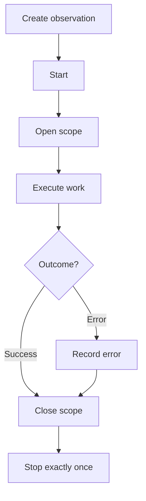

# Quản lý thủ công start và stop trên mọi đường thực thi

Micrometer Observation có một vòng đời rõ ràng: tạo observation, bắt đầu, mở scope khi cần đưa observation thành context hiện tại, ghi nhận lỗi nếu có và kết thúc bằng `stop()`. Khi quản lý vòng đời thủ công, nguyên tắc quan trọng nhất là mọi observation đã `start()` phải được `stop()` đúng một lần trên mọi đường thực thi: trả về bình thường, trả về sớm, ném exception hoặc kết thúc do một nhánh điều kiện.

Mẫu an toàn là gọi `start()` trước khối xử lý, đặt công việc trong `try`, ghi lỗi ở `catch` rồi gọi `stop()` trong `finally`. Nếu cần context hiện tại cho code bên dưới, mở `Observation.Scope` trong try-with-resources và đóng scope trước khi stop observation. `Scope.close()` và `Observation.stop()` là hai thao tác khác nhau: đóng scope khôi phục context của thread; stop kết thúc vòng đời observation và thông báo cho các handler.

## 1. Vòng đời của Observation

Observation mô tả một hoạt động có thể được quan sát, chẳng hạn xử lý đơn hàng, gọi dịch vụ thanh toán hoặc xử lý message. Registry kết nối observation với các handler tạo metrics, tracing hoặc các dạng telemetry khác.

Vòng đời thủ công thường gồm các bước:

1. Tạo observation bằng `Observation.createNotStarted(...)`.
2. Thêm low-cardinality hoặc high-cardinality key-value nếu cần.
3. Gọi `start()` để bắt đầu đo.
4. Mở scope nếu code bên dưới cần truy cập observation hiện tại qua `ObservationRegistry`.
5. Thực hiện công việc.
6. Nếu có lỗi, gọi `error(Throwable)` trước khi kết thúc.
7. Đóng scope để khôi phục context trước đó.
8. Gọi `stop()` đúng một lần để kết thúc observation.



Không phải observation nào cũng cần mở scope. Scope cần thiết khi muốn observation trở thành context hiện tại trong thread, ví dụ để instrumentation lồng nhau tìm được parent observation. Dù có mở scope hay không, observation đã start vẫn phải stop.

## 2. Phân biệt start, openScope, close và stop

Các thao tác này giải quyết hai khía cạnh khác nhau:

| Thao tác | Tác dụng | Có kết thúc observation không? |
| --- | --- | --- |
| `start()` | Bắt đầu vòng đời và thông báo sự kiện start cho handler | Không |
| `openScope()` | Đặt observation thành context hiện tại trên thread đang gọi | Không |
| `scope.close()` | Khôi phục observation/context trước đó của thread | Không |
| `error(Throwable)` | Ghi nhận lỗi xảy ra trong observation | Không |
| `stop()` | Kết thúc vòng đời, thông báo stop cho handler và hoàn tất việc ghi nhận | Có |

Một observation có thể được start nhưng chưa nằm trong scope. Ngược lại, đóng scope không tự stop observation. Nếu chỉ gọi `scope.close()` mà quên `stop()`, handler có thể không nhận được sự kiện kết thúc và dữ liệu đo lường không được hoàn tất đúng cách.

Tương tự, gọi `stop()` khi scope vẫn đang mở sẽ kết thúc observation trong khi context của nó còn được cài trên thread. Hãy đóng scope trước rồi mới stop.

## 3. Mẫu cơ bản: start và stop bằng try/finally

Nếu công việc không cần observation làm context hiện tại, có thể dùng mẫu đơn giản:

```java
import io.micrometer.observation.Observation;
import io.micrometer.observation.ObservationRegistry;

public final class OrderProcessor {
    private final ObservationRegistry observationRegistry;

    public OrderProcessor(ObservationRegistry observationRegistry) {
        this.observationRegistry = observationRegistry;
    }

    public OrderResult process(Order order) {
        Observation observation = Observation.createNotStarted(
                "shop.order.process", observationRegistry);
        observation.lowCardinalityKeyValue("operation", "process");
        observation.start();

        try {
            return doProcess(order);
        } catch (RuntimeException | Error error) {
            observation.error(error);
            throw error;
        } finally {
            observation.stop();
        }
    }

    private OrderResult doProcess(Order order) {
        // Thực hiện xử lý đơn hàng.
        return new OrderResult();
    }
}
```

`finally` chạy cả khi `doProcess()` trả về bình thường, ném exception hoặc có lệnh `return` trong một nhánh bên trong `try`. Vì vậy, observation không bị bỏ quên khi luồng điều khiển rời phương thức sớm.

`catch` gọi `observation.error(error)` rồi ném lại exception để giữ nguyên hành vi lỗi của nghiệp vụ. `finally` vẫn chạy sau khi exception được ném lại và gọi `stop()`.

Nếu phương thức có thể ném checked exception, khai báo `throws` phù hợp và bắt cả `Exception` cùng `Error`:

```java
public OrderResult process(Order order) throws Exception {
    Observation observation = Observation.createNotStarted(
            "shop.order.process", observationRegistry).start();
    try {
        return doProcessChecked(order);
    } catch (Exception | Error error) {
        observation.error(error);
        throw error;
    } finally {
        observation.stop();
    }
}
```

Không bắt exception chỉ để bỏ qua nó. Nếu nghiệp vụ chủ động xử lý lỗi và trả về fallback, vẫn nên ghi nhận lỗi vào observation trước khi trả fallback nếu lỗi đó là một phần của kết quả cần quan sát.

## 4. Mở scope và đóng scope an toàn

Khi code bên dưới cần lấy observation hiện tại, hãy dùng `openScope()` trong try-with-resources. Scope được đóng tự động khi rời khối, kể cả khi có return hoặc exception.

```java
import io.micrometer.observation.Observation;
import io.micrometer.observation.ObservationRegistry;

public OrderResult process(Order order) {
    Observation observation = Observation.createNotStarted(
            "shop.order.process", observationRegistry).start();

    try {
        try (Observation.Scope scope = observation.openScope()) {
            return doProcess(order);
        }
    } catch (RuntimeException | Error error) {
        observation.error(error);
        throw error;
    } finally {
        observation.stop();
    }
}
```

Thứ tự thực thi khi thành công:

1. Observation bắt đầu.
2. Scope được mở và observation trở thành current observation của thread.
3. `doProcess()` chạy.
4. Try-with-resources đóng scope và khôi phục context trước đó.
5. `finally` gọi `stop()`.

Khi có exception, Java vẫn đóng scope trước khi đi vào `catch`; sau đó code ghi lỗi, ném lại exception và cuối cùng gọi `stop()`. Cách lồng khối này bảo đảm scope không bị bỏ mở và observation không bị bỏ quên.

## 5. Xử lý return sớm và nhiều nhánh điều kiện

Một lỗi phổ biến là gọi stop ở cuối phương thức thay vì trong `finally`:

```java
// Không an toàn: return sớm hoặc exception có thể bỏ qua stop().
Observation observation = Observation.createNotStarted(
        "shop.order.validate", observationRegistry).start();

if (order == null) {
    return ValidationResult.invalid();
}

ValidationResult result = validate(order);
observation.stop();
return result;
```

Nhánh `order == null` trả về trước khi gọi stop. Nếu `validate()` ném exception, stop cũng không chạy.

Hãy gom mọi nhánh vào `try/finally`:

```java
Observation observation = Observation.createNotStarted(
        "shop.order.validate", observationRegistry).start();
try {
    if (order == null) {
        return ValidationResult.invalid();
    }

    return validate(order);
} catch (RuntimeException | Error error) {
    observation.error(error);
    throw error;
} finally {
    observation.stop();
}
```

Không cần gọi `stop()` ở từng nhánh return. Một điểm kết thúc duy nhất trong `finally` dễ kiểm tra và giảm nguy cơ gọi stop thiếu hoặc gọi hai lần.

## 6. Ghi nhận exception đúng thời điểm

`Observation.error(error)` ghi nhận lỗi trong context của observation. Nó không thay thế `stop()`. Hãy gọi error trước khi stop để handler có thể xử lý lỗi khi kết thúc observation.

```java
Observation observation = Observation.createNotStarted(
        "shop.payment.authorize", observationRegistry).start();

try (Observation.Scope scope = observation.openScope()) {
    return paymentGateway.authorize(command);
} catch (PaymentException error) {
    observation.error(error);
    throw error;
} finally {
    observation.stop();
}
```

Trong ví dụ, `PaymentException` được ghi nhận và vẫn được ném cho caller. Nếu có nhiều loại exception, có thể ghi nhận `RuntimeException | Error` hoặc `Exception | Error` tùy chữ ký phương thức.

Nếu code bắt lỗi và chuyển thành kết quả nghiệp vụ bình thường, hãy quyết định rõ observation nên phản ánh lỗi kỹ thuật đã xảy ra hay chỉ phản ánh kết quả cuối cùng. Ví dụ retry một lần rồi thành công có thể được biểu diễn bằng observation tổng thể thành công và observation con cho lần gọi thất bại, tùy mục tiêu phân tích.

## 7. Dùng helper để giảm lặp lại vòng đời

Nếu nhiều phương thức cần cùng mẫu lifecycle, có thể dùng API tiện ích `Observation.observe(...)` khi phù hợp với kiểu công việc. API này tự quản lý một phần vòng đời, giúp tránh lỗi quên stop.

Khi yêu cầu bắt buộc là quản lý thủ công, hãy đóng gói mẫu `start/catch/finally` vào một helper dùng chung thay vì sao chép nhiều phiên bản có thứ tự khác nhau. Ví dụ helper đồng bộ:

```java
import io.micrometer.observation.Observation;
import io.micrometer.observation.ObservationRegistry;
import java.util.function.Supplier;

public final class ObservationRunner {
    private final ObservationRegistry registry;

    public ObservationRunner(ObservationRegistry registry) {
        this.registry = registry;
    }

    public <T> T observe(String name, Supplier<T> action) {
        Observation observation = Observation.createNotStarted(name, registry).start();
        try (Observation.Scope scope = observation.openScope()) {
            return action.get();
        } catch (RuntimeException | Error error) {
            observation.error(error);
            throw error;
        } finally {
            observation.stop();
        }
    }
}
```

Helper này chỉ phù hợp với action không khai báo checked exception. Nếu cần hỗ trợ checked exception, hãy định nghĩa functional interface riêng có `throws Exception` và khai báo chữ ký helper tương ứng. Không bọc mọi checked exception thành runtime một cách âm thầm vì điều đó làm thay đổi contract của caller.

Không dùng helper để che giấu việc một observation được start ở thread này nhưng stop ở thread khác. Ranh giới đồng bộ và bất đồng bộ cần được thiết kế riêng.

## 8. Observation lồng nhau và thứ tự đóng scope

Một thao tác nghiệp vụ có thể tạo observation cha và nhiều observation con. Ví dụ xử lý đơn hàng gọi inventory và payment. Khi scope của observation cha đang mở, observation con có thể nhận context cha theo cơ chế propagation của registry/handler.

```java
Observation parent = Observation.createNotStarted(
        "shop.order.process", observationRegistry).start();
try (Observation.Scope parentScope = parent.openScope()) {
    Observation child = Observation.createNotStarted(
            "shop.inventory.check", observationRegistry).start();
    try (Observation.Scope childScope = child.openScope()) {
        inventoryClient.check(order);
    } catch (RuntimeException | Error error) {
        child.error(error);
        throw error;
    } finally {
        child.stop();
    }
} catch (RuntimeException | Error error) {
    parent.error(error);
    throw error;
} finally {
    parent.stop();
}
```

Observation con kết thúc trước observation cha. Scope con được đóng trước scope cha nhờ cấu trúc try-with-resources lồng nhau. Thứ tự này giúp context stack được khôi phục đúng.

Trong code thực tế, tránh lặp mẫu thủ công quá nhiều; helper hoặc API observation tiện ích có thể giúp giảm độ phức tạp. Dù dùng cách nào, mỗi observation đã start vẫn cần một lần stop tương ứng.

## 9. Quản lý lifecycle khi chuyển sang tác vụ bất đồng bộ

Scope của Observation gắn với execution context hiện tại, thường là thread-local context. Mở scope trên thread submit không tự động làm observation trở thành current observation trên worker thread. Khi tác vụ chạy bất đồng bộ, cần propagation context theo cơ chế executor/instrumentation đang dùng hoặc mở scope trên thread thực thi.

Nếu chỉ muốn đo thời gian thực thi task, có thể tạo observation bên trong task và stop trong chính task đó:

```java
executor.execute(() -> {
    Observation taskObservation = Observation.createNotStarted(
            "shop.order.background", observationRegistry).start();
    try (Observation.Scope scope = taskObservation.openScope()) {
        processOrder(order);
    } catch (RuntimeException | Error error) {
        taskObservation.error(error);
        throw error;
    } finally {
        taskObservation.stop();
    }
});
```

Trong cách này, observation bắt đầu khi worker thực sự chạy task, vì vậy nó đo thời gian xử lý trên worker. Thời gian chờ trong queue không nằm trong observation đó. Nếu cần đo queue wait hoặc toàn bộ thời gian từ submit đến completion, hãy thiết kế một lifecycle bao phủ cả khoảng đó và bảo đảm các nhánh task bị từ chối, bị hủy hoặc bị loại bỏ cũng kết thúc observation.

### 9.1. Không start trước submit rồi chỉ stop trong task

Nếu tạo và start observation trước `executor.execute(...)` nhưng chỉ gọi stop ở `finally` bên trong task, task bị từ chối có thể không bao giờ chạy; khi đó observation không được stop. Tương tự, một executor có policy âm thầm loại bỏ task có thể khiến callback kết thúc không được gọi.

Nếu cần đo cả queue wait và execution trong một observation bắt đầu ở thời điểm submit, cần có một cơ chế lifecycle duy nhất xử lý đủ các kết quả:

- Task được thực thi bình thường.
- Submit bị từ chối và ném exception.
- Task bị hủy trước khi bắt đầu.
- Task bị loại bỏ bởi rejection policy.
- Task kết thúc bằng exception.

Đảm bảo chỉ một nhánh có quyền gọi `stop()`; có thể dùng trạng thái kết thúc nguyên tử khi nhiều callback có thể cạnh tranh. Nếu chỉ cần execution observation, tạo observation bên trong task thường đơn giản và an toàn hơn.

## 10. Cancellation, timeout và callback completion

Đối với `Future`, `CompletableFuture` hoặc callback API, thời điểm hoàn tất có thể không nằm trong stack frame ban đầu. Không được đóng observation ngay sau khi đăng ký callback nếu mục tiêu là đo toàn bộ thao tác bất đồng bộ.

Ví dụ với `CompletableFuture`:

```java
CompletableFuture<Result> future = CompletableFuture.supplyAsync(() -> {
    Observation observation = Observation.createNotStarted(
            "shop.report.generate", observationRegistry).start();
    try (Observation.Scope scope = observation.openScope()) {
        return generateReport();
    } catch (RuntimeException | Error error) {
        observation.error(error);
        throw error;
    } finally {
        observation.stop();
    }
}, executor);
```

Observation bắt đầu bên trong supplier và dừng khi supplier kết thúc. Nếu future bị cancel trước khi supplier chạy, observation này chưa được tạo nên không có lifecycle bị bỏ dở. Nếu cần đo thời gian từ lúc tạo future đến lúc hoàn tất hoặc bị cancel, hãy tạo một observation riêng cho operation ngoài và gắn một completion handler duy nhất để ghi nhận success/error/cancel rồi stop.

Khi dùng callback, hãy xử lý cả success và failure. Với timeout, xác định timeout có kết thúc operation hay chỉ kết thúc việc chờ của caller; hai sự kiện này có thể khác nhau. Tránh gọi `stop()` đồng thời ở callback timeout và callback completion mà không có cơ chế đảm bảo chỉ stop một lần.

## 11. Các nguyên tắc bảo đảm stop đúng một lần

Một observation đã start cần một chủ sở hữu lifecycle rõ ràng. Chủ sở hữu đó chịu trách nhiệm kết thúc observation trong mọi trường hợp.

Các nguyên tắc thực hành:

- Gọi `start()` đúng một lần cho observation instance.
- Đặt phần công việc sau start bên trong `try` có `finally`.
- Ghi `error()` trước `stop()` khi có lỗi cần quan sát.
- Dùng try-with-resources để đóng scope.
- Đóng scope trước khi stop observation.
- Không gọi stop trong cả `catch` và `finally`.
- Không để callback hoặc nhánh cancel thứ hai stop lại observation đã kết thúc.
- Không chia sẻ một observation instance cho nhiều task độc lập.
- Nếu nhiều callback có thể hoàn tất cùng lúc, dùng state nguyên tử để chọn một nhánh kết thúc.
- Không start observation trước một thao tác có thể bị từ chối nếu không có đường xử lý rejection tương ứng.

Có thể hình dung invariant cần giữ:

\[
\text{number of stop calls} = 1
\]

cho mỗi observation instance đã start và đã được quản lý lifecycle đến điểm kết thúc. Observation không được stop trước khi công việc cần đo hoàn tất, và không được để mở sau khi mọi đường thực thi đã kết thúc.

## 12. Kiểm thử start, error và stop bằng ObservationHandler

Có thể đăng ký một handler thử nghiệm để đếm sự kiện lifecycle. Test này không cần backend metrics hoặc tracing thật:

```java
import static org.assertj.core.api.Assertions.assertThat;
import static org.assertj.core.api.Assertions.assertThatThrownBy;

import io.micrometer.observation.Observation;
import io.micrometer.observation.ObservationHandler;
import io.micrometer.observation.ObservationRegistry;
import java.util.concurrent.atomic.AtomicInteger;
import org.junit.jupiter.api.Test;

class ManualObservationLifecycleTest {
    @Test
    void stopsObservationWhenActionFails() {
        AtomicInteger starts = new AtomicInteger();
        AtomicInteger errors = new AtomicInteger();
        AtomicInteger stops = new AtomicInteger();

        ObservationRegistry registry = ObservationRegistry.create();
        registry.observationConfig().observationHandler(
                new ObservationHandler<Observation.Context>() {
                    @Override
                    public boolean supportsContext(Observation.Context context) {
                        return true;
                    }

                    @Override
                    public void onStart(Observation.Context context) {
                        starts.incrementAndGet();
                    }

                    @Override
                    public void onError(Observation.Context context) {
                        errors.incrementAndGet();
                    }

                    @Override
                    public void onStop(Observation.Context context) {
                        stops.incrementAndGet();
                    }
                });

        assertThatThrownBy(() -> runWithObservation(registry, true))
                .isInstanceOf(IllegalStateException.class);

        assertThat(starts).hasValue(1);
        assertThat(errors).hasValue(1);
        assertThat(stops).hasValue(1);
    }

    private void runWithObservation(
            ObservationRegistry registry, boolean fail) {
        Observation observation = Observation.createNotStarted(
                "test.operation", registry).start();
        try (Observation.Scope scope = observation.openScope()) {
            if (fail) {
                throw new IllegalStateException("test failure");
            }
        } catch (RuntimeException | Error error) {
            observation.error(error);
            throw error;
        } finally {
            observation.stop();
        }
    }
}
```

Handler thử nghiệm xác minh `onStart`, `onError` và `onStop` được gọi đúng số lần trong đường lỗi. Có thể bổ sung test cho đường thành công, return sớm và nested scope. Với đường thành công, `errors` phải bằng 0 và `stops` vẫn bằng 1.

Trong dự án thực tế, dùng phiên bản Micrometer tương thích với Spring Boot. Nếu test cần xác minh meter được tạo từ observation, hãy đăng ký observation-to-metrics handler phù hợp và dùng `SimpleMeterRegistry`; test handler ở trên chỉ xác minh lifecycle của Observation API.

## 13. Những lỗi thường gặp

- **Gọi `stop()` ở cuối phương thức:** return sớm hoặc exception bỏ qua lệnh stop.
- **Chỉ đóng scope:** scope được khôi phục nhưng observation chưa kết thúc.
- **Stop trước khi đóng scope:** observation kết thúc khi vẫn đang là current observation của thread.
- **Gọi stop trong catch và finally:** cùng một observation bị stop hai lần.
- **Không gọi `error()` trước stop:** handler có thể không nhận được thông tin lỗi.
- **Bắt lỗi rồi bỏ qua:** observation có thể trông như thành công dù thao tác đã thất bại.
- **Start trước submit và chỉ stop trong task:** rejection hoặc discard khiến task không chạy và observation bị bỏ mở.
- **Giữ scope qua thread boundary:** scope gắn với thread hiện tại, không tự truyền sang worker.
- **Stop ngay sau khi đăng ký callback:** đo thời gian đăng ký thay vì thời gian hoàn thành bất đồng bộ.
- **Nhiều callback cùng stop:** timeout, cancellation và completion có thể cạnh tranh kết thúc cùng observation.
- **Chia sẻ observation instance giữa nhiều tác vụ:** lifecycle và context của các thao tác độc lập bị trộn lẫn.

## 14. Checklist quản lý thủ công lifecycle

- [ ] Tạo observation bằng registry phù hợp.
- [ ] Thêm low-cardinality key-value trước khi start nếu cần.
- [ ] Gọi `start()` một lần.
- [ ] Đặt công việc sau start trong `try/finally`.
- [ ] Mở scope chỉ khi cần current observation.
- [ ] Dùng try-with-resources để đóng scope.
- [ ] Đảm bảo scope đóng trước `stop()`.
- [ ] Gọi `error(Throwable)` trước stop khi có lỗi.
- [ ] Không để return sớm bỏ qua finally.
- [ ] Không gọi stop ở nhiều nhánh cạnh tranh.
- [ ] Với async, xác định rõ observation đo thời gian submit, queue wait hay execution.
- [ ] Xử lý rejection, cancellation, timeout và discard nếu observation bắt đầu trước khi task chạy.
- [ ] Kiểm thử start/error/stop cho success và failure paths.

Quản lý thủ công Observation an toàn khi mỗi instance có một chủ sở hữu lifecycle và mọi đường thực thi đều đi đến cùng một điểm `stop()`. Dùng `finally` để kết thúc observation, try-with-resources để đóng scope và `error()` để ghi nhận lỗi trước khi stop. Với tác vụ bất đồng bộ, đặt ranh giới observation đúng với khoảng thời gian cần đo và xử lý đầy đủ rejection, cancellation cùng completion để không bỏ mở hoặc kết thúc trùng một observation.
