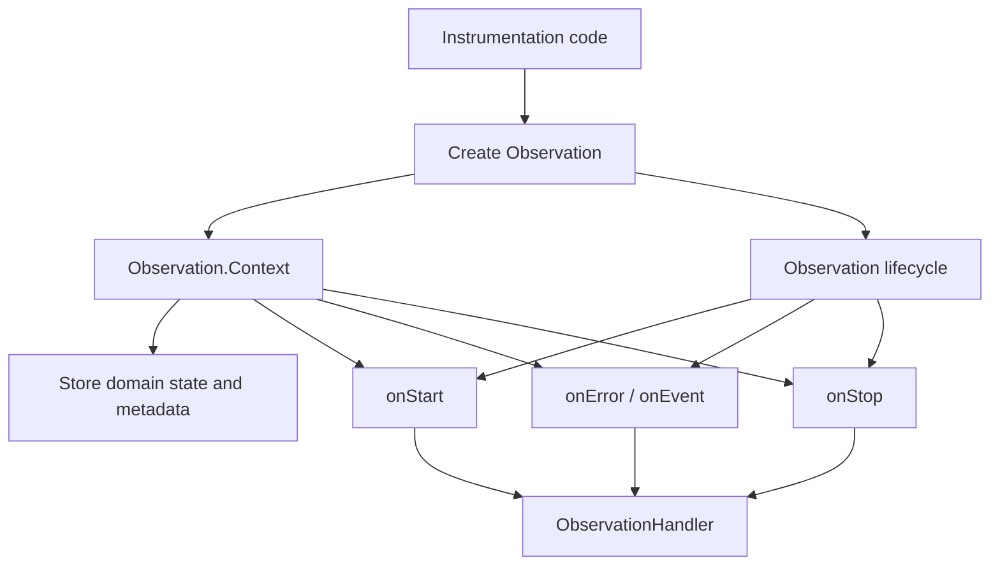

# `Observation.Context` để giữ trạng thái phục vụ quá trình quan sát

Trong module `OBSERVABILITY_INSTRUMENTATION_MICROMETER`, Micrometer Observation mô tả một thao tác đang được theo dõi và phát các sự kiện theo vòng đời của thao tác đó. `Observation.Context` là vùng trạng thái mutable gắn với một Observation. Code instrumentation có thể đặt dữ liệu vào context; các `ObservationHandler` đọc lại dữ liệu đó ở những thời điểm như start, error, event hoặc stop.

Context giúp truyền dữ liệu giữa phần code thực thi và các handler mà không cần tự tạo biến static hoặc dùng ThreadLocal cho từng giá trị. Nó cũng là nơi chứa metadata chuẩn của Observation như name, contextual name, error và các key value. Cần phân biệt dữ liệu nội bộ trong context với low-cardinality/high-cardinality key values: dữ liệu nội bộ không tự động trở thành metric tag, còn key values được handler sử dụng theo chính sách của từng loại tín hiệu.

## 1. Observation.Context nằm ở đâu?

Một Observation được tạo từ `ObservationRegistry` cùng với một `Observation.Context`. Khi Observation phát ra sự kiện vòng đời, registry gọi các handler hỗ trợ loại context đó và truyền cùng context vào handler. Vì vậy, dữ liệu được thêm trước hoặc trong quá trình quan sát có thể được đọc ở giai đoạn sau.



`Observation.Context` là một đối tượng mutable có cấu trúc giống map. Nó được gắn với một Observation cụ thể và được truyền cho handler trong suốt vòng đời. Một handler có thể đọc dữ liệu do instrumentation đặt vào context mà không cần biết chi tiết cách code nghiệp vụ lấy dữ liệu đó.

## 2. Context lưu những loại thông tin nào?

Có thể chia thông tin trong context thành hai nhóm lớn:

1. **Trạng thái phục vụ instrumentation/handler:** object nghiệp vụ, kết quả đã chuẩn hóa, cờ trạng thái, thông tin request đã rút gọn hoặc dữ liệu tạm cần dùng ở callback sau.
2. **Metadata của Observation:** tên Observation, contextual name, lỗi, Observation cha và các low/high-cardinality key values.

Ví dụ, khi đo thao tác xử lý đơn hàng, code có thể lưu một `OrderSummary` vào context để handler ghi audit hoặc bổ sung metadata khi Observation kết thúc. Handler không cần truy cập repository lần nữa.

Context không phải kho lưu trữ bền vững. Nó chỉ tồn tại trong vòng đời Observation và phục vụ phối hợp giữa instrumentation với các handler. Không dùng context để lưu dữ liệu cần tồn tại sau khi request kết thúc hoặc làm nguồn dữ liệu nghiệp vụ chính thức.

## 3. Dùng put/get để truyền trạng thái nội bộ

`Observation.Context` cung cấp các thao tác map-like như `put(key, value)`, `get(key)`, `getRequired(key)` và `remove(key)`. Key có thể là một object; cách dùng class làm key giúp hạn chế va chạm tên và giữ kiểu dữ liệu rõ ràng.

```java
import io.micrometer.observation.Observation;

Observation.Context context = new Observation.Context()
    .put(OrderSummary.class, new OrderSummary("order-42", 3));

OrderSummary summary = context.get(OrderSummary.class);
```

`get()` trả về `null` nếu key chưa tồn tại. `getRequired()` phù hợp khi thiếu dữ liệu là lỗi lập trình và cần fail rõ ràng. `remove()` loại bỏ giá trị khỏi context khi không còn cần thiết.

Nên ưu tiên key có kiểu rõ ràng, chẳng hạn `OrderSummary.class` hoặc một enum nội bộ. Nếu dùng string làm key, tập trung định nghĩa hằng số để tránh lỗi chính tả và xung đột giữa các thành phần.

## 4. Phân biệt dữ liệu put/get với key values

Đây là khác biệt quan trọng nhất khi sử dụng `Observation.Context`:

| Cách lưu | Mục đích | Tự động thành metric tag? | Handler đọc được? |
| --- | --- | --- | --- |
| `context.put(key, value)` | Trạng thái nội bộ hoặc object cần truyền giữa các callback | Không | Có, qua `get()` |
| `addLowCardinalityKeyValue(...)` | Metadata có tập giá trị hữu hạn | Thường được dùng làm metric tag | Có |
| `addHighCardinalityKeyValue(...)` | Metadata có thể có nhiều giá trị duy nhất, phù hợp tra cứu trace | Không được dùng làm metric tag mặc định | Có |

Ví dụ:

```java
Observation.Context context = new Observation.Context()
    .put(OrderSummary.class, summary);

Observation observation = Observation.createNotStarted(
    "orders.process", () -> context, observationRegistry);

observation.lowCardinalityKeyValue("order.type", "standard");
observation.highCardinalityKeyValue("order.id", summary.id());
```

`OrderSummary` là dữ liệu nội bộ cho handler. `order.type` là low-cardinality metadata có thể trở thành metric tag. `order.id` là high-cardinality metadata, có thể hữu ích trong trace nhưng không nên trở thành label metrics. Chỉ gọi `put()` không làm giá trị tự xuất hiện trên dashboard.

## 5. Tạo context riêng cho từng loại Observation

Khi một instrumentation cần nhiều trường có ý nghĩa nghiệp vụ, có thể tạo lớp con của `Observation.Context` thay vì dùng một map không có cấu trúc:

```java
import io.micrometer.observation.Observation;

public final class OrderObservationContext extends Observation.Context {
    private final String orderType;
    private final String channel;
    private String result;

    public OrderObservationContext(String orderType, String channel) {
        this.orderType = orderType;
        this.channel = channel;
    }

    public String getOrderType() {
        return orderType;
    }

    public String getChannel() {
        return channel;
    }

    public String getResult() {
        return result;
    }

    public void setResult(String result) {
        this.result = result;
    }
}
```

Các field typed giúp instrumentation và handler giao tiếp qua API rõ ràng. `orderType` và `channel` có thể là dữ liệu để convention tạo low-cardinality key values; `result` có thể được cập nhật khi thao tác hoàn tất rồi đọc trong `onStop`.

Context nên được tạo mới cho mỗi Observation. Không tái sử dụng cùng một instance cho nhiều request hoặc nhiều Observation đồng thời, vì các field mutable có thể bị ghi đè và khiến handler đọc nhầm dữ liệu của thao tác khác.

## 6. Gắn context khi tạo Observation

Có thể truyền context bằng supplier vào `Observation.createNotStarted(...)`. Supplier giúp context được tạo đúng lúc Observation được tạo và làm rõ object context thuộc về lần quan sát đó:

```java
import io.micrometer.observation.Observation;
import io.micrometer.observation.ObservationRegistry;
import org.springframework.stereotype.Service;

@Service
public class OrderProcessor {
    private final ObservationRegistry observationRegistry;
    private final OrderRepository repository;

    public OrderProcessor(
            ObservationRegistry observationRegistry,
            OrderRepository repository) {
        this.observationRegistry = observationRegistry;
        this.repository = repository;
    }

    public Order process(OrderCommand command) {
        OrderObservationContext context = new OrderObservationContext(
            command.type(), command.channel());

        Observation observation = Observation.createNotStarted(
            "orders.process", () -> context, observationRegistry);

        return observation
            .lowCardinalityKeyValue("order.type", context.getOrderType())
            .lowCardinalityKeyValue("channel", context.getChannel())
            .observe(() -> {
                Order order = repository.save(Order.from(command));
                context.setResult("success");
                return order;
            });
    }
}
```

Handler nhận đúng `OrderObservationContext` và có thể đọc `result` sau khi logic hoàn tất. Nếu repository ném exception trước khi gán `result`, handler sẽ thấy giá trị `null`; có thể bổ sung trạng thái lỗi trong nhánh catch hoặc để handler dựa vào `context.getError()`.

Không cần mở scope thủ công nếu chỉ muốn bao quanh một khối code: `observe(...)` quản lý start, scope, error và stop cho khối đó. Khi cần kiểm soát lifecycle chi tiết, có thể dùng `start()`, `openScope()` và `stop()`.

## 7. Handler đọc dữ liệu từ custom context

`ObservationHandler` nhận context trong các callback vòng đời. Handler có thể giới hạn loại context bằng `supportsContext(...)` để chỉ xử lý Observation phù hợp:

```java
import io.micrometer.observation.Observation;
import io.micrometer.observation.ObservationHandler;

public final class OrderAuditHandler
        implements ObservationHandler<OrderObservationContext> {

    @Override
    public void onStart(OrderObservationContext context) {
        // Có thể đọc orderType/channel khi Observation bắt đầu.
    }

    @Override
    public void onError(OrderObservationContext context) {
        // context.getError() chứa exception đã được báo cho Observation.
    }

    @Override
    public void onStop(OrderObservationContext context) {
        // Có thể đọc result và dữ liệu nội bộ được cập nhật trong lúc xử lý.
    }

    @Override
    public boolean supportsContext(Observation.Context context) {
        return context instanceof OrderObservationContext;
    }
}
```

Đăng ký handler với registry:

```java
observationRegistry.observationConfig()
    .observationHandler(new OrderAuditHandler());
```

`supportsContext` giúp một registry chứa nhiều handler mà mỗi handler chỉ xử lý loại context mình hiểu. Không nên để handler ép kiểu mọi context sang một custom class; điều đó có thể làm hỏng các Observation do thư viện khác tạo ra.

## 8. Context được dùng xuyên suốt vòng đời như thế nào?

Các handler nhận context ở những thời điểm khác nhau:

| Callback | Khi nào được gọi? | Dữ liệu thường cần |
| --- | --- | --- |
| `onStart` | Observation bắt đầu | Metadata đã có trước khi start, thông tin cần khởi tạo timer/span |
| `onScopeOpened` | Scope của Observation được mở | Thiết lập context hiện tại cho code chạy trong scope |
| `onEvent` | Observation phát một event | Trạng thái hoặc event name và dữ liệu bổ sung |
| `onError` | Observation được báo có lỗi | Exception và trạng thái nghiệp vụ trước khi lỗi |
| `onScopeClosed` | Scope được đóng | Dọn context gắn với scope/thread |
| `onStop` | Observation kết thúc | Kết quả cuối cùng, duration và dữ liệu đã được hoàn thiện |

Thứ tự thường gặp là start, mở/đóng scope quanh phần thực thi, có thể phát event hoặc error, rồi stop. `onError` không thay thế `onStop`; code vẫn phải kết thúc Observation. Với `observe(...)`, API quản lý phần này. Với lifecycle thủ công, phải gọi `error(exception)` và `stop()` đúng cách.

## 9. Context không đồng nghĩa với Observation Scope hoặc ThreadLocal

`Observation.Context` là vùng dữ liệu gắn với Observation. `Observation.Scope` là cơ chế đặt Observation hiện tại vào context thực thi trong một khoảng thời gian, thường để các instrumentation con tìm được Observation cha hiện tại.

```java
Observation observation = Observation.start(
    "orders.process", () -> context, observationRegistry);

try (Observation.Scope scope = observation.openScope()) {
    orderService.process(command);
}
catch (RuntimeException exception) {
    observation.error(exception);
    throw exception;
}
finally {
    observation.stop();
}
```

Scope thường dựa vào cơ chế context hiện tại theo thread. Context object không phải ThreadLocal và có thể được truyền trực tiếp cho handler. Mở scope không có nghĩa mọi field trong context sẽ tự động được truyền sang một thread khác.

Khi tác vụ chuyển qua executor, scheduler hoặc reactive boundary, cần cơ chế context propagation phù hợp nếu muốn giữ Observation hiện tại hoặc trace parent. Không dùng `Observation.Context` như một cách truyền dữ liệu xuyên thread không có đồng bộ; hãy truyền dữ liệu cần thiết qua tham số task hoặc cơ chế context propagation có chủ đích.

## 10. ObservationConvention đọc context để tạo tên và key values

`ObservationConvention` tách metadata khỏi logic lifecycle. Convention nhận custom context và quyết định tên Observation, contextual name cùng low/high-cardinality key values. Nhờ vậy instrumentation chỉ tạo context với dữ liệu cần thiết; quy tắc đặt tên và tag có thể được tùy chỉnh riêng.

```java
import io.micrometer.common.KeyValue;
import io.micrometer.common.KeyValues;
import io.micrometer.observation.Observation;
import io.micrometer.observation.ObservationConvention;

public final class OrderObservationConvention
        implements ObservationConvention<OrderObservationContext> {

    @Override
    public boolean supportsContext(Observation.Context context) {
        return context instanceof OrderObservationContext;
    }

    @Override
    public String getName() {
        return "orders.process";
    }

    @Override
    public String getContextualName(OrderObservationContext context) {
        return "process-order";
    }

    @Override
    public KeyValues getLowCardinalityKeyValues(
            OrderObservationContext context) {
        return KeyValues.of(
            KeyValue.of("order.type", context.getOrderType()),
            KeyValue.of("channel", context.getChannel()));
    }

    @Override
    public KeyValues getHighCardinalityKeyValues(
            OrderObservationContext context) {
        return KeyValues.empty();
    }
}
```

Instrumentation có thể dùng convention khi tạo Observation:

```java
OrderObservationContext context =
    new OrderObservationContext(command.type(), command.channel());

Observation.createNotStarted(
        new OrderObservationConvention(),
        () -> context,
        observationRegistry)
    .observe(() -> repository.save(Order.from(command)));
```

Overload này nhận convention, supplier tạo context và registry. Nếu muốn registry chọn một `GlobalObservationConvention` đã đăng ký khi không truyền convention tùy chỉnh, dùng overload có cả custom convention và default convention. Hãy dùng đúng API của phiên bản Micrometer được Spring Boot quản lý. Nguyên tắc vẫn là context cung cấp dữ liệu, convention chuyển dữ liệu đó thành metadata ổn định cho Observation.

## 11. ObservationFilter và ObservationPredicate tác động đến context

`ObservationFilter` được gọi trước khi Observation dừng và có thể biến đổi context. Nó phù hợp để bổ sung metadata chung hoặc chuẩn hóa giá trị dựa trên context:

```java
import io.micrometer.common.KeyValue;

observationRegistry.observationConfig()
    .observationFilter(context -> {
        if (context instanceof OrderObservationContext orderContext) {
            context.addLowCardinalityKeyValue(
                KeyValue.of("order.channel", orderContext.getChannel()));
        }
        return context;
    });
```

`ObservationPredicate` quyết định có tạo Observation thật hay dùng no-op Observation dựa trên tên và context. Ví dụ có thể bỏ qua một nhóm thao tác không cần theo dõi trong môi trường test. Predicate không nên thay thế kiểm soát truy cập hoặc logic nghiệp vụ; nó chỉ quyết định việc instrument.

Filter chạy gần thời điểm stop nên metadata được thêm ở đó có thể dùng cho handler khi stop. Tuy nhiên, nếu handler tạo một LongTaskTimer ngay ở `onStart`, tag được thêm sau start sẽ không có trong meter active đã khởi tạo. Metadata cần cho handler `onStart` phải sẵn sàng trước khi gọi `start()`.

## 12. Low-cardinality và high-cardinality vẫn phải được phân loại đúng

Custom context có thể chứa nhiều dữ liệu hơn những gì nên xuất ra metrics. Không phải mọi field trong context đều nên chuyển thành tag.

| Dữ liệu | Nơi lưu phù hợp | Lý do |
| --- | --- | --- |
| `orderType=standard|express` | Low-cardinality key value | Tập giá trị được kiểm soát |
| `channel=web|mobile|partner` | Low-cardinality key value | Hữu ích để nhóm dashboard |
| `orderId` | High-cardinality key value hoặc log/trace | Mỗi đơn có thể có giá trị riêng |
| Object `OrderSummary` | `context.put(...)` | Handler cần đọc object nội bộ; không phải metric label |
| Exception object | `context.setError(...)` qua `observation.error(...)` | Handler có thể phân loại lỗi; không gắn message làm tag |

`DefaultMeterObservationHandler` sử dụng low-cardinality key values để tạo metric tags. High-cardinality key values không được đưa vào metrics mặc định vì có thể làm bùng nổ số time series. Các handler tracing có thể dùng high-cardinality metadata theo cách riêng, nhưng vẫn cần tránh dữ liệu nhạy cảm.

## 13. Những lỗi thường gặp khi dùng Context

| Hiện tượng | Nguyên nhân nên kiểm tra |
| --- | --- |
| Handler không đọc thấy dữ liệu | Dữ liệu được put sau callback cần đọc, dùng sai key hoặc context khác instance |
| `getRequired()` ném lỗi | Key chưa được đặt ở mọi nhánh xử lý |
| Giá trị context bị ghi đè giữa request | Tái sử dụng một context mutable cho nhiều Observation đồng thời |
| Dữ liệu `put()` không xuất hiện trên Prometheus | `put/get` chỉ là state nội bộ, không tự thành low-cardinality tag |
| Metric có quá nhiều series | Đưa ID hoặc giá trị duy nhất vào low-cardinality key value |
| Handler chạy với context không đúng loại | `supportsContext()` quá rộng hoặc ép kiểu không an toàn |
| Handler `onStop` không được gọi | Observation chưa được stop hoặc lifecycle thủ công thiếu `finally` |
| Context không có ở worker thread | Nhầm context object với scope/context propagation xuyên thread |
| LongTaskTimer thiếu tag cuối cùng | Tag chỉ được thêm sau `start`, trong khi active meter đã tạo ở `onStart` |

Khi điều tra, kiểm tra nơi tạo context, thời điểm `put()` hoặc thêm key value, điều kiện `supportsContext`, thứ tự lifecycle và handler thực sự được đăng ký trong `ObservationRegistry`.

## 14. Kiểm thử dữ liệu Context và handler

Có thể kiểm tra context độc lập bằng một `ObservationRegistry` và handler thử nghiệm. Ví dụ dưới đây xác minh dữ liệu được đặt trước khi bắt đầu có thể được đọc ở `onStop`:

```java
import io.micrometer.observation.Observation;
import io.micrometer.observation.ObservationHandler;
import io.micrometer.observation.ObservationRegistry;
import org.junit.jupiter.api.Test;

import java.util.concurrent.atomic.AtomicReference;

import static org.junit.jupiter.api.Assertions.assertEquals;

class OrderObservationContextTest {
    @Test
    void passesContextStateToHandler() {
        ObservationRegistry registry = ObservationRegistry.create();
        AtomicReference<String> resultSeenByHandler = new AtomicReference<>();

        registry.observationConfig().observationHandler(
            new ObservationHandler<OrderObservationContext>() {
                @Override
                public void onStop(OrderObservationContext context) {
                    resultSeenByHandler.set(context.getResult());
                }

                @Override
                public boolean supportsContext(Observation.Context context) {
                    return context instanceof OrderObservationContext;
                }
            });

        OrderObservationContext context =
            new OrderObservationContext("standard", "web");

        Observation.createNotStarted(
                "orders.process", () -> context, registry)
            .observe(() -> context.setResult("success"));

        assertEquals("success", resultSeenByHandler.get());
    }
}
```

Test này kiểm tra luồng state từ instrumentation sang handler. Nếu cần xác minh metric, đăng ký thêm `DefaultMeterObservationHandler` với `SimpleMeterRegistry` và kiểm tra Timer được tạo khi Observation dừng. Nếu cần xác minh span, dùng tracing test phù hợp với bridge đang cấu hình.

Nên có test cho cả nhánh thành công và exception, dữ liệu thiếu, predicate bỏ qua Observation và filter bổ sung key value. Không chia sẻ cùng một custom context giữa nhiều test hoặc nhiều tác vụ chạy đồng thời.

## 15. Nguyên tắc thiết kế Context

`Observation.Context` nên chứa đúng trạng thái mà instrumentation và handler cần chia sẻ trong một lần quan sát. Dùng custom context có kiểu khi có nhiều field nghiệp vụ; dùng `put/get` cho dữ liệu nội bộ cần truyền giữa callback; dùng low/high-cardinality key values riêng cho metadata phục vụ metrics và tracing.

Tạo context mới cho từng Observation, đặt dữ liệu trước callback cần đọc, giới hạn kích thước và thời gian sống của object được lưu, không đưa bí mật hoặc payload lớn vào context. Phân biệt context với scope: context giữ trạng thái, scope xác định Observation hiện tại trong đoạn thực thi. Khi qua ranh giới thread, dùng context propagation hoặc truyền dữ liệu tường minh.

Cuối cùng, để `ObservationConvention` quản lý tên và key values có thể tùy chỉnh, `ObservationFilter` bổ sung metadata chung trước khi stop, `ObservationPredicate` quyết định có instrument hay không và `ObservationHandler` xử lý vòng đời. Sự phân chia này giúp `Observation.Context` trở thành điểm trao đổi trạng thái có cấu trúc mà không làm code nghiệp vụ phụ thuộc vào từng backend metrics hoặc tracing.

## Tài liệu tham khảo

- [Micrometer Observation Components](https://docs.micrometer.io/micrometer/reference/observation/components.html)
- [Micrometer Observation Introduction](https://docs.micrometer.io/micrometer/reference/observation/introduction.html)
- [Micrometer Observation API: Observation.Context](https://javadoc.io/doc/io.micrometer/micrometer-observation/latest/io/micrometer/observation/Observation.Context.html)
