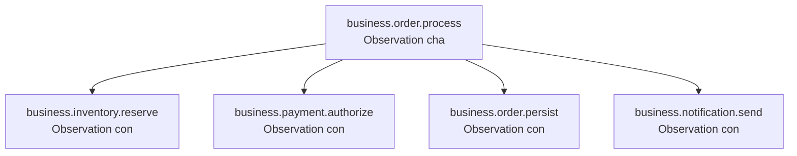
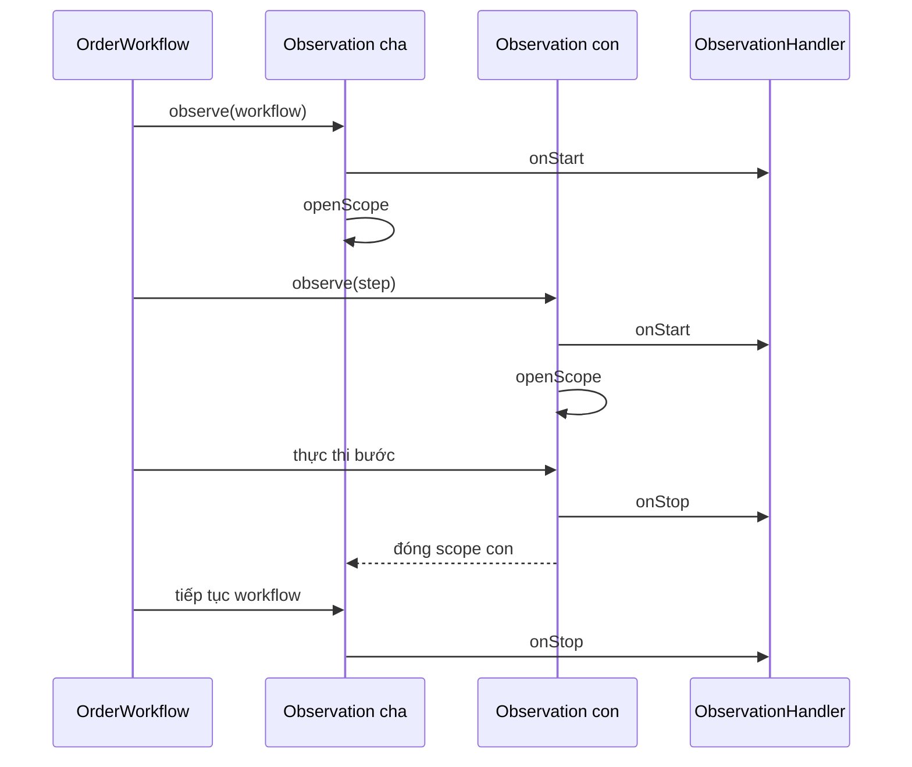

# Quan hệ cha con giữa các Observation lồng nhau

Một thao tác trong ứng dụng thường gọi nhiều thao tác nhỏ hơn. Khi xử lý đơn hàng, service có thể kiểm tra tồn kho, gọi cổng thanh toán, lưu đơn và gửi thông báo. Nếu mỗi bước được quan sát độc lập mà không giữ ngữ cảnh của thao tác bên ngoài, trace sẽ khó thể hiện bước nào thuộc về lần xử lý đơn hàng nào.

Micrometer Observation cho phép lồng các Observation theo phạm vi thực thi. Khi Observation cha đang mở scope, Observation con được tạo và chạy trong scope đó có thể kế thừa ngữ cảnh hiện tại. Với tracing handler được cấu hình, các span tương ứng có thể hình thành cây cha con. Điều này giúp người vận hành nhìn thấy tổng thể một thao tác và thời gian của từng bước bên trong.

Cần phân biệt quan hệ phân cấp của tracing với metrics. Metrics thường tổng hợp nhiều lần thực hiện thành các chuỗi thời gian phẳng theo tên và tag; chúng không lưu cây cha con của từng lần gọi. Observation cung cấp ngữ cảnh chung để handler tạo ra các tín hiệu phù hợp, còn cách thể hiện quan hệ phụ thuộc vào handler và cơ chế context propagation.

## 1. Một thao tác lớn chứa nhiều thao tác nhỏ

Giả sử một request xử lý đơn hàng thực hiện các bước:

1. Kiểm tra và giữ tồn kho.
2. Xác nhận thanh toán.
3. Lưu trạng thái đơn hàng.
4. Gửi thông báo.

Đội vận hành cần biết tổng thời gian xử lý đơn hàng, đồng thời muốn xác định bước nào chậm hoặc thất bại. Có thể mô tả thao tác lớn bằng một Observation cha và mỗi bước quan trọng bằng một Observation con.



Mỗi lần xử lý đơn hàng tạo một cây Observation riêng. Nhiều lần xử lý có cùng tên và tag có thể được tổng hợp thành metrics; tracing backend có thể lưu từng cây dưới dạng trace với các span liên quan.

## 2. Scope hiện tại tạo ngữ cảnh cho Observation con

Khi Observation cha bắt đầu và mở scope, nó trở thành Observation hiện tại trong ngữ cảnh thực thi. Một Observation con được tạo trong lúc scope cha còn mở có thể sử dụng ngữ cảnh hiện tại để nối quan hệ cha con thông qua tracing handler.

Phương thức `observe(...)` quản lý vòng đời và scope cho đoạn code được truyền vào. Vì vậy, cách đơn giản nhất để tạo các Observation lồng nhau là gọi `observe(...)` của con bên trong `observe(...)` của cha.

```java
import io.micrometer.observation.Observation;
import io.micrometer.observation.ObservationRegistry;

import org.springframework.stereotype.Service;

@Service
public class OrderWorkflow {

    private final ObservationRegistry registry;
    private final InventoryService inventory;
    private final PaymentService payment;
    private final OrderRepository orders;

    public OrderWorkflow(
            ObservationRegistry registry,
            InventoryService inventory,
            PaymentService payment,
            OrderRepository orders
    ) {
        this.registry = registry;
        this.inventory = inventory;
        this.payment = payment;
        this.orders = orders;
    }

    public OrderResult process(Order order) {
        return Observation.createNotStarted(
                "business.order.process",
                registry
            )
            .contextualName("process-order")
            .lowCardinalityKeyValue("channel", order.channel())
            .observe(() -> {
                Reservation reservation = Observation.createNotStarted(
                        "business.inventory.reserve",
                        registry
                    )
                    .contextualName("reserve-inventory")
                    .lowCardinalityKeyValue("warehouse", order.warehouse())
                    .observe(() -> inventory.reserve(order));

                PaymentResult paymentResult = Observation.createNotStarted(
                        "business.payment.authorize",
                        registry
                    )
                    .contextualName("authorize-payment")
                    .lowCardinalityKeyValue("provider", order.paymentProvider())
                    .observe(() -> payment.authorize(order));

                return Observation.createNotStarted(
                        "business.order.persist",
                        registry
                    )
                    .contextualName("persist-order")
                    .observe(() -> orders.save(order, reservation, paymentResult));
            });
    }
}
```

Trong ví dụ, Observation cha bao quanh toàn bộ workflow. Các Observation con được thực thi khi scope của cha còn mở. Nếu tracing handler được cấu hình, các span con có thể được tạo dưới span cha tương ứng.

Các service và repository trong ví dụ là thành phần nghiệp vụ minh họa. Điểm quan trọng là các lời gọi con diễn ra bên trong khối `observe(...)` của cha, để current observation được duy trì trong suốt đoạn thực thi đồng bộ.

## 3. Trace thể hiện cây cha con như thế nào?

Với tracing handler và exporter tương ứng, một lần xử lý có thể xuất hiện như sau:

```text
Trace: process-order
└── business.order.process             420 ms
    ├── business.inventory.reserve      65 ms
    ├── business.payment.authorize     210 ms
    └── business.order.persist          80 ms
```

Span cha biểu diễn khoảng thời gian tổng thể của workflow. Các span con cho biết từng bước bắt đầu và kết thúc khi nào. Các khoảng thời gian có thể bao gồm thời gian chờ hoặc xử lý nội bộ của bước đó.

Trong ví dụ trên, không nên cộng 420 ms của span cha với 65 + 210 + 80 ms của các span con để tính tổng thời gian. Span cha đã bao gồm thời gian của các bước con và các khoảng xử lý khác. Cộng các khoảng thời gian lồng nhau sẽ đếm trùng.

Cây trace giúp trả lời câu hỏi “lần xử lý này đã đi qua những bước nào và bước nào chiếm thời gian?”. Metrics giúp trả lời câu hỏi “trong 5 phút vừa qua, p95 của payment authorization là bao nhiêu?”. Hai tín hiệu bổ sung cho nhau.

## 4. Observation cha và con có vòng đời riêng

Mỗi Observation có lifecycle riêng. Khi dùng `observe(...)`, Micrometer quản lý các bước bắt đầu, mở scope, ghi nhận lỗi và dừng cho từng Observation.

Với luồng đồng bộ, trình tự thường là:

1. Cha bắt đầu và mở scope.
2. Con thứ nhất bắt đầu, mở scope, thực thi và dừng.
3. Scope của con được đóng; scope cha trở thành current observation trở lại.
4. Con tiếp theo chạy theo cách tương tự.
5. Cha kết thúc sau khi toàn bộ workflow hoàn tất.



Scope hoạt động theo thứ tự lồng nhau. Scope con phải được đóng trước khi scope cha kết thúc. Dùng `observe(...)` thường giúp tránh quên đóng scope hoặc dừng Observation.

## 5. Quan hệ cha con không có nghĩa mọi thuộc tính đều tự động kế thừa

Khi child observation chạy trong scope của parent, tracing handler có thể dùng current span để xác định parent span. Tuy nhiên, không nên giả định mọi low-cardinality key-value hoặc high-cardinality key-value của cha đều tự động được sao chép sang con.

Ví dụ cha có `channel=web`, còn con đo payment authorization. Nếu muốn metrics của payment được phân nhóm theo channel, hãy đưa channel vào context của Observation con hoặc dùng convention phù hợp để bổ sung chiều này một cách nhất quán.

```java
Observation.createNotStarted("business.payment.authorize", registry)
    .lowCardinalityKeyValue("provider", provider)
    .lowCardinalityKeyValue("channel", channel)
    .observe(() -> payment.authorize(order));
```

Việc gắn tag vào từng Observation nên có chủ đích. Chỉ thêm những chiều có tập giá trị hữu hạn và thực sự cần cho dashboard. Không sao chép toàn bộ dữ liệu của request hoặc đối tượng nghiệp vụ vào mọi Observation con.

## 6. Metrics từ Observation vẫn là dữ liệu tổng hợp

Khi có meter handler, Observation có thể tạo Timer hoặc meter tương ứng. Nhiều lần chạy của cùng một loại thao tác được tổng hợp thành các chuỗi thời gian dựa trên tên và low-cardinality tags.

Ví dụ:

| Observation | Metric có thể được tổng hợp | Câu hỏi |
|---|---|---|
| `business.order.process` | Timer của workflow | Tổng thời gian xử lý đơn hàng |
| `business.inventory.reserve` | Timer của bước giữ tồn kho | Bước inventory chậm đến đâu? |
| `business.payment.authorize` | Timer của bước thanh toán | p95 gọi payment provider là bao nhiêu? |
| `business.order.persist` | Timer của bước lưu đơn | Thời gian ghi đơn có tăng không? |

Metrics không giữ liên kết từng lần chạy giữa cha và con. Chúng có thể cho biết payment authorization thường mất bao lâu, nhưng để biết lần thanh toán cụ thể thuộc trace nào, cần tracing context và trace ID.

Không nên đưa order ID hoặc trace ID vào low-cardinality key-value. Nếu cần định danh lần thực hiện, hãy dùng tracing hoặc log. Metrics nên dùng các tag như `channel`, `provider`, `operation` với tập giá trị giới hạn.

## 7. Lỗi ở Observation con và ảnh hưởng đến cha

Nếu một Observation con ném exception, lifecycle của child được kết thúc với trạng thái lỗi khi dùng `observe(...)`. Exception tiếp tục được truyền về khối gọi. Nếu không bắt exception, Observation cha cũng nhận thấy thao tác của nó thất bại và được đánh dấu lỗi khi `observe(...)` của cha kết thúc.

Ví dụ:

```java
return Observation.createNotStarted("business.order.process", registry)
    .observe(() -> {
        return Observation.createNotStarted(
                "business.payment.authorize",
                registry
            )
            .observe(() -> payment.authorize(order));
    });
```

Nếu `payment.authorize(...)` ném exception, child ghi nhận lỗi rồi truyền exception ra ngoài. Parent cũng kết thúc bằng lỗi vì exception thoát khỏi khối workflow.

Có trường hợp nghiệp vụ muốn bắt lỗi của child và tiếp tục bằng phương án dự phòng. Khi đó, child vẫn có thể được ghi nhận là thất bại, trong khi parent hoàn tất thành công nếu fallback thành công:

```java
return Observation.createNotStarted("business.order.process", registry)
    .observe(() -> {
        try {
            return Observation.createNotStarted(
                    "business.payment.authorize",
                    registry
                )
                .observe(() -> payment.authorize(order));
        } catch (PaymentUnavailableException error) {
            return payment.useAlternativeProvider(order);
        }
    });
```

Ở đây, trạng thái của parent phản ánh kết quả cuối cùng của workflow. Child phản ánh lần gọi provider cụ thể đã thất bại. Cách diễn giải này hữu ích khi dashboard cần phân biệt “một dependency lỗi nhưng workflow đã fallback thành công” với “toàn bộ workflow thất bại”.

Nếu ứng dụng bắt exception và không ném lại, parent không tự động biết rằng child đã lỗi. Nếu muốn parent cũng được đánh dấu lỗi theo quy tắc nghiệp vụ, hãy chủ động ghi nhận lỗi hoặc trạng thái tương ứng trên parent.

## 8. Dùng lifecycle tường minh khi cần mở scope thủ công

Trong trường hợp cần kiểm soát rõ thời điểm mở và đóng scope, có thể gọi `start()`, `openScope()` và `stop()`. Scope con cần được đóng trước khi scope cha đóng.

```java
Observation parent = Observation.createNotStarted(
    "business.order.process",
    registry
);

parent.start();

try (Observation.Scope parentScope = parent.openScope()) {
    Observation child = Observation.createNotStarted(
        "business.inventory.reserve",
        registry
    );

    child.start();

    try (Observation.Scope childScope = child.openScope()) {
        inventory.reserve(order);
    } catch (RuntimeException | Error error) {
        child.error(error);
        throw error;
    } finally {
        child.stop();
    }
} catch (RuntimeException | Error error) {
    parent.error(error);
    throw error;
} finally {
    parent.stop();
}
```

Đoạn code thể hiện rõ thứ tự scope. Trong code thực tế, cần khai báo biến `registry`, `inventory` và `order` theo dependency của service. Với workflow đồng bộ thông thường, lồng các lời gọi `observe(...)` thường ngắn gọn và ít nguy cơ sai lifecycle hơn.

Không đóng scope cha khi child vẫn còn chạy. Nếu child chạy bất đồng bộ, không giữ scope cha trên thread hiện tại trong suốt thời gian chờ; hãy dùng cơ chế propagation và quản lý lifecycle theo thời điểm hoàn tất thực tế.

## 9. Observation lồng nhau qua nhiều lớp service

Một Observation cha không nhất thiết phải được tạo trong cùng class với các Observation con. Ví dụ controller hoặc application service có thể tạo Observation cho use case, còn inventory adapter và payment adapter tự instrument các lời gọi của chúng.

Điều kiện để tracing handler tạo cây hợp lý là các Observation con phải được thực thi trong đúng ngữ cảnh cha. Với luồng đồng bộ, điều này thường đạt được khi cha mở scope quanh lời gọi service con.

Một thiết kế phân lớp có thể như sau:

```text
OrderController
  └── Observation: http.server.request (framework)
       └── OrderApplicationService
            └── Observation: business.order.process
                 ├── InventoryAdapter
                 │    └── Observation: business.inventory.reserve
                 └── PaymentAdapter
                      └── Observation: business.payment.authorize
```

Nếu Spring Boot hoặc thư viện HTTP đã tự tạo Observation cho request, không cần tạo thêm một Observation trùng tên và trùng ranh giới chỉ để có trace. Hãy tạo Observation nghiệp vụ ở ranh giới use case, sau đó để các instrumentation adapter bổ sung các bước bên dưới.

## 10. Observation lồng nhau và async boundary

Quan hệ cha con dễ giữ trong một lời gọi đồng bộ vì scope cha vẫn mở trên thread hiện tại khi child chạy. Với `CompletableFuture`, executor, callback hoặc reactive pipeline, công việc có thể tiếp tục trên thread khác.

Không nên giả định scope tự động được truyền qua mọi lần chuyển thread. Nếu child bắt đầu trên thread khác mà không có context propagation, tracing handler có thể không nhận được parent context và span có thể trở thành root hoặc gắn sai quan hệ.

Một lỗi phổ biến là dùng `observe(...)` quanh việc tạo future:

```java
CompletableFuture<PaymentResult> future =
    Observation.createNotStarted("business.payment.authorize", registry)
        .observe(() -> payment.authorizeAsync(order));
```

Nếu `authorizeAsync` trả về ngay một future, Observation trên chỉ đo khoảng thời gian tạo future và trả về, không đo toàn bộ thời gian chờ đến khi payment hoàn tất. Khi cần đo toàn bộ thao tác async, lifecycle phải kết thúc khi future hoàn tất và context cần được truyền đến callback thích hợp.

Ví dụ minh họa quản lý thời điểm dừng:

```java
Observation observation = Observation.createNotStarted(
    "business.payment.authorize",
    registry
);

observation.start();

CompletableFuture<PaymentResult> future;

try {
    future = payment.authorizeAsync(order);
} catch (RuntimeException | Error error) {
    observation.error(error);
    observation.stop();
    throw error;
}

return future.whenComplete((result, error) -> {
    if (error != null) {
        observation.error(error);
    }
    observation.stop();
});
```

Ví dụ này minh họa thời điểm kết thúc Observation khi future hoàn tất. Để giữ parent-child trace qua callback, cần thêm cơ chế context propagation phù hợp với executor hoặc reactive stack. Không mở scope trên thread khởi tạo rồi để scope tồn tại đến lúc callback chạy ở thread khác.

## 11. Context propagation cho executor và Reactor

Micrometer Context Propagation cung cấp cơ chế capture và restore các giá trị context qua ranh giới thực thi. Spring Boot và các thư viện tích hợp có thể hỗ trợ một số trường hợp propagation, nhưng hành vi cụ thể phụ thuộc phiên bản và cấu hình.

Khi dùng executor tùy chỉnh:

- Dùng executor được cấu hình để truyền context hoặc bọc task bằng cơ chế context propagation.
- Xác minh Observation hiện tại được khôi phục trong task con.
- Đảm bảo scope được đóng trên thread thực thi task.
- Kiểm thử trace parent-child trong môi trường có executor thật.

Với Reactor, context thường được truyền qua Reactor Context thay vì dựa trực tiếp vào ThreadLocal. Cần bật và cấu hình cơ chế tích hợp phù hợp với phiên bản Reactor, Micrometer và Spring Boot. Không giả định rằng việc chuyển từ một operator sang scheduler khác vẫn giữ current observation nếu chưa bật propagation.

Khi công việc async tồn tại lâu hơn request cha, cần quyết định rõ quan hệ tracing mong muốn. Có thể tạo span/observation mới với context được capture từ request, nhưng không giữ scope cha mở trên thread request sau khi request đã kết thúc.

## 12. Tránh tạo cây Observation quá sâu hoặc quá chi tiết

Lồng Observation ở ranh giới có ý nghĩa giúp trace dễ đọc. Nếu tạo một child cho mỗi hàm tiện ích hoặc mỗi dòng code, trace sẽ có quá nhiều span ngắn và khó xác định bước gây chậm.

Nên tạo child cho các hoạt động có giá trị điều tra độc lập:

- Gọi một dịch vụ ngoài.
- Truy vấn hoặc cập nhật database quan trọng.
- Gửi message hoặc xử lý message.
- Giữ tồn kho hoặc xác nhận thanh toán.
- Thực hiện một bước batch có thời gian đáng kể.

Không cần tạo Observation cho mỗi phép kiểm tra null, phép ánh xạ DTO hoặc lời gọi hàm nội bộ quá nhỏ. Chọn ranh giới theo câu hỏi cần trả lời khi có sự cố.

Tên Observation nên ổn định và mô tả thao tác. Không đưa ID đơn hàng, mã khách hàng hoặc URL có ID động vào tên. Những giá trị này có thể được thêm dưới dạng high-cardinality attribute cho tracing nếu chính sách dữ liệu cho phép.

## 13. Kiểm tra cây trace trong thực tế

Để xác minh quan hệ cha con:

1. Cấu hình tracing handler và exporter phù hợp.
2. Tạo một request đại diện kích hoạt workflow có nhiều Observation.
3. Tìm trace tương ứng trong tracing backend.
4. Kiểm tra span cha bao quanh thời gian của các span con.
5. Kiểm tra các span con có parent span đúng và tên ổn định.
6. Gây lỗi có kiểm soát ở một bước con để xem child và parent được đánh dấu thế nào.
7. Kiểm tra một thao tác async để xác minh context propagation.
8. Đối chiếu metrics riêng của từng thao tác với thời lượng trong trace.

Nếu chỉ cấu hình metrics handler mà không có tracing handler, có thể thấy các Timer tổng hợp nhưng không có cây span. Đây không phải lỗi quan hệ cha con; backend tracing chưa được cấu hình hoặc handler tracing chưa được gắn.

## 14. Kiểm thử lifecycle của Observation cha con

Có thể dùng một registry độc lập và handler kiểm thử để ghi nhận thứ tự callback. Khi kiểm thử tích hợp tracing, nên dùng exporter trong bộ nhớ hoặc test support của tracing bridge đang dùng để xác minh parent span ID.

Các tình huống cần kiểm tra:

| Tình huống | Kết quả mong đợi |
|---|---|
| Child chạy thành công trong parent scope | Child được kết thúc trước parent; tracing handler tạo quan hệ cha con |
| Child ném exception và exception thoát ra | Child và parent đều được đánh dấu lỗi |
| Child lỗi nhưng parent dùng fallback | Child lỗi; parent có thể thành công nếu fallback hoàn tất |
| Nhiều child chạy tuần tự | Các child là span con cùng parent, không trở thành cha của nhau |
| Child chạy qua executor | Context propagation giữ đúng parent nếu đã cấu hình |
| Async child hoàn tất sau khi phương thức trả future | Observation dừng khi tác vụ thực sự hoàn tất |
| Không có tracing handler | Không có cây span, dù lifecycle Observation vẫn chạy |

Đối với metrics, kiểm tra count và duration của parent/child là các meter riêng. Không cộng tổng thời gian của parent và child vì chúng có thể chồng lấp.

## 15. Các lỗi thường gặp

| Lỗi | Hậu quả | Cách xử lý |
|---|---|---|
| Tạo child sau khi parent scope đã đóng | Child không còn current parent context | Thực thi child bên trong parent scope hoặc propagate context |
| Chỉ tạo Observation nhưng không start/observe | Handler không nhận lifecycle đầy đủ | Dùng `observe(...)` hoặc quản lý start/stop rõ ràng |
| Quên đóng scope con | Current observation có thể sai cho phần code tiếp theo | Dùng try-with-resources hoặc observe |
| Dừng parent trước child | Trace có thể kết thúc trước khi child hoàn tất | Bảo đảm child hoàn tất trước parent trong workflow đồng bộ |
| Nghĩ mọi tag của parent tự truyền sang child | Metrics thiếu chiều phân tích mong muốn | Gắn low-cardinality key cần thiết vào child hoặc convention |
| Cộng thời lượng parent và child | Đếm trùng thời gian lồng nhau | Phân tích span riêng hoặc dùng metric của từng thao tác |
| Bắt lỗi child rồi coi toàn bộ workflow thất bại | Trạng thái parent không phản ánh fallback thành công | Xác định rõ semantics lỗi của từng cấp |
| Dùng `observe()` quanh lời gọi trả future | Chỉ đo thời gian tạo future | Dừng Observation trong callback hoàn tất |
| Giả định ThreadLocal tự qua executor | Child mất parent context | Dùng Context Propagation và kiểm thử |
| Tạo span cho mọi hàm nhỏ | Trace quá sâu và khó đọc | Chọn ranh giới có ý nghĩa vận hành |
| Dùng ID động làm observation name/tag | Cardinality cao và trace khó nhóm | Dùng tên ổn định, ID ở trace/log |

## 16. Checklist thiết kế quan hệ cha con

- [ ] Xác định một Observation cha cho thao tác tổng thể có ý nghĩa.
- [ ] Chọn Observation con cho các bước độc lập cần điều tra.
- [ ] Tạo và chạy child khi parent scope còn mở.
- [ ] Dùng `observe(...)` cho luồng đồng bộ để quản lý lifecycle.
- [ ] Đảm bảo child kết thúc trước parent khi xử lý đồng bộ.
- [ ] Ghi nhận lỗi ở đúng cấp; xác định khi nào lỗi con làm lỗi cha.
- [ ] Không giả định low/high-cardinality key-value tự động kế thừa.
- [ ] Giữ tên Observation ổn định và tag có tập giá trị giới hạn.
- [ ] Không cộng duration của span cha và span con như các khoảng độc lập.
- [ ] Dùng Context Propagation khi chuyển thread hoặc reactive boundary.
- [ ] Với async, dừng Observation khi công việc hoàn tất thực sự.
- [ ] Kiểm tra parent span ID và cây trace bằng tracing backend.
- [ ] Kiểm tra metrics riêng cho từng loại thao tác.
- [ ] Tránh lồng quá sâu hoặc instrument những hàm không có giá trị điều tra.

Observation lồng nhau giúp biểu diễn một workflow thành các thao tác có quan hệ cha con. Scope của parent tạo ngữ cảnh cho child trong luồng đồng bộ; tracing handler có thể chuyển ngữ cảnh đó thành cây span. Metrics vẫn tổng hợp từng loại thao tác thành các chuỗi thời gian riêng. Khi quản lý đúng lifecycle, lỗi, tag và context propagation, đội vận hành có thể vừa theo dõi xu hướng tổng thể vừa lần theo bước cụ thể gây chậm hoặc thất bại.

## Tài liệu tham khảo

- [Micrometer Observation Concepts](https://docs.micrometer.io/micrometer/reference/observation.html) — Observation, scope, registry và handler.
- [Micrometer Observation Instrumentation](https://docs.micrometer.io/micrometer/reference/observation/instrumenting.html) — tạo Observation và quản lý lifecycle.
- [Micrometer Context Propagation](https://docs.micrometer.io/context-propagation/reference/) — truyền context qua executor, thread và reactive boundary.
- [Spring Boot Observability](https://docs.spring.io/spring-boot/reference/actuator/observability.html) — tích hợp metrics và tracing trong Spring Boot.

