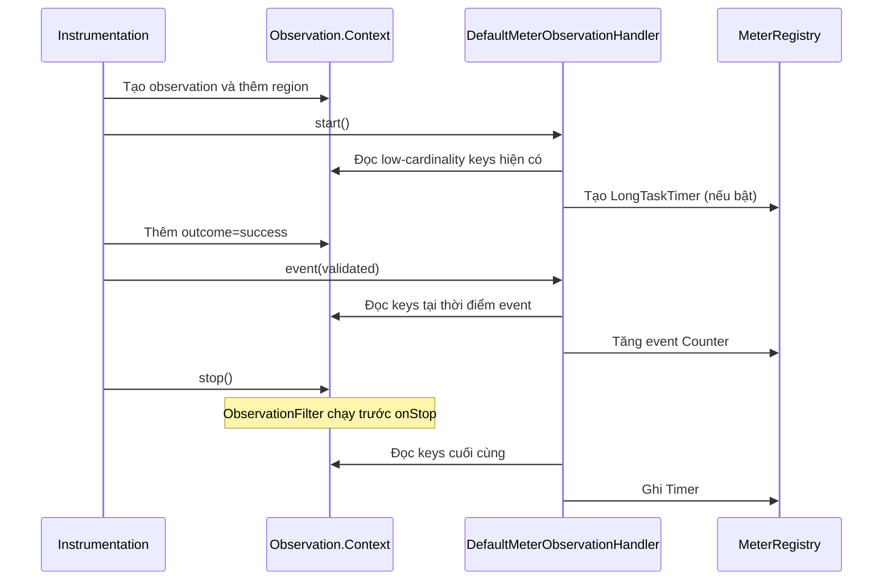

# Thời điểm thêm nhãn và ảnh hưởng tới dữ liệu được tạo khi start hoặc stop

Trong Micrometer Observation, thời điểm thêm key-value (nhãn) quyết định meter nào có thể nhìn thấy nhãn đó. Một observation có thể tạo nhiều loại dữ liệu ở những mốc khác nhau: `LongTaskTimer` được tạo khi observation bắt đầu, counter sự kiện được cập nhật khi event xảy ra, còn timer thông thường được ghi khi observation dừng.

Vì vậy, hai đoạn code cùng thêm một tag nhưng đặt ở hai thời điểm khác nhau có thể tạo ra các series khác nhau. Tag có trước `start()` có thể xuất hiện trên tất cả dữ liệu được tạo sau đó. Tag thêm sau `start()` vẫn có thể xuất hiện trên timer được ghi ở `stop()` và counter của event phát ra sau thời điểm thêm tag, nhưng không thể bổ sung ngược vào `LongTaskTimer` đã được đăng ký lúc start.

Trong module `OBSERVABILITY_INSTRUMENTATION_MICROMETER`, cần hiểu quy tắc này khi thiết kế `ObservationConvention`, `ObservationFilter`, low-cardinality key-value và metrics handler. Điều đó giúp các meter có tập tag ổn định, đồng thời tránh kỳ vọng sai về dữ liệu đang được theo dõi khi một tác vụ vẫn chạy.

## 1. Vì sao thời điểm thêm nhãn quan trọng?

Micrometer Observation giữ metadata trong `Observation.Context`. Handler đọc context tại các mốc lifecycle để tạo metrics hoặc trace. Context có thể được bổ sung key-value trước và trong khi observation chạy; tuy nhiên, mỗi handler không nhất thiết đọc context ở cùng một thời điểm.

Với `DefaultMeterObservationHandler`, các mốc quan trọng là:

| Dữ liệu | Thời điểm tạo/cập nhật | Nhãn được đọc tại thời điểm |
| --- | --- | --- |
| `LongTaskTimer` (`<name>.active`) | Khi `start()`; chỉ bật nếu cấu hình opt-in | Khi `onStart` chạy |
| Counter của event (`<name>.<event>`) | Khi gọi `event(...)` | Khi event được phát |
| Timer thông thường (`<name>`) | Khi `stop()` | Khi `onStop` chạy, sau khi `ObservationFilter` đã biến đổi context |

Hệ quả trực tiếp:

- Nhãn thêm trước `start()` có thể được dùng bởi LongTaskTimer, event counter phát sau đó và Timer cuối cùng.
- Nhãn thêm sau `start()` không thay đổi ID của LongTaskTimer đã đăng ký, nhưng có thể được dùng bởi event counter phát sau đó và Timer tạo khi stop.
- Nhãn thêm sau một event không thay đổi counter đã được cập nhật bởi event đó.
- Nhãn do `ObservationFilter` thêm lúc stop có thể được dùng bởi Timer thông thường, nhưng quá muộn để xuất hiện trên LongTaskTimer được tạo lúc start.

## 2. Dòng thời gian của một Observation

Sơ đồ dưới đây minh họa thứ tự xử lý và thời điểm handler lấy metadata:



Observation có một context mutable, nhưng meter đã đăng ký trong registry có một `Meter.Id` riêng. Khi LongTaskTimer được tạo với tên và tag tại `start()`, việc thay đổi context sau đó không đổi ID của meter đó. Khi Timer được tạo tại `stop()`, handler đọc context ở thời điểm muộn hơn nên có thể nhìn thấy những nhãn được thêm trong lúc xử lý.

## 3. Chuẩn bị nhãn trước khi start

Nếu một low-cardinality key-value cần xuất hiện trên mọi loại meter của observation, hãy thêm nó trước khi gọi `start()`. Có thể thêm trực tiếp bằng API của `Observation`:

```java
Observation observation = Observation.createNotStarted(
        "orders.process", observationRegistry)
        .lowCardinalityKeyValue("region", "ap-southeast")
        .lowCardinalityKeyValue("channel", "web")
        .highCardinalityKeyValue("order.id", orderId);

observation.start();
try (Observation.Scope scope = observation.openScope()) {
    validateOrder();
    reserveInventory();
    saveOrder();
} catch (RuntimeException ex) {
    observation.error(ex);
    throw ex;
} finally {
    observation.stop();
}
```

Trong ví dụ, `region` và `channel` là low-cardinality key-value nên có thể trở thành tag của metrics. `order.id` là high-cardinality key-value, phù hợp hơn với trace hoặc handler khác; `DefaultMeterObservationHandler` không đưa high-cardinality key-value vào meter tags.

Vì metadata được thêm trước `start()`, LongTaskTimer (nếu được bật) có thể dùng `region` và `channel`. Event counter phát trong phần xử lý và Timer tạo ở `stop()` cũng có thể dùng hai tag đó. `order.id` vẫn là high-cardinality nên không xuất hiện trong meter tags.

## 4. Nhãn thêm sau start ảnh hưởng đến Timer và LongTaskTimer khác nhau

Xét observation được bắt đầu chỉ với `region`:

```java
Observation observation = Observation.createNotStarted(
        "orders.process", observationRegistry)
        .lowCardinalityKeyValue("region", "ap-southeast");

observation.start();

// Kết quả nghiệp vụ chỉ được biết sau khi xử lý bắt đầu.
observation.lowCardinalityKeyValue("outcome", "success");

observation.stop();
```

Kết quả với metrics handler:

| Meter | Tag có thể có | Lý do |
| --- | --- | --- |
| `orders.process.active` | `region=ap-southeast` | LongTaskTimer đã được tạo trong `onStart`, trước khi thêm `outcome` |
| `orders.process` | `region=ap-southeast`, `outcome=success`, `error=none` | Timer được ghi trong `onStop`, sau khi `outcome` được thêm |

Đây là hành vi có chủ đích. LongTaskTimer phải được đăng ký ngay khi công việc bắt đầu để hệ thống có thể truy vấn số tác vụ đang chạy và thời lượng hiện tại. Nó không thể chờ đến cuối công việc mới biết các tag kết quả.

Timer thông thường đo thời gian đã hoàn tất. Handler chỉ ghi timer khi observation dừng, vì vậy có thể dùng outcome cuối cùng như `success`, `rejected` hoặc `error` làm tag của Timer.

**Quy tắc thực hành:** tag cần có trên dữ liệu active phải được xác định trước `start()`. Tag chỉ cần cho kết quả cuối cùng có thể được bổ sung trong lúc xử lý hoặc tại filter chạy trước `stop()`.

## 5. ObservationFilter là điểm bổ sung nhãn ở thời điểm stop

`ObservationFilter` được gọi khi observation dừng, trước khi các handler nhận callback `onStop`. Đây là nơi phù hợp để suy ra metadata cuối cùng từ context, chẳng hạn kết quả thành công/thất bại hoặc trạng thái được xác định ở cuối workflow.

```java
import io.micrometer.common.KeyValue;
import io.micrometer.observation.Observation;
import io.micrometer.observation.ObservationFilter;

public class OutcomeObservationFilter implements ObservationFilter {
    @Override
    public Observation.Context map(Observation.Context context) {
        String outcome = context.getError() == null ? "success" : "error";
        context.addLowCardinalityKeyValue(KeyValue.of("outcome", outcome));
        return context;
    }
}
```

Đăng ký filter vào registry:

```java
observationRegistry.observationConfig()
        .observationFilter(new OutcomeObservationFilter());
```

Khi `stop()` được gọi, filter thêm `outcome` trước khi metrics handler tạo Timer. Timer vì thế có thể mang `outcome=success` hoặc `outcome=error`. LongTaskTimer đã tạo trước đó vẫn giữ tập tag lúc start và không nhận `outcome` mới.

Nếu ứng dụng đã tự thêm `outcome` vào context, filter nên giữ quy tắc nhất quán và tránh ghi đè giá trị hợp lệ. Ví dụ có thể chỉ thêm khi key chưa tồn tại:

```java
if (context.getLowCardinalityKeyValue("outcome") == null) {
    String outcome = context.getError() == null ? "success" : "error";
    context.addLowCardinalityKeyValue(KeyValue.of("outcome", outcome));
}
```

Filter chạy trên context dùng chung của observation. Nếu nhiều filter cùng thay đổi một key, thứ tự thực thi và quy tắc ghi đè cần được xác định rõ. Không dùng filter để thêm giá trị động có cardinality cao vào metrics.

## 6. Counter của event lấy nhãn tại thời điểm event

Counter do `Observation.event(...)` tạo có một quy tắc thời gian riêng: handler đọc low-cardinality key-value hiện có khi event được phát.

```java
Observation observation = Observation.createNotStarted(
        "orders.process", observationRegistry)
        .lowCardinalityKeyValue("region", "ap-southeast");

observation.start();

observation.event(Observation.Event.of("validated"));

observation.lowCardinalityKeyValue("outcome", "success");
observation.event(Observation.Event.of("completed"));

observation.stop();
```

Với `DefaultMeterObservationHandler`, hai event có thể tạo các counter:

| Counter | Tag có tại thời điểm event |
| --- | --- |
| `orders.process.validated` | `region=ap-southeast` |
| `orders.process.completed` | `region=ap-southeast`, `outcome=success` |

Counter đầu tiên không được cập nhật lại khi `outcome` được thêm sau đó. Counter thứ hai nhìn thấy `outcome` vì event được phát sau khi key-value xuất hiện.

Nếu các event cùng tên được phát ở nhiều nhánh code, hãy bảo đảm chúng luôn có cùng tập tag key. Ví dụ, nếu một nhánh phát `completed` trước khi thêm `outcome` và nhánh khác phát sau khi thêm `outcome`, cùng counter name có thể được đăng ký với cấu trúc tag khác nhau. Hãy chuẩn hóa thứ tự: thiết lập tag trước event, hoặc chọn schema event không phụ thuộc tag chỉ có ở một nhánh.

## 7. ObservationConvention cung cấp nhãn mặc định

`ObservationConvention` tách quy ước tên và key-value khỏi logic điều khiển vòng đời. Convention lấy dữ liệu từ `Observation.Context` để tạo low-cardinality và high-cardinality key-values. Đây là nơi phù hợp để định nghĩa các tag có ý nghĩa ổn định cho một loại observation.

Ví dụ context lưu thông tin xử lý đơn hàng:

```java
import io.micrometer.observation.Observation;

public class OrderObservationContext extends Observation.Context {
    private final String channel;
    private final String region;

    public OrderObservationContext(String channel, String region) {
        this.channel = channel;
        this.region = region;
    }

    public String channel() {
        return channel;
    }

    public String region() {
        return region;
    }
}
```

Convention định nghĩa tên và nhãn:

```java
import io.micrometer.common.KeyValue;
import io.micrometer.common.KeyValues;
import io.micrometer.observation.ObservationConvention;

public class OrderObservationConvention
        implements ObservationConvention<OrderObservationContext> {

    @Override
    public boolean supportsContext(Observation.Context context) {
        return context instanceof OrderObservationContext;
    }

    @Override
    public String getName() {
        return "orders.process";
    }

    @Override
    public KeyValues getLowCardinalityKeyValues(OrderObservationContext context) {
        return KeyValues.of(
                KeyValue.of("channel", context.channel()),
                KeyValue.of("region", context.region()));
    }
}
```

Instrumentation tạo observation với context và convention:

```java
OrderObservationContext context = new OrderObservationContext("web", "ap-southeast");

Observation.createNotStarted(
        null,
        new OrderObservationConvention(),
        () -> context,
        observationRegistry)
    .observe(() -> processOrder(command));
```

Trong ứng dụng thực tế, có thể dùng overload tương ứng của instrumentation hoặc `ObservationDocumentation` để truyền convention mặc định và convention tùy biến. Điểm quan trọng là dữ liệu cần thiết cho convention phải có trong context khi handler cần tạo meter ở `onStart`. Nếu convention trả về các key-value từ context đã được thiết lập trước start, LongTaskTimer và Timer cuối cùng có thể dùng cùng các low-cardinality key-value chính; Timer thông thường còn có tag `error` do metrics handler bổ sung.

Convention phù hợp với metadata vốn có ngay từ đầu, ví dụ channel, region, operation hoặc client. Đừng trì hoãn một giá trị đã biết đến sau start chỉ để thêm nó vào context muộn hơn. Nếu gắn convention trực tiếp bằng `observation.observationConvention(...)`, phải thực hiện trước `start()`; Micrometer không cho phép đổi convention sau khi observation đã bắt đầu.

## 8. Phân biệt convention và filter

Hai cơ chế đều có thể bổ sung nhãn nhưng phục vụ các mục đích khác nhau:

| Cơ chế | Vai trò | Thời điểm thích hợp |
| --- | --- | --- |
| `ObservationConvention` | Định nghĩa tên và tập key-value mặc định theo loại context | Metadata có thể xác định từ đầu observation |
| `Observation.lowCardinalityKeyValue(...)` | Thêm một giá trị cụ thể cho observation hiện tại | Trước start hoặc trong lúc xử lý, tùy loại meter cần nhận |
| `ObservationFilter` | Chuẩn hóa hoặc bổ sung context trước callback `onStop` | Metadata chỉ biết khi công việc hoàn tất |
| `ObservationPredicate` | Quyết định observation có được tạo hay trở thành no-op | Trước khi observation chạy; không dùng để bổ sung tag |

Nếu một tag phải có trên cả LongTaskTimer và Timer, hãy đưa nó vào convention hoặc thêm trực tiếp trước start. Nếu tag chỉ có ý nghĩa cho kết quả cuối cùng, có thể thêm trong code trước stop hoặc qua filter. Nếu tag chỉ cần trên event counter, thêm trước khi phát event tương ứng.

## 9. Low-cardinality và high-cardinality không có cùng tác động

Micrometer phân biệt hai loại key-value:

- **Low-cardinality:** giá trị có tập hữu hạn, có giới hạn, ví dụ `region`, `channel`, `outcome`, `operation`.
- **High-cardinality:** giá trị có thể tăng không giới hạn, ví dụ `order.id`, `user.id`, request URL đầy đủ hoặc trace ID.

`DefaultMeterObservationHandler` chỉ dùng low-cardinality key-values làm meter tags. High-cardinality key-values không được đưa vào Timer, Counter hoặc LongTaskTimer mặc định; chúng thường dành cho tracing và các handler khác.

| Giá trị | Phân loại thường phù hợp | Lý do |
| --- | --- | --- |
| `region=ap-southeast` | Low | Tập vùng triển khai hữu hạn |
| `outcome=success` | Low | Tập kết quả được quy ước |
| `channel=web` | Low | Kênh nhận yêu cầu có số lượng giới hạn |
| `order.id=ORD-...` | High | Mỗi đơn hàng có thể có ID riêng |
| `trace.id=...` | High | Gần như mỗi trace có giá trị riêng |
| URL có ID tài nguyên | High | Giá trị thay đổi theo từng request |

Thời điểm thêm tag không làm thay đổi phân loại cardinality. Một high-cardinality key-value được thêm trước start vẫn không trở thành meter tag; một low-cardinality key-value được thêm sau start vẫn có thể xuất hiện trên Timer hoặc event counter được tạo sau đó.

## 10. Giữ tập tag key nhất quán cho từng meter name

Khi tag được thêm theo điều kiện hoặc theo thời điểm, cần kiểm tra tập key cuối cùng của từng meter name. Ví dụ, nếu Timer `orders.process` ở lần gọi này có `region` và `outcome`, nhưng lần gọi khác chỉ có `region`, registry/backend có thể nhận các series có schema khác nhau. Điều này gây khó truy vấn và ở một số Prometheus registry/version có thể dẫn đến lỗi đăng ký.

Một cách an toàn là định nghĩa schema từ đầu:

```java
Observation observation = Observation.createNotStarted(
        "orders.process", observationRegistry)
        .lowCardinalityKeyValue("region", region)
        .lowCardinalityKeyValue("outcome", "unknown");

observation.start();
try {
    processOrder(command);
    observation.lowCardinalityKeyValue("outcome", "success");
} catch (RuntimeException ex) {
    observation.lowCardinalityKeyValue("outcome", "error");
    observation.error(ex);
    throw ex;
} finally {
    observation.stop();
}
```

LongTaskTimer được tạo lúc start sẽ có `outcome=unknown`; Timer được tạo lúc stop sẽ có giá trị kết quả cuối cùng. Đây là hai meter khác nhau (`orders.process.active` và `orders.process`), nên giá trị tag của chúng có thể phản ánh hai giai đoạn khác nhau. Nếu dashboard cần phân nhóm LongTaskTimer theo outcome cuối cùng, điều đó không thể đạt được bằng cách thêm outcome sau start; phải xác định outcome trước khi bắt đầu hoặc chọn một chiều khác đã biết từ đầu.

Không thêm một key chỉ trong một số nhánh nếu cùng meter name cần schema cố định. Có thể dùng sentinel như `unknown`, `none` hoặc `other`, miễn là ý nghĩa được tài liệu hóa và số giá trị vẫn hữu hạn.

## 11. Kiểm thử khác biệt giữa start và stop

Có thể tái hiện quy tắc bằng `SimpleMeterRegistry` và bật LongTaskTimer cho observation. Đoạn test sau thêm `outcome` sau start, phát event sau khi thêm tag rồi dừng observation:

```java
import static org.assertj.core.api.Assertions.assertThat;

import io.micrometer.core.instrument.LongTaskTimer;
import io.micrometer.core.instrument.Timer;
import io.micrometer.core.instrument.observation.DefaultMeterObservationHandler;
import io.micrometer.core.instrument.simple.SimpleMeterRegistry;
import io.micrometer.observation.Observation;
import io.micrometer.observation.ObservationRegistry;
import org.junit.jupiter.api.Test;

class ObservationTagTimingTest {
    @Test
    void lateTagAppearsOnTimerButNotOnActiveLongTaskTimer() {
        try (SimpleMeterRegistry meters = new SimpleMeterRegistry()) {
            ObservationRegistry observations = ObservationRegistry.create();
            observations.observationConfig().observationHandler(
                    DefaultMeterObservationHandler.builder(meters)
                            .includeActiveObservationLongTaskTimer(true)
                            .build());

            Observation observation = Observation.createNotStarted(
                    "orders.process", observations)
                    .lowCardinalityKeyValue("region", "ap-southeast");

            observation.start();

            LongTaskTimer active = meters.get("orders.process.active")
                    .tag("region", "ap-southeast")
                    .longTaskTimer();
            assertThat(active.activeTasks()).isEqualTo(1);

            observation.lowCardinalityKeyValue("outcome", "success");
            observation.event(Observation.Event.of("completed"));
            observation.stop();

            Timer completed = meters.get("orders.process")
                    .tag("region", "ap-southeast")
                    .tag("outcome", "success")
                    .tag("error", "none")
                    .timer();
            assertThat(completed.count()).isEqualTo(1);

            assertThat(active.activeTasks()).isZero();
            assertThat(meters.find("orders.process.active")
                    .tag("outcome", "success")
                    .longTaskTimer()).isNull();

            assertThat(meters.get("orders.process.completed")
                    .tag("region", "ap-southeast")
                    .tag("outcome", "success")
                    .counter()
                    .count()).isEqualTo(1.0);
        }
    }
}
```

Test này chứng minh ba thời điểm khác nhau:

1. LongTaskTimer được tạo tại `start()` và chỉ có tag `region`.
2. Event counter được tạo khi event phát ra, sau khi `outcome` được thêm nên có cả hai tag.
3. Timer được ghi tại `stop()` và có `region`, `outcome` cùng tag `error=none` do metrics handler bổ sung.

Nếu không bật `includeActiveObservationLongTaskTimer(true)`, không có meter `.active` để kiểm tra. LongTaskTimer không được tạo mặc định bởi `DefaultMeterObservationHandler`.

## 12. Kiểm thử nhãn được thêm bởi ObservationFilter

Có thể kiểm tra rằng filter chạy trước khi Timer được ghi:

```java
import static org.assertj.core.api.Assertions.assertThat;

import io.micrometer.common.KeyValue;
import io.micrometer.core.instrument.simple.SimpleMeterRegistry;
import io.micrometer.core.instrument.observation.DefaultMeterObservationHandler;
import io.micrometer.observation.Observation;
import io.micrometer.observation.ObservationRegistry;
import org.junit.jupiter.api.Test;

@Test
void filterAddsOutcomeToTimerAtStop() {
    try (SimpleMeterRegistry meters = new SimpleMeterRegistry()) {
        ObservationRegistry observations = ObservationRegistry.create();
        observations.observationConfig()
                .observationHandler(DefaultMeterObservationHandler.builder(meters).build())
                .observationFilter(context -> {
                    context.addLowCardinalityKeyValue(
                            KeyValue.of("outcome", context.getError() == null
                                    ? "success" : "error"));
                    return context;
                });

        Observation.createNotStarted("orders.process", observations)
                .lowCardinalityKeyValue("region", "ap-southeast")
                .observe(() -> processOrder());

        assertThat(meters.get("orders.process")
                .tag("region", "ap-southeast")
                .tag("outcome", "success")
                .tag("error", "none")
                .timer()
                .count()).isEqualTo(1);
    }
}
```

Ví dụ giả định `processOrder()` hoàn tất bình thường. Khi ném exception, `observe()` ghi exception vào context trước khi stop; filter có thể thêm `outcome=error`, còn handler thêm tag `error` theo quy ước riêng. Không nên nhầm hai tag này: `outcome` là phân loại nghiệp vụ do ứng dụng định nghĩa, còn `error` là metadata exception do handler metrics cung cấp.

## 13. Các lỗi thường gặp

| Lỗi | Hệ quả | Cách xử lý |
| --- | --- | --- |
| Thêm tag sau `start()` nhưng mong LongTaskTimer có tag đó | Meter active đã được tạo với ID cũ | Thêm tag trước start hoặc chấp nhận tag active không có chiều kết quả |
| Dùng filter lúc stop để bổ sung tag cho LongTaskTimer | Filter chạy sau `onStart` | Chỉ dùng filter cho dữ liệu được tạo ở stop hoặc handler xử lý muộn |
| Phát event trước khi thêm tag cần thiết | Counter event không có tag đó | Thiết lập tag trước khi gọi `event(...)` |
| Nghĩ Timer được tạo lúc start | Timer chỉ được ghi khi stop | Dùng LongTaskTimer nếu cần theo dõi công việc đang chạy |
| Nghĩ LongTaskTimer được bật mặc định | Không tìm thấy meter `.active` | Bật `includeActiveObservationLongTaskTimer(true)` nếu cần |
| Đưa ID vào low-cardinality tag để có trên mọi meter | Cardinality tăng mạnh | Chuyển ID sang high-cardinality key-value nếu phù hợp với tracing |
| Chỉ thêm tag ở một số nhánh của cùng event name | Tập tag key của counter không nhất quán | Chuẩn hóa schema trước event và dùng sentinel khi cần |
| Ghi đè cùng key từ nhiều nguồn không có quy tắc | Giá trị Timer cuối cùng khó dự đoán | Chọn nguồn sở hữu key và xác định thứ tự convention/filter |
| Cho rằng tag thêm muộn sẽ cập nhật meter đã đăng ký | Meter ID đã được tạo không thay đổi | Hiểu thời điểm handler đăng ký meter và kiểm tra registry trực tiếp |

## 14. Quy trình thiết kế thời điểm thêm nhãn

Khi thiết kế observation có nhiều loại meter, hãy thực hiện theo trình tự:

1. Liệt kê meter được tạo ở `onStart`, tại event và ở `onStop`.
2. Xác định nhãn nào cần có trên dữ liệu active và đưa chúng vào context trước `start()`.
3. Dùng `ObservationConvention` cho tên và metadata mặc định có thể xác định từ context ban đầu.
4. Chỉ thêm nhãn trong lúc xử lý khi giá trị thực sự chỉ được biết sau start.
5. Dùng `ObservationFilter` để chuẩn hóa hoặc thêm metadata cuối cùng trước Timer ở `stop()`.
6. Thêm tag trước khi phát event nếu counter của event cần tag đó.
7. Giữ low-cardinality vocabulary nhỏ, ổn định và tập tag key nhất quán cho từng meter name.
8. Kiểm thử riêng LongTaskTimer, event Counter và Timer để xác nhận tag theo từng mốc.
9. Kiểm tra endpoint export hoặc registry đích sau khi thay đổi convention/filter.

Thời điểm thêm nhãn là một phần của thiết kế instrumentation. `LongTaskTimer` cần metadata ngay khi observation bắt đầu; event counter dùng metadata tại thời điểm event; Timer thông thường dùng context đã được filter trước khi observation dừng. Đặt đúng nhãn ở đúng mốc giúp dữ liệu phản ánh đúng giai đoạn công việc và giữ schema metrics dễ truy vấn.

## Tài liệu tham khảo

- [Micrometer 1.18: Observation Components — DefaultMeterObservationHandler](https://docs.micrometer.io/micrometer/reference/observation/components.html)
- [Micrometer 1.18: Observation Introduction](https://docs.micrometer.io/micrometer/reference/observation/introduction.html)
- [Micrometer Observation API source](https://github.com/micrometer-metrics/micrometer/blob/main/micrometer-observation/src/main/java/io/micrometer/observation/Observation.java)
