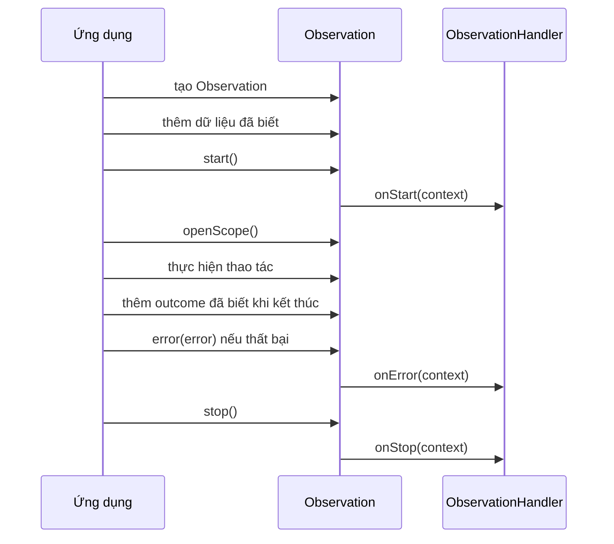

# Phạm vi nhãn có sẵn lúc bắt đầu so với lúc kết thúc

Một Observation thường bắt đầu trước khi ứng dụng biết kết quả cuối cùng của thao tác. Khi nhận request, ứng dụng đã biết method, route template, loại nghiệp vụ hoặc nhà cung cấp được chọn. Nhưng HTTP status, kết quả thanh toán, số bản ghi xử lý thành công hay loại lỗi có thể chỉ được xác định sau khi công việc hoàn tất.

Thời điểm một giá trị trở nên sẵn có ảnh hưởng đến cách gắn nó vào Observation và handler nào có thể sử dụng nó. Giá trị đã biết trước khi bắt đầu nên được đưa vào context trước `start()`. Giá trị chỉ biết khi xử lý xong có thể được bổ sung trong quá trình chạy, trước `stop()`; tuy nhiên, chỉ những handler đọc context ở thời điểm đó mới nhìn thấy giá trị mới. Handler chụp dữ liệu ngay tại `onStart` sẽ không tự cập nhật bản snapshot cũ.

Cần đồng thời phân biệt **thời điểm có dữ liệu** với **cardinality của dữ liệu**. Low-cardinality key-value phù hợp làm chiều metrics; high-cardinality key-value dành cho tracing hoặc tín hiệu có thể xử lý từng lần thực hiện. Một giá trị được biết ở cuối thao tác không tự động trở thành high-cardinality, và một giá trị có sẵn lúc bắt đầu cũng không mặc nhiên an toàn để làm metric tag.

## 1. Một thao tác có dữ liệu đầu vào và kết quả đầu ra

Xét thao tác xác nhận thanh toán:

- Trước khi bắt đầu, ứng dụng biết thao tác là `authorize`, provider là `pay-gateway-a`, channel là `web`.
- Trong khi xử lý, ứng dụng gọi provider và chờ phản hồi.
- Khi kết thúc, ứng dụng mới biết kết quả là `approved`, `declined`, `timeout` hoặc `error`.

Có thể chia dữ liệu thành hai nhóm theo thời điểm:

| Thời điểm | Thông tin thường có | Ví dụ |
|---|---|---|
| Trước `start()` | Loại thao tác, route template, method, provider đã chọn, channel | `operation=authorize`, `provider=gateway-a` |
| Trong khi chạy | Các bước đã thực hiện, retry count hiện tại, trạng thái trung gian | `retry.count=1` |
| Khi hoàn tất | Status, outcome, exception category, số bản ghi xử lý được | `outcome=declined`, `status=502` |

Thông tin có sẵn từ đầu có thể được dùng ngay khi handler nhận callback bắt đầu. Thông tin chỉ xuất hiện khi kết thúc cần được bổ sung trước khi Observation dừng và cần hiểu thời điểm handler đọc context.

## 2. Vòng đời Observation và thời điểm handler đọc context

Một Observation có các callback chính:

- `onStart(context)`: được gọi khi Observation bắt đầu.
- `onError(context)`: được gọi khi ứng dụng báo lỗi bằng `error(...)`.
- `onStop(context)`: được gọi khi Observation kết thúc.
- `onScopeOpened(context)` và `onScopeClosed(context)`: phản ánh việc mở và đóng scope.
- `onEvent(event, context)`: nhận sự kiện được phát trong vòng đời Observation.

Handler có thể đọc context ở một hoặc nhiều callback. Do đó, không có một quy tắc duy nhất rằng mọi nhãn đều phải có trước `start()` hoặc đều có thể thêm tùy ý đến `stop()`.



Một handler có thể chụp low-cardinality key-values tại `onStart` để tạo span hoặc khởi tạo trạng thái riêng. Handler metrics có thể tạo hoặc hoàn tất meter ở `onStop`, khi duration và outcome đã có. Handler tùy chỉnh có thể có chiến lược khác. Vì vậy, phải biết callback nào sử dụng thuộc tính nào và kiểm thử trên đúng handler/version của ứng dụng.

## 3. Đưa dữ liệu đã biết vào context trước start()

Các thuộc tính đầu vào ổn định nên được thêm trước khi gọi `start()`. Khi đó, handler nào đọc context tại `onStart` đều có thể thấy chúng.

```java
import io.micrometer.observation.Observation;
import io.micrometer.observation.ObservationRegistry;

public class PaymentService {

    private final ObservationRegistry registry;
    private final PaymentGateway gateway;

    public PaymentService(
            ObservationRegistry registry,
            PaymentGateway gateway
    ) {
        this.registry = registry;
        this.gateway = gateway;
    }

    public PaymentResult authorize(PaymentRequest request) {
        Observation observation = Observation.createNotStarted(
                "business.payment.authorize",
                registry
            )
            .contextualName("authorize-payment")
            .lowCardinalityKeyValue("operation", "authorize")
            .lowCardinalityKeyValue("provider", request.provider())
            .lowCardinalityKeyValue("channel", request.channel());

        observation.start();

        try (Observation.Scope scope = observation.openScope()) {
            return gateway.authorize(request);
        } catch (RuntimeException | Error error) {
            observation.error(error);
            throw error;
        } finally {
            observation.stop();
        }
    }
}
```

Trong ví dụ, `operation`, `provider` và `channel` đều có sẵn trước khi gọi provider. Chúng có thể được convention hoặc handler dùng ngay khi Observation bắt đầu.

Các giá trị như provider và channel phải được chuẩn hóa về tập hữu hạn. Nếu `request.provider()` có thể nhận chuỗi tùy ý từ người gọi, hãy map về enum hoặc nhóm provider đã cấu hình trước khi dùng làm low-cardinality key.

## 4. Thêm outcome chỉ biết khi thao tác kết thúc

Status hoặc outcome thường chỉ được biết sau khi nhận kết quả. Có thể thêm low-cardinality key-value khi thao tác đã chạy nhưng trước khi Observation dừng:

```java
public PaymentResult authorize(PaymentRequest request) {
    Observation observation = Observation.createNotStarted(
            "business.payment.authorize",
            registry
        )
        .lowCardinalityKeyValue("provider", request.provider())
        .lowCardinalityKeyValue("channel", request.channel());

    observation.start();

    try (Observation.Scope scope = observation.openScope()) {
        PaymentResult result = gateway.authorize(request);

        observation.lowCardinalityKeyValue(
            "outcome",
            result.approved() ? "approved" : "declined"
        );

        observation.lowCardinalityKeyValue(
            "http.status",
            Integer.toString(result.httpStatus())
        );

        return result;
    } catch (PaymentTimeoutException error) {
        observation.lowCardinalityKeyValue("outcome", "timeout");
        observation.error(error);
        throw error;
    } catch (RuntimeException | Error error) {
        observation.lowCardinalityKeyValue("outcome", "error");
        observation.error(error);
        throw error;
    } finally {
        observation.stop();
    }
}
```

Đây là mẫu lifecycle minh họa: outcome được thêm trước `stop()`, còn `error(...)` được gọi khi có exception. Với handler metrics lấy key-values ở giai đoạn hoàn tất, các tag này có thể tham gia tạo meter. Với handler chụp attributes ở `onStart`, chúng không thể xuất hiện trong snapshot lúc bắt đầu; cần handler hỗ trợ cập nhật span hoặc một cơ chế bổ sung thuộc tính sau khi có kết quả.

Nếu cần một thuộc tính phải có ngay trên span từ lúc bắt đầu, chỉ dùng dữ liệu đã biết trước `start()`. Nếu thuộc tính chỉ biết khi kết thúc, xác minh tracing handler đang dùng có cập nhật thuộc tính cuối vòng đời hay không.

## 5. Không đồng nhất thời điểm với cardinality

Low-cardinality và high-cardinality mô tả số lượng giá trị khác nhau có thể xuất hiện, không mô tả thời điểm giá trị được biết.

| Thuộc tính | Thời điểm có thể biết | Cardinality thường phù hợp |
|---|---|---|
| `operation=authorize` | Trước start | Low |
| `provider=gateway-a` | Trước start | Low nếu provider list hữu hạn |
| `channel=web` | Trước start | Low |
| `outcome=approved` | Cuối thao tác | Low nếu outcome thuộc enum hữu hạn |
| `http.status=502` | Cuối thao tác | Thường low nếu dùng mã status có tập giới hạn |
| `payment.reference=...` | Cuối thao tác | High; thường không nên export nếu nhạy cảm |
| `request.id=...` | Đầu hoặc cuối | High |
| `exception.message=...` | Khi lỗi | High và có thể chứa dữ liệu nhạy cảm |

Một outcome chỉ có bốn giá trị vẫn là low-cardinality dù chỉ biết ở cuối. Ngược lại, request ID đã có sẵn từ đầu vẫn là high-cardinality.

Không dùng high-cardinality key-value cho metric tags. Các giá trị này có thể tạo một chuỗi thời gian cho mỗi request hoặc giao dịch. Chỉ đưa dữ liệu vào tracing nếu backend, quyền truy cập và chính sách bảo vệ dữ liệu cho phép.

## 6. Low-cardinality key-value có thể được bổ sung trong lifecycle

Observation giữ key-values trong context. Ứng dụng có thể bổ sung low-cardinality key-value khi có kết quả, miễn là thực hiện trước thời điểm handler cần đọc chúng.

Ví dụ với Timer handler tiêu chuẩn, meter hoàn tất khi Observation dừng nên các low-cardinality values có trong context ở thời điểm đó có thể được dùng để xác định Timer. Tuy nhiên, convention hoặc handler tùy chỉnh có thể lấy snapshot sớm hơn. Không nên dựa vào giả định chung cho mọi handler.

Nguyên tắc thực hành:

- Thuộc tính cần cho `onStart`: thêm trước `start()`.
- Thuộc tính chỉ cần cho meter được tạo/hoàn tất ở `onStop`: thêm trước `stop()`.
- Thuộc tính cần cho cả span bắt đầu sớm và meter cuối vòng đời: thêm trước `start()` nếu đã biết; nếu chỉ biết cuối, xác minh tracing handler hỗ trợ cập nhật sau start.
- Thuộc tính không có cardinality giới hạn: không đưa thành low-cardinality key-value.

## 7. ObservationConvention cung cấp dữ liệu mặc định ở thời điểm bắt đầu

`ObservationConvention` chuẩn hóa tên, contextual name và các key-values theo loại context. Convention thường được hỏi khi Observation được khởi tạo/bắt đầu theo luồng của instrumentation. Vì vậy, các thuộc tính convention trả về cần dựa trên thông tin đã có trong context tại thời điểm đó.

Ví dụ một context tùy chỉnh giữ provider và channel đã biết từ request:

```java
import io.micrometer.common.KeyValues;
import io.micrometer.observation.Observation;
import io.micrometer.observation.ObservationConvention;

class PaymentContext extends Observation.Context {

    private final String provider;
    private final String channel;

    PaymentContext(String provider, String channel) {
        this.provider = provider;
        this.channel = channel;
    }

    String provider() {
        return provider;
    }

    String channel() {
        return channel;
    }
}

class PaymentObservationConvention
        implements ObservationConvention<PaymentContext> {

    @Override
    public boolean supportsContext(Observation.Context context) {
        return context instanceof PaymentContext;
    }

    @Override
    public String getName() {
        return "business.payment.authorize";
    }

    @Override
    public KeyValues getLowCardinalityKeyValues(PaymentContext context) {
        return KeyValues.of(
            "provider", context.provider(),
            "channel", context.channel()
        );
    }
}
```

Đoạn code minh họa convention cho dữ liệu đầu vào. Outcome chưa có trong context ở thời điểm tạo; có thể bổ sung sau khi gọi provider. Khi dùng convention tùy chỉnh trong ứng dụng thực tế, cần kiểm tra API của phiên bản Micrometer đang dùng và cách instrumentation tạo Observation từ convention.

Không nên đặt một giá trị mặc định như `outcome=success` trong convention nếu thao tác chưa chạy. Điều đó có thể làm một request timeout hoặc thất bại bị gắn nhãn thành công nếu kết quả không được cập nhật đúng.

## 8. Dùng context tùy chỉnh để lưu dữ liệu đầu ra

Với thao tác phức tạp, có thể tạo context chứa cả dữ liệu đầu vào và kết quả cuối cùng. Convention hoặc handler có thể đọc dữ liệu đó ở callback thích hợp.

Ví dụ context lưu status và outcome:

```java
class PaymentContext extends Observation.Context {

    private final String provider;
    private final String channel;

    private String outcome = "unknown";
    private Integer status;

    PaymentContext(String provider, String channel) {
        this.provider = provider;
        this.channel = channel;
    }

    String provider() {
        return provider;
    }

    String channel() {
        return channel;
    }

    void result(String outcome, Integer status) {
        this.outcome = outcome;
        this.status = status;
    }

    String outcome() {
        return outcome;
    }

    Integer status() {
        return status;
    }
}
```

Context được tạo với provider và channel trước start. Sau khi provider phản hồi, ứng dụng gọi `result(...)` để lưu outcome và status. Handler đọc context ở `onStop` có thể sử dụng dữ liệu cuối cùng.

Nếu handler cần outcome ở `onStart`, dữ liệu đó chưa tồn tại và không thể suy đoán. Handler có thể chụp input ban đầu ở start, rồi bổ sung outcome khi stop nếu API đích hỗ trợ.

## 9. Handler đọc context ở các callback khác nhau

Một handler tùy chỉnh có thể cần dữ liệu tại nhiều thời điểm. Ví dụ, handler kiểm tra có thể lưu snapshot lúc bắt đầu và snapshot cuối lúc dừng:

```java
import io.micrometer.observation.Observation;
import io.micrometer.observation.ObservationHandler;

class LifecycleAuditHandler
        implements ObservationHandler<Observation.Context> {

    @Override
    public boolean supportsContext(Observation.Context context) {
        return true;
    }

    @Override
    public void onStart(Observation.Context context) {
        // Chỉ ghi nhận những key-values đã có tại thời điểm bắt đầu.
        System.out.println(
            "start keys=" + context.getLowCardinalityKeyValues()
        );
    }

    @Override
    public void onStop(Observation.Context context) {
        // Có thể thấy các key-values được bổ sung trước khi stop.
        System.out.println(
            "stop keys=" + context.getLowCardinalityKeyValues()
        );
    }
}
```

Handler này chỉ minh họa việc đọc context; không nên in dữ liệu nhạy cảm trong production. Nếu một handler sao chép key-values vào cấu trúc riêng tại `onStart`, việc thay đổi context sau đó không tự sửa snapshot đã lưu.

Đối với handler tracing, cần xem cách handler tạo span và cập nhật attributes. Đối với handler metrics, cần xem khi nào nó tạo Timer, Counter hoặc meter khác. Đừng suy luận hành vi của một handler từ callback của handler khác.

## 10. Xử lý lỗi: outcome và exception có thời điểm riêng

Khi thao tác ném exception, ứng dụng có thể biết ngay exception category và outcome. Hãy gắn outcome có cardinality hữu hạn trước khi báo lỗi và dừng Observation:

```java
try (Observation.Scope scope = observation.openScope()) {
    return paymentGateway.authorize(request);
} catch (PaymentTimeoutException error) {
    observation.lowCardinalityKeyValue("outcome", "timeout");
    observation.error(error);
    throw error;
} catch (PaymentDeclinedException error) {
    observation.lowCardinalityKeyValue("outcome", "declined");
    observation.error(error);
    throw error;
} catch (RuntimeException | Error error) {
    observation.lowCardinalityKeyValue("outcome", "error");
    observation.error(error);
    throw error;
} finally {
    observation.stop();
}
```

Không dùng exception message làm low-cardinality tag. Message có thể chứa order ID, URL, SQL, dữ liệu người dùng hoặc nội dung động. Nếu cần phân loại lỗi, map về enum hữu hạn như `timeout`, `declined`, `provider_error`, `validation_error`.

Việc gọi `error(...)` thường kích hoạt `onError` ngay tại thời điểm gọi. Vì vậy, nếu handler `onError` cần đọc outcome, hãy đặt outcome trước `error(...)`. Sau đó vẫn cần `stop()` để kết thúc Observation.

## 11. Status HTTP chỉ có khi response đã được tạo

Trong HTTP server instrumentation, method và route có thể biết khi request bắt đầu; status code chỉ biết khi response được tạo hoặc khi exception được xử lý.

Một Observation HTTP có thể cần các thuộc tính:

| Thuộc tính | Thời điểm có thể biết |
|---|---|
| Method | Khi nhận request |
| Route template | Sau khi routing hoàn tất; có thể chưa biết ngay tại socket accept |
| URI template | Khi framework xác định handler |
| Status code | Khi response hoàn tất |
| Outcome | Sau khi status/exception được xác định |
| Exception category | Khi lỗi xảy ra |

Không nên gắn URL thô chứa ID vào tag. Với status và outcome, dùng tập giá trị hữu hạn. Nếu framework tự quản lý HTTP Observation, hãy sử dụng convention và handler tích hợp thay vì tự tạo Observation trùng lặp quanh cùng request.

## 12. Dữ liệu đầu vào chưa chắc đã sẵn sàng ngay khi nhận request

Không phải mọi thuộc tính “đầu vào” đều có ngay trước start. Ví dụ route template chỉ được biết sau bước routing; tenant hoặc loại nghiệp vụ có thể chỉ xác định sau authentication hay phân giải request.

Cần xác định chính xác ranh giới bắt đầu Observation:

- Nếu Observation bắt đầu tại socket/server entry, route có thể chưa được biết.
- Nếu Observation bắt đầu quanh controller handler, route và method có thể đã có.
- Nếu Observation bắt đầu ở application service, loại nghiệp vụ và channel có thể đã được xác định.

Nếu một thuộc tính low-cardinality chỉ có sau bước định tuyến, có thể bổ sung sau start trước stop cho handler đọc ở cuối; nếu handler cần nó ngay tại start, hãy chọn ranh giới Observation phù hợp hơn hoặc dùng convention/context được cập nhật trước khi span được tạo.

Không trì hoãn start chỉ để chờ một thuộc tính không thiết yếu nếu việc đó làm sai thời gian đo. Ranh giới Observation cần phản ánh đúng thời gian của thao tác mà hệ thống muốn quan sát.

## 13. Với async, dữ liệu cuối cùng và lifecycle phải kết thúc cùng nhau

Trong thao tác bất đồng bộ, response hoặc kết quả chỉ có khi future hoàn tất. Nếu Observation dừng ngay khi phương thức trả về future, các giá trị outcome chưa có và thời gian đo chỉ bao gồm thời gian khởi tạo.

Ví dụ lifecycle cần hoàn tất trong callback:

```java
Observation observation = Observation.createNotStarted(
    "business.payment.authorize",
    registry
)
.lowCardinalityKeyValue("provider", request.provider());

observation.start();

CompletableFuture<PaymentResult> future;

try {
    future = gateway.authorizeAsync(request);
} catch (RuntimeException | Error error) {
    observation.lowCardinalityKeyValue("outcome", "error");
    observation.error(error);
    observation.stop();
    throw error;
}

return future.whenComplete((result, error) -> {
    if (error != null) {
        observation.lowCardinalityKeyValue("outcome", "error");
        observation.error(error);
    } else {
        observation.lowCardinalityKeyValue(
            "outcome",
            result.approved() ? "approved" : "declined"
        );
    }

    observation.stop();
});
```

Đây là phác thảo lifecycle. Trong ứng dụng thật, phải xử lý cả cancellation, callback chạy đúng một lần và context propagation qua executor. Không mở một Observation.Scope trên thread khởi tạo rồi để nó mở cho đến khi callback chạy ở thread khác.

## 14. Không biến mọi giá trị cuối thao tác thành tag

Một số dữ liệu chỉ xuất hiện khi kết thúc nhưng không phù hợp làm metrics:

- Transaction ID.
- Payment reference.
- Customer ID.
- Exception message.
- Response body.
- SQL hoặc câu lệnh có tham số động.

Chúng có thể có giá trị khi điều tra một lần thực hiện, nhưng thường có cardinality cao hoặc chứa dữ liệu nhạy cảm. Chỉ thêm chúng vào tracing/log khi chính sách cho phép và backend có kiểm soát truy cập, retention phù hợp. Không ghi dữ liệu thẻ thanh toán, token, mật khẩu hoặc payload nhạy cảm vào Observation context.

Đối với metrics, chuyển thông tin cuối thành nhóm hữu hạn, ví dụ `outcome=approved|declined|timeout|error`, `status=2xx|4xx|5xx` hoặc `error.category=provider|validation|network`.

## 15. Kiểm thử thời điểm có sẵn của key-value

Một test hữu ích cần xác minh handler nhìn thấy giá trị nào ở `onStart` và giá trị nào ở `onStop`. Ví dụ dưới đây dùng handler kiểm thử để lưu hai snapshot:

```java
import io.micrometer.observation.Observation;
import io.micrometer.observation.ObservationHandler;
import io.micrometer.observation.ObservationRegistry;

import java.util.ArrayList;
import java.util.List;

public class ObservationTimingTestExample {

    static class SnapshotHandler
            implements ObservationHandler<Observation.Context> {

        final List<String> startValues = new ArrayList<>();
        final List<String> stopValues = new ArrayList<>();

        @Override
        public boolean supportsContext(Observation.Context context) {
            return true;
        }

        @Override
        public void onStart(Observation.Context context) {
            startValues.add(context.getLowCardinalityKeyValues().toString());
        }

        @Override
        public void onStop(Observation.Context context) {
            stopValues.add(context.getLowCardinalityKeyValues().toString());
        }
    }

    public static void main(String[] args) {
        ObservationRegistry registry = ObservationRegistry.create();
        SnapshotHandler handler = new SnapshotHandler();

        registry.observationConfig().observationHandler(handler);

        Observation observation = Observation.createNotStarted(
                "business.payment.authorize",
                registry
            )
            .lowCardinalityKeyValue("provider", "gateway-a");

        observation.start();

        try {
            observation.lowCardinalityKeyValue("outcome", "approved");
        } finally {
            observation.stop();
        }

        System.out.println("start=" + handler.startValues);
        System.out.println("stop=" + handler.stopValues);
    }
}
```

Snapshot ở start được tạo trước khi thêm `outcome`; snapshot ở stop đọc context sau khi thêm. Test này minh họa thời điểm handler quan sát context, không chứng minh mọi handler metrics/tracing đều dùng cùng thời điểm.

Trong test thực tế, nên kiểm tra thêm Timer được tạo với tag nào và tracing span có nhận attribute được thêm sau start hay không. Kết quả phụ thuộc handler cụ thể và phiên bản Micrometer/tracing bridge đang dùng.

## 16. Ma trận quyết định: thêm trước start hay trước stop?

| Trường hợp | Thời điểm thêm | Lý do |
|---|---|---|
| Observation name, contextual name | Trước start | Handler cần tên khi khởi tạo |
| Operation, method, provider đã chọn | Trước start | Có sẵn và hữu ích cho handler start-time |
| Route template chỉ biết sau routing | Khi route đã xác định, trước callback cần dùng | Không thể gắn chính xác trước khi framework biết route |
| Status code | Khi response hoàn tất, trước stop | Chỉ có ở cuối thao tác |
| Outcome success/declined/timeout | Khi có kết quả, trước stop | Cần phản ánh kết quả thật |
| Exception category | Khi lỗi xảy ra, trước onError/stop | Handler onError có thể đọc ngay lúc được gọi |
| Request ID hoặc transaction reference | Khi có, chỉ cho tracing/log nếu được phép | High-cardinality, không dùng làm metric tag |
| Exception message/payload | Tránh đưa vào metrics; cân nhắc tracing/log có kiểm soát | Có thể động và nhạy cảm |

## 17. Những lỗi thường gặp

| Lỗi | Hậu quả | Cách xử lý |
|---|---|---|
| Thêm provider hoặc operation sau start dù đã biết từ đầu | Handler chụp context ở onStart có thể bỏ lỡ | Thêm các giá trị đầu vào trước start |
| Thêm outcome sau stop | Handler đã hoàn tất, giá trị không tham gia tín hiệu | Gắn outcome trước stop |
| Gọi error() trước khi gắn outcome | Handler onError không thấy outcome | Gắn outcome trước error() |
| Giả định mọi handler đọc context cùng thời điểm | Tag xuất hiện ở metrics nhưng thiếu trên span hoặc ngược lại | Kiểm tra callback và test từng handler |
| Dùng exception message làm low-cardinality key | Cardinality tăng và có thể lộ dữ liệu | Map sang error category hữu hạn |
| Cho rằng giá trị biết ở cuối phải là high-cardinality | Mất chiều metrics hữu ích như status/outcome | Chọn cardinality theo số giá trị, không theo thời điểm |
| Dùng ID có sẵn từ đầu làm low-cardinality | Tạo series theo từng request/entity | Đưa ID vào trace/log nếu được phép |
| Dừng Observation ngay sau khi tạo future | Thiếu thời gian và outcome cuối cùng | Kết thúc trong callback hoàn tất |
| Dùng convention mặc định outcome=success | Request lỗi có thể bị gắn nhãn sai | Chỉ gắn outcome sau khi có kết quả |
| Test chỉ kiểm tra Observation được tạo | Không phát hiện handler bỏ lỡ key-value | Chụp context ở start/stop và kiểm tra exporter |

## 18. Checklist thiết kế nhãn theo lifecycle

- [ ] Xác định ranh giới bắt đầu và kết thúc của Observation.
- [ ] Liệt kê dữ liệu có sẵn trước start.
- [ ] Thêm tên, contextual name và input low-cardinality trước start.
- [ ] Xác định dữ liệu chỉ có khi thao tác hoàn tất.
- [ ] Thêm outcome/status trước stop và trước onError nếu handler cần đọc tại onError.
- [ ] Xác minh handler nào chụp context ở onStart, onError hoặc onStop.
- [ ] Không giả định mọi handler tự cập nhật snapshot sau khi context thay đổi.
- [ ] Chọn low/high cardinality theo số lượng giá trị, không theo thời điểm xuất hiện.
- [ ] Không đưa ID, message, payload hoặc dữ liệu nhạy cảm thành metric tag.
- [ ] Với async, giữ Observation đến khi công việc thực sự hoàn tất.
- [ ] Kiểm thử riêng metrics handler và tracing handler.
- [ ] Kiểm tra tag cuối cùng trên backend sau khi export.

Thời điểm một thuộc tính có sẵn quyết định handler nào có thể sử dụng nó; cardinality quyết định thuộc tính có phù hợp làm chiều metrics hay không. Hãy thêm dữ liệu đầu vào trước `start()`, bổ sung outcome và status trước `stop()`, đồng thời đặt outcome trước `error(...)` nếu callback lỗi cần đọc nó. Vì handler có thể chụp context ở các thời điểm khác nhau, cần xác minh hành vi trên đúng registry, tracing bridge và phiên bản đang chạy thay vì giả định mọi handler xử lý nhãn giống nhau.

## Tài liệu tham khảo

- [Micrometer Observation Concepts](https://docs.micrometer.io/micrometer/reference/observation.html) — lifecycle, context và low/high-cardinality key-values.
- [Micrometer Observation Instrumentation](https://docs.micrometer.io/micrometer/reference/observation/instrumenting.html) — tạo Observation, thêm key-values và quản lý start/stop.
- [Micrometer Observation API](https://javadoc.io/doc/io.micrometer/micrometer-observation/latest/io/micrometer/observation/Observation.html) — các phương thức lifecycle và key-value.
- [Spring Boot Observability](https://docs.spring.io/spring-boot/reference/actuator/observability.html) — tích hợp Observation, metrics và tracing.

