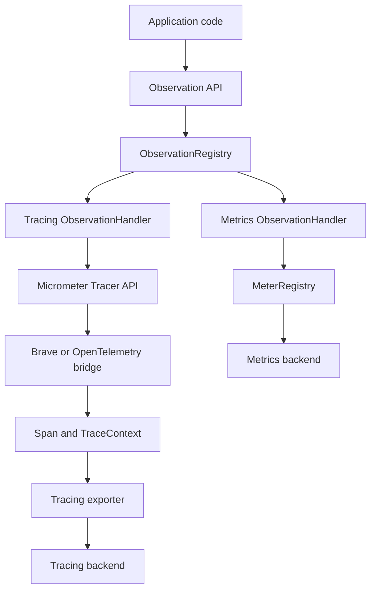

# Micrometer Tracing kết nối vòng đời quan sát với tracer như thế nào

Micrometer Observation cung cấp một vòng đời chung cho hoạt động cần quan sát; Micrometer Tracing kết nối vòng đời đó với tracer để tạo và quản lý span. Khi một observation được bắt đầu, tracing handler có thể tạo span tương ứng. Khi observation được mở scope, span trở thành context hiện tại trên thread. Khi có lỗi, observation chuyển thông tin lỗi cho handler. Khi observation dừng, tracing handler kết thúc span và chuyển nó cho exporter hoặc hệ thống tracing tương ứng.

Nhờ cách tích hợp này, cùng một observation có thể được nhiều handler xử lý: metrics handler tạo số đo Micrometer, tracing handler tạo span. Mã nghiệp vụ chỉ làm việc với `ObservationRegistry` và Observation API; bridge kết nối API tracing chung của Micrometer với implementation như Brave hoặc OpenTelemetry.

Trong module `OBSERVABILITY_INSTRUMENTATION_MICROMETER`, Counter, Gauge, Timer, DistributionSummary và tag giúp mô tả hành vi của một service. Micrometer Tracing bổ sung chiều liên kết theo request và dependency: observation của cùng một thao tác có thể đồng thời tạo metric để tổng hợp và span để điều tra đường đi của request qua nhiều thành phần.

## 1. Observation, Tracer và Span có vai trò khác nhau

Ba khái niệm cần được phân biệt:

| Thành phần | Vai trò | Câu hỏi được trả lời |
| --- | --- | --- |
| `Observation` | Mô tả một thao tác có vòng đời và context | Thao tác nào đang được quan sát? |
| `Tracer` | API chung để tạo span, truy cập span hiện tại và quản lý scope | Làm thế nào để tạo và liên kết các span? |
| `Span` | Đại diện cho một đơn vị công việc trong distributed trace | Công việc bắt đầu, kết thúc, lỗi và quan hệ cha-con ra sao? |

`ObservationRegistry` điều phối Observation API và các handler được đăng ký. Tracing handler nhận các lifecycle callback từ registry rồi dùng `Tracer` để quản lý span. Bridge chuyển lời gọi API Micrometer Tracing sang tracer backend cụ thể.



Observation là điểm tích hợp chung. Tracer và span là phần triển khai tracing được handler sử dụng để biểu diễn quan hệ và thời gian của thao tác.

## 2. ObservationRegistry điều phối các handler

Khi tạo observation từ `ObservationRegistry`, registry áp dụng predicate, conventions và các handler đã được cấu hình. Mỗi handler có thể khai báo loại context mà nó hỗ trợ thông qua `supportsContext(...)`.

Trong ứng dụng có Micrometer metrics và tracing, registry thường có ít nhất hai nhóm handler:

- **Metrics handler**: chuyển lifecycle thành meter như Timer hoặc LongTaskTimer.
- **Tracing handler**: chuyển lifecycle thành span và quản lý trace context.

Các handler cùng nhận lifecycle event của một observation được chấp nhận. Mã nghiệp vụ không cần tự gọi một API riêng cho metrics rồi gọi thêm một API khác cho tracing.

Ví dụ tạo observation:

```java
import io.micrometer.observation.Observation;
import io.micrometer.observation.ObservationRegistry;

public final class OrderService {
    private final ObservationRegistry observationRegistry;

    public OrderService(ObservationRegistry observationRegistry) {
        this.observationRegistry = observationRegistry;
    }

    public OrderResult process(Order order) {
        return Observation.createNotStarted(
                        "shop.order.process", observationRegistry)
                .contextualName("process-order")
                .lowCardinalityKeyValue("operation", "process")
                .observe(() -> doProcess(order));
    }

    private OrderResult doProcess(Order order) {
        // Thực hiện nghiệp vụ.
        return new OrderResult();
    }
}
```

`observe(...)` quản lý lifecycle đồng bộ: bắt đầu observation, mở scope trong lúc chạy callback, ghi nhận lỗi nếu callback ném exception và kết thúc observation. Nếu registry có tracing handler, handler có thể tạo span cho thao tác này; nếu có metrics handler, handler có thể ghi nhận thời lượng.

## 3. Bridge kết nối API Micrometer với tracer cụ thể

Micrometer Tracing cung cấp API chung để ứng dụng không phụ thuộc trực tiếp vào Brave hoặc OpenTelemetry SDK. Bridge triển khai API chung bằng tracer của hệ sinh thái được chọn.

| Bridge | Tracer phía dưới | Khi nào dùng |
| --- | --- | --- |
| `micrometer-tracing-bridge-brave` | Brave | Hệ thống đang dùng Brave hoặc Zipkin ecosystem. |
| `micrometer-tracing-bridge-otel` | OpenTelemetry | Hệ thống dùng OpenTelemetry SDK và exporter. |

Các dependency exporter thường đi kèm bridge tương ứng, ví dụ Zipkin reporter cho Brave hoặc OTLP exporter cho OpenTelemetry. Chỉ thêm bridge phù hợp với backend và phiên bản Spring Boot/Micrometer đang dùng; tránh đưa đồng thời nhiều bridge cạnh tranh vào cùng application context nếu không có kiến trúc cụ thể cho việc đó.

Bridge không phải backend lưu trữ. Nó chuyển API Micrometer Tracing sang tracer implementation. Exporter chịu trách nhiệm gửi span đến hệ thống nhận; backend tracing lưu trữ và cung cấp khả năng tìm kiếm, hiển thị trace.

## 4. Vòng đời Observation được ánh xạ sang Span

Tracing handler tham gia vào các lifecycle callback của Observation. Ở mức khái niệm, việc ánh xạ diễn ra như sau:

| Observation lifecycle | Vai trò của tracing handler | Kết quả trong trace |
| --- | --- | --- |
| Tạo observation | Nhận tên và context ban đầu | Chưa nhất thiết tạo span ngay. |
| `start()` | Tạo và bắt đầu span phù hợp với context | Span có start timestamp và trace context. |
| `openScope()` | Đặt span vào tracer context hiện tại | Code lồng nhau có thể tìm được span hiện tại. |
| `scope.close()` | Khôi phục span/context trước đó | Không còn coi span vừa đóng scope là current trên thread. |
| `error(Throwable)` | Ghi lỗi vào context và chuyển thông tin cho handler | Span có thể được đánh dấu lỗi hoặc gắn exception event/tag theo bridge. |
| `stop()` | Kết thúc span | Span có end timestamp và được exporter xử lý. |

Đây là cách diễn giải lifecycle ở tầng tích hợp. Chi tiết attribute, status và event được ghi lên span phụ thuộc tracing handler, bridge và quy ước của backend.

### 4.1. start tạo span

Khi observation được start, tracing handler có thể gọi tracer để tạo span mới. Span nhận tên dựa trên observation name hoặc contextual name theo convention. Tracer cũng xác định quan hệ parent dựa trên trace context hiện tại nếu có.

Nếu observation bị `ObservationPredicate` từ chối, registry dùng no-op observation và tracing handler không tạo span cho thao tác đó.

### 4.2. Scope làm span trở thành current

Span tồn tại không có nghĩa nó tự động là span hiện tại của thread. Khi code mở `Observation.Scope`, tracing handler đưa span tương ứng vào tracer context. Những thao tác được instrument bên trong scope có thể tìm thấy current span và tạo span con.

Khi scope đóng, context trước đó được khôi phục. Vì vậy, scope phải được đóng đúng thread và đúng thứ tự lồng nhau.

### 4.3. error ghi nhận thất bại

Khi code gọi `observation.error(exception)`, exception được lưu trong context để handler xử lý. Tracing handler có thể chuyển lỗi thành span status hoặc exception event theo convention của bridge. `error()` không tự kết thúc span; vẫn cần `stop()`.

### 4.4. stop kết thúc span

Khi observation dừng, tracing handler kết thúc span. Span có thời điểm kết thúc và có thể được chuyển đến exporter. Nếu quên stop, span có thể không được hoàn tất đúng cách; nếu stop quá sớm, trace chỉ phản ánh một phần thao tác.

## 5. Trace, Span và TraceContext

Một trace mô tả toàn bộ hành trình của một request hoặc một hoạt động phân tán qua nhiều thành phần. Trace gồm nhiều span có quan hệ cha-con hoặc liên kết theo mô hình tracing.

| Khái niệm | Ý nghĩa |
| --- | --- |
| Trace ID | Định danh trace xuyên suốt nhiều service. |
| Span ID | Định danh một đơn vị công việc trong trace. |
| Parent Span ID | Liên kết span hiện tại với span cha. |
| TraceContext | Mang thông tin cần thiết để nối các span, bao gồm trace ID, span ID và flags liên quan. |
| Baggage | Thuộc tính context có thể được truyền qua ranh giới process theo propagation policy. |

Một request đi qua gateway, order-service, inventory-service và payment-service có thể tạo một trace chung. Mỗi service tạo span cho phần xử lý của mình; các HTTP client/server instrumentation truyền và trích xuất trace context để liên kết span xuyên service.

## 6. Observation lồng nhau tạo quan hệ span cha-con

Khi một observation cha đang mở scope, observation con được tạo trong cùng context có thể nhận span cha tương ứng. Không cần tự truyền trace ID hoặc span ID qua từng method.

```java
public OrderResult process(Order order) {
    Observation parent = Observation.createNotStarted(
            "shop.order.process", observationRegistry).start();

    try (Observation.Scope parentScope = parent.openScope()) {
        Observation child = Observation.createNotStarted(
                "shop.inventory.reserve", observationRegistry).start();
        try (Observation.Scope childScope = child.openScope()) {
            inventoryService.reserve(order);
        } catch (RuntimeException | Error error) {
            child.error(error);
            throw error;
        } finally {
            child.stop();
        }

        return createResult(order);
    } catch (RuntimeException | Error error) {
        parent.error(error);
        throw error;
    } finally {
        parent.stop();
    }
}
```

Observation cha mở scope trước khi tạo observation con. Vì span cha là current span, tracing handler có thể tạo span con với parent context phù hợp. Scope con đóng trước scope cha và span con dừng trước span cha.

Trong code production, có thể dùng `Observation.observe(...)` để giảm boilerplate lifecycle. Điều quan trọng là duy trì đúng phạm vi thao tác và không để scope của child vượt khỏi scope của parent.

## 7. Tên observation và tên span

Observation có thể có tên kỹ thuật và contextual name:

- `name`: định danh ổn định của loại observation, thường quan trọng với metrics convention.
- `contextualName`: tên dễ đọc hơn trong trace, thường mô tả thao tác cụ thể bằng ngôn ngữ vận hành.

Ví dụ:

```java
Observation.createNotStarted("shop.payment.authorize", observationRegistry)
        .contextualName("authorize-payment")
        .observe(() -> paymentGateway.authorize(command));
```

Tên metric và span có thể được convention xử lý khác nhau. Hãy giữ observation name ổn định và ít cardinality; không thêm order ID, customer ID hoặc URL đầy đủ vào tên. Nếu cần thông tin cụ thể để điều tra, hãy cân nhắc span attribute hoặc baggage theo chính sách bảo mật và cardinality phù hợp.

## 8. Low-cardinality và high-cardinality key-value

Observation hỗ trợ hai nhóm key-value:

| Loại | Mục đích | Ví dụ |
| --- | --- | --- |
| Low-cardinality | Có thể được dùng cho metrics và tracing | `operation=reserve`, `result=success`, `region=apac` |
| High-cardinality | Dữ liệu chi tiết dành cho tracing, không nên trở thành metric label | `order.id=...`, `request.id=...` nếu policy cho phép |

Ví dụ:

```java
Observation.createNotStarted("shop.order.process", observationRegistry)
        .lowCardinalityKeyValue("operation", "process")
        .lowCardinalityKeyValue("channel", "web")
        .highCardinalityKeyValue("order.id", order.id())
        .observe(() -> doProcess(order));
```

Low-cardinality value có thể được dùng để tạo metric dimensions, vì vậy phải giới hạn số giá trị. High-cardinality value phù hợp hơn cho trace detail, nhưng vẫn có thể làm tăng kích thước telemetry và có nguy cơ chứa dữ liệu nhạy cảm. Không đưa token, email hoặc thông tin cá nhân vào span attribute/baggage chỉ vì chúng không phải metric tag.

## 9. Propagation qua HTTP giữa các service

Khi service A gọi service B qua HTTP, tracing instrumentation có thể inject trace context vào request header. Service B trích xuất context từ header và dùng nó làm parent cho span server.

Các định dạng propagation thường gặp:

- **W3C Trace Context**: dùng header như `traceparent` và tùy chọn `tracestate`.
- **B3**: định dạng header được dùng trong hệ sinh thái Brave/Zipkin.

Luồng cơ bản:

1. Service A có span hiện tại.
2. HTTP client instrumentation lấy trace context từ tracer.
3. Propagator inject context vào HTTP request headers.
4. Service B nhận request và propagator extract context.
5. HTTP server instrumentation tạo span server liên kết với context đã extract.

Khi cả hai phía được cấu hình tương thích, trace backend hiển thị các span trong cùng một trace. Không tự tạo `traceparent` bằng cách nối chuỗi nếu HTTP instrumentation và propagator đã đảm nhận việc này.

## 10. Propagation qua thread và executor

Trace context hiện tại thường gắn với execution context của thread. Mở `Observation.Scope` trên thread submit không tự động làm span đó trở thành current trên worker thread.

Với tác vụ bất đồng bộ, cần cơ chế context propagation phù hợp:

- Dùng executor được instrument hoặc cấu hình `TaskDecorator`/context propagation theo Spring Boot và phiên bản Micrometer.
- Capture context tại thời điểm submit và restore context khi task chạy.
- Đóng scope trên worker thread trước khi trả thread về pool.
- Không giữ `SpanInScope` hoặc `Observation.Scope` mở qua nhiều thread.

Nếu context không được truyền, span trong worker có thể trở thành root span mới hoặc không liên kết với trace cha. Điều này làm trace bị tách rời dù tác vụ vẫn thực thi đúng.

Khi dùng `CompletableFuture`, Reactor hoặc message listener, hãy ưu tiên integration/context propagation do framework cung cấp. Kiểm thử trace parent-child xuyên qua ranh giới bất đồng bộ thay vì chỉ kiểm tra code đồng bộ.

## 11. Cấu hình Micrometer Tracing trong Spring Boot

Spring Boot có thể tự cấu hình ObservationRegistry, tracing handler, tracer bridge và exporter khi các dependency tương ứng có mặt. Hai lựa chọn bridge phổ biến là Brave và OpenTelemetry.

Ví dụ dependency Maven khi dùng OpenTelemetry bridge và OTLP exporter:

```xml
<dependency>
    <groupId>org.springframework.boot</groupId>
    <artifactId>spring-boot-starter-actuator</artifactId>
</dependency>
<dependency>
    <groupId>io.micrometer</groupId>
    <artifactId>micrometer-tracing-bridge-otel</artifactId>
</dependency>
<dependency>
    <groupId>io.opentelemetry</groupId>
    <artifactId>opentelemetry-exporter-otlp</artifactId>
</dependency>
```

Nếu dùng Brave và Zipkin, thay bridge và exporter bằng các dependency tương ứng, chẳng hạn `micrometer-tracing-bridge-brave` cùng Zipkin reporter được hỗ trợ.

Ví dụ cấu hình sampling:

```yaml
spring:
  application:
    name: order-service

management:
  tracing:
    sampling:
      probability: 0.1
```

`probability` điều khiển tỷ lệ trace được sample theo cấu hình hỗ trợ của phiên bản. Giá trị 0.1 tương đương mục tiêu lấy mẫu khoảng 10% trace đầu vào trong mô hình probability sampling. Môi trường phát triển có thể dùng tỷ lệ cao hơn; production cần chọn theo lưu lượng, chi phí và yêu cầu điều tra.

Endpoint exporter và các property cấu hình tracing thay đổi theo dòng Spring Boot và exporter được chọn. Hãy dùng dependency management của Spring Boot và tài liệu đúng phiên bản để cấu hình OTLP/Zipkin endpoint, TLS, authentication và batch. Không giả định property của một phiên bản Boot có thể dùng nguyên xi ở phiên bản khác.

## 12. Dùng Tracer trực tiếp khi cần tạo span chuyên biệt

Trong phần lớn code nghiệp vụ, nên dùng Observation để cùng một lifecycle có thể phục vụ metrics và tracing. Có trường hợp cần API tracing trực tiếp, chẳng hạn tạo span cho một đoạn code đặc biệt hoặc tích hợp với thư viện không có Observation instrumentation.

Ví dụ với Micrometer `Tracer`:

```java
import io.micrometer.tracing.Span;
import io.micrometer.tracing.Tracer;

public final class LegacyOperation {
    private final Tracer tracer;

    public LegacyOperation(Tracer tracer) {
        this.tracer = tracer;
    }

    public Result execute() {
        Span span = tracer.nextSpan()
                .name("legacy-operation")
                .start();

        try (Tracer.SpanInScope scope = tracer.withSpan(span)) {
            return doExecute();
        } catch (RuntimeException | Error error) {
            span.error(error);
            throw error;
        } finally {
            span.end();
        }
    }

    private Result doExecute() {
        return new Result();
    }
}
```

`tracer.nextSpan()` tạo span dựa trên context hiện tại nếu có. `withSpan(...)` đặt span làm current trong phạm vi scope; `span.end()` kết thúc span. API này tạo span trực tiếp và không tự động tạo cùng bộ metrics mà Observation handler có thể tạo. Nếu cần metrics và tracing cùng phản ánh một thao tác, hãy ưu tiên Observation API.

## 13. Sampling và việc span không xuất hiện

Không phải mọi observation được chấp nhận đều nhất thiết xuất hiện trong tracing backend. Tracing sampler có thể quyết định không ghi hoặc không export một số span theo sampling policy. Đây là cơ chế khác với `ObservationPredicate`:

| Cơ chế | Tầng quyết định | Tác động |
| --- | --- | --- |
| `ObservationPredicate` | Observation creation | Từ chối observation cho các handler; có thể ảnh hưởng cả metrics và tracing. |
| Tracing sampler | Tracing implementation | Quyết định span/trace có được ghi hoặc export theo sampling policy. |
| Exporter/Collector filtering | Tầng vận chuyển | Có thể loại hoặc biến đổi dữ liệu sau khi span được tạo. |

Nếu không thấy span, hãy kiểm tra observation có được tạo không, predicate có cho phép không, tracing handler có hỗ trợ context không, sampler có chọn trace không và exporter có gửi thành công không.

## 14. Kiểm thử liên kết Observation với Tracer

Kiểm thử nên xác minh cả lifecycle và quan hệ trace:

1. Observation được start và stop.
2. Tracing handler tạo span cho observation được chấp nhận.
3. Span có tên và attribute phù hợp với convention.
4. Observation lồng nhau tạo quan hệ parent-child.
5. Scope đóng đúng thứ tự và khôi phục current span trước đó.
6. Exception được phản ánh trên span theo quy ước.
7. Context được propagation qua HTTP hoặc executor nếu ứng dụng dùng các ranh giới đó.

Với bridge OpenTelemetry, có thể dùng in-memory exporter hoặc test span processor để thu các span thay vì gửi đến backend thật. Với Brave, dùng test span handler hoặc reporter phù hợp. API test cụ thể tùy bridge và phiên bản.

Ví dụ kiểm tra thủ công bằng cách quan sát `Tracer.currentSpan()` trong scope:

```java
Span current = tracer.currentSpan();
assertThat(current).isNotNull();
```

Sau khi scope đóng, current span phải trở về span trước đó hoặc `null` nếu không có parent context. Với test integration, hãy kiểm tra cả trace ID và parent span ID của span con thay vì chỉ đếm số span.

## 15. Những lỗi thường gặp

- **Chỉ thêm tracing bridge nhưng thiếu exporter:** span có thể được tạo nhưng không đến backend.
- **Tạo span trực tiếp ở mọi service:** bỏ qua Observation pipeline và làm metrics/tracing bị phân tán.
- **Quên mở scope:** span tồn tại nhưng không trở thành current cho instrumentation lồng nhau.
- **Quên đóng scope:** current span có thể rò rỉ sang công việc tiếp theo trên cùng thread.
- **Quên stop/end:** span không có thời điểm kết thúc hoặc không được export đầy đủ.
- **Nhầm `Observation.Scope.close()` với `Observation.stop()`:** một thao tác khôi phục context, thao tác kia kết thúc observation.
- **Không ghi error trước stop:** span có thể thiếu thông tin lỗi theo handler/convention.
- **Không propagation qua executor:** trace bị đứt tại ranh giới thread.
- **Tự tạo trace header:** có thể sai định dạng hoặc ghi đè context do propagator quản lý.
- **Dùng high-cardinality value làm metric tag:** gây bùng nổ series dù tracing vẫn có thể cần chi tiết đó.
- **Hiểu sampling là predicate:** sampling tracing không đồng nghĩa metrics observation bị loại bỏ.
- **So sánh tên metric với span name:** hai lớp có convention và mục đích khác nhau.

## 16. Checklist triển khai Micrometer Tracing

- [ ] Dùng `ObservationRegistry` làm điểm tạo observation trong ứng dụng.
- [ ] Chọn một tracing bridge phù hợp: Brave hoặc OpenTelemetry.
- [ ] Cấu hình exporter và endpoint nhận trace.
- [ ] Xác minh tracing observation handler được đăng ký.
- [ ] Dùng observation name ổn định và contextual name dễ đọc.
- [ ] Dùng low-cardinality key-value cho metric dimensions.
- [ ] Chỉ dùng high-cardinality key-value cho trace detail cần thiết và không nhạy cảm.
- [ ] Đảm bảo `start`, scope, error và stop đúng lifecycle.
- [ ] Kiểm thử span cha-con khi observation lồng nhau.
- [ ] Cấu hình propagation phù hợp qua HTTP.
- [ ] Cấu hình context propagation qua executor/reactive boundary.
- [ ] Chọn sampling probability phù hợp với production traffic.
- [ ] Kiểm thử span đến exporter hoặc in-memory test processor.
- [ ] Theo dõi lỗi export và tình trạng Collector/backend.

Micrometer Tracing kết nối vòng đời Observation với tracer thông qua tracing observation handler và bridge. Observation cung cấp điểm bắt đầu, scope, lỗi và kết thúc; handler chuyển các sự kiện đó thành span, đặt span vào context hiện tại và kết thúc span khi observation dừng. Khi cùng registry có metrics handler, một thao tác có thể đồng thời tạo timer và span. Giữ ranh giới Observation rõ ràng, chọn bridge/exporter phù hợp và propagation context đúng qua thread cùng HTTP sẽ giúp trace liên tục từ đầu đến cuối mà không buộc mã nghiệp vụ phụ thuộc vào một tracer cụ thể.
