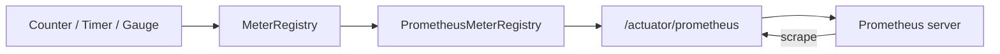
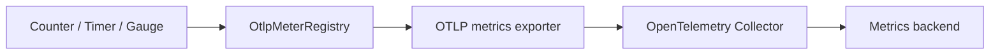
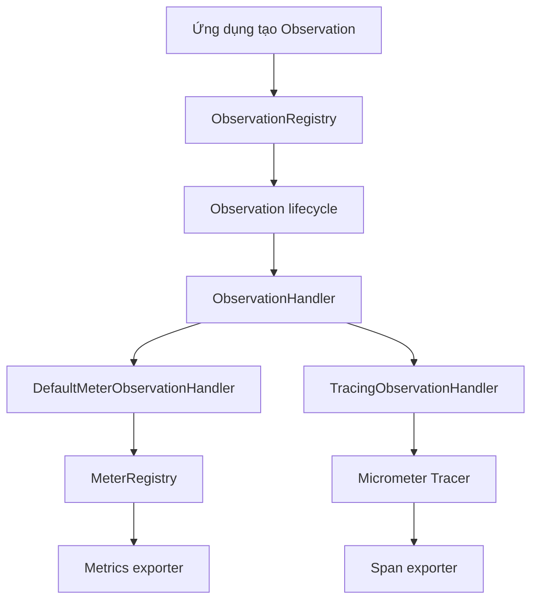

# Phân biệt MeterRegistry, ObservationRegistry và cấu hình xuất trace

Micrometer dùng hai registry có trách nhiệm khác nhau. MeterRegistry quản lý các meter như Counter, Gauge, Timer và DistributionSummary, đồng thời là điểm kết nối với registry implementation để xuất metrics. ObservationRegistry quản lý vòng đời Observation, current scope, convention, predicate và các ObservationHandler. Một handler có thể chuyển Observation thành metrics; handler tracing có thể chuyển Observation thành span.

Vì vậy, ObservationRegistry không phải nơi lưu metrics và MeterRegistry không phải nơi tạo hay xuất trace. Hai registry có thể cùng tham gia một luồng instrumentation: ứng dụng tạo Observation, handler metrics ghi meter vào MeterRegistry, handler tracing tạo span qua Micrometer Tracing, rồi exporter gửi span đến collector hoặc backend.

Bài học thuộc module OBSERVABILITY_INSTRUMENTATION_MICROMETER. Module này hướng dẫn sử dụng Micrometer để đo lường ứng dụng Java bằng counter, gauge, timer, distribution summary và nhãn có kiểm soát; tích hợp Spring Boot, xuất metrics đến hệ giám sát, kiểm soát cardinality, kiểm thử instrumentation và diễn giải số đo vận hành.

## Mục tiêu học tập

Sau bài này, bạn có thể:

- Phân biệt vai trò và vòng đời của MeterRegistry với ObservationRegistry.
- Giải thích Observation, Observation.Context, ObservationConvention và ObservationHandler.
- Mô tả cách một Observation tạo metrics và tracing span qua các handler khác nhau.
- Phân biệt registry metrics với tracing bridge và span exporter.
- Chọn dependency cho Prometheus, OTLP, OpenTelemetry hoặc Zipkin.
- Cấu hình sampling và endpoint xuất trace trong Spring Boot.
- Hiểu vì sao cấu hình OTLP metrics không tự bật OTLP trace export.
- Kiểm soát low-cardinality và high-cardinality attributes.
- Kiểm thử metrics và trace theo từng pipeline.

## 1. Hai registry giải quyết hai bài toán khác nhau

MeterRegistry là nơi đăng ký và truy xuất các meter. Một meter có tên, loại, tag và metadata; registry implementation chuyển dữ liệu sang định dạng hoặc giao thức của hệ thống giám sát.

ObservationRegistry quản lý các Observation được tạo trong ứng dụng. Nó giữ cấu hình về convention, predicate và handler; đồng thời hỗ trợ truy xuất Observation hiện hành trong scope. Bản thân ObservationRegistry không lưu time series và không gửi span đến backend.

| Tiêu chí | MeterRegistry | ObservationRegistry |
| --- | --- | --- |
| Mục đích | Quản lý và xuất metrics | Điều phối vòng đời Observation |
| Đối tượng chính | Counter, Gauge, Timer, DistributionSummary | Observation và Observation.Context |
| API thường dùng | counter(), timer(), gauge(), register() | createNotStarted(), start(), observe(), openScope() |
| Cấu hình | MeterFilter, common tags, naming convention | ObservationHandler, ObservationConvention, ObservationPredicate |
| Đầu ra | Metrics qua registry exporter hoặc scrape endpoint | Sự kiện Observation cho các handler |
| Có tự xuất trace không? | Không | Không; cần tracing handler và exporter |
| Có tự lưu metrics không? | Có, qua các meter của registry | Không |

Có thể inject cả hai registry vào cùng một component:

```java
import io.micrometer.core.instrument.MeterRegistry;
import io.micrometer.observation.ObservationRegistry;
import org.springframework.stereotype.Component;

@Component
public class CheckoutInstrumentation {

    private final MeterRegistry meterRegistry;
    private final ObservationRegistry observationRegistry;

    public CheckoutInstrumentation(
            MeterRegistry meterRegistry,
            ObservationRegistry observationRegistry
    ) {
        this.meterRegistry = meterRegistry;
        this.observationRegistry = observationRegistry;
    }
}
```

Trong Spring Boot, các bean này thường được auto-configure. Khi dùng ứng dụng Java độc lập, cần tạo và cấu hình chúng phù hợp với các handler và exporter muốn sử dụng.

## 2. MeterRegistry quản lý metrics

MeterRegistry là abstraction trung tâm của Micrometer Metrics. Ứng dụng có thể đăng ký meter trực tiếp:

```java
Counter completed = meterRegistry.counter(
        "checkout.completed",
        "channel", "web"
);

Timer paymentDuration = meterRegistry.timer(
        "checkout.payment.duration",
        "provider", "card"
);

completed.increment();

paymentDuration.record(() -> paymentService.pay());
```

MeterRegistry có thể là:

- SimpleMeterRegistry để kiểm thử hoặc giữ số liệu trong bộ nhớ.
- PrometheusMeterRegistry để cung cấp dữ liệu qua endpoint scrape.
- OtlpMeterRegistry để xuất metrics bằng OTLP.
- Một registry implementation khác như Datadog, Graphite hoặc Wavefront.
- CompositeMeterRegistry để phân phối cùng phép ghi nhận đến nhiều registry thành viên.

MeterRegistry tập trung vào metrics. Nó không quản lý quan hệ parent-child giữa span, trace context, propagation header hoặc vòng đời Observation.

### Metrics được xuất như thế nào?

Luồng phổ biến với Prometheus:



Với OTLP metrics:



Exporter và backend có thể khác nhau, nhưng điểm ghi nhận vẫn là MeterRegistry. Nếu dùng CompositeMeterRegistry, một phép ghi nhận có thể được gửi đến nhiều registry thành viên.

## 3. ObservationRegistry điều phối Observation

Observation biểu diễn một thao tác cần quan sát, chẳng hạn xử lý checkout, truy vấn repository hoặc gọi dịch vụ thanh toán. ObservationRegistry là nơi cấu hình các handler sẽ nhận sự kiện khi Observation bắt đầu, mở scope, ghi nhận lỗi hoặc kết thúc.

Các thành phần quan trọng:

| Thành phần | Vai trò |
| --- | --- |
| Observation | Đại diện một thao tác được quan sát |
| Observation.Context | Lưu dữ liệu dùng chung trong vòng đời Observation |
| ObservationRegistry | Quản lý cấu hình và current Observation |
| ObservationHandler | Phản ứng với các sự kiện lifecycle |
| ObservationConvention | Chuẩn hóa tên, contextual name và key-value |
| ObservationPredicate | Quyết định Observation có được tạo hoặc xử lý hay không |
| Observation.Scope | Đặt Observation thành current trong một phạm vi thực thi |

Một Observation có thể được nhiều handler xử lý. Ví dụ, một handler tạo Timer và handler khác tạo span. Nhờ vậy, instrumentation nghiệp vụ chỉ cần khai báo một Observation mà vẫn có thể tạo ra nhiều loại telemetry.



ObservationRegistry không quyết định backend metrics hoặc trace. Nó điều phối handler; từng handler kết nối với abstraction tương ứng.

## 4. Một Observation có thể tạo metrics và trace

Ví dụ tạo Observation cho một luồng checkout:

```java
import io.micrometer.observation.Observation;
import io.micrometer.observation.ObservationRegistry;

public final class CheckoutService {

    private final ObservationRegistry observationRegistry;

    public CheckoutService(ObservationRegistry observationRegistry) {
        this.observationRegistry = observationRegistry;
    }

    public CheckoutResult checkout(CheckoutCommand command) {
        return Observation.createNotStarted(
                        "checkout.process",
                        observationRegistry
                )
                .lowCardinalityKeyValue("channel", command.channel())
                .highCardinalityKeyValue("order.id", command.orderId())
                .observe(() -> processCheckout(command));
    }

    private CheckoutResult processCheckout(CheckoutCommand command) {
        // Xác thực, thanh toán và tạo đơn hàng
        return CheckoutResult.completed();
    }
}
```

Đoạn code tạo một Observation, thêm key-value và bao quanh logic nghiệp vụ bằng observe(). Các handler được cấu hình trong ObservationRegistry quyết định cách xử lý:

- Meter handler có thể tạo Timer cho thời gian checkout và gắn low-cardinality key-value làm metric tags.
- Tracing handler có thể tạo span, gắn thông tin phù hợp và liên kết với trace hiện hành.
- Logging hoặc handler tùy chỉnh có thể dùng context để bổ sung metadata cho log.

Nếu không có meter handler, Observation không tự tạo Timer. Nếu không có tracing handler, Observation cũng không tự tạo span. Việc gọi observe() chỉ phát lifecycle events cho các handler đã đăng ký.

### Metrics trực tiếp và metrics từ Observation

Có hai cách instrument thường gặp:

| Cách | API | Khi phù hợp |
| --- | --- | --- |
| Ghi meter trực tiếp | MeterRegistry.counter(), Timer.record() | Đo sự kiện hoặc trạng thái có ngữ nghĩa metric rõ ràng |
| Instrument qua Observation | Observation.createNotStarted(...).observe(...) | Đo một thao tác nghiệp vụ có thể cần metrics, trace và context chung |

Không cần chuyển mọi Counter hoặc Gauge sang Observation. Ví dụ, queue depth là trạng thái hiện tại phù hợp với Gauge trực tiếp. Một request hoặc thao tác nghiệp vụ có thời gian thực thi thường phù hợp với Observation vì có thể tạo cả Timer và span.

## 5. ObservationHandler nối Observation với registry tương ứng

ObservationHandler nhận sự kiện từ Observation lifecycle. Một số handler tiêu biểu:

- DefaultMeterObservationHandler chuyển Observation thành meter trong MeterRegistry.
- Tracing handler của Micrometer Tracing chuyển Observation thành span thông qua Tracer.
- Handler tùy chỉnh có thể cập nhật MDC, ghi log hoặc bổ sung metadata cho một hệ thống nội bộ.

Với Spring Boot, các handler phù hợp thường được auto-configure khi dependency tương ứng có trên classpath. Nếu ứng dụng chỉ thêm Actuator và Prometheus registry, metrics có thể được xuất nhưng chưa chắc có tracing span. Để tạo span, cần thêm tracing bridge và exporter phù hợp.

Trong ứng dụng độc lập, cần tự cấu hình ObservationRegistry và các handler mong muốn. Tránh tạo một ObservationRegistry mới bên trong mỗi service nếu mục tiêu là dùng chung tracing, metrics và context đã cấu hình ở cấp ứng dụng.

### ObservationConvention và ObservationPredicate

ObservationConvention quyết định tên Observation, contextual name và key-value chuẩn hóa. Ví dụ, convention có thể dùng tên `checkout.process`, thêm low-cardinality key `operation=checkout` và high-cardinality key `order.id`.

ObservationPredicate cho phép bỏ qua một Observation theo điều kiện. Ví dụ, có thể loại các thao tác health check hoặc một số request nội bộ khỏi instrumentation nếu chúng không có giá trị phân tích.

Convention và predicate thuộc ObservationRegistry; MeterFilter thuộc MeterRegistry. Không nhầm hai cơ chế này:

| Cơ chế | Áp dụng ở đâu? | Mục đích |
| --- | --- | --- |
| ObservationConvention | Khi tạo Observation | Chuẩn hóa tên và key-value |
| ObservationPredicate | Khi đánh giá Observation | Bỏ qua Observation không cần thiết |
| MeterFilter | Khi đăng ký meter | Accept, deny, map và configure meter |
| MeterRegistryCustomizer | Khi cấu hình registry | Common tags và chính sách chung |

## 6. Tracing cần Micrometer Tracing bridge và exporter

Micrometer Tracing cung cấp abstraction để ứng dụng và instrumentation không phải phụ thuộc trực tiếp vào API riêng của Brave hoặc OpenTelemetry. Bridge chuyển abstraction Micrometer Tracing sang tracer implementation cụ thể.

Các thành phần trong pipeline:

| Thành phần | Trách nhiệm |
| --- | --- |
| ObservationRegistry | Điều phối Observation lifecycle |
| TracingObservationHandler | Chuyển Observation thành tracing operation |
| Micrometer Tracer | Abstraction tạo và quản lý span |
| Tracing bridge | Kết nối Micrometer Tracing với Brave hoặc OpenTelemetry |
| Span exporter/reporter | Gửi span ra khỏi process |
| Collector/backend | Nhận, xử lý, lưu trữ và truy vấn trace |

Hai lựa chọn phổ biến:

- OpenTelemetry bridge: dùng `micrometer-tracing-bridge-otel`, kết hợp exporter tương ứng như `opentelemetry-exporter-otlp`.
- Brave bridge: dùng `micrometer-tracing-bridge-brave`, kết hợp reporter như `zipkin-reporter-brave`.

Chỉ thêm tracing bridge chưa chắc đã gửi span ra ngoài. Cần có exporter hoặc reporter được cấu hình và endpoint nhận dữ liệu có thể truy cập.

### OTLP metrics registry không phải OTLP trace exporter

Đây là điểm dễ nhầm khi cấu hình:

- `micrometer-registry-otlp` là registry xuất metrics qua OTLP.
- `micrometer-tracing-bridge-otel` kết nối Micrometer Tracing với OpenTelemetry.
- `opentelemetry-exporter-otlp` gửi span qua OTLP.

Nếu ứng dụng chỉ thêm `micrometer-registry-otlp`, backend có thể nhận metrics nhưng không vì thế mà nhận trace. Muốn xuất cả hai, phải cấu hình riêng metrics pipeline và tracing pipeline.

## 7. Cấu hình trong Spring Boot

Spring Boot Actuator có thể auto-configure MeterRegistry và ObservationRegistry. Khi tracing bridge và exporter tương ứng có trên runtime classpath, Boot có thể cấu hình Tracer, propagation và các ObservationHandler phù hợp.

Ví dụ với Gradle, dùng Prometheus cho metrics và OpenTelemetry OTLP cho trace:

```kotlin
dependencies {
    implementation("org.springframework.boot:spring-boot-starter-actuator")

    runtimeOnly("io.micrometer:micrometer-registry-prometheus")

    runtimeOnly("io.micrometer:micrometer-tracing-bridge-otel")
    runtimeOnly("io.opentelemetry:opentelemetry-exporter-otlp")
}
```

Spring Boot dependency management nên quản lý phiên bản tương thích. Không tự nâng riêng Micrometer Tracing, bridge hoặc OpenTelemetry exporter nếu chưa kiểm tra BOM và compatibility matrix của phiên bản Boot đang dùng.

Nếu dùng Brave và Zipkin, thay các dependency tracing bằng:

```kotlin
dependencies {
    runtimeOnly("io.micrometer:micrometer-tracing-bridge-brave")
    runtimeOnly("io.zipkin.reporter2:zipkin-reporter-brave")
}
```

Không đưa cả hai bridge vào cùng ứng dụng trừ khi có lý do rõ ràng và cấu hình riêng. Một ứng dụng thông thường nên chọn một tracer implementation để tránh tạo nhiều tracing pipeline không cần thiết.

### Sampling và endpoint Zipkin

Ví dụ cấu hình sampling và Zipkin exporter trong Spring Boot:

```properties
management.tracing.sampling.probability=0.1
management.zipkin.tracing.endpoint=http://zipkin:9411/api/v2/spans
```

Sampling probability bằng 0.1 yêu cầu lấy mẫu khoảng 10% trace mới theo chính sách sampler. Giá trị phù hợp phụ thuộc lưu lượng, chi phí lưu trữ và yêu cầu điều tra. Trong môi trường phát triển có thể tăng tỷ lệ để dễ quan sát; production nên chọn theo ngân sách và nhu cầu vận hành.

Với OpenTelemetry OTLP exporter, có thể cấu hình endpoint theo property được phiên bản Spring Boot hỗ trợ hoặc dùng các biến môi trường chuẩn của OpenTelemetry SDK khi exporter được cấu hình để đọc chúng:

```bash
OTEL_EXPORTER_OTLP_TRACES_ENDPOINT=http://otel-collector:4318/v1/traces
OTEL_EXPORTER_OTLP_PROTOCOL=http/protobuf
```

Biến `OTEL_EXPORTER_OTLP_TRACES_ENDPOINT` chỉ định endpoint riêng cho traces. Nếu dùng `OTEL_EXPORTER_OTLP_ENDPOINT`, exporter có thể tự thêm signal path như `/v1/traces`; hãy kiểm tra semantics của exporter và phiên bản SDK. HTTP/protobuf thường dùng port 4318, còn OTLP gRPC thường dùng port 4317.

Không dùng property metrics như `management.otlp.metrics.export.url` để suy ra endpoint trace. Cấu hình export metrics và traces là hai cấu hình riêng.

### Công bố metrics và trace không giống nhau

Với Prometheus, endpoint metrics thường cần expose:

```properties
management.endpoints.web.exposure.include=health,prometheus
```

Prometheus server chủ động scrape endpoint. Với tracing exporter dạng push, ứng dụng hoặc SDK gửi span đến Zipkin, Collector hoặc backend theo cơ chế exporter. Không cần expose một HTTP Actuator endpoint cho Prometheus để span được gửi đi.

## 8. Sampling ảnh hưởng trace, không phải phép đo metrics thông thường

Tracing sampling quyết định trace/span nào được giữ và xuất. Metrics có mục tiêu khác: tổng hợp số lượng, thời gian và trạng thái theo cửa sổ thời gian.

Ví dụ, nếu tracing sampling probability là 0.1:

- Khoảng 10% trace mới có thể được chọn theo sampler.
- Observation metrics handler vẫn có thể ghi Timer và Counter cho các Observation được instrument.
- Dashboard metrics vẫn phản ánh tổng lưu lượng theo cơ chế meter.
- Trace backend chỉ lưu các span được sampling policy chấp nhận.

Không dùng tỷ lệ trace được lấy mẫu để ước lượng trực tiếp request count nếu metric Counter đã có sẵn. Sampling trace có thể bỏ qua nhiều request; metrics được tổng hợp theo pipeline riêng.

### Head sampling và tail sampling

Head sampling quyết định giữ trace ở đầu hoặc khi trace được tạo. Nó tiết kiệm tài nguyên sớm nhưng chưa biết toàn bộ kết quả của request.

Tail sampling được thực hiện sau khi collector đã nhận các span cần thiết của trace. Collector có thể chọn giữ trace dựa trên lỗi, latency hoặc thuộc tính cuối cùng. Tail sampling cần collector giữ và xử lý trạng thái trace; không thể thực hiện chỉ bằng một property sampling trong ứng dụng.

Nếu dùng tail sampling, ứng dụng cần gửi đủ span đến collector để collector đưa ra quyết định. Không áp dụng head sampling quá thấp nếu mục tiêu là để collector chọn các trace chậm hoặc lỗi mà ứng dụng chưa biết trước khi kết thúc.

## 9. Low-cardinality và high-cardinality trong Observation

Observation hỗ trợ hai nhóm key-value:

- Low-cardinality key-value: phù hợp với metrics và trace attributes.
- High-cardinality key-value: phù hợp với trace, không nên chuyển thành metric tag.

Ví dụ:

```java
Observation.createNotStarted("checkout.process", observationRegistry)
        .lowCardinalityKeyValue("channel", "web")
        .lowCardinalityKeyValue("outcome", "success")
        .highCardinalityKeyValue("order.id", orderId)
        .observe(() -> processCheckout(orderId));
```

`channel` và `outcome` có tập giá trị hữu hạn, có thể được đưa vào metric tags. `order.id` gần như duy nhất cho mỗi tác vụ, chỉ phù hợp với trace nếu chính sách dữ liệu cho phép.

| Dữ liệu | Nên là | Lý do |
| --- | --- | --- |
| HTTP method | Low cardinality | Tập giá trị nhỏ |
| Route template | Low cardinality | Được chuẩn hóa theo route |
| Result: success/failure | Low cardinality | Tập kết quả hữu hạn |
| Order ID | High cardinality | Gần như duy nhất cho mỗi đơn |
| Request ID | High cardinality | Duy nhất theo request |
| Trace ID | Trace context | Định danh trace, không phải metric dimension |
| Email hoặc token | Không thu thập | Dữ liệu nhạy cảm |

High-cardinality không đồng nghĩa với có thể đưa mọi dữ liệu vào trace. Trace vẫn cần chính sách bảo vệ dữ liệu cá nhân, bí mật, retention và quyền truy cập.

### Baggage và span attributes

Baggage là dữ liệu context được truyền qua ranh giới service theo propagation format. Span attributes mô tả một span cụ thể. Metric tags lại tạo chiều phân tích cho time series.

Không dùng baggage thay cho metric tags nếu cần truy vấn tổng hợp; cũng không đưa baggage có giá trị không giới hạn vào metrics. Baggage có thể được truyền sang các service khác, nên chỉ truyền các trường cần thiết và có kiểm soát.

## 10. Kiểm thử hai registry và hai pipeline riêng biệt

Một test xác nhận MeterRegistry hoạt động không chứng minh trace exporter hoạt động. Tương tự, trace được xuất thành công không chứng minh Timer hoặc Counter được ghi đúng.

### Kiểm thử MeterRegistry

```java
import static org.assertj.core.api.Assertions.assertThat;

import io.micrometer.core.instrument.Counter;
import io.micrometer.core.instrument.simple.SimpleMeterRegistry;
import org.junit.jupiter.api.Test;

class MeterRegistryTest {

    @Test
    void recordsCounter() {
        var registry = new SimpleMeterRegistry();

        Counter counter = registry.counter(
                "checkout.completed",
                "channel", "web"
        );

        counter.increment();

        assertThat(counter.count()).isEqualTo(1.0);
    }
}
```

Test này xác nhận metric được ghi trong registry. Nó không kiểm tra network exporter hoặc backend.

### Kiểm thử Observation lifecycle

Có thể dùng ObservationRegistry và handler thử nghiệm để xác nhận Observation được start, mở scope, ghi nhận lỗi và stop đúng trình tự. Nếu muốn xác nhận metrics được tạo từ Observation, test cần đăng ký meter handler hoặc dùng Spring context đã auto-configure handler.

Các điểm cần kiểm tra:

- Observation có tên đúng không?
- Low-cardinality key-value có được đưa vào meter tags không?
- Observation có được stop sau khi công việc hoàn tất không?
- Exception có được ghi vào context không?
- Scope có được đóng và current Observation được khôi phục không?

### Kiểm thử tracing exporter

Dùng exporter thử nghiệm hoặc in-memory span exporter phù hợp với tracer implementation. Xác nhận:

- Một thao tác tạo span theo kỳ vọng.
- Span có đúng tên và parent-child relationship.
- Error được ghi nhận đúng.
- Propagation context được truyền qua HTTP hoặc Executor.
- Sampling policy được áp dụng.
- Exporter gửi span đến endpoint test hoặc collector thử nghiệm.

Đối với kiểm thử tích hợp, có thể dùng OpenTelemetry Collector hoặc Zipkin trong môi trường test. Không chỉ kiểm tra log của ứng dụng; cần xác nhận span thực sự đến receiver.

## 11. Chẩn đoán khi có metrics nhưng không có trace

| Triệu chứng | Nguyên nhân có thể | Cách kiểm tra |
| --- | --- | --- |
| Prometheus có metrics nhưng trace backend trống | Chưa thêm tracing bridge hoặc exporter | Kiểm tra runtime dependency và auto-configuration |
| Có Observation nhưng không có Timer | Meter handler chưa được đăng ký hoặc Observation bị predicate loại | Kiểm tra ObservationRegistry và handlers |
| Có Timer nhưng không có span | TracingObservationHandler hoặc tracer chưa được cấu hình | Kiểm tra bridge và Tracer bean |
| Có span trong app log nhưng backend không thấy | Exporter endpoint, protocol hoặc network sai | Kiểm tra exporter error và Collector receiver |
| Trace bị thiếu một phần | Sampling hoặc propagation không nhất quán | Kiểm tra sampler và traceparent |
| Mỗi service tạo trace mới | Header propagation không được truyền | Kiểm tra HTTP client/server instrumentation |
| Metrics cardinality tăng mạnh | High-cardinality key-value bị đưa vào meter | Kiểm tra convention và metric tags |
| Span được tạo nhưng không có parent | Context bị mất qua thread hoặc reactive boundary | Kiểm tra Context Propagation |
| Chỉ có một số request có trace | Sampling đang hoạt động | Kiểm tra sampling probability và parent-based behavior |
| OTLP metrics đến Collector nhưng trace không đến | Chỉ cấu hình metrics exporter | Cấu hình tracing bridge và span exporter riêng |

## 12. Checklist thiết kế

Trước khi triển khai Micrometer metrics và tracing, hãy xác nhận:

1. Component nghiệp vụ inject đúng MeterRegistry và ObservationRegistry dùng chung chưa?
2. MeterRegistry có registry implementation phù hợp với backend metrics không?
3. ObservationRegistry có meter handler nếu muốn Observation tạo metrics không?
4. Có tracing bridge và Tracer implementation nếu muốn tạo span không?
5. Có span exporter/reporter và endpoint nhận trace không?
6. Đã phân biệt cấu hình metrics export với traces export chưa?
7. Sampling probability có phù hợp với lưu lượng và chi phí không?
8. Low-cardinality key-value có tập giá trị hữu hạn không?
9. High-cardinality values có được giới hạn trong trace và không chứa dữ liệu nhạy cảm không?
10. Context có được truyền qua HTTP, Executor và reactive pipeline không?
11. Test đã xác nhận metrics và trace ở hai pipeline riêng biệt chưa?
12. Backend đã nhận đúng service identity, span parentage và metric tags chưa?

## Kết luận

MeterRegistry quản lý meter và kết nối với metrics exporter. ObservationRegistry điều phối Observation lifecycle và gọi các ObservationHandler. Meter handler có thể tạo metrics trong MeterRegistry; tracing handler có thể tạo span qua Micrometer Tracing, bridge và exporter. Hai registry phối hợp trong cùng instrumentation nhưng không thay thế nhau.

Khi triển khai, hãy cấu hình metrics registry và tracing bridge/exporter như hai pipeline riêng. Đừng nhầm `micrometer-registry-otlp` với OTLP span exporter; đừng dùng trace sampling để suy ra request count; và hãy giữ metric tags ở cardinality thấp. Kiểm thử riêng MeterRegistry, ObservationHandler và trace exporter giúp xác nhận dữ liệu đi đúng backend và có thể được diễn giải chính xác.

## Tài liệu tham khảo

- [Micrometer Observation](https://docs.micrometer.io/micrometer/reference/observation.html) — ObservationRegistry, Observation lifecycle, conventions và handlers.
- [Micrometer Tracing](https://docs.micrometer.io/tracing/reference/) — Tracer abstraction, Brave/OpenTelemetry bridge, propagation và span export.
- [Spring Boot Tracing](https://docs.spring.io/spring-boot/reference/actuator/tracing.html) — tracing auto-configuration, sampling, propagation và exporter.
- [Spring Boot Metrics](https://docs.spring.io/spring-boot/reference/actuator/metrics.html) — MeterRegistry, registry implementations và metrics export.
- [OpenTelemetry OTLP Exporter Configuration](https://opentelemetry.io/docs/specs/otel/protocol/exporter/) — OTLP endpoint, transport và protocol configuration.
