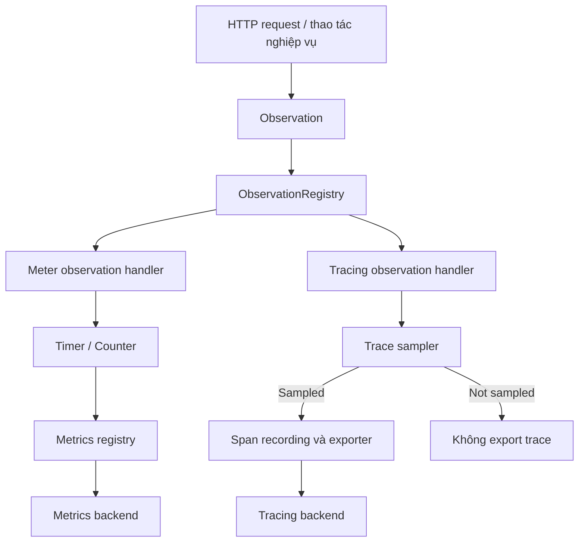

# Sampling của trace và việc kiểm soát phép đo là các cấu hình riêng

Trong một ứng dụng dùng Micrometer Observation, cùng một thao tác có thể tạo ra nhiều loại tín hiệu: metrics để theo dõi xu hướng tổng hợp và trace để điều tra một lần thực thi cụ thể. Hai tín hiệu có thể bắt nguồn từ cùng một Observation, nhưng việc lấy mẫu trace và việc ghi nhận metrics là hai cơ chế riêng.

**Trace sampling** quyết định một trace hoặc span có được ghi nhận và gửi đến tracing backend hay không. **Metric recording** quyết định meter có nhận số đo hay không; **metric export** quyết định số đo được công bố hoặc gửi đến backend như thế nào. Vì vậy, giảm tỷ lệ trace sampling thường làm giảm lượng span được lưu, nhưng không có nghĩa Counter hoặc Timer của Micrometer cũng chỉ ghi một phần tương ứng.

Cần phân biệt thêm với việc không tạo Observation. Nếu một `ObservationPredicate` loại bỏ thao tác ngay từ đầu, các handler gắn với Observation đó có thể không nhận lifecycle, nên cả metrics lẫn tracing dựa trên Observation đều có thể không được tạo. Đây là một quyết định ở lớp instrumentation, khác với sampler chỉ kiểm soát trace.

## 1. Ba lớp điều khiển có mục đích khác nhau

Khi một request đi vào ứng dụng, có thể hình dung ba câu hỏi độc lập:

1. **Observation có được tạo không?** Predicate và instrumentation quyết định thao tác nào được mô tả.
2. **Trace có được ghi nhận không?** Tracing sampler quyết định span/trace có được recording và export hay không.
3. **Metric có được ghi nhận và export không?** Meter handler, MeterFilter, cấu hình distribution và registry quyết định meter nào được cập nhật và công bố.

| Cơ chế | Phạm vi tác động | Ví dụ |
|---|---|---|
| `ObservationPredicate` | Quyết định Observation có hoạt động hay thành no-op | Bỏ qua một loại thao tác không cần instrument |
| Trace sampler | Quyết định trace/span có được ghi nhận | Chỉ giữ 10% trace |
| `MeterFilter` | Điều chỉnh hoặc từ chối meter | Deny một metric hoặc chuẩn hóa tag |
| Histogram/percentile config | Điều chỉnh thống kê của meter | Bật bucket cho HTTP Timer |
| Registry/export config | Điều chỉnh cách metrics được công bố | Prometheus scrape hoặc registry push theo step |

Các cơ chế này có thể phối hợp, nhưng không thay thế lẫn nhau. Nếu mục tiêu là giảm lượng trace lưu trữ, hãy điều chỉnh tracing sampling. Nếu mục tiêu là giảm cardinality hoặc số chuỗi thời gian, hãy xem lại meter name, tag và histogram. Nếu mục tiêu là bỏ instrumentation hoàn toàn cho một thao tác, hãy cân nhắc predicate và hiểu rõ rằng metrics dựa trên Observation cũng có thể bị ảnh hưởng.

## 2. Một Observation có thể tạo cả metrics lẫn tracing

Trong Spring Boot, Micrometer Observation thường là điểm chung cho instrumentation. Các handler khác nhau có thể nhận cùng lifecycle:

- Meter handler có thể tạo hoặc cập nhật Timer và các meter observation tương ứng; Counter nghiệp vụ cũng có thể được ghi độc lập trong cùng luồng xử lý.
- Tracing handler tạo span, gắn thuộc tính và gửi span đến tracing exporter nếu sampler cho phép.
- Handler tùy chỉnh có thể ghi nhận thêm dữ liệu phù hợp.



Trong sơ đồ, tracing sampler nằm trên nhánh tracing. Meter handler vẫn có thể ghi Timer cho cùng Observation. Khi sampler từ chối trace, metrics vẫn được cập nhật nếu Observation được tạo và meter handler vẫn hoạt động.

Đây là lý do dashboard latency hoặc error rate không nên phụ thuộc vào việc trace có được lấy mẫu hay không. Metrics cung cấp bức tranh tổng hợp; trace sampling chỉ giới hạn lượng dữ liệu chi tiết được lưu.

## 3. Trace sampling là gì?

Sampling là quyết định chọn một phần trace để ghi nhận đầy đủ. Nếu ứng dụng nhận 100.000 request mỗi phút và ghi mọi span, lượng dữ liệu tracing có thể rất lớn, đặc biệt khi mỗi request tạo nhiều span qua nhiều service.

Một sampler có thể chọn:

- **100%:** cố gắng ghi nhận tất cả trace đủ điều kiện.
- **10%:** ghi nhận khoảng một phần mười trace theo chính sách sampler.
- **0%:** không chọn trace root mới theo sampler đó; với parent-based sampler, quyết định sampled từ một parent bên ngoài vẫn có thể được kế thừa.

Tỷ lệ thực tế có thể khác tỷ lệ cấu hình do traffic, parent-based decisions, rule bổ sung, lỗi exporter hoặc việc trace bị loại ở collector. Sampling không có nghĩa là chia nhỏ một trace thành các span độc lập tùy ý; quyết định thường cần nhất quán trên toàn trace để giữ quan hệ cha con.

Sampling giúp kiểm soát chi phí lưu trữ, network và xử lý trace. Đổi lại, tracing backend không còn nhìn thấy mọi lần thực thi. Vì vậy, không dùng số lượng trace đã sample để thay thế Counter đếm tổng request hoặc tổng giao dịch.

## 4. Head-based sampling quyết định sớm

Head-based sampling đưa ra quyết định gần thời điểm trace bắt đầu, thường dựa trên trace ID, tỷ lệ cấu hình hoặc quyết định được kế thừa từ parent span.

Ưu điểm:

- Quyết định sớm, không cần giữ toàn bộ span trong bộ nhớ chờ kết quả.
- Chi phí instrumentation và export được giới hạn ngay trong ứng dụng hoặc SDK.
- Có thể giữ nhất quán quyết định qua các service khi propagation và parent-based sampler được cấu hình đúng.

Hạn chế:

- Khi request mới bắt đầu, sampler thường chưa biết kết quả cuối cùng.
- Khó ưu tiên chính xác các request chậm hoặc lỗi nếu chỉ dựa vào outcome xuất hiện sau đó.
- Một trace bị loại sớm sẽ không có đủ span gửi đến collector để tail sampler xem xét.

Ví dụ, một request được chọn ngay khi bắt đầu. Nếu request đó kết thúc thành công hoặc thất bại, quyết định head sampling ban đầu vẫn giữ nguyên. Muốn ưu tiên giữ trace lỗi hoặc chậm dựa trên kết quả cuối cùng, cần cân nhắc tail-based sampling ở collector.

## 5. Tail-based sampling quyết định sau khi thấy trace

Tail-based sampling thường được triển khai ở collector hoặc một tầng xử lý trace có khả năng nhận, giữ tạm và đánh giá các span của trace trước khi quyết định export.

Collector có thể áp dụng chính sách như:

- Giữ trace có span báo lỗi.
- Giữ trace có latency vượt ngưỡng.
- Giữ một tỷ lệ ngẫu nhiên trong số trace còn lại.
- Giữ trace có thuộc tính hoặc loại operation cụ thể.

Ưu điểm là quyết định có thể dựa trên outcome và thời lượng đã biết khi trace hoàn tất. Hạn chế là collector cần nhận đủ dữ liệu cần thiết, giữ trạng thái tạm, có đủ tài nguyên và cấu hình timeout phù hợp.

Nếu ứng dụng đã loại phần lớn trace bằng head sampler trước khi gửi đi, tail sampler không thể khôi phục những trace đã bị loại. Muốn tail sampling hoạt động đúng, SDK/app thường phải gửi các trace ứng viên đến collector với sampling policy phù hợp, rồi để collector quyết định trace nào được lưu cuối cùng. Điều này có thể làm tăng lưu lượng và bộ nhớ ở tầng collector.

## 6. Tỷ lệ sampling không phải tỷ lệ ghi metrics

Giả sử một service xử lý 10.000 request trong một phút và tracing sampler giữ 10%:

- Metrics Timer có thể ghi nhận cả 10.000 lần thực hiện.
- Counter request có thể tăng đủ 10.000 lần.
- Tracing backend có thể chỉ nhận khoảng 1.000 trace, nếu không có rule hoặc giới hạn khác.
- Histogram metrics vẫn phản ánh phân bố của toàn bộ các lần được meter handler ghi nhận.

Bảng ví dụ:

| Tín hiệu | Số lượng hoặc phạm vi |
|---|---|
| HTTP requests thực tế | 10.000 |
| Timer count | 10.000 nếu mọi request đều được instrument và ghi nhận |
| Counter request | 10.000 nếu cập nhật đúng một lần mỗi request |
| Trace sampling probability | 0,1 |
| Trace được chọn | Xấp xỉ 1.000 trong trường hợp đơn giản |
| Histogram bucket count | Dựa trên các lần Timer ghi nhận, không tự giảm còn 10% |

Đây là mô hình khái niệm. Các con số thực tế phụ thuộc sampler, parent decisions, observation predicates, handler, lỗi xử lý và exporter.

Nếu dashboard chỉ thấy 1.000 request trong khi load test gửi 10.000, hãy kiểm tra dashboard đang đọc metric hay đang đếm span. Có thể dashboard đã dùng tracing data thay cho metrics.

## 7. Observation bị loại khác với trace không được sample

Hai tình huống sau có kết quả khác nhau:

**Tình huống A — Observation được tạo, trace không được sample**

- Observation lifecycle vẫn chạy.
- Meter handler vẫn có thể ghi Timer/Counter.
- Tracing sampler không ghi nhận hoặc không export span.
- Metrics vẫn có dữ liệu nếu meter handler và registry hoạt động.

**Tình huống B — ObservationPredicate từ chối Observation**

- Observation trở thành no-op theo predicate.
- Handler không nhận lifecycle như với Observation thật.
- Metrics và tracing dựa trên Observation đó đều có thể không được tạo.
- Các instrumentation độc lập khác, không dựa trên Observation bị loại, vẫn có thể ghi metrics.

Vì vậy, không dùng `ObservationPredicate` để giảm trace volume nếu vẫn cần metrics đầy đủ cho thao tác. Hãy điều chỉnh tracing sampler ở nhánh tracing.

## 8. Cấu hình sampling trong Spring Boot

Với các phiên bản Spring Boot hỗ trợ Micrometer Tracing, tỷ lệ lấy mẫu trace thường được cấu hình qua:

```yaml
management:
  tracing:
    sampling:
      probability: 0.1
```

Giá trị `0.1` biểu thị tỷ lệ head sampling 10% cho sampler được cấu hình mặc định trong stack tương ứng. `1.0` thường dùng để lấy mẫu toàn bộ trong môi trường phát triển hoặc kiểm thử; `0.0` không chọn trace root mới, nhưng parent-based sampler vẫn có thể kế thừa quyết định sampled từ parent.

Cấu hình này điều khiển tracing. Nó không đặt tỷ lệ ghi Timer/Counter của Micrometer xuống 10%. Metrics vẫn được ghi bởi meter handler nếu Observation và meter instrumentation được thực thi.

Tên property và cách sampler được kết nối phụ thuộc phiên bản Spring Boot, Micrometer Tracing bridge và tracing SDK. Hãy xác nhận dependency runtime và tài liệu đúng phiên bản trước khi triển khai.

## 9. Dependency tracing và metrics là hai nhánh riêng

Một ứng dụng Spring Boot có thể dùng Actuator, một registry metrics và một tracing bridge. Ví dụ Maven minh họa các dependency phổ biến:

```xml
<dependencies>
    <dependency>
        <groupId>org.springframework.boot</groupId>
        <artifactId>spring-boot-starter-actuator</artifactId>
    </dependency>

    <dependency>
        <groupId>io.micrometer</groupId>
        <artifactId>micrometer-registry-prometheus</artifactId>
        <scope>runtime</scope>
    </dependency>

    <dependency>
        <groupId>io.micrometer</groupId>
        <artifactId>micrometer-tracing-bridge-otel</artifactId>
    </dependency>

    <dependency>
        <groupId>io.opentelemetry</groupId>
        <artifactId>opentelemetry-exporter-otlp</artifactId>
        <scope>runtime</scope>
    </dependency>
</dependencies>
```

Trong ví dụ:

- Actuator và Prometheus registry phục vụ metrics export.
- Micrometer Tracing bridge kết nối Observation với tracing API/SDK.
- OTLP exporter gửi trace đến một collector/backend tương thích.

Bộ dependency và cách cấu hình endpoint thay đổi theo Spring Boot BOM và phiên bản Micrometer Tracing. Không tự trộn phiên bản Micrometer core, bridge và registry ngoài dependency management nếu không có lý do tương thích rõ ràng.

## 10. Kiểm tra hai nhánh cấu hình riêng

Một cấu hình ứng dụng có thể đồng thời chứa metrics và tracing:

```yaml
management:
  endpoints:
    web:
      exposure:
        include: health,prometheus

  metrics:
    distribution:
      percentiles-histogram:
        http.server.requests: true

  tracing:
    sampling:
      probability: 0.1
```

Trong ví dụ:

- `management.metrics.distribution.percentiles-histogram` bật histogram cho HTTP Timer nếu meter name khớp.
- `management.tracing.sampling.probability` điều khiển sampling trace.
- Endpoint Prometheus công bố metrics theo cấu hình registry.

Không có thuộc tính nào trong ví dụ yêu cầu Prometheus chỉ nhận 10% request metrics. Nếu muốn giảm số chuỗi thời gian, cần thiết kế tag và histogram; nếu muốn giảm trace, điều chỉnh sampling.

## 11. MeterFilter không phải trace sampler

`MeterFilter` tác động đến meter trong `MeterRegistry`. Nó có thể:

- Từ chối một meter theo tên.
- Giới hạn số lượng meter.
- Đổi tên meter hoặc tag.
- Chuẩn hóa tag values.
- Cấu hình distribution statistics tùy nhu cầu.

MeterFilter không quyết định span nào được sample. Ngược lại, tracing sampler không deny Timer hoặc Counter trong registry.

Ví dụ, nếu dùng filter để deny `http.server.requests`, metric HTTP có thể biến mất nhưng trace HTTP vẫn có thể được ghi nhận. Nếu giảm trace sampling probability, trace giảm nhưng Timer HTTP vẫn có thể được cập nhật.

Hãy chọn công cụ theo tín hiệu muốn điều khiển. Không dùng một cơ chế để giải quyết vấn đề thuộc nhánh kia.

## 12. Metrics histogram và percentile không bị giảm theo trace sampling

Histogram của Timer được tạo từ các lần Timer record. Nếu mọi request đều đi qua meter handler, histogram phản ánh các request đó, bất kể trace tương ứng có được sample hay không.

Ví dụ truy vấn p95:

```promql
histogram_quantile(
  0.95,
  sum by (le) (
    rate(http_server_requests_seconds_bucket[5m])
  )
)
```

Truy vấn trên dùng bucket của Prometheus. Nó không đọc span và không phụ thuộc sampling probability của tracing.

Nếu p95 metrics thay đổi sau khi chỉnh trace sampling, cần tìm nguyên nhân khác như traffic, meter filter, ObservationPredicate, histogram config, exporter hoặc dashboard. Không nên cho rằng giảm trace sampling trực tiếp làm giảm số mẫu trong histogram.

## 13. Exemplars liên kết metrics với trace

Một số backend metrics hỗ trợ exemplar: một tham chiếu từ mẫu metric hoặc bucket đến trace ID liên quan. Exemplar giúp người vận hành nhấp từ panel metrics sang một trace mẫu để điều tra.

Exemplar không có nghĩa metrics chỉ được ghi khi trace được sample. Timer vẫn có thể ghi toàn bộ observations; exemplar chỉ có thể gắn trace context hợp lệ khi có trace/span được ghi nhận và exporter/registry hỗ trợ cơ chế này.

Khi trace không được sample, metrics vẫn có thể tăng nhưng không có trace exemplar tương ứng cho lần đó. Khi trace được sample, exemplar có thể xuất hiện nếu cấu hình hỗ trợ và trace context được truyền đúng.

Không phải mọi registry hoặc backend đều hỗ trợ exemplar theo cùng cách. Cần kiểm tra phiên bản Prometheus registry, exposition format, backend và tracing bridge.

## 14. Đánh đổi khi chọn tỷ lệ trace sampling

| Tỷ lệ | Lợi ích | Đánh đổi |
|---|---|---|
| 100% | Dữ liệu trace đầy đủ nhất trong điều kiện exporter hoạt động | Chi phí network, storage và collector cao |
| 10% | Giảm đáng kể volume trong khi vẫn có trace mẫu | Có thể bỏ lỡ sự cố hiếm |
| 1% | Chi phí thấp hơn cho traffic rất lớn | Trace hiếm hoặc nhóm traffic nhỏ khó xuất hiện |
| 0% | Không chọn trace root mới theo sampler | Parent-based sampler vẫn có thể kế thừa parent sampled; metrics vẫn có thể hoạt động |

Không có một tỷ lệ đúng cho mọi service. Chọn tỷ lệ dựa trên traffic, chi phí lưu trữ, yêu cầu điều tra, mức độ quan trọng và chính sách bảo mật. Với endpoint có traffic thấp nhưng quan trọng, tỷ lệ quá thấp có thể khiến gần như không có trace trong cửa sổ quan sát.

Nếu dùng head sampling theo xác suất, nhóm request nhỏ có thể không có trace trong một khoảng thời gian dù hệ thống vẫn hoạt động. Metrics tổng hợp giúp giữ khả năng theo dõi toàn bộ lưu lượng và phát hiện bất thường.

## 15. Vì sao không nên dùng trace count để tính request rate?

Trace count chỉ đếm những trace đã được ghi nhận/export. Khi sampling probability là 0,1, trace count có thể chỉ xấp xỉ một phần mười số request (trong mô hình đơn giản). Nếu dùng nó làm request rate, dashboard sẽ đánh giá thấp lưu lượng.

Request rate nên lấy từ Counter hoặc Timer count được ghi nhận bởi metrics instrumentation. Trace được dùng để điều tra mẫu đại diện, không phải nguồn đếm chính xác toàn bộ request.

Tương tự:

- Dùng Timer/Histogram để tính p95 latency tổng hợp.
- Dùng Counter để tính số lần lỗi hoặc giao dịch.
- Dùng trace để xem chi tiết các bước của một số lần thực hiện.
- Dùng log/audit/ledger cho sự kiện cần lưu chính xác theo bản ghi.

## 16. Sampling có thể ảnh hưởng đến điều tra lỗi hiếm

Head sampling ngẫu nhiên có thể bỏ qua một request thất bại. Nếu tỷ lệ lỗi rất thấp, khả năng không có trace lỗi trong một khoảng thời gian là đáng kể.

Có một số lựa chọn:

- Tăng tỷ lệ head sampling trong thời gian điều tra có kiểm soát.
- Dùng tail sampling để ưu tiên trace có error hoặc latency cao.
- Dùng metrics để phát hiện tỷ lệ lỗi và alert.
- Dùng log có correlation ID để bổ sung điều tra khi có trace.
- Chọn tỷ lệ khác nhau theo service hoặc nhóm traffic nếu tracing stack hỗ trợ policy đó.

Không dựa vào sampling để đếm lỗi. Error Counter hoặc HTTP status metrics nên ghi nhận toàn bộ các lần lỗi đủ điều kiện. Trace sampling chỉ quyết định có lưu chi tiết từng lần lỗi đó hay không.

## 17. Kiểm thử độc lập metrics và tracing

Nên có hai nhóm kiểm thử:

**Kiểm thử metrics:**

- Tạo Observation hoặc gọi instrumentation.
- Xác nhận Timer/Counter được cập nhật.
- Xác nhận meter name, tag và histogram đúng.
- Thay đổi cấu hình trace sampler không làm thay đổi số lần metric record trong cùng test scenario.

**Kiểm thử tracing:**

- Cấu hình sampler ở các tỷ lệ khác nhau hoặc dùng sampler deterministic.
- Xác nhận span được ghi nhận khi sampler chọn.
- Xác nhận trace không được export khi sampler từ chối.
- Kiểm tra parent/child context và exporter.
- Kiểm tra exemplar nếu backend hỗ trợ.

Không nên dùng một test end-to-end duy nhất để suy luận rằng metrics và tracing có cùng sampling behavior.

## 18. Ví dụ kiểm tra meter handler độc lập với trace exporter

Có thể kiểm thử Observation metrics handler mà không cần tracing backend:

```java
import io.micrometer.core.instrument.Timer;
import io.micrometer.core.instrument.simple.SimpleMeterRegistry;
import io.micrometer.observation.Observation;
import io.micrometer.observation.ObservationRegistry;
import io.micrometer.observation.DefaultMeterObservationHandler;

public class ObservationMetricsTest {

    public static void main(String[] args) {
        SimpleMeterRegistry meters = new SimpleMeterRegistry();
        ObservationRegistry observations = ObservationRegistry.create();

        observations.observationConfig().observationHandler(
            DefaultMeterObservationHandler.builder(meters).build()
        );

        Observation.createNotStarted("demo.operation", observations)
            .observe(() -> doWork());

        Timer timer = meters.get("demo.operation").timer();

        System.out.println("count=" + timer.count());

        meters.close();
    }

    private static void doWork() {
        // Simulate one operation.
    }
}
```

Ví dụ này chỉ gắn meter handler. Nó chứng minh lifecycle Observation có thể cập nhật Timer mà không cần cấu hình tracing exporter. Trong Spring Boot, handler thường được auto-configure; không tự thêm handler thứ hai nếu framework đã tạo, vì có thể ghi nhận trùng.

Để kiểm thử sampling, cần test riêng tracing bridge/SDK và exporter tương ứng. Không thể kết luận sampling hoạt động chỉ từ việc Timer xuất hiện.

## 19. Các lỗi cấu hình thường gặp

| Hiện tượng | Nguyên nhân có thể | Hướng kiểm tra |
|---|---|---|
| Trace giảm và metrics cũng biến mất | Observation bị predicate loại hoặc meter handler không hoạt động | Kiểm tra ObservationPredicate và meter registry |
| Trace giảm nhưng metrics vẫn đầy đủ | Trace sampler đang hoạt động riêng | Đây thường là hành vi mong muốn |
| Dashboard request rate giảm theo trace sampling | Dashboard đang đếm span thay vì metric | Dùng Counter/Timer count |
| p95 thay đổi khi chỉ đổi sampler | Có thể dashboard đang lấy percentile từ trace hoặc cấu hình khác thay đổi cùng lúc | Tính p95 từ histogram metrics |
| Không có trace lỗi dù error rate tăng | Head sampling bỏ qua các trace lỗi | Dùng tail sampling hoặc tăng tỷ lệ có kiểm soát; giữ Error Counter |
| Không thấy exemplar | Trace không sampled hoặc backend không hỗ trợ/cấu hình | Kiểm tra exemplar pipeline |
| Histogram không có bucket | Histogram chưa bật hoặc meter bị filter | Kiểm tra distribution config và endpoint export |
| Tail sampler không giữ trace lỗi | Span đã bị head sampler loại trước collector hoặc trace không đầy đủ | Kiểm tra sampling tại SDK và collector |
| Tỷ lệ trace thực tế khác xác suất cấu hình | Parent-based sampler, rule, traffic hoặc exporter limits | Kiểm tra sampler chain và collector |

## 20. Quy trình vận hành đề xuất

1. Xác định câu hỏi metrics và câu hỏi tracing riêng.
2. Bảo đảm Observation được tạo cho các thao tác cần theo dõi.
3. Bảo đảm meter handler và registry metrics được cấu hình.
4. Bật Counter/Timer/histogram phù hợp với nhu cầu dashboard.
5. Cấu hình tracing bridge, sampler và exporter riêng.
6. Chọn head sampling hoặc tail sampling theo yêu cầu điều tra và hạ tầng.
7. Kiểm tra metrics bằng Actuator hoặc endpoint exporter.
8. Kiểm tra trace trong tracing backend.
9. Xác nhận trace sampling không làm thay đổi metric count trong cùng scenario.
10. Nếu dùng exemplar, kiểm tra liên kết metric-to-trace.
11. Theo dõi chi phí collector, lưu trữ, cardinality và tỷ lệ trace thực tế.
12. Ghi lại cấu hình và phiên bản để tránh nhầm lẫn khi nâng cấp.

## 21. Checklist phân biệt sampling và recording

- [ ] Observation có được tạo hay bị ObservationPredicate loại?
- [ ] Meter handler có được đăng ký trong ObservationRegistry?
- [ ] Metrics registry có nhận Timer/Counter?
- [ ] MeterFilter có deny hoặc đổi tên meter không?
- [ ] Histogram và percentile có được bật đúng meter không?
- [ ] Registry có export metrics đến backend không?
- [ ] Tracing bridge và exporter có được cấu hình không?
- [ ] Trace sampler đang dùng head-based hay policy khác?
- [ ] Tỷ lệ sampling có được kế thừa từ parent span không?
- [ ] Có tail sampling tại collector không?
- [ ] Dashboard request rate lấy từ metric count hay trace count?
- [ ] p95/p99 được tính từ histogram metrics hay từ tập span đã sample?
- [ ] Exemplar có được backend hỗ trợ và cấu hình không?
- [ ] Test metrics và tracing được thực hiện độc lập?

Trace sampling và metric recording giải quyết hai vấn đề khác nhau. Sampling giới hạn số trace chi tiết được giữ để kiểm soát chi phí và hỗ trợ điều tra; metrics tiếp tục tổng hợp các lần thực hiện để theo dõi rate, error và latency. Hãy giữ Observation instrumentation và meter handler hoạt động cho các thao tác cần đo, điều chỉnh sampler ở nhánh tracing, và chỉ dùng predicate khi thực sự muốn bỏ toàn bộ Observation. Dashboard vận hành nên dựa trên metrics đầy đủ; trace được sample dùng để mở rộng điều tra một lần thực hiện cụ thể.

## Tài liệu tham khảo

- [Micrometer Observation](https://docs.micrometer.io/micrometer/reference/observation.html) — Observation lifecycle và các handler tạo metrics/tracing.
- [Micrometer Tracing](https://docs.micrometer.io/tracing/reference/) — tracing bridge, sampler và export trace.
- [Spring Boot Observability](https://docs.spring.io/spring-boot/reference/actuator/observability.html) — tích hợp Observation, metrics và tracing.
- [OpenTelemetry Sampling](https://opentelemetry.io/docs/concepts/sampling/) — head sampling, parent-based sampling và tail sampling.
- [Prometheus Exemplars](https://prometheus.io/docs/prometheus/latest/feature_flags/#exemplars-storage) — liên kết metrics sample với trace exemplar.

