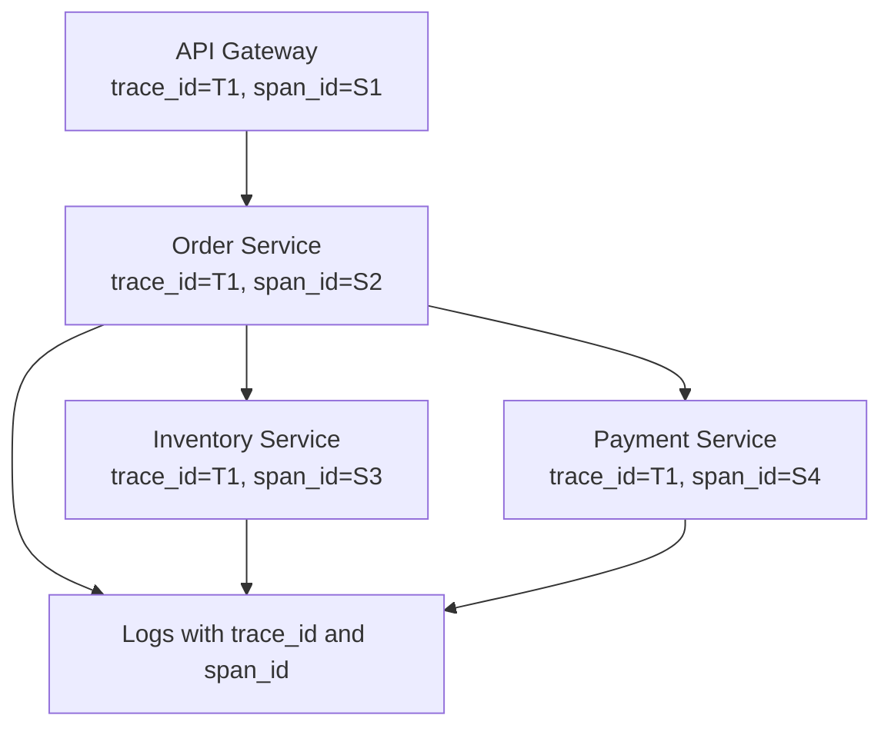

# Liên kết trace_id hoặc span_id với nhật ký mà vẫn giữ tag metric có giới hạn

Khi điều tra một request phân tán, log cần mang `trace_id` và `span_id` để người vận hành có thể tìm các dòng log thuộc cùng trace hoặc cùng span. Trong khi đó, metrics cần giữ số lượng tag value hữu hạn để backend không tạo hàng triệu time series. Vì vậy, trace ID và span ID nên được ghi vào log context, thường thông qua MDC, còn metric tags chỉ chứa các chiều tổng hợp như service, operation, route template, method và outcome.

Micrometer Tracing kết nối Observation với tracer; tracing integration có thể đặt trace ID và span ID của span hiện tại vào logging context trong thời gian span nằm trong scope. Spring Boot hỗ trợ log correlation khi có Micrometer Tracing được cấu hình. Mã nghiệp vụ không cần tự thêm trace ID vào từng `Counter` hoặc `Timer`.

Trong module `OBSERVABILITY_INSTRUMENTATION_MICROMETER`, các Counter, Gauge, Timer, DistributionSummary và tag có kiểm soát cung cấp góc nhìn tổng hợp về hoạt động service. Trace context bổ sung khả năng tìm log và lần theo một request cụ thể qua nhiều service; hai loại dữ liệu phối hợp với nhau nhưng giữ cách định danh riêng.

## 1. Trace ID và Span ID giúp nối log với trace

Một trace mô tả hành trình của request qua nhiều thành phần. Trace có một `trace_id` dùng chung xuyên suốt hành trình, trong khi mỗi span có một `span_id` riêng.

| Trường | Phạm vi | Dùng để |
| --- | --- | --- |
| `trace_id` | Toàn bộ trace qua nhiều service | Tìm tất cả span và log thuộc cùng một request phân tán. |
| `span_id` | Một operation cụ thể trong trace | Xác định log được phát ra trong phạm vi span nào. |
| `parent_span_id` | Quan hệ giữa span con và span cha | Hiểu operation hiện tại được gọi từ đâu trong trace. |

Ví dụ, một request tạo đơn hàng có thể đi qua `api-gateway`, `order-service`, `inventory-service` và `payment-service`. Các service có thể ghi cùng `trace_id`, nhưng mỗi span có `span_id` riêng. Khi log chứa cả hai ID, người vận hành có thể tìm tất cả log của request rồi phân biệt log thuộc operation nào.



`trace_id` dùng để gom log xuyên service; `span_id` giúp thu hẹp log vào một đoạn xử lý. Không nên tự sinh ID mới trong logger. Hãy lấy ID từ span hiện tại do tracer quản lý.

## 2. MDC là nơi phổ biến để đưa trace context vào log

MDC (Mapped Diagnostic Context) của SLF4J cho phép gắn các cặp key-value vào logging context hiện tại. Logging backend như Logback có thể đưa các giá trị này vào mỗi dòng log.

Với Micrometer Tracing được tích hợp đúng, tracing bridge và scope decoration có thể đồng bộ `traceId` và `spanId` của span hiện tại vào MDC. Khi scope được mở, các giá trị tương ứng có mặt trong log; khi scope đóng, context trước đó được khôi phục.

Luồng hoạt động:

1. HTTP server instrumentation nhận hoặc tạo trace context.
2. Tracing handler tạo span cho request và đưa span vào scope hiện tại.
3. Tracing integration cập nhật MDC với trace ID và span ID của span đó.
4. Các lệnh `logger.info(...)`, `logger.warn(...)` hoặc `logger.error(...)` phát log có thể đọc các giá trị MDC.
5. Khi scope đóng, MDC được khôi phục để thread không mang nhầm ID sang request tiếp theo.

Đây là lý do nên sử dụng Observation và tracing instrumentation tích hợp của Spring thay vì tự tạo ThreadLocal chứa ID riêng.

## 3. Cấu hình Micrometer Tracing trong Spring Boot

Spring Boot có thể tự cấu hình ObservationRegistry, tracing handler, bridge và exporter khi dependency tương ứng có mặt. Ví dụ với OpenTelemetry bridge và OTLP exporter:

```xml
<dependency>
    <groupId>org.springframework.boot</groupId>
    <artifactId>spring-boot-starter-actuator</artifactId>
</dependency>
<dependency>
    <groupId>io.micrometer</groupId>
    <artifactId>micrometer-tracing-bridge-otel</artifactId>
</dependency>
<dependency>
    <groupId>io.opentelemetry</groupId>
    <artifactId>opentelemetry-exporter-otlp</artifactId>
</dependency>
```

Nếu hệ thống dùng Brave, chọn `micrometer-tracing-bridge-brave` cùng reporter/exporter tương ứng. Chỉ cấu hình bridge phù hợp với tracer mà ứng dụng sử dụng; để Spring Boot dependency management quản lý phiên bản tương thích.

Đặt tên service để log và trace có thể nhận diện nguồn phát:

```yaml
spring:
  application:
    name: order-service

management:
  tracing:
    sampling:
      probability: 0.1
```

`probability` là tỷ lệ sampling mục tiêu cho trace theo cấu hình tracing của phiên bản đang dùng. Sampling quyết định trace nào được ghi/export; nó không thay đổi quy tắc cardinality của metric tags.

Endpoint OTLP, TLS, authentication và batch exporter cần được cấu hình theo backend. Việc log correlation trong ứng dụng không chứng minh span đã export thành công; cần kiểm tra riêng pipeline tracing.

## 4. Đưa trace_id và span_id vào logging pattern

Với Spring Boot và logging backend hỗ trợ MDC, có thể tùy chỉnh phần correlation trong pattern:

```yaml
logging:
  pattern:
    correlation: "[${spring.application.name:},%X{traceId:-},%X{spanId:-}] "
```

Trong Logback pattern, `%X{traceId:-}` đọc MDC key `traceId`, còn `%X{spanId:-}` đọc MDC key `spanId`. Dấu `-` là giá trị thay thế khi key chưa tồn tại, ví dụ log được phát ngoài một trace đang hoạt động.

Tùy phiên bản Spring Boot và logging configuration, correlation pattern có thể được kết hợp vào console/file pattern mặc định hoặc được ghi đè bởi cấu hình `logging.pattern.console`/`logging.pattern.file`. Nếu không thấy ID trong log, hãy kiểm tra pattern cuối cùng và MDC key thực tế.

Một dòng log minh họa:

```text
[order-service,4bf92f3577b34da6a3ce929d0e0e4736,00f067aa0ba902b7] INFO  OrderService - Order accepted
```

Giá trị trên chỉ là ví dụ định dạng. Khi không có span hiện tại, placeholder có thể hiển thị dấu `-` thay cho ID.

## 5. Log correlation không yêu cầu gắn trace ID vào metric tags

Metrics và logs phục vụ hai mục đích khác nhau:

| Dữ liệu | Mục đích | Thuộc tính phù hợp |
| --- | --- | --- |
| Metrics | Tổng hợp xu hướng, tỷ lệ và phân phối | `service`, `operation`, `method`, `route`, `status`, `outcome` |
| Logs | Ghi lại sự kiện và chi tiết phục vụ điều tra | `trace_id`, `span_id`, `message`, `exception`, các trường nghiệp vụ an toàn |
| Traces | Biểu diễn đường đi và quan hệ thời gian giữa operation | Trace ID, span ID, parent, span attributes và events |

Không thêm `trace_id` hoặc `span_id` làm tag cho Counter, Timer hay DistributionSummary. Mỗi request thường có trace ID riêng; nếu đưa ID đó vào metric label, mỗi request có thể tạo một time series mới. Số series sẽ tăng theo lưu lượng và thời gian chạy, làm tăng bộ nhớ, chi phí ingest và tải truy vấn.

Ví dụ metric phù hợp:

```java
Timer.builder("shop.order.process")
        .tag("operation", "process")
        .tag("result", "success")
        .register(registry);
```

Ví dụ không phù hợp:

```java
// Không đưa trace ID động vào meter tags.
Timer.builder("shop.order.process")
        .tag("trace_id", currentTraceId)
        .register(registry);
```

Metric nên dùng tag value từ tập hữu hạn. Nếu cần nhảy từ metric sample đến một trace cụ thể, hãy dùng exemplar khi registry/backend hỗ trợ hoặc dùng log correlation; không biến trace ID thành metric label.

## 6. Dùng log fields có cấu trúc cho trace context

Log dạng cấu trúc giúp hệ thống log index các trường riêng biệt thay vì phải phân tích chuỗi message. Một log event có thể chứa:

```json
{
  "timestamp": "2026-11-23T10:15:30.123Z",
  "level": "INFO",
  "service": "order-service",
  "trace_id": "4bf92f3577b34da6a3ce929d0e0e4736",
  "span_id": "00f067aa0ba902b7",
  "message": "Order accepted",
  "order_status": "accepted"
}
```

Đây là ví dụ schema, không phải cấu hình encoder hoàn chỉnh. Với structured logging, ánh xạ MDC key `traceId` và `spanId` thành field `trace_id` và `span_id` theo convention của log backend. Nên thống nhất tên field giữa các service để truy vấn liên service không cần nhiều biến thể.

Không đưa token, mật khẩu, email, thông tin thanh toán hoặc payload nhạy cảm vào log chỉ vì log có trace ID. Correlation ID giúp tìm đúng log; nó không làm cho dữ liệu nhạy cảm trở nên an toàn.

## 7. Lấy trace context hiện tại khi cần ghi log thủ công

Trong phần lớn ứng dụng Spring Boot, nên để tracing integration tự cập nhật MDC theo span scope. Có một số trường hợp cần lấy trace context trực tiếp, ví dụ bổ sung trường vào log event hoặc truyền correlation metadata sang một API logging nội bộ.

Có thể inject Micrometer `Tracer` và đọc span hiện tại:

```java
import io.micrometer.tracing.Span;
import io.micrometer.tracing.TraceContext;
import io.micrometer.tracing.Tracer;
import org.slf4j.Logger;
import org.slf4j.LoggerFactory;
import org.springframework.stereotype.Component;

@Component
public class OrderAuditLogger {
    private static final Logger log =
            LoggerFactory.getLogger(OrderAuditLogger.class);

    private final Tracer tracer;

    public OrderAuditLogger(Tracer tracer) {
        this.tracer = tracer;
    }

    public void logAccepted(String orderReference) {
        Span span = tracer.currentSpan();
        if (span == null) {
            log.info("Order accepted: reference={}", orderReference);
            return;
        }

        TraceContext context = span.context();
        log.info("Order accepted: reference={}, traceId={}, spanId={}",
                orderReference,
                context.traceId(),
                context.spanId());
    }
}
```

Ví dụ này đọc ID từ span hiện tại và đưa chúng vào message/structured arguments. Nó không tạo ID mới và không đăng ký metric. Trong hệ thống có MDC correlation tự động, thường không cần lặp lại ID trong message; chỉ làm vậy nếu log schema hoặc API đích yêu cầu trường tường minh.

Nếu `tracer.currentSpan()` trả về `null`, thao tác hiện tại không có span trong context. Không tự tạo một trace ID ngẫu nhiên để lấp chỗ trống; hãy kiểm tra propagation hoặc chấp nhận log không gắn trace.

## 8. MDC thủ công phải khôi phục context

Nếu không thể dùng scope decoration tự động và phải thêm MDC thủ công, cần lưu giá trị cũ rồi khôi phục trong `finally`. MDC gắn với thread; thread pool tái sử dụng worker, vì vậy không xóa/khôi phục đúng cách có thể làm log của request sau mang trace ID của request trước.

Ví dụ minh họa cho một phạm vi đồng bộ:

```java
import io.micrometer.tracing.Span;
import io.micrometer.tracing.TraceContext;
import io.micrometer.tracing.Tracer;
import java.util.Map;
import org.slf4j.MDC;

public final class ManualMdcLogging {
    private final Tracer tracer;

    public ManualMdcLogging(Tracer tracer) {
        this.tracer = tracer;
    }

    public void runWithCorrelation(Runnable action) {
        Map<String, String> previous = MDC.getCopyOfContextMap();
        try {
            Span span = tracer.currentSpan();
            if (span != null) {
                TraceContext context = span.context();
                MDC.put("traceId", context.traceId());
                MDC.put("spanId", context.spanId());
            }
            action.run();
        } finally {
            if (previous == null) {
                MDC.clear();
            } else {
                MDC.setContextMap(previous);
            }
        }
    }
}
```

Chỉ dùng mẫu này khi integration tự động không thể đảm nhận việc cập nhật MDC. Nếu đã có tracing scope decorator, việc ghi đè và khôi phục MDC thủ công có thể gây xung đột hoặc che mất context do bridge quản lý.

Không mở MDC thủ công ở thread submit rồi kỳ vọng worker thread tự nhận được các giá trị đó. Cần context propagation qua executor hoặc mở scope tương ứng ở thread thực thi.

## 9. Propagation trace context qua HTTP

Log correlation chỉ hữu ích xuyên service nếu các service cùng tham gia một trace. Với HTTP, tracing instrumentation dùng propagator để inject trace context vào request headers và extract ở phía nhận.

W3C Trace Context thường dùng header `traceparent` và có thể có `tracestate`. Khi service A gọi service B:

1. Service A có current span.
2. HTTP client instrumentation lấy trace context của span đó.
3. Propagator inject context vào HTTP request.
4. Service B extract context khi nhận request.
5. Server instrumentation tạo span mới có quan hệ với context đã nhận.
6. MDC của service B được cập nhật theo span hiện tại, nên log tiếp tục chứa cùng trace ID và span ID mới của service B.

Không tự nối chuỗi `traceparent` hoặc truyền `trace_id` qua query parameter nếu tracing instrumentation đã quản lý propagation. Dùng HTTP client/server đã được instrument và cấu hình propagation format tương thích.

## 10. Propagation qua Executor và tác vụ bất đồng bộ

MDC và current span thường gắn với execution context của thread. Khi submit task vào executor, worker thread có thể khác thread đang xử lý request. Nếu không truyền context, log bên trong task có thể thiếu trace ID hoặc nhận context không đúng.

Các lựa chọn thường dùng:

- Dùng context propagation được Spring Boot/Micrometer cấu hình cho executor.
- Dùng `ContextPropagatingTaskDecorator` của Spring Framework khi phù hợp phiên bản để capture và restore context quanh task.
- Với Micrometer Context Propagation, đăng ký accessor và snapshot phù hợp để truyền context qua ranh giới thực thi.
- Với Reactor, dùng context propagation tương thích reactive pipeline thay vì giả định MDC ThreadLocal luôn có mặt trên mọi operator.

Task decorator cần khôi phục context sau khi task hoàn tất. Không để trace ID trong MDC tồn tại trên worker thread sau khi task trả về pool.

Khi kiểm thử async logging, hãy kiểm tra cả hai trường hợp: task có trace context được truyền đúng và task chạy ngoài trace không vô tình kế thừa ID của request trước.

## 11. Giữ metric tags có cardinality thấp

Một metric time series thường được định danh bởi metric name và tổ hợp tag/label. Nếu thêm `trace_id` hoặc `span_id`, mỗi request hoặc mỗi operation có thể tạo một series mới. Hãy dùng các chiều phân loại ổn định:

| Tag phù hợp | Tập giá trị ví dụ | Vì sao phù hợp |
| --- | --- | --- |
| `service` | `order-service`, `payment-service` | Số service hữu hạn trong hệ thống. |
| `operation` | `create-order`, `authorize-payment` | Tên operation ổn định. |
| `method` | `GET`, `POST`, `PUT` | Tập HTTP method nhỏ. |
| `route` | `/orders`, `/orders/{id}` | Dùng URI template thay vì URL có ID. |
| `outcome` | `success`, `error`, `rejected` | Tập kết quả được quy ước. |
| `status` | Nhóm hoặc mã status có giới hạn | Không dùng response message tự do. |

Tránh các tag sau:

- `trace_id`, `span_id`, `request_id`;
- `user_id`, `customer_id`, `order_id`;
- URL đầy đủ có path variable hoặc query string;
- email, exception message hoặc dữ liệu tự do.

Nếu cần biết trace nào gây ra spike latency, hãy mở log hoặc trace liên quan. Metrics cho biết nhóm operation có vấn đề; trace cho biết một lần thực thi cụ thể.

## 12. Dùng exemplars khi metrics backend hỗ trợ

Một số metrics backend hỗ trợ exemplar: sample metrics có thể mang một tham chiếu đến trace context mà không biến trace ID thành metric label. Khi có hỗ trợ end-to-end từ registry, exporter và backend, exemplar tạo liên kết từ một điểm trên histogram/counter đến trace tương ứng.

Exemplar là tùy chọn và phụ thuộc registry/backend, cấu hình sampling cũng như cách trace context được cung cấp. Không giả định mọi Micrometer registry đều export exemplar hoặc mọi dashboard đều có nút mở trace. Nếu stack chưa hỗ trợ, log correlation với `trace_id` và `span_id` vẫn là cách liên kết hữu ích.

Không tự mô phỏng exemplar bằng cách thêm trace ID thành tag. Cách đó làm cardinality tăng và phá vỡ mục tiêu tổng hợp của metrics.

## 13. Truy vấn log theo trace_id hoặc span_id

Khi log được lưu dưới dạng field có cấu trúc, truy vấn theo trace ID có thể lấy log xuyên service. Ví dụ cú pháp truy vấn phụ thuộc hệ thống log, nhưng ý tưởng là:

```text
trace_id = "4bf92f3577b34da6a3ce929d0e0e4736"
```

Để giới hạn vào một span:

```text
trace_id = "4bf92f3577b34da6a3ce929d0e0e4736"
AND span_id = "00f067aa0ba902b7"
```

Trong một số hệ thống, field có thể tên `traceId`/`spanId` thay vì `trace_id`/`span_id`. Hãy chuẩn hóa schema khi ingest để truy vấn không cần biết mỗi service dùng tên MDC nào.

Quy trình điều tra thường là:

1. Tìm metric có latency hoặc error rate bất thường theo `service`, `route` và `outcome`.
2. Chọn một log mẫu trong khoảng thời gian đó.
3. Lấy `trace_id` từ log và mở trace tương ứng.
4. Dùng `span_id` để xác định operation phát log.
5. So sánh duration và status giữa các span để tìm dependency chậm hoặc lỗi.

## 14. Kiểm thử log correlation

Kiểm thử nên xác minh MDC được cập nhật khi span nằm trong scope và được khôi phục sau khi scope đóng. Với bridge cụ thể, cách tạo tracer và test exporter khác nhau; có thể dùng test span handler hoặc in-memory exporter.

Một kiểm tra đơn giản trong code có span hiện tại:

```java
Span span = tracer.currentSpan();
assertThat(span).isNotNull();
assertThat(span.context().traceId()).isNotBlank();
assertThat(span.context().spanId()).isNotBlank();
```

Để kiểm tra MDC, có thể xác minh key trong lúc scope đang mở:

```java
try (Tracer.SpanInScope scope = tracer.withSpan(span)) {
    assertThat(MDC.get("traceId")).isEqualTo(span.context().traceId());
    assertThat(MDC.get("spanId")).isEqualTo(span.context().spanId());
}
```

Assertion trên chỉ đúng khi tracing bridge/configuration có MDC scope decoration. Nếu ứng dụng dùng cấu hình khác, hãy kiểm tra logging integration thực tế thay vì mặc định mọi tracer đều tự ghi MDC.

Sau khi đóng scope, xác minh MDC trở lại trạng thái trước đó. Với executor, gửi hai task lần lượt: task thứ nhất chạy trong trace A, task thứ hai không có trace; task thứ hai không được nhìn thấy trace ID của task thứ nhất.

## 15. Những lỗi thường gặp

- **Đưa `trace_id` vào metric tag:** mỗi request có thể tạo series riêng và làm cardinality tăng mạnh.
- **Tự sinh trace ID trong logger:** ID không liên kết với trace backend.
- **Không có tracing bridge hoặc handler:** Observation không tạo span và MDC không có correlation ID.
- **Có span nhưng thiếu exporter:** log có ID nhưng trace không xuất hiện trong backend.
- **Logging pattern không đọc MDC:** trace ID có trong context nhưng không hiển thị trên dòng log.
- **Tên MDC key không khớp:** pattern đọc `trace_id` trong khi bridge ghi `traceId`, hoặc ngược lại.
- **MDC không được khôi phục:** thread pool tái sử dụng worker và log request sau mang ID cũ.
- **Không propagation qua executor/reactive boundary:** log trong tác vụ async thiếu hoặc sai trace context.
- **Tự truyền trace ID qua URL hoặc payload:** làm rò rỉ thông tin và tạo propagation không tương thích.
- **Đưa dữ liệu nhạy cảm vào span/log fields:** correlation không thay thế chính sách bảo vệ dữ liệu.
- **Kỳ vọng exemplar luôn có:** tính năng cần registry, exporter và backend hỗ trợ đồng bộ.

## 16. Checklist triển khai log-trace correlation

- [ ] Cấu hình Micrometer Tracing bridge và exporter phù hợp.
- [ ] Xác nhận tracing handler và ObservationRegistry được Spring Boot cấu hình.
- [ ] Dùng `spring.application.name` ổn định để nhận diện service.
- [ ] Đưa `traceId` và `spanId` từ MDC vào logging pattern hoặc structured log fields.
- [ ] Xác minh MDC key đúng với bridge và logging backend đang dùng.
- [ ] Giữ `trace_id`/`span_id` trong log và trace context, không dùng làm metric tags.
- [ ] Dùng metric tags có tập giá trị hữu hạn như service, operation, route template và outcome.
- [ ] Để HTTP instrumentation inject/extract trace context qua header.
- [ ] Cấu hình context propagation qua executor và reactive boundary.
- [ ] Khôi phục MDC khi scope/task kết thúc.
- [ ] Kiểm thử log trong span, sau khi đóng scope và trên worker thread tái sử dụng.
- [ ] Dùng exemplar nếu toàn bộ metrics stack hỗ trợ; không mô phỏng bằng tag động.

Log correlation và metrics cardinality cần được thiết kế ở hai lớp khác nhau. `trace_id` và `span_id` là định danh có giá trị riêng cho từng trace/span, phù hợp để tìm log và mở trace. Metric tags cần các giá trị ổn định để tổng hợp xu hướng. Hãy để Micrometer Tracing quản lý span context và MDC, cấu hình logging pattern hoặc structured fields để hiển thị ID, rồi dùng log/trace hoặc exemplar để đi từ một vấn đề tổng hợp đến lần thực thi cụ thể mà không làm metric series tăng theo từng request.
