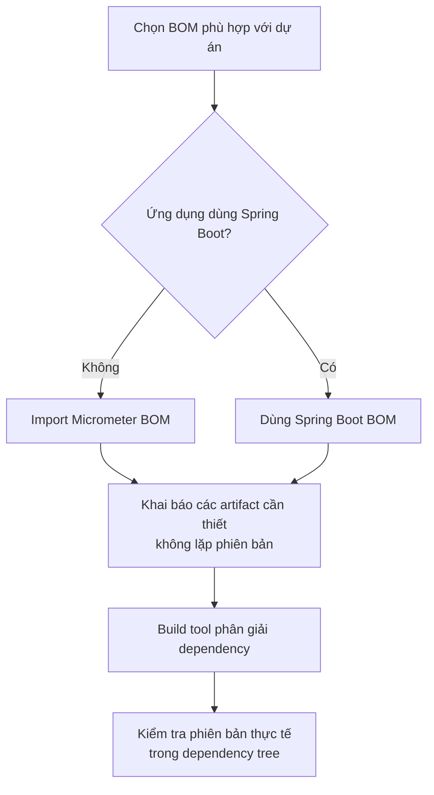

# Quản lý phiên bản bằng Micrometer BOM hoặc BOM của Spring Boot

Một ứng dụng Java có thể sử dụng nhiều thư viện trong cùng hệ sinh thái Micrometer, chẳng hạn `micrometer-core`, `micrometer-observation` và một registry như `micrometer-registry-prometheus`. Các module này cần tương thích với nhau. Nếu mỗi dependency tự khai báo một phiên bản riêng, ứng dụng dễ gặp tình trạng các module Micrometer lệch phiên bản, dependency bắc cầu chọn phiên bản ngoài dự kiến hoặc cấu hình build khó bảo trì.

BOM (Bill of Materials) giải quyết việc đó bằng cách tập trung quản lý phiên bản của một nhóm thư viện. Thay vì khai báo phiên bản ở từng dependency, dự án nhập BOM một lần rồi khai báo các artifact cần dùng. Công cụ build sẽ lấy phiên bản đã được BOM quản lý.

Với Micrometer, có hai lựa chọn thường gặp:

- **Micrometer BOM** (`io.micrometer:micrometer-bom`) quản lý phiên bản các module thuộc dự án Micrometer. Lựa chọn này phù hợp khi ứng dụng tự quản lý Micrometer hoặc không dùng BOM của Spring Boot để quản lý các dependency đó.
- **Spring Boot BOM** (`org.springframework.boot:spring-boot-dependencies`) quản lý một tập dependency rộng hơn, trong đó có các phiên bản Micrometer mà phiên bản Spring Boot đó đã chọn. Đây thường là lựa chọn phù hợp cho ứng dụng Spring Boot.

Mục tiêu là để các module Micrometer được phân giải theo một bộ phiên bản nhất quán, đồng thời phù hợp với nền tảng Spring Boot nếu ứng dụng sử dụng nền tảng này.

## 1. BOM quản lý phiên bản như thế nào?

BOM là một artifact dạng POM dùng để công bố thông tin quản lý dependency. Khi import BOM, dự án nhận các quy tắc phiên bản của những dependency được liệt kê trong BOM. BOM không phải thư viện chứa mã để ứng dụng gọi trực tiếp và cũng không tự động thêm tất cả artifact trong BOM vào classpath.

Ví dụ, sau khi import Micrometer BOM, dự án có thể khai báo `micrometer-core` và `micrometer-registry-prometheus` mà không ghi phiên bản riêng cho từng artifact. Nếu registry phụ thuộc vào các module Micrometer khác, dependency resolution cũng có thể áp dụng phiên bản được quản lý tương ứng.

Luồng quản lý phiên bản có thể tóm tắt như sau:



BOM quản lý phiên bản, còn dependency khai báo thư viện nào thực sự được sử dụng. Vì vậy, import BOM không có nghĩa là ứng dụng đã có registry hoặc đã bật endpoint metrics.

## 2. Dùng Micrometer BOM khi tự quản lý Micrometer

Lựa chọn Micrometer BOM phù hợp với ứng dụng Java không dùng Spring Boot dependency management, hoặc dự án chủ động quản lý các thư viện Micrometer độc lập với BOM của nền tảng khác.

### Maven

Import BOM trong phần `dependencyManagement`:

```xml
<properties>
    <micrometer.version>MICROMETER_VERSION</micrometer.version>
</properties>

<dependencyManagement>
    <dependencies>
        <dependency>
            <groupId>io.micrometer</groupId>
            <artifactId>micrometer-bom</artifactId>
            <version>${micrometer.version}</version>
            <type>pom</type>
            <scope>import</scope>
        </dependency>
    </dependencies>
</dependencyManagement>

<dependencies>
    <dependency>
        <groupId>io.micrometer</groupId>
        <artifactId>micrometer-core</artifactId>
    </dependency>

    <dependency>
        <groupId>io.micrometer</groupId>
        <artifactId>micrometer-registry-prometheus</artifactId>
        <scope>runtime</scope>
    </dependency>
</dependencies>
```

Thay `MICROMETER_VERSION` bằng phiên bản Micrometer đã chọn và được công bố trong repository dependency mà dự án sử dụng. Thuộc tính `micrometer.version` giúp thay đổi phiên bản tại một nơi.

Một số điểm cần hiểu:

- `dependencyManagement` quản lý phiên bản mặc định; nó không tự thêm dependency vào dự án.
- `type=pom` và `scope=import` cho Maven biết đây là BOM cần nhập quy tắc quản lý.
- Các dependency trong `dependencies` không cần lặp lại `version` nếu BOM đã quản lý artifact đó.
- `runtime` phù hợp khi ứng dụng chỉ cần registry lúc chạy, ví dụ registry được Spring hoặc cơ chế khởi tạo khác phát hiện. Nếu mã nguồn trực tiếp tham chiếu lớp triển khai của registry, hãy dùng scope phù hợp với nhu cầu biên dịch.

Nếu dự án dùng nhiều module Maven, có thể đặt phần import BOM ở parent POM để các module con kế thừa quy tắc phiên bản. Cần kiểm tra module con có kế thừa đúng parent và không khai báo phiên bản riêng làm lệch cấu hình chung.

### Gradle với native platform

Gradle hỗ trợ import BOM thông qua dependency platform:

```groovy
def micrometerVersion = 'MICROMETER_VERSION'

dependencies {
    implementation platform("io.micrometer:micrometer-bom:${micrometerVersion}")

    implementation 'io.micrometer:micrometer-core'
    runtimeOnly 'io.micrometer:micrometer-registry-prometheus'
}
```

Thay `MICROMETER_VERSION` bằng phiên bản đã chọn. `platform(...)` đưa các dependency constraints từ BOM vào quá trình phân giải của Gradle. Các khai báo module Micrometer phía dưới có thể bỏ phiên bản vì platform đã cung cấp constraint.

Với dự án dùng Groovy DSL, đoạn mã trên có thể đặt trong `build.gradle`; với Kotlin DSL, cú pháp tương ứng là:

```kotlin
val micrometerVersion = "MICROMETER_VERSION"

dependencies {
    implementation(platform("io.micrometer:micrometer-bom:$micrometerVersion"))

    implementation("io.micrometer:micrometer-core")
    runtimeOnly("io.micrometer:micrometer-registry-prometheus")
}
```

Gradle còn có `enforcedPlatform(...)`, nhưng không nên mặc định dùng nó để quản lý BOM. `enforcedPlatform` ép các phiên bản trong platform và có thể tác động đến dependency resolution của các thành phần phụ thuộc. Dùng `platform(...)` trước; chỉ dùng cơ chế ép phiên bản khi đã hiểu rõ ảnh hưởng và có lý do cụ thể.

## 3. Dùng BOM của Spring Boot cho ứng dụng Spring Boot

Spring Boot cung cấp BOM `spring-boot-dependencies` để quản lý phiên bản cho Spring Framework, Spring Boot và nhiều thư viện tích hợp. Bộ phiên bản Micrometer cũng được Spring Boot lựa chọn và kiểm thử trong tập dependency của phiên bản Boot tương ứng.

Vì vậy, ứng dụng Spring Boot thường nên để Spring Boot quản lý Micrometer. Điều này giúp hạn chế việc vô tình chọn một phiên bản Micrometer không phù hợp với phiên bản Boot đang chạy.

### Maven với Spring Boot parent

Nếu dự án dùng `spring-boot-starter-parent`, dependency management được kế thừa từ parent:

```xml
<parent>
    <groupId>org.springframework.boot</groupId>
    <artifactId>spring-boot-starter-parent</artifactId>
    <version>SPRING_BOOT_VERSION</version>
    <relativePath/>
</parent>

<dependencies>
    <dependency>
        <groupId>org.springframework.boot</groupId>
        <artifactId>spring-boot-starter-actuator</artifactId>
    </dependency>

    <dependency>
        <groupId>io.micrometer</groupId>
        <artifactId>micrometer-registry-prometheus</artifactId>
        <scope>runtime</scope>
    </dependency>
</dependencies>
```

Thay `SPRING_BOOT_VERSION` bằng phiên bản Spring Boot mà dự án sử dụng. Không cần khai báo phiên bản riêng cho Actuator hoặc Prometheus registry nếu chúng được BOM quản lý.

Starter Actuator cung cấp tích hợp Actuator và các thành phần metrics nền tảng. Registry Prometheus vẫn cần được thêm như một dependency riêng nếu muốn xuất metrics theo định dạng Prometheus. Việc thêm registry không tự động bảo đảm endpoint đã được expose hoặc Prometheus đã được cấu hình scrape.

### Maven không dùng Spring Boot parent

Nếu dự án cần giữ parent POM riêng, có thể import trực tiếp Spring Boot BOM trong `dependencyManagement`:

```xml
<properties>
    <spring-boot.version>SPRING_BOOT_VERSION</spring-boot.version>
</properties>

<dependencyManagement>
    <dependencies>
        <dependency>
            <groupId>org.springframework.boot</groupId>
            <artifactId>spring-boot-dependencies</artifactId>
            <version>${spring-boot.version}</version>
            <type>pom</type>
            <scope>import</scope>
        </dependency>
    </dependencies>
</dependencyManagement>

<dependencies>
    <dependency>
        <groupId>org.springframework.boot</groupId>
        <artifactId>spring-boot-starter-actuator</artifactId>
    </dependency>

    <dependency>
        <groupId>io.micrometer</groupId>
        <artifactId>micrometer-registry-prometheus</artifactId>
        <scope>runtime</scope>
    </dependency>
</dependencies>
```

Cách import BOM này cho phép dự án kế thừa quản lý dependency của Spring Boot mà không phải thay parent POM. Hãy giữ phiên bản BOM đồng nhất với phiên bản Spring Boot plugin hoặc nền tảng Boot mà dự án thực sự sử dụng.

### Gradle với Spring Boot dependency management plugin

Khi dự án Gradle dùng plugin `io.spring.dependency-management`, Spring Boot Gradle plugin có thể tích hợp BOM `spring-boot-dependencies` tương ứng với phiên bản Boot đã khai báo:

```groovy
plugins {
    id 'java'
    id 'org.springframework.boot' version 'SPRING_BOOT_VERSION'
    id 'io.spring.dependency-management' version 'DEPENDENCY_MANAGEMENT_PLUGIN_VERSION'
}

dependencies {
    implementation 'org.springframework.boot:spring-boot-starter-actuator'
    runtimeOnly 'io.micrometer:micrometer-registry-prometheus'
}
```

Thay các placeholder bằng phiên bản plugin đã chọn. Trong cấu hình này, không cần import thêm Micrometer BOM chỉ để quản lý phiên bản các module Micrometer; Spring Boot BOM đã cung cấp các phiên bản tương ứng.

Nếu dự án Gradle không sử dụng `io.spring.dependency-management`, có thể dùng native platform để import Spring Boot BOM:

```groovy
def springBootVersion = 'SPRING_BOOT_VERSION'

dependencies {
    implementation platform(
        "org.springframework.boot:spring-boot-dependencies:${springBootVersion}"
    )

    implementation 'org.springframework.boot:spring-boot-starter-actuator'
    runtimeOnly 'io.micrometer:micrometer-registry-prometheus'
}
```

Cách native platform phù hợp khi muốn dùng cơ chế dependency management sẵn có của Gradle. Nếu dự án đã dùng plugin quản lý dependency của Spring, hãy theo một cơ chế thống nhất và tránh import lại cùng BOM ở nhiều nơi mà không có chủ đích.

## 4. Chọn BOM nào?

| Tình huống | Lựa chọn phù hợp | Lý do |
|---|---|---|
| Ứng dụng Java thuần, tự quản lý Micrometer | Micrometer BOM | Quản lý đồng bộ các module Micrometer |
| Ứng dụng Spring Boot theo cấu hình tiêu chuẩn | Spring Boot BOM | Dùng bộ phiên bản Micrometer tương thích với Boot |
| Dự án Maven có parent POM riêng nhưng vẫn dùng Spring Boot | Import Spring Boot BOM | Giữ parent hiện tại và nhận dependency management của Boot |
| Dự án Gradle dùng Spring Boot và dependency-management plugin | Spring Boot BOM do plugin tích hợp | Các dependency theo phiên bản được Boot quản lý |
| Dự án Gradle dùng native dependency constraints | Import BOM bằng `platform(...)` | Quản lý phiên bản bằng cơ chế chuẩn của Gradle |

Một nguyên tắc hữu ích là để một BOM chính chịu trách nhiệm quản lý phiên bản cho một nhóm dependency. Với ứng dụng Spring Boot, hãy bắt đầu từ Spring Boot BOM. Với ứng dụng không dùng Spring Boot dependency management, Micrometer BOM là lựa chọn trực tiếp cho các module Micrometer.

Không import đồng thời Micrometer BOM và Spring Boot BOM chỉ vì ứng dụng có cả dependency Micrometer lẫn Spring Boot. Hai BOM có thể cùng quản lý một artifact. Khi đó, kết quả phụ thuộc quy tắc ưu tiên của công cụ build và cấu hình cụ thể, khiến người đọc khó biết phiên bản nào đang được chọn. Chỉ phối hợp nhiều BOM khi có nhu cầu rõ ràng, đã hiểu thứ tự ưu tiên và xác minh kết quả phân giải.

## 5. Vì sao không nên khai báo phiên bản riêng cho từng module?

Giả sử một dự án dùng `micrometer-core` ở một phiên bản và Prometheus registry ở một phiên bản khác. Registry có thể phụ thuộc vào API hoặc module khác trong cùng release train. Sự lệch phiên bản có thể gây lỗi biên dịch, lỗi khởi tạo bean, lỗi liên kết lớp hoặc hành vi không tương thích lúc chạy.

Ví dụ dưới đây khó bảo trì vì mỗi module tự chọn phiên bản:

```xml
<dependencies>
    <dependency>
        <groupId>io.micrometer</groupId>
        <artifactId>micrometer-core</artifactId>
        <version>CORE_VERSION</version>
    </dependency>

    <dependency>
        <groupId>io.micrometer</groupId>
        <artifactId>micrometer-registry-prometheus</artifactId>
        <version>REGISTRY_VERSION</version>
    </dependency>
</dependencies>
```

Nếu hai placeholder trên trỏ đến các phiên bản không tương thích, ứng dụng có thể gặp sự cố dù build vẫn thành công. Khi dùng BOM, dependency chỉ cần khai báo artifact; việc chọn phiên bản được tập trung ở cấu hình quản lý.

Cũng cần chú ý dependency bắc cầu. Một thư viện khác có thể kéo vào module Micrometer như dependency gián tiếp. BOM giúp áp dụng quy tắc phiên bản cho các artifact mà nó quản lý, nhưng không loại bỏ nhu cầu kiểm tra dependency tree, đặc biệt khi một thư viện khai báo constraint hoặc version riêng.

## 6. Khi nào cần ghi đè phiên bản Micrometer?

Với ứng dụng Spring Boot, nên dùng bộ phiên bản Micrometer mà Spring Boot BOM đã chọn. Chỉ cân nhắc ghi đè khi có lý do cụ thể, chẳng hạn cần một bản sửa lỗi đã được xác nhận hoặc có yêu cầu tương thích đã được kiểm thử.

Trước khi ghi đè, cần:

1. Xác định chính xác artifact đang cần thay đổi và lý do thay đổi.
2. Kiểm tra phiên bản Micrometer đó tương thích với phiên bản Spring Boot, Java và các module Micrometer còn lại.
3. Quản lý thay đổi tại một điểm tập trung trong cấu hình build.
4. Kiểm tra toàn bộ nhóm artifact liên quan, không chỉ một module đơn lẻ nếu chúng cần cùng release train.
5. Chạy kiểm thử khởi động ứng dụng và kiểm tra registry thực tế được nạp.
6. Xem dependency tree để xác nhận phiên bản cuối cùng đúng như dự kiến.

Nếu một phiên bản Micrometer mới chưa nằm trong BOM của Spring Boot hiện tại, việc ép nâng cấp có thể vượt ra ngoài tổ hợp dependency đã được Boot kiểm thử. Khi có thể, nâng phiên bản Spring Boot lên bản phù hợp thường là hướng dễ duy trì hơn. Nếu buộc phải ghi đè, hãy ghi lại lý do và phạm vi ảnh hưởng để lần nâng cấp tiếp theo có thể đánh giá lại.

Không nên dùng `enforcedPlatform` hoặc ép dependency trên toàn bộ dự án chỉ để làm mất cảnh báo xung đột. Cách ép rộng có thể che giấu nguyên nhân gốc và ảnh hưởng đến thư viện không thuộc phạm vi Micrometer.

## 7. Kiểm tra phiên bản thực tế được phân giải

Sau khi cấu hình BOM, hãy kiểm tra phiên bản mà Maven hoặc Gradle thực sự chọn. File build thể hiện ý định quản lý; dependency report cho biết kết quả sau khi kết hợp dependency trực tiếp, dependency bắc cầu, constraints và các quy tắc override.

### Maven

Chạy lệnh sau tại thư mục chứa POM của module cần kiểm tra:

```bash
mvn dependency:tree -Dincludes=io.micrometer
```

Kết quả giúp nhìn thấy các artifact Micrometer, phiên bản được phân giải và dependency nào kéo chúng vào. Nếu cần kiểm tra một artifact cụ thể hoặc mở rộng thông tin, có thể dùng thêm các tùy chọn của Maven Dependency Plugin.

Khi đọc kết quả, hãy chú ý:

- Có nhiều phiên bản của cùng một artifact trong các nhánh dependency hay không.
- Phiên bản cuối cùng của `micrometer-core` và registry có nằm trong release train dự kiến hay không.
- Một dependency trực tiếp có khai báo version khiến cấu hình BOM không còn là nguồn quản lý duy nhất hay không.
- Module con có kế thừa đúng parent hoặc import đúng BOM hay không.

### Gradle

Dùng `dependencies` để xem cây dependency của runtime:

```bash
./gradlew dependencies --configuration runtimeClasspath
```

Dùng `dependencyInsight` để biết lý do một phiên bản được chọn:

```bash
./gradlew dependencyInsight \
    --dependency micrometer-core \
    --configuration runtimeClasspath
```

Có thể thay `micrometer-core` bằng `micrometer-registry-prometheus` hoặc artifact Micrometer cần kiểm tra. Phần `dependencyInsight` đặc biệt hữu ích khi Gradle chọn một phiên bản khác với mong đợi, vì nó cho biết các yêu cầu phiên bản và nguyên nhân phiên bản được chọn.

Nếu ứng dụng biên dịch được nhưng lỗi khi khởi chạy, hãy kiểm tra cả cấu hình `runtimeClasspath`. Một dependency có trên compile classpath chưa chắc đã được đưa vào runtime theo scope mà ứng dụng cần.

## 8. Các lỗi cấu hình thường gặp

| Hiện tượng | Nguyên nhân có thể | Cách xử lý |
|---|---|---|
| Maven báo thiếu version cho dependency | BOM chưa được import hoặc artifact không được BOM quản lý | Kiểm tra `dependencyManagement`, tọa độ BOM và artifact |
| Dependency tree có phiên bản Micrometer ngoài dự kiến | Có version trực tiếp, BOM khác hoặc dependency bắc cầu tác động | Xem dependency tree và loại bỏ khai báo trùng không cần thiết |
| Core và registry không cùng bộ phiên bản dự kiến | Quản lý phiên bản rời rạc hoặc override chưa đầy đủ | Để một BOM quản lý các module Micrometer và kiểm tra lại cây dependency |
| Ứng dụng Spring Boot có Actuator nhưng không có Prometheus endpoint | Chưa thêm Prometheus registry hoặc chưa cấu hình endpoint | Thêm registry phù hợp, kiểm tra cấu hình Actuator và runtime classpath |
| Gradle không nhận phiên bản từ BOM | Platform chưa được khai báo trong đúng configuration hoặc module | Kiểm tra `platform(...)`, cấu hình dependency và báo cáo dependency |
| Module con dùng phiên bản khác module cha | Module không kế thừa parent hoặc có quy tắc riêng | Kiểm tra cấu trúc multi-module và dependency management tại module con |

Một số lỗi không xuất phát từ BOM. Chẳng hạn, thêm Prometheus registry chỉ giải quyết dependency của registry; ứng dụng vẫn cần cấu hình endpoint và bảo đảm endpoint được expose qua Actuator. Tương tự, phiên bản đúng không bảo đảm Prometheus server đã scrape được ứng dụng.

## 9. Checklist quản lý phiên bản

- [ ] Xác định dự án có dùng Spring Boot dependency management hay không.
- [ ] Chọn một BOM chính để quản lý phiên bản Micrometer.
- [ ] Import BOM đúng cách theo Maven hoặc Gradle.
- [ ] Không khai báo phiên bản lặp lại ở từng module nếu BOM đã quản lý.
- [ ] Với Spring Boot, ưu tiên phiên bản Micrometer do Spring Boot BOM cung cấp.
- [ ] Chỉ ghi đè phiên bản khi có lý do và đã kiểm tra tương thích.
- [ ] Kiểm tra dependency tree hoặc dependency insight sau khi thay đổi.
- [ ] Xác nhận registry cần thiết có mặt trên runtime classpath.
- [ ] Kiểm tra ứng dụng khởi động và endpoint metrics trong môi trường tích hợp.
- [ ] Ghi lại quyết định nâng cấp hoặc ghi đè để hỗ trợ bảo trì.

Quản lý phiên bản bằng BOM giúp các module Micrometer đi cùng một bộ phiên bản có chủ đích. Trong ứng dụng Java tự quản lý thư viện, Micrometer BOM là lựa chọn trực tiếp. Trong ứng dụng Spring Boot, Spring Boot BOM thường là điểm quản lý phù hợp vì nó giữ Micrometer trong bộ dependency mà nền tảng đã lựa chọn. Sau mỗi thay đổi, kiểm tra dependency report và runtime của ứng dụng để xác nhận cấu hình đã được áp dụng đúng.

