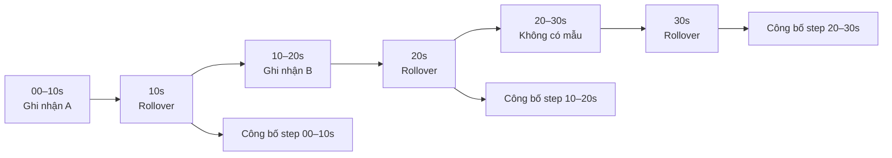

# Kiểm thử chuyển cửa sổ của step registry hoặc thống kê phân phối

Các phép đo trong Micrometer không phải lúc nào cũng giữ số liệu theo cùng một khoảng thời gian. Registry dạng step như StepMeterRegistry trả số liệu của step đã hoàn tất gần nhất, còn max và percentile của Timer hoặc DistributionSummary thường dùng cửa sổ thống kê có thời hạn riêng. Nếu kiểm thử chỉ ghi vài mẫu rồi đọc ngay, kết quả có thể đúng với implementation nhưng sai với kỳ vọng của người viết test.

Cách kiểm thử ổn định là điều khiển Clock thay vì chờ thời gian thực. MockClock cho phép tiến đồng hồ đến trước hoặc sau ranh giới step, kiểm tra số liệu của từng cửa sổ và xác nhận dữ liệu cũ hết hạn. Bài này tập trung vào hai nhóm kiểm thử: rollover của StepMeterRegistry và thời hạn của thống kê phân phối.

Bài học thuộc module OBSERVABILITY_INSTRUMENTATION_MICROMETER. Module này hướng dẫn sử dụng Micrometer để đo lường ứng dụng Java bằng counter, gauge, timer, distribution summary và nhãn có kiểm soát; tích hợp Spring Boot, xuất metrics đến hệ giám sát, kiểm soát cardinality, kiểm thử instrumentation và diễn giải số đo vận hành.

## Mục tiêu học tập

Sau bài này, bạn có thể:

- Giải thích step window và dữ liệu được công bố sau khi một step hoàn tất.
- Phân biệt giá trị của step registry với số liệu tích lũy suốt vòng đời process.
- Dùng MockClock để kiểm thử rollover mà không cần Thread.sleep().
- Tạo StepMeterRegistry nhỏ phục vụ test và kiểm soát chu kỳ step.
- Kiểm tra count, total time và việc chuyển sang step tiếp theo.
- Phân biệt step window với time window của max và percentile.
- Cấu hình expiry và buffer length để kiểm thử thống kê phân phối xác định.
- Phân biệt client-side percentile với percentile histogram.
- Tránh test phụ thuộc scheduler, network exporter hoặc thời gian chạy thực.

## 1. Hai loại cửa sổ thời gian

Micrometer có thể lưu hoặc công bố thống kê theo các cách khác nhau tùy registry và loại meter.

**Step window** là khoảng thời gian báo cáo được cấu hình cho một registry push. Khi sang step mới, StepCounter, StepTimer và StepDistributionSummary chuyển dữ liệu của step vừa hoàn tất thành giá trị có thể công bố. Getter của các meter step trả dữ liệu thuộc step hoàn tất gần nhất, không phải tổng tích lũy từ lúc process khởi động.

**Distribution time window** là cửa sổ mà các thống kê như max hoặc percentile (khi được bật) giữ lại mẫu. Cửa sổ này được điều khiển bởi expiry và buffer length trong DistributionStatisticConfig. Nó có thể dài hơn hoặc ngắn hơn một step.

| Thuộc tính | Step window | Distribution time window |
| --- | --- | --- |
| Mục đích | Chốt số liệu cho một chu kỳ báo cáo | Giữ mẫu phục vụ max và percentile gần đây |
| Cấu hình chính | StepRegistryConfig.step() | DistributionStatisticConfig.expiry và bufferLength |
| Thành phần thường gặp | StepCounter, StepTimer, StepDistributionSummary | TimeWindowMax, TimeWindowPercentileHistogram |
| Khi sang cửa sổ | Số liệu của step trước được chuyển sang trạng thái đã hoàn tất | Bucket cũ được xoay vòng hoặc hết hạn |
| Ví dụ giá trị | Count và total time của 10 giây vừa qua | Max trong một cửa sổ thống kê gần đây |

Một StepTimer có thể dùng cả hai cơ chế. Count và total time được chia theo step, trong khi max và percentile được tính trên time window. Vì vậy, không nên giả định tất cả trường trong một HistogramSnapshot có cùng ranh giới thời gian.

## 2. Rollover của StepMeterRegistry

StepMeterRegistry là lớp cơ sở cho registry push có dữ liệu được chuẩn hóa theo step. Một số registry implementation dùng mô hình này để gom dữ liệu trước khi gửi đến backend.

Với step 10 giây, các khoảng báo cáo có thể được hình dung như sau:



Ví dụ:

- Trong step đầu, Timer ghi nhận hai lần.
- Khi đồng hồ vượt ranh giới 10 giây, step đầu được hoàn tất.
- Giá trị count và total time lúc này phản ánh step vừa kết thúc.
- Các lần ghi tiếp theo thuộc step kế tiếp.
- Khi step kế tiếp hoàn tất, giá trị đã đọc sẽ chuyển sang dữ liệu của step đó.
- Một step không có mẫu có thể trả count và total time bằng 0.

Điều này khác với SimpleMeterRegistry hoặc PrometheusMeterRegistry tích lũy count và total time theo vòng đời của meter. Khi viết test, phải biết registry đang dùng thuộc nhóm nào trước khi quyết định expected value.

### Không dùng Thread.sleep() để chờ step

Test kiểu sau không ổn định:

```java
timer.record(Duration.ofMillis(100));
Thread.sleep(10_000);
assertThat(timer.count()).isEqualTo(1);
```

Test phải chờ thật, làm chậm suite và có thể chạy sai do scheduler, tải máy hoặc độ trễ của CI. Nếu test chạy lệch khỏi ranh giới step, kết quả cũng khó tái hiện.

MockClock cho phép tiến thời gian có chủ đích:

```java
MockClock clock = new MockClock();

clock.add(Duration.ofSeconds(10));
```

MockClock điều khiển cả wall time và monotonic time. Step registry sử dụng wall time để xác định ranh giới step; Timer sử dụng monotonic time để đo duration. Không cần đợi đồng hồ hệ thống chạy.

## 3. Tạo StepMeterRegistry dùng trong test

StepMeterRegistry là lớp abstract vì mỗi registry cụ thể phải định nghĩa cách publish dữ liệu và base time unit. Có thể tạo một registry nhỏ chỉ dùng trong test:

```java
package io.micrometer.core.instrument.step;

import java.time.Duration;
import java.util.concurrent.TimeUnit;

import io.micrometer.core.instrument.Clock;

final class TestStepMeterRegistry extends StepMeterRegistry {

    private static final StepRegistryConfig CONFIG =
            new StepRegistryConfig() {
                @Override
                public String prefix() {
                    return "test";
                }

                @Override
                public String get(String key) {
                    return null;
                }

                @Override
                public Duration step() {
                    return Duration.ofSeconds(10);
                }

                @Override
                public boolean enabled() {
                    return false;
                }
            };

    TestStepMeterRegistry(Clock clock) {
        super(CONFIG, clock);
    }

    @Override
    protected void publish() {
        // Test không gửi dữ liệu ra network.
    }

    @Override
    protected TimeUnit getBaseTimeUnit() {
        return TimeUnit.SECONDS;
    }
}
```

Một số điểm trong registry test:

- Step được cố định ở 10 giây để test dễ đọc.
- Clock được truyền từ test, không dùng Clock.SYSTEM.
- enabled=false ngăn registry khởi động scheduler push tự động.
- publish() rỗng vì test chỉ kiểm tra semantics của meter, không kiểm tra network exporter.
- Base time unit là giây; khi đọc totalTime có thể yêu cầu đơn vị milliseconds.

Đặt class test trong package test cùng package `io.micrometer.core.instrument.step` để có thể truy cập các thành phần package-private cần thiết nếu test muốn gọi polling hook. Không đưa registry test này vào mã production.

Nếu chỉ cần kiểm tra hành vi của StepTimer, không cần gọi start() trên registry. Việc đọc count hoặc totalTime sau khi MockClock tiến qua ranh giới step sẽ kích hoạt quá trình lấy giá trị của step hoàn tất. Trong test cần xác minh lịch poll hoặc publish riêng, hãy kiểm thử scheduler bằng một lớp kiểm soát được; không trộn kiểm thử scheduler với kiểm thử dữ liệu của Timer.

## 4. Kiểm thử Timer chuyển sang step tiếp theo

Ví dụ JUnit 5 và AssertJ:

```java
package io.micrometer.core.instrument.step;

import static org.assertj.core.api.Assertions.assertThat;

import java.time.Duration;
import java.util.concurrent.TimeUnit;

import io.micrometer.core.instrument.MockClock;
import io.micrometer.core.instrument.Timer;
import org.junit.jupiter.api.Test;

class StepTimerRolloverTest {

    @Test
    void exposesValuesFromTheLastCompletedStep() {
        MockClock clock = new MockClock();

        try (TestStepMeterRegistry registry =
                     new TestStepMeterRegistry(clock)) {

            Timer timer = registry.timer("job.execution");

            timer.record(Duration.ofMillis(120));
            timer.record(Duration.ofMillis(180));

            // Step đầu chưa hoàn tất.
            assertThat(timer.count()).isZero();
            assertThat(timer.totalTime(TimeUnit.MILLISECONDS)).isZero();

            // Chuyển đồng hồ đến ranh giới step 10 giây.
            clock.add(Duration.ofSeconds(10));

            assertThat(timer.count()).isEqualTo(2L);
            assertThat(timer.totalTime(TimeUnit.MILLISECONDS))
                    .isEqualTo(300.0);

            // Mẫu mới thuộc step thứ hai.
            timer.record(Duration.ofMillis(250));

            // Giá trị công bố vẫn là step đầu cho đến khi step hai kết thúc.
            assertThat(timer.count()).isEqualTo(2L);
            assertThat(timer.totalTime(TimeUnit.MILLISECONDS))
                    .isEqualTo(300.0);

            clock.add(Duration.ofSeconds(10));

            assertThat(timer.count()).isEqualTo(1L);
            assertThat(timer.totalTime(TimeUnit.MILLISECONDS))
                    .isEqualTo(250.0);

            // Step thứ ba không có mẫu.
            clock.add(Duration.ofSeconds(10));

            assertThat(timer.count()).isZero();
            assertThat(timer.totalTime(TimeUnit.MILLISECONDS)).isZero();
        }
    }
}
```

Test này xác minh ba step liên tiếp:

| Step | Mẫu được ghi | Giá trị sau rollover |
| --- | --- | --- |
| 0–10 giây | 120 ms, 180 ms | count=2, total=300 ms |
| 10–20 giây | 250 ms | count=1, total=250 ms |
| 20–30 giây | Không có mẫu | count=0, total=0 ms |

Các assertion trước rollover xác nhận dữ liệu mới chưa được xem là dữ liệu của step đã hoàn tất. Các assertion sau rollover xác nhận meter chuyển sang step mới và không cộng dồn toàn bộ lịch sử.

Nếu muốn kiểm tra Counter, có thể dùng cùng registry:

```java
Counter requests = registry.counter("job.requests");

requests.increment(3);

clock.add(Duration.ofSeconds(10));

assertThat(requests.count()).isEqualTo(3.0);
```

Counter của step registry biểu diễn sự kiện thuộc step hoàn tất gần nhất. Với một registry cumulative, cùng phép ghi nhận sẽ tiếp tục được cộng dồn qua các lần đọc.

## 5. Kiểm tra step rỗng và bước nhảy nhiều step

Một test quan trọng là không có dữ liệu trong step kế tiếp. Giá trị của step vừa hoàn tất phải về 0:

```java
timer.record(Duration.ofMillis(90));

clock.add(Duration.ofSeconds(10));
assertThat(timer.count()).isEqualTo(1L);

clock.add(Duration.ofSeconds(10));
assertThat(timer.count()).isZero();
```

Cũng cần kiểm tra khi đồng hồ nhảy qua nhiều step:

```java
timer.record(Duration.ofMillis(90));

clock.add(Duration.ofSeconds(30));

assertThat(timer.count()).isZero();
```

Khi bỏ qua nhiều step, dữ liệu cũ có thể không còn là giá trị của step hoàn tất gần nhất. Test nên phản ánh chính sách rollover của implementation thay vì giả định dữ liệu cũ được giữ lại vô thời hạn.

Không dùng một lần advance lớn để thay thế toàn bộ test boundary. Hãy có ít nhất một test tiến từng step và một test nhảy qua nhiều step nếu ứng dụng có khả năng pause lâu hoặc máy bị suspend.

## 6. Thống kê phân phối có cửa sổ riêng

Timer và DistributionSummary có thể công bố max, percentile hoặc histogram. Các thống kê này không nhất thiết có cùng thời hạn với count và total time.

Với các implementation cơ bản, max được quản lý bởi TimeWindowMax. Percentile histogram, khi được bật, được quản lý bởi TimeWindowPercentileHistogram. Các cấu trúc này dùng cấu hình expiry và buffer length.

Thời gian giữ dữ liệu xấp xỉ:

`window retention = expiry × bufferLength`

Ví dụ:

| expiry | bufferLength | Khoảng giữ tối đa xấp xỉ |
| --- | ---: | ---: |
| 10 giây | 1 | 10 giây |
| 10 giây | 2 | 20 giây |
| 10 giây | 3 | 30 giây |
| 1 phút | 3 | 3 phút |

Với StepMeterRegistry, expiry mặc định của histogram thường được đặt bằng step size; bufferLength mặc định là 3. Do đó, max có thể còn xuất hiện sau khi count và total time đã chuyển sang step tiếp theo.

Đây là lý do test không nên khẳng định rằng max luôn reset ngay tại ranh giới step. Hãy kiểm thử riêng từng loại thống kê với cấu hình thực tế.

## 7. Kiểm thử thời hạn của Timer.max

Có thể dùng SimpleMeterRegistry cùng MockClock để cô lập thống kê phân phối khỏi step registry:

```java
import static org.assertj.core.api.Assertions.assertThat;

import java.time.Duration;
import java.util.concurrent.TimeUnit;

import io.micrometer.core.instrument.MockClock;
import io.micrometer.core.instrument.Timer;
import io.micrometer.core.instrument.simple.SimpleConfig;
import io.micrometer.core.instrument.simple.SimpleMeterRegistry;
import org.junit.jupiter.api.Test;

class TimerDistributionWindowTest {

    @Test
    void expiresMaxWithoutResettingCumulativeCountAndTotal() {
        MockClock clock = new MockClock();

        try (SimpleMeterRegistry registry =
                     new SimpleMeterRegistry(SimpleConfig.DEFAULT, clock)) {

            Timer timer = Timer.builder("http.request.duration")
                    .distributionStatisticExpiry(Duration.ofSeconds(10))
                    .distributionStatisticBufferLength(1)
                    .publishPercentiles(0.5, 0.95)
                    .register(registry);

            timer.record(Duration.ofMillis(100));
            timer.record(Duration.ofMillis(300));

            assertThat(timer.count()).isEqualTo(2L);
            assertThat(timer.totalTime(TimeUnit.MILLISECONDS))
                    .isEqualTo(400.0);
            assertThat(timer.max(TimeUnit.MILLISECONDS))
                    .isEqualTo(300.0);

            clock.add(Duration.ofSeconds(11));

            // Max đã hết hạn theo time window.
            assertThat(timer.max(TimeUnit.MILLISECONDS)).isZero();

            // SimpleMeterRegistry vẫn giữ count và total tích lũy.
            assertThat(timer.count()).isEqualTo(2L);
            assertThat(timer.totalTime(TimeUnit.MILLISECONDS))
                    .isEqualTo(400.0);
        }
    }
}
```

Test dùng bufferLength=1 để cửa sổ dễ quan sát. Sau khi đồng hồ tiến hơn expiry, lần đọc max kích hoạt rotation và giá trị cũ bị loại bỏ.

Nếu dùng bufferLength mặc định là 3, max có thể còn tồn tại lâu hơn một expiry. Khi viết test, hãy đặt rõ expiry và bufferLength thay vì dựa vào default không được nêu trong test.

Count và total time của SimpleMeterRegistry là cumulative. Vì vậy, max có thể về 0 trong khi count và total time vẫn giữ nguyên. Đây là hành vi đúng, không phải mất dữ liệu.

## 8. Kiểm thử DistributionSummary theo cùng nguyên tắc

DistributionSummary lưu phân phối của các giá trị không phải thời lượng, chẳng hạn kích thước payload, số phần tử trong batch hoặc số byte được xử lý.

```java
import static org.assertj.core.api.Assertions.assertThat;

import java.time.Duration;

import io.micrometer.core.instrument.DistributionSummary;
import io.micrometer.core.instrument.MockClock;
import io.micrometer.core.instrument.simple.SimpleConfig;
import io.micrometer.core.instrument.simple.SimpleMeterRegistry;
import org.junit.jupiter.api.Test;

class DistributionSummaryWindowTest {

    @Test
    void expiresWindowMaxButKeepsCumulativeAmount() {
        MockClock clock = new MockClock();

        try (SimpleMeterRegistry registry =
                     new SimpleMeterRegistry(SimpleConfig.DEFAULT, clock)) {

            DistributionSummary summary =
                    DistributionSummary.builder("batch.payload.size")
                            .distributionStatisticExpiry(Duration.ofSeconds(10))
                            .distributionStatisticBufferLength(1)
                            .register(registry);

            summary.record(128);
            summary.record(512);

            assertThat(summary.count()).isEqualTo(2L);
            assertThat(summary.totalAmount()).isEqualTo(640.0);
            assertThat(summary.max()).isEqualTo(512.0);

            clock.add(Duration.ofSeconds(11));

            assertThat(summary.max()).isZero();
            assertThat(summary.count()).isEqualTo(2L);
            assertThat(summary.totalAmount()).isEqualTo(640.0);
        }
    }
}
```

Timer và DistributionSummary dùng cùng nguyên tắc quản lý time-window statistics, nhưng ý nghĩa đơn vị khác nhau. Timer tự chuẩn hóa đơn vị thời gian theo registry; DistributionSummary giữ nguyên đại lượng được ghi nhận và có thể dùng scale nếu nghiệp vụ cần.

## 9. Phân biệt percentile và percentile histogram

Micrometer hỗ trợ hai cách phổ biến để xuất percentile:

| Cách | Cấu hình | Nơi tính percentile | Có thể gộp qua tag? |
| --- | --- | --- | --- |
| Client-side percentile | publishPercentiles(0.5, 0.95) | Trong ứng dụng | Không |
| Percentile histogram | publishPercentileHistogram() | Backend tính từ bucket | Có, nếu backend hỗ trợ |

Client-side percentile tạo giá trị xấp xỉ cho từng Meter.Id. Nếu có các tag region hoặc endpoint, percentile của từng meter không thể cộng hoặc gộp để tạo percentile toàn service một cách đúng đắn.

Percentile histogram gửi bucket để backend tính percentile. Với Prometheus, có thể dùng histogram_quantile() trên các bucket đã được cộng theo chiều cần phân tích.

Ví dụ cấu hình:

```java
Timer timer = Timer.builder("http.request.duration")
        .publishPercentileHistogram()
        .serviceLevelObjectives(
                Duration.ofMillis(100),
                Duration.ofMillis(300),
                Duration.ofSeconds(1)
        )
        .minimumExpectedValue(Duration.ofMillis(1))
        .maximumExpectedValue(Duration.ofSeconds(10))
        .register(registry);
```

SLO boundaries thêm bucket tại các ngưỡng nghiệp vụ cần theo dõi. Chọn khoảng giá trị phù hợp giúp giới hạn số bucket và bộ nhớ histogram.

Không bật cả client-side percentile và percentile histogram theo thói quen. Với backend hỗ trợ histogram có thể gộp, histogram thường linh hoạt hơn. Một số backend hoặc client có giới hạn riêng về kiểu dữ liệu xuất dưới cùng một metric name.

## 10. Step rollover và histogram có thể cho kết quả khác thời điểm

Một StepTimer có thể cho thấy:

- count đã chuyển sang step mới.
- total time đã chuyển sang step mới.
- max vẫn giữ giá trị lớn nhất của cửa sổ thống kê đang còn hiệu lực.
- percentile vẫn phản ánh mẫu trong ring buffer của histogram.

Ví dụ với step=10 giây, expiry=10 giây và bufferLength=3:

| Thời điểm | Count/total của step | Max/percentile |
| --- | --- | --- |
| 0–10 giây | Đang ghi step 1 | Có mẫu mới |
| 10 giây | Step 1 hoàn tất, bắt đầu step 2 | Mẫu step 1 vẫn nằm trong time window |
| 20 giây | Step 2 hoàn tất | Mẫu cũ vẫn có thể còn trong ring buffer |
| 30 giây | Step 3 hoàn tất | Các bucket cũ bắt đầu hết hạn theo vòng quay |
| Sau khi đủ thời gian retention | Step tiếp tục chuyển bình thường | Max/percentile của mẫu cũ không còn |

Thời điểm chính xác phụ thuộc cách clock được lấy mẫu và lần gọi poll. Không viết test dựa vào giả định max sẽ về 0 đúng tại một ranh giới step khi bufferLength lớn hơn 1.

Nếu cần xác nhận expiry, hãy tạo test riêng với expiry và bufferLength được đặt rõ ràng. Nếu cần xác nhận step rollover, hãy tập trung vào count và total time của step.

## 11. Phân biệt StepMeterRegistry với Prometheus cumulative registry

Không phải mọi registry đều dùng step semantics.

StepMeterRegistry phù hợp với các exporter push cần tổng hợp dữ liệu theo chu kỳ. PrometheusMeterRegistry hoạt động theo mô hình pull và các counter/histogram thông thường được xuất dưới dạng cumulative.

| Đặc điểm | Step registry | Prometheus registry |
| --- | --- | --- |
| Mô hình | Push theo chu kỳ | Prometheus scrape |
| Count của Counter/Timer | Step vừa hoàn tất | Tích lũy theo vòng đời meter |
| Rollover | Có | Không reset count/sum/histogram cumulative |
| Max | Time-window statistic | Time-window max của Timer |
| Histogram bucket | Phụ thuộc registry và export semantics | Cumulative bucket |
| Kiểm thử | MockClock và ranh giới step | Kiểm tra exposition và cumulative progression |

Một test rollover trên StepMeterRegistry không chứng minh Prometheus counter sẽ reset. Nếu test ứng dụng dùng Prometheus, hãy kiểm tra exposition sau nhiều lần record và xác nhận count/sum tăng tích lũy.

Với Prometheus histogram, bucket là counter cumulative. Có thể dùng rate() để tính tốc độ tăng trong một khoảng truy vấn; không cần chờ registry reset bucket.

## 12. Kiểm tra snapshot và các trường phân phối

Timer và DistributionSummary cung cấp takeSnapshot() để lấy dữ liệu phân phối tại thời điểm kiểm tra:

```java
HistogramSnapshot snapshot = timer.takeSnapshot();

long count = snapshot.count();
double total = snapshot.total();
double max = snapshot.max();

ValueAtPercentile[] percentiles = snapshot.percentileValues();
CountAtBucket[] buckets = snapshot.histogramCounts();
```

Các trường cần xem:

| Trường | Ý nghĩa |
| --- | --- |
| count | Số mẫu trong snapshot theo semantics của implementation |
| total | Tổng thời lượng hoặc tổng đại lượng |
| max | Giá trị lớn nhất theo time window |
| percentileValues | Các giá trị percentile được cấu hình |
| histogramCounts | Số mẫu trong từng bucket |

Không giả định mọi registry đều hỗ trợ tất cả trường. Nếu chưa bật percentile hoặc histogram, snapshot có thể không chứa dữ liệu tương ứng. Một số backend chuyển đổi hoặc xuất dữ liệu theo định dạng riêng.

Test nên kiểm tra đúng năng lực đã cấu hình. Ví dụ, nếu chỉ cấu hình SLO buckets, hãy kiểm tra bucket boundaries và counts thay vì chờ client-side percentile values xuất hiện.

## 13. Test boundary và race condition

Rollover thường xảy ra đồng thời với ghi nhận meter trong ứng dụng thật. Test đơn luồng với MockClock xác minh semantics cơ bản, nhưng không chứng minh mọi tình huống concurrent.

Nên chia test thành các lớp:

1. **Deterministic unit test:** một thread ghi mẫu và tiến MockClock qua ranh giới step.
2. **Boundary test:** ghi ngay trước, đúng tại và ngay sau ranh giới.
3. **Idle test:** không ghi mẫu trong một hoặc nhiều step.
4. **Long-gap test:** clock nhảy qua nhiều step.
5. **Concurrency test:** nhiều thread ghi cùng meter trong lúc step rollover.
6. **Exporter integration test:** xác nhận payload thực tế được tạo và gửi đúng chu kỳ.

Với boundary test, dùng khoảng thời gian cụ thể:

```java
timer.record(Duration.ofMillis(100));

clock.add(Duration.ofMillis(9_999));
assertThat(timer.count()).isZero();

clock.add(Duration.ofMillis(1));
assertThat(timer.count()).isEqualTo(1L);
```

Cách kiểm tra này làm rõ chính sách tại đúng ranh giới 10 giây. Tuy nhiên, nếu implementation poll theo lịch có độ trễ riêng, hãy xác minh hợp đồng của registry và test đúng phương thức rollover được hỗ trợ.

Không gọi nhiều thread cùng thao tác trên MockClock trong test đơn giản. Nếu cần concurrency test, giữ clock cố định trong lúc các worker ghi, sau đó tiến clock sau khi các worker đã đồng bộ hoàn tất. Điều này giúp phân biệt lỗi rollover với lỗi điều phối test.

## 14. Kiểm tra exporter mà không nhầm với rollover

Unit test StepTimer xác nhận cách meter trả số liệu. Nó chưa xác nhận exporter gửi payload đúng.

Với custom registry, có thể ghi lại dữ liệu trong phương thức publish():

```java
@Override
protected void publish() {
    Timer timer = find("job.execution").timer();

    if (timer != null) {
        publishedCount = timer.count();
        publishedTotal = timer.totalTime(TimeUnit.SECONDS);
    }
}
```

Đây là ý tưởng cho test registry có sink trong bộ nhớ. Các field publishedCount và publishedTotal cần được khai báo trong registry test. Sau khi tiến clock và gọi cơ chế publish test, có thể kiểm tra payload snapshot đã ghi nhận.

Với registry implementation có exporter cụ thể, ưu tiên dùng mock HTTP server hoặc fake sender do implementation hỗ trợ. Kiểm tra:

- Endpoint và HTTP method.
- Payload chứa đúng tên metric và tag.
- Giá trị count/sum tương ứng step đã hoàn tất.
- Một step không bị publish lặp ngoài chính sách.
- Lỗi gửi không làm mất dữ liệu theo cách ngoài dự kiến.
- Close() và shutdown không làm rơi phần dữ liệu cuối cùng cần flush.

Không dùng unit test của StepTimer để kết luận HTTP exporter đã gửi thành công. Hai lớp cần test riêng.

## 15. Các lỗi thường gặp

| Lỗi | Hệ quả | Cách xử lý |
| --- | --- | --- |
| Dùng Thread.sleep() chờ rollover | Test chậm và flaky | Dùng MockClock |
| Nghĩ StepTimer.count() là tổng vòng đời | Assertion sai sau nhiều step | So sánh với step hoàn tất gần nhất |
| Nghĩ Prometheus cũng reset theo step | Hiểu sai cumulative counter/histogram | Kiểm thử theo semantics của Prometheus registry |
| Giả định max reset đúng lúc step kết thúc | Test thất bại khi bufferLength lớn hơn 1 | Kiểm tra expiry × bufferLength |
| Dùng expiry mặc định trong test | Kết quả phụ thuộc default registry | Đặt expiry và bufferLength rõ ràng |
| Chỉ kiểm tra count | Bỏ sót total, max và percentile | Test riêng từng statistic |
| Bật publishPercentiles rồi cộng percentile theo tag | Kết quả tổng hợp không đúng | Dùng percentile histogram nếu backend hỗ trợ |
| Không kiểm tra step rỗng | Giá trị cũ có thể bị hiểu nhầm là dữ liệu mới | Thêm test idle step |
| Tiến clock qua nhiều step nhưng mong dữ liệu cũ giữ lại | Expected value sai | Kiểm tra chính sách khi bỏ lỡ nhiều step |
| Test rollover nhưng không test exporter | Chưa phát hiện lỗi payload/network | Viết integration test riêng |
| Dùng Clock.SYSTEM trong test | Phụ thuộc thời gian thật | Inject MockClock |
| Dùng concurrency và thay clock cùng lúc | Khó xác định nguyên nhân sai | Đồng bộ writer trước khi tiến clock |

## 16. Checklist kiểm thử

Trước khi hoàn tất test cho step registry hoặc thống kê phân phối, hãy xác nhận:

1. Registry đang dùng là step-based hay cumulative?
2. Step duration có được cấu hình rõ ràng không?
3. Test có inject MockClock thay vì Clock.SYSTEM không?
4. Count và total time có được kiểm tra trước và sau rollover không?
5. Có test cho step rỗng và bước nhảy nhiều step không?
6. Expiry và bufferLength có được đặt rõ ràng khi test max/percentile không?
7. Test có phân biệt count/sum với max/percentile không?
8. Histogram buckets có đúng kiểu backend hỗ trợ không?
9. Có test riêng cho cumulative semantics của Prometheus không?
10. Exporter có test payload và lỗi gửi riêng không?
11. Test có tránh Thread.sleep() và scheduler phụ thuộc thời gian thực không?
12. Test concurrency có đồng bộ việc ghi và tiến clock không?

## Kết luận

Step registry và thống kê phân phối dùng các cửa sổ thời gian khác nhau. StepTimer công bố count và total time của step đã hoàn tất gần nhất; max và percentile thường được giữ trong time window điều khiển bởi expiry và bufferLength. Một meter có thể vì thế hiển thị count của step mới nhưng max vẫn còn giá trị từ cửa sổ trước.

Hãy dùng MockClock để kiểm thử rollover xác định, đặt rõ expiry và bufferLength khi kiểm tra thống kê phân phối, đồng thời tách test meter semantics khỏi test exporter. Không dùng Thread.sleep() để chờ step và không áp dụng kỳ vọng reset của StepMeterRegistry cho Prometheus cumulative registry. Cách kiểm thử theo từng lớp giúp phát hiện sai lệch thời gian, dữ liệu cũ và cách diễn giải metric trước khi đưa dashboard vào vận hành.

## Tài liệu tham khảo

- [Micrometer Timers](https://docs.micrometer.io/micrometer/reference/concepts/timers.html) — Timer, StepTimer, TimeWindowMax và percentile window.
- [Micrometer Histograms and Percentiles](https://docs.micrometer.io/micrometer/reference/concepts/histogram-quantiles.html) — client-side percentile, percentile histogram và SLO buckets.
- [StepMeterRegistry Javadoc](https://javadoc.io/doc/io.micrometer/micrometer-core/latest/io/micrometer/core/instrument/step/StepMeterRegistry.html) — registry push theo step.
- [StepTimer Javadoc](https://javadoc.io/doc/io.micrometer/micrometer-core/latest/io/micrometer/core/instrument/step/StepTimer.html) — count, total time, max và rollover.
- [MockClock Javadoc](https://javadoc.io/doc/io.micrometer/micrometer-core/latest/io/micrometer/core/instrument/MockClock.html) — điều khiển wall time và monotonic time trong test.
- [Micrometer Prometheus](https://docs.micrometer.io/micrometer/reference/implementations/prometheus.html) — cumulative histogram và series của Timer trong Prometheus.
