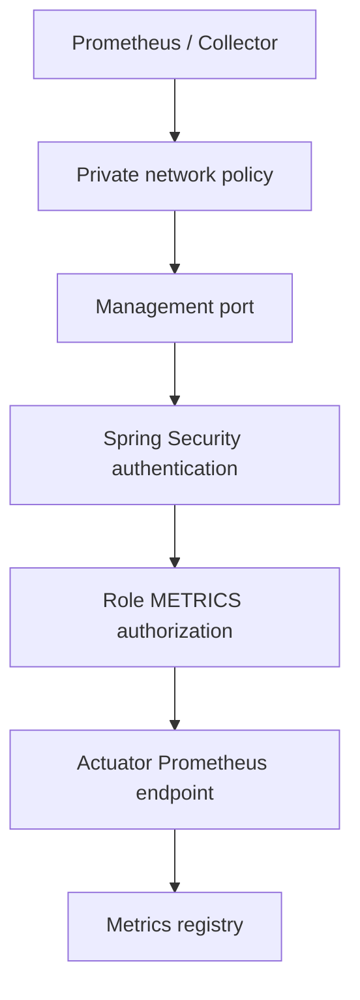

# Bảo vệ endpoint Actuator hoặc endpoint scrape

Trong module `OBSERVABILITY_INSTRUMENTATION_MICROMETER`, endpoint Actuator như `/actuator/prometheus` cung cấp dữ liệu runtime của ứng dụng cho hệ thống giám sát. Dữ liệu này hữu ích cho vận hành nhưng cũng tiết lộ thông tin về JVM, bộ nhớ, thread, request, dependency và các tag do ứng dụng tự định nghĩa. Vì vậy, endpoint metrics cần được giới hạn phạm vi truy cập như một giao diện quản trị nội bộ.

Bảo vệ endpoint scrape cần phối hợp ba lớp: chỉ expose đúng endpoint cần thiết; xác thực và phân quyền cho Prometheus hoặc collector; giới hạn đường mạng có thể truy cập management port. Một cổng riêng hoặc một đường dẫn khó đoán không thay thế authentication, authorization và network policy.

## 1. Phân biệt exposure, authentication và network access

Ba cơ chế giải quyết ba câu hỏi khác nhau:

| Lớp | Câu hỏi | Cơ chế thường dùng |
| --- | --- | --- |
| Endpoint exposure | Endpoint nào được công bố qua HTTP? | `management.endpoints.web.exposure.include/exclude` |
| Authentication/authorization | Ai được phép gọi endpoint? | Spring Security, Basic/Bearer authentication, role/authority |
| Network boundary | Máy hoặc workload nào có thể kết nối đến management port? | Private network, firewall, Kubernetes NetworkPolicy, security group, service mesh |

Ví dụ, chỉ expose `health` và `prometheus` không có nghĩa mọi người đều được quyền đọc metrics; nó chỉ xác định endpoint có mặt trên HTTP. Ngược lại, cấu hình Spring Security không làm endpoint bị ẩn khỏi mạng nếu port vẫn được mở công khai. Cần kết hợp cả ba lớp.



## 2. Chỉ expose endpoint thực sự cần thiết

Với Spring Boot Actuator và Prometheus registry, ứng dụng cần dependency tương ứng:

```groovy
dependencies {
    implementation("org.springframework.boot:spring-boot-starter-actuator")
    runtimeOnly("io.micrometer:micrometer-registry-prometheus")
}
```

Chỉ expose các endpoint cần dùng:

```yaml
management:
  endpoints:
    web:
      exposure:
        include: health,prometheus
  endpoint:
    health:
      show-details: when-authorized
```

Endpoint Prometheus được cung cấp khi registry dependency có trong classpath và endpoint được expose. Các endpoint như `env`, `configprops`, `heapdump`, `threaddump`, `loggers`, `mappings`, `conditions` hoặc `shutdown` có thể tiết lộ thông tin nhạy cảm hay cho phép thay đổi trạng thái ứng dụng; không expose hàng loạt chỉ để tiện debug.

Tránh cấu hình `include: "*"` trong production. Nếu cấu hình dùng nhiều profile, hãy kiểm tra giá trị cuối cùng sau khi các file cấu hình và biến môi trường được hợp nhất; profile production không nên vô tình kế thừa wildcard từ cấu hình phát triển.

## 3. Dùng management port riêng và giữ nó trong mạng nội bộ

Có thể tách Actuator khỏi cổng HTTP phục vụ người dùng:

```yaml
server:
  port: 8080

management:
  server:
    port: 8081
    address: 0.0.0.0
  endpoints:
    web:
      exposure:
        include: health,prometheus
```

Ứng dụng phục vụ request nghiệp vụ ở port 8080 và management endpoint ở port 8081. Trong container, bind vào `0.0.0.0` hoặc interface pod cần thiết để Prometheus ở pod khác có thể kết nối. Sau đó giới hạn port 8081 bằng NetworkPolicy, firewall hoặc cấu hình service nội bộ.

Nếu chỉ bind management server vào `127.0.0.1`, một Prometheus chạy ở pod hoặc host khác sẽ không truy cập được. Nếu bind vào `0.0.0.0` mà không giới hạn network, management port có thể bị truy cập từ các workload không mong muốn.

Management port riêng không tự động an toàn. Không đưa port này vào public Service, Ingress hoặc load balancer Internet-facing. Chỉ tạo route nội bộ dành cho monitoring system.

## 4. Bảo vệ endpoint bằng Spring Security

Với Spring Security, có thể tạo một filter chain dành riêng cho Actuator. `EndpointRequest` giúp match theo endpoint ID thay vì hard-code đường dẫn, nên vẫn hoạt động khi base path được thay đổi.

```java
import org.springframework.boot.actuate.autoconfigure.security.servlet.EndpointRequest;
import org.springframework.context.annotation.Bean;
import org.springframework.context.annotation.Configuration;
import org.springframework.core.annotation.Order;
import org.springframework.security.config.Customizer;
import org.springframework.security.config.annotation.web.builders.HttpSecurity;
import org.springframework.security.web.SecurityFilterChain;

@Configuration(proxyBeanMethods = false)
public class ActuatorSecurityConfiguration {

@Bean
@Order(1)
SecurityFilterChain actuatorSecurity(HttpSecurity http) throws Exception {
    return http
        .securityMatcher(EndpointRequest.toAnyEndpoint())
        .authorizeHttpRequests(authorize -> authorize
            .requestMatchers(EndpointRequest.to("health")).permitAll()
            .requestMatchers(EndpointRequest.to("prometheus")).hasRole("METRICS")
            .anyRequest().denyAll())
        .httpBasic(Customizer.withDefaults())
        .build();
}
}
```

Trong ví dụ này, health endpoint được cho phép truy cập theo chính sách đã chọn; Prometheus endpoint yêu cầu authority `ROLE_METRICS` vì `hasRole("METRICS")` tự thêm tiền tố `ROLE_`. Mọi Actuator endpoint khác bị từ chối trong filter chain này.

HTTP Basic chỉ là cơ chế xác thực; cần cấu hình `UserDetailsService`, `AuthenticationProvider` hoặc identity provider hiện có để cấp tài khoản scraper với đúng role. Dùng mật khẩu mạnh được lưu trong secret manager và chỉ truyền qua TLS. Không hard-code username/password trong source code.

Khi định nghĩa `SecurityFilterChain` tùy chỉnh, cấu hình bảo mật mặc định của Spring Boot có thể không còn áp dụng theo cách trước đó. Hãy bảo đảm có filter chain khác với thứ tự phù hợp để bảo vệ các request nghiệp vụ còn lại bằng cơ chế authentication hiện có của ứng dụng. Không để request ngoài Actuator rơi vào trạng thái không được bảo vệ do chỉ cấu hình một chain có matcher hẹp.

## 5. Chỉ cấp quyền scrape cần thiết

Tài khoản Prometheus nên có quyền đọc endpoint metrics, không cần quyền quản trị ứng dụng. Có thể mô hình hóa authority riêng như `ROLE_METRICS` và chỉ dùng nó cho endpoint `prometheus`.

Các nguyên tắc phân quyền:

- Tạo danh tính riêng cho từng môi trường hoặc workload scraper.
- Chỉ cấp role cần thiết để đọc metrics.
- Không dùng tài khoản administrator hoặc tài khoản nghiệp vụ của người dùng.
- Không cho tài khoản scraper gọi `shutdown`, `env`, `heapdump` hay endpoint quản trị khác.
- Thu hồi credential khi Prometheus/collector bị thay thế hoặc workload không còn cần truy cập.

Nếu tổ chức dùng OAuth2 Resource Server, mTLS identity hoặc reverse proxy có xác thực, có thể dùng cơ chế đó thay Basic Auth. Điều quan trọng là mapping danh tính scraper sang quyền đọc endpoint phải rõ ràng và có thể kiểm tra.

## 6. Cấu hình Prometheus gửi thông tin xác thực

Khi endpoint yêu cầu HTTP Basic, Prometheus có thể đọc mật khẩu từ file được mount dưới dạng secret:

```yaml
scrape_configs:
  - job_name: order-service
    metrics_path: /actuator/prometheus
    scheme: https
    static_configs:
      - targets:
          - order-service.internal:8081
    basic_auth:
      username: metrics-scraper
      password_file: /etc/prometheus/secrets/order-service-password
    tls_config:
      ca_file: /etc/prometheus/secrets/metrics-ca.crt
```

Prometheus gửi credentials khi scrape và xác minh chứng thư máy chủ bằng CA được cấu hình. File mật khẩu phải được mount từ secret store với quyền đọc tối thiểu cho tiến trình Prometheus. Không ghi mật khẩu trực tiếp vào `prometheus.yml`, ConfigMap công khai, image hoặc Git repository.

Nếu dùng `scheme: http`, Basic Auth không mã hóa credentials trên đường truyền. Chỉ dùng HTTP khi đường mạng đã được bảo vệ bằng một lớp mã hóa tin cậy khác; production thường nên dùng HTTPS hoặc service mesh mTLS.

## 7. Dùng TLS hoặc mutual TLS

TLS mã hóa kết nối và giúp Prometheus xác minh danh tính server. Với mutual TLS (mTLS), server còn yêu cầu client cung cấp certificate hợp lệ, nhờ đó chỉ workload có client certificate được tin cậy mới thiết lập được kết nối.

Phần client của Prometheus có thể khai báo certificate:

```yaml
scrape_configs:
  - job_name: order-service
    scheme: https
    metrics_path: /actuator/prometheus
    static_configs:
      - targets: ["order-service.internal:8081"]
    tls_config:
      ca_file: /etc/prometheus/secrets/server-ca.crt
      cert_file: /etc/prometheus/secrets/prometheus-client.crt
      key_file: /etc/prometheus/secrets/prometheus-client.key
      server_name: order-service.internal
```

Phía server phải được cấu hình để yêu cầu và xác minh client certificate, thường tại management server hoặc reverse proxy/service mesh đứng trước nó. Chỉ khai báo `cert_file` và `key_file` ở Prometheus không tự bật mTLS ở server.

Quản lý vòng đời certificate gồm cấp phát, gia hạn, thu hồi và thay thế không gián đoạn. Không đặt private key trong image hoặc repository; mount từ secret store và giới hạn quyền đọc. Tránh tắt xác minh certificate trong production.

## 8. Giới hạn truy cập bằng Kubernetes NetworkPolicy

Trong Kubernetes, có thể giới hạn ingress tới pod ứng dụng chỉ từ namespace monitoring và pod Prometheus. Ví dụ minh họa:

```yaml
apiVersion: networking.k8s.io/v1
kind: NetworkPolicy
metadata:
  name: allow-prometheus-to-management
  namespace: application
spec:
  podSelector:
    matchLabels:
      app: order-service
  policyTypes:
    - Ingress
  ingress:
    - from:
        - namespaceSelector:
            matchLabels:
              kubernetes.io/metadata.name: monitoring
          podSelector:
            matchLabels:
              app.kubernetes.io/name: prometheus
      ports:
        - protocol: TCP
          port: 8081
```

Ví dụ chỉ cho phép pod Prometheus trong namespace `monitoring` truy cập port 8081 của pod có label `app: order-service`. Label namespace/pod và port phải khớp với cluster thực tế. NetworkPolicy chỉ có hiệu lực nếu CNI của cluster hỗ trợ thực thi policy; cần kiểm tra default-deny và các policy hiện có để tránh mở rộng quyền ngoài ý muốn.

NetworkPolicy là lớp giới hạn nguồn kết nối, không thay thế Spring Security. Nếu một pod khác có thể kết nối do policy sai hoặc cấu hình mạng thay đổi, authentication vẫn phải ngăn nó đọc metrics.

## 9. Bảo vệ endpoint khi đi qua reverse proxy hoặc service mesh

Một số hệ thống không để Prometheus gọi trực tiếp application pod mà đi qua ingress nội bộ, gateway hoặc sidecar. Trong trường hợp này:

- Chỉ publish route metrics trên listener nội bộ.
- Giới hạn source identity hoặc service account của scraper.
- Dùng TLS/mTLS giữa các hop theo yêu cầu bảo mật.
- Không để proxy xóa header xác thực rồi chuyển request như một caller đáng tin mà không có cơ chế xác minh khác.
- Giới hạn method cần thiết; endpoint scrape thường chỉ cần `GET` và `HEAD` nếu exporter hỗ trợ.
- Không cache response metrics lâu vì dữ liệu cần phản ánh mẫu mới; nếu cache, đặt TTL và semantics rõ ràng.

Nếu proxy kết thúc TLS, hãy bảo vệ cả chặng proxy-to-application bằng mạng nội bộ đáng tin hoặc TLS nội bộ. Không giả định kết nối từ proxy tới pod luôn an toàn chỉ vì client-to-proxy đã mã hóa.

## 10. Metrics endpoint cũng có thể tiết lộ dữ liệu nhạy cảm

Metrics thường không chứa payload request, nhưng vẫn có thể để lộ thông tin vận hành:

- Tên service, hostname, pod, region và phiên bản ứng dụng.
- Tên queue, database pool, dependency hoặc endpoint nội bộ.
- Tag tùy chỉnh có thể vô tình chứa user ID, tenant ID, order ID, email hoặc URL thô.
- Số lượng thread, connection, request và trạng thái xử lý có thể tiết lộ tải hoặc thời điểm hoạt động.
- Một số meter tùy chỉnh có thể ghi giá trị liên quan đến dữ liệu nghiệp vụ.

Không đưa secret, token, email, dữ liệu cá nhân hoặc định danh từng thực thể vào metric tag. Dùng log/trace có kiểm soát quyền truy cập khi cần điều tra một request cụ thể. Cardinality cao vừa tăng chi phí vừa mở rộng lượng thông tin có thể bị suy luận từ metrics.

## 11. Không dùng endpoint scrape như endpoint quản trị

Endpoint scrape nên có mục đích đọc metrics. Tránh dùng chung một tài khoản scraper cho các endpoint cho phép thay đổi cấu hình hoặc trạng thái ứng dụng.

Một số endpoint Actuator có hành vi nhạy cảm:

| Endpoint | Rủi ro nếu expose rộng |
| --- | --- |
| `env` / `configprops` | Có thể tiết lộ cấu hình và thông tin môi trường |
| `heapdump` | Tạo file dump có thể chứa dữ liệu nhạy cảm trong heap |
| `threaddump` | Tiết lộ cấu trúc thread, class và trạng thái nội bộ |
| `loggers` | Có thể thay đổi mức log runtime nếu cho phép ghi |
| `shutdown` | Có thể dừng ứng dụng |
| `mappings` | Tiết lộ route và cấu trúc endpoint |

Chỉ bật endpoint quản trị khi có use case rõ ràng, bảo vệ bằng role riêng và giới hạn network chặt chẽ. Tài khoản scrape không nên nhận những quyền này.

## 12. Kiểm thử quyền truy cập endpoint

Kiểm thử cần xác minh ít nhất ba trường hợp: chưa xác thực nhận `401`, đã xác thực nhưng thiếu role nhận `403`, và scraper có role hợp lệ nhận `200`.

Ví dụ với MockMvc và Spring Security Test:

```java
import org.junit.jupiter.api.Test;
import org.springframework.beans.factory.annotation.Autowired;
import org.springframework.boot.test.autoconfigure.web.servlet.AutoConfigureMockMvc;
import org.springframework.boot.test.context.SpringBootTest;
import org.springframework.test.web.servlet.MockMvc;

import static org.springframework.security.test.web.servlet.request.SecurityMockMvcRequestPostProcessors.user;
import static org.springframework.security.test.web.servlet.request.SecurityMockMvcRequestPostProcessors.httpBasic;
import static org.springframework.test.web.servlet.request.MockMvcRequestBuilders.get;
import static org.springframework.test.web.servlet.result.MockMvcResultMatchers.status;

@SpringBootTest
@AutoConfigureMockMvc
class PrometheusEndpointSecurityTest {
    @Autowired
    MockMvc mockMvc;

    @Test
    void requiresMetricsRole() throws Exception {
        mockMvc.perform(get("/actuator/prometheus"))
            .andExpect(status().isUnauthorized());

        mockMvc.perform(get("/actuator/prometheus")
                .with(user("regular-user").roles("USER")))
            .andExpect(status().isForbidden());

        mockMvc.perform(get("/actuator/prometheus")
                .with(user("scraper").roles("METRICS")))
            .andExpect(status().isOk());

        // Test Basic Auth thật với user được cấu hình trong test profile.
        mockMvc.perform(get("/actuator/prometheus")
                .with(httpBasic("scraper", "test-password")))
            .andExpect(status().isOk());
    }
}
```

Thêm dependency sau vào test scope:

```groovy
testImplementation("org.springframework.security:spring-security-test")
```

Test giả định endpoint Prometheus đã được expose và test profile cung cấp một user `scraper` có role `METRICS`. `user(...)` mô phỏng principal cùng authority để kiểm tra authorization; `httpBasic(...)` đi qua cơ chế Basic Auth và kiểm tra cấu hình `AuthenticationProvider`/`UserDetailsService` thực tế của test.

Ngoài ra, kiểm tra endpoint không được expose trả `404`, health endpoint có đúng chính sách công khai/được bảo vệ, và endpoint quản trị khác bị từ chối. Với management port riêng, chạy integration test qua đúng port hoặc test môi trường để xác nhận listener không bị publish ra public ingress.

## 13. Xoay vòng credential và xử lý khi bị lộ

Credential của scraper cần được xoay vòng như các secret vận hành khác:

1. Cấp credential hoặc certificate mới cho Prometheus.
2. Cập nhật secret được mount vào Prometheus và xác nhận scraper dùng được credential mới.
3. Cập nhật danh tính/credential phía ứng dụng hoặc trust store để chấp nhận credential mới.
4. Thu hồi credential cũ sau khi các target đã chuyển đổi.
5. Kiểm tra log xác thực và scrape error để xác nhận không còn client cũ.

Với hệ thống cần không gián đoạn, có thể hỗ trợ thời gian chuyển tiếp ngắn với hai credential hợp lệ, sau đó thu hồi credential cũ. Không giữ credential cũ vô thời hạn.

Nếu credential bị lộ, thu hồi hoặc rotate ngay, kiểm tra log truy cập management endpoint, xác định các workload đã đọc secret và đánh giá liệu dữ liệu metrics có bị truy cập trái phép hay không. Không ghi lại secret bị lộ vào ticket, log hoặc chat vận hành.

## 14. Quan sát chính endpoint scrape

Endpoint metrics cũng cần được vận hành như một thành phần có thể gặp lỗi. Theo dõi:

- Prometheus target health và scrape error.
- HTTP status của scrape request, đặc biệt `401`, `403`, `404` và `5xx`.
- Scrape duration và response size.
- Tỷ lệ scrape timeout hoặc response bị cắt.
- Lỗi certificate, hết hạn certificate và lỗi xác thực.
- Thay đổi số series sau khi thêm meter/tag mới.

Khi Prometheus không scrape được, kiểm tra theo thứ tự DNS/route, NetworkPolicy/firewall, management port/path, TLS handshake, authentication, authorization và cuối cùng là exporter. `401` thường cho biết thiếu hoặc sai credentials; `403` cho biết principal đã xác thực nhưng không có quyền; `404` thường là endpoint chưa expose hoặc path/base path sai.

Không xử lý lỗi scrape bằng cách mở endpoint công khai tạm thời. Dùng log và kiểm tra từng lớp để xác định đúng nguyên nhân.

## 15. Checklist triển khai

| Kiểm tra | Kết quả mong đợi |
| --- | --- |
| Web exposure | Chỉ có `health` và `prometheus` hoặc endpoint thực sự cần thiết |
| Management listener | Port riêng hoặc listener nội bộ, không đi qua public ingress |
| Network policy | Chỉ Prometheus/collector được kết nối tới management port |
| Authentication | Scraper có danh tính riêng, credentials được cấp từ secret store |
| Authorization | Scraper chỉ có role đọc metrics; endpoint khác bị từ chối |
| Transport | HTTPS hoặc mTLS; không truyền Basic Auth qua mạng không mã hóa |
| Secret handling | Không commit/log password, token, private key hoặc certificate secret |
| Metrics labels | Không chứa PII, secret hoặc ID có cardinality cao |
| Tests | Xác minh 401, 403, 200 và endpoint không được expose |
| Rotation | Có quy trình thay và thu hồi credentials/certificate |

## 16. Nguyên tắc áp dụng

Expose đúng endpoint scrape cần thiết, đặt management port trong mạng nội bộ, xác thực scraper và cấp quyền đọc metrics riêng. Dùng TLS hoặc mTLS để bảo vệ đường truyền; quản lý credentials bằng secret store và xoay vòng định kỳ. NetworkPolicy/firewall giới hạn nguồn kết nối, còn Spring Security đảm bảo chỉ principal có role phù hợp được đọc endpoint.

Giữ metrics endpoint chỉ phục vụ quan sát, không dùng chung quyền với endpoint quản trị. Kiểm soát tag để tránh tiết lộ dữ liệu nhạy cảm, kiểm thử các trạng thái 401/403/200 và theo dõi scrape errors sau triển khai. Một endpoint scrape được bảo vệ tốt phải có exposure tối thiểu, danh tính rõ ràng, quyền tối thiểu và đường mạng giới hạn.
