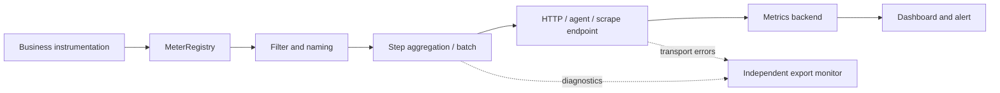

# Theo dõi lỗi công bố và khả năng xuất dữ liệu khi ứng dụng chịu tải

Metrics chỉ có ích khi dữ liệu đến được hệ thống nhận đúng lúc và đủ tin cậy. Một ứng dụng có thể ghi counter, timer và gauge hoàn toàn bình thường trong bộ nhớ nhưng vẫn mất khả năng quan sát nếu quá trình publish gặp lỗi xác thực, timeout, giới hạn ingest, nghẽn mạng hoặc quá tải. Vì vậy, vận hành Micrometer cần theo dõi cả metrics nghiệp vụ lẫn chính đường xuất metrics.

Đường export là một pipeline riêng: meter được cập nhật trong ứng dụng, registry gom và chuyển đổi dữ liệu, transport gửi batch, backend nhận và lưu trữ, cuối cùng dashboard hoặc alert truy vấn dữ liệu. Mỗi đoạn có kiểu lỗi và tín hiệu chẩn đoán khác nhau. Không nên giả định mọi registry đều cung cấp cùng một bộ meter nội bộ về số lần publish thành công/thất bại; cần kết hợp log của registry, số liệu backend, kiểm tra endpoint và telemetry độc lập cho exporter khi cần.

Trong module `OBSERVABILITY_INSTRUMENTATION_MICROMETER`, nội dung này giúp phát hiện sớm khi metrics bị chậm, bị drop hoặc không đến backend dưới tải cao, đồng thời giữ cho lỗi của hệ thống giám sát không làm gián đoạn xử lý nghiệp vụ.

## 1. Nhìn đường export như một pipeline



Các bước chính:

1. **Record:** code cập nhật meter trong `MeterRegistry`.
2. **Filter và chuẩn hóa:** registry áp dụng `MeterFilter`, common tags, naming convention và giới hạn meter.
3. **Aggregate:** registry dạng step gom dữ liệu theo chu kỳ; registry khác có thể expose dữ liệu để backend pull.
4. **Transport:** dữ liệu được gửi qua HTTP, agent hoặc một cơ chế nhận khác.
5. **Ingest:** backend xác thực, kiểm tra payload, áp giới hạn và lưu dữ liệu.
6. **Query:** dashboard và alert đọc dữ liệu đã ingest.

Một meter xuất hiện trong `/actuator/metrics` chỉ chứng minh meter đang được ứng dụng quản lý. Nó không chứng minh Datadog, InfluxDB hoặc backend khác đã nhận batch. Cần kiểm tra đến tận nơi nhận.

## 2. Phân biệt lỗi ghi meter, lỗi publish và lỗi ingest

Ba nhóm lỗi có thể tạo ra biểu hiện giống nhau là dashboard thiếu dữ liệu, nhưng cách xử lý khác nhau:

| Nhóm | Ví dụ | Dấu hiệu cần kiểm tra |
| --- | --- | --- |
| Record/registration | Meter bị filter, tên hoặc tag không hợp lệ, xung đột đăng ký | Log ứng dụng, số meter, schema tag, registry configuration |
| Publish/transport | DNS, TLS, connect timeout, read timeout, HTTP 5xx | Log exporter, trạng thái request, độ trễ publish, retry |
| Backend ingest | Sai API key, payload bị từ chối, quota, rate limit, bucket/database sai | Phản hồi backend, audit/ingest log, usage và quota phía backend |

Nếu meter không được tạo, kiểm tra instrumentation và filter. Nếu meter có trong registry nhưng backend không có, kiểm tra publish và ingest. Nếu backend nhận dữ liệu nhưng dashboard không hiển thị, kiểm tra tên export, tag, thời gian, retention và truy vấn.

## 3. Push và pull có cách theo dõi khác nhau

Với registry push như Datadog hoặc InfluxDB, ứng dụng chủ động gửi batch theo chu kỳ. Cần theo dõi trạng thái publish, lỗi transport, thời gian gửi, số lần retry và thời điểm thành công gần nhất.

Với Prometheus pull, ứng dụng chủ yếu expose endpoint scrape. Prometheus chủ động lấy dữ liệu; chỉ số `up` phía Prometheus cho biết scrape target có thành công hay không. Khi scrape thất bại, hãy xem `scrape_duration_seconds`, `scrape_samples_scraped`, `scrape_samples_post_metric_relabeling` và log target. Ứng dụng không thể tự biết một scrape đã thất bại nếu không có tín hiệu từ Prometheus hoặc lớp proxy.

| Câu hỏi | Registry push | Prometheus pull |
| --- | --- | --- |
| Ai khởi tạo việc chuyển dữ liệu? | Ứng dụng/registry | Prometheus scraper |
| Tín hiệu lỗi chính | Publish log, transport status, backend ingest response | `up`, scrape duration, scrape error và target log |
| Cách phát hiện dữ liệu cũ | Thời điểm publish thành công gần nhất và ingest lag | Thời điểm scrape gần nhất và `up` |
| Nguyên nhân thường gặp | Credential, quota, network, batch quá lớn | Endpoint không truy cập được, timeout, sample limit, scrape config |

Không áp dụng cảnh báo `publish failure` của push registry cho Prometheus pull. Với pull, hãy giám sát scrape từ phía Prometheus và khả năng phục vụ endpoint từ phía ứng dụng.

## 4. Những tín hiệu cần quan sát trên đường export

Nếu registry hoặc transport không cung cấp sẵn các meter cần thiết, hãy bổ sung monitor riêng hoặc lấy số liệu từ log/backend. Các tên bên dưới là schema gợi ý cho telemetry vận hành của exporter, không phải cam kết rằng mọi Micrometer registry tự tạo chúng.

| Tín hiệu | Ý nghĩa | Cảnh báo khi |
| --- | --- | --- |
| `telemetry.export.publish.success` | Số batch gửi thành công | Không tăng trong nhiều chu kỳ dự kiến |
| `telemetry.export.publish.failures` | Số batch gửi thất bại | Tăng liên tục hoặc tỷ lệ lỗi vượt ngưỡng |
| `telemetry.export.publish.duration` | Thời gian một lần publish | p95/p99 tiến gần timeout hoặc vượt step |
| `telemetry.export.batch.size` | Số meter/sample trong batch | Tăng bất thường hoặc vượt giới hạn backend |
| `telemetry.export.payload.bytes` | Kích thước payload | Gần giới hạn request hoặc tăng nhanh |
| `telemetry.export.queue.depth` | Số batch đang chờ gửi | Tăng liên tục, không giảm sau khi backend hồi phục |
| `telemetry.export.dropped` | Số batch/sample bị bỏ | Tăng khác 0 ngoài mức cho phép |
| `telemetry.export.last.success.timestamp` | Thời điểm publish thành công gần nhất | Tuổi dữ liệu vượt quá ngưỡng freshness |
| `telemetry.export.retry` | Số lần retry publish | Retry tăng liên tục hoặc gây backlog |

Chọn một bộ tín hiệu tối thiểu phù hợp với registry thực tế. Nếu adapter không expose queue depth hoặc batch size, không tự suy ra chúng từ số meter; hãy lấy từ transport, log hoặc custom exporter có quyền truy cập batch.

## 5. Theo dõi lỗi publish bằng telemetry độc lập

Một vấn đề quan trọng là không nên chỉ ghi lỗi export vào chính registry đang gặp lỗi. Nếu Datadog registry không gửi được dữ liệu, counter `export.failures` nằm trong registry đó cũng có thể không bao giờ đến backend. Đây là vòng lặp tự giám sát không đáng tin cậy.

Với exporter do ứng dụng tự điều khiển, có thể dùng một registry chẩn đoán riêng, log có cấu trúc hoặc health state độc lập. Ví dụ dưới đây minh họa monitor cho một publisher do ứng dụng sở hữu:

```java
import java.time.Clock;
import java.util.concurrent.atomic.AtomicLong;

import io.micrometer.core.instrument.Counter;
import io.micrometer.core.instrument.MeterRegistry;
import io.micrometer.core.instrument.Timer;

public final class ExportAttemptMonitor {
    private final MeterRegistry diagnosticRegistry;
    private final Clock wallClock;
    private final Counter successes;
    private final Counter failures;
    private final AtomicLong lastSuccessEpochSeconds = new AtomicLong();

    public ExportAttemptMonitor(MeterRegistry diagnosticRegistry, Clock wallClock) {
        this.diagnosticRegistry = diagnosticRegistry;
        this.wallClock = wallClock;
        this.successes = diagnosticRegistry.counter("telemetry.export.publish.success");
        this.failures = diagnosticRegistry.counter("telemetry.export.publish.failures");
        diagnosticRegistry.gauge(
                "telemetry.export.last.success.timestamp",
                lastSuccessEpochSeconds,
                AtomicLong::doubleValue);
    }

    public void publish(Runnable sendBatch) {
        Timer.Sample sample = Timer.start(diagnosticRegistry);
        String outcome = "success";
        try {
            sendBatch.run();
            successes.increment();
            lastSuccessEpochSeconds.set(wallClock.instant().getEpochSecond());
        } catch (RuntimeException ex) {
            outcome = classify(ex);
            failures.increment();
            throw ex;
        } finally {
            sample.stop(diagnosticRegistry.timer(
                    "telemetry.export.publish.duration", "outcome", outcome));
        }
    }

    private String classify(RuntimeException error) {
        // Ánh xạ exception/HTTP response vào vocabulary hữu hạn.
        return "transport_error";
    }
}
```

Ví dụ này chỉ áp dụng khi ứng dụng thực sự sở hữu lời gọi `sendBatch`. Với registry push được Spring Boot/Micrometer tự cấu hình và scheduler nội bộ quản lý, không gọi `publish()` thủ công hoặc bọc registry bằng một `Runnable` giả. Hãy dùng log và khả năng quan sát của adapter/HTTP client, hoặc một integration point được adapter hỗ trợ.

`diagnosticRegistry` cần được đọc qua một kênh độc lập như JMX, log/health endpoint hoặc một scrape endpoint riêng. Nếu đưa nó vào cùng composite registry đang lỗi, bạn lại phụ thuộc vào chính đường export cần giám sát. Khi dùng `SimpleMeterRegistry`, các số liệu chỉ nằm trong bộ nhớ và mất khi tiến trình dừng; cần cân nhắc cách đọc phù hợp với môi trường vận hành.

Gauge timestamp khởi tạo bằng `0` nghĩa là tiến trình chưa ghi nhận lần publish thành công nào. Alert cần xử lý sentinel này riêng, thay vì diễn giải nó như một thời điểm thành công hợp lệ.

## 6. Phân loại lỗi để chọn hành động phù hợp

Không phải mọi lỗi export đều nên retry giống nhau:

| Lỗi | Ví dụ | Hành động vận hành |
| --- | --- | --- |
| Authentication/authorization | HTTP 401/403, API key/token hết hạn hoặc thiếu quyền | Sửa secret/permission; không retry liên tục với credential sai |
| Invalid request | HTTP 400, payload sai schema, tên/tag không hợp lệ | Sửa cấu hình hoặc dữ liệu; retry nguyên batch thường không có ích |
| Rate limit | HTTP 429 hoặc quota ingest | Tôn trọng `Retry-After` nếu có, giảm tốc độ/batch, dùng backoff |
| Backend transient | HTTP 5xx, backend unavailable | Retry có giới hạn và backoff; theo dõi backlog |
| Network | DNS, TLS handshake, connect/read timeout | Kiểm tra DNS, certificate, route, firewall và timeout |
| Local saturation | CPU cao, GC kéo dài, queue đầy, thread pool cạn | Giảm tải exporter, giới hạn queue, giảm cardinality hoặc scale tài nguyên |
| Shutdown | Tiến trình dừng khi còn batch chưa gửi | Dành thời gian shutdown hữu hạn và kiểm tra hành vi close của adapter |

Đừng retry vô hạn với lỗi cấu hình cố định. Một API key sai có thể tạo hàng nghìn request thất bại, tăng tải mạng và làm log nhiễu trong khi không có khả năng tự phục hồi.

## 7. Retry, backoff và tránh làm nghẽn ứng dụng

Khi backend tạm thời không khả dụng, retry có thể giúp dữ liệu đến sau khi hệ thống hồi phục. Tuy nhiên, retry quá nhanh làm tăng áp lực đúng lúc backend đang quá tải.

Một chính sách an toàn thường có:

- Số lần retry hoặc tổng thời gian retry có giới hạn.
- Exponential backoff để khoảng chờ tăng dần.
- Jitter để nhiều instance không retry đồng thời.
- Tôn trọng hướng dẫn retry của backend như `Retry-After` nếu adapter hỗ trợ.
- Phân biệt lỗi tạm thời với lỗi cấu hình hoặc payload không hợp lệ.
- Giới hạn số batch đang chờ và xác định rõ chính sách khi đầy queue.

Ví dụ lịch chờ minh họa: 1 giây, 2 giây, 4 giây, 8 giây cộng jitter, với giới hạn tối đa. Con số thực tế phải dựa trên SLA backend và step interval. Không tự thêm retry ở tầng ứng dụng nếu registry/HTTP client đã retry; nhiều lớp retry có thể nhân số request và kéo dài thời gian khôi phục.

Đối với metrics, dữ liệu thường là telemetry chứ không phải giao dịch nghiệp vụ. Có thể chấp nhận mất một phần dữ liệu khi queue đầy để bảo vệ luồng request chính, nhưng phải đo và cảnh báo số lượng bị drop. Nếu yêu cầu không mất dữ liệu, cần một pipeline bền vững như agent/collector có queue lưu trữ, thay vì giữ vô hạn batch trong heap của ứng dụng.

## 8. Giới hạn batch và cardinality khi tải tăng

Số meter và số time series thường tác động trực tiếp đến payload size, thời gian serialize, CPU, heap và chi phí ingest. Một meter có nhiều tổ hợp tag có thể tạo rất nhiều series dù code chỉ khai báo một builder.

Các việc cần kiểm soát:

1. Dùng `MeterFilter` để giới hạn số meter hoặc loại bỏ meter không cần thiết.
2. Không dùng user ID, order ID, request ID, URL đầy đủ hoặc exception message làm tag.
3. Giữ vocabulary của `outcome`, `method`, `region`, `operation` hữu hạn.
4. Kiểm tra số meter và số series sau khi bật instrumentation mới.
5. Điều chỉnh step và batch size theo giới hạn backend, không chỉ theo tốc độ mong muốn.
6. Theo dõi payload bytes và thời gian serialize/publish khi số series tăng.

Nếu registry có hàng trăm nghìn series, tăng batch size có thể giảm số request nhưng làm payload lớn hơn, tăng heap tạm và thời gian timeout. Giảm batch size có thể giảm kích thước từng request nhưng tăng overhead mạng và số lần publish. Cần thử tải với phân bố tag gần production để chọn cấu hình.

## 9. Tách lỗi export khỏi sức khỏe nghiệp vụ

Metrics backend không khả dụng không nhất thiết có nghĩa ứng dụng nghiệp vụ không thể phục vụ người dùng. Nếu exporter chạy đồng bộ trên request thread, timeout export có thể làm tăng latency hoặc gây lỗi request. Nếu exporter chạy bất đồng bộ, ứng dụng có thể tiếp tục phục vụ nhưng dữ liệu giám sát bị trễ hoặc mất.

Thiết kế vận hành nên:

- Không thực hiện network publish trên đường xử lý request nghiệp vụ nếu adapter không được thiết kế cho việc đó.
- Dùng timeout kết nối/đọc hữu hạn và queue có giới hạn.
- Theo dõi exporter health riêng với liveness của ứng dụng.
- Chỉ đưa exporter vào readiness nếu yêu cầu nghiệp vụ thực sự không thể vận hành khi thiếu metrics backend.
- Không để lỗi telemetry làm restart loop ứng dụng khi business service vẫn khỏe.
- Ghi log lỗi export có rate limit hoặc sampling để tránh log storm.

Nếu cần custom `HealthIndicator`, trạng thái nên phản ánh thời điểm publish thành công gần nhất hoặc trạng thái transport gần nhất. Đừng đánh dấu UP chỉ vì registry bean tồn tại; bean tồn tại không có nghĩa backend nhận dữ liệu. Cũng không nên đánh dấu DOWN ngay sau một lỗi đơn lẻ nếu registry có retry và backend thường xuyên chập chờn; dùng ngưỡng thời gian hoặc số lần lỗi liên tiếp.

## 10. Theo dõi Prometheus scrape và dữ liệu cũ

Với Prometheus, kiểm tra target qua các truy vấn sau:

```promql
up{job="order-service"}
```

Giá trị 0 cho biết scrape gần nhất thất bại; không có series có thể chỉ ra target chưa được phát hiện hoặc cấu hình job sai.

```promql
scrape_duration_seconds{job="order-service"}
```

Theo dõi thời gian scrape để phát hiện endpoint chậm hoặc số sample tăng làm scrape nặng.

```promql
scrape_samples_scraped{job="order-service"}
```

Theo dõi số sample thu thập để phát hiện cardinality tăng đột ngột. So sánh với `scrape_samples_post_metric_relabeling` để hiểu số sample còn lại sau metric relabeling.

Nếu `up=1` nhưng một metric nghiệp vụ không cập nhật, endpoint vẫn hoạt động nhưng instrumentation có thể không được gọi, meter bị filter hoặc series không còn được xuất. Nếu metric biến mất sau khi có lỗi scrape, kiểm tra `sample_limit`, scrape timeout và log Prometheus.

## 11. Cảnh báo cho registry push

Với push registry, có thể xây dựng cảnh báo từ monitor độc lập hoặc metric exporter do adapter cung cấp. Ví dụ PromQL giả định các metric chẩn đoán đã được expose ở một kênh độc lập:

**Tỷ lệ publish thất bại:**

```promql
sum(rate(telemetry_export_publish_failures_total[5m]))
/
clamp_min(
  sum(rate(telemetry_export_publish_success_total[5m]))
  + sum(rate(telemetry_export_publish_failures_total[5m])),
  1
)
```

**Thời gian từ lần publish thành công gần nhất:**

```promql
time() - telemetry_export_last_success_timestamp_seconds
```

**p95 thời gian publish:**

```promql
histogram_quantile(
  0.95,
  sum by (le) (
    rate(telemetry_export_publish_duration_seconds_bucket[5m])
  )
)
```

Tên metric và hậu tố phụ thuộc naming convention của registry. Cần xác nhận exposition thực tế trước khi dùng rule. Ví dụ Java lưu timestamp theo epoch seconds để có thể so sánh trực tiếp với `time()` của Prometheus.

Alert nên dùng thời gian freshness và lỗi liên tiếp thay vì chỉ dựa vào một counter tăng đơn lẻ. Ví dụ, cảnh báo khi không có publish thành công trong nhiều step liên tiếp hoặc tuổi dữ liệu vượt ngưỡng cho phép. Nếu monitor độc lập cũng mất, cần có cảnh báo từ log, process health hoặc nền tảng vận hành.

## 12. Shutdown và batch chưa gửi

Khi ứng dụng dừng, registry push có thể có scheduler và batch chưa được publish. Spring container thường đóng các bean theo lifecycle, nhưng không nên mặc định mọi adapter đều đảm bảo flush toàn bộ dữ liệu trong mọi tình huống shutdown.

Hãy xác minh tài liệu adapter và phiên bản đang dùng để biết `close()` dừng scheduler, có publish cuối hay không, và việc publish có bị giới hạn bởi timeout nào. Cấu hình graceful shutdown của ứng dụng cần đủ thời gian cho tác vụ cleanup, nhưng phải có giới hạn để tiến trình không treo vô hạn.

Checklist shutdown:

- Ngừng nhận công việc mới trước khi đóng registry.
- Cho các request/job đang chạy hoàn tất trong giới hạn graceful shutdown.
- Đóng registry theo lifecycle do Spring quản lý; không tự tạo nhiều registry không được đóng.
- Nếu adapter hỗ trợ final publish, xác nhận nó hoàn tất trước khi tiến trình thoát.
- Ghi log nếu batch cuối thất bại hoặc hết thời gian chờ.
- Kiểm tra dữ liệu cuối cùng tại backend trong integration test.

Không gọi `publish()` thủ công trên registry đã có scheduler nếu adapter không công bố API đó cho ứng dụng. Gọi song song có thể tạo batch trùng hoặc cạnh tranh state nội bộ.

## 13. Bảo vệ credential và dữ liệu telemetry

Đường export thường mang API key, token hoặc thông tin định danh service. Cần bảo vệ cả credential và nội dung payload:

- Lấy API key/token từ secret manager hoặc environment, không commit vào YAML.
- Dùng credential chỉ có quyền ingest/write metrics cần thiết.
- Dùng TLS và xác minh certificate khi gửi qua mạng.
- Không log Authorization header, token, query string chứa secret hoặc payload có dữ liệu nhạy cảm.
- Không đưa email, user ID, session ID, IP cá nhân hoặc dữ liệu tự do vào metric tag.
- Hạn chế endpoint export qua network policy/firewall và cấu hình site/region đúng.
- Luân chuyển secret và kiểm thử quy trình cập nhật credential.

Metric tag có thể được lưu lâu, lập chỉ mục và chia sẻ cho nhiều nhóm. Vì vậy, cardinality không phải vấn đề duy nhất; dữ liệu tag còn cần tuân thủ chính sách riêng tư và phân quyền truy cập observability.

## 14. Kiểm thử lỗi export và tải cao

Unit test cần xác minh monitor ghi nhận thành công/thất bại, còn integration test cần xác minh transport và backend. Không dùng một loại test để thay thế tất cả.

| Kịch bản | Điều cần xác minh |
| --- | --- |
| Backend trả 401/403 | Lỗi được nhận diện; không retry vô hạn; credential không xuất hiện trong log |
| Backend trả 400 | Batch bị từ chối được ghi nhận; lỗi payload có thể truy vết |
| Backend trả 429 | Backoff/Retry-After được tôn trọng; queue không tăng vô hạn |
| Backend trả 5xx | Retry có giới hạn; exporter phục hồi sau khi backend trở lại |
| DNS/TLS/connect timeout | Request kết thúc trong timeout; request thread nghiệp vụ không bị treo |
| Backend ngừng hoạt động lâu | Queue đạt giới hạn theo thiết kế; drop được đếm/cảnh báo; heap không tăng vô hạn |
| Cardinality tăng nhanh | Số meter, payload, CPU và heap được quan sát; filter hoạt động như dự kiến |
| Shutdown khi còn batch | Thời gian graceful shutdown hữu hạn; final publish theo hành vi adapter |
| Backend hồi phục | Backlog giảm, publish thành công trở lại, dữ liệu không bị gửi trùng ngoài dự kiến |

Trong load test, tăng dần request rate và số tổ hợp tag. Theo dõi đồng thời:

- Latency p95/p99 và error rate của API nghiệp vụ.
- CPU, heap, GC pause và số thread.
- Số meter/series và payload size.
- Publish duration, failures, retry và queue depth nếu có.
- Ingest lag hoặc freshness ở backend.

Một test quan trọng là ngắt backend trong khi ứng dụng vẫn chịu tải. Hệ thống nên tiếp tục xử lý nghiệp vụ trong giới hạn đã thiết kế, exporter phải thể hiện lỗi rõ ràng, queue không tăng không giới hạn và sau khi backend hồi phục dữ liệu phải được gửi lại hoặc drop theo chính sách đã định.

## 15. Những lỗi vận hành thường gặp

| Biểu hiện | Nguyên nhân có thể | Hướng điều tra |
| --- | --- | --- |
| Meter có trong Actuator nhưng backend không có | Publish/ingest thất bại | Kiểm tra log exporter, credential, endpoint và backend ingest |
| Publish thành công nhưng dashboard thiếu metric | Sai tên, tag, thời gian hoặc query | Kiểm tra raw series, naming convention, tag filter và retention |
| Publish duration tăng dần | Backend chậm, payload lớn hoặc network nghẽn | Kiểm tra payload bytes, response time, GC và network |
| Failure tăng cùng 429 | Vượt quota hoặc ingest rate | Giảm tốc độ, batch hợp lý, backoff và xem quota |
| Failure 401/403 liên tục | Secret sai/hết hạn hoặc thiếu quyền | Sửa credential; không retry vô hạn |
| Heap tăng khi backend down | Queue không giới hạn hoặc batch giữ quá lâu | Giới hạn queue, drop policy và backpressure |
| API latency tăng cùng lỗi export | Export chạy trên request path hoặc tranh chấp tài nguyên | Tách exporter khỏi request thread, đặt timeout hữu hạn |
| Dữ liệu mất khi restart | Batch chưa flush hoặc queue chỉ ở memory | Kiểm tra close lifecycle; dùng collector bền vững nếu cần |
| Alert export health không hoạt động khi backend down | Monitor nằm trong cùng registry bị lỗi | Dùng kênh chẩn đoán độc lập |
| Log tăng đột biến | Mỗi retry/lỗi đều log ở mức cao | Rate-limit log và phát metric tổng hợp |

## 16. Quy trình vận hành

Khi triển khai hoặc điều tra lỗi export, hãy thực hiện theo trình tự:

1. Xác định mô hình push hay pull và thành phần chịu trách nhiệm chuyển dữ liệu.
2. Xác minh meter được tạo trong registry trước khi điều tra backend.
3. Kiểm tra log, endpoint, credential, TLS, quota và phản hồi ingest.
4. Theo dõi publish success/failure, duration, batch size, payload và freshness qua kênh độc lập.
5. Kiểm soát retry, backoff, queue limit và drop policy để bảo vệ ứng dụng.
6. Kiểm tra cardinality và chi phí serialize/ingest khi tải tăng.
7. Tách exporter health khỏi liveness/readiness nghiệp vụ theo yêu cầu vận hành.
8. Xác minh graceful shutdown và hành vi batch cuối của adapter cụ thể.
9. Chạy thử nghiệm backend unavailable, rate limit, timeout, recovery và load.
10. Đặt alert theo lỗi liên tiếp, freshness và backlog thay vì chỉ một sự kiện đơn lẻ.

Theo dõi export cần nhìn xuyên suốt từ meter trong ứng dụng đến dữ liệu đã ingest. Với push registry, hãy quan sát publish và transport; với Prometheus pull, hãy quan sát scrape từ phía scraper. Dùng telemetry chẩn đoán độc lập để phát hiện chính đường export bị lỗi, giới hạn queue và retry để bảo vệ ứng dụng, đồng thời kiểm thử backend outage và shutdown để biết dữ liệu nào có thể được phục hồi hoặc bị mất.

## Tài liệu tham khảo

- [Micrometer: Meter Registry and Push Registries](https://docs.micrometer.io/micrometer/reference/concepts/registry.html)
- [Micrometer: Meter Filters](https://docs.micrometer.io/micrometer/reference/concepts/meter-filters.html)
- [Micrometer Prometheus Registry](https://docs.micrometer.io/micrometer/reference/implementations/prometheus.html)
- [Prometheus: Jobs and instances / up metric](https://prometheus.io/docs/concepts/jobs_instances/)
- [Prometheus: Instrumentation and metric naming](https://prometheus.io/docs/practices/naming/)
