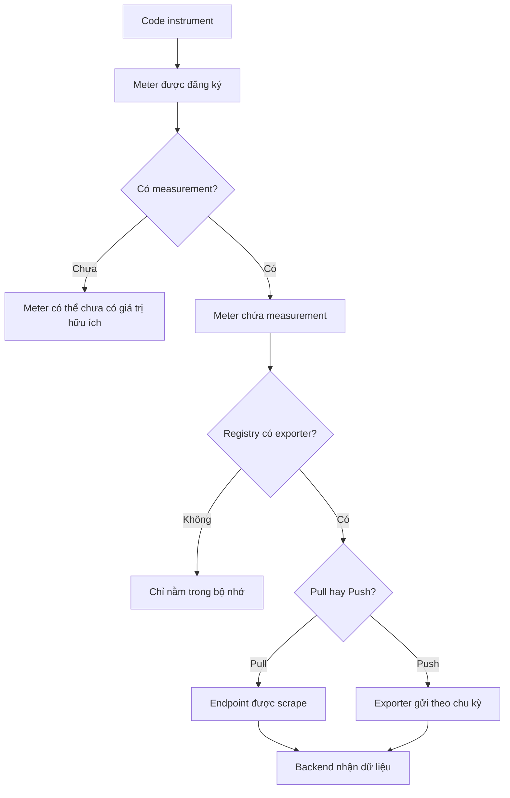

# Có meter trong bộ nhớ nhưng dữ liệu chưa được công bố

Một meter có thể đã được đăng ký và ghi nhận giá trị trong JVM nhưng dữ liệu vẫn chưa xuất hiện ở hệ thống giám sát. Nguyên nhân thường nằm ở một ranh giới giữa instrumentation, registry và exporter: component ghi vào một MeterRegistry khác với registry được export; meter bị MeterFilter loại; registry chỉ lưu dữ liệu trong bộ nhớ; exporter chưa được kích hoạt; step chưa hoàn tất; endpoint chưa được expose hoặc scrape; hay Collector/backend từ chối payload.

Cách xử lý hiệu quả là lần theo dữ liệu theo từng chặng. Trước tiên xác nhận meter và giá trị trong đúng registry, sau đó xác nhận registry có exporter phù hợp, tiếp theo kiểm tra cơ chế công bố (pull hoặc push), cuối cùng kiểm tra transport và backend. Bài này xây dựng quy trình chẩn đoán theo chuỗi đó, kèm lệnh kiểm tra, ví dụ cấu hình và test tách biệt từng lớp.

Bài học thuộc module OBSERVABILITY_INSTRUMENTATION_MICROMETER. Module này hướng dẫn sử dụng Micrometer để đo lường ứng dụng Java bằng counter, gauge, timer, distribution summary và nhãn có kiểm soát; tích hợp Spring Boot, xuất metrics đến hệ giám sát, kiểm soát cardinality, kiểm thử instrumentation và diễn giải số đo vận hành.

## Mục tiêu học tập

Sau bài này, bạn có thể:

- Phân biệt meter được tạo, meter đã có measurement và dữ liệu đã được exporter công bố.
- Xác nhận component đang ghi vào đúng MeterRegistry.
- Nhận biết SimpleMeterRegistry, CompositeMeterRegistry và registry implementation cụ thể.
- Chẩn đoán meter bị MeterFilter từ chối hoặc bị đổi tên/tag.
- Phân biệt registry pull như Prometheus với registry push theo step như OTLP.
- Kiểm tra endpoint Actuator, cấu hình exposure và trạng thái scrape.
- Chẩn đoán lỗi DNS, network, TLS, authentication, protocol và Collector.
- Kiểm thử instrumentation, exposition và exporter theo từng lớp.
- Xây dựng checklist xử lý sự cố từ ứng dụng đến backend.

## 1. Phân biệt ba trạng thái của dữ liệu

Cụm từ “có meter trong bộ nhớ” có thể chỉ ba trạng thái khác nhau:

1. **Meter đã đăng ký:** MeterRegistry biết Meter.Id gồm name, type và tags. Việc đăng ký chưa chứng minh meter đã nhận mẫu.
2. **Meter đã có measurement:** Counter đã tăng, Timer đã record, DistributionSummary đã ghi giá trị hoặc Gauge đang đọc được nguồn dữ liệu.
3. **Dữ liệu đã được công bố:** Registry/exporter đã đưa measurement ra endpoint hoặc gửi payload đến backend.



Khi dashboard không có metric, đừng bắt đầu bằng việc sửa query ngay. Trước hết cần xác định dữ liệu chưa được ghi, chưa được export, chưa được scrape hay đã đến backend nhưng được lưu/truy vấn dưới tên khác.

## 2. Bước đầu: xác nhận meter trong đúng registry

Đầu tiên, kiểm tra component ghi nhận có inject MeterRegistry do Spring quản lý hay tự tạo một registry riêng.

Ví dụ không nên dùng trong một component production:

```java
public class CheckoutService {

    private final MeterRegistry registry =
            new SimpleMeterRegistry();

    private final Counter completed =
            registry.counter("checkout.completed");

    public void checkout() {
        completed.increment();
    }
}
```

Counter trên tăng trong SimpleMeterRegistry riêng của CheckoutService. Spring Boot có thể đang export một CompositeMeterRegistry khác. Vì hai registry không cùng instance, exporter không nhìn thấy meter này.

Dùng constructor injection:

```java
import io.micrometer.core.instrument.Counter;
import io.micrometer.core.instrument.MeterRegistry;
import org.springframework.stereotype.Service;

@Service
public class CheckoutService {

    private final Counter completed;

    public CheckoutService(MeterRegistry registry) {
        this.completed = registry.counter("checkout.completed");
    }

    public void checkout() {
        completed.increment();
    }
}
```

Nếu component cần dùng registry trực tiếp, hãy inject registry do ứng dụng quản lý thay vì tạo mới bằng constructor. Không tạo MeterRegistry trong mỗi request hoặc mỗi method.

### Kiểm tra loại registry được inject

Có thể log loại registry khi ứng dụng khởi động:

```java
import io.micrometer.core.instrument.MeterRegistry;
import io.micrometer.core.instrument.composite.CompositeMeterRegistry;
import org.slf4j.Logger;
import org.slf4j.LoggerFactory;
import org.springframework.stereotype.Component;

@Component
public class RegistryDiagnostics {

    private static final Logger log =
            LoggerFactory.getLogger(RegistryDiagnostics.class);

    public RegistryDiagnostics(MeterRegistry registry) {
        log.info("MeterRegistry type: {}", registry.getClass().getName());

        if (registry instanceof CompositeMeterRegistry composite) {
            composite.getRegistries().forEach(child ->
                    log.info("Registry child: {}", child.getClass().getName())
            );
        }
    }
}
```

CompositeMeterRegistry phân phối các phép ghi nhận đến registry thành viên. Nếu composite không có exporter thành viên, meter vẫn có thể tồn tại nhưng không có nơi nhận dữ liệu để công bố.

Khi chẩn đoán, xác nhận:

- Component nghiệp vụ và exporter dùng cùng registry do Spring quản lý.
- Registry inject thực tế là loại nào.
- Composite có những registry con nào.
- Registry con có đúng backend cần dùng không.
- Không có cấu hình tạo thêm một SimpleMeterRegistry riêng ngoài ý muốn.

Không log toàn bộ tag values nếu chúng có thể chứa dữ liệu cá nhân, token hoặc thông tin nhạy cảm.

## 3. Xác nhận meter đã nhận measurement

Sau khi xác nhận đúng registry, kiểm tra meter có giá trị thực hay mới chỉ được đăng ký.

Ví dụ với Counter:

```java
Counter counter = registry.counter(
        "checkout.completed",
        "channel", "web"
);

counter.increment();

double value = registry.get("checkout.completed")
        .tag("channel", "web")
        .counter()
        .count();
```

Với Timer:

```java
Timer timer = registry.timer("checkout.payment.duration");

timer.record(() -> paymentService.pay());

long count = timer.count();
double totalMillis = timer.totalTime(TimeUnit.MILLISECONDS);
```

Với DistributionSummary:

```java
DistributionSummary summary =
        registry.summary("checkout.payload.size");

summary.record(512);

long count = summary.count();
double total = summary.totalAmount();
```

Gauge có semantics khác: registry đọc giá trị từ một object được tham chiếu, không nhận lệnh increment. Nếu object nguồn đã bị garbage collection, Gauge có thể trả NaN hoặc không cung cấp giá trị hữu ích.

```java
AtomicInteger queueDepth = new AtomicInteger();

Gauge.builder("worker.queue.depth", queueDepth, AtomicInteger::get)
        .register(registry);

// Nguồn Gauge phải còn được giữ tham chiếu và được cập nhật.
queueDepth.set(7);
```

Không dùng một object tạm thời chỉ được tạo trong constructor rồi bỏ tham chiếu. Hãy giữ object nguồn trong field của bean có vòng đời phù hợp.

### Kiểm tra tên và tags chính xác

Một meter được định danh bởi name và tag set. Cùng tên nhưng khác tags là những Meter.Id khác nhau:

```java
registry.counter("checkout.completed", "channel", "web");
registry.counter("checkout.completed", "channel", "mobile");
```

Nếu dashboard tìm tag `channel=browser` trong khi ứng dụng ghi `channel=web`, query không trả series mong muốn.

Kiểm tra:

- Tên meter có đúng chính tả và đúng convention không?
- Tag key có đúng tên không?
- Tag value có đúng giá trị đã chuẩn hóa không?
- Có common tags được thêm từ MeterRegistryCustomizer không?
- Có tag được đổi hoặc bỏ bởi MeterFilter không?
- Meter có được đăng ký trên một registry khác không?

Tên xuất ra backend có thể được chuẩn hóa. Ví dụ, dấu chấm trong tên Micrometer có thể thành dấu gạch dưới ở Prometheus; Timer có thể có suffix đơn vị như seconds. Luôn kiểm tra tên thực tế tại endpoint exposition thay vì suy luận từ tên trong Java.

## 4. Kiểm tra MeterFilter và chính sách đăng ký

MeterFilter có thể:

- Chấp nhận hoặc từ chối meter.
- Đổi tên meter.
- Thay đổi tags.
- Giới hạn số tag value được phép cho một meter.
- Cấu hình histogram hoặc các thuộc tính của meter.

Ví dụ filter từ chối meter nội bộ:

```java
@Bean
MeterFilter denyInternalMetrics() {
    return MeterFilter.denyNameStartsWith("internal.debug");
}
```

Ví dụ giới hạn số giá trị uri:

```java
@Bean
MeterFilter limitUriTags() {
    return MeterFilter.maximumAllowableTags(
            "http.server.requests",
            "uri",
            100,
            MeterFilter.deny()
    );
}
```

Nếu meter không xuất hiện, tìm filter được áp dụng trước khi meter đăng ký. Meter bị deny có thể được thay bằng no-op meter, vì vậy code vẫn gọi increment() mà không tạo dữ liệu có thể export.

MeterFilter thường áp dụng lúc đăng ký. Thay đổi filter sau khi meter đã tồn tại không tự động sửa lại tất cả meter cũ. Khi điều tra, kiểm tra thứ tự cấu hình và thời điểm meter được tạo.

Không xóa filter cardinality chỉ để làm metric xuất hiện. Nếu filter từ chối vì quá nhiều tag value, hãy sửa thiết kế tag hoặc chuẩn hóa giá trị về tập hữu hạn.

## 5. Kiểm tra exporter có thực sự được cấu hình

Micrometer core cung cấp API meter; nó không tự gửi dữ liệu đến mọi backend. Cần registry implementation tương ứng.

Ví dụ dependency Gradle:

```kotlin
dependencies {
    implementation("org.springframework.boot:spring-boot-starter-actuator")

    // Chọn registry theo backend.
    runtimeOnly("io.micrometer:micrometer-registry-prometheus")
}
```

Nếu không có registry backend khác, Spring Boot có thể dùng SimpleMeterRegistry trong bộ nhớ. SimpleMeterRegistry hữu ích cho test hoặc phát triển nhưng không tự xuất dữ liệu ra hệ thống giám sát.

Với OTLP:

```kotlin
dependencies {
    implementation("org.springframework.boot:spring-boot-starter-actuator")
    runtimeOnly("io.micrometer:micrometer-registry-otlp")
}
```

Hãy để Spring Boot dependency management quản lý phiên bản tương thích của Micrometer và registry. Nếu source code trực tiếp tham chiếu lớp cụ thể của registry, dependency cần có trên compile classpath; nếu chỉ dùng MeterRegistry abstraction, runtimeOnly thường phù hợp.

### Kiểm tra property enablement

Một registry có thể nằm trên classpath nhưng exporter bị tắt bởi property.

Ví dụ cấu hình OTLP:

```properties
management.otlp.metrics.export.enabled=true
management.otlp.metrics.export.url=http://otel-collector:4318/v1/metrics
management.otlp.metrics.export.step=30s
```

Có thể tắt mặc định tất cả registry rồi bật riêng registry cần dùng:

```properties
management.defaults.metrics.export.enabled=false
management.otlp.metrics.export.enabled=true
```

Tên property và khả năng hỗ trợ phụ thuộc registry implementation và phiên bản Spring Boot. Hãy kiểm tra configuration metadata của phiên bản ứng dụng đang chạy.

Các điểm cần xác nhận:

- Registry dependency có trên runtime classpath.
- Property enablement không bị đặt false ở profile đang chạy.
- Environment variable hoặc command-line argument không ghi đè application.yml.
- Không có exclude auto-configuration.
- Custom registry bean không làm auto-configuration tương ứng back off ngoài ý muốn.
- URL, credential, protocol và export step đã được cấu hình.

Có thể chạy ứng dụng với tùy chọn --debug để xem condition evaluation report. Report cho biết auto-configuration được áp dụng hoặc bị bỏ qua do điều kiện nào. Không expose endpoint chẩn đoán này công khai nếu chưa có chính sách bảo vệ phù hợp.

## 6. Phân biệt pull và push: điểm công bố khác nhau

Hai nhóm registry thường gặp có cách công bố khác nhau.

| Đặc điểm | Pull registry (Prometheus) | Push registry (OTLP và một số backend khác) |
| --- | --- | --- |
| Ai khởi tạo việc lấy dữ liệu? | Backend scrape ứng dụng | Ứng dụng gửi dữ liệu |
| Điểm kiểm tra đầu tiên | HTTP exposition endpoint | Exporter và lịch export |
| Chu kỳ | Theo scrape interval của backend | Theo step hoặc batch/flush interval |
| Lỗi thường gặp | Endpoint không expose, target DOWN, sai path | Exporter disable, step chưa tới, network hoặc Collector lỗi |
| Dữ liệu ở backend | Được scrape và lưu theo thời điểm | Được ingest từ payload gửi lên |

Không dùng cách kiểm tra của pull registry để chẩn đoán push registry. Prometheus không cần ứng dụng chủ động POST metric đến Prometheus server; Prometheus server scrape endpoint của ứng dụng. Ngược lại, OTLP registry cần exporter gửi payload đến receiver.

## 7. Trường hợp Prometheus không thấy metric

Prometheus registry thường cung cấp dữ liệu qua Actuator endpoint:

```properties
management.endpoints.web.exposure.include=health,metrics,prometheus
```

Nếu dùng Spring Boot Actuator với Prometheus registry, endpoint thường là:

```text
http://localhost:8080/actuator/prometheus
```

Kiểm tra trực tiếp endpoint:

```bash
curl -i http://localhost:8080/actuator/prometheus
```

Tìm tên metric đã được Prometheus naming convention chuẩn hóa. Ví dụ một Counter Micrometer tên `checkout.completed` có thể được hiển thị thành `checkout_completed_total`. Timer có thể xuất các series count, sum, max hoặc histogram buckets tùy cấu hình và phiên bản registry/client.

### Kiểm tra Actuator metrics endpoint

Endpoint metrics có thể dùng để chẩn đoán meter trong ứng dụng:

```bash
curl -s http://localhost:8080/actuator/metrics/checkout.completed
```

Nếu cần lọc tag, dùng tham số tag theo cú pháp của Actuator metrics endpoint:

```bash
curl -s "http://localhost:8080/actuator/metrics/checkout.completed?tag=channel:web"
```

Endpoint này là giao diện chẩn đoán meter trong process. Nó không thay thế Prometheus exposition endpoint và cũng không chứng minh Prometheus đã scrape dữ liệu.

Nếu /actuator/metrics có meter nhưng /actuator/prometheus không có series, kiểm tra:

1. PrometheusMeterRegistry có thực sự được cấu hình trong context không?
2. Meter có bị filter hoặc bị đổi tên không?
3. Meter có thuộc registry con khác, không phải Prometheus registry không?
4. Meter type có được Prometheus registry hỗ trợ và export không?
5. Metric đã có measurement chưa?
6. Tên series có suffix hoặc naming convention khác không?

### Kiểm tra endpoint và exposure

Nếu trả 404:

- Kiểm tra Actuator dependency.
- Kiểm tra management.endpoints.web.exposure.include.
- Kiểm tra management.endpoints.web.base-path.
- Kiểm tra ứng dụng có dùng management.server.port riêng không.
- Kiểm tra reverse proxy có rewrite path không.

Nếu trả 401 hoặc 403:

- Kiểm tra Spring Security và quyền truy cập Actuator.
- Xác nhận Prometheus có credentials hoặc network policy cần thiết.
- Chỉ expose endpoint metrics trong mạng quản trị phù hợp.

Nếu endpoint trả 200 nhưng không có metric:

- Kiểm tra tên và tags.
- Kiểm tra meter đã nhận sample.
- Kiểm tra MeterFilter.
- Kiểm tra registry identity và registry con.

### Kiểm tra phía Prometheus server

Mở trang Targets của Prometheus và kiểm tra:

- Target có UP không?
- Scrape URL có đúng host, port và path không?
- Scrape interval có phù hợp không?
- Last scrape có thành công không?
- Scrape error có chỉ ra timeout, 404, 401, TLS hoặc DNS không?
- Metric có xuất hiện dưới tên đã chuẩn hóa không?

Target UP chỉ chứng minh Prometheus lấy endpoint thành công. Nó không bảo đảm metric cụ thể có trong payload hoặc query đang dùng đúng tên/tag.

## 8. Trường hợp OTLP hoặc push exporter không gửi dữ liệu

Với registry push, cần kiểm tra lịch export. Ví dụ:

```properties
management.otlp.metrics.export.enabled=true
management.otlp.metrics.export.url=http://otel-collector:4318/v1/metrics
management.otlp.metrics.export.step=30s
```

Nếu step là 30 giây, dữ liệu có thể chưa được gửi ngay sau khi Counter tăng. Đợi đến step kế tiếp trong môi trường quan sát thực tế; trong unit test, dùng clock giả hoặc cơ chế test phù hợp thay vì chờ 30 giây.

### Kiểm tra exporter log

Tìm log quanh thời điểm export:

| Dấu hiệu | Nguyên nhân thường gặp | Hướng xử lý |
| --- | --- | --- |
| Connection refused | Collector không listen hoặc sai port | Kiểm tra receiver và port |
| Unknown host / DNS failure | Hostname không resolve trong container/network | Kiểm tra DNS, service name và network |
| Connection timeout | Firewall, route hoặc endpoint không phản hồi | Kiểm tra network policy và timeout |
| 401 / 403 | Credential thiếu hoặc không hợp lệ | Kiểm tra token/API key và quyền |
| 404 | Sai URL path hoặc receiver chưa bật | Kiểm tra OTLP path và cấu hình receiver |
| TLS handshake failure | Certificate, truststore hoặc protocol không khớp | Kiểm tra CA, hostname và TLS config |
| 400 / rejected payload | Payload hoặc resource attributes không được chấp nhận | Kiểm tra receiver log và schema |
| 429 / throttling | Backend giới hạn ingest | Kiểm tra quota, batch và retry policy |
| Export success nhưng backend không có series | Collector pipeline hoặc backend routing sai | Kiểm tra receiver, processor, exporter và tenant |

Với OTLP HTTP/protobuf, endpoint metrics thường có path /v1/metrics. Nếu cấu hình endpoint base thay vì endpoint signal-specific, kiểm tra cách exporter ghép path theo phiên bản. Không tự thêm path hai lần.

### Kiểm tra OpenTelemetry Collector

Một Collector có thể nhận payload thành công nhưng không xuất đến backend vì pipeline cấu hình sai. Kiểm tra:

- OTLP receiver có bật đúng protocol HTTP hoặc gRPC không?
- Receiver bind trên interface/port có thể truy cập từ ứng dụng không?
- Service pipeline có khai báo metrics receiver không?
- Processor có drop hoặc transform metric không?
- Exporter có kết nối được backend không?
- Pipeline có tham chiếu đúng exporter không?
- Tenant, namespace hoặc resource attributes có làm metric đi vào dataset khác không?

Cần phân biệt log “receiver accepted” với log “exporter delivered”. Hai sự kiện nằm ở hai chặng khác nhau.

## 9. Kiểm tra step, flush và shutdown

Một số registry push công bố dữ liệu theo step. Nếu quan sát quá sớm, meter có thể đã tăng trong bộ nhớ nhưng chưa tới thời điểm publish.

Ví dụ step 30 giây:

- Tại giây 5, Counter tăng.
- Ứng dụng vẫn đang ghi vào step hiện tại.
- Đến ranh giới step, registry hoàn tất và publish dữ liệu.
- Sau đó step tiếp theo bắt đầu.

Không nên giả định mọi exporter đều gửi ngay sau mỗi lần increment. Cần đọc semantics của registry implementation và property step.

Khi ứng dụng shutdown, registry có thể có cơ chế close hoặc flush tùy implementation. Không dựa vào shutdown như cách duy nhất để công bố dữ liệu: process có thể bị kill cưỡng bức hoặc container hết thời gian termination grace period trước khi flush hoàn tất.

Nếu cần bảo đảm dữ liệu cuối cùng được gửi, hãy dùng lifecycle management của registry, cấu hình timeout shutdown phù hợp và kiểm thử hành vi exporter. Với Prometheus pull, ứng dụng không push step; dữ liệu được đọc khi scrape endpoint còn hoạt động.

## 10. Kiểm tra meter bị tạo nhưng không có giá trị hữu ích

Một meter có thể tồn tại nhưng không tạo series như kỳ vọng.

| Meter | Trường hợp cần kiểm tra |
| --- | --- |
| Counter | Chưa gọi increment(), bị deny hoặc đang nhìn nhầm registry |
| Timer | Chưa record mẫu; chỉ tạo Timer không có nghĩa đã có request duration |
| DistributionSummary | Chưa record giá trị hoặc giá trị không hợp lệ theo logic ứng dụng |
| Gauge | Nguồn bị GC, object không được giữ tham chiếu hoặc callback trả NaN |
| LongTaskTimer | Chưa có task đang active |
| FunctionCounter / FunctionTimer | Nguồn được quan sát chưa thay đổi hoặc function trả giá trị không hợp lệ |

Gauge thường giữ weak reference tới object nguồn. Nếu object không còn strong reference, giá trị Gauge có thể thành NaN. Giữ nguồn trong field hoặc bean có vòng đời đủ dài.

Với Timer và DistributionSummary, việc tạo meter không tự sinh sample. Phải có record thực tế. Với một số backend, zero hoặc meter chưa có sample có thể không xuất hiện theo cách bạn mong đợi; hãy kiểm tra exposition và semantics của registry cụ thể.

## 11. Kiểm tra naming convention, unit và tags

Tên meter Micrometer có thể được chuyển đổi khi export. Backend có quy tắc riêng về ký tự, suffix và đơn vị.

Ví dụ:

| Trong Micrometer | Có thể xuất ra Prometheus |
| --- | --- |
| checkout.completed | checkout_completed_total |
| checkout.payment.duration | checkout_payment_duration_seconds |
| worker.queue.depth | worker_queue_depth |
| Tag channel=web | Label channel="web" |

Bảng chỉ minh họa naming convention phổ biến; tên chính xác phụ thuộc meter type, registry và phiên bản client.

Nếu metric có trên endpoint nhưng query không thấy:

- Dùng tên series thực tế từ exposition.
- Kiểm tra label names và values.
- Kiểm tra tag common được thêm vào.
- Kiểm tra query đang lọc đúng job, instance, namespace và service.
- Kiểm tra unit suffix của Timer.
- Kiểm tra metric đã bị đổi tên bởi filter hoặc naming convention chưa.

Không dùng request ID, user ID, order ID hoặc raw URL làm tag để “dễ tìm metric”. Các giá trị này tạo cardinality cao và có thể khiến registry hoặc backend từ chối/giới hạn dữ liệu.

## 12. Phân biệt lỗi instrumentation với lỗi export

Một quy trình chẩn đoán nên chia thành các checkpoint độc lập:

| Checkpoint | Câu hỏi | Công cụ kiểm tra |
| --- | --- | --- |
| Instrumentation | Code có gọi increment/record không? | Unit test, breakpoint, log có kiểm soát |
| Registry identity | Code ghi vào registry nào? | Constructor injection, registry class, composite children |
| Meter state | Meter có measurement không? | registry.find(), Actuator metrics |
| Filter | Meter có bị deny/map không? | MeterFilter config, condition report |
| Exporter | Registry backend đã được tạo và enable chưa? | Dependency tree, Spring condition report |
| Publication | Pull endpoint hay push step? | curl endpoint, exporter logs |
| Transport | Payload có đến receiver không? | Network, TLS, HTTP status, Collector logs |
| Backend | Receiver đã route và lưu dữ liệu chưa? | Collector pipeline, backend ingest status |
| Query | Query có đúng name/tag/time range không? | Exposition, query explorer |

Nếu instrumentation test đã chứng minh Counter tăng trong SimpleMeterRegistry, điều đó chỉ xác nhận code instrument. Nó không kiểm tra exporter production.

Nếu Prometheus endpoint đã hiển thị metric, instrumentation và Prometheus registry đã nối được. Khi đó hãy tập trung vào scrape target và query.

Nếu Collector đã nhận OTLP nhưng backend không có metric, hãy kiểm tra pipeline Collector và backend routing, không cần sửa Counter trong service.

## 13. Kiểm thử theo từng lớp

### Unit test instrumentation với SimpleMeterRegistry

```java
import static org.assertj.core.api.Assertions.assertThat;

import io.micrometer.core.instrument.Counter;
import io.micrometer.core.instrument.simple.SimpleMeterRegistry;
import org.junit.jupiter.api.Test;

class CheckoutMetricsTest {

    @Test
    void incrementsCompletedCounter() {
        try (SimpleMeterRegistry registry = new SimpleMeterRegistry()) {
            Counter counter = registry.counter(
                    "checkout.completed",
                    "channel", "web"
            );

            counter.increment();

            assertThat(registry.get("checkout.completed")
                    .tag("channel", "web")
                    .counter()
                    .count())
                    .isEqualTo(1.0);
        }
    }
}
```

Test này không dùng network và không xác nhận exporter. Nó chỉ xác nhận instrumentation và registry trong bộ nhớ.

### Integration test Prometheus exposition

Khi test cần tham chiếu trực tiếp PrometheusMeterRegistry, đặt registry dependency trên test compile classpath:

~~~kotlin
dependencies {
    testImplementation("io.micrometer:micrometer-registry-prometheus")
}
~~~

```java
import static org.assertj.core.api.Assertions.assertThat;

import io.micrometer.prometheusmetrics.PrometheusMeterRegistry;
import org.springframework.beans.factory.annotation.Autowired;
import org.springframework.boot.test.context.SpringBootTest;
import org.junit.jupiter.api.Test;

@SpringBootTest
class PrometheusExportTest {

    @Autowired
    PrometheusMeterRegistry registry;

    @Test
    void exposesCounterInPrometheusFormat() {
        registry.counter(
                "checkout.completed",
                "channel", "web"
        ).increment();

        String exposition = registry.scrape();

        assertThat(exposition).contains("checkout_completed_total");
    }
}
```

Ví dụ dùng package của Prometheus client mới được Micrometer hỗ trợ. Với phiên bản Micrometer cũ hơn, package lớp registry có thể khác; hãy dùng package được quản lý bởi BOM của Spring Boot trong dự án.

### Kiểm thử exporter push

Dùng mock HTTP server hoặc fake sender nếu registry hỗ trợ. Xác nhận payload, endpoint, header, status code và hành vi retry. Với OTLP, có thể chạy Collector trong integration test để xác nhận receiver nhận được resource, scope và metric data point.

Không coi log “export scheduled” là bằng chứng payload đã đến backend. Cần xác nhận tại receiver hoặc fake server.

## 14. Checklist xử lý sự cố theo thứ tự

Khi meter trong bộ nhớ nhưng không thấy dữ liệu ở backend, hãy thực hiện theo thứ tự:

1. Xác nhận component inject đúng MeterRegistry dùng chung.
2. Kiểm tra registry thực tế và các registry con của CompositeMeterRegistry.
3. Xác nhận meter đã có sample, không chỉ mới được đăng ký.
4. Kiểm tra Gauge source có còn sống và trả giá trị hợp lệ.
5. Kiểm tra tên, tags, common tags và naming convention.
6. Kiểm tra MeterFilter có deny, map hoặc giới hạn tag không.
7. Xác nhận registry implementation có trên runtime classpath.
8. Kiểm tra property enablement và profile đang chạy.
9. Xác định backend dùng pull hay push.
10. Với Prometheus, kiểm tra Actuator endpoint và Prometheus Targets.
11. Với push exporter, kiểm tra step, exporter log và shutdown lifecycle.
12. Kiểm tra DNS, network, TLS, credential, protocol và endpoint.
13. Nếu dùng Collector, kiểm tra receiver, processor, exporter và pipeline.
14. Kiểm tra backend ingest, tenant, resource attributes và query.
15. Viết test riêng cho instrumentation, exposition và transport.

## 15. Các lỗi thường gặp

| Lỗi | Triệu chứng | Cách xử lý |
| --- | --- | --- |
| Tạo SimpleMeterRegistry riêng trong service | Meter tăng nhưng exporter không thấy | Inject MeterRegistry của Spring |
| Chỉ có micrometer-core | Có API nhưng không có backend exporter | Thêm registry implementation |
| Dùng SimpleMeterRegistry trong production | Dữ liệu chỉ ở bộ nhớ | Cấu hình registry xuất thật |
| Registry bị disable bằng property | Không có exporter hoạt động | Kiểm tra profile và enablement |
| MeterFilter deny meter | Code vẫn chạy nhưng không có series | Kiểm tra filter và tag policy |
| Chưa record sample | Meter tồn tại nhưng không có dữ liệu hữu ích | Xác nhận code path ghi nhận |
| Gauge source bị GC | Gauge thành NaN hoặc mất giá trị | Giữ strong reference |
| Nhầm tên/tag | Endpoint có dữ liệu nhưng query không thấy | Đọc exposition và sửa query |
| Chờ push exporter quá sớm | Chưa đến step publish | Kiểm tra step và thời điểm export |
| Prometheus không scrape endpoint | Endpoint local có metric nhưng backend trống | Kiểm tra target, path và security |
| OTLP sai URL/protocol | Collector không nhận payload | Kiểm tra signal endpoint và receiver |
| Collector nhận nhưng không export | App export thành công nhưng backend trống | Kiểm tra Collector pipeline |
| Cardinality vượt giới hạn | Một số meter bị deny hoặc backend drop | Chuẩn hóa tag values |
| Chỉ kiểm tra unit test | Instrumentation đúng nhưng export vẫn lỗi | Thêm integration test cho exporter |

## Kết luận

Meter tồn tại trong bộ nhớ chỉ chứng minh registry đã đăng ký hoặc giữ một phép đo. Để dữ liệu đến backend, component phải ghi vào đúng registry, meter phải có measurement hợp lệ, registry phải có exporter được bật và cơ chế công bố phải hoàn tất. Sau đó endpoint cần được scrape hoặc exporter phải gửi payload thành công, Collector/backend phải nhận và lưu dữ liệu.

Hãy chẩn đoán từ trong ra ngoài: registry identity, meter state, filter, exporter, publication mode, endpoint hoặc step, transport, Collector và query. Dùng SimpleMeterRegistry để kiểm tra instrumentation, exposition để kiểm tra registry pull và mock receiver/Collector để kiểm tra push exporter. Khi mỗi checkpoint có bằng chứng riêng, bạn sẽ xác định được dữ liệu dừng ở đâu mà không phải sửa ngẫu nhiên instrumentation hoặc dashboard.

## Tài liệu tham khảo

- [Spring Boot Metrics](https://docs.spring.io/spring-boot/reference/actuator/metrics.html) — registry auto-configuration, Actuator metrics endpoint và exporter properties.
- [Spring Boot Prometheus](https://docs.spring.io/spring-boot/reference/actuator/metrics.html#actuator.metrics.export.prometheus) — Prometheus registry và endpoint scrape.
- [Micrometer Registry Concepts](https://docs.micrometer.io/micrometer/reference/concepts/registry.html) — MeterRegistry, CompositeMeterRegistry và registry lifecycle.
- [Micrometer Meter Filters](https://docs.micrometer.io/micrometer/reference/concepts/meter-filters.html) — deny, map, configure và giới hạn tags.
- [Micrometer OTLP Registry](https://docs.micrometer.io/micrometer/reference/implementations/otlp.html) — cấu hình push metrics qua OTLP.
- [Prometheus Exposition Formats](https://prometheus.io/docs/instrumenting/exposition_formats/) — định dạng dữ liệu scrape.
- [OpenTelemetry Collector Configuration](https://opentelemetry.io/docs/collector/configuration/) — receiver, processor, exporter và service pipeline.
