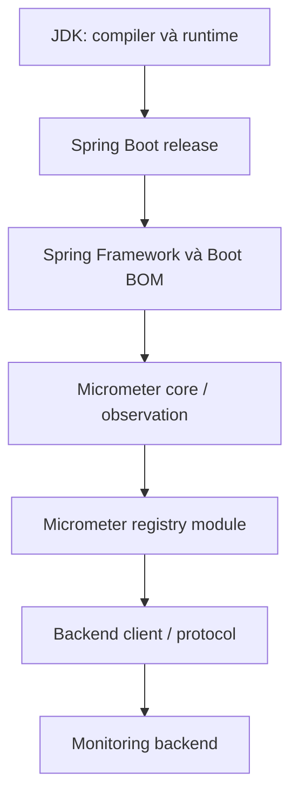

# Khóa phiên bản và đối chiếu ma trận JDK, Spring Boot, Micrometer cùng registry

Trong module `OBSERVABILITY_INSTRUMENTATION_MICROMETER`, API instrumentation của Micrometer được dùng cùng Spring Boot Actuator và một registry cụ thể như Prometheus, OTLP, Datadog hoặc StatsD. Các thành phần này có quan hệ phiên bản: Spring Boot kiểm thử với một tập dependency được tuyển chọn; Micrometer registry phụ thuộc vào Micrometer core và có thể kéo theo client của backend; JDK phải đáp ứng yêu cầu của Spring Boot lẫn mọi thư viện trong dependency graph.

Vì vậy, khóa phiên bản không chỉ là điền số version vào build file. Cần chọn một release train tương thích, để BOM quản lý các dependency thuộc cùng hệ sinh thái, xác minh phiên bản thực tế được resolve, kiểm tra JDK dùng để build và chạy, rồi thử exporter với backend mục tiêu. Ma trận tương thích phải phản ánh phiên bản đã kiểm chứng của dự án, không chỉ các phiên bản được khai báo trực tiếp.

## 1. Nhìn toàn bộ chuỗi tương thích

Một ứng dụng Spring Boot dùng Micrometer thường có các lớp sau:



Mỗi lớp có ràng buộc riêng:

- **JDK:** phải nằm trong dải Java mà Spring Boot release hỗ trợ; thư viện registry hoặc client bên thứ ba có thể yêu cầu cao hơn.
- **Spring Boot:** quyết định Spring Framework baseline, auto-configuration và tập dependency được quản lý.
- **Micrometer core/observation:** cung cấp API `MeterRegistry`, `Counter`, `Timer`, `Observation` và các binder.
- **Registry module:** ánh xạ meter sang giao thức backend và có thể phụ thuộc client riêng.
- **Backend:** cần hiểu đúng định dạng exposition, temporality, histogram và authentication mà exporter sử dụng.

Build thành công chỉ xác nhận một phần tương thích. Ứng dụng vẫn có thể lỗi khi khởi động do auto-configuration không nhận registry, hoặc chạy được nhưng backend không nhận đúng metric format.

## 2. Xác định JDK build và JDK runtime riêng biệt

Một dự án có thể dùng JDK mới để chạy Gradle/Maven nhưng biên dịch bytecode cho một release thấp hơn. Cần ghi rõ ít nhất ba giá trị:

1. **Build JDK:** JVM đang chạy Gradle hoặc Maven.
2. **Compile release:** API và bytecode Java mà compiler được phép tạo.
3. **Runtime JDK:** JVM trong môi trường chạy ứng dụng, thường là container image hoặc máy chủ.

Ví dụ Gradle Kotlin DSL dùng toolchain Java 21:

```kotlin
java {
    toolchain {
        languageVersion = JavaLanguageVersion.of(21)
    }
}

tasks.withType<JavaCompile>().configureEach {
    options.release = 21
}
```

Ví dụ Maven:

```xml
<properties>
    <java.version>21</java.version>
    <maven.compiler.release>21</maven.compiler.release>
</properties>
```

`--release` hoặc `maven.compiler.release` kiểm soát ngôn ngữ, bytecode và API Java được phép dùng khi biên dịch. Nó không cài JDK và không bảo đảm container production đang chạy đúng phiên bản. Hãy kiểm tra `java -version`, `./gradlew -version`, `mvn -version` và JDK trong image triển khai.

## 3. Đọc dải JDK từ tài liệu đúng release Spring Boot

Không lấy yêu cầu Java từ trang tài liệu `current` rồi áp dụng cho mọi nhánh Boot. Mỗi release train có trang system requirements riêng. Cần ghi nhận cả Java tối thiểu và tối đa được release đó công bố hỗ trợ, cùng yêu cầu của Spring Framework và build tool.

Ví dụ snapshot các release được tài liệu Spring Boot công bố tại ngày 23-11-2026:

| Spring Boot release | JDK được hỗ trợ theo system requirements | Spring Framework baseline | Micrometer core/registry do Boot quản lý |
| --- | --- | --- | --- |
| 3.5.16 | Java 17 đến Java 25 | 6.2.19+ | 1.15.12 |
| 4.0.10 | Java 17 đến Java 27 | 7.0.11+ | 1.16.9 |
| 4.2.0 | Java 17 đến Java 27 | 7.1.0+ | 1.18.0 |

Đây là ảnh chụp phiên bản tham khảo, không phải ma trận bảo đảm cho mọi registry/client. Patch release và dải JDK hỗ trợ thay đổi theo thời gian; hãy mở trang system requirements và dependency coordinates của đúng patch version đang chọn trước khi khóa build. Thư viện exporter hoặc backend client có thể đặt yêu cầu Java cao hơn Boot.

## 4. Dùng Spring Boot BOM làm nguồn quản lý Micrometer

Spring Boot phát hành `spring-boot-dependencies` BOM chứa một tập phiên bản đã được chọn và kiểm thử cùng release đó. Khi dùng Actuator và registry, nên để BOM quản lý Micrometer core, observation và registry module, trừ khi có lý do kỹ thuật đã được kiểm chứng để override.

Ví dụ Maven với Spring Boot parent:

```xml
<parent>
    <groupId>org.springframework.boot</groupId>
    <artifactId>spring-boot-starter-parent</artifactId>
    <version>4.2.0</version>
    <relativePath/>
</parent>

<properties>
    <java.version>21</java.version>
</properties>

<dependencies>
    <dependency>
        <groupId>org.springframework.boot</groupId>
        <artifactId>spring-boot-starter-actuator</artifactId>
    </dependency>
    <dependency>
        <groupId>io.micrometer</groupId>
        <artifactId>micrometer-registry-prometheus</artifactId>
        <scope>runtime</scope>
    </dependency>
</dependencies>
```

Không khai báo version riêng cho `micrometer-core` hoặc `micrometer-registry-prometheus`; Boot BOM sẽ chọn phiên bản tương ứng với release đã chọn. Nếu dự án không kế thừa `spring-boot-starter-parent`, có thể import `spring-boot-dependencies` BOM trong `dependencyManagement`.

## 5. Dùng BOM trong Gradle

Có hai cách phổ biến. Với plugin `io.spring.dependency-management`, Spring Boot plugin tự import BOM của đúng Boot version:

```kotlin
plugins {
    id("org.springframework.boot") version "4.2.0"
    id("io.spring.dependency-management") version "1.1.7"
}

dependencies {
    implementation("org.springframework.boot:spring-boot-starter-actuator")
    runtimeOnly("io.micrometer:micrometer-registry-prometheus")
}
```

Hoặc dùng Gradle native BOM support:

```kotlin
plugins {
    id("org.springframework.boot") version "4.2.0"
}

dependencies {
    implementation(platform("org.springframework.boot:spring-boot-dependencies:4.2.0"))
    implementation("org.springframework.boot:spring-boot-starter-actuator")
    runtimeOnly("io.micrometer:micrometer-registry-prometheus")
}
```

`platform(...)` đưa các version constraint từ BOM vào dependency resolution. `enforcedPlatform(...)` mạnh hơn và ép các phiên bản trong BOM thắng các constraint khác; chỉ dùng khi chủ động muốn chính sách đó. Không thêm nhiều BOM có version Micrometer khác nhau mà không hiểu thứ tự ưu tiên và kết quả resolve.

## 6. Ứng dụng Micrometer không dùng Spring Boot

Với ứng dụng Java thuần, Micrometer không có Spring Boot BOM để chọn phiên bản. Có thể import Micrometer BOM và để nó quản lý core cùng registry module:

```xml
<dependencyManagement>
    <dependencies>
        <dependency>
            <groupId>io.micrometer</groupId>
            <artifactId>micrometer-bom</artifactId>
            <version>1.18.0</version>
            <type>pom</type>
            <scope>import</scope>
        </dependency>
    </dependencies>
</dependencyManagement>

<dependencies>
    <dependency>
        <groupId>io.micrometer</groupId>
        <artifactId>micrometer-core</artifactId>
    </dependency>
    <dependency>
        <groupId>io.micrometer</groupId>
        <artifactId>micrometer-registry-prometheus</artifactId>
    </dependency>
</dependencies>
```

Ví dụ dùng version BOM 1.18.0 để minh họa cách khóa, không có nghĩa mọi ứng dụng nên dùng version này. Hãy chọn Micrometer release phù hợp với JDK, registry client và framework thực tế. Nếu ứng dụng dùng Spring Boot, ưu tiên Boot BOM làm nguồn quản lý chính thay vì import thêm Micrometer BOM khác version.

## 7. Giữ các module Micrometer cùng release train

Các artifact sau thuộc cùng hệ sinh thái Micrometer:

| Nhóm | Artifact tiêu biểu | Vai trò |
| --- | --- | --- |
| Core | `micrometer-core` | Meter API, registry abstraction, binder |
| Observation | `micrometer-observation` | Observation API và context |
| Registry | `micrometer-registry-prometheus`, `micrometer-registry-otlp`, `micrometer-registry-datadog` | Export sang backend |
| Test | `micrometer-test`, `micrometer-observation-test` | Hỗ trợ kiểm thử instrumentation/observation |
| Context propagation | `context-propagation` | Truyền context qua ranh giới thực thi được hỗ trợ |

Các module Micrometer core, observation và registry thường nên được resolve về cùng version theo BOM. Micrometer Tracing có release train và versioning riêng; không tự giả định số version của tracing phải giống core. Dùng dependency management của Boot hoặc tài liệu Micrometer Tracing để chọn bridge tương thích.

## 8. Đối chiếu registry và backend client

Registry module thường có dependency tới client hoặc SDK của backend. Ví dụ:

| Registry | Thành phần cần kiểm tra |
| --- | --- |
| `micrometer-registry-prometheus` | Prometheus Java client, exposition format, histogram và scrape endpoint |
| `micrometer-registry-otlp` | OTLP exporter, protocol HTTP/gRPC, endpoint và temporality |
| `micrometer-registry-datadog` | Datadog client/agent, API endpoint, API key và step interval |
| `micrometer-registry-statsd` | StatsD transport, agent, UDP/TCP và metric type mapping |
| `micrometer-registry-influx` | Influx client, server/API version, authentication và precision |

Không chỉ kiểm tra `micrometer-registry-*` có cùng version với `micrometer-core`. Cần xem dependency graph để biết client thực tế được resolve là phiên bản nào và backend có hỗ trợ giao thức/format đó không. Tránh pin trực tiếp client transitive chỉ để dập cảnh báo version nếu chưa xác minh registry tương thích.

## 9. Lưu ý thay đổi Prometheus client qua các release Micrometer

Prometheus là ví dụ cho thấy registry có thể thay đổi dependency và hành vi dù API Micrometer ở phía ứng dụng ít thay đổi. Từ Micrometer 1.13, registry Prometheus mặc định chuyển sang Prometheus Java client 1.x; artifact `micrometer-registry-prometheus-simpleclient` được cung cấp cho trường hợp cần tiếp tục dùng client 0.x.

Điều này ảnh hưởng đến framework auto-configuration. Migration guide của Micrometer ghi nhận một ví dụ cụ thể: Spring Boot 3.2 quản lý Micrometer 1.12.x; tự override registry lên 1.13.0 có thể khiến auto-configuration Prometheus của Boot 3.2 không hoạt động như mong đợi. Nếu cần giữ client 0.x trong giai đoạn đó, dùng registry simpleclient tương ứng thay vì ép một module registry không khớp release train.

Khi nâng cấp Prometheus registry, cần kiểm tra:

- Artifact registry được dùng là `micrometer-registry-prometheus` hay `micrometer-registry-prometheus-simpleclient`.
- Prometheus Java client được resolve và version major của nó.
- Auto-configuration có tạo đúng `PrometheusMeterRegistry` không.
- Endpoint exposition có định dạng mà Prometheus server hiện tại hỗ trợ không.
- Histogram, exemplar và naming có giữ hành vi dashboard/alert cũ không.

## 10. Tạo ma trận tương thích của chính dự án

Ma trận dự án nên có cả version khai báo và version resolve. Một mẫu tối thiểu:

| Thành phần | Version/giá trị dự án | Nguồn xác minh | Trạng thái |
| --- | --- | --- | --- |
| Build JDK | Ví dụ: Temurin 21 | `./gradlew -version` hoặc `mvn -version` | Chưa kiểm tra |
| Compile release | Ví dụ: 21 | Gradle toolchain hoặc `maven.compiler.release` | Chưa kiểm tra |
| Runtime JDK | Ví dụ: image JRE 21 | `java -version` trong image | Chưa kiểm tra |
| Spring Boot | Patch version chính xác | Plugin/parent và BOM | Chưa kiểm tra |
| Spring Framework | Version được Boot BOM quản lý | Dependency tree | Chưa kiểm tra |
| Micrometer core | Version resolve thực tế | Dependency insight/tree | Chưa kiểm tra |
| Micrometer observation | Version resolve thực tế | Dependency insight/tree | Chưa kiểm tra |
| Registry module | Artifact và version chính xác | Runtime dependency graph | Chưa kiểm tra |
| Backend client | Artifact và version resolve | Transitive dependency graph | Chưa kiểm tra |
| Monitoring backend | Version/server protocol | Hạ tầng vận hành | Chưa kiểm tra |

Không ghi `latest` vào ma trận. Ghi version đầy đủ, bao gồm patch hoặc qualifier như `-M`, `-RC`, `-SNAPSHOT` nếu có. Mỗi dòng cần chỉ ra nguồn xác minh để lần nâng cấp sau có thể lặp lại.

## 11. Kiểm tra dependency graph thực tế

Version khai báo trong build file chưa chắc là version được sử dụng. Dependency transitive, BOM, constraint, resolution strategy hoặc dependency lock có thể thay đổi kết quả.

Với Gradle:

```powershell
./gradlew dependencies --configuration runtimeClasspath
./gradlew dependencyInsight --dependency micrometer-core --configuration runtimeClasspath
./gradlew dependencyInsight --dependency micrometer-registry-prometheus --configuration runtimeClasspath
./gradlew dependencyInsight --dependency prometheus-metrics-core --configuration runtimeClasspath
```

Với Maven:

```powershell
mvn dependency:tree -Dincludes=io.micrometer,io.prometheus
mvn help:effective-pom
```

Đọc kết quả để xác định dependency nào kéo version vào, BOM nào quản lý version, có xung đột bị mediation hay không và có artifact Micrometer nào lệch release train. Với Gradle, `dependencyInsight` cho biết lý do một version được chọn. Với Maven, `effective-pom` giúp nhìn thấy dependency management sau khi kế thừa parent/import BOM.

## 12. Khóa dependency để build có thể tái lập

Sau khi chọn ma trận, dùng cơ chế khóa phù hợp với build tool:

- Maven: quản lý dependency bằng parent/BOM; cân nhắc Maven Enforcer để kiểm tra JDK, dependency convergence và rule version.
- Gradle: dùng dependency locking để ghi lại version đã resolve; có thể dùng version catalog để tập trung khai báo plugin và dependency coordinates.
- Container: pin base image theo tag version cụ thể, tốt hơn nữa là digest đã kiểm duyệt.
- CI: dùng cùng JDK toolchain và build command với local; ghi lại resolved dependency report như một artifact kiểm tra.

Gradle dependency locking có thể bật như sau:

```kotlin
dependencyLocking {
    lockAllConfigurations()
}
```

Sau đó resolve các configuration cần thiết và tạo/cập nhật lock state theo quy trình build của dự án. Lock file là kết quả của quyết định version; khi nâng cấp có chủ đích, cập nhật lock file cùng thay đổi BOM và review diff.

## 13. Các kiểu pin version dễ gây xung đột

Tránh những cách sau nếu chưa có bằng chứng tương thích:

```kotlin
dependencies {
    implementation("io.micrometer:micrometer-core:1.18.0")
    runtimeOnly("io.micrometer:micrometer-registry-prometheus:1.15.12")
}
```

Hai module Micrometer khác release train có thể gây `NoSuchMethodError`, `ClassNotFoundException` hoặc lỗi runtime khi registry gọi API không tồn tại ở core. Một lỗi tương tự xuất hiện khi chỉ override registry nhưng để observation/test modules ở version cũ.

Không dùng `resolutionStrategy.force("io.micrometer:micrometer-core:...")` để che xung đột nếu chưa biết dependency nào yêu cầu API khác. Không import đồng thời Boot BOM và Micrometer BOM khác version rồi giả định thứ tự import không quan trọng. Không pin client Prometheus/OTLP transitive riêng nếu registry module đã quản lý version tương thích.

Nếu buộc phải override vì security fix hoặc feature bắt buộc, ghi rõ lý do, module bị ảnh hưởng, compatibility evidence, test cần chạy và ngày dự kiến bỏ override.

## 14. Quy trình nâng cấp theo từng bước

Một lần nâng cấp an toàn nên thay đổi có kiểm soát:

1. **Chụp baseline:** lưu JDK, Boot, Spring Framework, Micrometer, registry/client, backend và dependency tree hiện tại.
2. **Đọc release notes:** xem breaking changes của Spring Boot, Micrometer và registry/client; đặc biệt chú ý Java baseline, auto-configuration và exporter protocol.
3. **Chọn JDK:** xác nhận build JDK, compile release và runtime JDK nằm trong dải hỗ trợ của release mới.
4. **Nâng Spring Boot patch/minor:** để Boot BOM cập nhật dependency được quản lý; chưa thêm override Micrometer riêng.
5. **Resolve dependency graph:** kiểm tra Micrometer core, observation, registry và backend client có version tương thích.
6. **Chạy test:** unit, application context, exporter smoke test và integration với backend/staging.
7. **So sánh dữ liệu:** kiểm tra tên metric, tag, unit, histogram bucket, counter semantics và dashboard/alert.
8. **Triển khai canary:** quan sát scrape error, ingest error, cardinality và tài nguyên ứng dụng.
9. **Khóa version:** cập nhật dependency lock, image digest và ma trận dự án sau khi xác nhận.

Nếu có thể, không thay JDK, Boot major, Micrometer major và registry client major trong cùng một thay đổi. Tách thay đổi giúp xác định nguyên nhân khi compile, startup hoặc export bị lỗi.

## 15. Kiểm tra tương thích ở build, startup và export

Một ma trận chỉ được coi là đã xác minh khi có kiểm tra ở các lớp khác nhau:

| Lớp kiểm tra | Cách xác minh | Điều cần đạt |
| --- | --- | --- |
| Build JDK | `java -version`, `./gradlew -version`, `mvn -version` | Tool chạy trên JDK được hỗ trợ |
| Compile | Build sạch với toolchain/release đã khóa | Không dùng API ngoài compile release |
| Dependency | `dependencyInsight` hoặc `dependency:tree` | Micrometer modules và registry client resolve đúng |
| Application context | Test khởi động Spring context | Auto-configuration tạo registry đúng, không có linkage error |
| Instrumentation | Test Counter/Timer/Observation | Meter vẫn ghi nhận đúng tên, tag và đơn vị |
| Exporter | Gọi `/actuator/prometheus` hoặc gửi OTLP test | Dữ liệu được export đúng protocol |
| Backend | Scrape/ingest ở staging | Backend nhận metric và query được |
| Dashboard/alert | So sánh trước và sau nâng cấp | Query, histogram và ngưỡng alert còn đúng |

Không chỉ kiểm tra compile. `NoSuchMethodError` thường chỉ xuất hiện lúc runtime khi một module được biên dịch với API khác version. Lỗi endpoint hoặc dữ liệu sai có thể chỉ xuất hiện sau khi backend scrape hoặc ingest.

## 16. Kiểm tra exporter Prometheus bằng smoke test

Với Spring Boot và Prometheus registry, smoke test nên xác nhận registry được auto-configure và endpoint trả về metric. Ví dụ dưới đây dùng package test của Spring Boot 3.5 và MockMvc khi endpoint được expose trong test:

```java
import io.micrometer.core.instrument.MeterRegistry;
import org.junit.jupiter.api.Test;
import org.springframework.beans.factory.annotation.Autowired;
import org.springframework.boot.test.autoconfigure.web.servlet.AutoConfigureMockMvc;
import org.springframework.boot.test.context.SpringBootTest;
import org.springframework.test.web.servlet.MockMvc;

import static org.hamcrest.Matchers.containsString;
import static org.springframework.test.web.servlet.request.MockMvcRequestBuilders.get;
import static org.springframework.test.web.servlet.result.MockMvcResultMatchers.content;
import static org.springframework.test.web.servlet.result.MockMvcResultMatchers.status;

@SpringBootTest
@AutoConfigureMockMvc
class PrometheusExportSmokeTest {
    @Autowired
    MockMvc mockMvc;

    @Autowired
    MeterRegistry registry;

    @Test
    void exportsApplicationMetric() throws Exception {
        registry.counter("upgrade.compatibility.check").increment();

        mockMvc.perform(get("/actuator/prometheus"))
            .andExpect(status().isOk())
            .andExpect(content().string(
                containsString("upgrade_compatibility_check_total")));
    }
}
```

Đoạn test giả định đã expose endpoint `prometheus`, có `spring-boot-starter-test` và registry dependency. Với Spring Boot 4.x, kiểm tra test starter và package của MockMvc auto-configuration theo đúng major version thay vì sao chép import của Boot 3.5. Tên metric trong exposition có thể thay đổi theo naming convention hoặc registry version; xác nhận output thực tế của phiên bản đang dùng và điều chỉnh assertion theo format được hỗ trợ.

Smoke test chỉ xác nhận endpoint local. Cần thêm integration test hoặc staging scrape để xác nhận Prometheus server thực tế chấp nhận format, histogram và label mà ứng dụng phát ra.

## 17. Tiêu chí chấp nhận ma trận tương thích

Trước khi chấp nhận một tổ hợp version, cần có bằng chứng cho các câu hỏi:

- JDK build và runtime có nằm trong dải hỗ trợ của Spring Boot release không?
- Spring Framework và build tool có đáp ứng system requirements không?
- Micrometer core, observation, test và registry có được quản lý theo cùng release train không?
- Registry có hỗ trợ client/backend version đang được resolve không?
- Backend có hiểu protocol, histogram, temporality và metric naming được export không?
- Spring Boot auto-configuration có tạo đúng registry và endpoint không?
- Test success/error, application startup và exporter smoke test có qua không?
- Dashboard/alert hiện có có tiếp tục đọc đúng dữ liệu sau nâng cấp không?
- Dependency lock và runtime image có phản ánh đúng ma trận đã xác minh không?

Nếu một câu hỏi chưa có bằng chứng, đánh dấu trạng thái chưa xác minh trong ma trận. Không coi việc dependency resolve thành công là đủ để kết luận toàn bộ stack tương thích.

## 18. Nguyên tắc áp dụng

Chọn JDK và Spring Boot release trước, sau đó dùng BOM của Spring Boot để quản lý Micrometer core, observation và registry. Với ứng dụng không dùng Boot, dùng Micrometer BOM tương ứng. Giữ các module Micrometer cùng release train; kiểm tra riêng registry client, giao thức và backend. Không override version chỉ để đạt một con số mới hơn nếu chưa kiểm chứng auto-configuration và runtime compatibility.

Ghi ma trận gồm build JDK, compile release, runtime JDK, Boot, Spring Framework, Micrometer, registry, backend client và monitoring server. Xác minh version thực tế bằng dependency graph, khóa dependency và image, rồi chạy test từ compile đến exporter/backend. Khi nâng cấp, thay từng lớp có kiểm soát, so sánh metric output và cập nhật ma trận sau khi canary đạt yêu cầu.

## Tài liệu tham khảo

- [Spring Boot System Requirements](https://docs.spring.io/spring-boot/system-requirements.html)
- [Spring Boot 3.5 System Requirements](https://docs.spring.io/spring-boot/3.5/system-requirements.html)
- [Spring Boot 4.0 System Requirements](https://docs.spring.io/spring-boot/4.0/system-requirements.html)
- [Spring Boot Dependency Management for Gradle](https://docs.spring.io/spring-boot/gradle-plugin/managing-dependencies.html)
- [Spring Boot Managed Dependency Coordinates](https://docs.spring.io/spring-boot/appendix/dependency-versions/coordinates.html)
- [Micrometer 1.13 Migration Guide](https://github.com/micrometer-metrics/micrometer/wiki/1.13-Migration-Guide)
