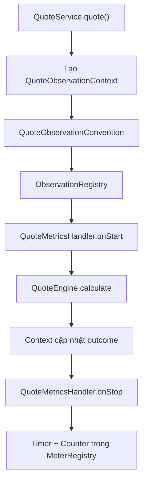

# Tạo Observation có Context, convention và handler tạo phép đo

Bài thực hành này xây dựng một Observation cho thao tác tính báo giá. Observation có Context riêng để giữ dữ liệu của một lần thực hiện, Convention chuẩn hóa tên và key-value, còn Handler dùng lifecycle để ghi Timer và Counter vào Micrometer registry.

Kết quả cần đạt:

- Mỗi lần tính báo giá có một Observation với tên ổn định.
- Context giữ channel, quote ID và outcome của lần thực hiện.
- Convention đưa channel vào low-cardinality key-values và quote ID vào high-cardinality key-values.
- Handler bắt đầu đo ở `onStart`, đánh dấu lỗi ở `onError` và ghi Timer/Counter ở `onStop`.
- Test xác nhận success, decline và exception được ghi nhận đúng.
- Metric tags chỉ chứa các giá trị có tập hữu hạn; quote ID không trở thành tag.

Bài dùng Java 17 và API Micrometer Observation. Có thể chạy như một ví dụ Java độc lập với `SimpleMeterRegistry`; sau đó tích hợp cùng ý tưởng vào Spring Boot.

## 1. Xác định thao tác cần quan sát

Giả sử hệ thống thương mại điện tử có use case tính báo giá. Một lần thực hiện nhận:

- Mã báo giá.
- Kênh bán hàng: web, mobile hoặc store.
- Giá trị giỏ hàng.

Kết quả có thể là:

- `approved`: báo giá hợp lệ.
- `declined`: nghiệp vụ từ chối báo giá.
- `error`: thao tác ném exception.

Ta muốn trả lời các câu hỏi:

| Câu hỏi | Phép đo |
|---|---|
| Có bao nhiêu lần tính báo giá theo channel và outcome? | Counter |
| Thời gian tính báo giá theo channel và outcome là bao lâu? | Timer |
| Một quote cụ thể đã được xử lý thế nào? | Trace/log dùng quote ID nếu chính sách dữ liệu cho phép |

Counter và Timer được tổng hợp qua nhiều lần thực hiện. Quote ID chỉ dùng để truy vết một lần thực hiện, không dùng làm metric tag.

## 2. Thiết kế các thành phần

Bài thực hành có bốn thành phần chính:

| Thành phần | Trách nhiệm |
|---|---|
| `QuoteObservationContext` | Giữ dữ liệu của một lần tính báo giá và trạng thái Timer.Sample |
| `QuoteObservationConvention` | Đặt observation name, contextual name và key-values |
| `QuoteMetricsHandler` | Tạo Timer.Sample khi bắt đầu, ghi Timer/Counter khi dừng |
| `QuoteService` | Tạo Observation và thực thi use case trong lifecycle đó |

Luồng xử lý:



Convention mô tả thao tác; Handler phản ứng với lifecycle. Không đặt logic nghiệp vụ vào Handler và không để QuoteService tự tạo Timer nếu Handler đã chịu trách nhiệm ghi phép đo.

## 3. Chuẩn bị dependency

Nếu dự án chưa dùng Spring Boot dependency management, cần chọn phiên bản Micrometer tương thích và quản lý đồng bộ. Ví dụ các dependency tối thiểu cho bài độc lập:

```xml
<dependencies>
    <dependency>
        <groupId>io.micrometer</groupId>
        <artifactId>micrometer-observation</artifactId>
    </dependency>

    <dependency>
        <groupId>io.micrometer</groupId>
        <artifactId>micrometer-core</artifactId>
    </dependency>

    <dependency>
        <groupId>org.junit.jupiter</groupId>
        <artifactId>junit-jupiter</artifactId>
        <scope>test</scope>
    </dependency>

    <dependency>
        <groupId>org.assertj</groupId>
        <artifactId>assertj-core</artifactId>
        <scope>test</scope>
    </dependency>
</dependencies>
```

Với Spring Boot 3, các dependency Actuator/Micrometer thường đã được quản lý qua BOM. Không thêm phiên bản riêng lẻ cho từng module Micrometer nếu Spring Boot đang quản lý chúng.

## 4. Tạo Context riêng cho báo giá

Context kế thừa `Observation.Context`. Đây là nơi giữ dữ liệu của một lần thực hiện, không phải một singleton dùng chung cho mọi request.

```java
import io.micrometer.core.instrument.MeterRegistry;
import io.micrometer.core.instrument.Timer;
import io.micrometer.observation.Observation;

import java.util.Objects;

public final class QuoteObservationContext extends Observation.Context {

    private final String quoteId;
    private final String channel;

    private String outcome = "unknown";
    private Timer.Sample timerSample;

    public QuoteObservationContext(String quoteId, String channel) {
        this.quoteId = Objects.requireNonNull(quoteId);
        this.channel = Objects.requireNonNull(channel);
    }

    public String quoteId() {
        return quoteId;
    }

    public String channel() {
        return channel;
    }

    public String outcome() {
        return outcome;
    }

    public void outcome(String outcome) {
        this.outcome = Objects.requireNonNull(outcome);
    }

    public void startTimer(MeterRegistry registry) {
        this.timerSample = Timer.start(registry);
    }

    public Timer.Sample timerSample() {
        return timerSample;
    }
}
```

Context giữ hai loại dữ liệu:

- `quoteId` và `channel` có sẵn khi tạo Observation.
- `outcome` chỉ xác định sau khi use case hoàn tất hoặc phát sinh lỗi.

`Timer.Sample` được lưu trong Context để Handler bắt đầu đo ở `onStart` và kết thúc ở `onStop`. Mỗi Observation có Context riêng nên sample không bị dùng chung giữa các request.

## 5. Viết ObservationConvention

Convention quy định cách đặt tên và key-values cho loại Context này.

```java
import io.micrometer.common.KeyValues;
import io.micrometer.observation.Observation;
import io.micrometer.observation.ObservationConvention;

public final class QuoteObservationConvention
        implements ObservationConvention<QuoteObservationContext> {

    @Override
    public boolean supportsContext(Observation.Context context) {
        return context instanceof QuoteObservationContext;
    }

    @Override
    public String getName() {
        return "business.quote.calculate";
    }

    @Override
    public String getContextualName(QuoteObservationContext context) {
        return "calculate-quote";
    }

    @Override
    public KeyValues getLowCardinalityKeyValues(
            QuoteObservationContext context
    ) {
        return KeyValues.of("channel", context.channel());
    }

    @Override
    public KeyValues getHighCardinalityKeyValues(
            QuoteObservationContext context
    ) {
        return KeyValues.of("quote.id", context.quoteId());
    }
}
```

Convention tạo hai nhóm thuộc tính:

| Key-value | Loại | Lý do |
|---|---|---|
| `channel=web` | Low cardinality | Chỉ có một tập channel hữu hạn |
| `quote.id=Q-...` | High cardinality | Mỗi lần báo giá có thể có ID khác nhau |

Low-cardinality values có thể trở thành metric dimensions. High-cardinality values dành cho tracing hoặc tín hiệu có thể truy vết từng lần thực hiện. Không đưa quote ID vào tag của Timer hoặc Counter.

Tên `business.quote.calculate` ổn định và không chứa ID. Contextual name `calculate-quote` ngắn gọn để hiển thị trong công cụ tracing.

## 6. Viết Handler tạo phép đo

Handler là nơi chuyển lifecycle Observation thành metrics. Ta dùng:

- `onStart`: khởi tạo Timer.Sample.
- `onError`: đổi outcome thành `error`.
- `onStop`: record duration và tăng execution Counter theo channel/outcome.

```java
import io.micrometer.core.instrument.Counter;
import io.micrometer.core.instrument.MeterRegistry;
import io.micrometer.core.instrument.Timer;
import io.micrometer.observation.Observation;
import io.micrometer.observation.ObservationHandler;

public final class QuoteMetricsHandler
        implements ObservationHandler<QuoteObservationContext> {

    private final MeterRegistry meterRegistry;

    public QuoteMetricsHandler(MeterRegistry meterRegistry) {
        this.meterRegistry = meterRegistry;
    }

    @Override
    public boolean supportsContext(Observation.Context context) {
        return context instanceof QuoteObservationContext;
    }

    @Override
    public void onStart(QuoteObservationContext context) {
        context.startTimer(meterRegistry);
    }

    @Override
    public void onError(QuoteObservationContext context) {
        context.outcome("error");
    }

    @Override
    public void onStop(QuoteObservationContext context) {
        Timer timer = Timer.builder("business.quote.duration")
            .description("Time spent calculating a quote")
            .tag("channel", context.channel())
            .tag("outcome", context.outcome())
            .register(meterRegistry);

        context.timerSample().stop(timer);

        Counter.builder("business.quote.executions")
            .description("Number of quote calculation executions")
            .tag("channel", context.channel())
            .tag("outcome", context.outcome())
            .register(meterRegistry)
            .increment();
    }
}
```

Handler chỉ hỗ trợ `QuoteObservationContext`, vì vậy nó không xử lý mọi Observation trong ứng dụng. Đây là cách giới hạn phạm vi handler theo loại Context.

Timer và Counter dùng cùng hai tag có cardinality giới hạn: `channel` và `outcome`. Handler không đưa `quote.id` vào meter. High-cardinality key-value vẫn có thể được tracing handler sử dụng theo cấu hình của tracing stack.

Handler không tự quyết định kết quả nghiệp vụ thành công hay từ chối. QuoteService cập nhật outcome cho kết quả nghiệp vụ; Handler chỉ chuyển lỗi kỹ thuật thành outcome `error` và ghi phép đo khi Observation dừng.

## 7. Đăng ký Handler vào ObservationRegistry

Trong bài độc lập, tạo registry tường minh:

```java
import io.micrometer.core.instrument.simple.SimpleMeterRegistry;
import io.micrometer.observation.ObservationRegistry;

SimpleMeterRegistry meterRegistry = new SimpleMeterRegistry();
ObservationRegistry observationRegistry = ObservationRegistry.create();

observationRegistry.observationConfig()
    .observationHandler(new QuoteMetricsHandler(meterRegistry));
```

Registry này có một custom handler ghi Timer và Counter. Không đăng ký thêm một handler khác cũng ghi cùng hai metric name/tag set, nếu không mỗi Observation có thể tạo phép đo trùng.

Trong Spring Boot, thường inject `ObservationRegistry` do framework quản lý và đăng ký custom handler vào registry đó bằng cơ chế customizer phù hợp với phiên bản Spring Boot. Kiểm tra các handler auto-configured trước khi thêm handler mới. Nếu dùng `DefaultMeterObservationHandler` đồng thời, hãy bảo đảm metric name do handler tùy chỉnh tạo không trùng với meter mà handler mặc định đã tạo.

## 8. Tạo QuoteService sử dụng Context và Convention

Service tạo Context cho mỗi lần gọi, tạo Observation bằng Convention và thực thi logic trong `observe(...)`.

```java
import io.micrometer.observation.Observation;
import io.micrometer.observation.ObservationConvention;
import io.micrometer.observation.ObservationRegistry;

import java.math.BigDecimal;

public final class QuoteService {

    private final ObservationRegistry observationRegistry;
    private final ObservationConvention<QuoteObservationContext> convention;
    private final QuoteEngine quoteEngine;

    public QuoteService(
            ObservationRegistry observationRegistry,
            ObservationConvention<QuoteObservationContext> convention,
            QuoteEngine quoteEngine
    ) {
        this.observationRegistry = observationRegistry;
        this.convention = convention;
        this.quoteEngine = quoteEngine;
    }

    public QuoteResult quote(QuoteInput input) {
        QuoteObservationContext context = new QuoteObservationContext(
            input.quoteId(),
            input.channel().metricValue()
        );

        return Observation.createNotStarted(
                convention,
                () -> context,
                observationRegistry
            )
            .observe(() -> {
                QuoteResult result = quoteEngine.calculate(input);

                context.outcome(
                    result.approved() ? "approved" : "declined"
                );

                return result;
            });
    }
}

enum SalesChannel {
    WEB("web"),
    MOBILE("mobile"),
    STORE("store");

    private final String metricValue;

    SalesChannel(String metricValue) {
        this.metricValue = metricValue;
    }

    public String metricValue() {
        return metricValue;
    }
}

record QuoteInput(
    String quoteId,
    SalesChannel channel,
    BigDecimal subtotal
) {}

record QuoteResult(
    boolean approved,
    BigDecimal total
) {}

interface QuoteEngine {
    QuoteResult calculate(QuoteInput input);
}
```

Luồng thực thi:

1. QuoteService tạo Context mới với quote ID và channel.
2. Convention cung cấp tên, contextual name và key-values.
3. Observation bắt đầu; Handler tạo Timer.Sample.
4. QuoteEngine tính báo giá.
5. Service đặt outcome thành `approved` hoặc `declined`.
6. Observation dừng; Handler ghi Timer và Counter.
7. Nếu QuoteEngine ném exception, Observation gọi `onError`; Handler đặt outcome thành `error`, sau đó `onStop` vẫn ghi phép đo.

Dùng enum cho channel giúp giá trị tag thuộc tập hữu hạn. Nếu nhận channel từ request, hãy xác thực hoặc chuẩn hóa trước khi tạo Context; không đưa chuỗi tùy ý trực tiếp vào metric tag.

## 9. Chạy thử với SimpleMeterRegistry

Tạo registry và service trong một chương trình nhỏ:

```java
import io.micrometer.core.instrument.simple.SimpleMeterRegistry;
import io.micrometer.observation.ObservationRegistry;

import java.math.BigDecimal;

public class QuoteObservationDemo {

    public static void main(String[] args) {
        SimpleMeterRegistry meters = new SimpleMeterRegistry();
        ObservationRegistry observations = ObservationRegistry.create();

        observations.observationConfig()
            .observationHandler(new QuoteMetricsHandler(meters));

        QuoteEngine engine = input -> new QuoteResult(
            true,
            input.subtotal().multiply(new BigDecimal("1.10"))
        );

        QuoteService service = new QuoteService(
            observations,
            new QuoteObservationConvention(),
            engine
        );

        service.quote(new QuoteInput(
            "Q-1001",
            SalesChannel.WEB,
            new BigDecimal("100.00")
        ));

        service.quote(new QuoteInput(
            "Q-1002",
            SalesChannel.MOBILE,
            new BigDecimal("250.00")
        ));

        meters.getMeters().forEach(meter ->
            System.out.println(
                meter.getId().getName() + " " + meter.getId().getTags()
            )
        );

        System.out.println(
            "web executions = " +
            meters.get("business.quote.executions")
                .tag("channel", "web")
                .tag("outcome", "approved")
                .counter()
                .count()
        );

        meters.close();
    }
}
```

Sau hai lần gọi, registry có các meter theo channel/outcome tương ứng. Timer count của mỗi tổ hợp bằng số lần Observation hoàn tất với tổ hợp đó. Counter execution cũng tăng một lần cho mỗi Observation.

`SimpleMeterRegistry` giữ dữ liệu trong bộ nhớ để kiểm thử và minh họa. Nó không export metrics đến Prometheus. Khi tích hợp Prometheus, thay registry cụ thể bằng registry được cấu hình trong ứng dụng và giữ nguyên API `MeterRegistry`.

## 10. Kiểm tra dữ liệu được tạo ra

Sau khi chạy demo, kiểm tra:

| Meter | Tags | Kết quả mong đợi |
|---|---|---|
| `business.quote.executions` | `channel=web,outcome=approved` | Counter = 1 |
| `business.quote.executions` | `channel=mobile,outcome=approved` | Counter = 1 |
| `business.quote.duration` | `channel=web,outcome=approved` | Timer count = 1 |
| `business.quote.duration` | `channel=mobile,outcome=approved` | Timer count = 1 |

Không có tag `quote.id`. Mỗi quote có ID khác nhau nhưng không làm tăng số meter identity. Nếu đưa quote ID thành tag, số time series có thể tăng theo số lần báo giá.

Có thể kiểm tra trực tiếp:

```java
double webCount = meters.get("business.quote.executions")
    .tag("channel", "web")
    .tag("outcome", "approved")
    .counter()
    .count();

long webTimerCount = meters.get("business.quote.duration")
    .tag("channel", "web")
    .tag("outcome", "approved")
    .timer()
    .count();
```

Với một lần gọi thành công qua channel web, cả hai giá trị đều bằng 1. Timer count là số lần record duration, không phải số giây.

## 11. Thêm test cho success, decline và exception

Test nên tạo registry mới cho mỗi trường hợp để meter state không rò rỉ giữa các test.

```java
import io.micrometer.core.instrument.simple.SimpleMeterRegistry;
import io.micrometer.observation.ObservationRegistry;
import org.junit.jupiter.api.Test;

import java.math.BigDecimal;

import static org.assertj.core.api.Assertions.assertThat;
import static org.assertj.core.api.Assertions.assertThatThrownBy;

class QuoteObservationTest {

    private SimpleMeterRegistry meters;
    private QuoteService service;

    private void setUp(QuoteEngine engine) {
        meters = new SimpleMeterRegistry();

        ObservationRegistry observations = ObservationRegistry.create();
        observations.observationConfig()
            .observationHandler(new QuoteMetricsHandler(meters));

        service = new QuoteService(
            observations,
            new QuoteObservationConvention(),
            engine
        );
    }

    @Test
    void recordsApprovedQuote() {
        setUp(input -> new QuoteResult(true, input.subtotal()));

        service.quote(input("Q-1", SalesChannel.WEB));

        assertThat(executionCount("web", "approved")).isEqualTo(1.0);
        assertThat(timerCount("web", "approved")).isEqualTo(1L);

        meters.close();
    }

    @Test
    void recordsDeclinedQuote() {
        setUp(input -> new QuoteResult(false, BigDecimal.ZERO));

        service.quote(input("Q-2", SalesChannel.MOBILE));

        assertThat(executionCount("mobile", "declined")).isEqualTo(1.0);
        assertThat(timerCount("mobile", "declined")).isEqualTo(1L);

        meters.close();
    }

    @Test
    void recordsExceptionAsErrorAndRethrowsIt() {
        setUp(input -> {
            throw new IllegalStateException("pricing engine unavailable");
        });

        assertThatThrownBy(() ->
            service.quote(input("Q-3", SalesChannel.STORE))
        ).isInstanceOf(IllegalStateException.class);

        assertThat(executionCount("store", "error")).isEqualTo(1.0);
        assertThat(timerCount("store", "error")).isEqualTo(1L);

        meters.close();
    }

    private QuoteInput input(String id, SalesChannel channel) {
        return new QuoteInput(id, channel, new BigDecimal("100.00"));
    }

    private double executionCount(String channel, String outcome) {
        return meters.get("business.quote.executions")
            .tag("channel", channel)
            .tag("outcome", outcome)
            .counter()
            .count();
    }

    private long timerCount(String channel, String outcome) {
        return meters.get("business.quote.duration")
            .tag("channel", channel)
            .tag("outcome", outcome)
            .timer()
            .count();
    }
}
```

Test exception xác nhận hai điều: lỗi được truyền lại cho caller và Handler vẫn ghi nhận lần thực thi với outcome `error`. Không nuốt exception chỉ để metrics được ghi; lifecycle Observation chịu trách nhiệm hoàn tất phép đo.

Trong test suite thực tế, nên dùng `@BeforeEach`/`@AfterEach` hoặc fixture tương đương để khởi tạo và đóng registry ngay cả khi assertion thất bại.

## 12. Kiểm tra convention và cardinality

Convention phải tạo tên ổn định và phân loại key-value đúng:

- `getName()` luôn trả về `business.quote.calculate`.
- `getContextualName()` luôn trả về `calculate-quote`.
- Low-cardinality chỉ chứa channel đã chuẩn hóa.
- High-cardinality chứa quote ID nếu tracing pipeline được cấu hình để dùng nó.
- Handler metrics chỉ dùng channel và outcome.

Có thể thêm assertion cho tags của meter:

```java
assertThat(
    meters.get("business.quote.duration")
        .tag("channel", "web")
        .tag("outcome", "approved")
        .timer()
        .getId()
        .getTags()
)
    .extracting("key")
    .contains("channel", "outcome")
    .doesNotContain("quote.id");
```

Nếu phiên bản AssertJ hoặc kiểu collection trong dự án không hỗ trợ cách trích xuất trên, hãy kiểm tra danh sách `Tag` bằng stream và assertion thông thường. Mục tiêu là xác nhận quote ID không xuất hiện trong metric tags.

Không đưa raw customer ID, email, payment reference hoặc payload vào high-cardinality tracing attributes nếu dữ liệu đó không được phép export. High-cardinality không đồng nghĩa với dữ liệu được phép công khai.

## 13. Tích hợp vào Spring Boot

Trong Spring Boot, inject `ObservationRegistry` do framework quản lý:

```java
@Service
class SpringQuoteService {

    private final ObservationRegistry observationRegistry;

    SpringQuoteService(ObservationRegistry observationRegistry) {
        this.observationRegistry = observationRegistry;
    }

    // Tạo Observation với custom Context và Convention như ví dụ trước.
}
```

Đăng ký custom handler vào registry được Spring Boot quản lý bằng cơ chế customizer của phiên bản Spring Boot đang dùng. Không tạo một `ObservationRegistry.create()` riêng trong mỗi service, vì handler auto-configured của framework sẽ không nhận các Observation thuộc registry độc lập đó.

Nếu Actuator và Prometheus registry đã có, metrics handler mặc định có thể tạo meter cho Observation. Custom Handler trong bài thực hành tạo hai metric business riêng. Hãy kiểm tra meter names để tránh ghi trùng với metric mặc định; nếu muốn chỉ dùng handler mặc định, có thể thay custom handler bằng convention và cấu hình meter handler theo khả năng của framework.

Tracing handler có thể sử dụng high-cardinality key-value từ convention để gắn thuộc tính vào span. Metrics handler không nên đưa các giá trị đó thành tags.

## 14. Những lỗi thường gặp

| Lỗi | Hậu quả | Cách sửa |
|---|---|---|
| Dùng một Context singleton cho mọi lần gọi | Dữ liệu giữa request bị ghi đè và Timer.Sample dùng sai | Tạo Context mới cho mỗi Observation |
| Convention dùng quote ID làm low-cardinality | Cardinality metrics tăng theo số quote | Đưa ID vào high-cardinality hoặc log có kiểm soát |
| Handler không kiểm tra Context type | Handler xử lý cả Observation không thuộc nghiệp vụ này | Cài `supportsContext()` chính xác |
| Chỉ tạo Observation nhưng không có handler | Không có phép đo tùy chỉnh được ghi | Đăng ký Handler vào đúng ObservationRegistry |
| Handler ghi Timer ở cả onStop và service tự record | Duration/count tăng hai lần | Chọn một nơi chịu trách nhiệm ghi |
| Không đặt outcome trước khi stop | Meter có tag `unknown` | Cập nhật Context trước khi Observation kết thúc |
| Không xử lý onError | Exception có thể bị ghi với outcome mặc định | Đặt outcome `error` trong `onError` |
| Dùng registry riêng trong Spring Boot | Auto-configured handlers không nhận Observation | Inject registry do Boot quản lý |
| Đăng ký cùng custom handler hai lần | Counter/Timer có thể ghi lặp | Kiểm tra cấu hình registry và handler |
| Cho rằng SimpleMeterRegistry export Prometheus | Không thấy endpoint scrape | Dùng Prometheus registry phù hợp khi triển khai |

## 15. Bài tập mở rộng

Sau khi hoàn thành phiên bản cơ bản, thử các yêu cầu sau:

1. Thêm tag `currency` với tập giá trị hữu hạn.
2. Thêm outcome `rejected` riêng cho lỗi validation nghiệp vụ.
3. Đo riêng thời gian gọi pricing provider bằng một Observation con có tên khác.
4. Thêm một handler chỉ ghi log lifecycle để kiểm tra thứ tự `onStart`, `onError`, `onStop`.
5. Viết test xác nhận hai quote ID khác nhau vẫn dùng cùng meter identity khi channel/outcome giống nhau.
6. Tích hợp Prometheus registry và kiểm tra output exposition.
7. Tích hợp tracing bridge và xác nhận `quote.id` xuất hiện trên span nhưng không xuất hiện trong metric labels.

Với mỗi phần mở rộng, hãy viết rõ câu hỏi quan sát cần trả lời trước khi thêm metric hoặc tag. Đừng thêm dimension chỉ vì dữ liệu đang có sẵn trong Context.

## 16. Tiêu chí hoàn thành

- [ ] Context riêng được tạo cho từng lần tính báo giá.
- [ ] Convention hỗ trợ đúng Context type.
- [ ] Observation name và contextual name ổn định.
- [ ] Channel là low-cardinality key-value.
- [ ] Quote ID là high-cardinality key-value.
- [ ] Handler tạo Timer.Sample ở `onStart`.
- [ ] Handler đổi outcome thành error ở `onError`.
- [ ] Handler record Timer và Counter ở `onStop`.
- [ ] Success, decline và exception đều có test.
- [ ] Metric tags không chứa quote ID.
- [ ] Không có handler hoặc instrumentation khác ghi trùng cùng metric.
- [ ] Spring Boot sử dụng registry do framework quản lý khi tích hợp.
- [ ] Đã xác minh output trên registry/exporter thực tế.

Bài thực hành hoàn tất khi một lần tính báo giá tạo đúng một Observation, Context mang dữ liệu của lần đó, Convention chuẩn hóa tên và key-values, còn Handler ghi đúng một Timer sample và một execution count. Cách chia trách nhiệm này giúp instrumentation có thể tái sử dụng, kiểm thử độc lập và mở rộng sang tracing mà không đưa chi tiết backend vào logic nghiệp vụ.

## Tài liệu tham khảo

- [Micrometer Observation](https://docs.micrometer.io/micrometer/reference/observation.html) — Context, Convention, Handler và lifecycle.
- [Micrometer Observation Instrumentation](https://docs.micrometer.io/micrometer/reference/observation/instrumenting.html) — tạo Observation và instrument thao tác.
- [Micrometer Timers](https://docs.micrometer.io/micrometer/reference/concepts/timers.html) — Timer.Sample và ghi thời lượng.
- [Spring Boot Observability](https://docs.spring.io/spring-boot/reference/actuator/observability.html) — ObservationRegistry, metrics và tracing trong Spring Boot.

