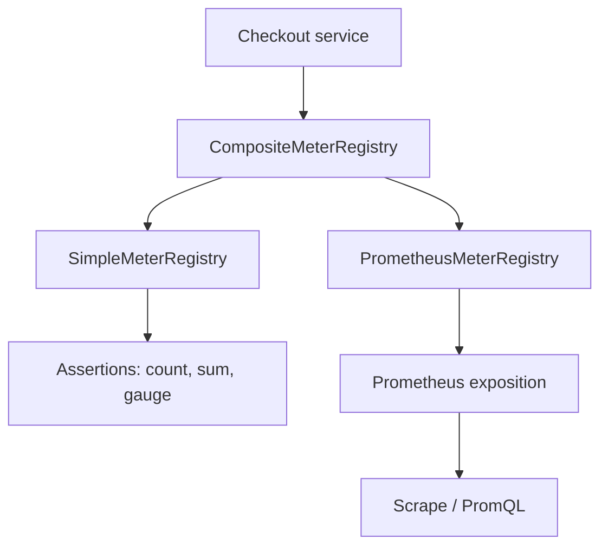

# Xuất cùng phép đo qua nhiều registry và đối chiếu ý nghĩa dữ liệu

Trong một ứng dụng Java, cùng một phép đo có thể cần được gửi đến nhiều hệ thống: Prometheus phục vụ dashboard và alert, một registry khác phục vụ nền tảng phân tích hoặc hệ thống giám sát tập trung. Micrometer hỗ trợ việc này bằng `CompositeMeterRegistry`: ứng dụng ghi meter một lần, composite chuyển các lần cập nhật đó đến những registry con đã đăng ký.

Bài thực hành xây dựng một luồng checkout nhỏ và xuất cùng Counter, Timer, DistributionSummary và Gauge tới `SimpleMeterRegistry` cùng `PrometheusMeterRegistry`. Sau khi chạy, bạn sẽ đối chiếu giá trị, tag, đơn vị và cách biểu diễn dữ liệu của từng registry. Mục tiêu là hiểu rằng các registry nhận cùng một phép đo logic nhưng có thể trình bày dữ liệu khác nhau theo naming convention, capability và mô hình lưu trữ của backend.

Trong module `OBSERVABILITY_INSTRUMENTATION_MICROMETER`, bài tập tổng hợp cách thiết kế meter, cấu hình registry, kiểm soát cardinality, đọc exposition và kiểm thử contract. Kết quả cần đạt là có thể giải thích vì sao một Timer trong code có cùng count và total time ở hai registry nhưng tên series hoặc cấu trúc histogram trên backend khác nhau.

## 1. Mục tiêu và kết quả cần đạt

Sau bài thực hành, bạn có thể:

1. Dùng `CompositeMeterRegistry` để fan-out một lần ghi đến nhiều registry.
2. Đăng ký cùng một tập meter qua một `MeterRegistry` chung.
3. So sánh count, total time, total amount và gauge value giữa các registry.
4. Giải thích khác biệt giữa tên meter Micrometer và tên được export.
5. Kiểm tra histogram bucket và SLO boundary ở Prometheus exposition.
6. Nhận biết khác biệt giữa registry cumulative và step-based.
7. Xác định nguyên nhân khi một registry thiếu meter hoặc xuất dữ liệu khác kỳ vọng.

<badge color="info">Bài lab</badge> **Thời lượng gợi ý:** 60–90 phút.

## 2. Bối cảnh thực hành

Một dịch vụ checkout cần đo:

| Phép đo | Meter | Ý nghĩa |
| --- | --- | --- |
| Số checkout được chấp nhận | Counter | Mỗi command mới được nhận tăng một lần |
| Số checkout thành công | Counter có tag `outcome` | Mỗi logical command có kết quả cuối cùng tăng một lần |
| Thời gian xử lý checkout | Timer | Thời gian của một logical command hoàn tất |
| Kích thước payload | DistributionSummary | Số byte của payload được xử lý |
| Độ dài queue hiện tại | Gauge | Giá trị queue tại thời điểm đọc |

Ứng dụng muốn gửi các phép đo này đến hai registry:

- `SimpleMeterRegistry`: registry trong bộ nhớ để kiểm tra giá trị trực tiếp trong test.
- `PrometheusMeterRegistry`: registry tạo exposition để Prometheus scrape.



Composite không cộng hoặc hợp nhất dữ liệu giữa các registry con. Nó chuyển cùng lần cập nhật đến từng registry. Mỗi backend giữ bản dữ liệu riêng và có thể áp dụng cách đặt tên, aggregation hoặc export khác nhau.

## 3. Chuẩn bị dependency

Với Gradle, thêm Micrometer core và Prometheus registry. Nếu dự án dùng Spring Boot, để dependency management/BOM quản lý phiên bản Micrometer tương thích:

```groovy
dependencies {
    implementation("io.micrometer:micrometer-core")
    implementation("io.micrometer:micrometer-registry-prometheus")

    testImplementation("org.junit.jupiter:junit-jupiter")
    testImplementation("org.assertj:assertj-core")
}
```

Ví dụ Prometheus bên dưới dùng adapter Prometheus Java Client 1.x, với package `io.micrometer.prometheusmetrics`. Nếu dự án đang dùng `micrometer-registry-prometheus-simpleclient`, hãy thay import và kiểu registry theo adapter legacy đang có; không trộn hai adapter trong cùng một test chỉ để làm ví dụ.

## 4. Thiết kế contract cho các phép đo

Trước khi viết code, thống nhất ý nghĩa và tag:

| Meter name trong Micrometer | Type | Tag | Unit | Semantics |
| --- | --- | --- | --- | --- |
| `business.checkout.accepted` | Counter | `service` | orders | Một checkout command mới được chấp nhận |
| `business.checkout.results` | Counter | `service`, `outcome` | orders | Một kết quả cuối cùng của logical command |
| `business.checkout.processing.duration` | Timer | `service`, `outcome` | seconds | Thời gian xử lý logical command |
| `business.checkout.payload.size` | DistributionSummary | `service` | bytes | Kích thước payload từng checkout |
| `business.checkout.queue.depth` | Gauge | `service` | items | Độ dài queue tại thời điểm đọc |

Tag `service` có một giá trị cố định là `checkout`. Tag `outcome` dùng vocabulary hữu hạn như `success`, `rejected`, `timeout` và `error`. Không thêm order ID, customer ID hoặc request ID vào tag vì chúng làm tăng cardinality theo số giao dịch.

Timer được cấu hình histogram và các SLO boundary 100 ms, 300 ms, 1 giây. DistributionSummary đo byte và có các ngưỡng 1 KiB, 10 KiB, 100 KiB. Đây là cấu hình của phép đo, không phải cam kết rằng mọi registry đều xuất cùng một cấu trúc bucket.

## 5. Tạo lớp instrumentation dùng một MeterRegistry

Lớp instrumentation chỉ nhận `MeterRegistry`. Nó không cần biết registry thực tế là composite, simple hay Prometheus. Nhờ vậy, cùng code có thể được dùng trong ứng dụng và test.

```java
import java.time.Duration;
import java.util.concurrent.TimeUnit;
import java.util.concurrent.atomic.AtomicInteger;

import io.micrometer.core.instrument.Counter;
import io.micrometer.core.instrument.DistributionSummary;
import io.micrometer.core.instrument.Gauge;
import io.micrometer.core.instrument.MeterRegistry;
import io.micrometer.core.instrument.Timer;

public final class CheckoutMetrics {
    private final Counter accepted;
    private final Counter successful;
    private final Timer processing;
    private final DistributionSummary payloadSize;
    private final AtomicInteger queueDepth = new AtomicInteger();

    public CheckoutMetrics(MeterRegistry registry) {
        this.accepted = Counter.builder("business.checkout.accepted")
                .description("Number of newly accepted checkout commands")
                .baseUnit("orders")
                .register(registry);

        this.successful = Counter.builder("business.checkout.results")
                .description("Number of completed checkout commands by outcome")
                .baseUnit("orders")
                .tag("outcome", "success")
                .register(registry);

        this.processing = Timer.builder("business.checkout.processing.duration")
                .description("Time spent processing one logical checkout command")
                .tag("outcome", "success")
                .publishPercentileHistogram()
                .serviceLevelObjectives(
                        Duration.ofMillis(100),
                        Duration.ofMillis(300),
                        Duration.ofSeconds(1))
                .register(registry);

        this.payloadSize = DistributionSummary.builder("business.checkout.payload.size")
                .description("Checkout request payload size")
                .baseUnit("bytes")
                .publishPercentileHistogram()
                .serviceLevelObjectives(1_024, 10_240, 102_400)
                .register(registry);

        Gauge.builder("business.checkout.queue.depth", queueDepth, AtomicInteger::get)
                .description("Current number of checkout commands waiting in queue")
                .register(registry);
    }

    public void checkoutAccepted() {
        accepted.increment();
    }

    public void checkoutSucceeded() {
        successful.increment();
    }

    public void recordProcessing(long amount, TimeUnit unit) {
        processing.record(amount, unit);
    }

    public void recordPayloadSize(double bytes) {
        payloadSize.record(bytes);
    }

    public void updateQueueDepth(int value) {
        queueDepth.set(value);
    }
}
```

Giữ `AtomicInteger` trong field để object được tham chiếu trong suốt thời gian meter tồn tại. Gauge thường giữ tham chiếu yếu đến object được quan sát; nếu chỉ truyền một object tạm thời vào builder rồi không giữ reference, giá trị gauge có thể biến mất do garbage collection.

Lớp trên tạo một Counter cho kết quả `success` để bài lab tập trung vào fan-out. Trong ứng dụng thật, hãy dùng enum hoặc mapper có vocabulary hữu hạn để ghi đủ outcome; không truyền trực tiếp chuỗi tùy ý từ request vào tag.

## 6. Tạo hai registry con và CompositeMeterRegistry

Tạo các registry con trước, áp dụng common tag giống nhau, rồi thêm chúng vào composite trước khi đăng ký meter:

```java
import io.micrometer.core.instrument.composite.CompositeMeterRegistry;
import io.micrometer.core.instrument.simple.SimpleMeterRegistry;
import io.micrometer.prometheusmetrics.PrometheusConfig;
import io.micrometer.prometheusmetrics.PrometheusMeterRegistry;

SimpleMeterRegistry simple = new SimpleMeterRegistry();
PrometheusMeterRegistry prometheus =
        new PrometheusMeterRegistry(PrometheusConfig.DEFAULT);
CompositeMeterRegistry composite = new CompositeMeterRegistry();
composite.config().commonTags("service", "checkout");
composite.add(simple);
composite.add(prometheus);

CheckoutMetrics metrics = new CheckoutMetrics(composite);
```

`commonTags` được cấu hình trên composite trước khi tạo meter. Tag được gắn vào meter identity chung rồi fan-out đến cả hai registry con. Trong một ứng dụng Spring Boot, common tags thường được cấu hình tập trung qua `MeterRegistryCustomizer` hoặc properties; bài lab cấu hình trực tiếp để dễ thấy luồng dữ liệu.

Đăng ký child registry trước khi tạo meter giúp lifecycle trong bài lab rõ ràng. Khi thêm hoặc gỡ registry trong ứng dụng đang chạy, cần hiểu cách composite xử lý meter đã tồn tại và kiểm thử hành vi đó với đúng phiên bản Micrometer.

## 7. Ghi cùng một bộ dữ liệu một lần

Giả lập ba checkout thành công:

```java
metrics.checkoutAccepted();
metrics.checkoutSucceeded();

metrics.recordProcessing(120, TimeUnit.MILLISECONDS);
metrics.recordPayloadSize(512);

metrics.checkoutAccepted();
metrics.checkoutSucceeded();
metrics.recordProcessing(250, TimeUnit.MILLISECONDS);
metrics.recordPayloadSize(4_096);

metrics.checkoutAccepted();
metrics.checkoutSucceeded();
metrics.recordProcessing(800, TimeUnit.MILLISECONDS);
metrics.recordPayloadSize(8_192);

metrics.updateQueueDepth(7);
```

Kết quả mong đợi về mặt semantics:

- 3 checkout được chấp nhận.
- 3 checkout có outcome `success`.
- Timer có 3 observation, tổng thời gian 1.170 ms, tương đương 1,17 giây.
- DistributionSummary có 3 observation, tổng kích thước 12.800 byte.
- Gauge trả về 7 tại thời điểm đọc.

Composite chuyển từng lần cập nhật đến cả `SimpleMeterRegistry` và `PrometheusMeterRegistry`. Ứng dụng không gọi `increment()` hai lần cho mỗi registry.

## 8. Viết test đối chiếu hai registry

Test sau gom setup, ghi dữ liệu và assertion. Trong dự án, đặt `CheckoutMetrics` ở source chính và test trong `src/test/java`.

```java
import static org.assertj.core.api.Assertions.assertThat;

import java.util.concurrent.TimeUnit;

import io.micrometer.core.instrument.composite.CompositeMeterRegistry;
import io.micrometer.core.instrument.simple.SimpleMeterRegistry;
import io.micrometer.prometheusmetrics.PrometheusConfig;
import io.micrometer.prometheusmetrics.PrometheusMeterRegistry;
import org.junit.jupiter.api.Test;

class MultiRegistryContractTest {
    @Test
    void sendsSameMeasurementsToSimpleAndPrometheusRegistries() {
        try (SimpleMeterRegistry simple = new SimpleMeterRegistry();
             PrometheusMeterRegistry prometheus =
                     new PrometheusMeterRegistry(PrometheusConfig.DEFAULT);
             CompositeMeterRegistry composite = new CompositeMeterRegistry()) {

            composite.config().commonTags("service", "checkout");
            composite.add(simple);
            composite.add(prometheus);

            CheckoutMetrics metrics = new CheckoutMetrics(composite);
            metrics.checkoutAccepted();
            metrics.checkoutSucceeded();
            metrics.recordProcessing(120, TimeUnit.MILLISECONDS);
            metrics.recordPayloadSize(512);

            metrics.checkoutAccepted();
            metrics.checkoutSucceeded();
            metrics.recordProcessing(250, TimeUnit.MILLISECONDS);
            metrics.recordPayloadSize(4_096);

            metrics.checkoutAccepted();
            metrics.checkoutSucceeded();
            metrics.recordProcessing(800, TimeUnit.MILLISECONDS);
            metrics.recordPayloadSize(8_192);

            metrics.updateQueueDepth(7);

            assertThat(simple.get("business.checkout.accepted")
                    .tag("service", "checkout")
                    .counter().count()).isEqualTo(3.0);
            assertThat(prometheus.get("business.checkout.accepted")
                    .tag("service", "checkout")
                    .counter().count()).isEqualTo(3.0);

            assertThat(simple.get("business.checkout.results")
                    .tags("service", "checkout", "outcome", "success")
                    .counter().count()).isEqualTo(3.0);
            assertThat(prometheus.get("business.checkout.results")
                    .tags("service", "checkout", "outcome", "success")
                    .counter().count()).isEqualTo(3.0);

            assertThat(simple.get("business.checkout.processing.duration")
                    .tags("service", "checkout", "outcome", "success")
                    .timer().count()).isEqualTo(3L);
            assertThat(prometheus.get("business.checkout.processing.duration")
                    .tags("service", "checkout", "outcome", "success")
                    .timer().count()).isEqualTo(3L);

            assertThat(simple.get("business.checkout.processing.duration")
                    .tags("service", "checkout", "outcome", "success")
                    .timer().totalTime(TimeUnit.MILLISECONDS)).isEqualTo(1_170.0);
            assertThat(prometheus.get("business.checkout.processing.duration")
                    .tags("service", "checkout", "outcome", "success")
                    .timer().totalTime(TimeUnit.MILLISECONDS)).isEqualTo(1_170.0);

            assertThat(simple.get("business.checkout.payload.size")
                    .tag("service", "checkout")
                    .summary().count()).isEqualTo(3L);
            assertThat(simple.get("business.checkout.payload.size")
                    .tag("service", "checkout")
                    .summary().totalAmount()).isEqualTo(12_800.0);
            assertThat(prometheus.get("business.checkout.payload.size")
                    .tag("service", "checkout")
                    .summary().count()).isEqualTo(3L);
            assertThat(prometheus.get("business.checkout.payload.size")
                    .tag("service", "checkout")
                    .summary().totalAmount()).isEqualTo(12_800.0);

            assertThat(simple.get("business.checkout.queue.depth")
                    .tag("service", "checkout")
                    .gauge().value()).isEqualTo(7.0);
            assertThat(prometheus.get("business.checkout.queue.depth")
                    .tag("service", "checkout")
                    .gauge().value()).isEqualTo(7.0);

            String exposition = prometheus.scrape();
            assertThat(exposition)
                    .contains("business_checkout_processing_duration_seconds_bucket")
                    .contains("service=\"checkout\"")
                    .contains("outcome=\"success\"")
                    .contains("le=\"0.3\"");
        }
    }
}
```

Test xác minh cùng một instrumentation tạo ra dữ liệu tương đương trong hai registry. `SimpleMeterRegistry` cho phép đọc trực tiếp các giá trị trong bộ nhớ; `PrometheusMeterRegistry` cũng cung cấp API meter để kiểm tra trước khi scrape.

## 9. Đọc exposition và so sánh naming convention

Micrometer giữ tên logic trong code, ví dụ `business.checkout.processing.duration`. Registry Prometheus chuyển tên theo quy ước Prometheus, thay dấu chấm bằng dấu gạch dưới và thêm base unit của Timer. Vì vậy, exposition có tên gần dạng:

```text
business_checkout_processing_duration_seconds_count
business_checkout_processing_duration_seconds_sum
business_checkout_processing_duration_seconds_max
business_checkout_processing_duration_seconds_bucket
```

Counter có thể được xuất với hậu tố `_total`; DistributionSummary có base unit `bytes` có thể được xuất với hậu tố `_bytes`. Gauge thường không có hậu tố unit nếu naming convention không thêm đơn vị.

Lấy raw exposition trong test:

```java
String exposition = prometheus.scrape();
System.out.println(exposition);
```

Kiểm tra các thành phần quan trọng:

```java
assertThat(exposition)
        .contains("business_checkout_processing_duration_seconds_bucket")
        .contains("business_checkout_processing_duration_seconds_count")
        .contains("service=\"checkout\"")
        .contains("outcome=\"success\"")
        .contains("le=\"0.3\"");
```

Không yêu cầu tên chuỗi ở mọi backend phải giống hệt tên trong code. Contract cần giữ ý nghĩa, unit và tag; naming convention có thể chuyển tên logic sang dạng mà backend yêu cầu. Khi debug, luôn đối chiếu tên trong code với tên raw exposition thay vì suy luận bằng mắt từ dashboard.

## 10. So sánh unit và giá trị Timer

Timer đo duration và Micrometer chuẩn hóa đơn vị theo registry. Ở API Java, có thể đọc cùng một timer bằng bất kỳ `TimeUnit` nào:

```java
double millis = timer.totalTime(TimeUnit.MILLISECONDS);
double seconds = timer.totalTime(TimeUnit.SECONDS);
```

Với dữ liệu lab:

| Cách đọc | Giá trị mong đợi |
| --- | ---: |
| Count | 3 |
| Total time (milliseconds) | 1.170 |
| Total time (seconds) | 1,17 |
| Max (milliseconds) | 800 |

Prometheus exposition dùng giây cho Timer, do đó `_sum` tương ứng khoảng `1.17`. Không so sánh trực tiếp số `1.17` trong Prometheus với `1170` từ API đang đọc milliseconds rồi kết luận dữ liệu lệch. Trước khi đối chiếu, hãy quy đổi về cùng đơn vị.

Với DistributionSummary, giá trị không tự động đổi thành giây. Trong bài lab, payload được ghi theo byte nên `totalAmount()` là 12.800 byte và Prometheus naming convention có thể đưa `_bytes` vào tên metric.

## 11. So sánh histogram bucket và SLO boundary

Timer được cấu hình các SLO 100 ms, 300 ms và 1 giây. Với ba observation 120 ms, 250 ms và 800 ms, số observation nằm trong các bucket tích lũy dự kiến:

| Bucket `le` | Count tích lũy |
| --- | ---: |
| 0.1 giây | 0 |
| 0.3 giây | 2 |
| 1.0 giây | 3 |
| `+Inf` | 3 |

Bucket Prometheus là bộ đếm tích lũy. `le="0.3"` có cả observation 120 ms và 250 ms; không phải chỉ observation nằm giữa 100 ms và 300 ms.

Với histogram, có thể tính p95 trên Prometheus:

```promql
histogram_quantile(
  0.95,
  sum by (le) (
    rate(business_checkout_processing_duration_seconds_bucket[5m])
  )
)
```

Và tính tỷ lệ checkout hoàn tất trong 300 ms:

```promql
sum(rate(business_checkout_processing_duration_seconds_bucket{le="0.3"}[5m]))
/
sum(rate(business_checkout_processing_duration_seconds_count[5m]))
```

Trong bài lab nhỏ, `rate()` có thể chưa trả dữ liệu vì chưa đủ mẫu scrape và thời gian. Hãy xem raw exposition trước để xác nhận bucket; PromQL cần dữ liệu được Prometheus scrape qua nhiều thời điểm.

`SimpleMeterRegistry` có thể cho count, total time và max nhưng không đại diện cho Prometheus exposition. Hãy dùng registry đích để kiểm tra bucket. Không giả định hai registry có cùng capability chỉ vì cùng nhận một Timer builder.

## 12. Đối chiếu từng loại meter

| Meter | Simple registry | Prometheus registry | Điều cần đối chiếu |
| --- | --- | --- | --- |
| Counter | Count tích lũy trong process | Counter series, thường có hậu tố `_total` | Một sự kiện chỉ tăng một lần ở mỗi registry |
| Timer | Count, total time, max và thống kê hỗ trợ trong bộ nhớ | `_count`, `_sum`, `_max`, bucket nếu bật | Cùng số observation; đổi đơn vị trước khi so sánh |
| DistributionSummary | Count, total amount, max | Count/sum/max và bucket nếu adapter hỗ trợ | Giá trị raw và base unit phải thống nhất |
| Gauge | Đọc giá trị từ object đang được quan sát | Gauge series trong exposition | Cùng object state tại thời điểm scrape/đọc |

Registry không phải bản sao byte-for-byte của nhau. Mỗi registry chuyển meter thành định dạng và kiểu dữ liệu mà backend của nó hiểu. Hãy so sánh ý nghĩa và các đại lượng tương đương, không chỉ so sánh tên chuỗi hoặc số trường trong exposition.

## 13. Những khác biệt khi thêm registry push hoặc step-based

Hai registry trong bài lab đều thuận tiện để đọc dữ liệu tích lũy. Trong môi trường thực tế, registry push như Datadog hoặc một số backend step-based có thể gom dữ liệu theo chu kỳ. Khi đó, Counter hoặc Timer được export có thể biểu diễn delta của một step thay vì tổng tích lũy từ lúc tiến trình khởi động.

Ví dụ, một registry cumulative có thể đang giữ tổng 100 checkout; registry step-based ở step hiện tại chỉ export 12 checkout mới phát sinh trong khoảng thời gian đó. Hai số không mâu thuẫn: chúng có temporality khác nhau.

Khi thêm registry step-based, hãy xác minh:

- Step interval đang cấu hình là bao lâu.
- Batch được publish ở ranh giới nào.
- Counter được export dưới dạng cumulative hay delta.
- Backend query cần `rate`, sum theo step hay phép tổng hợp khác.
- Timer histogram/percentile được backend hỗ trợ như thế nào.
- Shutdown có publish batch cuối hay bỏ dữ liệu chưa đến step tiếp theo.

Không so sánh số hiện tại của registry step với tổng tích lũy của `SimpleMeterRegistry` mà không quy đổi về cùng khoảng thời gian. Để đối chiếu đúng, chọn cùng time window và cùng semantics aggregation.

## 14. Tránh ghi trùng khi dùng nhiều registry

`CompositeMeterRegistry` đã fan-out mỗi lần cập nhật. Nếu code vừa ghi vào composite vừa ghi trực tiếp vào registry con, dữ liệu ở registry đó sẽ bị nhân đôi.

Ví dụ sai:

```java
Counter counter = composite.counter("business.checkout.accepted");
counter.increment();

// Không làm thêm thao tác này cho cùng một sự kiện:
simple.counter("business.checkout.accepted").increment();
```

Lần `increment()` đầu đã được chuyển đến `simple` và các child registry khác. Lần thứ hai làm `simple` tăng thêm một lần, trong khi Prometheus chỉ tăng một lần.

Một nguồn dữ liệu cũng có thể bị scrape hoặc ingest hai lần nếu cùng một registry được expose qua nhiều target mà dashboard lại cộng cả hai target. Khi triển khai, bảo đảm mỗi registry/backend có một luồng nhận diện rõ ràng và không cộng hai bản sao của cùng nguồn như hai instance nghiệp vụ khác nhau.

## 15. Kiểm soát common tags, filters và meter identity

Meter identity được xác định bởi name, type và tập tag. Khi nhiều registry cùng nhận dữ liệu, cần thống nhất tag nền tảng như `service`, `environment` và `region` nếu các backend cần so sánh cùng chiều.

Tuy nhiên, mỗi registry có thể có `MeterFilter` riêng. Một filter có thể:

- Từ chối một meter ở registry này nhưng vẫn cho phép ở registry khác.
- Thêm hoặc chuẩn hóa tag.
- Đổi tên meter.
- Cấu hình distribution statistics khác nhau.

Điều này có thể có chủ đích, nhưng cần ghi rõ. Nếu một registry thiếu meter, kiểm tra filter và common tags trước khi nghi ngờ `CompositeMeterRegistry` không fan-out.

Không thêm tag động chỉ để phân biệt backend. Registry đã là một ranh giới export; nếu cần phân biệt nguồn, dùng cấu hình backend hoặc nhãn ổn định được quản lý tập trung. Không thêm `registryId` hoặc tên host không giới hạn vào từng meter nếu điều đó làm cardinality tăng không cần thiết.

## 16. Bài tập mở rộng

Sau khi test cơ bản chạy thành công, hãy thực hiện các thay đổi sau và ghi lại kết quả:

### Bài tập A — Thêm outcome khác

Thêm `rejected` và `timeout` cho Counter `business.checkout.results` bằng enum. Kiểm tra cả hai registry có cùng số count cho từng outcome. Xác nhận tag values chỉ nằm trong vocabulary được tài liệu hóa.

### Bài tập B — Thay đổi common tag

Thêm `environment=staging` vào common tags của composite trước khi meter được đăng ký. Xác minh tag xuất hiện trong Simple registry và Prometheus exposition. Sau đó dùng một `MeterFilter` riêng trên một registry con để thêm hoặc chuẩn hóa tag, rồi quan sát sự khác biệt.

### Bài tập C — Tắt histogram ở một registry

Tạo filter/configuration phù hợp trên một registry con để histogram không được xuất ở đó, trong khi registry còn lại vẫn có bucket. Giải thích vì sao cùng một Timer logic có thể có capability export khác nhau.

### Bài tập D — Thêm registry thứ ba

Thêm một registry khác mà không thay đổi lớp `CheckoutMetrics`. Chỉ đăng ký registry đó vào composite. Đối chiếu tên, unit, temporality và distribution support theo tài liệu adapter.

### Bài tập E — Đo tác động cardinality

Thêm một tag `channel` với ba giá trị cố định. Tính số series tối đa của từng meter. Sau đó thử đưa một ID duy nhất cho mỗi checkout và giải thích tác động lên số series, chi phí ingest và truy vấn.

### Bài tập F — Đối chiếu step interval

Thay hoặc bổ sung registry step-based trong môi trường thử nghiệm. Ghi một số checkout trong hai step, kiểm tra thời điểm publish và giải thích vì sao giá trị export theo step khác tổng tích lũy ở Simple registry.

## 17. Tiêu chí hoàn thành

Bài thực hành đạt yêu cầu khi:

- [ ] `CheckoutMetrics` chỉ phụ thuộc `MeterRegistry`.
- [ ] `CompositeMeterRegistry` có ít nhất hai child registry.
- [ ] Một lần ghi nghiệp vụ cập nhật cả hai registry đúng một lần.
- [ ] Counter có cùng count và tag values ở cả hai registry.
- [ ] Timer có cùng count và total time sau khi quy đổi về cùng unit.
- [ ] DistributionSummary có cùng count và total amount.
- [ ] Gauge đọc cùng giá trị hiện tại từ object được giữ reference.
- [ ] Prometheus exposition có tên metric, label và SLO bucket dự kiến.
- [ ] Giải thích được khác biệt naming convention và unit.
- [ ] Giải thích được cumulative và step/delta temporality.
- [ ] Không có thao tác ghi trực tiếp trùng vào registry con.
- [ ] Tag vocabulary và cardinality được kiểm soát.

## 18. Lỗi thường gặp và cách xử lý

| Biểu hiện | Nguyên nhân có thể | Cách xử lý |
| --- | --- | --- |
| Chỉ một registry có meter | Child chưa được add, filter từ chối hoặc meter đăng ký trước cấu hình | Kiểm tra thứ tự setup, filter và common tags |
| Count ở một registry gấp đôi | Code ghi cả composite lẫn child registry | Chỉ ghi qua một registry chung |
| Tên metric khác nhau | Naming convention của backend | Đối chiếu name logic và raw exposition |
| Timer sum khác nhau | Đọc ở đơn vị khác hoặc registry dùng temporality khác | Quy đổi unit và cùng time window |
| Không thấy histogram bucket | Registry/backend không hỗ trợ hoặc chưa cấu hình | Kiểm tra builder, filter và exposition adapter |
| Gauge biến mất hoặc không đổi | Object bị garbage collected hoặc code không cập nhật state | Giữ strong reference và cập nhật object được gauge quan sát |
| Tag `service` chỉ có ở một registry | Common tags cấu hình không đồng nhất hoặc filter thay đổi tag | Cấu hình common tags trên composite trước khi đăng ký meter; kiểm tra filter của child |
| Số liệu step khác cumulative | Khác temporality và step interval | So sánh cùng khoảng thời gian và semantics |
| Prometheus query không có dữ liệu ngay | Chưa có đủ scrape sample hoặc time range quá ngắn | Xem raw scrape và chờ đủ cửa sổ query |
| Series tăng mạnh sau khi thêm tag | Tag value cardinality cao | Giới hạn vocabulary hoặc bỏ tag khỏi metrics |

## 19. Quy trình triển khai thực tế

Khi đưa multi-registry vào một dịch vụ, hãy làm theo trình tự:

1. Xác định các backend và mục đích của từng backend.
2. Định nghĩa một contract meter dùng chung: name, type, unit, tags, semantics và distribution.
3. Tạo registry con với naming convention, common tags, filters và export settings phù hợp.
4. Đăng ký các registry con vào `CompositeMeterRegistry`.
5. Inject composite qua `MeterRegistry` vào instrumentation.
6. Kiểm thử fan-out bằng registry trong bộ nhớ và exposition test cho backend quan trọng.
7. Đối chiếu unit, temporality, histogram capability và naming convention.
8. Kiểm tra cardinality, batch size, scrape/publish interval và chi phí ingest.
9. Theo dõi lỗi export riêng cho từng backend.
10. Tài liệu hóa backend nào là nguồn dashboard/alert chính để tránh cộng trùng dữ liệu.

## Tài liệu tham khảo

- [Micrometer: Composite Meter Registry](https://docs.micrometer.io/micrometer/reference/concepts/registry.html)
- [Micrometer: Meter Registry and Meter Types](https://docs.micrometer.io/micrometer/reference/concepts/meters.html)
- [Micrometer: Histograms and Percentiles](https://docs.micrometer.io/micrometer/reference/concepts/histogram-quantiles.html)
- [Micrometer: Prometheus Registry](https://docs.micrometer.io/micrometer/reference/implementations/prometheus.html)
- [Prometheus: Histograms and summaries](https://prometheus.io/docs/practices/histograms/)
