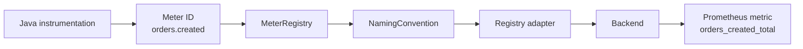

# Khác biệt giữa tên tra cứu trong registry và tên công bố ra ngoài

Trong Micrometer, một meter có tên định danh trong ứng dụng và một tên được registry chuyển đổi khi công bố metrics ra backend. Hai tên này có thể khác nhau dù cùng mô tả một phép đo. Ví dụ, ứng dụng đăng ký meter `http.server.requests`; Spring Boot Actuator tra cứu meter bằng tên này, trong khi Prometheus thường nhận các chuỗi như `http_server_requests_seconds_count` và `http_server_requests_seconds_sum`.

Sự khác biệt xuất phát từ vai trò của Micrometer như một API metrics độc lập với backend. Mã Java nên đặt tên meter theo ngữ nghĩa của ứng dụng; registry adapter chịu trách nhiệm chuyển tên, đơn vị và cấu trúc dữ liệu sang quy ước của hệ thống nhận. Hiểu rõ hai lớp tên giúp tránh truy vấn sai endpoint, viết sai PromQL và vô tình tạo thêm meter trùng lặp.

Trong module `OBSERVABILITY_INSTRUMENTATION_MICROMETER`, quy tắc này áp dụng cho counter, gauge, timer và distribution summary. Nó cũng liên quan trực tiếp đến tích hợp Spring Boot, kiểm soát cardinality, kiểm thử instrumentation và diễn giải số đo vận hành.

## 1. Tên định danh của meter trong Micrometer

Khi đăng ký meter, ứng dụng cung cấp một tên có ý nghĩa, thường viết thường và phân tách các thành phần bằng dấu chấm. Tên này là tên canonical trong API Micrometer và là cơ sở để registry quản lý meter.

Ví dụ:

| Tên canonical | Ý nghĩa |
| --- | --- |
| `orders.created` | Số đơn hàng được tạo |
| `orders.processing` | Thời gian xử lý đơn hàng |
| `http.server.requests` | Các request HTTP đi vào server |
| `cache.requests` | Các lần truy cập cache |
| `queue.pending` | Số phần tử hiện đang chờ trong queue |

Tên canonical nên thể hiện đại lượng hoặc sự kiện được đo, ổn định theo thời gian và không chứa giá trị động. Phân loại theo nhóm như `orders`, `http.server` hoặc `cache` giúp các meter liên quan có cấu trúc dễ hiểu.

Khi tạo meter, tên được truyền vào builder:

```java
Counter created = Counter.builder("orders.created")
        .description("Number of successfully created orders")
        .tag("channel", "web")
        .register(registry);

Timer processing = Timer.builder("orders.processing")
        .description("Time spent processing an order")
        .register(registry);
```

Trong ví dụ này, `orders.created` và `orders.processing` là tên meter mà mã ứng dụng sử dụng. Registry lưu meter cùng type, tag, description và các metadata liên quan. Khi cần tìm meter đã đăng ký, có thể dùng tên canonical:

```java
Counter existing = registry.find("orders.created")
        .tag("channel", "web")
        .counter();
```

`find` thực hiện tìm kiếm trong registry; nếu không có meter phù hợp, kết quả là `null`. Cần kiểm tra kết quả trước khi sử dụng. Trong khi đó, các API tạo hoặc lấy meter như `registry.counter(...)` hay builder `register(registry)` có thể đăng ký meter mới nếu meter tương ứng chưa tồn tại. Phân biệt thao tác tìm kiếm với thao tác đăng ký giúp tránh tạo meter ngoài ý muốn trong mã chẩn đoán.

## 2. Registry chuyển tên khi công bố metrics

Tên canonical được thiết kế để dùng nhất quán trong API Micrometer. Mỗi registry có thể áp dụng `NamingConvention` riêng để chuyển tên và tag sang định dạng mà backend yêu cầu.



Với Prometheus, dấu chấm trong tên thường được đổi thành dấu gạch dưới. Registry cũng có thể bổ sung hậu tố thể hiện loại meter hoặc đơn vị. Vì vậy, meter `orders.created` thường được công bố thành counter `orders_created_total`. Đây là ví dụ theo quy ước Prometheus; tên chính xác cần được xác minh trên endpoint của registry đang chạy.

Một số ví dụ thường gặp:

| Meter trong Micrometer | Dạng công bố thường gặp với Prometheus | Ghi chú |
| --- | --- | --- |
| Counter `orders.created` | `orders_created_total` | Counter thường có hậu tố `_total` |
| Timer `http.server.requests` | `http_server_requests_seconds_count`, `http_server_requests_seconds_sum` | Timer chuyển thời gian sang giây; có thể có thêm `_max` và các bucket histogram |
| Gauge `jvm.memory.used` có base unit byte | `jvm_memory_used_bytes` | Dấu chấm được đổi thành `_`, đơn vị có thể được thể hiện trong tên |
| Distribution summary `payload.size` có base unit byte | `payload_size_bytes_count`, `payload_size_bytes_sum` | Các chuỗi phân phối phụ thuộc cấu hình và registry |

Tên công bố không phải là tên mới mà ứng dụng cần dùng trong Java. Không đổi builder từ `orders.created` thành `orders_created_total` chỉ vì nhìn thấy tên đó trên Prometheus. Làm vậy có thể khiến registry lại chuyển dấu gạch dưới hoặc thêm hậu tố, tạo ra tên khó hiểu và làm mã ứng dụng phụ thuộc vào một backend cụ thể.

## 3. Vì sao tên được chuyển đổi?

Các backend có quy tắc đặt tên khác nhau. Một hệ thống có thể dùng dấu gạch dưới, hệ thống khác chấp nhận dấu chấm hoặc có quy tắc riêng về ký tự, hậu tố và đơn vị. Micrometer giữ API chung và để registry xử lý khác biệt đó.

Các chuyển đổi có thể bao gồm:

- **Dấu phân tách:** dấu chấm trong tên canonical có thể được chuyển thành dấu gạch dưới hoặc ký tự phù hợp với backend.
- **Đơn vị:** timer biểu diễn thời lượng có thể được chuẩn hóa sang giây; đại lượng có base unit byte có thể có hậu tố `_bytes`.
- **Loại meter:** counter có thể được công bố với hậu tố `_total`; timer hoặc distribution summary có thể được biểu diễn thành nhiều chuỗi như count, sum, max và bucket.
- **Tên tag:** key của tag cũng có thể được chuyển đổi để tuân theo quy tắc đặt tên của backend.
- **Cấu trúc phân phối:** histogram và percentile được biểu diễn khác nhau tùy registry và cấu hình.

Không phải registry nào cũng áp dụng cùng một phép chuyển đổi. Ngay cả khi hai backend cùng nhận một meter, tên và cấu trúc dữ liệu mà chúng công bố có thể khác nhau. Đây là lý do mã nghiệp vụ nên làm việc với API Micrometer và tên canonical.

## 4. Tra cứu bằng Spring Boot Actuator và Prometheus

Spring Boot Actuator cung cấp endpoint `/actuator/metrics` để xem meter mà ứng dụng đang quản lý. Đường dẫn chi tiết dùng tên meter canonical của Micrometer.

Ví dụ, để xem meter HTTP:

```bash
curl http://localhost:8080/actuator/metrics/http.server.requests
```

Để xem counter đơn hàng:

```bash
curl http://localhost:8080/actuator/metrics/orders.created
```

Nếu meter có tag, endpoint metrics có thể trả về các giá trị tag hiện có. Có thể lọc theo tag bằng query parameter, ví dụ:

```bash
curl "http://localhost:8080/actuator/metrics/orders.created?tag=channel:web"
```

Ngược lại, endpoint `/actuator/prometheus` trả về metrics theo định dạng Prometheus và dùng tên đã được Prometheus registry chuyển đổi:

```bash
curl http://localhost:8080/actuator/prometheus
```

Trong output, hãy tìm tên như `orders_created_total` hoặc `http_server_requests_seconds_count`. Đây là tên dùng trong truy vấn PromQL. Không dùng `orders.created` làm tên metric Prometheus nếu output thực tế đã chuyển nó thành `orders_created_total`.

| Mục tiêu | Nơi kiểm tra | Tên cần dùng |
| --- | --- | --- |
| Kiểm tra meter đã đăng ký trong ứng dụng | `/actuator/metrics/{name}` | Tên canonical, ví dụ `orders.created` |
| Kiểm tra chuỗi metrics được Prometheus scrape | `/actuator/prometheus` | Tên công bố, ví dụ `orders_created_total` |
| Viết truy vấn PromQL | Prometheus | Tên công bố và label đúng như dữ liệu đã scrape |

Để các endpoint này hoạt động, ứng dụng cần có Actuator, registry tương ứng và cấu hình exposure phù hợp. Việc tên canonical được dùng ở endpoint metrics không có nghĩa endpoint Prometheus cũng giữ nguyên tên đó.

## 5. Tên meter và đơn vị của timer

Timer là trường hợp dễ gây nhầm lẫn vì ngoài việc chuyển đổi dấu phân tách, registry còn chuẩn hóa đơn vị thời gian. Trong mã Java, timer được đặt tên theo khái niệm nghiệp vụ:

```java
Timer.builder("http.server.requests")
        .description("Duration of incoming HTTP requests")
        .register(registry);
```

Mã ứng dụng ghi thời lượng bằng `Duration`, `TimeUnit` hoặc API record của timer. Khi công bố, Prometheus registry biểu diễn giá trị thời gian theo giây. Do đó, các chuỗi có thể có tên dạng `http_server_requests_seconds_count`, `http_server_requests_seconds_sum` và `http_server_requests_seconds_max`.

Khi histogram được bật, registry còn có thể xuất các bucket như `http_server_requests_seconds_bucket` với label `le` biểu thị giới hạn bucket. Không tự thêm `_seconds` vào tên canonical trong Java; đơn vị là metadata của meter hoặc được registry suy ra và áp dụng khi công bố.

Ví dụ truy vấn p95 trên histogram đã được xuất:

```promql
histogram_quantile(
  0.95,
  sum by (le) (rate(http_server_requests_seconds_bucket[5m]))
)
```

Nếu histogram chưa được bật hoặc registry không xuất bucket, chuỗi `_bucket` sẽ không có. Trong trường hợp đó, cần xem lại cấu hình distribution và loại dữ liệu backend nhận được trước khi dùng truy vấn percentile dựa trên bucket.

## 6. Tên meter không thay thế tag

Tên canonical mô tả phép đo; tag phân tách phép đo theo các chiều có tập giá trị được kiểm soát. Ví dụ, không tạo meter `orders.created.web`, `orders.created.mobile` và `orders.created.partner` nếu sự khác biệt chỉ là kênh bán hàng. Nên giữ một tên `orders.created` và dùng tag `channel`:

```java
Counter.builder("orders.created")
        .tag("channel", channel)
        .register(registry)
        .increment();
```

Với Prometheus, tên metric có thể là `orders_created_total`, còn `channel` được biểu diễn thành label:

```promql
sum by (channel) (rate(orders_created_total[5m]))
```

Tên meter ổn định kết hợp tag giúp phân tích theo chiều cần thiết mà không phải tạo nhiều tên meter gần giống nhau. Tuy nhiên, tag phải có tập giá trị hữu hạn. Không đưa order ID, user ID, request ID, email hoặc dữ liệu đầu vào tùy ý vào tag, vì mỗi tổ hợp label có thể tạo thêm một time series và làm tăng cardinality.

Tên canonical cũng không nên nhúng môi trường, host hoặc instance nếu các thông tin này đã được cung cấp qua tag chung hoặc metadata của backend. Việc đặt các chiều phân biệt vào tag giúp dashboard và truy vấn tổng hợp dễ tái sử dụng.

## 7. Phân biệt NamingConvention và MeterFilter

`NamingConvention` và `MeterFilter` đều có thể ảnh hưởng đến meter, nhưng chúng giải quyết hai việc khác nhau:

| Cơ chế | Vai trò | Ví dụ sử dụng |
| --- | --- | --- |
| `NamingConvention` | Chuyển tên meter, tag key và một số metadata sang quy tắc đặt tên của registry | Đổi `orders.created` thành `orders_created_total` khi công bố theo Prometheus |
| `MeterFilter` | Chọn, từ chối, biến đổi hoặc giới hạn meter trước khi registry hoàn tất đăng ký | Loại bỏ meter không cần thiết; giới hạn số giá trị tag; đổi tên meter theo chính sách |

Naming convention là lớp chuyển đổi ở ranh giới registry và backend. MeterFilter là chính sách áp dụng lên meter khi đăng ký. Không dùng một naming convention tùy chỉnh để giải quyết vấn đề cardinality; hãy giới hạn tag bằng thiết kế instrumentation và filter phù hợp.

Nếu cần đổi tên meter theo một quy ước riêng của tổ chức, hãy thực hiện ở một điểm cấu hình thống nhất, có kiểm thử và tài liệu hóa mapping. Không đổi tên tùy tiện ở nhiều service, vì khi đó cùng một khái niệm có thể được công bố với các tên không nhất quán.

## 8. Kiểm thử tên canonical và tên công bố

Có thể dùng `SimpleMeterRegistry` để kiểm tra tên canonical, type và tag trong ứng dụng. Registry này hữu ích cho unit test vì không cần backend bên ngoài:

```java
import static org.assertj.core.api.Assertions.assertThat;

import io.micrometer.core.instrument.Counter;
import io.micrometer.core.instrument.simple.SimpleMeterRegistry;
import org.junit.jupiter.api.Test;

class MeterNamingTest {
    @Test
    void registersMeterWithCanonicalName() {
        try (SimpleMeterRegistry registry = new SimpleMeterRegistry()) {
            Counter.builder("orders.created")
                    .tag("channel", "web")
                    .register(registry)
                    .increment();

            Counter found = registry.find("orders.created")
                    .tag("channel", "web")
                    .counter();

            assertThat(found).isNotNull();
            assertThat(found.count()).isEqualTo(1.0);
        }
    }
}
```

Test này xác nhận mã instrumentation đăng ký meter với tên `orders.created` và tag đúng. Nó không xác nhận tên Prometheus, vì `SimpleMeterRegistry` không phải Prometheus registry và không xuất exposition format của Prometheus.

Để xác minh tên công bố, cần integration test với registry adapter thực tế hoặc khởi động ứng dụng trong môi trường kiểm thử rồi đọc endpoint export. Với Prometheus, kiểm tra `/actuator/prometheus` và xác nhận tên, hậu tố, label cùng đơn vị. Có thể thêm assertion trên output nếu tên công bố là một phần của hợp đồng vận hành mà dashboard hoặc alert đang phụ thuộc.

Không nên chỉ kiểm tra tên export bằng cách gọi `registry.find("orders_created_total")` trên Prometheus registry. Phương thức tìm kiếm trong Micrometer làm việc với tên meter canonical, trong khi tên export đã qua quy tắc của registry. Hãy dùng endpoint hoặc API scrape của registry để kiểm tra dạng dữ liệu thực sự được công bố.

## 9. Quy trình tìm lỗi khi không thấy metric

Khi một metric không xuất hiện trong dashboard hoặc truy vấn Prometheus trả về rỗng, hãy kiểm tra theo từng lớp:

1. **Kiểm tra instrumentation:** xác nhận luồng nghiệp vụ thực sự gọi `increment`, `record` hoặc cập nhật trạng thái được gauge tham chiếu.
2. **Kiểm tra tên canonical:** tìm meter trong registry bằng tên gốc như `orders.created`; với Spring Boot, xem `/actuator/metrics/orders.created`.
3. **Kiểm tra tag:** xác nhận tập tag và giá trị tag. Một truy vấn có label filter sai có thể trả về rỗng dù metric tồn tại.
4. **Kiểm tra registry export:** xem `/actuator/prometheus` để tìm tên đã chuẩn hóa, hậu tố và đơn vị thực tế.
5. **Kiểm tra cấu hình phân phối:** với timer hoặc summary, xác nhận histogram/bucket đã bật nếu truy vấn cần `_bucket`.
6. **Kiểm tra scrape và truy vấn:** xác nhận Prometheus scrape đúng target, sau đó dùng đúng tên công bố và label trong PromQL.

Ví dụ, nếu `/actuator/metrics/orders.created` trả về dữ liệu nhưng PromQL `orders.created` không có kết quả, có thể ứng dụng đang hoạt động bình thường và vấn đề chỉ là dùng tên canonical thay cho tên công bố. Hãy xem endpoint Prometheus để xác định tên chính xác, ví dụ `orders_created_total`, rồi cập nhật truy vấn.

Nếu cả endpoint metrics lẫn endpoint export đều không có meter, cần kiểm tra instrumentation, điều kiện thực thi và cấu hình registry. Nếu endpoint metrics có meter nhưng endpoint export không có, hãy kiểm tra adapter, filter và trạng thái registry. Nếu endpoint export có metric nhưng dashboard không hiển thị, kiểm tra scrape target, thời gian truy vấn, tên và label.

## 10. Những nhầm lẫn thường gặp

| Nhầm lẫn | Hệ quả | Cách hiểu đúng |
| --- | --- | --- |
| Dùng `orders_created_total` trong `registry.find(...)` | Không tìm thấy meter theo tên export | Dùng tên canonical `orders.created` để tra cứu trong Micrometer |
| Dùng `orders.created` trong PromQL | Không khớp tên Prometheus đã chuẩn hóa | Dùng tên thực tế từ `/actuator/prometheus` |
| Tự thêm `_total` hoặc `_seconds` vào builder name | Có thể tạo tên export lặp hậu tố hoặc sai ngữ nghĩa | Đặt tên canonical; để registry áp dụng convention và đơn vị |
| Nghĩ mọi registry đều chuyển tên giống Prometheus | Truy vấn hoặc dashboard sai khi đổi backend | Kiểm tra naming convention của registry đang sử dụng |
| Tạo nhiều meter name cho từng giá trị tag | Tăng số meter và khó tổng hợp | Giữ tên ổn định và dùng tag có cardinality giới hạn |
| Cho rằng `SimpleMeterRegistry` kiểm tra được output Prometheus | Unit test không phát hiện sai khác ở bước export | Kiểm tra tên canonical trong unit test và output ở integration test |

## 11. Quy tắc thực hành

Khi đặt tên meter mới, hãy thống nhất một quy trình:

1. Chọn tên canonical ngắn gọn, viết thường, phân tách nhóm bằng dấu chấm và mô tả một đại lượng hoặc sự kiện.
2. Xác định type, base unit, description và tag cần thiết.
3. Đăng ký meter bằng tên canonical qua `MeterRegistry` được inject.
4. Dùng tên canonical khi tìm meter trong code, test và endpoint Actuator metrics.
5. Dùng tên công bố sau chuyển đổi khi viết PromQL, cấu hình dashboard và alert cho backend đó.
6. Xác minh mapping bằng endpoint export thực tế sau khi thay đổi registry, phiên bản Micrometer hoặc cấu hình naming convention.

Tên canonical giữ cho instrumentation độc lập với backend; tên công bố giúp hệ thống giám sát nhận dữ liệu theo quy tắc riêng. Khi phân biệt đúng hai lớp này, mã Java có thể giữ tên ổn định trong khi registry đảm nhiệm việc chuyển đổi định dạng, đơn vị và cấu trúc dữ liệu. Điều đó giúp việc thay backend, kiểm thử instrumentation và điều tra metric trong vận hành trở nên rõ ràng hơn.
