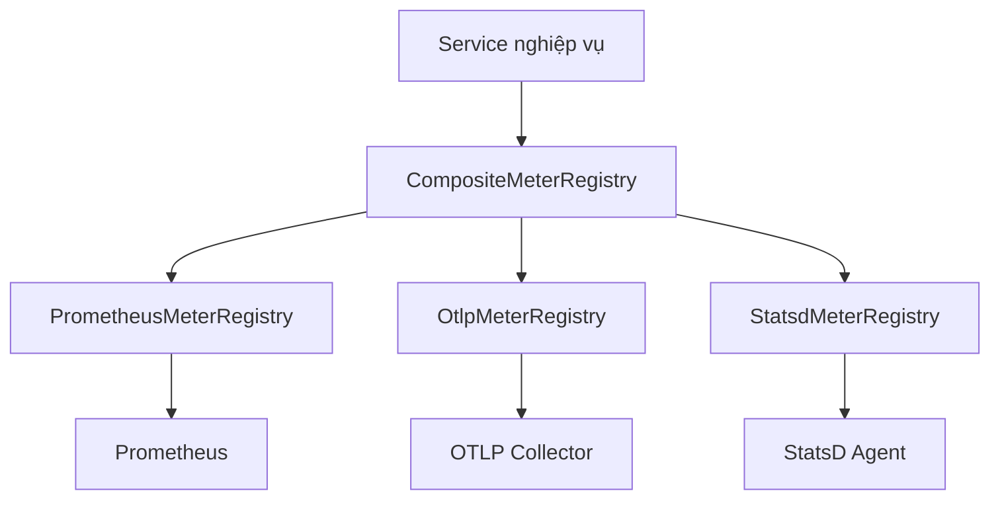

# CompositeMeterRegistry để kết nối nhiều registry thành phần

Một ứng dụng Java có thể cần gửi cùng một số đo đến nhiều hệ thống quan sát, chẳng hạn Prometheus để scrape metric và một backend OTLP để tập trung dữ liệu. Micrometer cung cấp `CompositeMeterRegistry` để kết nối nhiều `MeterRegistry` thành phần dưới một điểm ghi nhận chung. Mã nghiệp vụ chỉ cần làm việc với composite registry; mỗi meter được chuyển tiếp đến các registry con đã đăng ký.

`CompositeMeterRegistry` hoạt động như một bộ phân phối số đo. Nó không hợp nhất dữ liệu của nhiều backend thành một kết quả thống kê duy nhất, cũng không tự cung cấp giao thức xuất dữ liệu. Mỗi registry con vẫn chịu trách nhiệm định dạng và chuyển số đo đến hệ thống đích của nó.

## Vai trò của CompositeMeterRegistry

`MeterRegistry` là nơi đăng ký và quản lý meter như `Counter`, `Timer`, `Gauge` và `DistributionSummary`. Một registry cụ thể thường gắn với một cách xuất dữ liệu hoặc một backend. Ví dụ:

- `PrometheusMeterRegistry` cung cấp định dạng để Prometheus scrape.
- `OtlpMeterRegistry` xuất metric qua OpenTelemetry Protocol (OTLP).
- `StatsdMeterRegistry` gửi metric theo giao thức StatsD.
- `SimpleMeterRegistry` giữ số đo trong bộ nhớ, phù hợp cho ví dụ và kiểm thử.

`CompositeMeterRegistry` chứa nhiều registry con và chuyển tiếp thao tác ghi nhận đến từng registry đó. Luồng dữ liệu có thể hình dung như sau:



Mỗi nhánh có thể dùng cấu hình, endpoint, nhãn và chu kỳ xuất riêng. Việc thêm hoặc bỏ một registry con không yêu cầu thay đổi nơi service gọi `counter(...)` hay `timer(...)`, miễn là service chỉ phụ thuộc vào registry chung.

## Tạo composite và thêm registry con

`CompositeMeterRegistry` thuộc Micrometer Core. Khi dùng độc lập, có thể tạo một composite rồi thêm các registry con bằng `add(...)`:

```java
import io.micrometer.core.instrument.Counter;
import io.micrometer.core.instrument.composite.CompositeMeterRegistry;
import io.micrometer.core.instrument.simple.SimpleMeterRegistry;

public class CompositeRegistryExample {
    public static void main(String[] args) {
        CompositeMeterRegistry composite = new CompositeMeterRegistry();
        SimpleMeterRegistry first = new SimpleMeterRegistry();
        SimpleMeterRegistry second = new SimpleMeterRegistry();

        composite.add(first);
        composite.add(second);

        Counter orders = composite.counter(
                "orders.created",
                "channel", "web");
        orders.increment();
        orders.increment(2.0);

        Counter firstCounter = first.find("orders.created")
                .tag("channel", "web")
                .counter();
        Counter secondCounter = second.find("orders.created")
                .tag("channel", "web")
                .counter();

        if (firstCounter == null || secondCounter == null) {
            throw new IllegalStateException("Meter chưa được chuyển tiếp đến registry con");
        }

        System.out.println("First registry = " + firstCounter.count());
        System.out.println("Second registry = " + secondCounter.count());
    }
}
```

Kết quả ở cả hai registry con là `3.0`. Mã nghiệp vụ chỉ tăng `orders` một lần theo mỗi thao tác; composite chuyển tiếp các lần tăng đến cả `first` và `second`. Hai `SimpleMeterRegistry` trong ví dụ đóng vai trò minh họa hai đích nhận dữ liệu. Trong hệ thống thật, thay chúng bằng các registry tương ứng với backend cần kết nối.

Các registry con phải được tạo với cấu hình riêng phù hợp với hệ thống đích. Ví dụ Prometheus registry cần cấu hình scrape và endpoint exposition; OTLP registry cần endpoint, giao thức và thông tin xác thực phù hợp. Chỉ gọi `composite.add(...)` không tự cấu hình hạ tầng nhận dữ liệu.

## Meter được tạo trước hay sau khi thêm registry?

Một composite có thể được tạo trước khi các registry con sẵn sàng. Tuy nhiên, composite chưa có registry con thì không có đích để chuyển tiếp phép đo. Các lần ghi nhận xảy ra trong thời gian này không được lưu lại để phát bù sau đó.

Ví dụ dưới đây minh họa việc thêm registry thứ hai sau khi meter đã được tạo:

```java
CompositeMeterRegistry composite = new CompositeMeterRegistry();
SimpleMeterRegistry first = new SimpleMeterRegistry();
SimpleMeterRegistry second = new SimpleMeterRegistry();

composite.add(first);

Counter jobs = composite.counter("jobs.completed", "queue", "email");
jobs.increment(2.0);

composite.add(second);
jobs.increment();

double firstCount = first.find("jobs.completed")
        .tag("queue", "email")
        .counter()
        .count();
double secondCount = second.find("jobs.completed")
        .tag("queue", "email")
        .counter()
        .count();
```

Sau đoạn mã này, `firstCount` là `3.0`, còn `secondCount` là `1.0`. Registry thứ hai bắt đầu nhận số đo từ lúc được thêm vào; hai lần tăng trước đó không được tái tạo trong registry mới. Khi cần dữ liệu nhất quán giữa các backend ngay từ đầu, hãy cấu hình và thêm đầy đủ registry con trước khi nhận lưu lượng nghiệp vụ.

Đây là điểm quan trọng trong quá trình khởi động ứng dụng. Nếu registry con được thêm muộn do khởi tạo bất đồng bộ hoặc kết nối backend chưa sẵn sàng, dữ liệu trong khoảng thời gian chờ có thể không xuất hiện ở đích đó. Cần quyết định rõ liệu ứng dụng chấp nhận mất số đo trong giai đoạn khởi động hay phải trì hoãn nhận lưu lượng đến khi cấu hình quan sát hoàn tất.

## Ghi Counter và Timer qua một composite

Service không cần biết có bao nhiêu registry con. Nó chỉ cần nhận `MeterRegistry` và đăng ký meter tại điểm nghiệp vụ phù hợp:

```java
import io.micrometer.core.instrument.MeterRegistry;
import io.micrometer.core.instrument.Timer;
import org.springframework.stereotype.Service;

@Service
public class CheckoutService {
    private final MeterRegistry registry;
    private final PaymentGateway paymentGateway;

    public CheckoutService(
            MeterRegistry registry,
            PaymentGateway paymentGateway) {
        this.registry = registry;
        this.paymentGateway = paymentGateway;
    }

    public Receipt checkout(Order order) {
        Timer.Sample sample = Timer.start(registry);
        String result = "success";

        try {
            Receipt receipt = paymentGateway.charge(order);
            registry.counter("orders.created", "channel", order.channel())
                    .increment();
            return receipt;
        } catch (RuntimeException exception) {
            result = "failure";
            throw exception;
        } finally {
            sample.stop(registry.timer("checkout.duration", "result", result));
        }
    }
}
```

Nếu registry được inject là một `CompositeMeterRegistry`, counter và timer sẽ được chuyển tiếp đến các registry con. Service không phải tạo một counter cho Prometheus và một counter khác cho OTLP. Cách ghi nhận một lần qua registry chung cũng giúp các backend nhận cùng ngữ nghĩa và tập tag ở lớp instrumentation.

Các tag như `channel` và `result` phải có tập giá trị hữu hạn. Mỗi registry con có thể áp dụng filter hoặc quy tắc xuất riêng, vì vậy cần kiểm tra metric thực tế ở từng backend. Không dùng tag động như `orderId`, email hoặc URL chứa mã định danh chỉ vì composite có thể gửi metric đến nhiều nơi.

## Kết nối nhiều registry trong Spring Boot

Khi dùng Spring Boot Actuator, các registry implementation tương ứng thường được cấu hình tự động dựa trên dependency có mặt trong classpath và các thuộc tính cấu hình. Nếu ứng dụng có nhiều registry implementation được hỗ trợ, Spring Boot có thể tạo `CompositeMeterRegistry` và thêm các registry thành phần vào đó.

Ví dụ dependency Gradle cho ứng dụng muốn có Actuator, Prometheus và OTLP:

```kotlin
dependencies {
    implementation("org.springframework.boot:spring-boot-starter-actuator")
    runtimeOnly("io.micrometer:micrometer-registry-prometheus")
    runtimeOnly("io.micrometer:micrometer-registry-otlp")
}
```

Ví dụ Maven tương ứng:

```xml
<dependency>
    <groupId>org.springframework.boot</groupId>
    <artifactId>spring-boot-starter-actuator</artifactId>
</dependency>
<dependency>
    <groupId>io.micrometer</groupId>
    <artifactId>micrometer-registry-prometheus</artifactId>
    <scope>runtime</scope>
</dependency>
<dependency>
    <groupId>io.micrometer</groupId>
    <artifactId>micrometer-registry-otlp</artifactId>
    <scope>runtime</scope>
</dependency>
```

Các ví dụ giả định phiên bản Spring Boot đang dùng quản lý phiên bản Micrometer tương thích. Hãy dùng dependency management của Spring Boot hoặc BOM Micrometer phù hợp; không tự ghép các phiên bản registry khác dòng.

Trong bean nghiệp vụ, tiếp tục inject kiểu `MeterRegistry`:

```java
@Component
public class OrderMetrics {
    private final MeterRegistry registry;

    public OrderMetrics(MeterRegistry registry) {
        this.registry = registry;
    }

    public void created(String channel) {
        registry.counter("orders.created", "channel", channel)
                .increment();
    }
}
```

Spring Boot có thể tự tạo composite khi điều kiện auto-configuration phù hợp được đáp ứng. Việc chỉ thêm dependency chưa đảm bảo dữ liệu đã đến backend: cần cấu hình endpoint và thông tin kết nối cho từng exporter, expose endpoint scrape nếu dùng Prometheus, và bảo đảm mạng cho phép kết nối tới hệ thống nhận. Tên thuộc tính cấu hình cụ thể có thể thay đổi theo phiên bản Boot và registry; dùng metadata cấu hình của phiên bản đang chạy để thiết lập.

Không tự khai báo thêm một `SimpleMeterRegistry` trong service hoặc component để ghi metric vận hành. Làm vậy tạo một registry độc lập, có thể không nằm trong composite do Spring Boot quản lý. Hãy inject `MeterRegistry` từ container Spring và kiểm tra bean thực tế khi cần xác nhận cấu hình.

## Thêm hoặc loại bỏ registry trong lúc ứng dụng chạy

Composite hỗ trợ `add(...)` và `remove(...)` để thay đổi tập registry con. Điều này hữu ích khi tích hợp có vòng đời động, nhưng thay đổi registry trong lúc có lưu lượng cần được kiểm soát:

```java
composite.add(prometheusRegistry);
composite.add(otlpRegistry);

// Khi ngừng gửi dữ liệu đến một backend:
composite.remove(otlpRegistry);
```

Sau khi remove, composite ngừng chuyển tiếp các lần ghi nhận tiếp theo đến registry đó. Dữ liệu đã được gửi hoặc lưu ở backend không tự động bị xóa; backend vẫn giữ dữ liệu theo chính sách retention của nó. Việc remove cũng không chuyển số liệu lịch sử sang registry còn lại.

Nếu registry con bị đóng hoặc không còn khả năng gửi dữ liệu, hãy xử lý vòng đời của nó theo cách triển khai cụ thể. Không đóng một registry dùng chung trong khi bean hoặc thành phần khác vẫn phụ thuộc vào nó. Trong Spring Boot, ưu tiên để container quản lý vòng đời bean registry; chỉ tự add/remove khi có nhu cầu rõ ràng và có kiểm thử cho quá trình thay đổi.

## Composite không phải bộ cộng gộp dữ liệu

Composite chuyển cùng một phép đo đến nhiều đích. Nếu một counter tăng 5 lần, mỗi registry con nhận số tăng tương ứng; composite không cộng số liệu từ các registry con rồi trả về một counter tổng. Tương tự, timer được ghi nhận một lần ở ứng dụng và từng backend lưu bản số liệu của riêng nó.

Điều này có hai hệ quả:

- **Không cộng kết quả của các backend để tính tổng nghiệp vụ.** Nếu Prometheus và OTLP đều nhận cùng metric, cộng hai kết quả truy vấn sẽ đếm trùng cùng một sự kiện.
- **Không giả định các backend có dữ liệu giống hệt nhau.** Filter, cấu hình histogram, đơn vị, thời điểm scrape, lỗi mạng hoặc chính sách ingest có thể làm dữ liệu cuối cùng khác nhau.

Nếu cần một góc nhìn tổng hợp, hãy truy vấn một backend làm nguồn dữ liệu chuẩn hoặc thiết kế quy trình hợp nhất dữ liệu có chủ đích. Composite chỉ đảm nhiệm việc phân phối instrumentation đến nhiều registry.

## Cardinality và chi phí khi dùng nhiều registry

Một meter được ghi nhận qua composite có thể được xuất thành nhiều chuỗi trong từng backend. Histogram và các tag có nhiều giá trị làm số chuỗi tăng trong mỗi đích; thêm backend làm tăng lượng dữ liệu được gửi và lưu trên tổng các hệ thống. Composite không làm giảm cardinality của tag.

Trước khi thêm một registry, hãy xác định:

1. Backend đó cần những metric nào và có cần toàn bộ histogram hay percentile không.
2. Tập tag có giới hạn hay có thể tăng theo người dùng, request hoặc tài nguyên.
3. Registry con có filter, common tags hoặc quy tắc đổi tên riêng nào.
4. Tần suất xuất, dung lượng lưu trữ và chi phí ingest ở backend mới.
5. Hành vi khi backend mất kết nối hoặc registry con khởi tạo chậm.

Nếu hai backend có nhu cầu khác nhau, có thể cấu hình filter ở registry con để loại bỏ hoặc điều chỉnh metric không cần thiết ở đích đó. Cần bảo đảm các filter không vô tình loại bỏ metric phục vụ cảnh báo quan trọng.

## Kiểm thử CompositeMeterRegistry

Có thể dùng hai `SimpleMeterRegistry` để kiểm tra việc chuyển tiếp mà không cần kết nối Prometheus hoặc OTLP:

```java
CompositeMeterRegistry composite = new CompositeMeterRegistry();
SimpleMeterRegistry first = new SimpleMeterRegistry();
SimpleMeterRegistry second = new SimpleMeterRegistry();

composite.add(first);
composite.add(second);

Counter counter = composite.counter("test.events", "type", "created");
counter.increment(4.0);

Counter firstValue = first.find("test.events")
        .tag("type", "created")
        .counter();
Counter secondValue = second.find("test.events")
        .tag("type", "created")
        .counter();

if (firstValue == null || secondValue == null
        || firstValue.count() != 4.0
        || secondValue.count() != 4.0) {
    throw new AssertionError("Composite không chuyển tiếp đúng số đo");
}
```

Một bài test hữu ích nên kiểm tra cả ba tình huống: meter được ghi nhận sau khi đã add các registry; registry được add sau khi meter đã tồn tại chỉ nhận các lần ghi nhận về sau; và registry đã remove không nhận các lần ghi nhận tiếp theo. Với timer, kiểm tra `count()` ở từng registry con để xác nhận một thao tác được ghi nhận ở tất cả đích đang hoạt động.

Kiểm thử bằng `SimpleMeterRegistry` xác nhận hành vi fan-out trong JVM. Nó không xác minh endpoint Prometheus, OTLP exporter, chứng thư TLS, xác thực, khả năng kết nối mạng, retry hay dữ liệu thực sự được backend lưu. Những phần đó cần kiểm thử tích hợp riêng với registry và hệ thống nhận tương ứng.

## Lỗi thường gặp

| Hiện tượng | Nguyên nhân có thể | Cách xử lý |
|---|---|---|
| Không thấy metric ở bất kỳ backend nào | Composite chưa có registry con hoặc registry con chưa được cấu hình | Kiểm tra các registry đã được add và exporter đã khởi tạo |
| Backend thứ hai thiếu số đo ở giai đoạn đầu | Registry thứ hai được add sau khi ứng dụng đã ghi nhận dữ liệu | Thêm đầy đủ registry trước khi nhận lưu lượng; không kỳ vọng dữ liệu cũ được phát bù |
| Chỉ một backend nhận metric | Chỉ một registry con được add hoặc filter ở backend khác từ chối metric | Kiểm tra danh sách registry con, filter và log exporter |
| Backend có số liệu khác nhau | Khác chu kỳ scrape, filter, histogram, lỗi gửi hoặc thời điểm nhận | So sánh cấu hình và trạng thái ingest của từng đích |
| Dữ liệu bị đếm hai lần khi xem tổng | Cộng kết quả từ nhiều backend cùng nhận một sự kiện | Chọn một nguồn chuẩn hoặc loại trừ bản sao khi hợp nhất |
| Metric biến mất sau khi thay cấu hình | Registry con bị remove, đóng hoặc meter bị filter | Kiểm tra vòng đời registry và cấu hình filter |

## Checklist triển khai

- [ ] Service chỉ phụ thuộc vào `MeterRegistry` và ghi nhận mỗi sự kiện một lần.
- [ ] Composite có đầy đủ registry con trước khi ứng dụng nhận lưu lượng.
- [ ] Mỗi registry con đã cấu hình endpoint, giao thức và xác thực cần thiết.
- [ ] Đã xác nhận metric được chuyển tiếp đến từng registry con bằng kiểm thử.
- [ ] Đã kiểm tra exposition hoặc dữ liệu thực tế ở từng backend.
- [ ] Filter, common tags, histogram và percentile được chọn theo nhu cầu từng đích.
- [ ] Không cộng dữ liệu từ các backend cùng nhận một metric để tạo tổng giả.
- [ ] Vòng đời add/remove/close của registry con được quản lý rõ ràng.
- [ ] Chi phí ingest, cardinality và hành vi khi backend gián đoạn đã được xem xét.

`CompositeMeterRegistry` giúp ứng dụng ghi nhận metric qua một API thống nhất và phân phối số đo đến nhiều hệ thống quan sát. Để triển khai ổn định, hãy khởi tạo registry con trước lưu lượng, quản lý vòng đời rõ ràng, kiểm thử fan-out và kiểm tra độc lập dữ liệu ở từng backend. Mỗi backend vẫn có cấu hình, trạng thái và chi phí lưu trữ riêng.
