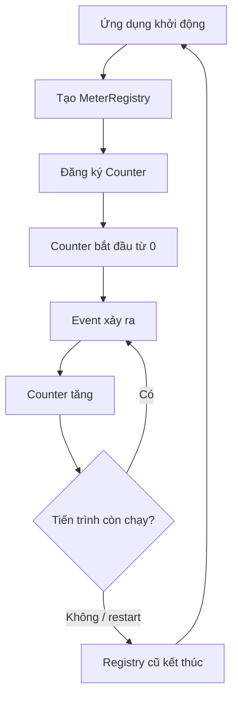

# Đặt lại khi ứng dụng khởi động và cách đọc dữ liệu phía hệ thống nhận

Counter của Micrometer là phép đo tích lũy chỉ tăng trong vòng đời của meter. Khi một ứng dụng Java khởi động lại và tạo registry mới, counter trong tiến trình mới bắt đầu từ 0. Việc này là hành vi bình thường: counter mô tả số sự kiện mà tiến trình đã ghi nhận kể từ khi meter được tạo, không phải một bộ đếm bền vững của toàn bộ hệ thống.

Khi dùng Prometheus hoặc một backend metrics khác, hệ thống nhận thường lưu các mẫu đã thu thập theo thời gian. Vì vậy, counter ở ứng dụng có thể bắt đầu lại sau restart trong khi lịch sử đã lưu ở backend vẫn còn. Người đọc dữ liệu cần hiểu reset này để chọn truy vấn phù hợp, thường là `rate()` hoặc `increase()` với Prometheus, thay vì coi giá trị thô là tổng số sự kiện vĩnh viễn.

Trong module `OBSERVABILITY_INSTRUMENTATION_MICROMETER`, counter thường dùng để đếm sự kiện như đơn hàng được tạo, request thất bại hoặc tác vụ hoàn tất. Bài này tập trung vào vòng đời của giá trị counter, quá trình thu thập và cách diễn giải dữ liệu ở hệ thống nhận.

## 1. Counter tích lũy trong vòng đời của tiến trình

Counter biểu diễn một giá trị tăng dần. Ứng dụng tăng counter khi sự kiện cần quan sát xảy ra:

```java
import io.micrometer.core.instrument.Counter;
import io.micrometer.core.instrument.MeterRegistry;
import org.springframework.stereotype.Component;

@Component
public class OrderMetrics {
    private final Counter created;

    public OrderMetrics(MeterRegistry registry) {
        this.created = Counter.builder("orders.created")
                .description("Number of successfully created orders")
                .tag("event", "created")
                .register(registry);
    }

    public void recordCreated() {
        created.increment();
    }
}
```

Service nghiệp vụ gọi phương thức sau khi đơn hàng đã được tạo thành công:

```java
public Order createOrder(CreateOrderCommand command) {
    Order order = orderRepository.save(Order.from(command));
    orderMetrics.recordCreated();
    return order;
}
```

Ví dụ giả định `save` hoàn tất thành công trước khi counter tăng. Nếu ứng dụng ghi nhận sự kiện ở thời điểm khác, chẳng hạn lúc tiếp nhận yêu cầu hoặc lúc thanh toán hoàn tất, tên meter và vị trí tăng phải phản ánh đúng ý nghĩa đó.

Counter không phải biến số tùy ý có thể gán về 0 hoặc giảm xuống. API `Counter` tập trung vào thao tác tăng. Nếu cần biểu diễn số lượng hiện tại có thể tăng và giảm, chẳng hạn số kết nối đang mở, hãy dùng gauge. Nếu cần một tổng nghiệp vụ bền vững qua nhiều lần khởi động, hãy đọc dữ liệu từ nguồn lưu trữ nghiệp vụ phù hợp thay vì dùng counter metrics làm cơ sở dữ liệu.

## 2. Điều gì xảy ra khi ứng dụng khởi động lại?

Trong một tiến trình Java, Spring Boot tạo registry và các meter được đăng ký vào registry đó. Counter tăng dần khi luồng nghiệp vụ gọi `increment()`. Khi tiến trình kết thúc, các đối tượng registry và giá trị counter trong bộ nhớ của tiến trình đó cũng kết thúc.

Ở lần khởi động tiếp theo, ứng dụng tạo registry mới và đăng ký meter mới. Giá trị counter mới bắt đầu từ 0 rồi tăng theo những sự kiện phát sinh trong tiến trình mới. Ứng dụng không cần gọi một lệnh reset riêng trong quá trình khởi động.



Ví dụ một tiến trình ghi nhận 120 đơn hàng, sau đó ứng dụng restart. Tiến trình mới không kế thừa giá trị 120 từ đối tượng counter cũ:

| Thời điểm | Sự kiện | Giá trị counter trong tiến trình |
| --- | --- | ---: |
| 10:00 | Ứng dụng khởi động lần 1 | 0 |
| 10:05 | Ghi nhận 120 đơn hàng | 120 |
| 10:06 | Tiến trình dừng | Registry cũ kết thúc |
| 10:07 | Ứng dụng khởi động lần 2 | 0 |
| 10:10 | Ghi nhận thêm 8 đơn hàng | 8 |

Đây là reset theo vòng đời tiến trình. Nó không có nghĩa lịch sử đã thu thập ở Prometheus bị xóa. Nếu Prometheus đã scrape được giá trị 120 trước khi tiến trình dừng, mẫu đó vẫn nằm trong lịch sử time series theo chính sách lưu trữ của Prometheus. Sau khi ứng dụng khởi động lại, lần scrape tiếp theo có thể ghi nhận giá trị thấp hơn, ví dụ 2 hoặc 8; Prometheus xử lý sự giảm này như một lần counter reset khi tính các hàm phù hợp.

Không nên tự khởi tạo lại counter theo lịch, theo ngày hoặc theo mỗi request bằng cách tạo registry mới. Việc đó làm mất tính tích lũy liên tục mà backend cần để tính tốc độ và số lượng sự kiện trong một khoảng thời gian.

## 3. Phân biệt giá trị counter và lịch sử ở backend

Có hai nơi cần phân biệt:

| Nơi lưu | Dữ liệu biểu diễn | Vòng đời |
| --- | --- | --- |
| Counter trong ứng dụng | Số sự kiện tiến trình hiện tại đã ghi nhận kể từ khi meter được tạo | Mất khi tiến trình/registry kết thúc; bắt đầu lại ở tiến trình mới |
| Time series ở backend | Các mẫu counter mà hệ thống nhận đã thu thập theo thời gian | Được giữ theo chính sách lưu trữ và vận hành của backend |

Ví dụ Prometheus scrape một counter mỗi 15 giây. Các mẫu có thể lần lượt là `110`, `116`, `123`, sau đó ứng dụng restart và các mẫu mới là `2`, `5`, `9`. Dãy số quan sát được có dạng:

```text
110 -> 116 -> 123 -> 2 -> 5 -> 9
```

Đường biểu diễn giá trị thô sẽ giảm từ 123 xuống 2 tại thời điểm reset. Đây là điều có thể dự đoán với counter theo tiến trình. Lịch sử ở backend vẫn có các mẫu trước và sau restart, do đó có thể tính tốc độ hoặc lượng tăng trong cửa sổ thời gian nếu có đủ mẫu scrape.

Với mô hình pull như Prometheus, ứng dụng không gửi từng lần `increment()` thành một bản tin riêng. Prometheus định kỳ đọc giá trị hiện tại của endpoint metrics. Nếu tiến trình dừng trước khi lần scrape tiếp theo xảy ra, những lần tăng chưa từng được scrape có thể không xuất hiện trong time series. Scrape interval, độ ổn định của target và vòng đời instance ảnh hưởng đến độ đầy đủ của dữ liệu thu thập.

## 4. Expose counter cho Prometheus qua Spring Boot

Khi ứng dụng dùng Spring Boot Actuator và Prometheus registry, có thể expose endpoint Prometheus:

```yaml
management:
  endpoints:
    web:
      exposure:
        include: health,prometheus
  metrics:
    tags:
      application: order-service
```

Counter Micrometer có tên canonical `orders.created` thường được Prometheus registry công bố thành `orders_created_total`. Tên chính xác phụ thuộc naming convention và phiên bản registry; hãy kiểm tra output endpoint của ứng dụng.

Mở endpoint:

```bash
curl http://localhost:8080/actuator/prometheus
```

Một phần output có thể có dạng:

```text
# HELP orders_created_total Number of successfully created orders
# TYPE orders_created_total counter
orders_created_total{application="order-service",event="created"} 123.0
```

Giá trị `123.0` là số tích lũy mà tiến trình đang chạy đã ghi nhận tại thời điểm endpoint được đọc. Đây là một mẫu hiện tại, không phải số sự kiện mới phát sinh kể từ lần scrape gần nhất.

Trong Prometheus, cấu hình scrape target trỏ đến endpoint Actuator của ứng dụng. Ví dụ tối giản:

```yaml
scrape_configs:
  - job_name: order-service
    metrics_path: /actuator/prometheus
    static_configs:
      - targets: ["localhost:8080"]
```

Trong môi trường thật, target thường được phát hiện từ hạ tầng triển khai thay vì khai báo tĩnh. Cần bảo đảm Prometheus truy cập được management endpoint và endpoint được bảo vệ theo chính sách mạng, authentication của hệ thống.

## 5. Dùng rate() để đọc tốc độ sự kiện

Không nên diễn giải trực tiếp giá trị counter thô như tốc độ xử lý. Để biết ứng dụng đang tạo bao nhiêu đơn hàng mỗi giây, dùng `rate()` trên cửa sổ thời gian:

```promql
rate(orders_created_total[5m])
```

`rate()` ước tính tốc độ tăng trung bình mỗi giây trong 5 phút gần nhất. Với counter, Prometheus xử lý các lần giá trị giảm như reset và tính toán tốc độ từ các mẫu còn lại trong cửa sổ. Vì vậy, truy vấn vẫn có thể cho kết quả có ý nghĩa khi ứng dụng restart trong khoảng thời gian đang xét, miễn là có đủ mẫu để tính toán.

Để tổng hợp tốc độ trên các instance của cùng ứng dụng:

```promql
sum by (application) (
  rate(orders_created_total{application="order-service"}[5m])
)
```

Prometheus tính `rate` trên từng time series trước, sau đó mới cộng các tốc độ. Đây là thứ tự quan trọng khi có nhiều replica hoặc counter reset. Không cộng các giá trị counter thô từ nhiều instance trước rồi mới tính rate, vì một instance reset có thể làm che khuất hoặc bóp méo thay đổi của instance khác.

Đơn vị kết quả của truy vấn trên là số đơn hàng mỗi giây. Có thể nhân với 60 để hiển thị số đơn hàng mỗi phút:

```promql
60 * sum by (application) (
  rate(orders_created_total{application="order-service"}[5m])
)
```

Chọn cửa sổ đủ dài so với scrape interval để có đủ mẫu. Cửa sổ ngắn phản ứng nhanh hơn nhưng dễ dao động hoặc không có đủ dữ liệu khi scrape thưa; cửa sổ dài ổn định hơn nhưng phản ánh thay đổi chậm hơn.

## 6. Dùng increase() để đọc số sự kiện trong một khoảng

Nếu câu hỏi là “Trong một giờ vừa qua có khoảng bao nhiêu đơn hàng được tạo?”, dùng `increase()`:

```promql
sum by (application) (
  increase(orders_created_total{application="order-service"}[1h])
)
```

`increase()` ước tính lượng counter tăng trong cửa sổ thời gian và xử lý reset của counter. Giá trị trả về có thể là số thập phân vì Prometheus ngoại suy dựa trên thời điểm các mẫu ở hai đầu cửa sổ; nó không phải bản ghi kiểm toán chính xác từng sự kiện.

Sử dụng:

- `rate(counter[window])` khi cần tốc độ trung bình, thường dùng cho biểu đồ throughput và alert.
- `increase(counter[window])` khi cần ước tính số lượng sự kiện phát sinh trong một cửa sổ, chẳng hạn 5 phút hoặc 1 giờ.
- Giá trị thô của counter khi cần quan sát tiến trình đang chạy đã ghi nhận bao nhiêu sự kiện kể từ lần khởi động hiện tại.

Nếu cần tổng số đơn hàng chính xác theo ngày, tháng hoặc toàn bộ lịch sử nghiệp vụ, hãy truy vấn cơ sở dữ liệu hoặc event store có tính bền vững. Metrics được tối ưu cho quan sát và phân tích xu hướng; scrape interval, restart, mất kết nối hoặc retention có thể khiến dữ liệu không phù hợp làm sổ cái nghiệp vụ.

## 7. Phát hiện reset bằng PromQL

Prometheus cung cấp `resets()` để đếm số lần counter giảm trong một cửa sổ thời gian:

```promql
resets(orders_created_total[24h])
```

Để xem số lần reset theo ứng dụng:

```promql
sum by (application) (
  resets(orders_created_total{application="order-service"}[24h])
)
```

Kết quả giúp nhận biết time series đã quan sát thấy bao nhiêu lần reset trong cửa sổ. Nó có thể hữu ích khi đối chiếu với lịch sử deploy hoặc sự cố. `resets()` chỉ nhận biết sự giảm giữa các mẫu của cùng time series; nếu instance thay đổi label nhận diện và tạo series mới, chuỗi mới bắt đầu độc lập và không nhất thiết được tính là reset của chuỗi cũ.

Với môi trường có pod hoặc instance thay đổi thường xuyên, hãy giữ label nhận diện instance phù hợp. Prometheus thường thêm label `instance` cho target; hệ thống khám phá dịch vụ có thể bổ sung `pod`, `namespace` hoặc label tương tự. Khi một pod mới xuất hiện, nó thường tạo một time series mới. Khi một tiến trình trong cùng target restart mà label không đổi, counter có thể giảm trong cùng series và được nhận diện là reset.

## 8. Nhiều replica và cách tổng hợp đúng

Giả sử ứng dụng `order-service` chạy ba replica. Mỗi replica có registry và counter riêng:

| Instance | Giá trị counter tại thời điểm scrape | Ý nghĩa |
| --- | ---: | --- |
| `order-1` | 120 | 120 đơn kể từ khi tiến trình này khởi động |
| `order-2` | 85 | 85 đơn kể từ khi tiến trình này khởi động |
| `order-3` | 42 | 42 đơn kể từ khi tiến trình này khởi động |

Các giá trị này không phải một counter toàn cục được chia sẻ giữa các replica. Backend lưu mỗi time series theo bộ nhãn nhận diện target và các tag của meter. Khi tổng hợp throughput, tính rate riêng cho từng series rồi cộng:

```promql
sum by (application) (
  rate(orders_created_total{application="order-service"}[5m])
)
```

Khi dùng label `instance` hoặc `pod`, có thể giữ chiều đó để xem từng replica:

```promql
sum by (instance) (
  rate(orders_created_total{application="order-service"}[5m])
)
```

Tránh đưa ID request hoặc ID đơn hàng vào label chỉ để ghép sự kiện giữa các replica. Những giá trị có cardinality rất cao làm tăng số time series và chi phí backend. Dùng label có tập giá trị hữu hạn như application, environment, region hoặc outcome khi chúng có ích cho phân tích.

## 9. Các tình huống dễ đọc sai dữ liệu

| Tình huống | Biểu hiện | Cách diễn giải |
| --- | --- | --- |
| Ứng dụng restart | Giá trị counter thô giảm về một số nhỏ | Reset theo vòng đời tiến trình; lịch sử scrape trước đó vẫn được backend giữ theo retention |
| Một replica restart | Một time series giảm, các replica khác vẫn tăng | Tính rate từng series rồi tổng hợp |
| Pod mới có label instance mới | Xuất hiện một time series mới với counter thấp | Đây là instance mới; không nhất thiết là reset của series cũ |
| Prometheus không scrape được trong một khoảng | Có khoảng trống giữa các mẫu | Kiểm tra target, mạng, endpoint và scrape interval; không suy diễn số sự kiện đã mất từ khoảng trống |
| Process chết trước lần scrape tiếp theo | Các lần increment chưa scrape có thể không được backend nhìn thấy | Metrics pull không phải hàng đợi sự kiện bền vững |
| Dashboard vẽ counter thô | Đường tăng rồi đột ngột giảm ở thời điểm restart | Dùng rate hoặc increase để đọc tốc độ/lượng tăng trong cửa sổ |
| Dùng counter làm tổng nghiệp vụ chính xác | Kết quả có thể lệch khi có scrape gap, restart hoặc retention | Dùng nguồn dữ liệu nghiệp vụ có lưu bền vững |

## 10. Có nên lưu giá trị counter qua lần khởi động?

Thông thường không nên cố khôi phục counter metrics từ cơ sở dữ liệu mỗi khi ứng dụng khởi động. Counter trong Micrometer mô tả sự kiện được ghi nhận bởi một tiến trình và registry cụ thể. Việc khôi phục giá trị cũ có thể làm cho backend nhìn thấy một giá trị tích lũy không còn phản ánh đúng vòng đời tiến trình, đặc biệt khi có nhiều replica hoặc khi cùng dữ liệu được nạp vào nhiều instance.

Nếu có yêu cầu nghiệp vụ về tổng đơn hàng đã tạo, hãy dùng truy vấn có thẩm quyền trên cơ sở dữ liệu hoặc event store. Có thể đăng ký thêm một gauge để hiển thị giá trị tổng hợp lấy từ nguồn đó, nhưng cần cân nhắc chi phí truy vấn, tính nhất quán và tần suất cập nhật. Không biến một counter metrics thành cơ chế lưu trữ trạng thái nghiệp vụ.

Nếu muốn theo dõi số sự kiện phát sinh kể từ khi tiến trình bắt đầu, counter theo tiến trình là đúng lựa chọn. Nếu muốn theo dõi tốc độ theo phút hoặc giờ, để backend tính `rate` hoặc `increase` từ các mẫu counter. Nếu muốn số liệu bền vững chính xác, lấy từ kho dữ liệu nghiệp vụ.

## 11. Quy trình kiểm tra từ ứng dụng đến backend

Khi thiết lập một counter và cần xác minh dữ liệu phía hệ thống nhận, hãy đi theo các bước:

1. Đăng ký counter bằng tên ổn định và tag có cardinality kiểm soát.
2. Tăng counter đúng tại thời điểm sự kiện nghiệp vụ đã xảy ra.
3. Khởi động ứng dụng và xác nhận counter xuất hiện trong `/actuator/prometheus`.
4. Gọi thao tác nghiệp vụ vài lần và kiểm tra giá trị counter tăng.
5. Cấu hình Prometheus scrape đúng target và metrics path.
6. Xác nhận target ở trạng thái scrape thành công và time series đã xuất hiện.
7. Dùng `rate()` để xem tốc độ, `increase()` để ước tính số sự kiện trong cửa sổ và `resets()` để quan sát lần reset.
8. Restart ứng dụng, quan sát giá trị counter trong tiến trình mới bắt đầu lại và xác minh truy vấn rate/increase vẫn xử lý được reset.
9. Nếu chạy nhiều replica, tính rate trên từng series trước khi cộng tổng.

Counter trong Micrometer bắt đầu lại theo vòng đời của registry và tiến trình; backend nhận các mẫu theo thời gian và có thể xử lý reset khi tính toán. Khi phân biệt đúng hai vòng đời này, biểu đồ throughput vẫn có ý nghĩa sau deploy hoặc restart, đồng thời số liệu metrics không bị nhầm với tổng nghiệp vụ cần lưu trữ bền vững.
