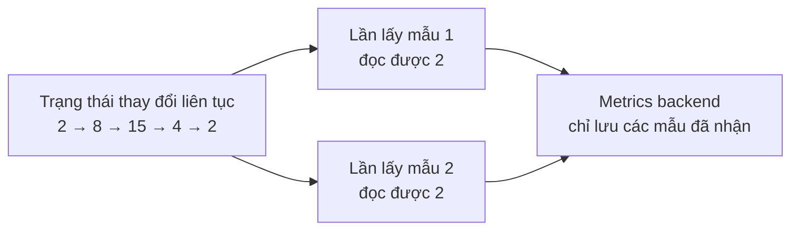

# Biến động giữa hai lần lấy mẫu và thông tin không được lưu lại

Gauge trong Micrometer dùng để quan sát **giá trị hiện tại của một trạng thái có thể tăng hoặc giảm**. Ví dụ: số phần tử đang chờ trong hàng đợi, số kết nối đang mở, số tác vụ đang chạy hoặc dung lượng bộ nhớ đang được sử dụng.

Gauge được đọc tại thời điểm registry hoặc backend lấy mẫu. Nó không ghi lại từng lần biến đổi của đối tượng và không lưu lịch sử mọi giá trị đã đi qua. Vì vậy, nếu một giá trị tăng rồi giảm hoàn toàn giữa hai lần lấy mẫu, hệ thống giám sát có thể không nhìn thấy biến động đó.

Hiểu giới hạn này giúp chọn đúng meter: Gauge phù hợp để quan sát trạng thái hiện tại; Counter, Timer và DistributionSummary phù hợp hơn khi cần ghi nhận sự kiện, thời lượng hoặc phân bố của các giá trị đã xảy ra.

## 1. Gauge phản ánh giá trị tại thời điểm lấy mẫu

Một Gauge thường được gắn với một đối tượng hoặc một hàm đọc trạng thái. Khi backend lấy metrics, registry gọi hàm đó để đọc giá trị tại thời điểm tương ứng.

Ví dụ, hàng đợi có độ sâu thay đổi theo thời gian:

```text
Thời điểm       Độ sâu hàng đợi
t0              2
t0 + 1s         8
t0 + 2s         15
t0 + 3s         4
t0 + 4s         2
```

Nếu backend chỉ lấy mẫu tại `t0` và `t0 + 4s`, dữ liệu nhận được có thể chỉ là:

```text
t0              2
t0 + 4s         2
```

Các giá trị 8, 15 và 4 đã xuất hiện trong ứng dụng, nhưng không được ghi nhận bởi lần lấy mẫu nào. Gauge không có bộ đệm nội bộ để phát lại các giá trị trung gian đó.



Gauge không sai khi chỉ xuất hiện hai giá trị 2. Nó đã trả lời đúng câu hỏi của nó: tại thời điểm lấy mẫu, độ sâu hàng đợi là bao nhiêu? Câu hỏi "độ sâu đã từng đạt đỉnh bao nhiêu giữa hai lần lấy mẫu?" là một yêu cầu khác và cần cách ghi nhận khác.

## 2. Chu kỳ scrape hoặc publish quyết định thời điểm quan sát

Tần suất quan sát Gauge phụ thuộc cơ chế thu thập của registry và backend:

- Với hệ thống pull như Prometheus, backend chủ động scrape endpoint metrics theo một chu kỳ cấu hình.
- Với registry push, registry thường gửi metrics theo lịch publish của cấu hình registry.
- Trong test hoặc khi đọc trực tiếp từ registry, mã kiểm thử có thể gọi `gauge.value()` tại thời điểm mình chọn.

Ứng dụng có thể thay đổi trạng thái hàng nghìn lần giữa hai lần scrape. Các thay đổi đó không tự động tạo ra hàng nghìn mẫu metrics. Backend chỉ nhận giá trị mà Gauge trả về tại các thời điểm thu thập.

Ví dụ cấu hình scrape của Prometheus có thể đặt chu kỳ 15 giây:

```yaml
scrape_configs:
  - job_name: order-service
    scrape_interval: 15s
    metrics_path: /actuator/prometheus
    static_configs:
      - targets:
          - order-service:8080
```

Nếu hàng đợi tăng lên 500 phần tử rồi trở về 20 trong 15 giây giữa hai lần scrape, Prometheus có thể chỉ ghi nhận 20 ở cả hai lần. Giảm chu kỳ scrape có thể tăng khả năng bắt được biến động ngắn, nhưng không bảo đảm mọi thay đổi đều được quan sát và làm tăng số lần thu thập, lưu trữ cùng tải hệ thống.

Do đó, không nên coi việc tăng tần suất scrape là cách thay thế cho instrumentation sự kiện. Trước hết cần xác định câu hỏi cần trả lời: trạng thái hiện tại, mức cao nhất, số lần vượt ngưỡng hay toàn bộ lịch sử sự kiện.

## 3. Ví dụ Gauge theo dõi độ sâu hàng đợi

Có thể đăng ký Gauge theo dõi một đối tượng giữ trạng thái hiện tại. Ví dụ dưới đây dùng `AtomicInteger` để biểu diễn số tác vụ đang chờ:

```java
import io.micrometer.core.instrument.Gauge;
import io.micrometer.core.instrument.MeterRegistry;

import java.util.concurrent.atomic.AtomicInteger;

import org.springframework.stereotype.Component;

@Component
public class WorkerQueueMetrics {

    private final AtomicInteger pendingJobs = new AtomicInteger();

    public WorkerQueueMetrics(MeterRegistry registry) {
        Gauge.builder(
                "worker.queue.depth",
                pendingJobs,
                AtomicInteger::get
            )
            .description("Number of jobs waiting to be processed")
            .register(registry);
    }

    public void jobEnqueued() {
        pendingJobs.incrementAndGet();
    }

    public void jobDequeued() {
        pendingJobs.updateAndGet(current -> Math.max(0, current - 1));
    }

    public int currentDepth() {
        return pendingJobs.get();
    }
}
```

Gauge đọc `pendingJobs.get()` khi được lấy mẫu. Các phương thức enqueue và dequeue cập nhật trạng thái trong ứng dụng; chúng không yêu cầu Gauge ghi lại từng giá trị.

Trong ví dụ này, đối tượng `pendingJobs` được giữ bằng field của bean để nó còn tồn tại trong suốt vòng đời component. Đây là điểm quan trọng: Gauge thường giữ tham chiếu yếu đến đối tượng được theo dõi. Nếu ứng dụng chỉ truyền một đối tượng tạm thời vào Gauge rồi không còn giữ tham chiếu mạnh nào khác, đối tượng có thể bị garbage collector thu hồi và Gauge có thể trả về `NaN`.

Với hàng đợi thực tế, nên đo chính cấu trúc hàng đợi hoặc một bộ đếm trạng thái được cập nhật tại đúng thời điểm enqueue/dequeue thành công. Nếu tăng bộ đếm trước khi enqueue thành công hoặc giảm nó khi dequeue thất bại, Gauge sẽ phản ánh sai trạng thái.

## 4. Biến động ngắn có thể biến mất hoàn toàn

Xét một worker xử lý hàng đợi. Backend scrape mỗi 10 giây:

| Thời điểm | Sự kiện | Độ sâu |
|---|---|---:|
| 00:00:00 | Backend scrape | 5 |
| 00:00:02 | Nhiều job đến | 40 |
| 00:00:04 | Worker xử lý nhanh | 8 |
| 00:00:06 | Hàng đợi tạm thời rỗng | 0 |
| 00:00:08 | Job mới đến | 12 |
| 00:00:10 | Backend scrape | 5 |

Backend chỉ lưu hai mẫu:

| Thời điểm | Giá trị được quan sát |
|---|---:|
| 00:00:00 | 5 |
| 00:00:10 | 5 |

Từ hai mẫu này, dashboard không thể kết luận hàng đợi luôn ổn định ở 5. Nó cũng không thể khôi phục được đỉnh 40 hay thời điểm hàng đợi về 0. Các giá trị đó không có trong chuỗi mẫu đã lưu.

Nếu mục tiêu là cảnh báo khi hàng đợi từng vượt 30 dù chỉ trong thời gian ngắn, chỉ dựa vào Gauge scrape mỗi 10 giây có thể bỏ lỡ tình huống. Cần ghi nhận thêm sự kiện vượt ngưỡng hoặc lưu giữ high-water mark để backend có cơ hội quan sát.

## 5. Gauge khác Counter, Timer và DistributionSummary

Các meter khác nhau trả lời những câu hỏi khác nhau:

| Meter | Ghi nhận | Có lưu từng biến động ứng dụng không? | Câu hỏi phù hợp |
|---|---|---|---|
| **Gauge** | Giá trị hiện tại tại lúc lấy mẫu | Không | Hiện có bao nhiêu job đang chờ? |
| **Counter** | Số sự kiện tích lũy | Ghi nhận mỗi lần tăng counter | Có bao nhiêu job đã hoàn tất? |
| **Timer** | Số lần thao tác và thời lượng | Ghi nhận từng lần record | Các lần xử lý mất bao lâu? |
| **DistributionSummary** | Các mẫu số được record | Ghi nhận từng lần record | Kích thước payload đã được ghi nhận phân bố ra sao? |

Ví dụ:

- Muốn biết số job đang chờ hiện tại: Gauge `worker.queue.depth`.
- Muốn biết tổng số job đã hoàn tất: Counter `worker.jobs.completed`.
- Muốn biết thời gian xử lý từng job: Timer `worker.job.processing`.
- Muốn biết phân bố kích thước payload: DistributionSummary `worker.payload.size`.

Nếu chỉ dùng Gauge để quan sát số job hoàn tất tại một biến đếm có thể tăng liên tục, những thay đổi giữa hai lần scrape sẽ không được giữ lại như từng sự kiện. Counter được thiết kế cho số sự kiện tích lũy và backend có thể tính tốc độ tăng của nó theo thời gian.

Tương tự, nếu muốn biết thời gian xử lý của từng tác vụ hoặc phân vị độ trễ, hãy ghi nhận bằng Timer. Gauge đo thời gian của một tác vụ đang chạy tại thời điểm lấy mẫu không thể thay thế lịch sử thời lượng của các tác vụ đã kết thúc.

## 6. Khi cần giữ lại thông tin biến động

Trước tiên hãy xác định loại thông tin cần lưu:

### Đếm số lần xảy ra

Dùng Counter để ghi nhận mỗi sự kiện khi nó xảy ra:

```java
Counter queueSaturationEvents = Counter.builder(
        "worker.queue.saturation.events"
    )
    .description("Number of times the queue reached its saturation threshold")
    .register(registry);

void onQueueSaturated() {
    queueSaturationEvents.increment();
}
```

Mỗi lần hàng đợi đạt điều kiện bão hòa, ứng dụng tăng counter. Backend có thể tính số sự kiện trong một cửa sổ thời gian hoặc tốc độ xảy ra sự kiện. Nếu cần đếm chính xác số lần vượt ngưỡng, hãy định nghĩa rõ một lần vượt ngưỡng là gì; tránh tăng counter liên tục trong mọi lần kiểm tra khi trạng thái vẫn đang ở trên ngưỡng.

### Ghi nhận phân bố của các giá trị đã quan sát

Dùng DistributionSummary khi ứng dụng chủ động ghi nhận từng mẫu số:

```java
DistributionSummary observedQueueDepth = DistributionSummary.builder(
        "worker.queue.depth.observed"
    )
    .description("Queue depth values recorded by the application")
    .register(registry);

void recordQueueDepth(int depth) {
    observedQueueDepth.record(depth);
}
```

Ở đây, mỗi lời gọi `recordQueueDepth(...)` ghi nhận một mẫu vào DistributionSummary. Điều này khác Gauge: DistributionSummary giữ thông tin thống kê của các giá trị đã được record, trong khi Gauge chỉ đọc trạng thái hiện tại khi được lấy mẫu.

Chỉ ghi mẫu ở những thời điểm có ý nghĩa, ví dụ sau khi xử lý một batch hoặc khi có sự kiện chuyển trạng thái. Ghi một mẫu ở mỗi vòng lặp quá nhanh có thể làm tăng chi phí instrumentation và thay đổi ý nghĩa phân bố.

### Theo dõi thời lượng

Dùng Timer khi cần ghi nhận thời gian của mỗi thao tác:

```java
Timer processingTimer = Timer.builder("worker.job.processing")
    .description("Time spent processing a job")
    .register(registry);

processingTimer.record(() -> processJob(job));
```

Timer ghi nhận mỗi lần xử lý và thời lượng tương ứng. Có thể cấu hình histogram hoặc percentile phù hợp để phân tích phân bố độ trễ.

### Giữ lại mức cao nhất

Nếu câu hỏi là "hàng đợi đã từng đạt mức cao nhất bao nhiêu trong khoảng thời gian này?", ứng dụng có thể duy trì một high-water mark riêng:

```java
private final AtomicInteger queueHighWaterMark = new AtomicInteger();

void updateQueueDepth(int currentDepth) {
    queueHighWaterMark.accumulateAndGet(
        currentDepth,
        Math::max
    );
}
```

Sau đó đăng ký Gauge cho `queueHighWaterMark`. Tuy nhiên, để giữ đỉnh theo từng cửa sổ thời gian, ứng dụng cần quy định rõ lúc bắt đầu và kết thúc cửa sổ, cách reset hoặc chuyển giá trị đỉnh. Nếu reset ngay sau một lần scrape nhưng backend không scrape kịp, đỉnh vẫn có thể bị mất. Có thể dùng cửa sổ do ứng dụng quản lý hoặc record các giá trị quan sát vào DistributionSummary tùy câu hỏi phân tích.

## 7. Cấu hình và diễn giải chuỗi thời gian

Gauge xuất ra các mẫu giá trị theo thời gian. Backend lưu những mẫu đã nhận, vì vậy khả năng phân tích phụ thuộc vào chu kỳ scrape/publish và retention của backend.

Một số cách phân tích thường gặp:

- Xem giá trị hiện tại để biết trạng thái ngay lúc này.
- Xem xu hướng theo thời gian để nhận biết trạng thái đang tăng hay giảm.
- Tìm giá trị lớn nhất trong các mẫu đã lưu để phát hiện mức cao nhất mà backend thực sự quan sát được.
- So sánh với ngưỡng để cảnh báo khi một mẫu được thu thập vượt ngưỡng.

Ví dụ PromQL với metric Gauge đã export:

```promql
worker_queue_depth
```

Tìm mức lớn nhất trong 5 phút của các mẫu đã thu thập:

```promql
max_over_time(worker_queue_depth[5m])
```

Biểu thức này chỉ tính max trên những mẫu Prometheus đã lưu. Nếu giá trị 40 xuất hiện rồi biến mất giữa hai lần scrape, `max_over_time` không thể tái tạo giá trị 40 đó.

Đây là khác biệt quan trọng giữa **max của các mẫu đã quan sát** và **max thực sự của trạng thái trong ứng dụng**. Muốn có max thực, ứng dụng phải tự giữ lại hoặc ghi nhận mức đỉnh trước khi nó biến mất.

## 8. Những lỗi thường gặp khi dùng Gauge

- **Mong đợi Gauge ghi lại mọi thay đổi:** Gauge chỉ được đọc khi lấy mẫu; thay đổi trung gian có thể biến mất.
- **Dùng Gauge để đếm sự kiện:** Counter phù hợp hơn khi mỗi sự kiện cần được ghi nhận.
- **Dùng Gauge để đo thời lượng đã hoàn tất:** Timer phù hợp hơn cho từng lần thực hiện.
- **Không giữ tham chiếu mạnh đến đối tượng được theo dõi:** đối tượng có thể bị garbage collector thu hồi, khiến Gauge không còn giá trị hợp lệ.
- **Đọc một trạng thái không đại diện cho dữ liệu cần đo:** chọn đúng nguồn trạng thái và bảo đảm cập nhật ở đúng thời điểm.
- **Tăng scrape interval mà không xét chi phí:** thu thập thường xuyên hơn tăng tải và dung lượng dữ liệu nhưng vẫn không bảo đảm bắt được mọi biến động.
- **Nhầm max_over_time với mức đỉnh tuyệt đối:** truy vấn chỉ nhìn thấy các mẫu backend đã nhận.

## 9. Checklist lựa chọn cách đo

- [ ] Câu hỏi cần trả lời là trạng thái hiện tại hay lịch sử sự kiện?
- [ ] Nếu là trạng thái hiện tại, Gauge có phản ánh đúng nguồn dữ liệu không?
- [ ] Nếu cần đếm sự kiện, đã dùng Counter chưa?
- [ ] Nếu cần thời lượng, đã dùng Timer chưa?
- [ ] Nếu cần phân bố các giá trị đã quan sát, đã dùng DistributionSummary chưa?
- [ ] Đã hiểu chu kỳ scrape hoặc publish của registry chưa?
- [ ] Đã chấp nhận rằng thay đổi giữa hai lần lấy mẫu có thể không được quan sát chưa?
- [ ] Đối tượng được Gauge theo dõi có còn được giữ tham chiếu mạnh không?
- [ ] Nếu cần mức đỉnh, ứng dụng có duy trì high-water mark hoặc ghi nhận mẫu phù hợp không?
- [ ] Đã kiểm tra cảnh báo và truy vấn dựa trên dữ liệu thực sự được thu thập chưa?

Gauge là công cụ đo trạng thái hiện tại, không phải nhật ký biến động. Khi một giá trị thay đổi nhiều lần giữa hai lần lấy mẫu, các giá trị trung gian có thể không xuất hiện trong metrics backend. Hãy kết hợp Gauge với Counter, Timer, DistributionSummary hoặc trạng thái high-water mark tùy thông tin cần bảo toàn. Cách chọn meter đúng ngay từ đầu giúp dashboard phản ánh trung thực những gì ứng dụng đo được và tránh kết luận sai từ các mẫu thưa.

## Tài liệu tham khảo

- [Micrometer Gauges](https://docs.micrometer.io/micrometer/reference/concepts/gauges.html) — cách Gauge quan sát trạng thái và lưu ý về tham chiếu yếu.
- [Micrometer Counters](https://docs.micrometer.io/micrometer/reference/concepts/counters.html) — ghi nhận số sự kiện tích lũy.
- [Micrometer Timers](https://docs.micrometer.io/micrometer/reference/concepts/timers.html) — ghi nhận số lần thực hiện và thời lượng.
- [Micrometer Distribution Summaries](https://docs.micrometer.io/micrometer/reference/concepts/distribution-summaries.html) — ghi nhận phân bố của các giá trị số.

