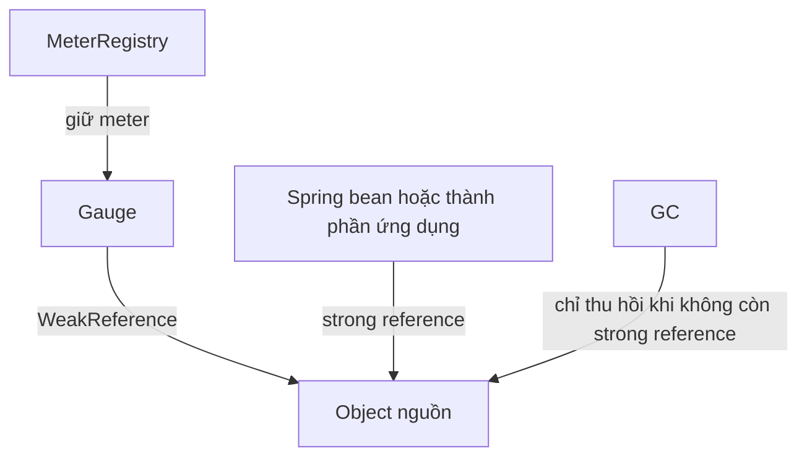

# Tham chiếu yếu và trách nhiệm giữ đối tượng còn sống

Trong module `OBSERVABILITY_INSTRUMENTATION_MICROMETER`, `Gauge` dùng để đọc một giá trị có thể thay đổi theo thời gian, chẳng hạn độ dài queue, số kết nối đang mở hoặc số tác vụ đang chờ. Micrometer thường giữ **tham chiếu yếu** đến object mà gauge quan sát. Vì vậy, việc đăng ký gauge không đồng nghĩa registry sẽ giữ object đó sống trong bộ nhớ.

Nếu ứng dụng không còn tham chiếu mạnh nào tới object, garbage collector (GC) có thể thu hồi object. Khi đó gauge không còn đọc được giá trị và thường trả về `NaN` khi được lấy mẫu. Trách nhiệm giữ object còn sống thuộc về ứng dụng: object được quan sát cần có vòng đời phù hợp với vòng đời của meter.

## 1. Gauge quan sát object thay vì tích lũy sự kiện

Một gauge gồm định danh meter và cách đọc giá trị từ object được đăng ký. Ví dụ, `AtomicInteger` có thể đại diện cho số tác vụ đang chờ:

```java
import io.micrometer.core.instrument.Gauge;
import java.util.concurrent.atomic.AtomicInteger;

AtomicInteger pendingTasks = new AtomicInteger(2);

Gauge.builder("worker.queue.depth", pendingTasks, AtomicInteger::get)
    .register(registry);

pendingTasks.incrementAndGet();
pendingTasks.addAndGet(2);
```

Khi registry lấy số liệu, hàm `AtomicInteger::get` đọc giá trị hiện tại. Sau các cập nhật trên, gauge trả về 5 nếu object vẫn còn sống. Micrometer không nhận một lệnh “đặt gauge thành 5” để lưu giá trị độc lập; nó gọi hàm đọc trên object đang được quan sát.

Đặc tính này phù hợp với trạng thái có thể tăng và giảm:

- Số phần tử hiện có trong queue.
- Số kết nối đang được sử dụng.
- Số tác vụ đang chạy.
- Kích thước hiện tại của cache hoặc collection.
- Dung lượng bộ nhớ đang được sử dụng, nếu nguồn đọc có ý nghĩa và chi phí phù hợp.

Nếu cần đếm số lần sự kiện xảy ra, hãy dùng `Counter`. Nếu cần đo thời lượng, hãy dùng `Timer`. Gauge trả lời câu hỏi “giá trị hiện tại là bao nhiêu?” chứ không lưu lại mọi giá trị từng xuất hiện.

## 2. Vì sao Micrometer dùng tham chiếu yếu

Một registry thường sống trong suốt vòng đời ứng dụng. Nếu mỗi gauge giữ tham chiếu mạnh tới object được quan sát, registry có thể vô tình giữ lại những object mà phần còn lại của ứng dụng đã bỏ dùng. Điều này có thể làm object không được GC thu hồi và gây giữ bộ nhớ ngoài ý muốn.

Vì vậy, gauge thường giữ `WeakReference` tới object nguồn. Tham chiếu yếu cho phép GC thu hồi object khi không còn nơi nào khác giữ tham chiếu mạnh tới nó. Registry vẫn giữ meter và định danh của meter, nhưng không nhất thiết giữ object nguồn sống.



Trong sơ đồ, `MeterRegistry` có thể tiếp tục giữ `Gauge`, còn object nguồn được giữ sống bởi một field trong bean. Khi bean hoặc thành phần quản lý kết thúc vòng đời và không còn tham chiếu mạnh khác, object có thể được GC thu hồi; gauge khi đó không còn giá trị để đọc.

Khi tham chiếu yếu đã bị xóa do object được thu hồi, gauge thường trả về `NaN`. Nó không tự chuyển thành 0, bởi 0 có nghĩa là ứng dụng đã đo được trạng thái rỗng, còn `NaN` thể hiện không còn đọc được nguồn dữ liệu. Backend hoặc dashboard có thể xử lý giá trị này theo cách riêng, vì vậy không nên diễn giải `NaN` thành queue rỗng.

## 3. Lỗi thường gặp: chỉ đăng ký object cục bộ

Ví dụ sau có rủi ro về vòng đời:

```java
void registerQueueGauge(MeterRegistry registry) {
    AtomicInteger queueDepth = new AtomicInteger(4);

    Gauge.builder("worker.queue.depth", queueDepth, AtomicInteger::get)
        .register(registry);
}
```

Sau khi phương thức kết thúc, nếu không còn tham chiếu mạnh nào khác tới `queueDepth`, object có thể trở thành ứng viên để GC thu hồi. Việc gauge vẫn còn trong registry không bảo đảm object nguồn còn sống. Thời điểm GC diễn ra không xác định; metric có thể hoạt động một thời gian rồi mới chuyển sang `NaN`.

Cách tương tự cũng có rủi ro khi truyền trực tiếp một object vừa tạo:

```java
Gauge.builder(
        "worker.queue.depth",
        new AtomicInteger(4),
        AtomicInteger::get)
    .register(registry);
```

Nếu không giữ object ở một nơi khác, ứng dụng không có tham chiếu mạnh để duy trì vòng đời của nó. Đừng dựa vào việc GC chưa chạy để kết luận gauge được đăng ký đúng.

## 4. Giữ object nguồn trong bean sống lâu

Với ứng dụng Spring Boot, cách thông thường là giữ object được quan sát trong một field của bean có vòng đời đủ dài. Spring ApplicationContext giữ bean singleton trong thời gian ứng dụng chạy; field của bean tạo tham chiếu mạnh tới object nguồn.

```java
import io.micrometer.core.instrument.Gauge;
import io.micrometer.core.instrument.MeterRegistry;
import org.springframework.stereotype.Component;

import java.util.concurrent.atomic.AtomicInteger;

@Component
public class QueueMetrics {
    private final AtomicInteger queueDepth = new AtomicInteger();

    public QueueMetrics(MeterRegistry registry) {
        Gauge.builder(
                "worker.queue.depth",
                queueDepth,
                AtomicInteger::get)
            .description("Number of tasks waiting in the worker queue")
            .register(registry);
    }

    public void taskEnqueued() {
        queueDepth.incrementAndGet();
    }

    public void taskDequeued() {
        queueDepth.updateAndGet(current -> Math.max(0, current - 1));
    }
}
```

Ở đây có hai quan hệ tham chiếu khác nhau:

1. `MeterRegistry` quản lý meter và gauge.
2. Bean `QueueMetrics` giữ `queueDepth` bằng field `final`, nhờ đó object vẫn có tham chiếu mạnh trong thời gian bean còn sống.

Khi queue thay đổi, ứng dụng cập nhật cùng object `queueDepth`. Không tạo một `AtomicInteger` mới cho mỗi lần enqueue/dequeue, vì gauge vẫn quan sát object đã đăng ký ban đầu.

Nếu nguồn dữ liệu thực tế là queue hoặc collection, hãy giữ chính collection đó trong thành phần quản lý queue và đăng ký gauge dựa trên collection ấy:

```java
import io.micrometer.core.instrument.Gauge;
import io.micrometer.core.instrument.MeterRegistry;
import org.springframework.stereotype.Component;

import java.util.Queue;
import java.util.concurrent.ConcurrentLinkedQueue;

@Component
public class PendingOrderQueue {
    private final Queue<Order> queue = new ConcurrentLinkedQueue<>();

    public PendingOrderQueue(MeterRegistry registry) {
        Gauge.builder("orders.queue.depth", queue, Queue::size)
            .description("Number of orders waiting for processing")
            .register(registry);
    }

    public void enqueue(Order order) {
        queue.add(order);
    }

    public Order poll() {
        return queue.poll();
    }
}
```

Bean giữ `queue` sống và mọi thao tác đều cập nhật cùng queue. Ví dụ này chỉ minh họa vòng đời object; ứng dụng thực tế cần chọn cấu trúc queue và cơ chế đồng bộ phù hợp với yêu cầu xử lý.

## 5. Khi nào dùng strongReference(true)

Trong các phiên bản Micrometer có hỗ trợ, builder của gauge có tùy chọn `strongReference(true)` để yêu cầu meter giữ tham chiếu mạnh tới object được quan sát:

```java
Gauge.builder("worker.queue.depth", queueDepth, AtomicInteger::get)
    .strongReference(true)
    .register(registry);
```

Khi dùng tùy chọn này, object được gauge giữ lại thông qua meter và không thể được GC thu hồi chỉ vì ứng dụng bỏ các tham chiếu khác. Hãy kiểm tra API của phiên bản Micrometer mà dự án đang dùng trước khi áp dụng, vì khả năng và cách cấu hình phụ thuộc phiên bản.

Tham chiếu mạnh hữu ích khi vòng đời object được thiết kế để gắn với vòng đời meter và việc registry giữ object là chủ đích. Tuy nhiên, nó cũng có thể kéo dài vòng đời object ngoài dự kiến. Nếu registry sống lâu nhưng object đáng lẽ phải được giải phóng sau một tác vụ, strong reference có thể làm tăng bộ nhớ được giữ lại.

Trong ứng dụng Spring, thường dễ quản lý hơn nếu bean hoặc thành phần sở hữu trạng thái giữ object nguồn bằng field. Chỉ bật `strongReference(true)` khi muốn registry trực tiếp chịu trách nhiệm giữ object và đã hiểu vòng đời của registry/meter.

## 6. Đăng ký lặp không thay thế object đang được quan sát

Meter được nhận diện theo tên và tag trong cùng registry. Nếu một gauge đã được đăng ký, lời gọi sau với cùng tên và tag sẽ nhận lại gauge đã có. Nó không thay thế object nguồn của gauge đó.

```java
AtomicInteger firstQueue = new AtomicInteger(2);
AtomicInteger secondQueue = new AtomicInteger(9);

Gauge first = Gauge.builder(
        "worker.queue.depth", firstQueue, AtomicInteger::get)
    .register(registry);

Gauge second = Gauge.builder(
        "worker.queue.depth", secondQueue, AtomicInteger::get)
    .register(registry);
```

Hai builder có cùng tên và tag mặc định, nên `second` được tái sử dụng từ gauge đã đăng ký. Gauge vẫn quan sát `firstQueue`; việc đăng ký `secondQueue` không chuyển nguồn đọc sang object thứ hai.

Nếu cần chuyển sang một nguồn trạng thái khác, hãy thiết kế vòng đời meter rõ ràng: dùng một object ổn định rồi cập nhật nội dung của nó, hoặc chủ động quản lý việc gỡ meter cũ và đăng ký meter mới khi định danh thực sự thay đổi. Không dùng đăng ký lặp như một cơ chế cập nhật nguồn gauge.

## 7. Object phải sống ít nhất bằng thời gian cần quan sát

Vòng đời của object nguồn cần bao phủ toàn bộ khoảng thời gian mà hệ giám sát có thể đọc gauge. Cần xem xét các trường hợp sau:

| Nguồn gauge | Rủi ro vòng đời | Cách tổ chức phù hợp |
| --- | --- | --- |
| `AtomicInteger` cục bộ trong phương thức | Không còn tham chiếu mạnh sau khi phương thức kết thúc | Chuyển thành field của bean quản lý trạng thái |
| Queue/collection tạm thời | Object có thể bị GC sau khi công việc kết thúc | Đăng ký gauge trên collection sống cùng queue manager |
| Cache singleton | Thường sống cùng ApplicationContext | Giữ cache trong field của bean và đo kích thước hiện tại |
| Object gắn với một request | Kết thúc request thì object có thể không còn cần thiết | Không đăng ký gauge toàn cục cho từng request; dùng Timer/Counter hoặc tracing phù hợp |
| Object tạo theo tenant/job | Nhiều object có thể tồn tại và kết thúc độc lập | Cân nhắc số lượng meter, gỡ meter đúng lúc và cardinality của tag |

Đừng tạo gauge cho từng request chỉ để quan sát một giá trị thoáng qua. Gauge được thiết kế để lấy mẫu trạng thái của object còn sống; đối với giá trị đo một lần, `Timer` hoặc `DistributionSummary` thường phù hợp hơn.

## 8. Hàm đọc gauge cần nhẹ và an toàn

Hàm đọc được gọi khi registry lấy mẫu hoặc exporter thu thập metrics. Vì vậy, hàm đọc nên:

- Nhanh, không chặn thread và không gọi dịch vụ từ xa.
- Không tạo side effect hoặc thay đổi trạng thái nghiệp vụ.
- An toàn khi được gọi đồng thời với các luồng cập nhật object.
- Trả về giá trị số có ý nghĩa và đơn vị nhất quán.

Ví dụ đọc `AtomicInteger` là thao tác nhẹ:

```java
Gauge.builder("worker.queue.depth", queueDepth, AtomicInteger::get)
    .register(registry);
```

Không nên gọi database hoặc HTTP API bên trong hàm đọc gauge để lấy số liệu. Một lần scrape có thể đọc nhiều meter; nếu mỗi gauge phát sinh truy vấn I/O, endpoint metrics sẽ chậm, gây tải ngược lên hệ thống và có thể làm việc thu thập metrics thất bại.

Với collection đồng thời, hãy chọn cấu trúc có cách đọc an toàn trong môi trường đa luồng. Giá trị gauge là một snapshot tại thời điểm đọc; nó không nhất thiết phản ánh một trạng thái giao dịch nguyên tử trên nhiều object liên quan.

## 9. Kiểm thử vòng đời và giá trị Gauge

Unit test nên xác minh gauge đọc cùng object nguồn và phản ánh các thay đổi của object khi object vẫn còn được giữ sống:

```java
import io.micrometer.core.instrument.Gauge;
import io.micrometer.core.instrument.simple.SimpleMeterRegistry;
import org.junit.jupiter.api.Test;

import java.util.concurrent.atomic.AtomicInteger;

import static org.junit.jupiter.api.Assertions.assertEquals;

class QueueGaugeTest {
    @Test
    void readsCurrentValueFromTheSameSourceObject() {
        SimpleMeterRegistry registry = new SimpleMeterRegistry();
        AtomicInteger queueDepth = new AtomicInteger(2);

        Gauge.builder("worker.queue.depth", queueDepth, AtomicInteger::get)
            .register(registry);

        assertEquals(2.0, registry.get("worker.queue.depth")
            .gauge().value());

        queueDepth.set(7);

        assertEquals(7.0, registry.get("worker.queue.depth")
            .gauge().value());
    }
}
```

Test giữ biến `queueDepth` trong phạm vi phương thức và xác minh gauge đọc giá trị hiện tại. Đây là kiểm thử hành vi quan sát, không phải kiểm thử GC.

Không viết test phụ thuộc vào `System.gc()` để khẳng định chính xác lúc object bị thu hồi. GC không được bảo đảm chạy ngay theo lời gọi đó; thời điểm thu hồi phụ thuộc JVM, bộ nhớ và khả năng reachability. Những test kiểu này thường không ổn định giữa các lần chạy. Thay vào đó, kiểm tra thiết kế vòng đời qua field của bean hoặc kiểm tra cấu hình strong reference ở phiên bản Micrometer đang sử dụng.

Ở mức tích hợp, hãy kiểm tra endpoint metrics của ứng dụng qua nhiều lần scrape, cập nhật object nguồn giữa các lần đọc và xác nhận giá trị gauge thay đổi như mong đợi. Nếu gauge biến mất hoặc trả `NaN`, kiểm tra nguồn object còn được giữ mạnh hay không trước khi kết luận exporter có lỗi.

## 10. Các lỗi thường gặp

| Hiện tượng | Nguyên nhân cần kiểm tra |
| --- | --- |
| Gauge hoạt động lúc đầu rồi trả `NaN` | Object nguồn chỉ được giữ bằng tham chiếu yếu và đã bị GC thu hồi |
| Gauge luôn bằng 0 | Hàm đọc đang đọc object khác, object nguồn không được cập nhật hoặc metric không đúng loại trạng thái |
| Đăng ký object mới nhưng gauge vẫn đọc object cũ | Cùng tên/tag đã có gauge; registry tái sử dụng meter đã đăng ký đầu tiên |
| Bộ nhớ tăng sau khi bật strong reference | Registry giữ object mạnh lâu hơn vòng đời mà ứng dụng dự kiến |
| Endpoint metrics chậm | Hàm đọc gauge thực hiện I/O, lock lâu hoặc tính toán tốn kém |
| Gauge của request biến mất sau khi request kết thúc | Object nguồn có vòng đời ngắn hơn meter và không còn tham chiếu mạnh |

Khi điều tra, hãy xác định object cụ thể mà gauge đọc, tìm nơi đang giữ tham chiếu mạnh tới object, kiểm tra vòng đời của bean hoặc collection sở hữu nó, rồi xem xét GC và cấu hình strong reference. Việc chỉ thấy meter trong registry không chứng minh object nguồn vẫn còn sống.

## 11. Nguyên tắc áp dụng

Gauge mặc định dùng tham chiếu yếu để tránh registry vô tình giữ các object không còn được ứng dụng sử dụng. Vì vậy, khi đăng ký gauge, hãy luôn xác định rõ object nguồn được giữ sống ở đâu và có vòng đời bao phủ thời gian quan sát hay không. Trong Spring Boot, giữ object trong field của bean quản lý trạng thái thường là cách dễ hiểu và dễ kiểm soát nhất.

Chỉ dùng strong reference khi muốn meter giữ object và đã tính đến vòng đời cùng bộ nhớ. Giữ hàm đọc nhanh, không chặn và an toàn khi truy cập đồng thời. Khi object nguồn không còn sống, hãy xem `NaN` là dấu hiệu mất nguồn đo; không diễn giải nó thành giá trị 0. Cách quản lý vòng đời đúng giúp Gauge phản ánh trạng thái vận hành ổn định và tránh giữ bộ nhớ ngoài ý muốn.
