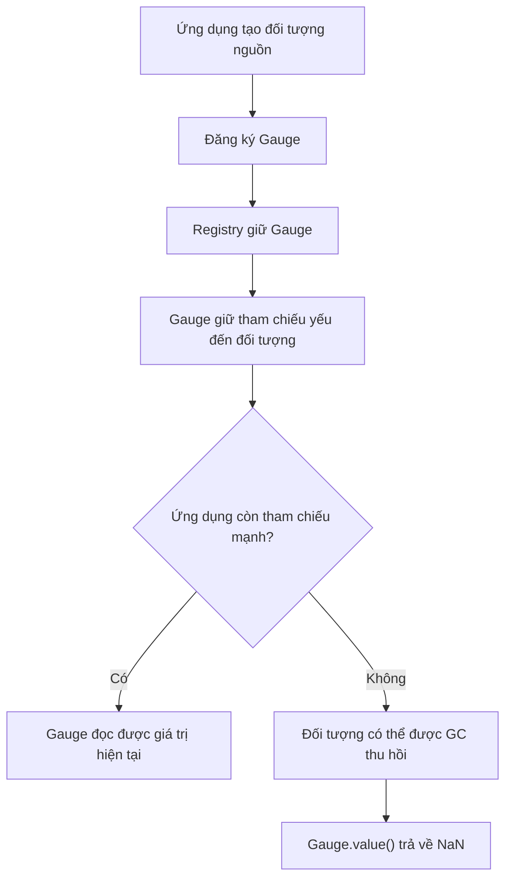

# Kiểm chứng giá trị khi trạng thái thay đổi và khi đối tượng bị giải phóng

Gauge trong Micrometer biểu diễn giá trị hiện tại của một đối tượng hoặc trạng thái. Registry đọc giá trị thông qua một hàm truy xuất khi metrics được thu thập hoặc xuất. Vì vậy, giá trị Gauge có thể thay đổi theo trạng thái của ứng dụng mà không cần đăng ký lại meter sau mỗi lần cập nhật.

Cách hoạt động này phụ thuộc vào vòng đời của đối tượng được quan sát. Theo mặc định, Gauge giữ tham chiếu yếu đến đối tượng nguồn để tránh việc metrics vô tình giữ sống một đối tượng không còn được ứng dụng sử dụng. Khi đối tượng bị garbage collector thu hồi, Gauge vẫn có thể còn trong registry nhưng không còn đọc được giá trị; Micrometer biểu diễn trường hợp này bằng `NaN`. Nếu ứng dụng không giữ tham chiếu mạnh đến đối tượng nguồn, Gauge có thể mất giá trị ngay cả khi mã đã đăng ký nó thành công.

Bài học thuộc module OBSERVABILITY_INSTRUMENTATION_MICROMETER. Module này hướng dẫn sử dụng Micrometer để đo lường ứng dụng Java bằng counter, gauge, timer, distribution summary và nhãn có kiểm soát; tích hợp Spring Boot, xuất metrics đến hệ giám sát, kiểm soát cardinality, kiểm thử instrumentation và diễn giải số đo vận hành.

## Mục tiêu học tập

Sau bài này, bạn có thể:

- Giải thích cách Gauge đọc trạng thái hiện tại qua một hàm truy xuất.
- Kiểm chứng giá trị Gauge thay đổi khi đối tượng nguồn thay đổi.
- Phân biệt tham chiếu yếu và tham chiếu mạnh trong vòng đời Gauge.
- Nhận biết giá trị `NaN` khi đối tượng được quan sát bị thu hồi.
- Giữ đối tượng nguồn sống đúng vòng đời của thành phần nghiệp vụ.
- Gỡ meter khi tài nguyên hoặc đối tượng được đo không còn tồn tại.
- Viết kiểm thử đáng tin cậy cho cập nhật trạng thái và hành vi garbage collection.

## 1. Gauge đọc trạng thái hiện tại

Gauge là meter dùng để quan sát một giá trị có thể tăng hoặc giảm, ví dụ:

- Số phần tử hiện có trong hàng đợi.
- Số tác vụ đang chạy.
- Số kết nối hiện đang mở.
- Số entry đang có trong cache.
- Mức sử dụng của một tài nguyên tại thời điểm thu thập.

Khác với Counter, Gauge không cộng dồn sự kiện. Nó đọc giá trị từ đối tượng nguồn thông qua một hàm truy xuất. Ví dụ, Gauge quan sát độ sâu hàng đợi bằng cách gọi `Queue::size`.

```java
Gauge.builder("queue.depth", queue, Queue::size)
        .description("Số phần tử hiện có trong hàng đợi")
        .register(registry);
```

Trong ví dụ:

- `queue.depth` là tên meter.
- `queue` là đối tượng được quan sát.
- `Queue::size` là hàm đọc giá trị hiện tại.
- `registry` quản lý Gauge và cung cấp số đo cho exporter.

Khi queue thay đổi kích thước, hàm `size()` trả về giá trị mới ở lần đọc tiếp theo. Ứng dụng không phải gọi `register()` lại sau mỗi lần thêm hoặc lấy phần tử.

### Gauge được lấy mẫu khi nào?

Gauge không phát ra một sự kiện mỗi khi trạng thái thay đổi. Registry gọi hàm truy xuất khi đọc hoặc thu thập meter, thường trong chu kỳ scrape của Prometheus hoặc chu kỳ export của registry tương ứng.

Ví dụ:

1. Queue có 2 phần tử khi lần scrape thứ nhất diễn ra.
2. Ứng dụng thêm 3 phần tử, queue có 5 phần tử.
3. Lần scrape tiếp theo đọc được 5.
4. Nếu queue tăng lên 8 rồi giảm về 5 giữa hai lần scrape, backend có thể không bao giờ nhìn thấy giá trị 8.

Vì vậy, Gauge phù hợp với trạng thái hiện tại. Nếu cần đếm mọi sự kiện đã xảy ra, hãy dùng Counter. Nếu cần ghi nhận thời lượng từng lần thực hiện, hãy dùng Timer.

## 2. Kiểm chứng Gauge khi trạng thái thay đổi

Để kiểm tra Gauge, hãy dùng một đối tượng mutable có phương thức trả về trạng thái hiện tại. Đối tượng phải được giữ trong một biến hoặc field có vòng đời đủ dài.

Ví dụ, QueueState sử dụng AtomicInteger để quản lý số phần tử:

```java
import java.util.concurrent.atomic.AtomicInteger;

public final class QueueState {

    private final AtomicInteger depth = new AtomicInteger();

    public int size() {
        return depth.get();
    }

    public void enqueue() {
        depth.incrementAndGet();
    }

    public void dequeue() {
        depth.updateAndGet(current -> Math.max(0, current - 1));
    }
}
```

Đăng ký Gauge một lần:

```java
import io.micrometer.core.instrument.Gauge;
import io.micrometer.core.instrument.MeterRegistry;

public final class QueueMetrics {

    private final QueueState queueState;
    private final Gauge queueDepth;

    public QueueMetrics(
            QueueState queueState,
            MeterRegistry registry
    ) {
        this.queueState = queueState;

        this.queueDepth = Gauge.builder(
                        "queue.depth",
                        queueState,
                        QueueState::size
                )
                .description("Số phần tử hiện có trong hàng đợi")
                .baseUnit("tasks")
                .register(registry);
    }

    public double currentDepth() {
        return queueDepth.value();
    }
}
```

Field `queueState` giữ tham chiếu mạnh đến đối tượng nguồn trong suốt vòng đời của QueueMetrics. Gauge có thể đọc trạng thái của đối tượng này mỗi khi giá trị được truy xuất.

### Kiểm thử thay đổi trạng thái

Có thể dùng SimpleMeterRegistry để kiểm tra trực tiếp giá trị Gauge:

```java
import static org.assertj.core.api.Assertions.assertThat;

import io.micrometer.core.instrument.Gauge;
import io.micrometer.core.instrument.simple.SimpleMeterRegistry;
import org.junit.jupiter.api.Test;

class QueueGaugeTest {

    @Test
    void reflectsCurrentQueueDepth() {
        var registry = new SimpleMeterRegistry();
        var queueState = new QueueState();

        Gauge gauge = Gauge.builder(
                        "queue.depth",
                        queueState,
                        QueueState::size
                )
                .register(registry);

        assertThat(gauge.value()).isEqualTo(0.0);

        queueState.enqueue();
        queueState.enqueue();

        assertThat(gauge.value()).isEqualTo(2.0);

        queueState.dequeue();

        assertThat(gauge.value()).isEqualTo(1.0);
    }
}
```

Bài kiểm thử chứng minh Gauge đọc trạng thái mới nhất thay vì giữ lại giá trị tại thời điểm đăng ký. Cần gọi `gauge.value()` sau mỗi lần cập nhật để quan sát kết quả.

Trong ứng dụng thực tế, state object có thể là queue, cache hoặc bean quản lý tài nguyên. Hãy kiểm thử thông qua đối tượng nghiệp vụ để xác nhận hành vi cập nhật đúng, đồng thời kiểm tra meter vẫn được đăng ký đúng một lần.

## 3. Vòng đời đối tượng được Gauge quan sát

Micrometer mặc định dùng tham chiếu yếu đến đối tượng nguồn của Gauge. Tham chiếu yếu cho phép garbage collector thu hồi đối tượng khi không còn tham chiếu mạnh nào khác giữ nó sống.

Điều này có ý nghĩa quan trọng: đăng ký Gauge không đồng nghĩa với việc registry sở hữu vòng đời của đối tượng nguồn.



Ví dụ sau dễ tạo ra Gauge mất giá trị:

```java
public void registerQueueGauge(MeterRegistry registry) {
    QueueState temporaryQueue = new QueueState();

    Gauge.builder(
            "queue.depth.temporary",
            temporaryQueue,
            QueueState::size
    ).register(registry);
}
```

Khi phương thức kết thúc, nếu không có nơi nào khác giữ `temporaryQueue`, đối tượng có thể được garbage collector thu hồi. Registry vẫn có thể chứa meter `queue.depth.temporary`, nhưng Gauge không còn đối tượng để đọc.

Không dựa vào việc một biến local còn xuất hiện trong mã nguồn để kết luận đối tượng được giữ sống. JIT có thể xem một biến không còn được sử dụng là không còn cần thiết trước khi scope kết thúc. Hãy quản lý tham chiếu bằng field hoặc thành phần có vòng đời rõ ràng.

## 4. Giá trị Gauge sau khi đối tượng bị giải phóng

Khi đối tượng nguồn bị thu hồi, Micrometer không thể gọi hàm truy xuất trên đối tượng đó. Giá trị Gauge trong trường hợp này trở thành `NaN` (Not a Number).

`NaN` có ý nghĩa khác với số 0:

| Giá trị | Ý nghĩa |
| --- | --- |
| `0.0` | Đối tượng còn tồn tại và trạng thái hiện tại có giá trị bằng 0 |
| Số dương | Đối tượng còn tồn tại và hàm truy xuất đọc được giá trị dương |
| `NaN` | Đối tượng nguồn không còn khả dụng để Gauge đọc |

Không diễn giải `NaN` thành hàng đợi rỗng, không có tác vụ hoặc tài nguyên đã giải phóng thành công. Đây là dấu hiệu Gauge đã mất đối tượng được quan sát.

### Ví dụ kiểm tra tham chiếu yếu

Có thể dùng WeakReference để kiểm tra đối tượng nguồn có còn được tham chiếu mạnh ở nơi khác hay không:

```java
import java.lang.ref.WeakReference;

import io.micrometer.core.instrument.Gauge;
import io.micrometer.core.instrument.simple.SimpleMeterRegistry;

static WeakReference<QueueState> registerTemporaryGauge(
        SimpleMeterRegistry registry
) {
    QueueState state = new QueueState();

    Gauge.builder("queue.depth.temporary", state, QueueState::size)
            .register(registry);

    return new WeakReference<>(state);
}
```

Sau khi phương thức trả về, biến local không còn giữ đối tượng. Registry chỉ giữ tham chiếu yếu theo mặc định, vì vậy đối tượng có thể được thu hồi nếu không có tham chiếu mạnh nào khác.

Có thể quan sát bằng mã chẩn đoán:

```java
WeakReference<QueueState> reference =
        registerTemporaryGauge(registry);

System.gc(); // Chỉ là yêu cầu GC, không bảo đảm thu hồi ngay.

// Sau khi xác nhận reference.get() == null:
double value = registry.get("queue.depth.temporary")
        .gauge()
        .value();

assert Double.isNaN(value);
```

`System.gc()` chỉ là gợi ý cho JVM. Không có bảo đảm đối tượng sẽ được thu hồi ngay sau lời gọi. Nếu kiểm thử cần chờ garbage collection, hãy dùng timeout hữu hạn, kiểm tra WeakReference và tránh giả định thời điểm GC chính xác. Không nên tạo unit test phụ thuộc cứng vào một số lần gọi `System.gc()` hoặc một khoảng ngủ cố định vì kết quả có thể khác nhau giữa các JVM và điều kiện tải.

Trong kiểm thử thông thường, nên ưu tiên xác minh cập nhật trạng thái bằng đối tượng được giữ sống rõ ràng. Hành vi thu hồi đối tượng có thể được kiểm tra riêng trong một test chuyên biệt hoặc kiểm thử tích hợp chạy trong JVM được kiểm soát.

## 5. Giữ đối tượng nguồn sống đúng vòng đời

Cách xử lý thông thường là để thành phần sở hữu trạng thái giữ tham chiếu mạnh đến đối tượng mà Gauge quan sát.

Trong Spring Boot, có thể inject QueueState vào một bean singleton:

```java
import io.micrometer.core.instrument.Gauge;
import io.micrometer.core.instrument.MeterRegistry;
import io.micrometer.core.instrument.binder.MeterBinder;
import org.springframework.stereotype.Component;

@Component
public class QueueMetrics implements MeterBinder {

    private final QueueState queueState;

    public QueueMetrics(QueueState queueState) {
        this.queueState = queueState;
    }

    @Override
    public void bindTo(MeterRegistry registry) {
        Gauge.builder(
                        "queue.depth",
                        queueState,
                        QueueState::size
                )
                .description("Số phần tử hiện có trong hàng đợi")
                .baseUnit("tasks")
                .register(registry);
    }
}
```

Bean QueueMetrics giữ field `queueState`; do đó đối tượng nguồn tiếp tục sống trong vòng đời của bean. Gauge có thể đọc được trạng thái khi registry thu thập metrics.

Các nguyên tắc cần nhớ:

- Đặt đối tượng được quan sát trong field của bean hoặc một owner có vòng đời phù hợp.
- Không chỉ truyền một đối tượng tạm thời vào Gauge builder rồi bỏ tham chiếu.
- Nếu trạng thái được quản lý bởi queue hoặc cache, hãy để thành phần quản lý giữ đối tượng đó.
- Hàm truy xuất nên nhanh, an toàn khi gọi đồng thời và không có side effect.
- Không tạo một Gauge mới cho mỗi request hoặc mỗi đối tượng nghiệp vụ ngắn hạn.

### Dùng strongReference(true) khi nào?

Một số trường hợp có thể cấu hình Gauge giữ tham chiếu mạnh:

```java
Gauge.builder("queue.depth", queueState, QueueState::size)
        .description("Số phần tử hiện có trong hàng đợi")
        .strongReference(true)
        .register(registry);
```

Khi bật `strongReference(true)`, Gauge giữ đối tượng nguồn sống cùng với meter. Điều này hữu ích khi registry thực sự cần sở hữu vòng đời tham chiếu, nhưng có thể làm đối tượng không được giải phóng dù ứng dụng không còn cần nó.

Chỉ dùng tham chiếu mạnh khi vòng đời meter được quản lý rõ ràng. Nếu đăng ký Gauge cho nhiều đối tượng ngắn hạn và giữ tham chiếu mạnh, registry có thể vô tình giữ lại toàn bộ các đối tượng đó. Khi tài nguyên kết thúc vòng đời, cần gỡ meter tương ứng hoặc giải phóng registry theo thiết kế.

Với bean ứng dụng có vòng đời dài và đã được giữ trong field, thường không cần bật `strongReference(true)`.

## 6. Phân biệt giải phóng đối tượng và gỡ meter

Có hai vòng đời khác nhau:

1. Vòng đời của đối tượng nguồn được Gauge quan sát.
2. Vòng đời của Meter được đăng ký trong MeterRegistry.

Khi đối tượng nguồn bị garbage collector thu hồi, Gauge có thể trở thành `NaN`, nhưng meter vẫn còn trong registry. Việc thu hồi đối tượng không tự động xóa Meter.Id khỏi registry.

Nếu ứng dụng quản lý tài nguyên động và không còn cần quan sát một meter, hãy gỡ meter khi tài nguyên kết thúc:

```java
import io.micrometer.core.instrument.Gauge;
import io.micrometer.core.instrument.MeterRegistry;

public final class DynamicQueueGauge {

    private final MeterRegistry registry;
    private final Gauge gauge;

    public DynamicQueueGauge(
            MeterRegistry registry,
            QueueState queueState
    ) {
        this.registry = registry;
        this.gauge = Gauge.builder(
                        "queue.depth",
                        queueState,
                        QueueState::size
                )
                .tag("queue", "temporary")
                .register(registry);
    }

    public void close() {
        registry.remove(gauge.getId());
    }
}
```

Trong ví dụ, `close()` loại bỏ meter khỏi registry. Thành phần quản lý tài nguyên cần gọi phương thức này khi queue không còn tồn tại hoặc không còn được quan sát. Nếu dùng strong reference, việc gỡ meter cũng giải phóng tham chiếu mạnh mà Gauge giữ.

Không tạo tên hoặc tag riêng theo từng ID ngẫu nhiên rồi để meter nằm lại trong registry. Dù đối tượng nguồn đã được thu hồi, số Meter.Id vẫn có thể tăng theo thời gian. Hãy dùng tên và tag có tập giá trị hữu hạn, đồng thời quản lý việc đăng ký và gỡ meter theo vòng đời tài nguyên.

## 7. Kiểm thử giá trị NaN và vòng đời

Có thể kiểm thử hai hành vi riêng biệt:

- Giá trị Gauge phản ánh state khi đối tượng còn sống.
- Giá trị Gauge trở thành `NaN` sau khi đối tượng nguồn bị thu hồi.

Kiểm thử đầu tiên nên là unit test thông thường vì có thể kiểm soát vòng đời đối tượng:

```java
@Test
void readsUpdatedValueWhileSourceIsAlive() {
    var registry = new SimpleMeterRegistry();
    var state = new QueueState();

    Gauge gauge = Gauge.builder("queue.depth", state, QueueState::size)
            .register(registry);

    state.enqueue();
    state.enqueue();

    assertThat(gauge.value()).isEqualTo(2.0);
}
```

Kiểm thử garbage collection cần thận trọng vì JVM quyết định thời điểm thu hồi. Có thể tạo WeakReference trong một helper method, sau đó chờ trong thời gian hữu hạn đến khi tham chiếu trở thành null. Chỉ sau khi xác nhận đối tượng đã được thu hồi mới kiểm tra `Double.isNaN(gauge.value())`.

Ví dụ khung kiểm thử:

```java
import static org.assertj.core.api.Assertions.assertThat;
import static org.junit.jupiter.api.Assumptions.assumeTrue;

import java.lang.ref.WeakReference;
import java.time.Duration;

import io.micrometer.core.instrument.simple.SimpleMeterRegistry;
import org.junit.jupiter.api.Test;

@Test
void gaugeBecomesNaNWhenObservedObjectIsCollected()
        throws InterruptedException {

    var registry = new SimpleMeterRegistry();
    WeakReference<QueueState> reference =
            registerTemporaryGauge(registry);

    long deadline = System.nanoTime() + Duration.ofSeconds(5).toNanos();

    while (reference.get() != null
            && System.nanoTime() < deadline) {
        System.gc();
        Thread.sleep(50);
    }

    assumeTrue(reference.get() == null,
            "GC chưa thu hồi đối tượng trong thời hạn của test");

    double value = registry.get("queue.depth.temporary")
            .gauge()
            .value();

    assertThat(Double.isNaN(value)).isTrue();
}
```

Khung trên minh họa cách chờ có giới hạn và xác nhận tham chiếu yếu. Trong bộ test thực tế, cần dùng cơ chế assumption hoặc phân loại test riêng nếu GC không xảy ra trong thời hạn. Không được xem trường hợp timeout là bằng chứng Gauge hoạt động sai.

Để kiểm tra ứng dụng production, có thể quan sát ba tín hiệu:

- Giá trị Gauge có hợp lý khi đối tượng nguồn còn sống không?
- Giá trị có chuyển thành `NaN` khi owner giải phóng đối tượng không?
- Meter có được gỡ khỏi registry khi tài nguyên kết thúc vòng đời không?

## 8. Các lỗi thường gặp

| Lỗi | Biểu hiện | Cách xử lý |
| --- | --- | --- |
| Đăng ký Gauge bằng đối tượng local rồi không giữ tham chiếu | Giá trị có thể chuyển thành NaN sau GC | Giữ đối tượng trong field hoặc owner có vòng đời rõ ràng |
| Nghĩ registry giữ sống đối tượng nguồn | Gauge mất giá trị dù meter vẫn tồn tại | Hiểu mặc định là weak reference |
| Dùng số 0 để biểu diễn đối tượng đã bị thu hồi | Dashboard hiểu nhầm là trạng thái rỗng | Phân biệt NaN với 0 |
| Bật strongReference(true) cho nhiều đối tượng ngắn hạn | Registry giữ đối tượng lâu hơn dự kiến | Quản lý vòng đời và gỡ meter |
| Tạo Gauge mới sau mỗi lần state thay đổi | Trùng Meter.Id hoặc tạo nhiều meter không cần thiết | Đăng ký một lần, cập nhật state object |
| Đưa một giá trị snapshot bất biến vào Gauge | Gauge không phản ánh thay đổi sau đó | Truyền đối tượng mutable và hàm đọc trạng thái |
| Dùng Gauge để đếm sự kiện | Mất các lần thay đổi giữa hai lần scrape | Dùng Counter |
| Chỉ kiểm thử giá trị ngay sau register | Không phát hiện lỗi tham chiếu hoặc cập nhật | Kiểm tra nhiều trạng thái và vòng đời |
| Dùng System.gc() như một bảo đảm | Test chập chờn giữa các môi trường | Chờ có timeout và xác nhận WeakReference |

## 9. Checklist thiết kế và kiểm thử Gauge

Trước khi đưa Gauge vào ứng dụng, hãy kiểm tra:

1. Đại lượng có thực sự là trạng thái hiện tại có thể tăng hoặc giảm không?
2. Đối tượng nguồn có được giữ bằng tham chiếu mạnh trong suốt thời gian cần đo không?
3. Hàm truy xuất có nhanh, an toàn khi gọi đồng thời và không gây side effect không?
4. Gauge có được đăng ký một lần cho mỗi Meter.Id không?
5. Kiểm thử đã xác nhận giá trị sau khi trạng thái thay đổi chưa?
6. Nếu đối tượng nguồn bị thu hồi, hệ thống có nhận biết giá trị NaN không?
7. Nếu tài nguyên kết thúc vòng đời, meter có được gỡ khỏi registry không?
8. Có tránh bật strong reference cho các đối tượng ngắn hạn không?
9. Dashboard có phân biệt NaN, missing series và giá trị 0 không?

## Kết luận

Gauge luôn biểu diễn giá trị hiện tại mà hàm truy xuất đọc được từ đối tượng nguồn. Khi trạng thái thay đổi, lần thu thập tiếp theo sẽ đọc giá trị mới. Khi đối tượng nguồn bị garbage collector thu hồi, Gauge mặc định không giữ đối tượng sống thay cho ứng dụng và giá trị có thể trở thành `NaN`.

Hãy để thành phần sở hữu trạng thái giữ tham chiếu mạnh trong đúng vòng đời cần quan sát. Chỉ bật `strongReference(true)` khi đã có kế hoạch giải phóng rõ ràng. Khi tài nguyên kết thúc, gỡ meter khỏi registry để tránh giữ lại các Meter.Id không còn hữu ích. Kiểm thử cả cập nhật trạng thái và vòng đời đối tượng sẽ giúp Gauge phản ánh đúng hoạt động thực tế của ứng dụng Java.
