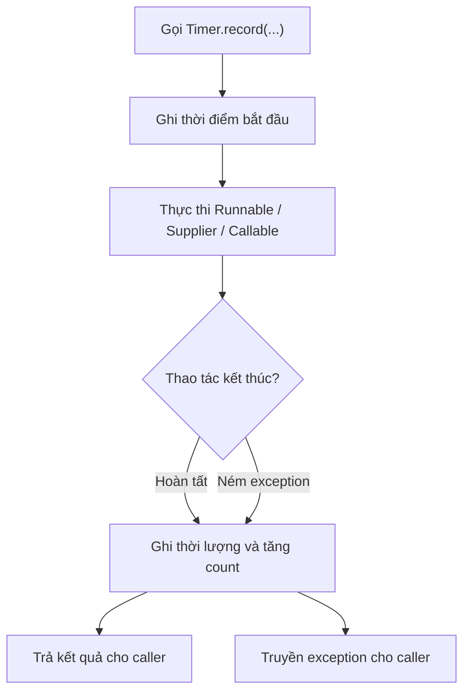

# Đo Runnable, Callable và các khối mã có kết quả trả về

Micrometer `Timer` đo thời gian thực thi của một thao tác và số lần thao tác đó được ghi nhận. Khi cần đo một đoạn mã đồng bộ, có thể truyền trực tiếp đoạn mã vào Timer thay vì tự lấy thời gian bắt đầu, thời gian kết thúc rồi tính hiệu.

Timer cung cấp các cách đo phù hợp với kiểu tác vụ Java thường gặp:

- `record(Runnable)` đo đoạn mã không trả về kết quả.
- `record(Supplier<T>)` đo đoạn mã trả về kết quả mà không khai báo checked exception.
- `recordCallable(Callable<T>)` đo đoạn mã trả về kết quả và có thể ném checked exception.

Các phương thức này trả lại kết quả của thao tác khi có kết quả, đồng thời ghi nhận thời lượng vào Timer. Chúng giúp giữ nguyên cách gọi nghiệp vụ và đặt ranh giới đo lường rõ ràng.

## 1. Timer đo một lần thực thi như thế nào?

Khi gọi một phương thức đo, Timer ghi lại thời điểm bắt đầu bằng đồng hồ monotonic, thực thi đoạn mã được truyền vào, rồi ghi thời lượng khi đoạn mã kết thúc. Thời lượng được ghi nhận kể cả khi thao tác ném exception; exception vẫn được truyền về phía gọi.

Luồng xử lý có thể mô tả như sau:



Một Timer thường ghi nhận ít nhất số lần thực thi và tổng thời gian. Khi được cấu hình histogram hoặc percentile phù hợp, nó còn hỗ trợ phân tích phân bố thời lượng. Việc ghi nhận một lần thực thi không có nghĩa Timer lưu lại toàn bộ kết quả trả về hoặc stack trace của exception.

## 2. Đo Runnable không có kết quả trả về

`Runnable` biểu diễn một thao tác không trả về giá trị. Dùng `Timer.record(Runnable)` khi cần đo một đoạn mã thực hiện hành động rồi kết thúc.

Ví dụ đo thao tác gửi thông báo:

```java
import io.micrometer.core.instrument.MeterRegistry;
import io.micrometer.core.instrument.Timer;

import org.springframework.stereotype.Component;

@Component
public class NotificationService {

    private final Timer sendTimer;
    private final NotificationClient client;

    public NotificationService(
            MeterRegistry registry,
            NotificationClient client
    ) {
        this.client = client;
        this.sendTimer = registry.timer(
            "notification.send",
            "channel", "email"
        );
    }

    public void send(Notification notification) {
        sendTimer.record(() -> client.send(notification));
    }
}
```

Lambda `()-> client.send(notification)` tương thích với `Runnable` nếu `send(...)` trả về `void`. Timer đo khoảng thời gian từ lúc bắt đầu gọi `client.send(...)` đến khi phương thức đó kết thúc.

Phương thức `record(Runnable)` trả về `void`. Nó không tạo ra một kết quả để gán vào biến. Nếu thao tác ném runtime exception, Timer vẫn ghi nhận thời lượng rồi exception tiếp tục được truyền ra ngoài. Vì vậy, caller vẫn có thể xử lý lỗi theo logic nghiệp vụ như trước.

### Đo một khối lệnh gồm nhiều bước

Có thể dùng block lambda khi thao tác gồm nhiều câu lệnh:

```java
timer.record(() -> {
    validate(request);
    updateDatabase(request);
    publishEvent(request);
});
```

Trong trường hợp này, Timer đo toàn bộ ba bước nằm bên trong block. Nếu chỉ muốn đo thời gian cập nhật database, hãy đặt Timer quanh riêng lời gọi đó. Ranh giới đo cần phản ánh đúng câu hỏi vận hành.

## 3. Đo thao tác trả về kết quả bằng Supplier<T>

Khi đoạn mã trả về một giá trị và không cần khai báo checked exception, dùng `Timer.record(Supplier<T>)`. Timer trả lại chính kết quả do Supplier tạo ra.

Ví dụ:

```java
import io.micrometer.core.instrument.MeterRegistry;
import io.micrometer.core.instrument.Timer;

import org.springframework.stereotype.Component;

@Component
public class ProductQueryService {

    private final Timer queryTimer;
    private final ProductRepository repository;

    public ProductQueryService(
            MeterRegistry registry,
            ProductRepository repository
    ) {
        this.repository = repository;
        this.queryTimer = registry.timer(
            "product.query",
            "operation", "find-by-id"
        );
    }

    public Product findById(long id) {
        return queryTimer.record(() -> {
            return repository.findById(id)
                .orElseThrow(() -> new ProductNotFoundException(id));
        });
    }
}
```

Giá trị trả về từ `repository.findById(...)` được Timer trả lại cho caller. Caller vẫn nhận được `Product` hoặc exception nếu thao tác thất bại.

Nếu muốn code dễ đọc hơn hoặc tránh nhầm lẫn giữa các overload lambda, có thể khai báo Supplier tường minh:

```java
import java.util.function.Supplier;

Supplier<Product> operation = () -> repository.findById(id)
    .orElseThrow(() -> new ProductNotFoundException(id));

Product product = queryTimer.record(operation);
```

Dùng `Supplier<T>` khi thao tác có kết quả và chỉ ném các exception không kiểm tra (unchecked) hoặc không cần khai báo checked exception. Nếu API được gọi có thể ném checked exception, hãy xem `Callable<T>`.

## 4. Đo Callable<T> có thể ném checked exception

`Callable<T>` cũng trả về một giá trị, nhưng phương thức `call()` có thể ném checked exception. Micrometer cung cấp `Timer.recordCallable(Callable<T>)` để đo loại tác vụ này.

Ví dụ gọi một client cũ có thể ném `IOException`:

```java
import io.micrometer.core.instrument.MeterRegistry;
import io.micrometer.core.instrument.Timer;

import java.io.IOException;
import java.util.concurrent.Callable;

public class LegacyCatalogService {

    private final Timer fetchTimer;
    private final LegacyCatalogClient client;

    public LegacyCatalogService(
            MeterRegistry registry,
            LegacyCatalogClient client
    ) {
        this.client = client;
        this.fetchTimer = registry.timer(
            "catalog.legacy.fetch",
            "operation", "fetch"
        );
    }

    public CatalogItem fetch(String code) throws IOException {
        Callable<CatalogItem> operation = () -> client.fetch(code);
        return fetchTimer.recordCallable(operation);
    }
}
```

`recordCallable(...)` trả lại `CatalogItem` do `call()` tạo ra. Nếu client ném `IOException`, exception được truyền ra caller; chữ ký phương thức vẫn có thể khai báo `throws IOException` như trước.

Không cần bắt exception chỉ để Timer có thể ghi thời lượng. Nếu cần xử lý lỗi, hãy thực hiện ở lớp nghiệp vụ hoặc lớp gọi. Việc đo thời gian không nên làm thay đổi chính sách retry, fallback hay xử lý exception của ứng dụng.

## 5. Chọn đúng API cho từng kiểu thao tác

| Kiểu thao tác | API Timer | Giá trị trả về | Exception |
|---|---|---|---|
| Khối lệnh không trả kết quả | `record(Runnable)` | Không có | Runtime exception được truyền tiếp |
| Hàm trả về kết quả | `record(Supplier<T>)` | Trả lại `T` | Runtime exception được truyền tiếp |
| Hàm trả về kết quả và có checked exception | `recordCallable(Callable<T>)` | Trả lại `T` | Checked exception được truyền tiếp |

Có thể ghi nhớ theo kiểu hàm Java:

- Dùng `Runnable` khi chữ ký thao tác là `void run()`.
- Dùng `Supplier<T>` khi chữ ký thao tác là `T get()`.
- Dùng `Callable<T>` khi chữ ký thao tác là `T call() throws Exception`.

Không nên bọc checked exception thành runtime exception chỉ để dùng `Supplier<T>`. Nếu API gốc có checked exception, `Callable<T>` diễn đạt đúng hợp đồng của nó và giúp caller xử lý lỗi rõ ràng.

## 6. Đo một đoạn mã trả về kết quả trong nhiều bước

Timer đo toàn bộ đoạn mã được bao quanh. Có thể tận dụng điều này để đo cả một luồng xử lý có nhiều lời gọi đồng bộ:

```java
Order order = checkoutTimer.record(() -> {
    Cart cart = cartService.load(cartId);
    Payment payment = paymentService.charge(cart);
    return orderService.create(cart, payment);
});
```

Timer đo thời gian tải giỏ hàng, thanh toán và tạo đơn cộng lại. Kết quả `Order` được trả lại cho caller.

Nếu cần phân tích riêng từng giai đoạn, tạo các Timer riêng tại từng ranh giới:

```java
Cart cart = cartLoadTimer.record(() -> cartService.load(cartId));

Payment payment = paymentTimer.record(
    () -> paymentService.charge(cart)
);

Order order = orderCreateTimer.record(
    () -> orderService.create(cart, payment)
);
```

Không nên tạo quá nhiều Timer chỉ để phân rã mọi dòng code. Chọn các giai đoạn có ý nghĩa vận hành, ví dụ gọi database, gọi dịch vụ ngoài hoặc xử lý nghiệp vụ chính.

## 7. Đo kết quả và phân loại thành công/thất bại

Timer ghi nhận thời lượng và count, nhưng không tự biết kết quả nghiệp vụ là thành công hay thất bại. Nếu cần phân biệt hai loại kết quả, có thể dùng tag có tập giá trị hữu hạn.

Với thao tác đồng bộ, `Timer.Sample` cho phép bắt đầu đo trước, rồi chọn Timer đích khi thao tác đã có kết quả:

```java
Timer.Sample sample = Timer.start(registry);

try {
    Order order = orderService.create(command);

    sample.stop(registry.timer(
        "order.create",
        "outcome", "success"
    ));

    return order;
} catch (RuntimeException exception) {
    sample.stop(registry.timer(
        "order.create",
        "outcome", "failure"
    ));

    throw exception;
}
```

Cách này hữu ích khi tag `outcome` chỉ biết được sau khi thao tác kết thúc. Tập giá trị tag nên hữu hạn, ví dụ `success` và `failure`; không đưa exception message, order ID hoặc request ID vào tag.

Nếu chỉ cần tổng thời gian và số lần thực thi, một Timer duy nhất với `record(...)` đơn giản hơn. Dùng `Timer.Sample` khi cần quyết định Timer hoặc tag ở thời điểm kết thúc, hoặc khi ranh giới đo không thuận tiện để đặt trong một lambda.

## 8. Đo bất đồng bộ: thời điểm trả về khác thời điểm hoàn tất

Các API `record(Runnable)`, `record(Supplier<T>)` và `recordCallable(Callable<T>)` đo thời gian thực thi đồng bộ của khối được truyền vào. Nếu Supplier chỉ tạo và trả về một `CompletableFuture`, Timer dừng khi future được tạo ra, không chờ công việc bất đồng bộ hoàn tất.

Ví dụ không đo toàn bộ thời gian xử lý bất đồng bộ:

```java
CompletableFuture<Response> future = timer.record(
    () -> {
        return client.sendAsync(request);
    }
);
```

Đoạn trên chủ yếu đo thời gian gọi `sendAsync(...)` và nhận về future. Muốn đo đến khi future hoàn tất, hãy dùng `Timer.Sample` và dừng sample trong callback hoàn tất:

```java
Timer.Sample sample = Timer.start(registry);

CompletableFuture<Response> future = client.sendAsync(request);

return future.whenComplete((response, error) -> {
    String outcome = error == null ? "success" : "failure";

    sample.stop(registry.timer(
        "client.request",
        "outcome", outcome
    ));
});
```

Trong ứng dụng thực tế, cần xử lý cả trường hợp lời gọi `sendAsync(...)` ném exception đồng bộ trước khi trả future; khi đó sample cũng phải được dừng và lỗi được truyền tiếp. Cần bảo đảm callback hoàn tất chỉ dừng sample một lần. Nếu có timeout, cancellation hoặc retry, hãy định nghĩa rõ Timer đo một lần thử, toàn bộ request logic hay thời gian đến khi có kết quả cuối cùng.

## 9. Kiểm thử hành vi record và kết quả trả về

Có thể dùng `SimpleMeterRegistry` để kiểm tra Timer có ghi nhận count và trả đúng kết quả. Không cần phụ thuộc vào thời gian thực thi chính xác trong unit test, vì thời lượng rất nhỏ có thể thay đổi theo máy chạy test.

```java
import io.micrometer.core.instrument.Timer;
import io.micrometer.core.instrument.simple.SimpleMeterRegistry;

import java.io.IOException;
import java.util.concurrent.Callable;
import java.util.concurrent.atomic.AtomicBoolean;

import org.junit.jupiter.api.Test;

import static org.assertj.core.api.Assertions.assertThat;
import static org.assertj.core.api.Assertions.assertThatThrownBy;

class TimerRecordTest {

    @Test
    void recordsRunnable() {
        SimpleMeterRegistry registry = new SimpleMeterRegistry();
        Timer timer = registry.timer("job.execute");
        AtomicBoolean executed = new AtomicBoolean(false);

        timer.record(() -> executed.set(true));

        assertThat(executed).isTrue();
        assertThat(timer.count()).isEqualTo(1);
    }

    @Test
    void returnsSupplierResult() {
        SimpleMeterRegistry registry = new SimpleMeterRegistry();
        Timer timer = registry.timer("product.lookup");

        String result = timer.record(() -> {
            return "found";
        });

        assertThat(result).isEqualTo("found");
        assertThat(timer.count()).isEqualTo(1);
    }

    @Test
    void returnsCallableResultAndRecordsCheckedFailure() {
        SimpleMeterRegistry registry = new SimpleMeterRegistry();
        Timer timer = registry.timer("legacy.fetch");

        Callable<String> success = () -> "item";
        String result = timer.recordCallable(success);

        assertThat(result).isEqualTo("item");

        assertThatThrownBy(() ->
            timer.recordCallable(() -> {
                throw new IOException("remote unavailable");
            })
        ).isInstanceOf(IOException.class);

        assertThat(timer.count()).isEqualTo(2);
    }
}
```

Các test kiểm tra:

- Runnable thực sự được thực thi và Timer tăng count.
- Supplier trả đúng giá trị mà thao tác tạo ra.
- Callable trả đúng kết quả khi thành công.
- Checked exception vẫn được truyền về caller và lần thực thi thất bại vẫn được tính vào Timer.

Không nên khẳng định một ngưỡng thời gian chính xác trong unit test thông thường. Nếu cần xác minh percentile, histogram hoặc cách registry export duration, hãy viết integration test phù hợp với registry thật.

## 10. Những lỗi thường gặp

- **Dùng Runnable cho thao tác cần trả kết quả:** chọn Supplier hoặc Callable để giữ giá trị trả về.
- **Dùng Supplier cho API có checked exception:** chọn Callable và `recordCallable(...)` để không phải thay đổi hợp đồng exception.
- **Bắt rồi nuốt exception trong lambda:** Timer vẫn có thể ghi thời gian nhưng caller không còn nhận được lỗi đúng như thiết kế.
- **Đo nhầm ranh giới:** đặt Timer quanh việc tạo future khiến thời lượng bất đồng bộ bị đo thiếu.
- **Tạo Timer ở mỗi lần gọi:** đăng ký Timer một lần và tái sử dụng field hoặc bean để tránh công việc tra cứu/đăng ký lặp lại.
- **Đưa dữ liệu động vào tag:** outcome nên là tập hữu hạn; không dùng ID hoặc nội dung exception.
- **Đo lồng nhau nhưng diễn giải sai:** Timer ngoài bao gồm thời gian của các Timer trong; không cộng các duration lồng nhau như thể chúng là các khoảng độc lập.
- **Đo cả thời gian chờ không thuộc thao tác:** đặt ranh giới đo đúng phần cần đánh giá, ví dụ không bao gồm thời gian chờ người dùng nếu mục tiêu là latency của xử lý backend.

## 11. Checklist lựa chọn cách đo

- [ ] Đoạn mã có trả về kết quả không?
- [ ] Nếu không trả kết quả, có thể dùng `record(Runnable)`.
- [ ] Nếu trả kết quả và không có checked exception, dùng `record(Supplier<T>)`.
- [ ] Nếu trả kết quả và có checked exception, dùng `recordCallable(Callable<T>)`.
- [ ] Xác định rõ phần mã nằm trong ranh giới đo.
- [ ] Giữ nguyên kết quả trả về và chính sách xử lý exception.
- [ ] Xác định Timer đo một lần thử hay toàn bộ luồng retry.
- [ ] Với future hoặc tác vụ async, dừng Timer khi công việc thực sự hoàn tất.
- [ ] Dùng tag có tập giá trị hữu hạn nếu cần phân loại kết quả.
- [ ] Kiểm thử count, kết quả trả về và exception bằng SimpleMeterRegistry.

Các API đo trực tiếp của Timer giúp instrument mã Java mà không phải viết thủ công logic tính thời gian. Dùng Runnable cho thao tác không có kết quả, Supplier cho kết quả thông thường và Callable cho kết quả có thể kèm checked exception. Giữ đúng ranh giới đo và chú ý sự khác biệt giữa lời gọi đồng bộ với hoàn tất bất đồng bộ để số liệu duration phản ánh đúng thời gian cần quan sát.

## Tài liệu tham khảo

- [Micrometer Timers](https://docs.micrometer.io/micrometer/reference/concepts/timers.html) — cách Timer ghi nhận thời lượng và số lần thực hiện.
- [Micrometer Timer API](https://javadoc.io/doc/io.micrometer/micrometer-core/latest/io/micrometer/core/instrument/Timer.html) — các overload `record(Runnable)`, `record(Supplier)` và `recordCallable(Callable)`.
- [Micrometer Timer.Sample API](https://javadoc.io/doc/io.micrometer/micrometer-core/latest/io/micrometer/core/instrument/Timer.Sample.html) — bắt đầu và kết thúc phép đo tại các điểm khác nhau trong luồng xử lý.

