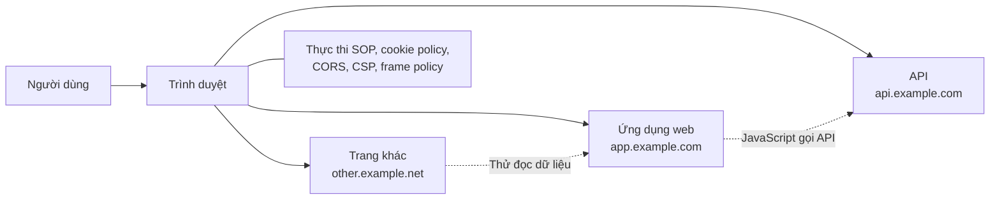
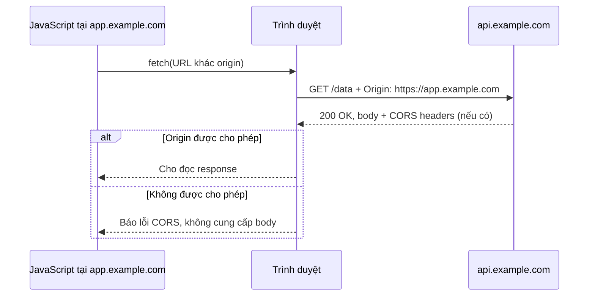

# Browser security là gì?

**Browser security (bảo mật trình duyệt)** là tập hợp các ranh giới tin cậy, cơ chế kiểm soát và biện pháp phòng vệ giúp trình duyệt xử lý nội dung web từ nhiều nguồn mà không để một nguồn tùy ý đọc, sửa hoặc chiếm quyền dữ liệu của nguồn khác. Đối với nhà phát triển ứng dụng web, browser security còn là cách thiết kế máy chủ, mã JavaScript và HTTP response để các cơ chế bảo vệ đó hoạt động đúng.

Bài học thuộc chương **Bức tranh tổng thể**, đặt nền tảng cho việc phân tích ranh giới giữa **trình duyệt, origin, cookie và ứng dụng web**. Sau bài này, người học sẽ nhận diện được vai trò của **Same-Origin Policy (SOP), CORS**, các cơ chế cách ly, cũng như hướng phòng vệ trước **XSS, CSRF và clickjacking** bằng **CSP, Trusted Types, security headers** và kiểm chứng trong DevTools.

## 1. Vì sao trình duyệt cần mô hình bảo mật riêng?

Một trình duyệt có thể cùng lúc mở trang ngân hàng, hệ thống nội bộ, trang tin và một website không đáng tin cậy. Mỗi trang đều có thể chứa HTML, CSS, JavaScript, hình ảnh, biểu mẫu và lời gọi mạng. Nếu mọi đoạn JavaScript có quyền đọc dữ liệu của mọi tab, một website lạ có thể lấy thông tin từ ứng dụng mà người dùng đã đăng nhập.

Trình duyệt vì vậy phải giải quyết đồng thời ba bài toán:

1. **Cách ly:** nội dung của một nguồn không được tự do truy cập DOM, bộ nhớ lưu trữ hay phản hồi mạng của nguồn khác.
2. **Cấp quyền có kiểm soát:** một số tương tác xuyên nguồn vẫn cần hoạt động, ví dụ ứng dụng giao diện gọi API hoặc hiển thị ảnh từ CDN.
3. **Hạn chế tác hại khi nội dung bị lạm dụng:** mã độc chen vào trang, request được kích hoạt ngoài ý muốn hoặc giao diện bị lồng trong trang giả mạo cần bị ngăn chặn hoặc giảm phạm vi ảnh hưởng.

Browser security là một phần của an toàn ứng dụng web, không thay thế xác thực, phân quyền, kiểm tra dữ liệu đầu vào và bảo vệ phía máy chủ. Trình duyệt thực thi một số quy tắc an toàn cho người dùng; máy chủ vẫn phải tự quyết định **ai được làm gì**.

### Các bên và ranh giới tin cậy



Trong sơ đồ, trình duyệt tải tài nguyên và gửi request tới nhiều máy chủ, nhưng quyền **đọc dữ liệu trả về** không mặc nhiên giống quyền **gửi request**. Phân biệt hai quyền này là chìa khóa để hiểu SOP, CORS và CSRF.

## 2. Origin và site: hai khái niệm không được đánh đồng

**Origin** là bộ ba **scheme (giao thức) + host (tên máy) + port (cổng)**. Ví dụ, origin của `https://app.example.com/account` là `https://app.example.com` (cổng HTTPS mặc định là 443). Đường dẫn `/account`, query string và fragment không tạo origin mới.

**Site** thường được xác định bằng scheme cùng *registrable domain* (tên miền có thể đăng ký, xét theo Public Suffix List). Hai subdomain khác nhau có thể **cùng site nhưng khác origin**. Phân biệt này đặc biệt quan trọng khi hiểu `SameSite` của cookie.

Giả sử trang đang mở là `https://app.example.com/dashboard`:

| Địa chỉ so sánh | Cùng origin? | Cùng site? | Lý do |
| --- | :---: | :---: | --- |
| `https://app.example.com/profile` | Có | Có | Chỉ khác đường dẫn |
| `https://api.example.com/v1` | Không | Có | Khác host; cùng scheme và `example.com` |
| `https://app.example.com:8443` | Không | Có | Khác port |
| `http://app.example.com` | Không | Không | Khác scheme; trình duyệt hiện đại dùng *schemeful same-site* |
| `https://other.example.net` | Không | Không | Khác tên miền đăng ký |

Một số tình huống đặc biệt như URL `file:`, sandboxed iframe và tài liệu có *opaque origin* cần quy tắc riêng; không nên suy luận chúng chỉ từ chuỗi host. Trong DevTools, có thể xem origin của tài liệu thông thường bằng `location.origin`.

### Dữ liệu được gắn với ranh giới nào?

| Thành phần | Quy tắc cần nhớ |
| --- | --- |
| DOM của trang / iframe | SOP thường cấm JavaScript từ origin khác đọc hoặc thao tác trực tiếp DOM; một số thuộc tính, thao tác điều hướng được cho phép có giới hạn |
| `localStorage`, `IndexedDB` | Về cơ bản được phân tách theo origin; trình duyệt có thể áp dụng thêm phân vùng lưu trữ theo ngữ cảnh bên thứ ba |
| Cookie | Phạm vi gửi dựa vào `Domain`, `Path`, `Secure`, `SameSite` và chính sách trình duyệt; **không** đồng nhất với origin |
| HTTP response từ `fetch()` / XHR | SOP ngăn script đọc response xuyên origin trừ khi chính sách như CORS cho phép |
| `postMessage()` | Cho phép trao đổi thông điệp có chủ đích giữa các cửa sổ/iframe; phía nhận phải kiểm tra `event.origin` và cấu trúc dữ liệu |

`Path` của cookie là quy tắc gửi cookie, **không phải ranh giới bảo mật đủ mạnh** giữa hai ứng dụng cùng host. Nếu cần cách ly rõ ràng, hãy cân nhắc tách ứng dụng sang các origin phù hợp và cấu hình cookie cẩn thận.

## 3. Same-Origin Policy: chặn quyền đọc vượt ranh giới

**Same-Origin Policy (SOP)** là chính sách nền tảng ngăn mã của một origin tùy ý đọc hoặc sửa tài nguyên nhạy cảm thuộc origin khác. Ví dụ, script từ `https://evil.example.net` không thể tự lấy nội dung trang tài khoản đang mở ở `https://bank.example.com` bằng cách truy cập DOM của iframe hoặc đọc kết quả `fetch()` nếu không có quyền phù hợp.

SOP **không** có nghĩa trình duyệt chặn mọi hoạt động xuyên origin:

- **Liên kết, chuyển hướng và nhiều request biểu mẫu** có thể được gửi sang origin khác; việc máy chủ chấp nhận hành động hay không là chuyện riêng.
- **Ảnh, stylesheet, script và iframe** có các cơ chế nhúng tài nguyên xuyên origin với những giới hạn khác nhau. Nhúng được một tài nguyên không có nghĩa JavaScript có thể đọc mọi dữ liệu bên trong nó; việc tải script ngoài còn tạo rủi ro thực thi mã trong trang đang nhúng.
- **`fetch()` / XHR xuyên origin** có thể phát request, nhưng JavaScript chỉ đọc response nếu kiểm tra CORS và các chính sách liên quan thành công.

Ví dụ sau chạy trong trang `https://app.example.com`:

```js
// Cùng origin: bình thường không cần CORS.
const profile = await fetch('/api/profile');

// Khác origin: phải xét CORS nếu script cần đọc response.
const reports = await fetch('https://api.example.com/reports');
```

Khi request thứ hai thất bại vì CORS, điều đó không nhất thiết chứng minh máy chủ API chưa nhận request. Với request đơn giản, máy chủ có thể đã nhận và xử lý trước khi trình duyệt chặn JavaScript đọc response.

## 4. CORS: ngoại lệ có kiểm soát cho việc đọc response

**Cross-Origin Resource Sharing (CORS)** là cơ chế dựa trên HTTP headers để máy chủ tuyên bố origin nào được phép truy cập response từ JavaScript của trình duyệt. **Máy chủ phát biểu chính sách, trình duyệt thực thi chính sách.** CORS không thay thế đăng nhập, phân quyền hoặc kiểm tra CSRF.

Ví dụ giao diện ở `https://app.example.com` cần đọc dữ liệu từ `https://api.example.com`. API có thể trả:

```http
HTTP/1.1 200 OK
Access-Control-Allow-Origin: https://app.example.com
Vary: Origin
Content-Type: application/json

{"orders": []}
```

`Access-Control-Allow-Origin` cho phép origin được nêu đọc response; `Vary: Origin` giúp cache phân biệt biến thể phản hồi khi máy chủ chọn origin động theo allowlist. Máy chủ không nên phản chiếu tùy tiện giá trị `Origin` của mọi request để biến CORS thành cho phép tất cả.

### Simple request, preflight và credentials

- Một số request thuộc nhóm **CORS-safelisted** (thường gọi là *simple request*) có thể được gửi trực tiếp. Trình duyệt vẫn kiểm tra CORS trước khi cung cấp response cho JavaScript.
- Những request không thỏa điều kiện đó, ví dụ `POST` với `Content-Type: application/json` hoặc có header tùy chỉnh, thường có bước **preflight `OPTIONS`** để hỏi máy chủ cho phép method và headers nào trước khi gửi request chính.
- Khi JavaScript cần gửi cookie/HTTP credentials cho API xuyên origin, `fetch()` thường phải đặt `credentials: 'include'` và máy chủ phải trả `Access-Control-Allow-Credentials: true` cùng một **origin cụ thể** trong `Access-Control-Allow-Origin`. Không được dùng `*` cho response CORS có credentials.
- Cookie còn phải thỏa chính sách cookie riêng (`Domain`, `SameSite`, `Secure`, chống theo dõi của trình duyệt...). CORS cho phép đọc response **không tự tạo quyền gửi cookie**.

```js
// Chỉ dùng khi API chủ đích hỗ trợ xác thực bằng cookie xuyên origin.
const response = await fetch('https://api.example.com/me', {
  credentials: 'include',
});
if (!response.ok) throw new Error(`HTTP ${response.status}`);
const user = await response.json();
```

Một preflight thành công không cấp quyền thực hiện thao tác nhạy cảm: API vẫn cần xác thực, phân quyền và bảo vệ CSRF. Ngược lại, việc thiếu CORS không bảo vệ API trước `curl`, ứng dụng máy chủ hoặc những client không bị SOP của trình duyệt ràng buộc.

### Luồng quan sát trong Network



## 5. Những lỗ hổng phổ biến ở ranh giới trình duyệt

| Nguy cơ | Kẻ tấn công lợi dụng gì? | Hậu quả ví dụ | Phòng vệ chính |
| --- | --- | --- | --- |
| **XSS** (*Cross-Site Scripting*) | Dữ liệu không tin cậy trở thành mã chạy trong origin của ứng dụng | Đọc nội dung trang, thao tác thay người dùng, đánh cắp dữ liệu mà script có thể truy cập | Output encoding theo ngữ cảnh, API DOM an toàn, sanitization phù hợp, CSP, Trusted Types |
| **CSRF** (*Cross-Site Request Forgery*) | Trình duyệt có thể tự đính kèm cookie phiên khi gửi request | Ép người dùng đang đăng nhập thực hiện thao tác ngoài ý muốn | CSRF token, `SameSite`, kiểm tra `Origin`/`Referer`, chống side effects qua GET |
| **Clickjacking** | Trang thật bị đặt trong iframe và che phủ bằng giao diện đánh lừa | Người dùng bấm vào nút nhạy cảm mà không biết | CSP `frame-ancestors`, `X-Frame-Options` hỗ trợ tương thích |
| **Rò rỉ / nhầm ranh giới cross-origin** | Cấu hình CORS, cookie hoặc nhúng tài nguyên quá rộng | Script ở website không được tin cậy đọc thông tin qua API | Allowlist origin, kiểm soát credentials, tách origin, kiểm tra phân quyền |
| **Mixed content / kết nối không an toàn** | Trang HTTPS tải nội dung HTTP hoặc truyền dữ liệu không bảo vệ | Can thiệp nội dung, giảm độ tin cậy của kết nối | HTTPS, tránh mixed content, HSTS khi triển khai phù hợp |

### 5.1. XSS: dữ liệu nhập vào trở thành mã thực thi

XSS có thể xuất hiện dưới dạng *reflected* (phản chiếu ngay trong response), *stored* (được lưu và phát lại) hoặc *DOM-based* (lỗi xử lý dữ liệu phía client). Điểm chung là **dữ liệu do bên ngoài kiểm soát bị đưa vào ngữ cảnh thực thi**.

```js
const query = new URLSearchParams(location.search).get('q') ?? '';

// Không an toàn: chuỗi từ URL bị phân tích như HTML.
document.querySelector('#search-term').innerHTML = query;

// An toàn khi mục tiêu chỉ là hiển thị văn bản.
document.querySelector('#search-term').textContent = query;
```

Khi cần hiển thị rich text/HTML do người dùng cung cấp, phải dùng bộ **sanitize HTML đáng tin cậy** phù hợp với chính sách ứng dụng; thay thế ký tự thủ công hoặc lọc một vài thẻ là không đủ. Với template, URL, CSS và thuộc tính HTML, cần áp dụng xử lý theo **đúng ngữ cảnh đầu ra**. Không đưa dữ liệu không tin cậy vào `eval()`, `new Function()` hay các sink tương tự.

**Content Security Policy (CSP)** giảm khả năng thực thi script trái phép và hạn chế nguồn tài nguyên được tải. Ví dụ chính sách khởi đầu nghiêm ngặt:

```http
Content-Security-Policy: default-src 'self'; script-src 'self' 'nonce-<gia-tri-ngau-nhien-moi-response>'; object-src 'none'; base-uri 'self'; frame-ancestors 'none'
```

Trong hệ thống thật, giá trị nonce phải được sinh đủ ngẫu nhiên **cho mỗi response** và gắn tương ứng vào các thẻ script inline được cho phép. Không dùng nguyên văn chuỗi placeholder trên. CSP là lớp phòng vệ bổ sung; ứng dụng vẫn phải sửa nguồn gây XSS. Khi triển khai thực tế có thể bắt đầu với `Content-Security-Policy-Report-Only` và kiểm tra báo cáo trước khi bật chặn.

**Trusted Types** là cơ chế bổ sung giúp hạn chế việc truyền chuỗi tùy ý vào một số DOM sink nguy hiểm, ví dụ `innerHTML`. Có thể định hướng dùng các chỉ thị CSP `require-trusted-types-for 'script'` và `trusted-types`; cần kiểm tra mức độ hỗ trợ của trình duyệt mục tiêu. Trusted Types không tự sanitize dữ liệu và không thay thế các API DOM an toàn.

### 5.2. CSRF: request không mong muốn được gửi kèm phiên đăng nhập

Giả sử người dùng đang đăng nhập `https://bank.example.com`. Một trang độc hại có thể cố khiến trình duyệt gửi request đến ngân hàng. Nếu cookie phiên đủ điều kiện được trình duyệt gửi và máy chủ chỉ dựa vào cookie để chấp nhận hành động, yêu cầu ngoài ý muốn có thể thành công.

Phòng vệ nên phối hợp:

1. Sử dụng **CSRF token** gắn với phiên hoặc cơ chế token tương đương được thiết kế đúng cho các thao tác thay đổi trạng thái.
2. Đặt cookie phiên với `Secure`, `HttpOnly` và giá trị `SameSite=Lax` hoặc `SameSite=Strict` tùy luồng sản phẩm. Chỉ dùng `SameSite=None; Secure` khi có nhu cầu hợp lệ cho cookie xuyên site.
3. Xác minh `Origin` (và `Referer` khi phù hợp), kiểm tra phương thức HTTP, tránh dùng `GET` cho hành động làm thay đổi dữ liệu.
4. Luôn xác thực và phân quyền ở máy chủ. `SameSite` không thay thế CSRF token cho mọi trường hợp, nhất là các tương tác **cùng site nhưng khác origin**.

Đừng cho rằng **“đã bật CORS” đồng nghĩa “không thể bị CSRF”**. Một biểu mẫu HTML hoặc simple request vẫn có thể gửi request; việc trình duyệt ngăn script đọc response là vấn đề khác với việc server thực hiện thao tác.

### 5.3. Clickjacking: thao túng thao tác qua iframe

Kẻ tấn công có thể lồng trang của ứng dụng vào iframe trên website giả mạo rồi căn chỉnh nút thật với nội dung đánh lừa. Người dùng nghĩ mình bấm vào giao diện ngoài, nhưng thao tác thực tế lại tác động lên ứng dụng đang đăng nhập.

Đối với trang nhạy cảm không được nhúng, máy chủ nên gửi:

```http
Content-Security-Policy: frame-ancestors 'none'
X-Frame-Options: DENY
```

`frame-ancestors` là cơ chế hiện đại để quy định **trang cha nào được phép nhúng** tài liệu. Nếu có nhu cầu nhúng hợp lệ, định nghĩa allowlist rõ ràng; đừng chặn toàn bộ iframe một cách máy móc. `X-Frame-Options` hỗ trợ các môi trường cũ hơn và có phạm vi biểu đạt hạn chế hơn. Chỉ thị `frame-ancestors` phải được gửi qua **HTTP response header**, không có tác dụng khi đặt trong thẻ `<meta>`.

## 6. Cookie và phiên đăng nhập: dữ liệu đi kèm request

Cookie thường được trình duyệt đính vào HTTP request khi thỏa thuộc tính và chính sách áp dụng. Đó là lý do cookie liên quan tới cả **xác thực**, **CSRF** và ranh giới site.

Ví dụ cookie phiên đặt cho một host cụ thể:

```http
Set-Cookie: __Host-session=opaque-session-id; Path=/; Secure; HttpOnly; SameSite=Lax
```

- `Secure`: chỉ gửi qua kết nối an toàn theo quy tắc của trình duyệt.
- `HttpOnly`: JavaScript không thể đọc cookie qua `document.cookie`; **không** ngăn script bị XSS gửi hành động trong phiên người dùng.
- `SameSite`: kiểm soát một số tình huống gửi cookie trong request xuyên site; **không** tương đương với kiểm tra origin.
- Tiền tố `__Host-`: yêu cầu `Secure`, `Path=/` và không có thuộc tính `Domain`, giúp ràng buộc cookie vào host tạo nó theo quy tắc hỗ trợ của trình duyệt.

Cookie là một phương tiện lưu và truyền session identifier; quyết định xem một request có hợp lệ vẫn phải được kiểm tra ở phía server. Với token trong `localStorage`, XSS có thể đọc giá trị đó trực tiếp; với cookie `HttpOnly`, XSS vẫn có thể thao tác trên phiên trong ngữ cảnh trang. Lựa chọn cơ chế phiên cần xét mô hình đe dọa của ứng dụng.

## 7. Security headers và các cơ chế cách ly quan trọng

Máy chủ gửi response headers để bổ sung rào chắn an toàn; trình duyệt áp dụng chúng theo từng tài liệu hoặc tài nguyên. Bảng dưới đây là bản đồ chức năng, **không phải một cấu hình duy nhất có thể áp dụng nguyên xi cho mọi website**.

| Header / cơ chế | Tác dụng chính | Lưu ý thiết kế |
| --- | --- | --- |
| `Content-Security-Policy` | Giới hạn nguồn script, tài nguyên, nơi được nhúng và một số hành vi DOM | Chọn chính sách theo ứng dụng; tránh `unsafe-inline` không cần thiết; xem CSP là nhiều lớp chỉ thị khác nhau |
| `X-Content-Type-Options: nosniff` | Giảm rủi ro trình duyệt đoán sai kiểu MIME ở một số ngữ cảnh | Máy chủ vẫn phải đặt `Content-Type` đúng |
| `Strict-Transport-Security` (HSTS) | Yêu cầu trình duyệt quay lại qua HTTPS sau khi nhận chính sách hợp lệ | Chỉ cấu hình trên HTTPS; kiểm tra mọi subdomain trước khi bật `includeSubDomains` |
| `Referrer-Policy` | Hạn chế thông tin URL gửi trong `Referer` | Ví dụ `strict-origin-when-cross-origin` có thể phù hợp với nhiều ứng dụng |
| `Permissions-Policy` | Kiểm soát quyền sử dụng một số tính năng như camera, microphone, geolocation | Tắt tính năng không dùng; một số chính sách cần phối hợp quyền người dùng |
| `Cross-Origin-Opener-Policy` (COOP) | Quản lý mối quan hệ giữa các browsing context cấp cao | Một cấu hình chặt có thể ảnh hưởng luồng popup/đăng nhập |
| `Cross-Origin-Embedder-Policy` (COEP) | Đặt yêu cầu với tài nguyên nhúng xuyên origin | Có thể yêu cầu tài nguyên được tải bằng CORS hoặc chính sách CORP phù hợp |
| `Cross-Origin-Resource-Policy` (CORP) | Cho phép chủ tài nguyên giới hạn ngữ cảnh khác origin/site nào được nhúng tài nguyên theo một số chế độ tải | Không thay thế CORS khi script cần đọc response |

**Cross-origin isolation** là trạng thái bảo vệ nâng cao, thường cần phối hợp COOP và COEP cùng cấu hình tài nguyên liên quan. Một số khả năng web nhạy cảm như `SharedArrayBuffer` chịu ảnh hưởng của trạng thái này. Không nên bật các header cách ly theo phong trào: hãy xác định nhu cầu sản phẩm và kiểm thử popup, iframe, CDN, bên thứ ba trước khi triển khai.

**HTTPS** bảo vệ tính bí mật và toàn vẹn dữ liệu trên đường truyền tới đầu cuối thích hợp; nó không sửa lỗi XSS, CSRF hay lỗi phân quyền. Trình duyệt có thể chặn hoặc nâng cấp một số nội dung HTTP khi trang chính dùng HTTPS (*mixed content*), nhưng ứng dụng nên chủ động chỉ tải tài nguyên qua HTTPS.

## 8. Thực hành: tự quan sát SOP và CORS trên hai origin

Bài thực hành dùng **Node.js** và hai cổng localhost, không cần thư viện ngoài. Mục tiêu là chứng minh: **request mạng có thể tới API trong khi JavaScript không được đọc response vì CORS**.

Tạo hai file trong một thư mục thử nghiệm riêng (không phải thư mục bài học):

**`app.mjs`** — trang chạy ở `http://localhost:3000`:

```js
import { createServer } from 'node:http';

createServer((req, res) => {
  res.setHeader('Content-Type', 'text/html; charset=utf-8');
  res.end(`<!doctype html>
    <html lang="vi"><meta charset="utf-8">
    <h1>Quan sát CORS</h1>
    <pre id="result">Đang gửi request...</pre>
    <script>
      fetch('http://localhost:3001/data')
        .then(r => r.json())
        .then(data => document.querySelector('#result').textContent = JSON.stringify(data))
        .catch(err => document.querySelector('#result').textContent = String(err));
    </script>
    </html>`);
}).listen(3000, () => console.log('App: http://localhost:3000'));
```

**`api.mjs`** — API ở `http://localhost:3001`:

```js
import { createServer } from 'node:http';

const allowCors = false; // Thử đổi thành true ở vòng 2.

createServer((req, res) => {
  console.log('API đã nhận:', req.method, req.url, 'Origin:', req.headers.origin);
  if (allowCors) {
    res.setHeader('Access-Control-Allow-Origin', 'http://localhost:3000');
  }
  res.setHeader('Content-Type', 'application/json; charset=utf-8');
  res.end(JSON.stringify({ message: 'Phản hồi từ origin 3001' }));
}).listen(3001, () => console.log('API: http://localhost:3001'));
```

**Cách chạy và quan sát:**

1. Trong hai terminal riêng, chạy `node api.mjs` và `node app.mjs`.
2. Mở `http://localhost:3000`; nhấn **F12 → Network** và **Console**. Trang thường hiện `TypeError: Failed to fetch` (câu chữ có thể khác theo trình duyệt), Console có thông báo CORS. Terminal API vẫn ghi nhận `GET /data` và `Origin: http://localhost:3000`.
3. Dừng API, sửa `allowCors = true`, chạy lại `node api.mjs`, rồi tải lại trang. Lúc này JavaScript đọc được JSON và hiển thị thông điệp.
4. Trong Network, so sánh **Request Headers → Origin** và **Response Headers → Access-Control-Allow-Origin** của hai lần thử. Trong Console, kiểm tra `location.origin` của trang là `http://localhost:3000`.

Hai địa chỉ chỉ khác cổng nên **khác origin**; ví dụ này không có session/cookie và không cần credentials. Request `GET` dùng trong ví dụ là trường hợp không yêu cầu preflight. Nếu thử yêu cầu `POST` với `Content-Type: application/json`, cần bổ sung xử lý `OPTIONS`/`Access-Control-Allow-Methods`/`Access-Control-Allow-Headers` cho API để quan sát luồng preflight.

### Cần rút ra điều gì?

- API **đã nhận request** dù JavaScript bị CORS chặn đọc kết quả.
- Chỉ cần thay đổi **response header ở API**, hành vi đọc của JavaScript thay đổi. Việc thêm CORS vào frontend không tự giải quyết vấn đề.
- Việc ứng dụng đọc được JSON **không chứng minh** người dùng đã được xác thực hoặc có quyền đọc dữ liệu đó; API phải kiểm tra quyền độc lập.

Khi kiểm tra một website thật, dùng **DevTools → Network, Application/Storage, Security và Console** để xem request `Origin`, CORS headers, cookie attributes, CSP violations và kết nối HTTPS. Nên ghi lại URL, origin nguồn, request method, trạng thái phản hồi và header liên quan, vì riêng thông báo lỗi trên màn hình thường chưa đủ để xác định nguyên nhân.

## 9. Những nhầm lẫn cần tránh

| Nhầm lẫn | Cách hiểu đúng |
| --- | --- |
| “CORS bảo vệ API khỏi mọi truy cập trái phép.” | CORS chủ yếu kiểm soát quyền đọc response của JavaScript trong trình duyệt. API luôn cần xác thực và phân quyền. |
| “Khác subdomain là khác site.” | Khác subdomain thường khác **origin**, nhưng vẫn có thể cùng **site**. |
| “SOP không cho gửi request sang website khác.” | Nhiều loại request vẫn được gửi; SOP giới hạn một số quyền đọc và tương tác. |
| “Cookie `HttpOnly` làm XSS vô hại.” | `HttpOnly` ngăn script đọc trực tiếp cookie; script bị XSS vẫn có thể thực hiện hành động trong phiên. |
| “`SameSite` thay thế hoàn toàn CSRF token.” | Cần xét các luồng xác thực, trường hợp cùng site khác origin và thao tác nhạy cảm; phòng vệ nhiều lớp an toàn hơn. |
| “CSP sẽ tự sửa lỗi đưa dữ liệu vào `innerHTML`.” | CSP giúp giảm tác hại và tăng khả năng chặn khai thác; mã ứng dụng vẫn cần API an toàn và xử lý đầu ra đúng ngữ cảnh. |
| “Cứ bật mọi security header với giá trị chặt nhất.” | Chính sách phải phù hợp yêu cầu nhúng, popup, API và tài nguyên ngoài, rồi được kiểm chứng bằng hành vi thực tế. |

## 10. Tự kiểm tra

**Câu 1.** `https://store.example.com` gọi `https://api.example.com`. Hai địa chỉ cùng origin hay cùng site? Có cần xét CORS không?

**Đáp án:** Khác origin (khác host), cùng site (cùng scheme và registrable domain `example.com`). Khi JavaScript cần đọc response từ API xuyên origin, phải xét CORS.

**Câu 2.** Một form trên website lạ đã gửi request thành công đến endpoint thay đổi email, nhưng trang lạ không thể đọc response vì CORS. Endpoint đã an toàn chưa?

**Đáp án:** Chưa thể kết luận an toàn. Máy chủ có thể đã xử lý request; cần kiểm tra xác thực, phân quyền, CSRF token, cookie và `Origin`.

**Câu 3.** Ứng dụng hiển thị chuỗi truy vấn tìm kiếm bằng `innerHTML`. Biện pháp đầu tiên nên làm là gì?

**Đáp án:** Nếu chỉ cần hiển thị văn bản, dùng `textContent` (hoặc cơ chế escape theo ngữ cảnh của template). Có thể bổ sung CSP/Trusted Types, nhưng không dùng chúng thay cho việc sửa DOM sink không an toàn.

**Câu 4.** Trang thanh toán không được phép xuất hiện trong iframe của website bên ngoài. Cấu hình nào trực tiếp xử lý yêu cầu này?

**Đáp án:** Gửi CSP response header `frame-ancestors 'none'` (có thể kèm `X-Frame-Options: DENY` để hỗ trợ môi trường cũ).

## Tài liệu tham khảo

- MDN — [Same-origin policy](https://developer.mozilla.org/en-US/docs/Web/Security/Same-origin_policy) và [Cross-Origin Resource Sharing (CORS)](https://developer.mozilla.org/en-US/docs/Web/HTTP/Guides/CORS).
- MDN — [Content Security Policy](https://developer.mozilla.org/en-US/docs/Web/HTTP/CSP), [Secure cookie configuration](https://developer.mozilla.org/en-US/docs/Web/Security/Practical_implementation_guides/Cookies) và [Cross-origin isolation](https://developer.mozilla.org/en-US/docs/Web/API/Window/crossOriginIsolated).
- OWASP Cheat Sheet Series — [Cross Site Scripting Prevention](https://cheatsheetseries.owasp.org/cheatsheets/Cross_Site_Scripting_Prevention_Cheat_Sheet.html), [Cross-Site Request Forgery Prevention](https://cheatsheetseries.owasp.org/cheatsheets/Cross-Site_Request_Forgery_Prevention_Cheat_Sheet.html) và [Clickjacking Defense](https://cheatsheetseries.owasp.org/cheatsheets/Clickjacking_Defense_Cheat_Sheet.html).
