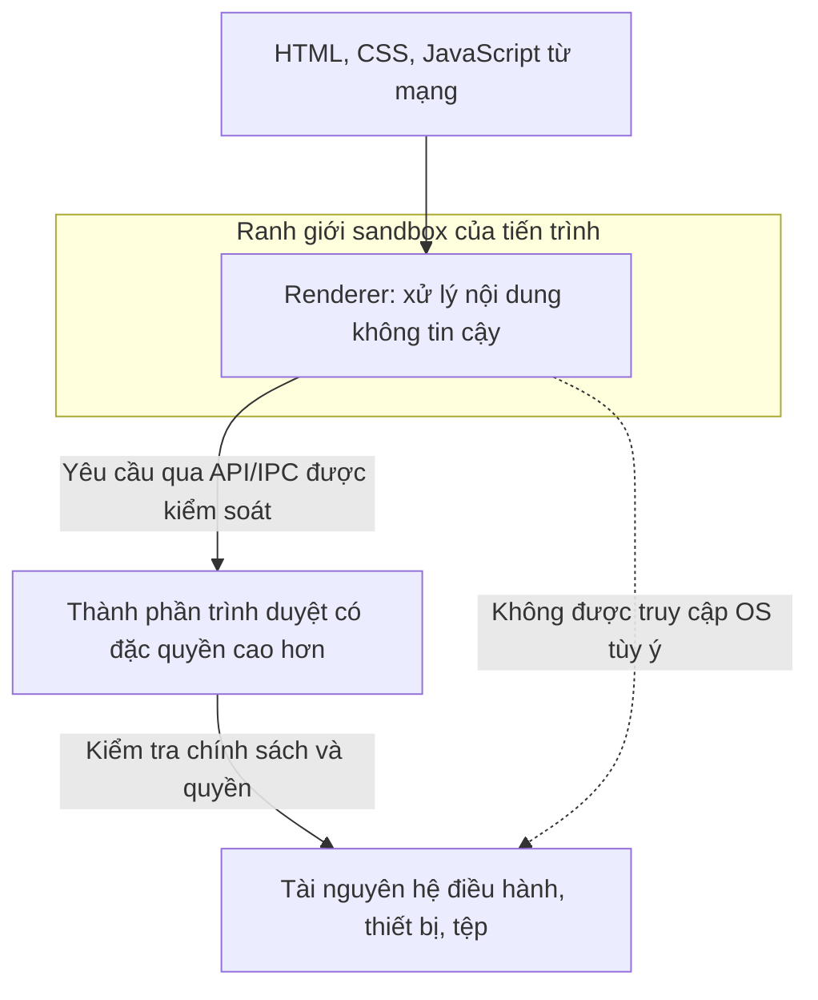

# Vì sao trình duyệt cần sandbox

> **Chương:** Bức tranh tổng thể  
> **Phạm vi:** Bảo mật ứng dụng web trong trình duyệt — ranh giới giữa hệ điều hành, tiến trình trình duyệt, origin và nội dung nhúng. Đây là nền tảng để hiểu Same-Origin Policy (SOP), CORS, cookie, XSS, CSRF, clickjacking, CSP, Trusted Types và các security header.

## 1. Một trang web thực chất đang được trao quyền gì?

Khi truy cập một trang web, ta cho phép trình duyệt tải HTML, CSS, JavaScript, hình ảnh và nhiều tài nguyên từ mạng rồi xử lý chúng trên máy của mình. Nội dung ấy có thể đến từ một nhà cung cấp đáng tin cậy, một quảng cáo bên thứ ba, một đường dẫn bị thay thế hoặc một trang do kẻ tấn công kiểm soát. Dù đến từ đâu, trình duyệt vẫn cần **hiển thị trang và thực thi những chức năng web hợp lệ** mà không cho nội dung đó mặc nhiên điều khiển máy tính hoặc đọc dữ liệu của website khác.

Hãy hình dung một trang giả mạo gửi JavaScript với các ý định sau:

- Đọc mọi tệp trong thư mục cá nhân hoặc lấy mật khẩu đang lưu trong hệ điều hành.
- Truy cập DOM và dữ liệu đăng nhập của một tab ngân hàng đang mở.
- Âm thầm bật camera, microphone hoặc truy cập vị trí chính xác.
- Tự điều khiển cửa sổ cha, chuyển hướng trang hay bật hàng loạt cửa sổ quảng cáo.

Nếu tất cả những việc này đều được phép chỉ vì người dùng mở một URL, web sẽ không thể là nền tảng chạy nội dung từ nhiều bên. **Sandbox** là một phần cốt lõi của lời giải: đặt mã và tài liệu có độ tin cậy thấp vào một môi trường có giới hạn, chỉ cho phép vượt ranh giới thông qua các cơ chế được kiểm soát.

Điều quan trọng là có **nhiều ranh giới khác nhau**. Sandbox của tiến trình bảo vệ hệ điều hành; Same-Origin Policy bảo vệ dữ liệu giữa các origin; sandbox của `iframe` giới hạn một tài liệu được nhúng. Chúng bổ sung cho nhau nhưng không thay thế nhau.

## 2. Sandbox là gì, và nó đang bảo vệ ai?

Trong bảo mật, một *sandbox* là môi trường thực thi được cấp ít quyền hơn môi trường chủ. Nội dung bên trong có thể tính toán, vẽ giao diện và dùng những API được cho phép, nhưng không thể tự ý vượt qua giới hạn để thực hiện thao tác nhạy cảm.

Mô hình đe dọa của trình duyệt bắt đầu từ giả định: **nội dung tải qua mạng có thể độc hại, kể cả khi trông giống một website bình thường**. Trình duyệt phải cân bằng hai mục tiêu: chạy đủ chức năng để ứng dụng web hoạt động và hạn chế hậu quả nếu HTML/JavaScript độc hại, hoặc thậm chí một lỗ hổng trong bộ máy xử lý web, được khai thác.

Ví dụ, một bảng tính chạy trong web cần thao tác với ô dữ liệu, vẽ biểu đồ, gửi request đến máy chủ của ứng dụng. Nó không cần quyền đọc toàn bộ ổ đĩa hoặc điều khiển tiến trình khác. Nguyên tắc thiết kế tương ứng là **đặc quyền tối thiểu** (*least privilege*): chỉ cấp quyền thật sự cần và yêu cầu trung gian kiểm tra khi muốn làm việc nhạy cảm.

Một số thành phần cũng có khả năng *cách ly* dù không mang tên “sandbox”. Vì vậy, khi đọc tài liệu kỹ thuật, cần hỏi rõ: **đối tượng nào bị cô lập, khỏi tài nguyên nào, bằng ranh giới gì và ai quyết định ngoại lệ?**

## 3. Những ranh giới bảo mật thường gặp trong trình duyệt

| Ranh giới | Đối tượng được giới hạn | Ngăn chặn điển hình | Không nên hiểu nhầm là |
| --- | --- | --- | --- |
| **Sandbox ở mức hệ điều hành/tiến trình** | Tiến trình xử lý nội dung web và những thao tác có đặc quyền | Mã trong renderer trực tiếp truy cập tài nguyên OS tùy ý | Một cơ chế phân quyền giữa mọi tài khoản web |
| **Same-Origin Policy (SOP)** | Script/tài liệu từ origin này đối với dữ liệu của origin khác | Script ở trang A tự đọc DOM hoặc response được bảo vệ của trang B | Lệnh cấm gửi mọi request hoặc nhúng mọi tài nguyên chéo origin |
| **Cách ly tiến trình/site (Site Isolation và cơ chế liên quan)** | Nội dung từ các site khác nhau trong bộ nhớ/tiến trình, tùy trình duyệt | Giảm phạm vi ảnh hưởng khi tiến trình xử lý nội dung bị xâm phạm | Cam kết mỗi iframe hay mỗi origin luôn có một tiến trình riêng |
| **HTML `iframe sandbox`** | Một tài liệu nhúng cụ thể | Script, form, popup, quyền giữ nguyên origin, điều hướng cấp trên… nếu không được cấp | Chế độ bảo vệ tự động áp dụng cho mọi iframe |
| **Quyền truy cập API và Permissions Policy** | API như camera, microphone, vị trí, tính năng trong iframe | Sử dụng tính năng nhạy cảm ngoài quyền do người dùng hoặc chính sách cho phép | Thay thế sandbox của tiến trình hoặc kiểm tra phân quyền máy chủ |

Các lớp này xuất hiện ở các vị trí khác nhau trên đường thực thi của một trang. Một request có thể được gửi qua mạng nhưng JavaScript vẫn không được đọc phản hồi; một iframe có thể chạy script nhưng bị ngăn mở popup; một renderer có thể vẽ giao diện nhưng không được trực tiếp đọc tập tin bất kỳ.

## 4. Sandbox của tiến trình: vì sao JavaScript không thành chương trình hệ điều hành?

Các trình duyệt hiện đại dùng kiến trúc nhiều thành phần/tiến trình với những mức đặc quyền khác nhau. Một mô hình khái niệm thường gặp gồm:

1. **Thành phần điều phối có quyền cao hơn** quản lý tab, điều hướng, quyền truy cập tài nguyên và những thao tác cần kiểm soát.
2. **Renderer** phân tích nội dung và chạy JavaScript, bố cục trang, xử lý DOM. Đây là nơi thường xuyên tiếp xúc với dữ liệu web không đáng tin.
3. **Cơ chế sandbox của hệ điều hành** giới hạn những syscall, tài nguyên và khả năng mà renderer có thể trực tiếp dùng.
4. **Các kênh giao tiếp được kiểm soát** cho phép renderer yêu cầu những dịch vụ cần thiết. Bên cung cấp dịch vụ phải kiểm tra ngữ cảnh và quyền trước khi đáp ứng.



Sơ đồ chỉ minh họa nguyên tắc; số lượng tiến trình, tên tiến trình, chính sách sandbox và mức tách biệt thay đổi theo trình duyệt, nền tảng và phiên bản. Không nên giả định mọi tab có đúng một renderer hoặc mọi origin có đúng một tiến trình.

**Điểm mấu chốt:** nếu một trang khai thác được lỗi trong mã xử lý nội dung web, mã độc vẫn phải vượt qua sandbox hoặc lạm dụng một giao diện được cấp quyền mới có thể chạm tới tài nguyên hệ điều hành bị bảo vệ. Sandbox giảm phạm vi thiệt hại; nó không bảo đảm mọi lỗi triển khai đều vô hại. Vì thế cập nhật trình duyệt và giảm bề mặt tấn công vẫn cần thiết.

Site Isolation giải quyết một phần khác của cùng bài toán: cố gắng tách nội dung thuộc các site khác nhau ra khỏi những vùng thực thi/bộ nhớ chung ở nơi được hỗ trợ. Điều này giúp hạn chế hậu quả của lỗi trong renderer và hỗ trợ bảo vệ dữ liệu chéo site. **Sandbox tiến trình** hỏi “renderer có thể làm gì đối với OS?”, còn **cách ly site** hỏi “nội dung từ site khác nhau có thể chia sẻ môi trường thực thi nào?”.

## 5. Origin: vì sao hai trang web không được tự đọc dữ liệu của nhau?

Sandbox hệ điều hành chưa đủ. Nếu hai trang đều chạy hợp lệ trong trình duyệt nhưng một trang đọc được dữ liệu của trang kia, mật khẩu, email và hồ sơ người dùng vẫn có thể bị lộ mà không cần chạm tới hệ điều hành.

Trình duyệt dùng khái niệm **origin**, gồm bộ ba **scheme + hostname + port**. Những URL dưới đây minh họa cách xác định:

| URL | Quan hệ với `https://app.example.com/dashboard` | Lý do |
| --- | --- | --- |
| `https://app.example.com/profile` | Cùng origin | Cùng scheme, hostname, port hiệu lực |
| `http://app.example.com/` | Khác origin | Khác scheme |
| `https://api.example.com/` | Khác origin | Khác hostname |
| `https://app.example.com:8443/` | Khác origin | Khác port |

Port mặc định của HTTPS là `443`; viết hoặc không viết `:443` không làm thay đổi origin. **Site** là một khái niệm khác với origin, thường dựa trên scheme và tên miền có thể đăng ký (*registrable domain*). Chẳng hạn `https://app.example.com` và `https://api.example.com` khác origin nhưng có thể cùng site. Phân biệt này quan trọng khi học về cookie `SameSite` và cách ly site.

### Same-Origin Policy cho phép và ngăn điều gì?

Giả sử người dùng đang đăng nhập tại `https://bank.example.com`. Khi họ mở `https://news.example.net`:

- JavaScript của trang tin **không thể trực tiếp đọc** DOM, biến JavaScript hoặc các phản hồi được bảo vệ của tab ngân hàng chỉ vì hai tab cùng mở trong một trình duyệt.
- Trình duyệt vẫn có thể **gửi một số request chéo origin** hoặc tải một số tài nguyên nhúng, tùy loại request, chính sách và các biện pháp phòng vệ khác. Việc gửi request khác với việc cho script đọc nội dung phản hồi.
- Nếu hai tài liệu thật sự cần trao đổi dữ liệu, chúng có thể dùng cơ chế được thiết kế cho giao tiếp chéo origin như `postMessage`, đi kèm kiểm tra origin, nguồn gửi và cấu trúc dữ liệu.

Ví dụ, script trong `https://app.example.com` thử gọi API tại `https://api.example.com`:

```js
fetch("https://api.example.com/account")
  .then((response) => response.json())
  .then((data) => console.log(data))
  .catch((error) => console.error("Không đọc được response:", error));
```

Đây là request **chéo origin**. Theo cơ chế CORS, máy chủ API phải trả về header phù hợp, ví dụ `Access-Control-Allow-Origin: https://app.example.com`, để trình duyệt cho JavaScript của `app.example.com` đọc phản hồi. Tùy phương thức/header, trình duyệt có thể gửi thêm request kiểm tra trước (*preflight*). Với request mang credentials, còn có các điều kiện CORS riêng về credentials và origin được phép.

CORS là chính sách **chia sẻ dữ liệu cho script trong trình duyệt**, không phải hệ thống xác thực người dùng. API vẫn phải kiểm tra phiên đăng nhập, quyền truy cập từng tài nguyên và dữ liệu đầu vào. Việc thấy lỗi CORS cũng không chứng minh request chưa từng rời trình duyệt; cần xem loại request và Network panel để đánh giá.

### Giao tiếp chéo origin có chủ đích

Một ứng dụng có thể nhúng widget của đối tác rồi trao đổi thông điệp qua `postMessage`. Ví dụ sau **giả định iframe giữ origin thực của đối tác** (không bị chuyển thành origin mờ/opaque bởi `sandbox`):

```html
<iframe id="partner" src="https://widget.partner.example.com/" title="Widget đối tác"></iframe>
<script>
  const frame = document.querySelector("#partner");
  const partnerOrigin = "https://widget.partner.example.com";

  frame.addEventListener("load", () => {
    frame.contentWindow.postMessage({ type: "PING" }, partnerOrigin);
  });

  window.addEventListener("message", (event) => {
    if (event.origin !== partnerOrigin) return;
    if (event.source !== frame.contentWindow) return;
    if (!event.data || event.data.type !== "PONG") return;

    console.log("Đã nhận phản hồi hợp lệ từ widget");
  });
</script>
```

Phía widget cũng cần kiểm tra `event.origin` trước khi xử lý. `targetOrigin` phải là origin dự kiến, không dùng `"*"` khi gửi dữ liệu nhạy cảm. Kiểm tra `event.source` giúp ràng buộc nguồn gửi với iframe mong đợi, nhưng không thay thế xác thực và kiểm tra cấu trúc nội dung thông điệp.

## 6. `iframe sandbox`: thu hẹp quyền cho một tài liệu được nhúng

`iframe` cho phép trang A hiển thị tài liệu B bên trong giao diện của mình. Một iframe thông thường **không tự động có bộ quyền hạn chế giống như khi thêm thuộc tính `sandbox`**. SOP vẫn hoạt động đối với iframe chéo origin, nhưng trang nhúng có thể thực hiện nhiều hành vi được trình duyệt hỗ trợ trong ngữ cảnh của nó.

Thuộc tính `sandbox` áp thêm tập hạn chế cho tài liệu được nhúng:

```html
<iframe
  src="https://widget.partner.example.com/"
  title="Nội dung bên thứ ba"
  sandbox
></iframe>
```

Với `sandbox` rỗng, các khả năng như chạy script, gửi form, mở popup và điều hướng trang cấp trên bị hạn chế theo các *sandbox flags* tương ứng. Nội dung cũng được đặt trong một **opaque origin** riêng trừ khi được cấp `allow-same-origin`. Opaque origin không có nghĩa là “origin thật của đối tác nhưng bị đổi tên”; nó có những hệ quả cụ thể đối với truy cập cùng origin, lưu trữ và thông điệp.

Ta có thể cấp lại **từng khả năng cần thiết** bằng token:

```html
<!-- Cho phép chạy JS, vẫn giữ các hạn chế sandbox khác. -->
<iframe
  src="https://widget.partner.example.com/"
  title="Widget cần JavaScript"
  sandbox="allow-scripts"
></iframe>
```

| Token | Tác dụng chính khi được thêm vào `sandbox` |
| --- | --- |
| `allow-scripts` | Cho phép script thực thi trong iframe |
| `allow-forms` | Cho phép gửi form |
| `allow-popups` | Cho phép tạo popup, nhưng popup có thể vẫn kế thừa giới hạn nếu không có quyền phù hợp khác |
| `allow-same-origin` | Không ép tài liệu vào opaque origin chỉ vì sandbox; quy tắc origin thông thường tiếp tục áp dụng |
| `allow-top-navigation-by-user-activation` | Cho phép điều hướng top-level trong điều kiện có kích hoạt của người dùng |

Không cấp token chỉ vì tính năng của iframe “không chạy”. Hãy tìm chính xác quyền cần thiết rồi cấp mức nhỏ nhất. Đặc biệt, **tránh kết hợp `allow-scripts` và `allow-same-origin` cho nội dung iframe cùng origin với trang cha**: tài liệu cùng origin có thể thao tác với phần tử iframe ở trang cha và vô hiệu hóa hiệu quả của sandbox khi tải lại. Đối với nội dung bên thứ ba, vẫn cần đánh giá mức tin cậy trước khi cấp quyền rộng.

`sandbox` và thuộc tính `allow` không đồng nghĩa. Ví dụ `allow="camera"` (Permissions Policy) điều phối khả năng sử dụng API camera trong iframe; nó không tự gỡ hạn chế script hoặc origin do `sandbox` đặt ra, và quyền của người dùng vẫn có thể cần được cấp riêng.

### Thí nghiệm nhỏ: hai iframe, một khác biệt

Lưu đoạn sau vào **một tệp HTML riêng để thử trên môi trường học tập** rồi mở bằng trình duyệt. Cả hai iframe đều hiển thị nút giống nhau; chỉ iframe thứ hai được cấp `allow-scripts`:

```html
<!doctype html>
<html lang="vi">
  <meta charset="utf-8">
  <title>Thử nghiệm iframe sandbox</title>
  <h1>So sánh sandbox flags</h1>

  <p>1. Không cấp quyền chạy script:</p>
  <iframe
    title="Sandbox chặn JavaScript"
    sandbox
    srcdoc="<button onclick='document.body.textContent=&quot;Script đã chạy&quot;'>Bấm thử</button>"
  ></iframe>

  <p>2. Chỉ cấp quyền chạy script:</p>
  <iframe
    title="Sandbox cho phép JavaScript"
    sandbox="allow-scripts"
    srcdoc="<button onclick='document.body.textContent=&quot;Script đã chạy&quot;'>Bấm thử</button>"
  ></iframe>
</html>
```

**Kỳ vọng:** nút thứ nhất không thực thi handler JavaScript; nút thứ hai đổi nội dung iframe thành “Script đã chạy”. Trong DevTools Console, trình duyệt thường báo việc chặn script do sandbox flags. Ví dụ cố ý dùng `srcdoc` và không cấp `allow-same-origin`; không suy ra từ thí nghiệm này rằng iframe thứ hai được phép đọc DOM của trang cha.

Khi nhúng tài liệu thật, cần cân nhắc nguồn nội dung và chính sách của ứng dụng. Không dùng sandbox của iframe để xem trực tiếp nội dung có thể gây hại cho máy chủ hoặc các tài khoản thật; thử nghiệm trên chỉ kiểm tra một giới hạn của trình duyệt.

## 7. Sandbox không thay thế các lớp phòng vệ ứng dụng

Một sandbox hoạt động đúng vẫn không ngăn mọi cuộc tấn công web. Từng lớp bảo mật cần giải quyết đúng loại rủi ro của mình.

| Rủi ro | Vì sao sandbox/SOP chưa giải quyết đủ | Phòng vệ thích hợp ở ứng dụng |
| --- | --- | --- |
| **XSS** | Script do kẻ tấn công chèn vào **chính origin của ứng dụng** có thể chạy với quyền web của origin đó; SOP không phân biệt “script tốt” và “script xấu” cùng origin | Escape/encode theo ngữ cảnh, tránh DOM sink nguy hiểm, kiểm soát input, CSP, Trusted Types khi phù hợp |
| **CSRF** | Trình duyệt có thể gửi một số request chéo origin kèm cookie phù hợp; SOP thường cấm đọc response chứ không mặc định cấm tác động của request | CSRF token, kiểm tra `Origin`/`Referer` khi thích hợp, `SameSite`, tránh thao tác thay đổi trạng thái qua GET |
| **Clickjacking** | Website của bạn có thể bị bên khác nhúng vào iframe để đánh lừa thao tác; sandbox trên iframe do bạn tạo không quyết định ai được nhúng **trang của bạn** | CSP `frame-ancestors` và, khi cần tương thích, `X-Frame-Options` |
| **Lộ cookie/session** | Cookie được trình duyệt tự gửi theo phạm vi domain/path và chính sách liên quan; SOP không phải một bộ kiểm soát phiên hoàn chỉnh | Cookie `HttpOnly`, `Secure`, `SameSite`, quản lý phiên và kiểm tra quyền ở server |
| **Lạm dụng quyền API/phishing** | Trang có thể thuyết phục người dùng cấp quyền hoặc nhập bí mật; sandbox không thể tự xác định ý định người dùng | Chỉ xin quyền khi cần, Permissions Policy, UX rõ ràng, phòng vệ xác thực và nhận thức người dùng |
| **Khai thác lỗ hổng trình duyệt** | Sandbox có thể có lỗi, hoặc code có thể khai thác dịch vụ trung gian được cấp quyền | Cập nhật trình duyệt, OS, giảm đặc quyền và duy trì nhiều lớp bảo vệ |

Ví dụ một server có endpoint chuyển tiền nhận `POST` cùng cookie phiên. Trang ngoài có thể không đọc được response vì SOP/CORS, nhưng điều đó **không tự động chứng minh** request chuyển tiền không được gửi hoặc xử lý. Server phải xác thực ý định thay đổi trạng thái bằng CSRF protection và kiểm tra quyền. Ngược lại, nếu trang ứng dụng bị XSS, mã độc có thể gọi những API cùng origin bằng quyền của phiên người dùng; sandbox OS vẫn hoạt động nhưng dữ liệu ứng dụng vẫn có nguy cơ bị lạm dụng.

Về clickjacking, phản hồi của trang cần chống bị nhúng có thể khai báo:

```http
Content-Security-Policy: frame-ancestors 'none'
```

Header này nói với trình duyệt rằng tài liệu không được đặt trong khung của trang khác. Nó khác bản chất với `iframe sandbox`, vốn do trang **đang nhúng** khai báo cho tài liệu con. `X-Frame-Options: DENY` là một header truyền thống có tác dụng tương tự trong phạm vi hỗ trợ của nó.

## 8. Đọc lỗi trình duyệt để xác định đúng ranh giới

Khi một tính năng không hoạt động, đừng gộp mọi lỗi thành “bị sandbox chặn”. Mỗi tín hiệu chỉ về một lớp khác nhau:

| Quan sát trong DevTools | Thường liên quan đến | Hướng điều tra |
| --- | --- | --- |
| “Blocked a frame with origin … from accessing a cross-origin frame” hoặc `SecurityError` khi truy cập `contentDocument` | SOP | Kiểm tra scheme/host/port, thiết kế `postMessage` nếu cần giao tiếp |
| “Blocked script execution … sandboxed … 'allow-scripts' …” | HTML iframe sandbox | Kiểm tra token `sandbox` và nhu cầu thật sự của script |
| “Blocked by CORS policy” | Chính sách đọc phản hồi chéo origin, đôi khi có preflight | Xem Network panel, request/response headers và cấu hình CORS phía server |
| `getUserMedia()` bị từ chối | Quyền người dùng, secure context, Permissions Policy hoặc điều kiện API | Kiểm tra HTTPS, quyền trình duyệt, `allow` trong iframe và API cụ thể |
| Trang từ chối hiển thị trong iframe do `frame-ancestors` | Chính sách của trang **bị nhúng** | Kiểm tra CSP response của trang đó; không cố “sửa” bằng cách nới iframe sandbox |

Thông báo cụ thể có thể khác theo engine và phiên bản. Để chẩn đoán đúng, hãy ghi lại origin của trang cha và iframe, các thuộc tính iframe, request/response headers, trạng thái quyền API và thông báo Console. Không nên bật CORS quá rộng, bỏ `sandbox` hoặc tắt bảo vệ của trình duyệt chỉ để làm biến mất lỗi.

## 9. Cách suy luận khi thiết kế một tính năng web

Giả sử một sàn thương mại điện tử muốn đưa widget đánh giá sản phẩm của đối tác vào trang mua hàng:

1. **Xác định dữ liệu và độ tin cậy.** Widget là mã của bên thứ ba; dữ liệu tài khoản, giỏ hàng và token của ứng dụng chủ phải có ranh giới rõ ràng.
2. **Xác định quyền tối thiểu.** Nếu widget chỉ cần hiển thị nội dung, có thể không cần JavaScript, popup, form hoặc quyền truy cập thiết bị. Nếu phải chạy script, cân nhắc `sandbox="allow-scripts"` và kiểm tra tính năng thực tế.
3. **Xác định kênh trao đổi.** Nếu widget cần nhận mã sản phẩm từ trang cha, có thể truyền dữ liệu tối thiểu qua `postMessage`; nếu frame mang opaque origin, thiết kế giao thức xác thực cẩn thận vì `event.origin` có thể là `"null"`, không phải origin thật để đối chiếu một cách an toàn.
4. **Bảo vệ phía máy chủ.** API của ứng dụng chủ cần kiểm tra phiên, quyền, CSRF protection và CORS phù hợp; không mặc định tin request chỉ vì nó đến từ trình duyệt.
5. **Kiểm thử các trường hợp thất bại.** Thử widget lỗi, popup bị từ chối, truy cập DOM chéo origin, request chéo origin, người dùng từ chối quyền API và điều hướng bất thường.

Quyết định cấp quyền cho một iframe phải dựa trên chức năng cụ thể và nguồn nội dung. Nếu cùng một tính năng có thể hoạt động với một tập quyền nhỏ hơn, tập quyền nhỏ hơn thường giúp giảm thiệt hại khi nội dung bị thay thế hoặc bị khai thác.

## 10. Ghi nhớ mô hình nhiều lớp

- **Sandbox tiến trình** hạn chế khả năng mã xử lý web tác động trực tiếp tới hệ điều hành và tài nguyên có đặc quyền.
- **Origin + SOP** hạn chế việc nội dung của một origin đọc dữ liệu được bảo vệ ở origin khác; **CORS** là cơ chế server cho phép chia sẻ một số phản hồi chéo origin với script.
- **Site Isolation** và các hình thức phân tách nội dung giảm phạm vi ảnh hưởng giữa những site, nhưng cách thực thi không đồng nhất ở mọi trình duyệt.
- **`iframe sandbox`** thu hẹp quyền của một tài liệu con; chỉ mở những token cần thiết, đặc biệt thận trọng với `allow-scripts` kết hợp `allow-same-origin`.
- **Cookie, quyền API và phòng vệ ứng dụng** xử lý những rủi ro mà sandbox không thể tự giải quyết: XSS, CSRF, clickjacking, lạm dụng phiên và lừa người dùng cấp quyền.

Một câu hỏi hữu ích mỗi khi gặp rủi ro bảo mật trong trình duyệt là: **“Ai đang muốn vượt qua ranh giới nào, và cơ chế nào thực sự có trách nhiệm kiểm soát bước vượt ranh giới đó?”** Trả lời được câu hỏi này sẽ giúp chọn chính xác SOP, CORS, CSP, Trusted Types, security headers, token chống CSRF hay `iframe sandbox` trong những bài tiếp theo.
