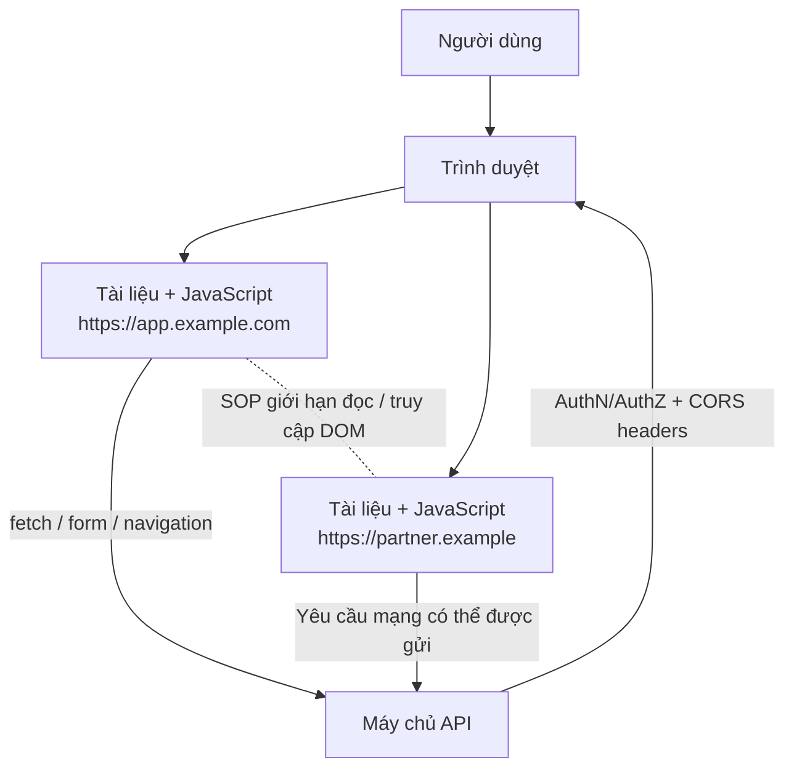

# Web platform security model

> **Chủ đề:** Bức tranh tổng thể về mô hình bảo mật của nền tảng web. Bài học thuộc phạm vi **SECURITY_APPLICATION_SECURITY_BROWSER_SECURITY**: hiểu ranh giới giữa trình duyệt, origin, cookie và ứng dụng web; từ đó giải thích được Same-Origin Policy (SOP), CORS, cơ chế cách ly và cách phối hợp phòng vệ trước XSS, CSRF, clickjacking.

## Mục tiêu học tập

Sau bài này, người học có thể:

1. Phân biệt **origin**, **site**, phạm vi **cookie** và **secure context**; xác định các URL có cùng ranh giới bảo mật hay không.
2. Giải thích trình duyệt cho phép **gửi yêu cầu**, **nhúng tài nguyên**, **điều hướng** và **đọc dữ liệu** theo những quy tắc khác nhau.
3. Mô tả vai trò của SOP, CORS, preflight, cơ chế lưu trữ và cách ly tài liệu; nhận ra CORS không thay thế xác thực, phân quyền.
4. Phân tích tại sao XSS, CSRF và clickjacking vượt qua hoặc lợi dụng các ranh giới khác nhau.
5. Chọn biện pháp phòng vệ phù hợp: escaping, CSP, Trusted Types, CSRF token, SameSite, kiểm tra Origin, `frame-ancestors` và các security headers.
6. Kiểm tra hành vi thực tế bằng DevTools, phân biệt yêu cầu mạng đã được gửi với việc JavaScript có được đọc phản hồi hay không.

## 1. Trình duyệt là nơi thực thi ranh giới tin cậy

Một trang web thường nhận HTML, CSS, JavaScript, hình ảnh và dữ liệu từ nhiều máy chủ. Trình duyệt phải đồng thời hỗ trợ liên kết, nhúng nội dung và trao đổi giữa các ứng dụng, nhưng không được tự ý trao quyền đọc dữ liệu riêng của ứng dụng này cho ứng dụng khác.

**Web platform security model** là tập hợp quy tắc mà trình duyệt dùng để xác định: **đoạn mã nào đang chạy trong ngữ cảnh nào, được tác động tới tài nguyên nào, và dưới điều kiện nào**. Trong mô hình này, máy chủ quyết định danh tính, phiên đăng nhập, nghiệp vụ và quyền của người dùng; trình duyệt thực thi những ràng buộc đối với mã web và dữ liệu ở phía máy khách.

Một cách nhìn hữu ích:



Có hai câu hỏi phải tách biệt:

- **Yêu cầu có được gửi tới máy chủ không?** Một số yêu cầu liên origin, việc nhúng ảnh, tải script hay gửi biểu mẫu vẫn có thể diễn ra.
- **Mã JavaScript có được đọc phản hồi hoặc thao tác tài liệu đích không?** SOP và các cơ chế liên quan có thể chặn quyền đọc dù máy chủ đã nhận và xử lý yêu cầu.

Vì vậy, **không thấy dữ liệu trong JavaScript** chưa chứng minh rằng **máy chủ không bị tác động**.

### Các thành phần và trách nhiệm

| Thành phần | Vai trò trong bảo mật | Không tự bảo đảm được |
|---|---|---|
| **Origin của tài liệu** | Định danh ngữ cảnh mà mã trang đang chạy; là cơ sở của SOP | Quyền nghiệp vụ của người dùng |
| **Trình duyệt** | Thực thi SOP, CORS, CSP, cookie policy và nhiều cơ chế cách ly | Phòng vệ trước mã độc đã chạy hợp lệ bên trong origin |
| **Máy chủ/API** | Xác thực, phân quyền, kiểm tra đầu vào, quản lý phiên, trả security headers | Ép khách hàng dùng trình duyệt tuân thủ CORS |
| **Cookie/phiên đăng nhập** | Duy trì trạng thái và có thể được tự động gửi theo quy tắc cookie | Chống CSRF/XSS một cách toàn diện |
| **Đường truyền HTTPS** | Bảo vệ truyền tải, xác thực máy chủ qua TLS | Xử lý an toàn nội dung HTML/JS |
| **Mã và thư viện bên thứ ba** | Cung cấp chức năng, widget hoặc tích hợp | Tự cô lập nếu được nạp bằng `<script src>` vào trang chủ |

**Nguyên tắc thiết kế:** không gộp “mã đang chạy trong trình duyệt”, “mã được phép đọc dữ liệu” và “người dùng được phép thực hiện hành động” thành một khái niệm quyền duy nhất.

## 2. Origin, site và cookie: ba phạm vi khác nhau

### 2.1. Origin: scheme + host + port

Với URL HTTP(S), origin thông thường là bộ ba:

**`origin = (scheme, host, port)`**

Ví dụ, origin của `https://shop.example.com:443/account?tab=orders` là `(https, shop.example.com, 443)`. Đường dẫn, query string và fragment không quyết định origin; cổng mặc định được chuẩn hóa, nên `https://shop.example.com` và `https://shop.example.com:443` là cùng origin.

| URL A | URL B | Cùng origin? | Giải thích |
|---|---|---|---|
| `https://app.example.com/a` | `https://app.example.com/b?x=1` | Có | Chỉ khác path và query |
| `https://app.example.com` | `https://app.example.com:443` | Có | Cùng cổng HTTPS mặc định |
| `https://app.example.com` | `http://app.example.com` | Không | Khác scheme |
| `https://app.example.com` | `https://api.example.com` | Không | Khác host/subdomain |
| `http://localhost:3000` | `http://localhost:4000` | Không | Khác port |
| `https://app.example.com` | `https://app.example.com:8443` | Không | Khác port |

Một số URL có **opaque origin** (origin không so sánh bằng bộ ba bình thường), chẳng hạn tài liệu `data:` và iframe có `sandbox` nhưng không được cấp `allow-same-origin`. `about:blank` hay `blob:` có quy tắc kế thừa/liên kết origin riêng tùy ngữ cảnh tạo ra chúng. Với `file:`, hành vi có thể phụ thuộc trình duyệt; **không dựa vào mở file trực tiếp để kết luận về SOP của ứng dụng triển khai trên HTTP(S)**.

Tạo ranh giới rõ ràng bằng origin riêng là nền tảng cho kiến trúc như `app.example.com` (giao diện), `api.example.com` (API), `admin.example.com` (quản trị). Nhưng chỉ đặt ở subdomain khác **không tự động đủ an toàn**: cookie dùng chung, cấu hình CORS, nhúng script hay lỗi ứng dụng vẫn có thể nối lại những vùng tin cậy này.

### 2.2. Site: cơ sở của SameSite và một số cơ chế cách ly

Trong ngữ cảnh cookie hiện đại, **site** thường được xác định theo *schemeful site*: scheme và **registrable domain** (miền đăng ký hiệu lực, xác định dựa trên Public Suffix List), không gồm port. Ví dụ:

- `https://shop.example.com` và `https://api.example.com`: **khác origin nhưng cùng site**.
- `https://shop.example.com` và `http://shop.example.com`: **khác site** theo schemeful same-site.
- `https://shop.example.com` và `https://payment.other-example.com`: **khác site**.

Không được suy “site” bằng cách máy móc lấy hai nhãn cuối của host: có các public suffix như `co.uk`. Đối với `localhost` và địa chỉ IP, cách xác định site có các trường hợp riêng; khi thiết kế kiểm thử, ghi rõ URL và cơ chế trình duyệt sử dụng.

**Same-origin** và **same-site** trả lời những câu hỏi khác nhau. Hai subdomain có thể là cùng site để áp dụng `SameSite` nhưng vẫn bị SOP chặn đọc DOM của nhau. Vì thế **SameSite không phải phiên bản khác của SOP**.

### 2.3. Cookie có phạm vi riêng

Cookie có thể bị chi phối bởi `Domain`, `Path`, `Secure`, `HttpOnly`, `SameSite`, thời hạn sống và các chính sách chặn/phân vùng cookie của trình duyệt. Cookie **không bị tách theo port** như origin.

Ví dụ phản hồi từ `https://app.example.com`:

```http
Set-Cookie: session=RANDOM_OPAQUE_ID; Path=/; Secure; HttpOnly; SameSite=Lax
```

Đây là **host-only cookie** nếu không có `Domain`: cookie được gửi đến đúng host đã đặt nó, theo các quy tắc tương ứng. Nếu dùng `Domain=example.com`, cookie có thể được gửi đến nhiều subdomain đủ điều kiện; phạm vi này rộng hơn và làm tăng ảnh hưởng của một subdomain bị xâm nhập. `Path` chỉ quy định phạm vi gửi cookie, **không phải ranh giới cô lập bảo mật tương đương SOP**.

| Thuộc tính | Giảm rủi ro chính | Giới hạn cần nhớ |
|---|---|---|
| `Secure` | Chỉ gửi cookie qua kết nối bảo mật theo quy tắc trình duyệt | Không ngăn mã độc chạy trong origin gửi request |
| `HttpOnly` | Chặn JavaScript đọc cookie qua `document.cookie` | XSS vẫn có thể thao tác trang, gọi API với phiên hiện tại |
| `SameSite=Strict` | Giới hạn gửi cookie trong ngữ cảnh cross-site chặt hơn | Có thể ảnh hưởng các luồng đăng nhập/liên kết từ site khác |
| `SameSite=Lax` | Hạn chế cookie trong nhiều yêu cầu cross-site, vẫn hỗ trợ một số điều hướng top-level an toàn | Không thay token CSRF, đặc biệt với tấn công same-site |
| `SameSite=None; Secure` | Cho phép một số trường hợp cookie cross-site nếu chính sách trình duyệt cho phép | Có thể bị giới hạn bởi chính sách third-party cookies; tăng diện tích CSRF |
| Tiền tố `__Host-` | Yêu cầu `Secure`, `Path=/` và không có `Domain` đối với browser hỗ trợ | Không thay phân quyền hoặc phòng chống XSS |

Tùy phiên bản và chính sách quyền riêng tư, trình duyệt còn có thể **chặn hoặc phân vùng third-party cookies và storage**. Không giả định cookie third-party luôn hoạt động trên mọi trình duyệt.

## 3. Same-Origin Policy: giới hạn quyền đọc và thao tác

**SOP** là nguyên tắc mà trình duyệt áp dụng để ngăn mã thuộc origin A tùy tiện truy cập dữ liệu nhạy cảm của origin B. SOP hiện diện ở nhiều API với ngoại lệ và quy tắc riêng; không phải một “công tắc chặn mọi request xuyên origin”.

Ví dụ trang `https://evil.example` cố gắng:

```js
const frame = document.querySelector('iframe');
console.log(frame.contentWindow.document.body.innerText);
```

Nếu iframe tải `https://bank.example`, truy cập DOM trên thường bị chặn vì khác origin. Tuy nhiên, một số thao tác hạn chế với `Window` vẫn được cho phép; đặc biệt, cửa sổ có thể giao tiếp qua `postMessage` khi xử lý đúng quy tắc.

### 3.1. Cần phân biệt các hành động của trình duyệt

| Hành động | Hành vi điển hình khi khác origin | Điều kiện và lưu ý |
|---|---|---|
| Điều hướng qua liên kết | Thường được phép | Có quy tắc hạn chế điều hướng, sandbox, chính sách trình duyệt |
| Nhúng ảnh bằng `` | Thường tải được | Không mặc nhiên được đọc pixel qua canvas; canvas có thể bị *tainted* |
| Tải script bằng `<script src>` | Có thể tải và chạy nếu được phép | **Script chạy với quyền của tài liệu nhúng nó**, không tự được sandbox bởi host nguồn script |
| Nhúng iframe | Có thể, nếu trang đích cho phép | DOM giữa hai origin bị giới hạn; `frame-ancestors` có thể cấm nhúng |
| Gửi form đến origin khác | Có thể | Có thể gây thay đổi trạng thái ở máy chủ; cần chống CSRF |
| `fetch()` API origin khác | Có thể phát request theo quy tắc Fetch/CORS | JavaScript chỉ đọc được phản hồi khi được phép; một số request cần preflight |
| Đọc `localStorage` / `IndexedDB` origin khác | Không được truy cập trực tiếp | Cơ chế phân vùng storage có thể áp dụng thêm |
| `postMessage` | Được phép gửi thông điệp qua cửa sổ | Bên nhận phải xác thực `origin`, nguồn gửi và cấu trúc dữ liệu |

**Điểm rất dễ nhầm:** tải thư viện bên ngoài bằng `<script src="https://cdn.example/...">` không tạo ra origin cách ly cho thư viện. Khi chạy trong trang `https://app.example.com`, script có thể thao tác DOM và dữ liệu của chính trang đó. Nếu cần cô lập nội dung không tin cậy, cân nhắc iframe ở origin riêng, có `sandbox` và giao tiếp tối thiểu qua thông điệp.

### 3.2. Trao đổi có chủ đích bằng postMessage

```js
const frame = document.querySelector('#partner-frame');
const PARTNER_ORIGIN = 'https://partner.example';

frame.contentWindow.postMessage({ type: 'PING' }, PARTNER_ORIGIN);

window.addEventListener('message', (event) => {
  if (event.origin !== PARTNER_ORIGIN) return;
  if (event.source !== frame.contentWindow) return;

  const data = event.data;
  if (!data || data.type !== 'RESULT' || typeof data.ok !== 'boolean') {
    return;
  }

  // Chỉ xử lý các trường đã được kiểm tra kiểu và ý nghĩa.
  console.log('Partner result:', data.ok);
});
```

`event.origin` cho biết origin của bên gửi **tại lúc gửi**; `event.source` giúp kiểm tra đúng cửa sổ dự kiến. Dùng `targetOrigin` cụ thể khi gửi và không nhận mọi dữ liệu từ sự kiện message như lệnh đáng tin. **Không dùng `'*'` làm `targetOrigin` khi gửi dữ liệu nhạy cảm**.

## 4. CORS: mở quyền đọc tài nguyên liên origin có kiểm soát

**Cross-Origin Resource Sharing (CORS)** là cơ chế để máy chủ khai báo origin nào được phép đọc phản hồi thông qua những API web tuân thủ CORS. Trình duyệt là bên thực thi việc kiểm tra đó.

Giả sử frontend chạy tại `https://app.example.com`:

```js
const response = await fetch('https://api.example.com/profile');
const profile = await response.json();
```

Đây là **cross-origin** vì host khác nhau. Nếu API không trả header CORS phù hợp, JavaScript không thể đọc phản hồi theo cách này. Điều đó **không có nghĩa request GET chắc chắn chưa được gửi đến API**.

### 4.1. Phản hồi CORS

Với frontend được phép, API có thể trả:

```http
HTTP/1.1 200 OK
Access-Control-Allow-Origin: https://app.example.com
Vary: Origin
Content-Type: application/json

{"displayName":"Lan"}
```

`Access-Control-Allow-Origin` chỉ khai báo quyền **đọc qua CORS**. `Vary: Origin` cần có khi phản hồi thay đổi theo `Origin` và được cache trung gian, nhằm tránh trả sai biến thể header cho origin khác.

Nếu API dùng cookie hoặc HTTP authentication xuyên origin, JavaScript cần yêu cầu chế độ credential phù hợp (chẳng hạn `credentials: 'include'`), máy chủ cần trả `Access-Control-Allow-Credentials: true`, và `Access-Control-Allow-Origin` phải là origin cụ thể được cho phép. Kết hợp `Access-Control-Allow-Origin: *` với phản hồi có credential **không được trình duyệt chấp nhận**; cookie vẫn phải đáp ứng quy tắc `SameSite` và chính sách riêng tư.

### 4.2. Preflight là gì?

Với những request không thuộc nhóm CORS-safelisted, trình duyệt thường gửi `OPTIONS` preflight trước để hỏi máy chủ về method và headers. Ví dụ:

```js
await fetch('https://api.example.com/orders', {
  method: 'POST',
  headers: { 'Content-Type': 'application/json' },
  body: JSON.stringify({ itemId: 42 })
});
```

Vì `Content-Type: application/json` không thuộc nhóm safelisted content types, preflight thường xuất hiện:

```http
OPTIONS /orders HTTP/1.1
Origin: https://app.example.com
Access-Control-Request-Method: POST
Access-Control-Request-Headers: content-type
```

Máy chủ cho phép có thể phản hồi:

```http
HTTP/1.1 204 No Content
Access-Control-Allow-Origin: https://app.example.com
Access-Control-Allow-Methods: POST
Access-Control-Allow-Headers: Content-Type
Vary: Origin
```

Nếu preflight không đạt yêu cầu, trình duyệt không gửi **request thực tế dự định sau preflight**. Nhưng **không phải mọi cross-origin request đều có preflight**. Biểu mẫu, request đơn giản hay việc nhúng một số loại tài nguyên vẫn có thể đến máy chủ mà không qua bước này.

### 4.3. Giới hạn của CORS

- **CORS không phải xác thực và phân quyền.** API phải kiểm tra phiên/token và quyền trên từng thao tác, kể cả khi yêu cầu đến từ origin “được phép”.
- **CORS không ngăn chương trình ngoài trình duyệt gọi API.** Một HTTP client có thể tự tạo `Origin` hoặc không gửi `Origin`; server tuyệt đối không coi header này là bằng chứng danh tính người dùng.
- `mode: 'no-cors'` không phải đường tắt để đọc dữ liệu bị chặn: JavaScript thường nhận **opaque response**, không được đọc nội dung.
- Không phản chiếu tùy ý mọi `Origin` nhận được vào `Access-Control-Allow-Origin`, nhất là cùng `Access-Control-Allow-Credentials: true`; cần kiểm tra allowlist chính xác.
- Nếu máy chủ thực hiện thay đổi trạng thái chỉ vì cookie tự động được gửi, **CORS không ngăn được CSRF**.
- Thông báo “CORS error” trong Console là triệu chứng kiểm soát quyền đọc; kiểm tra **Network tab** và log server để biết preflight/request nào thật sự được gửi.

## 5. Secure context, HTTPS và cách ly

### 5.1. HTTPS bảo vệ đường truyền, không thay bảo mật ứng dụng

HTTPS dùng TLS giúp chống đọc trộm và sửa đổi dữ liệu trên đường truyền, đồng thời xác thực máy chủ qua chứng chỉ. Nhiều tính năng nhạy cảm của web yêu cầu **secure context**. Tuy vậy, origin HTTPS vẫn có thể mắc XSS, CSRF hoặc phân quyền sai.

Một số origin phát triển cục bộ như `http://localhost` được trình duyệt xem là **potentially trustworthy** cho nhiều tính năng secure-context. Điều này không biến HTTP trên mạng công cộng thành kết nối an toàn.

**Mixed content** xảy ra khi trang HTTPS cố tải tài nguyên HTTP không an toàn; trình duyệt có thể nâng cấp hoặc chặn tùy loại tài nguyên và chính sách. Mục tiêu là tránh để nội dung không bảo mật làm suy yếu trang HTTPS. Kiểm tra URL của tài nguyên con, WebSocket và các lệnh gọi API khi triển khai.

**HTTP Strict Transport Security (HSTS)** qua `Strict-Transport-Security` hướng trình duyệt ưu tiên HTTPS cho host trong thời hạn đã cấu hình (sau khi nhận header hợp lệ qua HTTPS, hoặc qua cơ chế preload). Không bật `includeSubDomains` hay đăng ký preload nếu các subdomain liên quan chưa sẵn sàng HTTPS.

### 5.2. Cách ly giữa các tài liệu và tiến trình

- **Iframe sandbox** giảm quyền của tài liệu nhúng, ví dụ hạn chế script, biểu mẫu, popup hoặc quyền coi như cùng origin nếu không cấp tương ứng. Chỉ cấp những token `allow-...` thật sự cần. Việc phối hợp `allow-scripts` và `allow-same-origin` cho tài liệu cùng origin với trang nhúng có thể làm suy yếu ý nghĩa sandbox.
- **Site Isolation** và các cơ chế tách tiến trình triển khai trên trình duyệt giúp hạn chế tác động của một số lỗ hổng, đặc biệt các kịch bản kênh kề. Chi tiết khác nhau theo trình duyệt; **không xem process ID là ranh giới ứng dụng được đặc tả thay SOP**.
- **Storage partitioning** và chính sách third-party storage có thể thêm khóa theo site cấp cao nhất để hạn chế theo dõi/xâm nhập xuyên site. Hành vi cụ thể cần kiểm tra trên các trình duyệt được hỗ trợ.
- **COOP** (`Cross-Origin-Opener-Policy`), **COEP** (`Cross-Origin-Embedder-Policy`) và **CORP** (`Cross-Origin-Resource-Policy`) điều khiển các mối liên hệ cửa sổ, nhúng tài nguyên và khả năng cách ly. Một số ứng dụng cần cấu hình COOP/COEP để đạt trạng thái *cross-origin isolated* cho các API đặc thù. Chúng có thể làm hỏng tích hợp popup, iframe, ảnh hay SDK bên thứ ba nếu bật thiếu đánh giá.

Các cơ chế cách ly hỗ trợ phòng vệ theo chiều sâu; chúng không sửa được lỗi tin dữ liệu đầu vào hoặc bỏ qua kiểm tra quyền ở phía máy chủ.

## 6. Ba kiểu tấn công điển hình lợi dụng ba điểm yếu khác nhau

### 6.1. XSS: mã độc chạy **bên trong origin được tin**

Giả sử ứng dụng render bình luận bằng cách gán trực tiếp dữ liệu người dùng vào HTML:

```js
// Không an toàn nếu comment là dữ liệu chưa được làm sạch:
document.querySelector('#comment').innerHTML = comment;
```

Kẻ tấn công có thể làm trình duyệt diễn giải nội dung như markup/script nguy hiểm trong origin của ứng dụng. **SOP không cứu được trang khi mã độc đã chạy với quyền của chính origin đó.**

Với nội dung chỉ cần hiển thị như văn bản:

```js
document.querySelector('#comment').textContent = comment;
```

Khi bắt buộc hỗ trợ HTML do người dùng nhập, cần **sanitizer phù hợp ngữ cảnh, được duy trì** và tránh các *dangerous sinks*. Với ứng dụng sinh HTML ở server, dùng **output encoding theo ngữ cảnh** (HTML text, attribute, URL, JavaScript, CSS có quy tắc riêng) và framework template auto-escape; không tự xây bộ lọc bằng regex đơn giản.

**CSP (Content Security Policy)** giảm khả năng thực thi script ngoài chính sách, tải tài nguyên nguy hiểm hoặc nhúng trang trái phép. Ví dụ khởi điểm cần tinh chỉnh theo thực tế:

```http
Content-Security-Policy: default-src 'self'; script-src 'self' 'nonce-RANDOM_EACH_RESPONSE'; object-src 'none'; base-uri 'none'; frame-ancestors 'none'; form-action 'self'
```

Nonce phải đủ ngẫu nhiên, **mới cho mỗi HTTP response**, và được đặt trên những `<script nonce="...">` hợp lệ. Không đưa nonce cố định vào mã nguồn rồi kỳ vọng CSP bảo vệ. Có thể triển khai `Content-Security-Policy-Report-Only` để ghi nhận vi phạm trước khi cưỡng chế, nhưng chính sách Report-Only **không chặn**.

**Trusted Types** có thể buộc những API tạo HTML/script nhạy cảm dùng đối tượng đã được tạo từ policy phù hợp, giúp quản lý luồng dữ liệu đi vào DOM XSS sinks. Ví dụ chính sách:

```http
Content-Security-Policy: require-trusted-types-for 'script'; trusted-types app-html
```

Hiệu lực và mức hỗ trợ Trusted Types khác nhau giữa các trình duyệt; ứng dụng vẫn phải dùng escaping/sanitizing an toàn ở nơi cần thiết. **CSP và Trusted Types là lớp phụ trợ, không thay quy trình xử lý dữ liệu an toàn.**

### 6.2. CSRF: trình duyệt tự mang theo thông tin phiên

Giả sử người dùng đang đăng nhập `https://bank.example`. Trang độc hại ở site khác có thể tìm cách kích hoạt một yêu cầu thay đổi trạng thái tới ngân hàng. Nếu browser tự gắn cookie phiên và server chỉ kiểm tra cookie, hành động có nguy cơ được thực hiện theo quyền người dùng.

Để phòng vệ cho thao tác thay đổi trạng thái:

1. Dùng **CSRF token** gắn với phiên/ngữ cảnh hợp lệ, khó đoán, được kiểm tra phía máy chủ; nếu dùng mô hình double-submit cookie, bảo đảm token có ràng buộc/kiểm chứng thích hợp.
2. Xác minh `Origin` của request (hoặc `Referer` theo chính sách fallback được thiết kế và kiểm thử), đối chiếu với nguồn tin cậy; xử lý rõ trường hợp header vắng mặt.
3. Cấu hình cookie `SameSite=Lax`/`Strict` tùy luồng nghiệp vụ; `Secure` và `HttpOnly` khi phù hợp.
4. Có thể dùng **Fetch Metadata** (`Sec-Fetch-Site`, `Sec-Fetch-Mode`, `Sec-Fetch-Dest`) để bổ sung chính sách từ chối các request cross-site không mong muốn.
5. Không dùng `GET` để thực hiện thao tác gây thay đổi trạng thái và luôn xác thực/phân quyền trên server.

**Cùng site chưa chắc an toàn:** một subdomain yếu có thể gửi request được phân loại same-site tới subdomain quan trọng. Vì vậy, SameSite riêng lẻ không thay thế kiểm tra CSRF và ranh giới tin cậy giữa subdomain.

### 6.3. Clickjacking: đánh lừa người dùng thao tác trên trang thật

Một site độc hại có thể cố đặt trang quản trị hoặc trang thanh toán thật vào iframe, phủ thành phần giao diện để người dùng vô tình bấm hành động mà họ không thấy rõ.

Ưu tiên chính sách chống nhúng trong **HTTP response của chính trang cần bảo vệ**:

```http
Content-Security-Policy: frame-ancestors 'none'
X-Frame-Options: DENY
```

`frame-ancestors 'none'` cấm mọi ancestor nhúng trang; nếu có nhu cầu nhúng hợp lệ, cấu hình danh sách origin được phép phù hợp. `X-Frame-Options` hỗ trợ các trình duyệt cũ hơn, nhưng giới hạn biểu đạt hơn CSP. `frame-ancestors` phải được cung cấp qua HTTP header để có hiệu lực, không trông đợi từ `<meta http-equiv>`.

Điều khiển thao tác quan trọng bằng xác nhận/kiểm tra phía server vẫn cần thiết; không phụ thuộc riêng vào việc iframe có bị chặn.

### Ma trận điểm yếu và phòng vệ

| Tấn công | Kẻ tấn công lợi dụng | Phòng vệ chính | Ngộ nhận thường gặp |
|---|---|---|---|
| **XSS** | Dữ liệu không tin cậy đi vào ngữ cảnh HTML/JS; mã chạy trong origin hợp lệ | Encoding đúng ngữ cảnh, API DOM an toàn, sanitizer, CSP, Trusted Types | “SOP sẽ chặn script độc trong trang của mình” |
| **CSRF** | Trình duyệt tự gửi cookie/credential trong một số request | CSRF token, kiểm tra Origin, SameSite, Fetch Metadata, phân quyền server | “Đã có CORS nên không thể CSRF” |
| **Clickjacking** | Nhúng trang thật để đánh lừa thao tác | CSP `frame-ancestors`, `X-Frame-Options`, xác nhận phù hợp | “SOP chặn iframe, nên không cần chống nhúng” |
| **Đánh cắp dữ liệu qua tích hợp** | CORS quá rộng, postMessage thiếu kiểm tra, thư viện bên ngoài chạy cùng origin | Origin allowlist, kiểm tra message, giới hạn script, iframe sandbox | “Nạp script từ CDN thì quyền của script chỉ ở CDN” |

## 7. Security headers: phân vai đúng từng cơ chế

| Header | Mục đích | Ví dụ có điều kiện |
|---|---|---|
| `Content-Security-Policy` | Giới hạn nguồn tài nguyên/script, ranh giới nhúng và các tính năng liên quan | `script-src 'self'; object-src 'none'; base-uri 'none'` |
| `Strict-Transport-Security` | Ghi nhớ yêu cầu HTTPS cho host đủ điều kiện | `max-age=31536000` |
| `X-Content-Type-Options` | Giảm MIME sniffing ở những ngữ cảnh được bảo vệ | `nosniff` |
| `Referrer-Policy` | Kiểm soát lượng thông tin URL gửi trong `Referer` | `strict-origin-when-cross-origin` |
| `Permissions-Policy` | Kiểm soát quyền dùng một số tính năng browser | `camera=(), microphone=()` |
| `Cross-Origin-Opener-Policy` | Điều chỉnh nhóm ngữ cảnh duyệt với opener | `same-origin` nếu luồng popup phù hợp |
| `Cross-Origin-Embedder-Policy` | Yêu cầu tài nguyên nhúng thỏa CORS/CORP theo chính sách | `require-corp` khi cần cross-origin isolation |
| `Cross-Origin-Resource-Policy` | Quy định nhóm origin/site có thể nhúng tài nguyên theo dạng no-CORS | `same-origin` với tài nguyên chỉ dùng nội bộ |
| `Cache-Control` | Hạn chế cache ngoài ý muốn cho dữ liệu nhạy cảm | `no-store` với phản hồi thật sự chứa bí mật |
| `X-Frame-Options` | Chống framing trên trình duyệt cũ | `DENY` khi trang không được nhúng |

Không có một bộ header bật đồng loạt nào đúng cho mọi hệ thống. Ví dụ `COEP: require-corp` có thể chặn tài nguyên của đối tác chưa cấu hình CORS/CORP; `frame-ancestors 'none'` sẽ chặn iframe hợp lệ của sản phẩm; CSP quá lỏng không bảo vệ, CSP quá chặt có thể làm hỏng luồng đang dùng. Thiết kế theo **tài sản, điểm tích hợp và đe dọa thực tế**, rồi kiểm thử.

## 8. Ví dụ kiến trúc: một ứng dụng thương mại điện tử

Giả sử có bốn vùng:

- `https://www.shop.example`: trang giới thiệu công khai.
- `https://app.shop.example`: ứng dụng khách hàng.
- `https://api.shop.example`: API đơn hàng và tài khoản.
- `https://pay.partner.example`: đối tác thanh toán.

Các ranh giới cần được xác định:

1. **Frontend ↔ API** là cross-origin nhưng có thể same-site. API cho phép đúng origin của ứng dụng qua CORS, xử lý credential có chủ đích, vẫn xác thực và phân quyền mọi endpoint. Nếu dùng cookie phiên, quyết định phạm vi `Domain` và CSRF riêng.
2. **Frontend ↔ đối tác thanh toán** là cross-site. Nếu đối tác nhúng bằng iframe, giới hạn quyền với sandbox phù hợp và dùng `postMessage` có kiểm tra `origin`, `source`, schema dữ liệu. Không tin mọi message từ iframe.
3. **Trang quản trị và tài khoản** cần chống XSS tại mọi điểm hiển thị dữ liệu, kể cả tên sản phẩm, nhận xét, tên người dùng, thông điệp từ đối tác.
4. **Trang thanh toán và thao tác nhạy cảm** cần token chống CSRF, kiểm tra request, xác nhận nghiệp vụ và chính sách framing rõ ràng.
5. **Script bên thứ ba** (analytics, chat widget, tag manager) khi được nạp trực tiếp có thể chạy trong origin của ứng dụng. Đánh giá nguồn, quyền, khả năng bị thay đổi và biện pháp hạn chế; khi phù hợp thì cô lập bằng iframe và giao thức message.

Hỏi “đã cấu hình CORS chưa?” mới kiểm tra được một mặt. Một đánh giá thiết kế hoàn chỉnh cần thêm câu hỏi: **ai xác thực người dùng, ai cấp quyền, dữ liệu nào đi qua origin, cookie nào tự được gửi và JavaScript nào được tin để chạy?**

## 9. Thực hành quan sát hành vi bằng DevTools

Phần này mô tả các kiểm thử trên **ứng dụng mẫu do bạn kiểm soát**, ví dụ frontend ở `http://localhost:3000` và API ở `http://localhost:4000`. Hai URL này khác origin do port; môi trường localhost phù hợp để quan sát giao tiếp, nhưng không thay kiểm thử HTTPS và cookie trên tên miền triển khai thực.

### Thí nghiệm A — Request đã đến server nhưng JavaScript không đọc được

1. Cho API trả JSON tại `http://localhost:4000/data` **chưa có** `Access-Control-Allow-Origin`.
2. Mở frontend từ `http://localhost:3000`, bật DevTools → **Network** và **Console**.
3. Trong Console của frontend, chạy:

```js
fetch('http://localhost:4000/data')
  .then((res) => res.json())
  .then(console.log)
  .catch(console.error);
```

4. Quan sát thông báo CORS ở Console; đồng thời xem tab Network và log API. Với một yêu cầu GET đơn giản, server có thể **đã nhận request** dù mã JavaScript không đọc được kết quả.
5. Cho API trả `Access-Control-Allow-Origin: http://localhost:3000` và thử lại. Lúc này mã đọc được JSON nếu các điều kiện liên quan thỏa mãn.

**Kết luận quan sát:** CORS là cơ chế kiểm soát quyền đọc phản hồi của browser, không phải firewall bảo đảm request chưa đi ra ngoài.

### Thí nghiệm B — Nhận diện preflight

1. Từ cùng frontend, gửi `POST` với `Content-Type: application/json` đến endpoint bạn kiểm soát.
2. Trong Network, tìm request `OPTIONS`, đọc `Origin`, `Access-Control-Request-Method`, `Access-Control-Request-Headers`.
3. Khi máy chủ chưa cho phép, ghi nhận kết quả. Sau đó cấp CORS headers cho `OPTIONS` và phản hồi chính, thử lại.
4. So sánh với GET đơn giản. Lưu ý preflight có thể được cache, nên yêu cầu mới không nhất thiết tạo một dòng `OPTIONS` ở mỗi lần chạy.

**Kết luận quan sát:** preflight chỉ xuất hiện trong những điều kiện cụ thể; việc không thấy `OPTIONS` không có nghĩa SOP/CORS đã tắt.

### Thí nghiệm C — Chống XSS và framing

- Tạo vùng hiển thị nhận chuỗi `` trong môi trường demo an toàn. So sánh render bằng `innerHTML` và `textContent`; xem tác động của escaping và CSP. Không dùng payload này với hệ thống bạn không sở hữu.
- Thử nhúng một trang demo vào iframe; quan sát khác biệt khi response có `Content-Security-Policy: frame-ancestors 'none'`. Dùng Network → **Headers** để xác nhận header nằm trên **response của trang bị nhúng**, không phải trang cha.

### Bảng ghi nhận kết quả

| Tình huống | Request tới server? | JavaScript đọc nội dung? | Điều cần xác minh |
|---|---|---|---|
| GET cross-origin, API không cấp CORS | Có thể có | Không qua Fetch/CORS thông thường | Network + server log |
| GET cross-origin, CORS đúng | Có thể có | Có, nếu các điều kiện khác đạt | `Origin` và ACAO |
| POST JSON bị từ chối preflight | `OPTIONS` có thể đến; POST chính bị chặn | Không | Preflight response |
| iframe cross-origin được nhúng | Có tải khi chính sách cho phép | Không được tùy ý đọc DOM | Console/SOP |
| Trang từ chối framing | Trình duyệt có thể tải/kiểm tra response | Không hiển thị trong iframe | `frame-ancestors`/XFO |

Khi báo cáo, lưu **URL nguồn/đích, scheme, host, port, method, request headers, response headers, mã trạng thái và kết quả quan sát**. Không kết luận từ một dòng Console mà không kiểm tra request thực tế.

## 10. Quy trình suy luận khi gặp một sự cố bảo mật trình duyệt

Gặp một trang “không gọi được API”, “bị chèn script”, “cookie không gửi” hay “iframe không hiện”, kiểm tra theo thứ tự:

1. **Xác định ngữ cảnh:** document/script đang chạy dưới origin nào? Đích là origin nào, site nào? Có iframe, sandbox, opener hay extension tham gia?
2. **Xác định thao tác:** điều hướng, tải tài nguyên, gửi request, đọc body, truy cập DOM, đọc storage, hay nhúng trang?
3. **Xác định credential:** cookie thuộc host/domain/path nào; `SameSite`, `Secure`, `HttpOnly` và chính sách third-party ra sao? Fetch có gửi credential không?
4. **Xem chính sách trình duyệt:** SOP, CORS/preflight, CSP, `frame-ancestors`, mixed content, COOP/COEP/CORP hoặc sandbox có áp dụng?
5. **Xem trách nhiệm server:** xác thực, phân quyền, CSRF token, kiểm tra Origin/Fetch Metadata, validation và xử lý output đã đúng chưa?
6. **Đối chiếu bằng bằng chứng:** DevTools Network, Console, response headers và log server. Phân biệt **chặn gửi**, **chặn đọc** và **server từ chối nghiệp vụ**.

### Câu hỏi tự kiểm tra

**1.** `https://app.example.com` và `https://api.example.com` cùng site nhưng khác origin. API có cần CORS để frontend đọc `fetch()` thông thường không?  
**Đáp án:** Có. CORS xét quyền truy cập liên origin, không dựa riêng vào việc cùng site.

**2.** API không cho phép CORS. Một form cross-site gửi POST thay đổi email có còn rủi ro CSRF không?  
**Đáp án:** Có, nếu request đến server cùng credential hợp lệ và server thiếu bảo vệ CSRF. CORS không bảo đảm chặn việc gửi form.

**3.** Đặt `HttpOnly` cho cookie đã đủ chống XSS chưa?  
**Đáp án:** Chưa. HttpOnly hạn chế đọc cookie bằng JavaScript, nhưng XSS có thể thao tác DOM, đọc dữ liệu trang và gọi API bằng phiên hiện có.

**4.** Chỉ thêm `Access-Control-Allow-Origin: *` có phải là cách xử lý phù hợp cho mọi API?  
**Đáp án:** Không. Phải xác định dữ liệu công khai hay nhạy cảm, chính sách credential và danh sách origin được phép; mọi endpoint vẫn phải xác thực/phân quyền theo nghiệp vụ.

**5.** Tại sao script tải từ CDN có thể nguy hiểm hơn iframe ở origin riêng?  
**Đáp án:** Script được nạp trực tiếp chạy với quyền của trang nhúng; iframe cross-origin chịu SOP và có thể được hạn chế thêm bằng sandbox.

## Ghi nhớ

**Browser security là hệ nhiều ranh giới phối hợp.** Origin giới hạn quyền đọc/thao tác; site tham gia chính sách cookie; CORS cấp quyền đọc phản hồi cross-origin; cookie và phiên xác định khả năng gửi credential; CSP và Trusted Types giảm nguy cơ script injection; token và kiểm tra phía server phòng CSRF; `frame-ancestors` phòng clickjacking; HTTPS và các header bổ sung bảo vệ truyền tải/cách ly.

Khi thiết kế ứng dụng web, luôn đặt ba câu hỏi riêng: **request có thể được gửi không, JavaScript có thể đọc gì, và máy chủ có cho phép hành động của người dùng không?** Ba câu trả lời này tạo nên khung phân tích đáng tin cậy cho các bài học chuyên sâu về SOP, CORS, XSS, CSRF và browser isolation.
