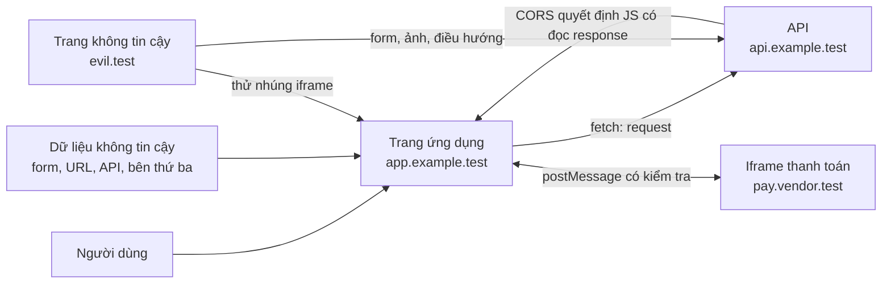

# Trust boundary trong trình duyệt

## 1. Vì sao cần hiểu ranh giới tin cậy?

Trình duyệt liên tục xử lý dữ liệu đến từ nhiều bên: mã ứng dụng, API, trang bên thứ ba, quảng cáo, tệp tải về và nội dung do người dùng nhập. Mỗi bên có mức quyền và mức độ tin cậy khác nhau. **Trust boundary (ranh giới tin cậy)** là điểm mà dữ liệu, lệnh hoặc quyền truy cập đi từ một miền kiểm soát sang miền khác. Tại điểm đó, hệ thống phải quyết định bên nào được **gửi**, **đọc**, **thực thi**, **nhúng**, **lưu** hoặc **sử dụng danh tính** của người dùng.

Trong bảo mật ứng dụng web, trình duyệt là một bộ phận thực thi chính sách quan trọng nhưng không thể thay thế kiểm tra ở máy chủ. Chẳng hạn, **Same-Origin Policy (SOP)** thường ngăn JavaScript từ một origin đọc dữ liệu ở origin khác; nó không mặc định ngăn việc gửi biểu mẫu hay tải ảnh sang origin đó. Phân biệt này giải thích vì sao ứng dụng vẫn cần chống **CSRF**, vì sao cấu hình **CORS** không phải cơ chế xác thực, và vì sao **XSS** có thể phá vỡ sự tin cậy ngay bên trong một origin hợp lệ.

Sau bài học, người học có thể:

- Xác định đúng **origin**, **site**, **browsing context**, phạm vi cookie và các vùng dữ liệu trình duyệt bảo vệ.
- Vẽ luồng dữ liệu qua những ranh giới tin cậy trong một ứng dụng web có API, iframe và bên thứ ba.
- Giải thích ranh giới nào được SOP, CORS, cookie, sandbox, CSP hoặc security headers thực thi; ranh giới nào vẫn phải kiểm soát ở phía máy chủ.
- Nhận diện nơi phát sinh XSS, CSRF, clickjacking và lỗi `postMessage`, rồi chọn biện pháp phòng vệ phù hợp.
- Kiểm chứng kết luận bằng DevTools, Network, Console và các thử nghiệm có kiểm soát.

## 2. Mô hình tư duy: dữ liệu, quyền và người thực thi

Để đánh giá một luồng web, hãy trả lời bốn câu hỏi theo thứ tự:

1. **Ai đang hành động?** JavaScript chạy trong trang nào, một iframe, một worker, trình duyệt tự gửi yêu cầu hay chính máy chủ?
2. **Đối tượng được bảo vệ là gì?** DOM, phản hồi API, cookie phiên, bộ nhớ lưu trữ, camera, hoặc thao tác thay đổi dữ liệu?
3. **Hành động cụ thể là gì?** Gửi request, đọc response, chạy script, lấy cookie, nhúng trang hay thay đổi trạng thái tài khoản?
4. **Ai ra quyết định cấp quyền?** Trình duyệt qua SOP/sandbox/CSP, người dùng qua quyền thiết bị, hay máy chủ qua authentication/authorization và kiểm tra CSRF?

Ví dụ, giao diện ở `https://app.example.test` gọi API tại `https://api.example.test`:



Sơ đồ cho thấy có nhiều ranh giới độc lập: trang ↔ API là **ranh giới origin**; nội dung ngoài ↔ DOM là **ranh giới dữ liệu/thực thi**; trình duyệt ↔ cookie phiên là **ranh giới danh tính**; trang cha ↔ iframe là **ranh giới tài liệu**; trang bên ngoài ↔ thao tác của người dùng là **ranh giới giao diện**. Một cơ chế bảo vệ tốt ở ranh giới này không tự động bảo vệ ranh giới khác.

### Ranh giới tin cậy không đồng nghĩa với đường dẫn URL

Hai đường dẫn `/public` và `/admin` trên cùng `https://app.example.test` thuộc cùng origin. JavaScript chạy ở một đường dẫn thường có khả năng tương tác với tài nguyên và DOM cùng origin theo chính sách của trình duyệt. Nếu cần tách các ứng dụng có mức tin cậy khác nhau, chỉ tách route hoặc thư mục là chưa đủ; có thể cần **origin riêng**, quyền máy chủ riêng và chính sách giao tiếp rõ ràng.

Tương tự, dữ liệu trả về từ máy chủ ứng dụng không tự trở thành an toàn để gán vào HTML. Nội dung do người dùng khác tạo vẫn có thể là dữ liệu không tin cậy, kể cả khi nó được tải từ API chính thức của ứng dụng.

## 3. Origin, site và phạm vi cách ly

### 3.1. Origin là bộ ba scheme, host, port

Với URL web thông thường, **origin** được xác định bởi `(scheme, host, port)`. Cổng mặc định được chuẩn hóa: `https://shop.example.test` và `https://shop.example.test:443` có cùng origin. Thay đổi giao thức, host hoặc cổng thường tạo origin khác.

Giả sử trang gốc là `https://shop.example.test`:

| URL đem so sánh | Cùng origin? | Giải thích |
| --- | --- | --- |
| `https://shop.example.test/cart` | Có | Chỉ khác path. |
| `https://shop.example.test:443/pay` | Có | `443` là cổng mặc định của HTTPS. |
| `https://shop.example.test:8443` | Không | Khác cổng. |
| `https://api.example.test` | Không | Khác subdomain/host. |
| `http://shop.example.test` | Không | Khác scheme. |
| `https://example.test` | Không | Khác host. |

SOP sử dụng origin làm cơ sở kiểm soát nhiều thao tác giữa các tài liệu. Quyền đọc DOM của một iframe khác origin, truy cập `localStorage` và đọc phản hồi bằng `fetch` thường bị giới hạn theo origin, dù có những ngoại lệ và cơ chế cho phép rõ ràng.

Một số URL không có origin theo dạng bộ ba thông thường. Ví dụ, tài liệu `data:` thường mang **opaque origin**; tài liệu bị sandbox mà không có `allow-same-origin` cũng thường mang origin riêng không thể so sánh như origin URL bình thường. `blob:` thường gắn với origin của môi trường tạo nó. Không nên suy quyền của `about:blank`, `file:` hoặc tài liệu sandbox chỉ từ chuỗi URL hiển thị: ngữ cảnh tạo tài liệu và quy tắc của trình duyệt cũng quan trọng.

### 3.2. Site thường rộng hơn origin

Trong mô hình **schemeful same-site**, *site* của URL HTTP(S) thường được xác định từ **scheme** và **registrable domain** (dựa trên Public Suffix List). Ví dụ, `https://shop.example.test` và `https://api.example.test` khác origin nhưng cùng site `https://example.test`. Trong khi đó `http://shop.example.test` khác site với phiên bản HTTPS theo schemeful same-site.

| Hai địa chỉ | Quan hệ origin | Quan hệ site (schemeful) |
| --- | --- | --- |
| `https://app.example.test` ↔ `https://api.example.test` | Cross-origin | Same-site |
| `https://app.example.test` ↔ `https://app.example.test:8443` | Cross-origin | Same-site |
| `https://app.example.test` ↔ `http://app.example.test` | Cross-origin | Cross-site |
| `https://app.example.test` ↔ `https://other.test` | Cross-origin | Cross-site |

Phân biệt này đặc biệt quan trọng:

- **CORS** nói về quyền cho JavaScript đọc phản hồi **cross-origin**.
- Cookie **`SameSite`** chủ yếu xét ngữ cảnh **same-site/cross-site**, không xét “cùng origin” theo nghĩa gồm cả cổng.
- Một subdomain bị chiếm quyền có thể **same-site** với ứng dụng chính nhưng vẫn **cross-origin**. Vì vậy `SameSite` không thay thế kiểm tra quyền, CSRF token hoặc sự an toàn của từng subdomain.

### 3.3. Các ranh giới lưu trữ và định danh không hoàn toàn trùng nhau

| Đối tượng | Phạm vi/ranh giới chính | Điều cần lưu ý |
| --- | --- | --- |
| DOM và JavaScript của tài liệu | Origin, chính sách iframe và tài liệu | Script được nạp từ CDN bằng `<script src>` thông thường **chạy với quyền của trang nhúng**. |
| `localStorage`, IndexedDB | Chủ yếu theo origin; trình duyệt có thể bổ sung partitioning tùy ngữ cảnh | Không mặc định dùng chung giữa `app` và `api` khác origin. |
| Cookie | Host/`Domain`, `Path`, `Secure`, `SameSite` và các thuộc tính khác | Cookie không được cách ly theo cổng; `Path` không phải một cơ chế cách ly bảo mật mạnh. |
| Session API | Xác thực, phân quyền và trạng thái ở **máy chủ** | SOP không quyết định người dùng có quyền sửa tài khoản hay không. |
| Service worker | Origin và scope đăng ký | Service worker có thể xử lý request trong phạm vi được phép; script bị chiếm quyền là rủi ro dai dẳng. |
| Iframe | Origin, `sandbox`, CSP và các chính sách quyền | Có thể hiển thị nội dung cross-origin nhưng không đồng nghĩa được đọc DOM của nó. |

Các trình duyệt hiện đại còn triển khai nhiều cách **phân vùng lưu trữ** theo site phía trên (top-level site) để giảm theo dõi giữa các trang. Chi tiết khác nhau theo trình duyệt và chế độ; không được dựa vào một hành vi phân vùng cụ thể để thay thế thiết kế xác thực và phân quyền của ứng dụng.

## 4. Same-Origin Policy: chặn quyền đọc, không chặn mọi request

SOP là nguyên tắc cốt lõi hạn chế một origin đọc hoặc thao tác trực tiếp vào dữ liệu được bảo vệ của origin khác. Nó **không có nghĩa** là mọi tương tác cross-origin đều bị cấm.

| Hành động từ `https://app.example.test` đến origin khác | Trình duyệt thường cho thực hiện? | Giới hạn cần phân biệt |
| --- | --- | --- |
| Gửi biểu mẫu HTML hoặc điều hướng đến URL khác | Có, tùy chính sách khác | Việc **gửi** không chứng minh người gửi được phép thay đổi dữ liệu. |
| Hiển thị ảnh, stylesheet, script từ origin khác | Thường có | Script thông thường chạy trong **origin của trang nhúng**; không trở thành sandbox chỉ vì tải từ host khác. |
| Nhúng iframe cross-origin | Thường có, trừ khi bị cấm bởi CSP/X-Frame-Options | Trang cha thường không đọc hay sửa DOM bên trong iframe. |
| `fetch`/XHR đến API cross-origin | Có thể gửi; việc đọc response do CORS quyết định | Một request có thể đến máy chủ dù JavaScript sau đó nhận lỗi CORS. |
| Đọc `iframe.contentWindow.document` cross-origin | Không | Chỉ có một số thuộc tính/thao tác cross-origin rất hạn chế được phép. |
| Vẽ ảnh cross-origin lên canvas rồi đọc pixel | Bị hạn chế nếu chưa được cấp quyền phù hợp | Canvas có thể bị đánh dấu *tainted*. |

**Tình huống:** Trang tấn công tạo `<form action="https://bank.example.test/transfer" method="POST">`. SOP không phải lớp kiểm tra quyền thao tác chuyển tiền; trình duyệt có thể gửi biểu mẫu. Việc cookie được gửi hay không còn tùy thuộc `SameSite` và những quy tắc khác. Bất kể thế nào, máy chủ phải xác nhận danh tính, quyền thao tác và kiểm tra chống CSRF cho yêu cầu có tác động trạng thái.

### 4.1. CORS là một ngoại lệ có kiểm soát đối với quyền đọc

**Cross-Origin Resource Sharing (CORS)** là giao thức dùng HTTP headers để máy chủ cho phép trình duyệt cung cấp response cho JavaScript của một origin khác. Ví dụ giao diện `https://app.example.test` cần đọc JSON từ `https://api.example.test`:

```http
GET /v1/profile HTTP/1.1
Host: api.example.test
Origin: https://app.example.test
```

Nếu API chủ động cho phép origin đó, phản hồi có thể chứa:

```http
Access-Control-Allow-Origin: https://app.example.test
Access-Control-Allow-Credentials: true
Vary: Origin
Content-Type: application/json
```

Ở phía giao diện, nếu ứng dụng thực sự cần gửi cookie cross-origin, `fetch` phải cấu hình credentials:

```js
const response = await fetch("https://api.example.test/v1/profile", {
  credentials: "include",
});
if (!response.ok) throw new Error("Không tải được hồ sơ");
const profile = await response.json();
```

`credentials: "include"` chỉ nói trình duyệt **được phép cân nhắc** gửi thông tin xác thực; cookie vẫn phụ thuộc phạm vi host/domain, `Secure`, `SameSite`, chính sách cookie của trình duyệt và ngữ cảnh yêu cầu. Với phản hồi chứa credentials, máy chủ không được dùng `Access-Control-Allow-Origin: *`; phải cho phép origin cụ thể và trả `Access-Control-Allow-Credentials: true` khi thích hợp. Nếu phản chiếu `Origin` động từ một allowlist, `Vary: Origin` giúp cache phân biệt các phiên bản response.

Một số yêu cầu cross-origin được trình duyệt **preflight** bằng `OPTIONS` để hỏi phương thức và headers có được cho phép hay không. Tuy nhiên, không phải request nào cũng preflight. Ví dụ, các biểu mẫu HTML thông thường có thể gửi những loại request mà không cần CORS. **Preflight không phải xác thực, CORS không phải chống CSRF, và cấu hình CORS không thay thế phân quyền ở API.**

### 4.2. Kết quả “CORS error” phải được hiểu đúng

Khi Console báo lỗi CORS, nguyên nhân thường là JavaScript không được đọc response do thiếu hoặc sai header cho phép. Máy chủ **có thể đã nhận và xử lý request**. Việc “không đọc được câu trả lời” không đảo ngược tác động của một request thay đổi dữ liệu. Khi kiểm tra, cần xem cả tab **Network**, log phía máy chủ và loại request; không suy ra rằng request chưa từng được gửi chỉ từ lỗi ở Console.

## 5. Ranh giới dữ liệu → mã thực thi: XSS

SOP tin tưởng JavaScript đang chạy trong origin của ứng dụng theo mô hình quyền của origin đó. Nếu dữ liệu do kẻ tấn công kiểm soát được diễn giải thành mã trong chính origin này, **XSS** làm cho mã độc chạy với quyền của trang hợp lệ. Vì vậy, ranh giới quan trọng nhất đôi khi nằm **ngay trong một origin**, tại nơi dữ liệu đi vào trình phân tích HTML hoặc JavaScript.

Ví dụ không an toàn:

```js
const searchTerm = new URLSearchParams(location.search).get("q") ?? "";
document.querySelector("#result").innerHTML = `Kết quả: ${searchTerm}`;
```

Nếu `q` chứa markup có khả năng thực thi, `innerHTML` biến dữ liệu thành cấu trúc HTML hoạt động. Nguồn vào có thể là query string, hash URL, `postMessage`, phản hồi API, thông tin hồ sơ hay bất cứ nội dung nào do bên ngoài kiểm soát. Đây là **DOM-based XSS** nếu mã phía client thực hiện thao tác nguy hiểm; XSS còn có các dạng reflected và stored tùy đường đi của payload.

Cách hiển thị chuỗi thuần văn bản:

```js
const searchTerm = new URLSearchParams(location.search).get("q") ?? "";
document.querySelector("#result").textContent = `Kết quả: ${searchTerm}`;
```

Khi cần hỗ trợ một tập HTML do người dùng nhập, hãy dùng bộ **sanitize HTML** được duy trì và cấu hình rõ ràng, thay vì tự viết bộ lọc bằng regex. Mã hóa đầu ra phải **đúng ngữ cảnh**: văn bản HTML, thuộc tính, URL, JavaScript và CSS có quy tắc khác nhau. Tránh các sink có thể thực thi như `innerHTML`, `outerHTML`, `insertAdjacentHTML`, `eval`, `new Function` và việc tạo handler từ chuỗi khi không thực sự cần.

### 5.1. CSP và Trusted Types tăng khả năng phòng thủ

**Content Security Policy (CSP)** cho phép response quy định nguồn và kiểu tài nguyên được tải hoặc thực thi. Ví dụ minh họa cho trang HTML tự quản lý script:

```http
Content-Security-Policy: default-src 'self'; script-src 'self' 'nonce-{NONCE_MOI_RESPONSE}'; object-src 'none'; base-uri 'none'; frame-ancestors 'none'; form-action 'self'
```

Nonce phải được tạo ngẫu nhiên, đủ khó đoán **cho từng response HTML**, và được gắn vào những thẻ `<script nonce="...">` được tin cậy. Chính sách thực tế cần kiểm tra các script, kết nối, style và tài nguyên ứng dụng đang sử dụng. CSP hỗ trợ giảm tác động XSS nhưng không miễn trừ việc xử lý dữ liệu đầu vào đúng cách; một CSP yếu hoặc bị cấu hình sai có thể không ngăn được mã độc.

**Trusted Types** giúp giới hạn việc truyền chuỗi tùy ý vào một số sink DOM nhạy cảm. Trên những trình duyệt hỗ trợ, có thể tăng cường với:

```http
Content-Security-Policy: require-trusted-types-for 'script'; trusted-types appSanitizer
```

Khi đó ứng dụng cần tạo và dùng policy Trusted Types phù hợp cho sink liên quan. Nếu cần hiển thị HTML, policy phải thực sự **sanitize** nội dung, không chỉ đổi kiểu dữ liệu của chuỗi. Hỗ trợ Trusted Types khác nhau giữa các trình duyệt; vẫn phải dùng API an toàn, mã hóa/sanitize theo ngữ cảnh và kiểm thử.

### 5.2. Script bên thứ ba có quyền gì?

```html
<script src="https://cdn.vendor.test/widget.js"></script>
```

Script dạng này thực thi trong **môi trường của trang nhúng**, thường có thể đọc DOM và thực hiện thao tác với quyền JavaScript của `https://app.example.test`. Host CDN khác origin **không** làm script bị cách ly. Chỉ tải script từ nguồn thực sự đáng tin, giới hạn số lượng dependency, theo dõi thay đổi, cân nhắc Subresource Integrity (SRI) cho tài nguyên tĩnh phù hợp và áp dụng CSP. Nếu cần cách ly thành phần có mức tin cậy thấp, dùng iframe khác origin với giao diện trao đổi dữ liệu nhỏ và được kiểm tra kỹ.

## 6. Ranh giới danh tính: cookie, SameSite và CSRF

Cookie phiên thường được trình duyệt gửi tự động khi request khớp điều kiện, dù đoạn mã hoặc biểu mẫu tạo request đến từ trang nào. Đây là dạng **quyền đi kèm ngầm định** (*ambient authority*): bên tạo request không nhất thiết là bên được phép yêu cầu thao tác. **CSRF** lợi dụng khoảng cách giữa “trình duyệt có thể gửi cookie” và “người dùng thực sự muốn thực hiện hành động”.

Ví dụ cookie phiên ở host API:

```http
Set-Cookie: __Host-session=OPAQUE_VALUE; Secure; HttpOnly; Path=/; SameSite=Lax
```

- `Secure` giới hạn cookie vào ngữ cảnh kết nối an toàn theo quy tắc trình duyệt.
- `HttpOnly` ngăn JavaScript truy cập cookie qua `document.cookie`; nó **không** ngăn XSS gọi API dưới phiên đang đăng nhập.
- `SameSite=Lax` thường giảm gửi cookie trên các request cross-site không phải điều hướng cấp cao với phương thức an toàn. Vẫn có trường hợp cookie được gửi trên điều hướng `GET` cấp cao; `GET` không được làm thay đổi trạng thái quan trọng. Quy tắc cụ thể còn phụ thuộc cách cookie được thiết lập và trình duyệt.
- `SameSite=Strict` hạn chế hơn nhưng có thể ảnh hưởng luồng đăng nhập hoặc điều hướng từ trang ngoài; `SameSite=None` cần `Secure` và có thể cần trong tích hợp cross-site hợp lệ.
- Prefix `__Host-` yêu cầu cookie có `Secure`, `Path=/` và **không có `Domain`** trong những trình duyệt hỗ trợ, giúp giữ cookie ở đúng host. Không gán `Domain=.example.test` cho cookie mang prefix này.

Mẫu phòng vệ cho thao tác thay đổi trạng thái:

1. Thiết kế `GET`, `HEAD` và các phương thức an toàn không gây thay đổi trạng thái nghiệp vụ.
2. Dùng **CSRF token** gắn với phiên hoặc cơ chế xác thực phù hợp; máy chủ phải kiểm tra token đối với request cần bảo vệ.
3. Kiểm tra header `Origin`/`Referer` theo chính sách và xử lý trường hợp header vắng mặt một cách chủ đích; không xem chúng là dữ liệu xác thực duy nhất trong mọi bối cảnh.
4. Cấu hình `SameSite`, `Secure`, `HttpOnly` và phạm vi cookie hẹp như lớp bảo vệ bổ sung.
5. Xác thực và **phân quyền lại ở máy chủ** cho từng thao tác; không tin vào button bị ẩn, đường dẫn “nội bộ” hay xác nhận ở frontend.

**Chú ý cùng site nhưng khác origin:** `https://legacy.example.test` và `https://api.example.test` là same-site. Nếu `legacy` có XSS hoặc bị chiếm quyền, `SameSite` có thể không ngăn các yêu cầu từ nó đến API. Vì thế, mô hình đe dọa phải xét cả những subdomain được quản lý bởi đội khác, nội dung do khách hàng lưu trữ và các hệ thống cũ.

## 7. Ranh giới giữa các cửa sổ và iframe

### 7.1. `postMessage` là cổng giao tiếp, không phải sự bảo đảm tin cậy

SOP giới hạn đọc DOM cross-origin nhưng vẫn cho phép các tài liệu trao đổi thông điệp bằng `window.postMessage`. Người nhận phải tự kiểm tra **nguồn gốc người gửi**, **đúng cửa sổ** và **cấu trúc dữ liệu** trước khi xử lý.

Ví dụ trang cha `https://app.example.test` nhận kết quả từ iframe thanh toán `https://pay.vendor.test`:

```js
const paymentFrame = document.querySelector("#payment-frame");
const paymentOrigin = "https://pay.vendor.test";

window.addEventListener("message", (event) => {
  if (event.origin !== paymentOrigin) return;
  if (event.source !== paymentFrame.contentWindow) return;

  const data = event.data;
  if (!data || typeof data !== "object") return;
  if (data.type !== "payment-status") return;
  if (typeof data.transactionId !== "string") return;

  // Chỉ dùng thông điệp làm tín hiệu cập nhật giao diện.
  // Máy chủ phải xác nhận trạng thái thanh toán với nhà cung cấp.
  refreshPaymentStatusFromServer(data.transactionId);
});
```

Khi gửi thông điệp, chỉ định origin đích chính xác:

```js
paymentFrame.contentWindow.postMessage(
  { type: "initialize-payment", orderId: "order-123" },
  "https://pay.vendor.test"
);
```

Tránh `targetOrigin: "*"` khi dữ liệu nhạy cảm; không chấp nhận mọi `event.origin`, không so sánh origin bằng phép kiểm tra chuỗi mơ hồ như `includes("example.test")`, và không xem một thông điệp client là bằng chứng thanh toán đã thành công. Với tài liệu opaque origin/sandbox, `event.origin` có thể là chuỗi `"null"`; không nên cho phép tất cả thông điệp `"null"` vì nhiều nguồn không liên quan cũng có thể có giá trị đó.

### 7.2. Iframe sandbox hạn chế khả năng của nội dung nhúng

Một iframe cross-origin mặc định đã chịu SOP nhưng vẫn có thể chạy script, mở các luồng tương tác hoặc yêu cầu quyền tùy chính sách. Thuộc tính `sandbox` thêm các hạn chế, rồi có thể nới một số hạn chế theo nhu cầu:

```html
<iframe
  src="https://widget.vendor.test/preview"
  sandbox="allow-scripts"
  referrerpolicy="no-referrer"
  title="Xem trước nội dung"
></iframe>
```

Nếu không cho `allow-same-origin`, nội dung sandbox thường nhận opaque origin, kể cả URL gốc có host rõ ràng. Chỉ cấp các token `allow-*` thực sự cần thiết. Đặc biệt, kết hợp `allow-scripts` và `allow-same-origin` cho iframe **cùng origin** có thể phá vỡ mục đích cách ly, vì nội dung có thể tìm cách gỡ sandbox rồi tải lại. Đặt nội dung ít tin cậy trên origin riêng và xây dựng hợp đồng `postMessage` chặt chẽ.

Thuộc tính `allow` của iframe và **Permissions-Policy** quản lý những năng lực như camera hoặc micro; đây là ranh giới **tính năng**, không phải cơ chế xác thực hay thay thế origin isolation.

### 7.3. Clickjacking và ranh giới giao diện

**Clickjacking** xảy ra khi trang tấn công nhúng hoặc che phủ giao diện thật để lừa người dùng nhấp vào chức năng họ không định sử dụng. Máy chủ sở hữu trang cần kiểm soát ai có quyền **nhúng trang của mình**, ví dụ:

```http
Content-Security-Policy: frame-ancestors 'none'
```

Hoặc cho phép một trang cha đã biết:

```http
Content-Security-Policy: frame-ancestors 'self' https://portal.example.test
```

`frame-ancestors` điều khiển **ai được nhúng trang hiện tại**; `frame-src` điều khiển **trang hiện tại được nhúng nội dung từ đâu**. Hai chỉ thị có mục đích khác nhau. `X-Frame-Options: DENY` hoặc `SAMEORIGIN` có thể dùng như lớp tương thích cho ứng dụng không cần nhúng; CSP `frame-ancestors` linh hoạt hơn để cấu hình danh sách origin được phép.

Khi mở tab hoặc cửa sổ đến nơi không tin cậy, cân nhắc `rel="noopener"` trên liên kết `target="_blank"` hoặc sử dụng API tương đương để giới hạn truy cập `window.opener` và giảm rủi ro **tabnabbing**.

## 8. Ranh giới giữa trang web và năng lực trình duyệt

Một origin không được mặc nhiên dùng camera, micro hoặc vị trí của người dùng chỉ vì đã đăng nhập. Những API nhạy cảm thường phụ thuộc **secure context (thường là HTTPS)**, quyền người dùng và/hoặc chính sách do trang cha đặt ra. Các quyền này là lớp bảo vệ khác với SOP và kiểm tra phiên trên máy chủ.

Ví dụ response có thể giới hạn tính năng ở trang và các iframe:

```http
Permissions-Policy: camera=(), microphone=(), geolocation=()
```

Một số ứng dụng cần năng lực này cho tính năng thật; khi đó hãy cấp tối thiểu theo nhu cầu và kiểm tra hành vi trong trình duyệt mục tiêu. Quyền đã được cấp cho camera không có nghĩa frontend được phép gọi mọi endpoint nhạy cảm, và ngược lại.

### Các header hỗ trợ các ranh giới khác nhau

| Cơ chế | Ranh giới chính | Vai trò và giới hạn |
| --- | --- | --- |
| **CSP `script-src`** | Dữ liệu và tài nguyên → script | Giảm nguồn thực thi không mong muốn, bổ trợ chống XSS; không thay xử lý dữ liệu an toàn. |
| **CSP `frame-ancestors`** | Trang khác → giao diện được nhúng | Chống clickjacking bằng cách giới hạn ancestor được phép. |
| **CORS headers** | Origin khác → quyền JavaScript đọc response | Không xác thực người gọi, không thay CSRF token. |
| **Cookie attributes** | Request → danh tính phiên | Giới hạn cách cookie được gửi/đọc, không tự kiểm tra quyền nghiệp vụ. |
| **`X-Content-Type-Options: nosniff`** | Nội dung tải về → cách trình duyệt diễn giải | Giảm rủi ro diễn giải sai MIME type ở những loại tài nguyên liên quan. |
| **`Referrer-Policy`** | Điều hướng/request → thông tin referrer | Giảm rò rỉ URL hoặc nguồn truy cập sang nơi khác. |
| **`Permissions-Policy`** | Tài liệu/iframe → API trình duyệt | Giới hạn một số năng lực nhạy cảm. |
| **COOP, COEP, CORP** | Tài liệu/tài nguyên ↔ ngữ cảnh cross-origin | Bổ sung cách ly và hạn chế nhúng/tải tài nguyên; cần kiểm tra tương thích tích hợp. |

### COOP, COEP và CORP giải quyết điều gì?

Các cơ chế nâng cao này được dùng khi ứng dụng cần tăng cách ly cross-origin hoặc sử dụng những API yêu cầu **cross-origin isolation**:

- **Cross-Origin-Opener-Policy (COOP)** tác động đến quan hệ giữa trang cấp cao và các cửa sổ/tab khác trong các browsing context group.
- **Cross-Origin-Embedder-Policy (COEP)** yêu cầu tài nguyên cross-origin được nhúng tuân theo chính sách cho phép thích hợp, chẳng hạn qua CORS hoặc CORP ở chế độ `require-corp`.
- **Cross-Origin-Resource-Policy (CORP)** cho phép tài nguyên khai báo phạm vi được nhúng/tải theo các chế độ như `same-origin`, `same-site` hay `cross-origin` trong những ngữ cảnh chịu kiểm tra CORP.

Ví dụ một ứng dụng có nhu cầu cách ly nâng cao có thể đánh giá:

```http
Cross-Origin-Opener-Policy: same-origin
Cross-Origin-Embedder-Policy: require-corp
```

Các header này có thể làm hỏng luồng popup, đăng nhập liên kết, tài nguyên CDN hoặc widget hiện có nếu phía bên kia không hỗ trợ. Chỉ triển khai sau khi lập danh sách tích hợp và kiểm chứng kỹ; chúng **không** thay thế CSP chống XSS, CSRF token hay phân quyền API.

## 9. Case study: ứng dụng có API và dịch vụ thanh toán

Giả sử một hệ thống thương mại có các thành phần:

| Thành phần | Origin | Mức độ tin cậy và quyền mong muốn |
| --- | --- | --- |
| Frontend khách hàng | `https://shop.example.test` | Hiển thị dữ liệu và gọi API đã được cấp quyền. |
| Backend API | `https://api.example.test` | Kiểm tra phiên, phân quyền, CSRF và trả dữ liệu. |
| Trang quản trị | `https://admin.example.test` | Quyền cao hơn; nên có bảo vệ tài khoản và origin riêng. |
| Iframe thanh toán | `https://pay.vendor.test` | Chỉ trao đổi dữ liệu cần thiết qua giao thức đã thiết kế. |
| Nội dung đánh giá sản phẩm | Dữ liệu lưu ở API | **Không tin cậy** chỉ vì nằm trong JSON do API trả về. |
| Trang bên ngoài | `https://evil.test` | Không được đọc response API hay kích hoạt thao tác ngoài ý muốn. |

Một hành trình mua hàng đi qua nhiều ranh giới:

1. Người mua xem đánh giá. Frontend phải đưa văn bản đánh giá vào DOM dưới dạng **text** hoặc HTML đã sanitize để tránh biến dữ liệu của người khác thành script.
2. Frontend gọi API khác origin. API chỉ cho phép những origin thực sự cần **đọc response** qua CORS; còn quyền xem đơn hàng phải được xác nhận bằng danh tính và ownership ở máy chủ.
3. Người mua bấm đặt hàng. API kiểm tra phiên, CSRF và giá/tồn kho ở máy chủ; không dùng tổng tiền gửi từ client làm sự thật nghiệp vụ.
4. Giao diện mở iframe thanh toán ở origin khác. Hai bên trao đổi thông điệp có kiểm tra `origin`, `source` và schema. Thông báo từ iframe chỉ là tín hiệu để frontend tải trạng thái đã được máy chủ xác minh.
5. API và trang quản trị không để các trang tùy ý nhúng giao diện nhạy cảm; đặt `frame-ancestors` thích hợp. Trang quản trị cần bảo vệ quyền ở máy chủ ngay cả khi frontend đã che các hành động đặc quyền.

### Cùng một sự cố, nhiều lớp bảo vệ

Nếu một subdomain cũ bị tấn công, nó có thể vẫn **same-site** với API. `SameSite=Lax` chưa đủ để loại bỏ nguy cơ request trái ý người dùng. Nếu frontend chính bị XSS, CSRF token có thể bị mã độc chạy trong origin hợp lệ truy cập hoặc sử dụng tùy thiết kế. Vì vậy không nên tìm một “header giải quyết tất cả”: phải giảm khả năng xảy ra XSS, giới hạn phạm vi phiên, kiểm tra CSRF cho các luồng phù hợp, phân quyền chặt ở máy chủ và giám sát sự kiện nhạy cảm.

## 10. Thực hành kiểm chứng ranh giới trong trình duyệt

Các bài thử dưới đây nên thực hiện trong môi trường local hoặc staging do bạn kiểm soát. Có thể dùng `http://localhost:3000` cho frontend và `http://localhost:4000` cho API. Hai địa chỉ **khác origin vì khác cổng**, dù cùng hostname. Đây là thí nghiệm về **origin/CORS**, không phải minh họa hai site khác nhau.

### Thử nghiệm A — Gửi được request nhưng không đọc được response

1. Cho API ở cổng 4000 trả một JSON đơn giản nhưng **không có** `Access-Control-Allow-Origin`.
2. Mở trang ở cổng 3000, chạy trong Console:

   ```js
   fetch("http://localhost:4000/profile")
     .then((r) => r.text())
     .then(console.log)
     .catch(console.error);
   ```

3. Quan sát Console báo lỗi CORS, sau đó mở tab **Network** để xem request có được gửi tới API hay không.
4. Cấu hình API trả `Access-Control-Allow-Origin: http://localhost:3000` và chạy lại. Nếu API cho phép, JavaScript giờ có thể đọc response. Không đổi xác thực hay quyền backend chỉ để thử CORS.

**Kết luận cần chứng minh:** CORS kiểm soát việc JavaScript đọc response cross-origin; một request đã gửi không được tự động hoàn tác khi có lỗi CORS. Công cụ dòng lệnh như `curl` có thể xem header nhưng **không thực thi SOP/CORS như trình duyệt**.

### Thử nghiệm B — Cookie và ranh giới same-site

1. Trên môi trường kiểm thử, đặt một cookie phiên với `Secure`, `HttpOnly`, `SameSite` và phạm vi host phù hợp.
2. Trong DevTools → **Application/Storage → Cookies**, xem các thuộc tính; trong Network xem cookie nào thực sự đi cùng request.
3. Đối chiếu request **same-origin**, **cross-origin nhưng same-site** và **cross-site**; ghi nhận phương thức, ngữ cảnh điều hướng, `credentials` của `fetch` và chính sách trình duyệt.
4. Kiểm tra rằng endpoint thay đổi dữ liệu vẫn từ chối request thiếu/không hợp lệ CSRF token hoặc thiếu quyền, dù request có mang cookie phiên.

**Kết luận cần chứng minh:** Phạm vi cookie, chính sách gửi credentials và quyền đọc response là ba quyết định khác nhau. Không xem hành vi cookie trong một trình duyệt duy nhất là bảo đảm dùng được với mọi trình duyệt.

### Thử nghiệm C — Dữ liệu hiển thị và XSS

1. Tạo một phần tử `<div id="result"></div>` và một giá trị kiểm thử chứa ký tự HTML, ví dụ chuỗi văn bản `"<b>hello</b>"`.
2. Gán giá trị đó vào `textContent` và quan sát: chuỗi được hiển thị như văn bản.
3. Trong môi trường thử nghiệm, so sánh với `innerHTML`: chuỗi có thể được phân tích thành thẻ HTML. Không đưa nội dung không tin cậy vào sink HTML ở ứng dụng thật.
4. Kiểm tra CSP ở **Network → Response Headers** và xác định vi phạm, nếu có, trong tab Console.

**Kết luận cần chứng minh:** Khác biệt giữa **dữ liệu** và **mã/markup có ý nghĩa** nằm ở API tiếp nhận, không nằm ở việc chuỗi được trả từ host nào.

### Thử nghiệm D — Iframe, `postMessage` và clickjacking

1. Nhúng một trang test khác origin vào iframe và thử đọc `iframe.contentWindow.document`; quan sát giới hạn SOP.
2. Thiết lập `postMessage` với `targetOrigin` cụ thể và kiểm tra `event.origin`, `event.source`, `event.data` ở phía nhận. Gửi thử thông điệp sai schema để xác nhận nó bị bỏ qua.
3. Trên response của trang được nhúng, bật `Content-Security-Policy: frame-ancestors 'none'`. Tải lại trang cha và kiểm tra trình duyệt từ chối nhúng.
4. Nếu ứng dụng dùng `sandbox`, thử nới từng token trong môi trường kiểm soát và ghi lại vì sao mỗi quyền cần thiết.

**Kết luận cần chứng minh:** SOP bảo vệ việc đọc DOM, `postMessage` là lối giao tiếp có điều kiện, `sandbox` giảm năng lực iframe, còn `frame-ancestors` kiểm soát quyền nhúng từ phía trang được bảo vệ.

## 11. Ma trận lựa chọn cơ chế theo ranh giới

| Tình huống cần bảo vệ | Câu hỏi phải trả lời | Biện pháp chủ chốt |
| --- | --- | --- |
| API trả dữ liệu cá nhân | Origin nào được **đọc** response? User nào được **xem** bản ghi? | CORS allowlist cho phía trình duyệt; authentication + authorization ở máy chủ. |
| Form cập nhật địa chỉ, đặt hàng | Request có thực sự xuất phát từ luồng được phép? | CSRF token, kiểm tra Origin/Referer phù hợp, SameSite, kiểm tra quyền và trạng thái ở máy chủ. |
| Nội dung người dùng hiển thị trong DOM | Dữ liệu có bị biến thành HTML/script? | `textContent`, encoding/sanitization đúng ngữ cảnh, CSP, Trusted Types nếu hỗ trợ. |
| Tích hợp script analytics/CDN | Mã tải từ ngoài được thực thi với quyền nào? | Hạn chế dependency, kiểm soát nguồn, SRI khi phù hợp, CSP hoặc cách ly iframe. |
| Iframe thanh toán | Ai được gửi thông điệp và sự kiện có đáng tin không? | Kiểm tra `event.origin`, `source`, schema; xác thực kết quả ở server. |
| Trang quản trị bị nhúng vào website lạ | Ai được hiển thị giao diện trong iframe? | CSP `frame-ancestors`, có thể bổ sung X-Frame-Options. |
| Widget ít tin cậy | Nội dung được nhúng cần những năng lực nào? | Origin riêng, `sandbox`, Permissions-Policy, giao thức message nhỏ gọn. |
| Ứng dụng cần cross-origin isolation | Quan hệ tab và tài nguyên cross-origin có được phép không? | Xem xét COOP/COEP/CORP sau kiểm tra tương thích. |

## 12. Những ngộ nhận thường gây lỗi thiết kế

1. **“Cùng domain là cùng origin.”** Sai khi khác subdomain, scheme hoặc port.
2. **“Cùng site thì SOP cho phép đọc dữ liệu.”** Sai; same-site và same-origin là hai phép so sánh khác nhau.
3. **“CORS chặn kẻ tấn công gọi API.”** Sai; CORS giới hạn quyền đọc response của JavaScript trong trình duyệt. Backend vẫn phải kiểm tra quyền.
4. **“Lỗi CORS nghĩa là server chưa xử lý request.”** Không nhất thiết; phải kiểm tra Network và log server.
5. **“Cookie HttpOnly khiến XSS vô hại.”** Sai; script độc vẫn có thể hành động trong phiên của trang theo những cách khác.
6. **“Đặt cookie `SameSite` là đủ chống CSRF.”** Không đủ, đặc biệt với các luồng same-site, tích hợp phức tạp và thay đổi hành vi trình duyệt.
7. **“Script từ CDN bị giới hạn bởi origin CDN.”** Sai với `<script src>` thông thường; script chạy trong origin trang nhúng.
8. **“`postMessage` kiểm tra `data.type` là đủ.”** Chưa đủ; cần kiểm tra nguồn gửi và dữ liệu trước khi tạo tác động.
9. **“CSP và sandbox thay thế sanitize hoặc kiểm tra quyền.”** Không; chúng chỉ là những lớp kiểm soát bổ sung tại các ranh giới khác nhau.
10. **“Đường dẫn `/admin` và cookie `Path=/admin` tạo vùng quyền riêng.”** Không; quyền thực tế phải do backend và kiến trúc cách ly phù hợp bảo đảm.

## 13. Quy trình phân tích trust boundary khi review một ứng dụng

Với mỗi tính năng mới, có thể sử dụng checklist thực tế sau:

- [ ] Liệt kê URL/origin của frontend, API, iframe, CDN và các trang mở bằng popup.
- [ ] Chỉ ra dữ liệu do người dùng, đối tác hoặc origin ngoài kiểm soát và nơi nó được đưa vào DOM/JavaScript.
- [ ] Tách rõ quyền **gửi request**, **đọc response**, **thực thi script**, **đọc cookie** và **thay đổi dữ liệu**.
- [ ] Xác định cookie đang chịu `Domain`, `Path`, `Secure`, `HttpOnly`, `SameSite` và các chính sách browser nào.
- [ ] Đối với từng API có tác động trạng thái, kiểm tra authentication, authorization, CSRF và các phương thức HTTP.
- [ ] Kiểm tra CORS theo allowlist chính xác, credentials, preflight, cache và những origin không được phép.
- [ ] Kiểm tra sink DOM, mã hóa/sanitize, CSP và nơi có thể sử dụng Trusted Types.
- [ ] Kiểm tra iframe `sandbox`, `frame-ancestors`, `postMessage` và các quyền tính năng được cấp.
- [ ] Thử các ca hợp lệ lẫn không hợp lệ trong DevTools; ghi bằng chứng từ Console, Network, response headers và kết quả backend.

**Nguyên tắc tổng kết:** Trust boundary trong trình duyệt không chỉ là “trang A có gọi được trang B không”. Mỗi luồng cần xét **ai làm gì với tài nguyên nào**, quyền đó được trình duyệt hay máy chủ quyết định, và dữ liệu đi qua điểm nào có thể đổi từ **nội dung** thành **mã hoặc hành động có đặc quyền**. Hiểu đúng các ranh giới này là nền tảng để dùng SOP, CORS, cookie, CSP, Trusted Types, iframe sandbox và security headers một cách có chủ đích khi phòng vệ XSS, CSRF và clickjacking.
