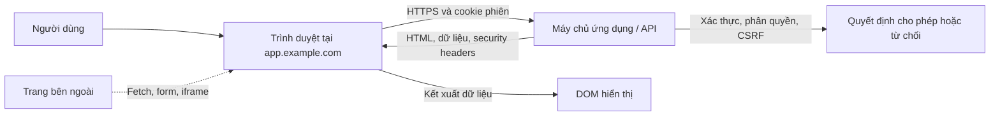

# Đầu ra của ứng dụng web an toàn

Một ứng dụng web không được xem là an toàn chỉ vì trang đăng nhập hoạt động, mã nguồn đã qua kiểm tra hoặc trình duyệt không hiện cảnh báo. **Đầu ra của một ứng dụng web an toàn** phải thể hiện bằng hành vi có thể quan sát và kiểm chứng: nội dung hiển thị không thực thi dữ liệu không tin cậy, phiên đăng nhập được bảo vệ, yêu cầu thay đổi trạng thái được xác thực, quyền truy cập được kiểm soát và chính sách của trình duyệt chặn những tương tác trái phép.

Bài học này thuộc phạm vi `SECURITY_APPLICATION_SECURITY_BROWSER_SECURITY`: phân tích ranh giới bảo mật giữa **trình duyệt, origin, cookie và ứng dụng web**; từ đó tổng hợp cách phòng vệ XSS, CSRF, clickjacking bằng Same-Origin Policy (SOP), CORS, Content Security Policy (CSP), Trusted Types, security headers và kiểm chứng hành vi thực tế.

## 1. Hiểu đúng chữ “đầu ra”

Trong một dự án, “đầu ra” có hai lớp liên quan trực tiếp với nhau:

1. **Đầu ra kỹ thuật:** HTML/JavaScript mà ứng dụng tạo ra; HTTP response và các header; cookie, API, chính sách tải tài nguyên, cách cập nhật DOM, cấu hình máy chủ và trình duyệt.
2. **Đầu ra kiểm chứng:** bằng chứng rằng các cơ chế trên thực sự hoạt động trước những tình huống tấn công cụ thể: yêu cầu bị từ chối, mã độc được hiển thị như văn bản, trang không thể bị nhúng vào iframe của kẻ tấn công, hoặc dữ liệu phiên không bị lộ cho JavaScript.

Ví dụ, câu “đã bật CSP” mới mô tả cấu hình. Một kết quả thuyết phục hơn là: **response có CSP ở chế độ cưỡng chế**, một đoạn script không được cho phép bị trình duyệt chặn và phép thử hợp lệ của ứng dụng vẫn hoạt động. Tương tự, câu “API đã cấu hình CORS” chưa chứng minh API được phân quyền đúng.

Đây là các **tiêu chí chấp nhận theo mô hình đe dọa đã xác định**, không phải lời cam kết rằng một website không còn bất kỳ lỗ hổng nào.

## 2. Xác định các ranh giới bảo mật trước khi chọn biện pháp

Giả sử có một ứng dụng quản lý đơn hàng tại `https://app.example.com`. Người dùng đăng nhập, xem đơn hàng, cập nhật địa chỉ giao hàng và nhập ghi chú. Ứng dụng có thể truy cập API tại cùng origin (`/api`) hoặc một origin khác (`https://api.example.com`). Một trang độc hại tại `https://attacker.example.net` có thể dụ người dùng truy cập.

**Origin** gồm `scheme + hostname + port`. **Site** dùng trong chính sách `SameSite` của cookie được xác định theo scheme và miền có thể đăng ký (registrable domain); origin và site không phải cùng một khái niệm.

| Hai địa chỉ | Quan hệ | Ý nghĩa thực tiễn |
| --- | --- | --- |
| `https://app.example.com/orders` và `https://app.example.com/profile` | Cùng origin | JavaScript có thể gọi API cùng origin; vẫn cần xác thực và phân quyền phía máy chủ. |
| `https://app.example.com` và `https://api.example.com` | Khác origin, thường cùng site | `fetch` chịu kiểm soát CORS khi đọc phản hồi; cookie `SameSite` không tự bảo vệ trước mọi origin cùng site. |
| `https://app.example.com` và `http://app.example.com` | Khác origin và khác site theo mô hình schemeful SameSite | HTTPS và chính sách truyền cookie tác động đến bảo mật phiên. |
| `https://app.example.com` và `https://attacker.example.net` | Khác origin, khác site | SOP hạn chế đọc dữ liệu qua JavaScript; trình duyệt vẫn có thể gửi một số yêu cầu xuyên site. |



Các ranh giới cần nhận diện gồm:

- **Dữ liệu đi vào DOM:** ghi chú đơn hàng, tham số URL, bình luận hay dữ liệu API là dữ liệu không tin cậy, dù đến từ cơ sở dữ liệu nội bộ.
- **Lệnh từ trình duyệt đi đến máy chủ:** trình duyệt có thể tự gắn cookie cho một yêu cầu; điều đó không chứng minh người dùng chủ ý thực hiện thao tác.
- **Yêu cầu và phản hồi giữa các origin:** SOP và CORS quy định khả năng đọc tài nguyên qua JavaScript; phân quyền tài nguyên vẫn do máy chủ quyết định.
- **Trang bị nhúng vào trang khác:** kẻ tấn công có thể đặt giao diện hợp lệ trong iframe rồi đánh lừa người dùng nhấp chuột.
- **Mã chạy trong cùng origin:** script bên thứ ba hoặc script phát sinh từ XSS có thể hoạt động với quyền của origin; cần kiểm soát cả nguồn script lẫn các vị trí nguy hiểm trong DOM.

Khi lập mô hình đe dọa, nên hỏi: *Ai điều khiển đầu vào? Dữ liệu/lệnh vượt qua ranh giới nào? Ai phải đưa ra quyết định tin cậy? Bằng chứng nào cho thấy yêu cầu không hợp lệ đã bị chặn?*

## 3. Một “hợp đồng bảo mật” có thể kiểm chứng

Các thành phần dưới đây tạo thành bộ đầu ra tham chiếu cho ứng dụng ví dụ. Tùy kiến trúc và rủi ro, từng dự án có thể cần thêm hoặc điều chỉnh chính sách.

| Bề mặt | Đầu ra mong đợi | Cách kiểm chứng |
| --- | --- | --- |
| Kết nối | Nội dung nhạy cảm chỉ truyền qua HTTPS; không có mixed content | Kiểm tra URL, certificate và tab **Security/Network** của DevTools. |
| Phiên đăng nhập | Cookie phiên có `Secure`, `HttpOnly`, `SameSite` phù hợp, phạm vi hẹp; phiên được quản lý trên máy chủ | Quan sát `Set-Cookie`, yêu cầu tiếp theo và quy trình đăng xuất/hết hạn. |
| Dữ liệu ra giao diện | Dữ liệu người dùng được mã hóa theo ngữ cảnh hoặc đưa vào DOM qua API an toàn | Chèn chuỗi có ký tự HTML/JavaScript và xác minh nó không thực thi. |
| Script và DOM | CSP có hiệu lực; dùng Trusted Types khi nền tảng hỗ trợ và phù hợp | Thử script/DOM sink không hợp lệ; xem Console và CSP violation. |
| API khác origin | CORS chỉ cho phép các origin/phương thức/header cần thiết; không dùng CORS thay thế phân quyền | Thử từ origin được phép và không được phép trong trình duyệt. |
| Hành động thay đổi dữ liệu | Máy chủ kiểm tra phiên, phân quyền, CSRF token và các tín hiệu nguồn yêu cầu thích hợp | Gửi POST thiếu/sai token, sai quyền, sai nguồn và kiểm tra trạng thái dữ liệu. |
| Chống nhúng độc hại | `frame-ancestors` ngăn iframe ngoài danh sách cho phép | Tạo trang bên ngoài có iframe và kiểm tra trình duyệt từ chối nhúng. |
| Vận hành | Có kiểm thử hồi quy, báo cáo vi phạm chính sách và danh sách ngoại lệ rõ ràng | Lưu kết quả thử nghiệm và đưa vào quy trình phát hành. |

Không một ô nào trong bảng tự đủ để bảo vệ toàn hệ thống. Chẳng hạn, cookie `HttpOnly` hạn chế JavaScript đọc giá trị phiên nhưng **không ngăn** một script XSS gửi yêu cầu được xác thực từ chính trang đang mở.

## 4. HTTP response và security headers là đầu ra hữu hình

Đối với trang HTML có đăng nhập, một response minh họa có thể mang các trường sau:

```http
HTTP/1.1 200 OK
Content-Type: text/html; charset=utf-8
Cache-Control: no-store
X-Content-Type-Options: nosniff
Referrer-Policy: strict-origin-when-cross-origin
Permissions-Policy: camera=(), microphone=(), geolocation=()
X-Frame-Options: DENY
Content-Security-Policy: default-src 'self'; script-src 'self' 'nonce-{NONCE}' 'strict-dynamic'; style-src 'self'; img-src 'self' data:; connect-src 'self'; object-src 'none'; base-uri 'none'; form-action 'self'; frame-ancestors 'none'
Set-Cookie: __Host-session={OPAQUE_SESSION}; Path=/; Secure; HttpOnly; SameSite=Lax
```

Đây là **mẫu định hướng, không phải cấu hình dán nguyên vào production**. Máy chủ phải sinh giá trị `NONCE` khó đoán bằng bộ sinh số ngẫu nhiên an toàn **cho mỗi response**, đồng thời đặt cùng nonce vào những thẻ script đáng tin cậy cần cho phép. Các giá trị trong dấu `{...}` chỉ là ký hiệu minh họa. Một trang cần được bên thứ ba nhúng hợp pháp không thể dùng `frame-ancestors 'none'`; khi đó phải xác định danh sách origin được phép. Với trang công khai và tài nguyên tĩnh có thể cache, `Cache-Control` cần được thiết kế khác so với dữ liệu cá nhân.

Ý nghĩa và giới hạn của các cơ chế quan trọng:

- **HTTPS và HSTS:** HTTPS bảo vệ kênh truyền. Sau khi xác minh tất cả miền liên quan đã sẵn sàng dùng HTTPS, có thể áp dụng `Strict-Transport-Security` với thời hạn phù hợp; `includeSubDomains` và `preload` cần đánh giá riêng vì ảnh hưởng đến toàn bộ miền.
- **CSP:** giới hạn nguồn tài nguyên và các hành vi trình duyệt như thực thi script, gửi form hoặc nhúng trang. Một chính sách hiệu quả tránh `unsafe-inline`/`unsafe-eval` khi có thể. Chế độ `Content-Security-Policy-Report-Only` dùng để quan sát trước khi bật cưỡng chế; chỉ báo cáo vi phạm **không chặn** hành vi.
- **`X-Content-Type-Options: nosniff`:** giúp chặn một số kiểu diễn giải MIME sai cho script/style; response phải đặt `Content-Type` đúng.
- **`Referrer-Policy`:** giới hạn thông tin URL được gửi qua `Referer`; không đặt token hoặc dữ liệu bí mật vào query string.
- **`Permissions-Policy`:** giới hạn các tính năng trình duyệt không cần dùng; không thay thế hộp thoại cấp quyền của người dùng.
- **`frame-ancestors`:** kiểm soát ai được nhúng trang, chống clickjacking. `X-Frame-Options: DENY` là lớp hỗ trợ cho trình duyệt cũ; nên dùng CSP `frame-ancestors` làm chính.
- **`Cache-Control: no-store`:** hợp lý với response chứa thông tin cá nhân hoặc dữ liệu nhạy cảm; không phải cài đặt mặc định cho mọi hình ảnh, CSS hay JavaScript công khai.

Các header như `Cross-Origin-Opener-Policy` (COOP), `Cross-Origin-Embedder-Policy` (COEP) và `Cross-Origin-Resource-Policy` (CORP) có vai trò trong cách ly cửa sổ/tài nguyên xuyên origin. **Không nên bật cứng cho mọi trang**: một số luồng đăng nhập liên kết, popup và tài nguyên nhúng của bên thứ ba có thể bị ảnh hưởng. Chúng cần được chọn theo yêu cầu cách ly của ứng dụng và kiểm thử tương thích.

## 5. Dữ liệu hiển thị an toàn: phòng vệ XSS ngay tại đầu ra DOM

XSS xuất hiện khi dữ liệu do người khác kiểm soát được biến thành mã chạy trong origin của ứng dụng. Nguồn dữ liệu có thể là `location.search`, hash URL, phản hồi API, tên hiển thị hoặc nội dung lấy từ cơ sở dữ liệu. Biện pháp cốt lõi là **đặt dữ liệu vào đúng ngữ cảnh và dùng API không diễn giải dữ liệu thành code**.

Ví dụ, một hộp xem trước ghi chú:

```html
<p id="note-preview"></p>
<script nonce="{NONCE}">
  const note = new URLSearchParams(location.search).get('note') ?? '';
  document.querySelector('#note-preview').textContent = note;
</script>
```

Nếu `note` chứa ``, thuộc tính `textContent` đưa chuỗi đó ra màn hình dưới dạng **văn bản**. Cách nguy hiểm là gán dữ liệu không tin cậy vào `innerHTML`:

```js
// Không dùng cho dữ liệu không tin cậy:
document.querySelector('#note-preview').innerHTML = note;
```

Một số lưu ý khi thiết kế đầu ra:

1. **Văn bản:** ưu tiên `textContent`, `createTextNode` hoặc cơ chế escaping mặc định của framework. Không đánh dấu dữ liệu người dùng là “HTML an toàn” chỉ để tránh escaping.
2. **Thuộc tính HTML:** sử dụng API DOM để gán thuộc tính thông thường và kiểm tra giá trị; các thuộc tính như `href` vẫn cần kiểm tra scheme/URL hợp lệ. Không cho phép URL `javascript:`.
3. **Dữ liệu trong JavaScript/CSS/URL:** không dùng cùng một hàm escape cho mọi ngữ cảnh; tốt nhất là tách dữ liệu ra JSON hoặc thuộc tính dữ liệu được xử lý an toàn thay vì ghép chuỗi vào code.
4. **Nội dung HTML có chủ đích:** chỉ dùng bộ lọc HTML đáng tin cậy, duy trì cập nhật và giới hạn các thẻ/thuộc tính được phép; sanitization không tương đương với escaping văn bản.
5. **CSP:** là lớp giảm thiểu hậu quả nếu lỗi DOM/XSS lọt qua; CSP không thay thế việc xử lý đầu ra đúng ngữ cảnh.

### Trusted Types bảo vệ các điểm nhận HTML/script nguy hiểm

Ở các trình duyệt có hỗ trợ, ứng dụng có thể bật:

```http
Content-Security-Policy: require-trusted-types-for 'script'; trusted-types app-policy
```

Chỉ thị này yêu cầu giá trị có kiểu tin cậy đối với một số DOM sink nguy hiểm, giúp phát hiện những chỗ còn gán trực tiếp chuỗi vào các sink đó. Nếu ứng dụng thật sự cần tạo HTML, có thể định nghĩa **một chính sách Trusted Types có kiểm soát**, kết hợp bộ làm sạch HTML phù hợp; không tạo chính sách “trả nguyên đầu vào” vì như vậy sẽ làm mất tác dụng bảo vệ. Trusted Types còn khác biệt về mức hỗ trợ giữa các trình duyệt, do đó cần tiếp tục dùng API DOM an toàn, escaping và kiểm thử đa trình duyệt.

**Đầu ra kiểm chứng của XSS:** chuỗi tấn công được hiển thị như dữ liệu, không xuất hiện script thực thi, không có lời gọi mạng ngoài ý muốn, và các luồng hiển thị hợp lệ vẫn hoạt động.

## 6. Cookie và phiên: bảo vệ danh tính qua từng yêu cầu

Với mô hình đăng nhập bằng cookie, trình duyệt giữ một **mã phiên ngẫu nhiên, khó đoán**; máy chủ quản lý phiên, thời hạn, quyền và trạng thái thu hồi. Một cookie ví dụ:

```http
Set-Cookie: __Host-session={OPAQUE_SESSION}; Path=/; Secure; HttpOnly; SameSite=Lax
```

| Thuộc tính | Tác dụng | Điều không giải quyết được |
| --- | --- | --- |
| `Secure` | Chỉ gửi cookie qua kết nối an toàn theo quy tắc của trình duyệt | Không thay thế HTTPS và bảo mật máy chủ. |
| `HttpOnly` | Ngăn JavaScript đọc cookie bằng `document.cookie` | Không ngăn XSS gửi yêu cầu hợp lệ cùng origin. |
| `SameSite=Lax` hoặc `Strict` | Giảm một số lần gửi cookie trong yêu cầu xuyên site | Không thay thế CSRF token, nhất là với origin khác nhưng cùng site. |
| `Path=/` và không có `Domain` | Giữ cookie ở phạm vi host, kết hợp tiền tố `__Host-` | Không thay thế kiểm tra quyền trên endpoint. |
| Hạn sử dụng và thu hồi phiên | Giảm thời gian tồn tại và cho phép chấm dứt phiên | Cần xử lý đúng ở máy chủ khi đăng xuất/đổi quyền. |

Tiền tố `__Host-` yêu cầu cookie được đặt qua kết nối an toàn với `Secure`, có `Path=/` và **không có `Domain`**. Không mặc định gắn `Domain=.example.com` để mọi subdomain cùng nhận cookie, vì việc mở rộng phạm vi có thể tăng bề mặt rủi ro. Khi đăng nhập hoặc nâng quyền, cần cân nhắc đổi mã phiên để chống session fixation; khi đăng xuất phải vô hiệu hóa phiên phía máy chủ nếu ứng dụng quản lý phiên tập trung.

`SameSite=None; Secure` chỉ phù hợp khi có nhu cầu cookie xuyên site đã được đánh giá và trình duyệt thực tế cho phép loại cookie đó; việc chặn cookie bên thứ ba vẫn có thể khiến luồng này không hoạt động. Nếu frontend và API ở hai origin khác nhau, cần thiết kế **đúng nơi cookie được đặt, nơi cookie được gửi và chính sách CORS**.

## 7. SOP và CORS: chia sẻ tài nguyên có kiểm soát

Same-Origin Policy mặc định hạn chế JavaScript tại một origin đọc dữ liệu của origin khác. **CORS là giao thức để máy chủ cho phép một số truy cập xuyên origin**, không phải cơ chế xác thực người dùng hay lớp chống CSRF.

Ứng dụng cùng origin (`https://app.example.com` gọi `/api/orders`) thường không cần CORS. Nếu frontend tại `https://app.example.com` thực sự gọi API tại `https://api.example.com`, API có thể phản hồi theo chính sách cấp phép cụ thể:

```http
Access-Control-Allow-Origin: https://app.example.com
Access-Control-Allow-Credentials: true
Vary: Origin
```

Đây chỉ là ví dụ cho API cần dùng **cookie/credentials**. Khi có preflight, máy chủ cần xử lý `OPTIONS` và khai báo phương thức/header được phép, chẳng hạn `Access-Control-Allow-Methods: GET, POST` và `Access-Control-Allow-Headers: Content-Type, X-CSRF-Token`. Chỉ phản hồi origin nằm trong danh sách cho phép; không phản chiếu tùy tiện giá trị `Origin`. `Access-Control-Allow-Origin: *` **không thể dùng cùng credentialed CORS**. Không phải API nào cũng cần `Access-Control-Allow-Credentials: true`.

Phía frontend chỉ dùng `credentials: 'include'` khi kiến trúc cần gửi cookie xuyên origin và đã cấu hình cookie/CORS phù hợp. CORS không thể thay thế kiểm tra session, quyền truy cập tài nguyên, giới hạn tốc độ hoặc CSRF. Ngay cả khi trình duyệt **không cho JavaScript đọc response**, một form hay yêu cầu thuộc loại được phép vẫn có thể đến máy chủ và gây thay đổi trạng thái nếu endpoint không bảo vệ.

**Đầu ra kiểm chứng của CORS:** origin được phép có thể đọc response khi đủ điều kiện; origin không được phép không thể đọc qua JavaScript; mọi endpoint vẫn từ chối người dùng không xác thực hoặc không đủ quyền.

## 8. CSRF: xác nhận ý định thay đổi dữ liệu ở máy chủ

CSRF lợi dụng việc trình duyệt có thể tự đính kèm cookie phiên khi gửi yêu cầu. Một trang độc hại cố khiến người dùng đã đăng nhập thực hiện thao tác mà họ không chủ ý, ví dụ đổi địa chỉ nhận hàng. Một response bị SOP/CORS che khỏi kẻ tấn công **vẫn có thể đã gây thay đổi dữ liệu**.

Với endpoint cập nhật trạng thái, các yêu cầu cốt lõi là:

- Không dùng `GET` cho thao tác thay đổi trạng thái; dùng phương thức thích hợp và kiểm tra `Content-Type` mong đợi.
- Xác thực phiên, **phân quyền theo đúng bản ghi** và xác thực CSRF token được gắn với phiên/ngữ cảnh của người dùng. Token cần khó đoán và được kiểm tra ở máy chủ; không đặt token vào URL.
- Kiểm tra `Origin` (hoặc `Referer` có điều kiện) và có thể dùng các header Fetch Metadata như `Sec-Fetch-Site` để bổ sung kiểm soát, với chính sách xử lý trường hợp header vắng mặt được thiết kế rõ ràng.
- Dùng `SameSite` như một lớp bảo vệ bổ sung; không nhầm “cùng site” với “cùng origin”.
- XSS có thể lấy hoặc sử dụng token chống CSRF trong bối cảnh trang hợp lệ, nên phòng vệ XSS vẫn là yêu cầu nền tảng.

Luồng hợp lệ minh họa:

```js
// csrfToken do ứng dụng cấp qua một luồng cùng origin được bảo vệ.
await fetch('/api/orders/42/address', {
  method: 'POST',
  credentials: 'same-origin',
  headers: {
    'Content-Type': 'application/json',
    'X-CSRF-Token': csrfToken
  },
  body: JSON.stringify({ address: 'Địa chỉ giao hàng hợp lệ' })
});
```

Máy chủ chỉ ghi thay đổi sau khi đã xác minh **đúng người dùng, đúng tài nguyên, đúng phiên và CSRF token hợp lệ**. Phía client gửi token không có giá trị bảo vệ nếu máy chủ không kiểm tra. Khi token thiếu hoặc sai, response nên báo lỗi thích hợp (ví dụ HTTP 403), và **dữ liệu không thay đổi**; HTTP 403 chỉ là dấu hiệu bên ngoài, còn trạng thái dữ liệu mới là bằng chứng cuối cùng.

## 9. Clickjacking: người dùng thấy một giao diện, nhưng nhấp vào giao diện khác

Kẻ tấn công có thể đặt website hợp pháp bên trong một iframe, che phủ nó bằng giao diện khác và dụ người dùng nhấp vào nút nhạy cảm. Nếu trang quản lý đơn hàng không cần nhúng ở đâu, chính sách đơn giản là:

```http
Content-Security-Policy: frame-ancestors 'none'
X-Frame-Options: DENY
```

Nếu hệ thống có nhu cầu được nhúng trong portal tin cậy, hãy dùng danh sách origin cụ thể cho `frame-ancestors`; kiểm tra cả các trang con trong chuỗi iframe. `frame-src` giới hạn **trang của ta được nhúng những iframe nào**, còn `frame-ancestors` giới hạn **ai được nhúng trang của ta**: hai chiều khác nhau.

**Đầu ra kiểm chứng:** từ một trang ở origin không được phép, thử tạo `<iframe src="https://app.example.com/orders">`. Trình duyệt phải chặn việc nhúng và DevTools Console thường ghi rõ chính sách bị vi phạm. Đồng thời kiểm tra các luồng nhúng hợp lệ nếu sản phẩm có hỗ trợ.

## 10. Bốn tình huống chứng minh bằng hành vi thực tế

Để tránh đánh giá bảo mật chỉ bằng việc đọc cấu hình, có thể xây dựng bộ thử nghiệm cho ứng dụng quản lý đơn hàng:

| Tình huống thử | Cách tạo điều kiện | Kết quả bắt buộc |
| --- | --- | --- |
| XSS lưu trữ hoặc DOM XSS | Lưu ghi chú chứa `` hoặc truyền chuỗi tương tự qua query | Ghi chú hiển thị như văn bản; script không chạy; CSP/Trusted Types phát hiện điểm dùng DOM sink không hợp lệ nếu được bật. |
| CSRF | Khi người dùng đã đăng nhập, gửi yêu cầu đổi địa chỉ từ một trang khác mà không có CSRF token hợp lệ | Máy chủ từ chối và địa chỉ trong cơ sở dữ liệu giữ nguyên. |
| Truy cập xuyên origin | Từ origin lạ, chạy `fetch` đến API nhạy cảm; thử cả origin được phép nhưng chưa đăng nhập | Không có quyền đọc response xuyên origin trái phép; API vẫn yêu cầu xác thực và phân quyền. |
| Clickjacking | Nhúng trang đơn hàng vào iframe tại một origin không được cấp phép | Trình duyệt chặn iframe; không có giao diện nhạy cảm để kẻ tấn công phủ lên. |

Một số phép thử có thể gây **âm tính giả** nếu chỉ nhìn kết quả trước mắt: `alert` không xuất hiện chưa đủ chứng minh không có XSS; một `fetch` bị lỗi CORS chưa chứng minh POST không có hiệu lực trên máy chủ; iframe trống có thể do lỗi mạng chứ không nhất thiết do `frame-ancestors`. Cần kiểm tra song song **Network, Console, log máy chủ và trạng thái dữ liệu**.

### Kiểm tra response và preflight

Có thể dùng `curl` để quan sát header trên một môi trường được phép kiểm thử:

```bash
curl -i https://app.example.com/

curl -i -X OPTIONS https://api.example.com/orders \
  -H 'Origin: https://app.example.com' \
  -H 'Access-Control-Request-Method: POST' \
  -H 'Access-Control-Request-Headers: content-type,x-csrf-token'
```

Đối chiếu thêm bằng trình duyệt vì `curl` **không tự thực thi SOP, CORS, CSP, cookie policy hay Trusted Types**. Thử lại preflight với `Origin: https://attacker.example.net`; response không được cấp quyền đọc theo CORS cho origin này. Với endpoint nhạy cảm, phải kiểm tra riêng yêu cầu không xác thực, sai quyền và CSRF token thiếu/sai.

### Bảng bằng chứng khi nghiệm thu

| Bằng chứng | Cần ghi lại | Tín hiệu lỗi cần chú ý |
| --- | --- | --- |
| Network/Headers | URL HTTPS, header thật ở response cuối, cookie attributes, preflight | Redirect làm rơi chính sách; header chỉ có trên trang chủ nhưng thiếu ở endpoint khác. |
| Browser Console | Vi phạm CSP/Trusted Types và nguyên nhân | Policy ở Report-Only nhưng bị hiểu là đã cưỡng chế; một ngoại lệ `unsafe-inline` quá rộng. |
| Thử nghiệm hành động | HTTP status và giá trị bản ghi trước/sau | Trình duyệt báo lỗi CORS nhưng dữ liệu vẫn bị sửa. |
| Đa trình duyệt | Các luồng đăng nhập, popup, iframe, cookie, fetch | Trình duyệt không hỗ trợ Trusted Types hoặc chính sách cô lập gây hỏng chức năng. |
| Kiểm thử hồi quy | Kịch bản XSS, CSRF, phân quyền, nhúng trái phép chạy lại sau thay đổi | Bản cập nhật frontend thêm `innerHTML`; endpoint mới thiếu CSRF/authz. |

## 11. Từ cấu hình rời rạc thành một bộ bàn giao bảo mật

Khi hoàn thành một tính năng web có dùng cookie và trình duyệt, nhóm triển khai nên bàn giao những đầu ra sau:

1. **Sơ đồ ranh giới tin cậy:** liệt kê origin, API, nguồn dữ liệu người dùng, cookie và các tài nguyên/iframe bên thứ ba; nêu rõ chức năng nào cần truy cập xuyên origin hoặc xuyên site.
2. **Hợp đồng response:** cấu hình HTTPS, cookie, CSP, CORS, các header liên quan và nơi áp dụng. Mỗi ngoại lệ phải gắn với một nhu cầu sản phẩm cụ thể.
3. **Quy ước dựng giao diện:** cách render văn bản/HTML/URL, danh sách DOM sink bị cấm hoặc hạn chế, nơi dùng sanitizer và Trusted Types policy nếu có.
4. **Hợp đồng endpoint nhạy cảm:** yêu cầu authentication, authorization, CSRF, validation, HTTP method, cách xử lý lỗi và cách bảo vệ dữ liệu khi người dùng không đủ quyền.
5. **Bằng chứng nghiệm thu:** kết quả thử với yêu cầu hợp lệ và bất hợp lệ trong trình duyệt thật, log phù hợp, kết quả hồi quy và những giới hạn còn tồn tại.

Mô hình kiểm tra ưu tiên theo thứ tự: **chặn lỗi tại nguồn → thiết lập ranh giới ở máy chủ → áp dụng chính sách trình duyệt → thử hành vi tấn công thực tế**. Các lớp bổ sung cho nhau; không có một header hay thư viện nào thay thế toàn bộ kiến trúc bảo mật ứng dụng.

## 12. Câu hỏi tự kiểm tra

1. Hai trang cùng site nhưng khác origin có bị CORS chi phối khi JavaScript đọc response không? Cookie `SameSite` có đủ để ngăn mọi CSRF giữa hai trang đó không?
2. Vì sao `HttpOnly` không thể thay thế phòng vệ XSS? Vì sao `Access-Control-Allow-Origin` không thể thay thế xác thực và phân quyền?
3. Nếu người dùng cung cấp chuỗi chứa thẻ `<script>`, khi nào nên dùng `textContent`, khi nào cần sanitizer, và vai trò bổ sung của CSP/Trusted Types là gì?
4. Làm sao chứng minh một CSRF đã bị chặn nếu trình duyệt chỉ hiển thị lỗi CORS?
5. Khi sản phẩm có nhu cầu nhúng trang vào portal đối tác, cần thay đổi và kiểm chứng `frame-ancestors` như thế nào?

**Tiêu chí hoàn thành bài học:** người học có thể xem một luồng web cụ thể, chỉ ra ranh giới bảo mật, đề xuất đúng cơ chế bảo vệ cho từng rủi ro, và cung cấp bằng chứng hành vi trong trình duyệt lẫn trên máy chủ. Đó mới là đầu ra quan sát được của một ứng dụng web được thiết kế và kiểm thử với yêu cầu bảo mật rõ ràng.
