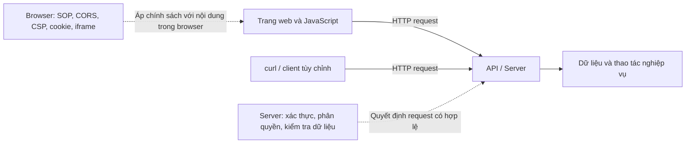

# Giới hạn của browser security

> **Chương:** Bức tranh tổng thể  
> **Phạm vi:** Application Security — Browser Security

Trình duyệt hiện đại có nhiều cơ chế bảo vệ: **Same-Origin Policy (SOP)**, **CORS**, cookie attributes, sandbox cho iframe, **Content Security Policy (CSP)**, **Trusted Types**, các security header và cơ chế cách ly tiến trình. Tuy vậy, những cơ chế này chỉ bảo vệ **một số ranh giới xác định**. Chúng không thể tự bảo đảm rằng API đã phân quyền đúng, dữ liệu trả về được phép tiết lộ, mã JavaScript của chính ứng dụng là an toàn, hoặc người dùng không bị lừa.

Hiểu giới hạn của browser security giúp chúng ta đặt biện pháp phòng vệ đúng chỗ khi xử lý **XSS, CSRF, clickjacking** và những rủi ro phát sinh từ origin, cookie, nội dung bên thứ ba.

## 1. Sau bài học, bạn cần phân biệt được điều gì?

- Trình duyệt có thể kiểm soát **cách nội dung web tương tác với nhau**; máy chủ phải kiểm soát **ai được làm gì với dữ liệu**.
- **Cross-origin** khác **cross-site**; SOP, CORS và SameSite giải quyết những vấn đề khác nhau.
- Một request bị JavaScript chặn đọc response vẫn có thể đã được **gửi tới máy chủ**.
- **CSP, Trusted Types, HttpOnly, SameSite và `frame-ancestors`** là các lớp giảm thiểu rủi ro có phạm vi giới hạn, không phải bằng chứng ứng dụng không còn lỗ hổng.
- Bảo vệ cần được kiểm tra bằng hành vi thực tế của **browser, network và API**, thay vì chỉ nhìn vào giao diện hay sự hiện diện của security header.

## 2. Ranh giới tin cậy: browser quản lý cái gì, server quản lý cái gì?

Browser là môi trường chạy mã phía người dùng. Nó có thể áp dụng chính sách với tài liệu, script, DOM, cookie, việc nhúng trang và quyền đọc tài nguyên giữa các origin. Tuy nhiên, **người dùng kiểm soát thiết bị và các request xuất phát từ đó**: họ có thể sửa JavaScript, mở DevTools, gọi API trực tiếp bằng `curl`, viết client riêng hoặc tắt JavaScript.



Ví dụ: ứng dụng ẩn nút **Xóa tài khoản** khi `currentUser.role !== "admin"`. Việc ẩn nút chỉ thay đổi giao diện. Nếu API `DELETE /api/users/42` không kiểm tra quyền trên server, người dùng vẫn có thể gọi trực tiếp endpoint. **Server phải xác minh danh tính, quyền trên tài nguyên cụ thể và tính hợp lệ của thao tác ở từng request**.

Một luồng kiểm tra phía server có thể được mô tả như sau (mã giả):

```text
DELETE /api/users/{id}
  → xác thực phiên / access token
  → kiểm tra người gọi có quyền xóa user {id} hay không
  → kiểm tra ràng buộc nghiệp vụ
  → thực hiện thay đổi hoặc trả 403/404
```

Điểm mấu chốt: **không có security header ở phía trình duyệt nào thay thế được kiểm tra phân quyền này**.

## 3. Origin không đồng nghĩa với site

Một **origin** được xác định bởi bộ ba `scheme + host + port`. Hai URL chỉ cùng origin khi cả ba thành phần trùng nhau; cổng mặc định của giao thức được hiểu theo giá trị chuẩn.

| URL so với `https://app.example.com` | Cùng origin? | Vì sao? |
| --- | --- | --- |
| `https://app.example.com/profile` | Có | Cùng giao thức, host, cổng |
| `https://api.example.com` | Không | Khác host |
| `http://app.example.com` | Không | Khác scheme |
| `https://app.example.com:8443` | Không | Khác port |

Khái niệm **site** thường dựa trên scheme và *registrable domain* (ví dụ `example.com`). Vì vậy `https://app.example.com` và `https://blog.example.com` là **cross-origin** nhưng thường **same-site**. Điều này đặc biệt quan trọng với cookie `SameSite`: một subdomain khác có thể là nguồn request same-site dù vẫn khác origin.

Không nên dùng “cùng domain”, “cùng site” và “cùng origin” như các từ đồng nghĩa. Mỗi chính sách dựa trên một ranh giới khác nhau.

## 4. SOP và CORS: bảo vệ việc đọc response, không phải tường lửa API

**Same-Origin Policy** hạn chế việc một script ở origin A đọc dữ liệu thuộc origin B, như DOM của iframe cross-origin hoặc response của request không được cho phép. **CORS** là cơ chế để server khai báo những origin nào được phép đọc một số response cross-origin từ JavaScript của browser.

Ví dụ, một trang ở `https://shop.example` gọi:

```js
fetch("https://api.example.test/orders", {
  credentials: "include"
});
```

Nếu API không trả về header CORS phù hợp, JavaScript thường **không đọc được response**. Nhưng điều đó không chứng minh API chưa nhận request. Với các request đủ điều kiện là *simple request*, browser có thể gửi request rồi mới không cho JavaScript tiếp cận kết quả. Với nhiều request không đơn giản, browser kiểm tra **preflight `OPTIONS`** trước khi gửi request thực tế; kết quả phụ thuộc loại request và chính sách phản hồi.

| Cơ chế | Thực sự làm gì? | Không bảo đảm điều gì? |
| --- | --- | --- |
| SOP | Cách ly khả năng đọc DOM/dữ liệu giữa các origin theo quy tắc browser | Không xác thực người gọi API; không chặn mọi request cross-origin |
| CORS | Cho phép hoặc từ chối **JavaScript trong browser đọc** response cross-origin | Không là cơ chế phân quyền API; không ràng buộc `curl`, backend khác, mobile app |
| Preflight CORS | Browser kiểm tra quyền thực hiện một số request cross-origin trước request chính | Không thay thế xác thực, phân quyền hay chống CSRF |

Server có thể trả về `Access-Control-Allow-Origin: https://app.example` và `Access-Control-Allow-Credentials: true` khi thực sự muốn cho origin đó đọc response với credentials. Tuy nhiên, danh sách origin được phép **không phải** danh sách người dùng được phép truy cập dữ liệu. Hơn nữa, `Access-Control-Allow-Origin: *` không cho phép JavaScript đọc credentialed response. Nếu phản hồi `Access-Control-Allow-Origin` thay đổi theo request, cần cân nhắc `Vary: Origin` để cache không trộn chính sách.

**Sai lầm thường gặp:** “API đã cấu hình CORS chỉ cho frontend, vậy không ai gọi được API từ nơi khác”. Thực tế, bất kỳ HTTP client nào cũng có thể gửi request tới endpoint truy cập được qua mạng; **server vẫn phải kiểm tra session/token và quyền trên từng tài nguyên**.

## 5. Browser không thể bảo vệ bí mật và quy tắc nghiệp vụ đặt trong frontend

Mã JavaScript, JSON cấu hình, source map được phát hành công khai và dữ liệu có trong DOM hoặc bộ nhớ browser đều có thể được người dùng xem hoặc thay đổi. Vì vậy:

- Không đưa **API secret, private key, mật khẩu dịch vụ** vào bundle frontend hoặc biến môi trường đã được build ra frontend.
- Không tin giá tiền, chiết khấu, `userId`, `role`, trạng thái thanh toán hay cờ `isAdmin` chỉ vì chúng được gửi từ giao diện hợp lệ.
- Không coi việc ẩn menu, vô hiệu hóa nút, chặn route phía client hoặc kiểm tra form bằng JavaScript là biện pháp bảo vệ dữ liệu.
- Với yêu cầu đọc/sửa dữ liệu, server phải kiểm tra **quyền theo đối tượng**: người dùng A có được đọc đơn hàng của B hay không?

Ví dụ kiểm tra phía server (mã giả):

```js
if (!request.user) return response.sendStatus(401);
const order = await orders.findById(request.params.orderId);
if (!order || order.ownerId !== request.user.id) {
  return response.sendStatus(404); // Hoặc 403 theo chính sách API
}
return response.json(order);
```

Frontend chỉ có thể cải thiện trải nghiệm; **quyền truy cập là quyết định của server**.

## 6. XSS: cùng origin có thể chứa mã độc

SOP bảo vệ origin này khỏi origin khác, nhưng không tự phân biệt **script hợp pháp** và **script độc hại đang chạy trong cùng origin**. Nếu ứng dụng đưa dữ liệu không đáng tin cậy vào DOM hoặc JavaScript theo cách nguy hiểm, kẻ tấn công có thể khiến mã của họ thực thi trong ngữ cảnh origin ứng dụng. Đây là bản chất của **Cross-Site Scripting (XSS)**.

Ví dụ một *DOM XSS sink*:

```js
const query = new URLSearchParams(location.search).get("q") ?? "";
document.querySelector("#search-result").innerHTML = query; // Nguy hiểm
```

Nếu chỉ hiển thị văn bản, sửa thành:

```js
const query = new URLSearchParams(location.search).get("q") ?? "";
document.querySelector("#search-result").textContent = query;
```

Trong trường hợp phải hiển thị HTML do người dùng cung cấp, cần sử dụng **bộ sanitizer phù hợp với ngữ cảnh**, kết hợp cách tạo DOM an toàn và kiểm soát những sink có thể thực thi mã. Không dùng biểu thức chính quy tự viết như một bộ lọc HTML tổng quát.

Các cơ chế hỗ trợ:

- **CSP** giới hạn nguồn script, kiểu thực thi script và nhiều hành vi tải tài nguyên. CSP chặt chẽ có thể giảm khả năng khai thác, nhưng một script đã được tin cậy hoặc chính sách quá rộng vẫn có thể gây hại. CSP không sửa được lỗi xây dựng HTML trong ứng dụng.
- **Trusted Types** yêu cầu một số DOM sink nguy hiểm nhận giá trị từ chính sách Trusted Types đã khai báo, giúp ngăn nhiều đường đưa chuỗi trực tiếp thành HTML/script. Nó **không tự sanitize dữ liệu**, không bảo vệ mọi sink, và mức hỗ trợ khác nhau giữa browser.
- **`HttpOnly` cookie** không cho JavaScript đọc cookie qua `document.cookie`, nhưng XSS vẫn có thể **thực hiện hành động với phiên đăng nhập của nạn nhân** hoặc đọc dữ liệu mà trang được phép truy cập.

Do đó, chiến lược chính vẫn là **output encoding đúng ngữ cảnh, API/DOM an toàn, tránh sink nguy hiểm, kiểm soát nội dung không tin cậy**, rồi bổ sung CSP và Trusted Types để phòng vệ nhiều lớp.

## 7. CSRF: browser có thể tự gắn credentials vào request

Với xác thực dựa trên cookie, browser có thể tự gửi cookie khi request tới server đáp ứng các quy tắc về domain/path, `Secure` và `SameSite`. Một trang do kẻ tấn công kiểm soát có thể tìm cách khiến browser của người đã đăng nhập **gửi request thay đổi trạng thái** đến ứng dụng đích. Đây là **Cross-Site Request Forgery (CSRF)**.

SOP hoặc CORS có thể ngăn script của trang tấn công **đọc response**, nhưng không bảo đảm browser không **gửi** request. Chẳng hạn, trình duyệt hỗ trợ việc gửi form HTML cross-origin; việc cookie có được đính kèm hay không phụ thuộc ngữ cảnh và chính sách cookie.

Cookie hỗ trợ giảm thiểu rủi ro:

```http
Set-Cookie: session=...; Path=/; Secure; HttpOnly; SameSite=Lax
```

Ý nghĩa và giới hạn:

- `Secure`: chỉ gửi cookie qua kết nối bảo mật phù hợp; không ngăn script độc hại hoặc lỗi phân quyền trên server.
- `HttpOnly`: ngăn JavaScript trực tiếp đọc cookie; không ngăn trình duyệt dùng cookie trong các request hợp lệ.
- `SameSite=Lax`: giảm gửi cookie trong nhiều ngữ cảnh cross-site, nhưng một số điều hướng top-level vẫn có thể gửi cookie. Không được thiết kế để phân biệt các subdomain **same-site**.
- `SameSite=Strict`: hạn chế mạnh hơn trong cross-site navigation, nhưng có thể làm gián đoạn luồng đăng nhập/chuyển hướng hợp lệ.
- `SameSite=None`: cho phép cookie ở nhiều ngữ cảnh cross-site khi đi kèm `Secure`, vì vậy cần thiết kế chống CSRF đặc biệt cẩn thận.

Các endpoint thay đổi trạng thái cần dùng **phương thức HTTP phù hợp** (không thực hiện xóa/chuyển tiền bằng GET), đồng thời áp dụng **CSRF token** hoặc cơ chế chống giả mạo phù hợp, có thể kết hợp kiểm tra `Origin`/`Referer`, kiểm soát content type và xác thực/phân quyền. Đừng xem `SameSite` hoặc CORS là biện pháp duy nhất; đặc biệt cần xem xét các origin khác thuộc **cùng site**.

## 8. Clickjacking: giới hạn của cơ chế chống nhúng trang

Clickjacking xảy ra khi kẻ tấn công nhúng một trang hợp pháp vào iframe, rồi bố trí giao diện để người dùng vô tình click vào thành phần của trang đó. Cơ chế phòng vệ chính là **CSP `frame-ancestors`**, có thể bổ sung `X-Frame-Options` để hỗ trợ các trình duyệt cũ:

```http
Content-Security-Policy: frame-ancestors 'none'
X-Frame-Options: DENY
```

`frame-ancestors 'none'` chặn các trang khác nhúng tài liệu được bảo vệ vào frame. Nếu sản phẩm cần nhúng có kiểm soát, dùng danh sách ancestor được phép và kiểm thử các luồng nhúng. Đây là **chính sách do response của trang được nhúng công bố**, khác với chỉ thị `frame-src` kiểm soát những frame mà trang đó **được phép tải**.

Giới hạn: chống nhúng không ngăn người dùng mở trực tiếp một website giả mạo, bị lừa click trên trang tấn công hoặc xác nhận một thao tác nghiệp vụ nguy hiểm. Các thao tác nhạy cảm vẫn cần xác minh quyền, xác nhận phù hợp và thiết kế UI thận trọng.

## 9. Các lớp bảo vệ browser khác cũng có ranh giới

| Cơ chế | Giúp chống lại | Giới hạn cần nhớ |
| --- | --- | --- |
| **HTTPS/TLS** | Nghe lén, sửa dữ liệu trên đường truyền giữa client và điểm kết thúc TLS tin cậy | Không ngăn lỗ hổng server, XSS, phishing, mã bên thứ ba đã bị xâm nhập |
| **HSTS** | Yêu cầu browser dùng HTTPS cho những lần truy cập sau theo chính sách đã ghi nhớ | Không bảo đảm lần truy cập đầu tiên nếu browser chưa có chính sách/preload; cần cấu hình HTTPS đúng |
| **Cookie `Secure`, `HttpOnly`, `SameSite`** | Hạn chế một số đường lộ cookie và gửi cookie không mong muốn | Không thay thế session management, chống CSRF, phân quyền |
| **CSP** | Hạn chế nguồn nội dung và một số cách thực thi mã, nhúng trang | Chính sách quá rộng dễ mất tác dụng; script được phép vẫn có thể có lỗi |
| **Trusted Types** | Giảm XSS qua các DOM sink thuộc phạm vi thực thi | Không tự làm sạch HTML, không bao phủ mọi browser/sink |
| **Iframe `sandbox`** | Hạn chế quyền của nội dung iframe | Các token cấp quyền có thể nới lỏng đáng kể sandbox; cần đánh giá theo origin và chức năng |
| **SRI (`integrity`)** | Phát hiện nội dung subresource không khớp hash được khai báo | Không bảo đảm thư viện ban đầu an toàn hoặc kiểm soát mọi cập nhật động |
| **COOP / COEP / CORP** | Củng cố ranh giới giữa browsing context và việc chia sẻ/nạp tài nguyên | Không cấp quyền truy cập dữ liệu; có thể ảnh hưởng iframe, popup và tích hợp bên ngoài |
| **`X-Content-Type-Options: nosniff`** | Hạn chế một số hành vi đoán kiểu nội dung không mong muốn | Không bù được MIME type sai, file upload độc hại hay xử lý dữ liệu phía server thiếu an toàn |

Một số vấn đề **nằm ngoài năng lực giải quyết hoàn toàn của web platform**: tiện ích browser được cấp quyền cao, thiết bị đã bị xâm nhập, chuỗi cung ứng JavaScript bị thao túng, người dùng bị phishing, các lỗ hổng triển khai của browser hoặc cách ly phần cứng. Sandbox và site isolation làm giảm rủi ro, nhưng không nên được coi là lời hứa mọi mã đều không thể vượt ranh giới.

Đặc biệt, dùng `sandbox` cho iframe cần chọn token tối thiểu. Với nội dung iframe **cùng origin**, việc kết hợp `allow-scripts` và `allow-same-origin` có thể vô hiệu hóa đáng kể mục tiêu cách ly vì mã trong iframe có khả năng tháo thuộc tính sandbox rồi tải lại chính nó. Khi cần cô lập nội dung không tin cậy, cân nhắc **origin riêng** và chính sách sandbox đã kiểm thử.

## 10. Security headers là chính sách, không phải chứng nhận an toàn

Ví dụ các header thường gặp trên một ứng dụng web (cần điều chỉnh cho sản phẩm thực tế):

```http
Content-Security-Policy: default-src 'self'; script-src 'self' 'nonce-{RANDOM_PER_RESPONSE}'; object-src 'none'; base-uri 'none'; frame-ancestors 'none'
Strict-Transport-Security: max-age=31536000
X-Content-Type-Options: nosniff
Referrer-Policy: strict-origin-when-cross-origin
```

Ở đây `{RANDOM_PER_RESPONSE}` là **placeholder**: server phải tạo nonce đủ ngẫu nhiên, riêng cho từng response, và đặt nonce tương ứng lên script được cho phép. Không copy nguyên placeholder lên production. Những site có nhu cầu nhúng hoặc tải script bên thứ ba phải xác định chính sách phù hợp; thêm `'unsafe-inline'` hoặc wildcard quá rộng có thể làm giảm ý nghĩa bảo vệ.

Nếu ứng dụng đã triển khai quy trình tạo DOM an toàn và nhắm tới browser hỗ trợ, có thể đánh giá thêm:

```http
Content-Security-Policy: require-trusted-types-for 'script'; trusted-types app-policy
```

Chỉ thị Trusted Types cần thiết kế và đăng ký `app-policy` đúng cách trong JavaScript, kiểm tra tương thích browser và thư viện trước khi bật chế độ cưỡng chế. Không có một bộ header giống nhau phù hợp với mọi ứng dụng. Riêng COOP/COEP/CORP cần kiểm tra ảnh hưởng đến popup đăng nhập, iframe nhúng và tài nguyên cross-origin trước khi áp dụng.

Quan trọng hơn cấu hình header là câu hỏi: **“Nếu client gửi một request hợp lệ về mặt HTTP nhưng không có quyền, server sẽ làm gì?”** Header không thể trả lời thay cho server.

## 11. Chọn biện pháp đúng theo loại rủi ro

| Tình huống | Lớp bảo vệ ở browser | Điều ứng dụng/server vẫn phải làm |
| --- | --- | --- |
| JavaScript trang lạ muốn đọc API | SOP, CORS | Xác thực và phân quyền từng request/tài nguyên; không trả dữ liệu thừa |
| XSS qua tìm kiếm, bình luận, HTML động | CSP, Trusted Types khi hỗ trợ | Encoding/sanitization đúng ngữ cảnh, DOM API an toàn, kiểm soát thư viện |
| Form độc hại kích hoạt chuyển trạng thái với cookie phiên | SameSite và chính sách cookie | CSRF token/kiểm tra nguồn, không đổi trạng thái bằng GET, xác thực quyền |
| Trang khác iframe trang thanh toán | `frame-ancestors`, `X-Frame-Options` | Xác minh thao tác nhạy cảm, giới hạn quyền và luồng nghiệp vụ |
| Người dùng sửa `price` hoặc `role` trong request | Không có cơ chế browser đáng tin cho việc này | Tính giá và kiểm tra quyền ở server; ghi log các thao tác nhạy cảm |
| Script của vendor chạy trên origin ứng dụng | CSP, SRI khi phù hợp, sandbox nếu có thể | Kiểm soát dependency, đánh giá vendor, giảm đặc quyền, quản lý cập nhật |
| Token nằm trong `localStorage` | SOP hạn chế origin khác đọc trực tiếp | Hiểu rằng JavaScript/XSS cùng origin có thể đọc; chọn chiến lược lưu phiên, hạn quyền và thời hạn phù hợp |

Một nguyên tắc thiết kế hữu ích là **defense in depth**: giảm bề mặt tấn công bằng browser policy, sửa lỗi tại nơi dữ liệu đi vào hoặc nơi quyết định quyền được thực hiện, và giám sát hành vi ở backend. Không lấy một cơ chế che lấp rủi ro còn tồn tại ở tầng khác.

## 12. Thực hành kiểm chứng ranh giới

Có thể thực hiện các quan sát sau trong **môi trường local/lab có quyền kiểm thử**. Mỗi bài thử nhằm trả lời một câu hỏi về phạm vi bảo vệ, không nhằm khai thác hệ thống bên ngoài.

### Bài thử A — Response bị CORS chặn có nghĩa request không tới server?

1. Tạo trang ở `http://localhost:4000` gọi `fetch("http://localhost:3000/api/demo")`; endpoint trả JSON nhưng **không** bật CORS cho `:4000`.
2. Mở **DevTools → Console** để xem lỗi CORS và **Network** để quan sát request/response; đối chiếu log server `:3000`.
3. Gọi cùng endpoint bằng `curl -i http://localhost:3000/api/demo`.

**Kỳ vọng:** JavaScript cross-origin không đọc được JSON; một GET thông thường vẫn có thể đến server, còn `curl` không chịu chính sách CORS của browser. Thử thêm endpoint yêu cầu đăng nhập để xác minh API tự trả `401` nếu thiếu credentials. Nếu dữ liệu nhạy cảm vẫn trả về cho client không có quyền, lỗi nằm ở kiểm soát truy cập của server, bất kể CORS có chặn đọc trong browser hay không.

### Bài thử B — Khác origin nhưng vẫn same-site

So sánh `https://app.example.com` và `https://blog.example.com` trên mô hình đã học. Cặp này khác origin nhưng thường cùng site; vì vậy **không** thể suy luận rằng `SameSite=Lax` sẽ loại trừ mọi request giữa chúng. Kiểm tra cookie trong tab Network khi thử trên domain lab mà bạn kiểm soát.

### Bài thử C — XSS sink và cơ chế giảm thiểu

Tạo một trang lab nhận query string và hiển thị bằng `innerHTML`, sau đó thay bằng `textContent`. Thử nhập chuỗi chứa ký tự HTML và xem liệu browser có diễn giải thành phần tử hay chỉ hiển thị văn bản. Thử bật CSP ở chế độ phù hợp rồi quan sát báo cáo vi phạm trong Console. **Kỳ vọng:** sửa DOM sink là biện pháp khắc phục tại gốc; CSP bổ sung một lớp ngăn một số hành vi thực thi không mong muốn.

### Bài thử D — Phân quyền độc lập giao diện

Trong app lab, ẩn nút quản trị với user thường, rồi gửi trực tiếp cùng request API. **Kỳ vọng:** server từ chối bằng `403`/`404` khi không đủ quyền. Lặp lại với hai user sở hữu hai tài nguyên khác nhau để kiểm tra quyền theo đối tượng. Đây là phép thử cần thiết ngay cả khi ứng dụng đã có SOP, CORS và CSP đúng.

### Bài thử E — Clickjacking và chống CSRF

Ở môi trường lab, thử nhúng trang được bảo vệ bằng `frame-ancestors 'none'` vào iframe từ origin khác; xem trình duyệt từ chối nhúng. Với một endpoint POST thay đổi trạng thái, kiểm tra rằng request từ trang khác **không** thành công khi thiếu CSRF token/kiểm tra nguồn theo thiết kế; không suy luận từ việc JavaScript có đọc được response hay không.

## 13. Câu hỏi tự kiểm tra

1. Vì sao API không thể dùng CORS để thay cho xác thực và phân quyền?
2. Hai subdomain có thể cross-origin nhưng same-site không? Điều đó tác động thế nào tới chống CSRF?
3. Cookie `HttpOnly` ngăn được hành vi gì, và hành vi nào XSS vẫn có thể thực hiện?
4. Vì sao `frame-ancestors` khác `frame-src`? Chống clickjacking có giải quyết phishing không?
5. Nếu DevTools báo CORS error, bằng chứng nào cần kiểm tra trước khi khẳng định API không nhận request?
6. Nếu người dùng có thể thay `role` trong payload, tầng nào phải quyết định thao tác có được phép?

**Ghi nhớ:** Browser security bảo vệ những ranh giới cụ thể trong môi trường trình duyệt. **Bảo mật ứng dụng web** chỉ hoàn chỉnh khi các lớp đó đi cùng kiểm soát đầu vào, phiên, quyền truy cập, logic nghiệp vụ và kiểm chứng ở server.
