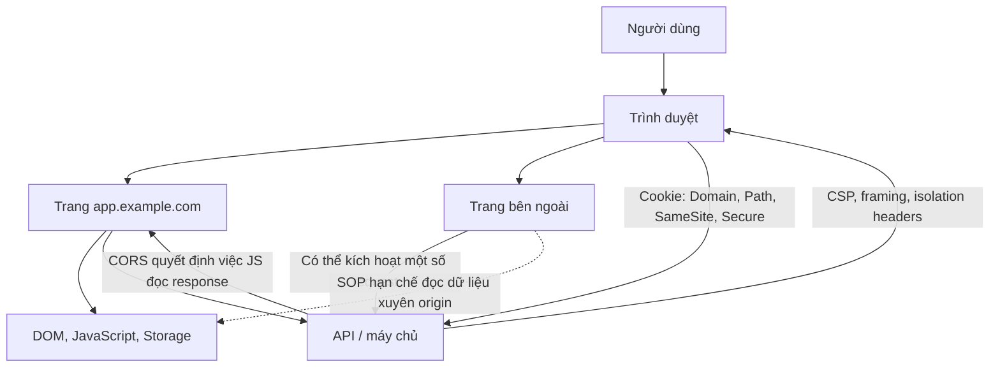

# Lộ trình học browser security

## 1. Vì sao cần một lộ trình thay vì học từng lỗ hổng riêng lẻ?

Một ứng dụng web không chỉ là mã chạy trên máy chủ. Trình duyệt nhận HTML, CSS và JavaScript từ nhiều nguồn; lưu cookie và dữ liệu phía client; gửi yêu cầu HTTP; hiển thị trang trong iframe; và áp dụng các quy tắc quyết định mã nào được đọc hoặc tương tác với dữ liệu nào. Vì vậy, **bảo mật trình duyệt (browser security)** là bài toán về *ranh giới tin cậy*: giữa các origin, giữa các site, giữa mã JavaScript và dữ liệu không đáng tin, cũng như giữa trình duyệt và máy chủ ứng dụng.

Hãy hình dung một hệ thống có ba thành phần:

- Trang giao diện tại `https://app.example.com`, nơi người dùng đăng nhập và thao tác.
- API tại `https://api.example.com`, nơi tiếp nhận yêu cầu và thay đổi dữ liệu.
- Một trang bên ngoài có thể đặt liên kết, biểu mẫu, iframe hoặc JavaScript của chính nó.

Các câu hỏi cần trả lời được gồm: JavaScript ở trang bên ngoài có thể *đọc* dữ liệu API hay không? Nó có thể khiến trình duyệt *gửi* một yêu cầu đến API không? Cookie nào được gửi kèm? Dữ liệu người dùng đưa vào DOM có thể biến thành mã thực thi không? Ai được phép nhúng trang đăng nhập vào iframe? Header từ máy chủ có thể giới hạn hành vi nào của trình duyệt?

Lộ trình dưới đây đi từ **mô hình trình duyệt → chính sách truy cập → các kiểu tấn công → phòng vệ nhiều lớp → kiểm chứng thực tế**. Đây là bản đồ học tập cho module `SECURITY_APPLICATION_SECURITY_BROWSER_SECURITY`, tập trung vào Same-Origin Policy (SOP), CORS, cookie, XSS, CSRF, clickjacking, Content Security Policy (CSP), Trusted Types, security headers và cơ chế cách ly.

### Kết quả đầu ra

Sau khi học xong, người học cần có khả năng:

1. Phân biệt chính xác **origin**, **site** và các phạm vi áp dụng của SOP, cookie, CORS.
2. Dùng DevTools để giải thích vì sao một yêu cầu cross-origin được gửi nhưng JavaScript không đọc được phản hồi, hoặc vì sao preflight thất bại.
3. Nhận diện các đường dẫn dẫn tới XSS, CSRF, clickjacking; chọn biện pháp phòng vệ đúng loại đe dọa.
4. Thiết kế và đọc các cấu hình CSP, Trusted Types, cookie flags, header chống nhúng và header cách ly.
5. Viết các phép thử có **kết quả kỳ vọng và bằng chứng quan sát được**, thay vì chỉ khẳng định rằng ứng dụng “đã bật bảo mật”.

## 2. Những kiến thức nền phải nắm

| Kiến thức | Cần hiểu trước khi học browser security | Cách tự kiểm tra |
| --- | --- | --- |
| HTTP/HTTPS | Request/response, method, status, header, redirect, TLS | Mở tab Network và giải thích một luồng đăng nhập |
| JavaScript/DOM | Event, DOM node, `textContent`, `innerHTML`, `fetch`, Promise | Viết đoạn mã cập nhật nội dung trang an toàn |
| Cookie và phiên đăng nhập | `Set-Cookie`, `Cookie`, session ID, đăng nhập dựa trên cookie | Nhìn request và chỉ ra cookie nào được gửi |
| Khái niệm máy khách/máy chủ | Đoạn mã nào chạy trong browser, đoạn mã nào kiểm tra quyền ở server | Chỉ ra nơi phải kiểm tra xác thực, phân quyền |
| Công cụ | DevTools: Network, Application/Storage, Console, Elements | Lưu lại request headers, response headers và lỗi Console |

Nên chuẩn bị môi trường thử nghiệm do chính mình kiểm soát: một trang tại `http://localhost:3000`, một API tại `http://localhost:4000`, và khi cần thử *cross-site* thì dùng thêm hostname khác (chẳng hạn `127.0.0.1`) hoặc các tên miền thử nghiệm cục bộ. **Hai cổng khác nhau tạo ra hai origin khác nhau nhưng vẫn có thể cùng site**. Các bài kiểm tra liên quan đến cookie có thuộc tính `Secure`, ngữ cảnh an toàn hoặc cơ chế cách ly nâng cao cần môi trường HTTPS phù hợp. Tránh suy luận rằng mọi kết quả quan sát trên HTTP localhost đều giống môi trường production.

Sử dụng dữ liệu và tài khoản thử nghiệm. Khi thực hành, ghi nhận tên trình duyệt, phiên bản và cài đặt chặn third-party cookie, vì chính sách quyền riêng tư có thể ảnh hưởng kết quả.

## 3. Bản đồ các ranh giới bảo mật



Sơ đồ chỉ minh họa các luồng chính, không đồng nghĩa rằng một header có thể thay thế kiểm tra xác thực hoặc phân quyền trên máy chủ.

**Origin** được xác định bởi bộ ba `scheme + host + port`. Ví dụ:

| Địa chỉ so với `https://app.example.com` | Cùng origin? | Giải thích |
| --- | --- | --- |
| `https://app.example.com/profile` | Có | Đường dẫn không làm đổi origin |
| `https://app.example.com:8443` | Không | Khác cổng |
| `http://app.example.com` | Không | Khác scheme |
| `https://api.example.com` | Không | Khác hostname |

**Site** dùng để xét quan hệ *same-site/cross-site*; trong mô hình **schemeful same-site** hiện đại, site xét scheme cùng miền đăng ký (registrable domain, còn gọi là eTLD+1), với quy tắc riêng cho localhost, địa chỉ IP và public suffix. Ví dụ `https://app.example.com` và `https://api.example.com` thường là **cross-origin nhưng same-site**. Không được suy ra “cross-origin” đồng nghĩa với “cross-site”.

Từ hai khái niệm đó, cần phân biệt bốn cơ chế:

| Cơ chế | Câu hỏi chính | Phạm vi |
| --- | --- | --- |
| Same-Origin Policy | Mã của origin A có được trực tiếp đọc/truy cập tài nguyên nhạy cảm của origin B? | Quyền truy cập qua browser, đặc biệt DOM và dữ liệu response |
| CORS | Server B có cho phép JavaScript từ origin A đọc response cross-origin? | HTTP response, kiểm tra do browser thực hiện |
| Cookie scope và SameSite | Cookie nào được lưu và gửi trong từng ngữ cảnh? | Domain, Path, Secure, SameSite, chính sách cookie của browser |
| CSP, Trusted Types, framing/isolation | Mã và tài nguyên nào được thực thi, trang được nhúng ở đâu, các browsing context được cách ly ra sao? | Chính sách áp cho tài liệu và tài nguyên |

Đây là “bản đồ” cần sử dụng khi phân tích mọi tình huống sau này: **ai khởi tạo hành động, trên origin/site nào, trình duyệt cho phép điều gì, và server kiểm tra điều gì**.

## 4. Lộ trình đề xuất theo 9 chặng

Có thể dành khoảng 8–12 buổi học, mỗi buổi 60–120 phút. Thời lượng chỉ để lên kế hoạch; chỉ chuyển chặng khi đạt tiêu chí quan sát được. Các chặng được xếp theo quan hệ phụ thuộc kiến thức:

| Chặng | Nội dung trọng tâm | Sản phẩm phải hoàn thành |
| --- | --- | --- |
| **0. Nền tảng** | HTTP, DOM, DevTools, phiên đăng nhập | Sơ đồ đường đi của một request có cookie |
| **1. Origin và SOP** | Origin/site, DOM access, storage, iframe | Bảng thử cùng origin và khác origin |
| **2. CORS** | Simple request, preflight, credentials, response headers | Ma trận CORS: case được đọc/case bị chặn |
| **3. Cookie và CSRF** | Cookie flags, SameSite, CSRF token, Origin/Fetch Metadata | Một endpoint thay đổi trạng thái có bảo vệ CSRF |
| **4. XSS và DOM** | Reflected/stored/DOM XSS, encoding, safe sinks | Sửa một đoạn render dữ liệu không tin cậy |
| **5. CSP và Trusted Types** | CSP nonce/hash, Report-Only, Trusted Types | Chính sách giảm khả năng thực thi script ngoài ý muốn |
| **6. Clickjacking và cách ly** | `frame-ancestors`, X-Frame-Options, sandbox, postMessage, COOP/COEP/CORP | Thử nhúng iframe và ghi nhận kết quả |
| **7. Security headers** | HSTS, nosniff, Referrer-Policy, Permissions-Policy, cache | Bản kiểm kê header cho từng loại response |
| **8. Tích hợp và đánh giá** | Threat model, kiểm chứng, lỗi cấu hình, regression | Báo cáo bảo mật trình duyệt có bằng chứng |

### Chặng 0 — Đọc được hành vi của trình duyệt

**Học:** vòng đời một request, sự khác biệt giữa navigation, form submission và `fetch`; request/response headers; redirect; cookie được gắn vào request khi nào; JavaScript chạy trong document nào.

**Thực hành:** đăng nhập vào ứng dụng thử nghiệm, mở DevTools → **Network**, chọn request gửi tới API, xác định `Origin` (nếu có), `Cookie`, `Set-Cookie`, status code và các header điều khiển bảo mật. Trong **Application/Storage**, kiểm tra cookie có các thuộc tính gì. Nhìn **Console** để phân biệt lỗi JavaScript, lỗi mạng và lỗi chính sách browser.

**Đạt khi:** giải thích được một chuỗi “người dùng bấm nút → JS gửi request → server phản hồi → UI thay đổi”, chỉ rõ cả trình duyệt và máy chủ có trách nhiệm kiểm tra gì.

### Chặng 1 — Origin, site và Same-Origin Policy

**Học:** cách tính origin, thế nào là same-origin/cross-origin và same-site/cross-site; SOP bảo vệ quyền đọc DOM, dữ liệu và nhiều giao diện browser; các tương tác xuyên origin được cho phép có điều kiện (navigation, tải ảnh/script, gửi form...), cùng những hạn chế riêng.

**Thực hành:** mở một trang tại `localhost:3000` và trang thứ hai tại `localhost:4000`, so sánh quyền đọc `window.parent.document` trong iframe cùng origin và khác origin; thử `fetch` và quan sát Network. Chú ý: một request có thể xuất hiện trên mạng dù JavaScript không được quyền đọc response.

**Đạt khi:** phân biệt “**gửi request**” và “**đọc response**”, đồng thời không lẫn giữa origin và site. Tránh kết luận rằng SOP chặn toàn bộ HTTP request xuyên origin.

### Chặng 2 — CORS: ngoại lệ có kiểm soát đối với quyền đọc response

**Học:** browser gửi header `Origin`; server trả `Access-Control-Allow-Origin`; điều kiện cần đối với `Access-Control-Allow-Methods`, `Access-Control-Allow-Headers` trong preflight; `Access-Control-Allow-Credentials`; và ý nghĩa của `Vary: Origin` khi phản hồi thay đổi theo Origin. Nắm rằng CORS là chính sách do **trình duyệt áp dụng**, không phải cơ chế xác thực hoặc phân quyền API.

Ví dụ server chỉ cho frontend tin cậy đọc phản hồi có cookie:

```http
Access-Control-Allow-Origin: https://app.example.com
Access-Control-Allow-Credentials: true
Vary: Origin
```

Phía client, lời gọi cross-origin cần cấu hình `credentials: 'include'` nếu muốn browser đưa credentials vào luồng yêu cầu và chấp nhận trao đổi credentialed theo chính sách; cookie thực tế có được gửi hay không vẫn phụ thuộc `SameSite`, `Secure`, phạm vi cookie và cài đặt browser:

```js
fetch("https://api.example.com/me", {
  credentials: "include"
});
```

**Không kết hợp** `Access-Control-Allow-Origin: *` với response được đọc bằng cơ chế CORS có credentials: browser sẽ từ chối cho JavaScript truy cập. Với preflight, cần quan sát **OPTIONS** trước request chính nếu request không đáp ứng điều kiện “simple”; một preflight không được chấp nhận có thể khiến request chính không được gửi. Không phải mọi request cross-origin đều có preflight.

**Thực hành:** lập một bảng kết quả cho `GET` đơn giản, `POST` dùng `Content-Type: application/json`, `fetch` có và không có credentials, server có và không có CORS headers. Đối chiếu **Network** (request nào đã đến server?) với **Console** (JS có đọc được response?). Khi sửa lỗi CORS, kiểm tra cấu hình API và origin thực tế; không “chữa” lỗi bằng cách mở `*` cho mọi nguồn.

**Đạt khi:** giải thích chính xác vì sao request có thể trả HTTP 200 trên Network nhưng `fetch` vẫn bị CORS chặn, và vì sao CORS không ngăn CSRF.

### Chặng 3 — Cookie, phiên đăng nhập và CSRF

**Học:** cookie do server thiết lập và browser tự quyết định phạm vi gửi theo `Domain`, `Path`, `Secure`, `SameSite` và ngữ cảnh browser; `HttpOnly` ngăn JavaScript đọc cookie qua `document.cookie` nhưng không ngăn JavaScript tạo các request sử dụng phiên đã đăng nhập. `SameSite=Strict` hạn chế hơn `Lax`; `SameSite=None` cần `Secure` trong browser hiện đại, nhưng third-party cookie vẫn có thể bị chặn. Cookie prefix `__Host-` yêu cầu `Secure`, `Path=/` và không có `Domain`, giúp giảm rủi ro mở rộng phạm vi cookie.

Một cấu hình cookie phiên *minh họa*:

```http
Set-Cookie: __Host-session=<session-id>; Path=/; Secure; HttpOnly; SameSite=Lax
```

**CSRF** xảy ra khi một trang khác khiến browser của người dùng đã đăng nhập gửi request thay đổi trạng thái đến ứng dụng, trong khi server dựa vào credential tự động gửi (ví dụ cookie) mà không xác minh ý định hợp lệ. Một request cross-origin không cần đọc được response vẫn có thể gây tác động. Vì vậy **CORS không phải lớp phòng vệ CSRF**.

**Phòng vệ:** dùng CSRF token khó đoán, gắn với phiên hoặc một cơ chế token được xác minh chặt chẽ phía server; kiểm tra `Origin` (và `Referer` theo chính sách fallback phù hợp), cân nhắc header Fetch Metadata như `Sec-Fetch-Site`, dùng `SameSite` hợp lý và không để HTTP `GET` làm thay đổi trạng thái. Endpoint phải tiếp tục xác thực và phân quyền.

**Thực hành:** tạo thao tác đổi một giá trị thử nghiệm thông qua `POST`. Thử gửi biểu mẫu từ trang khác trong môi trường cục bộ; quan sát cookie có được gửi, server có xử lý hay không. Sau đó thêm token kiểm tra ở server và xác nhận yêu cầu thiếu/sai token bị từ chối. Thử một tình huống **same-site nhưng cross-origin** (hai subdomain) để hiểu giới hạn của SameSite.

**Đạt khi:** chỉ ra được cơ chế gửi credential tự động, điều kiện CSRF thành công, sự khác biệt giữa *token CSRF* và *token truy cập*, cùng lý do cần kiểm tra server-side.

### Chặng 4 — XSS: từ dữ liệu không tin cậy đến mã thực thi

**Học:** ba nhóm XSS thường gặp:

- **Reflected XSS:** dữ liệu từ request được phản ánh vào response mà không xử lý theo đúng ngữ cảnh.
- **Stored XSS:** dữ liệu được lưu trước rồi hiển thị tới người dùng khác với cách xử lý không an toàn.
- **DOM-based XSS:** JavaScript phía client đưa dữ liệu không tin cậy vào một DOM sink có thể diễn giải như mã/HTML.

Đầu vào có thể đến từ query string, form, dữ liệu API, fragment, message hoặc nội dung do người khác nhập. Phòng vệ phụ thuộc **ngữ cảnh đầu ra**: text trong HTML, thuộc tính HTML, URL, CSS và JavaScript có quy tắc khác nhau. Ưu tiên template/framework có tự động escape đúng ngữ cảnh; sử dụng các API DOM an toàn; chỉ dùng sanitizer đáng tin cậy nếu thực sự cần render HTML do người dùng cung cấp.

Ví dụ render nội dung truy vấn dưới dạng văn bản:

```js
const message = new URLSearchParams(location.search).get("message") ?? "";
const output = document.querySelector("#message");
output.textContent = message; // Dữ liệu được xem là text, không phải HTML.
```

Nếu đổi thành `output.innerHTML = message`, ứng dụng đã đưa dữ liệu không tin cậy vào một HTML sink và phải giải quyết nguy cơ XSS. `HttpOnly` giúp hạn chế việc đọc cookie phiên nhưng **không xóa bỏ XSS**: script đã chạy trong origin tin cậy có thể tương tác với DOM và gửi request trong quyền của người dùng.

**Thực hành:** chuẩn bị các giá trị thử nghiệm gồm text thông thường và chuỗi có ký tự HTML; so sánh hiển thị khi dùng `textContent` và `innerHTML` trong môi trường cục bộ. Kiểm kê nơi mã đưa dữ liệu vào `innerHTML`, `outerHTML`, `insertAdjacentHTML`, `document.write` hoặc các API thực thi chuỗi thành mã. Sửa một luồng bằng API an toàn hoặc sanitizer theo yêu cầu sản phẩm.

**Đạt khi:** mô tả được nguồn (*source*) và vị trí nguy hiểm (*sink*), nguyên nhân XSS, cách sửa ở lớp render, và vì sao lọc một vài ký tự cố định không phải giải pháp tổng quát.

### Chặng 5 — CSP và Trusted Types: rào chắn bổ sung chống thực thi ngoài ý muốn

**Học về CSP:** server có thể khai báo nguồn tài nguyên và giới hạn hành vi của document bằng header `Content-Security-Policy`. Các directive cần hiểu trước gồm `default-src`, `script-src`, `style-src`, `connect-src`, `img-src`, `object-src`, `base-uri`, `frame-ancestors` và `form-action`.

Minh họa một chính sách theo hướng hạn chế script:

```http
Content-Security-Policy: default-src 'self'; script-src 'self' 'nonce-<random-per-response>'; object-src 'none'; base-uri 'none'; frame-ancestors 'none'
```

Đây là **mẫu cần tùy chỉnh**, không phải cấu hình có thể sao chép nguyên trạng. Giá trị nonce phải là số ngẫu nhiên khó đoán được tạo **mới cho từng response**, khớp với thuộc tính `nonce` của script được cho phép; không hardcode nonce. Nếu ứng dụng phụ thuộc inline script, thư viện hoặc dịch vụ bên ngoài, hãy thiết kế chính sách tương ứng và đo tác động trước khi bắt buộc thực thi. Chính sách có nonce/hash thường chắc chắn hơn chiến lược chỉ duy trì danh sách host cho script. CSP không thay thế output encoding và sửa XSS tận gốc.

**Học về Trusted Types:** ở các trình duyệt hỗ trợ, cơ chế này yêu cầu các DOM sink nhạy cảm nhận đối tượng đã đi qua một *policy* được kiểm soát, giảm khả năng gán chuỗi tùy ý vào sink. Ví dụ header khi triển khai:

```http
Content-Security-Policy: require-trusted-types-for 'script'; trusted-types app-policy
```

Ứng dụng cần tự định nghĩa policy `app-policy` phù hợp và kiểm tra tất cả nơi sử dụng sink; policy cấp phát TrustedHTML không được chỉ trả về nguyên dữ liệu không tin cậy. Nếu cần HTML động, áp dụng sanitizer đáng tin cậy trong policy. **Mức độ hỗ trợ Trusted Types khác nhau giữa trình duyệt**, nên vẫn cần mã render an toàn làm nền tảng.

**Thực hành:** bắt đầu từ `Content-Security-Policy-Report-Only` để quan sát các vi phạm mà chưa chặn hành vi; đọc cảnh báo trong Console, xác định script nào đang vi phạm và tinh chỉnh chính sách. Sau đó kiểm thử ở chế độ thực thi `Content-Security-Policy` trong môi trường thử nghiệm. Thử đưa một giá trị chuỗi vào sink bị Trusted Types kiểm soát để xác nhận trình duyệt hỗ trợ sẽ từ chối; chỉnh luồng qua policy an toàn.

**Đạt khi:** giải thích được CSP kiểm soát *khả năng tải/thực thi*, Trusted Types kiểm soát *đường đưa giá trị vào sink*, và mỗi cơ chế cần triển khai, kiểm thử ra sao.

### Chặng 6 — Clickjacking, iframe, postMessage và cách ly trình duyệt

**Học về clickjacking:** kẻ tấn công tìm cách đặt một trang nhạy cảm trong iframe rồi khiến người dùng bấm vào thành phần bị che hoặc ngụy trang. Phòng vệ chính là giới hạn **ai được phép nhúng trang**, do chính response của trang cần bảo vệ gửi:

```http
Content-Security-Policy: frame-ancestors 'none'
X-Frame-Options: DENY
```

`frame-ancestors 'none'` chặn nhúng từ mọi ancestor; nếu sản phẩm cần nhúng hợp lệ, phải xác định danh sách origin được phép. `X-Frame-Options` là cơ chế cũ hơn, có thể dùng bổ trợ theo yêu cầu tương thích. Không nhầm `frame-ancestors` (ai được nhúng *trang này*) với `frame-src` (trang này được tải iframe từ đâu).

**Học về cách ly và giao tiếp:** iframe có thể có thuộc tính `sandbox` để hạn chế quyền; `postMessage` hỗ trợ truyền thông điệp giữa các window khác origin, nhưng bên nhận phải xác minh `event.origin` và kiểm tra dữ liệu, còn bên gửi nên chỉ rõ `targetOrigin` thay vì mặc định dùng `*` với dữ liệu nhạy cảm. Việc đồng thời cấp `allow-scripts` và `allow-same-origin` cho iframe nội dung cùng origin cần được đánh giá kỹ vì có thể vô hiệu hóa nhiều ý nghĩa của sandbox.

Các header cách ly bổ sung cần nhận diện:

| Header | Vai trò cốt lõi | Lưu ý triển khai |
| --- | --- | --- |
| `Cross-Origin-Opener-Policy` (COOP) | Hạn chế quan hệ giữa top-level browsing contexts ở các origin khác nhau | Có thể ảnh hưởng popup và luồng đăng nhập |
| `Cross-Origin-Embedder-Policy` (COEP) | Yêu cầu điều kiện phù hợp khi nhúng tài nguyên cross-origin | Có thể làm hỏng asset không cấp CORS/CORP phù hợp |
| `Cross-Origin-Resource-Policy` (CORP) | Tài nguyên khai báo đối tượng được phép nạp theo tương quan origin/site | Đặt trên response tài nguyên và thử với các trang đang sử dụng |

COOP, COEP và CORP phục vụ bài toán cách ly tài liệu/tài nguyên, **không phải cách thay thế CORS, CSRF token hay chính sách chống XSS**. Chỉ bật các chính sách nghiêm ngặt khi hiểu luồng nhúng, popup và nhu cầu của sản phẩm.

**Thực hành:** tạo trang thử dùng iframe nhúng trang đăng nhập mẫu; quan sát trước/sau khi có `frame-ancestors`. Dùng hai window thử `postMessage` với origin hợp lệ và không hợp lệ. Nếu triển khai COOP/COEP, kiểm kê tài nguyên cross-origin và thử từng luồng popup, ảnh, script trước khi áp dụng.

**Đạt khi:** phân biệt được tấn công thao túng thao tác người dùng với truy cập dữ liệu trực tiếp, và lựa chọn đúng cơ chế chống nhúng hoặc cách ly.

### Chặng 7 — Security headers và cấu hình vận hành

**Học:** một bộ header thực tế không chỉ có CSP. Cần hiểu mục tiêu, nơi cấu hình, và tác dụng phụ của từng header:

| Header/cấu hình | Mục đích | Điều cần tránh |
| --- | --- | --- |
| `Strict-Transport-Security` | Yêu cầu browser dùng HTTPS cho host trong thời gian quy định | Bật `includeSubDomains` hoặc preload khi chưa sẵn sàng cho toàn miền |
| `X-Content-Type-Options: nosniff` | Hạn chế MIME sniffing trong các ngữ cảnh được áp dụng | Trả sai `Content-Type` cho script/style |
| `Referrer-Policy` | Giới hạn thông tin URL nguồn gửi đi qua `Referer` | Để lộ đường dẫn hoặc tham số nhạy cảm không cần thiết |
| `Permissions-Policy` | Hạn chế API/tính năng browser cho tài liệu và iframe | Vô tình khóa tính năng camera, micro, geolocation cần thiết |
| `Cache-Control` | Điều khiển lưu cache cho response nhạy cảm | Cache nội dung tài khoản hoặc token không phù hợp |
| `Content-Security-Policy` | Giới hạn nguồn tài nguyên, script, nhúng và một số hành vi | Chính sách quá rộng, hoặc chính sách quá chặt làm hỏng ứng dụng |
| Cookie `Secure`, `HttpOnly`, `SameSite` | Hạn chế vận chuyển, truy cập JavaScript, gửi cookie theo ngữ cảnh | Dùng cookie flags như biện pháp duy nhất bảo vệ endpoint |

Kiểm kê header theo **loại response**: HTML đăng nhập, HTML ứng dụng, API JSON, tài nguyên tĩnh, file tải về, nội dung được nhúng. Không nên áp một bộ giá trị giống hệt cho mọi response mà không xét mục đích; ví dụ `frame-ancestors` có tác dụng khi bảo vệ tài liệu bị nhúng, còn `Cache-Control` của nội dung riêng tư khác với tài nguyên tĩnh có fingerprint.

**Thực hành:** trên DevTools → Network, lưu response headers của ít nhất ba loại endpoint. Dùng `curl -I` khi phù hợp để đối chiếu header server trả; nhớ rằng `HEAD` đôi khi được ứng dụng xử lý khác `GET`, nên kiểm tra response thực tế mà trình duyệt nhận. Với `Strict-Transport-Security`, đánh giá trên HTTPS và không thử cấu hình kéo dài trên miền đang vận hành khi chưa có kế hoạch triển khai.

**Đạt khi:** giải thích được *vì sao* mỗi header tồn tại, đối tượng nó bảo vệ, điều nó **không** giải quyết và ảnh hưởng đến tính năng.

### Chặng 8 — Tích hợp thành quy trình phân tích và kiểm chứng

**Học:** mô hình hóa mối đe dọa dựa trên tài sản (session, dữ liệu cá nhân, hành động đổi trạng thái), điểm vào (URL, form, API, iframe, message), ranh giới origin/site và thành phần có quyền quyết định. Mỗi nguy cơ phải có **cơ chế phòng vệ chính**, **lớp giảm thiểu bổ sung** và **bài kiểm thử thất bại/thành công**.

**Thực hành:** dựng một ứng dụng mẫu có đăng nhập bằng cookie, trang hồ sơ, API cập nhật dữ liệu, nội dung hiển thị từ người dùng và một luồng iframe hoặc popup. Tạo báo cáo với bằng chứng Network/Console/Storage cho cả cấu hình ban đầu và cấu hình sau khi gia cố.

**Đạt khi:** chỉ ra được giới hạn của từng lớp bảo vệ, phát hiện ít nhất một cấu hình sai qua kiểm thử có thể lặp lại và đề xuất sửa ở đúng lớp client/server.

## 5. Bộ bài thực hành xuyên suốt

Thực hiện trên ứng dụng tự tạo và dữ liệu giả. Mỗi bài nên lưu **đầu vào → trạng thái cấu hình → kết quả dự kiến → kết quả thực tế → bằng chứng**.

| Mã | Tình huống thử nghiệm | Kết quả cần quan sát | Kết luận phải rút ra |
| --- | --- | --- | --- |
| LAB-01 | Trang cổng 3000 gọi API cổng 4000, API chưa bật CORS | Request có thể xuất hiện nhưng JS không đọc được response | SOP/CORS điều khiển quyền đọc response |
| LAB-02 | Cấu hình CORS cho origin cụ thể; thử `*` và credentials | Chỉ tổ hợp header/credentials hợp lệ được JS chấp nhận | CORS không phải “mở mạng” hay xác thực |
| LAB-03 | Gửi `POST application/json` có custom header | Network xuất hiện OPTIONS preflight trước request chính trong trường hợp phù hợp | Phân biệt preflight với request thực |
| LAB-04 | Dùng form gửi thao tác đổi trạng thái từ trang thử khác | Request có thể được tạo ngay cả khi response không đọc được; server từ chối khi thiếu CSRF token | CORS không thay cho CSRF protection |
| LAB-05 | Hiển thị query string bằng `textContent` và `innerHTML` | Giá trị chứa ký tự HTML được render khác nhau | Phải chọn DOM sink phù hợp |
| LAB-06 | Cấu hình CSP Report-Only rồi enforcement | Ghi nhận vi phạm và ảnh hưởng đến script đã định | Triển khai CSP có đo lường và sửa luồng |
| LAB-07 | Nhúng trang mẫu trong iframe trước/sau `frame-ancestors` | Browser chặn nhúng sau khi policy hợp lệ có hiệu lực | Trang đích tự kiểm soát quyền được nhúng |
| LAB-08 | So sánh ba response: login, API JSON, asset tĩnh | Bộ header và chính sách cache khác theo tài sản | Header phải bám sát ngữ cảnh response |

Đối với một kết quả “bị chặn”, cần phân biệt rõ:

1. Browser **không gửi** request chính do preflight bị chặn.
2. Browser **đã gửi** request nhưng **không cho JavaScript đọc** response.
3. Browser nhận response và **chặn thực thi/nhúng** theo CSP hoặc chính sách framing.
4. Server **từ chối** thao tác do CSRF token, xác thực hoặc phân quyền không hợp lệ.

Bốn trường hợp trên tạo thông báo lỗi và tác động khác nhau. Chỉ nhìn status code là chưa đủ.

## 6. Các nhầm lẫn thường gây lỗi thiết kế

| Nhận định sai | Cách hiểu đúng |
| --- | --- |
| “Khác origin là khác site.” | Hai subdomain có thể cross-origin nhưng same-site; port khác cũng đổi origin. |
| “SOP/CORS ngăn mọi request cross-origin.” | Một số request vẫn được gửi. CORS chủ yếu quyết định JavaScript có được đọc response cross-origin hay không; preflight có thể chặn request chính. |
| “Chỉ cần CORS là không bị CSRF.” | CSRF không cần đọc response. Endpoint thay đổi trạng thái phải kiểm tra ý định hợp lệ phía server. |
| “Cookie `HttpOnly` ngăn XSS.” | Nó hạn chế đọc cookie từ JS, không ngăn mã độc chạy trong origin hay gửi request theo phiên. |
| “`SameSite=Lax` giải quyết mọi CSRF.” | SameSite có giới hạn theo luồng điều hướng, phương thức, quan hệ site và hành vi browser; không bảo vệ đầy đủ tình huống same-site cross-origin. |
| “Escape HTML một lần là an toàn ở mọi nơi.” | Encoding/sanitization phải phù hợp ngữ cảnh; text, thuộc tính, URL, CSS và JS khác nhau. |
| “CSP thay thế sửa XSS.” | CSP là lớp giảm thiểu; phải tránh đưa dữ liệu không tin cậy vào executable sink từ đầu. |
| “`frame-src` bảo vệ trang khỏi clickjacking.” | `frame-ancestors` quy định ai được nhúng trang hiện tại. |
| “COOP/COEP/CORP bật càng nhiều càng tốt.” | Chính sách cách ly có thể làm hỏng luồng popup và tài nguyên cross-origin; cần kiểm kê rồi thử. |
| “Có header nghĩa là đã an toàn.” | Header phải có giá trị đúng, được browser áp dụng, và có bằng chứng hành vi phù hợp. |

## 7. Đề bài tổng hợp: gia cố một ứng dụng hồ sơ

**Bối cảnh:** ứng dụng có trang hồ sơ tại `app.example.com`, API tại `api.example.com`; đăng nhập bằng cookie phiên; người dùng có thể đổi email hiển thị; trang có ô giới thiệu bản thân; đội sản phẩm định nhúng một trang trợ giúp qua iframe.

**Yêu cầu triển khai:**

1. Vẽ sơ đồ các origin/site tham gia, dữ liệu cần bảo vệ và request đổi trạng thái.
2. Chỉ cho phép frontend được ủy quyền đọc response API qua CORS; đồng thời đảm bảo API tự kiểm tra xác thực và phân quyền.
3. Chọn cookie flags phù hợp với cách triển khai và giải thích trường hợp browser không gửi cookie khi cross-site.
4. Bảo vệ endpoint đổi thông tin bằng CSRF token được server xác minh, kiểm tra nguồn request theo chính sách phù hợp và không dùng `GET` để ghi dữ liệu.
5. Hiển thị giới thiệu bản thân an toàn; kiểm toán HTML sinks và xử lý nội dung rich text bằng sanitizer nếu tính năng thực sự cần.
6. Đề xuất CSP có cơ chế quản lý script an toàn, khảo sát Trusted Types trên browser hỗ trợ, và thử nghiệm bằng Report-Only trước khi cưỡng chế.
7. Chặn nhúng trang nhạy cảm nếu không có nhu cầu, đồng thời xác định rõ chính sách cho trang thực sự cần đặt trong iframe; xác minh mọi thông điệp `postMessage`.
8. Lập bảng header theo từng response, thực hiện lại các bài kiểm tra sau khi thay đổi cấu hình.

**Mẫu báo cáo kết quả:**

| Tài sản/luồng | Nguy cơ | Cơ chế phòng vệ | Phép thử và kỳ vọng | Bằng chứng |
| --- | --- | --- | --- | --- |
| API hồ sơ | Đọc response từ origin không được phép | CORS allowlist và auth | JS ở origin không hợp lệ không đọc được response; server vẫn kiểm tra quyền | Network + Console + log API |
| Đổi email | CSRF qua phiên cookie | CSRF token, kiểm tra nguồn | Request thiếu/sai token bị server từ chối | Request/response + log |
| Ô giới thiệu | XSS trong DOM | Text sink hoặc sanitization đúng ngữ cảnh | Chuỗi nhập hiển thị theo ý định, không trở thành script | DOM + Console |
| Trang tài khoản | Clickjacking | `frame-ancestors` | Không nhúng được từ origin trái phép | Console + iframe |
| HTML ứng dụng | Script không được phép | CSP, Trusted Types khi hỗ trợ | Vi phạm được ghi nhận/chặn đúng chính sách | Console + response headers |

### Tiêu chí hoàn thành

Một bài thực hành được xem là **đạt** khi có đủ bốn bằng chứng: (1) mô tả ranh giới và nguy cơ chính xác, (2) cấu hình/mã phòng vệ ở đúng nơi, (3) trường hợp hợp lệ vẫn hoạt động, (4) trường hợp không hợp lệ bị ngăn bởi đúng cơ chế dự kiến. Một lỗi Console đơn lẻ, một điểm số công cụ hoặc sự hiện diện của header chưa đủ chứng minh an toàn.

Để tự đánh giá mức độ tiến bộ:

- **Mức 1 – Nhận diện:** gọi tên và phân biệt origin, site, SOP, CORS, cookie flags, CSP và framing.
- **Mức 2 – Giải thích:** dự đoán được request nào được gửi, phản hồi nào JS đọc được, cookie nào có thể đi kèm và browser sẽ chặn tại đâu.
- **Mức 3 – Triển khai:** sửa mã và cấu hình bảo vệ XSS, CSRF, clickjacking; chứng minh không làm hỏng luồng hợp lệ.
- **Mức 4 – Phân tích:** lập threat model, đánh giá giới hạn của từng cơ chế, phát hiện cấu hình sai qua DevTools và đề xuất kiểm thử hồi quy.

## 8. Thứ tự ôn tập và hướng mở rộng

Khi một tình huống khó xuất hiện, dùng quy trình sáu câu hỏi sau: **(1)** dữ liệu/hành động nào cần bảo vệ; **(2)** bên khởi tạo request hoặc mã chạy thuộc origin/site nào; **(3)** browser gửi được gì; **(4)** browser cho phép đọc, thực thi hoặc nhúng gì; **(5)** server có kiểm tra xác thực, phân quyền và ý định hợp lệ không; **(6)** có bằng chứng kiểm thử nào xác nhận cơ chế đã hoạt động?

Sau khi hoàn thành lộ trình cốt lõi, có thể học sâu về cookie partitioning và thay đổi chính sách third-party cookie; Service Worker và phạm vi origin; storage partitioning; các rủi ro từ dependency/frontend supply chain; XS-Leaks; và chi tiết triển khai cross-origin isolation cho ứng dụng cần quyền đặc biệt. Đây là các chủ đề mở rộng, nên học trên nền hiểu biết chắc về origin, cookie, quyền đọc response và cách browser áp chính sách.

**Điểm chốt của lộ trình:** browser security là khả năng mô tả và kiểm chứng **ranh giới**. SOP/CORS quy định cách các origin tương tác; cookie/CSRF kiểm soát các yêu cầu gắn phiên; XSS/CSP/Trusted Types bảo vệ đường thực thi mã; clickjacking và các header cách ly bảo vệ ngữ cảnh hiển thị; còn xác thực, phân quyền và kiểm tra nghiệp vụ luôn phải được thực hiện ở phía máy chủ.
