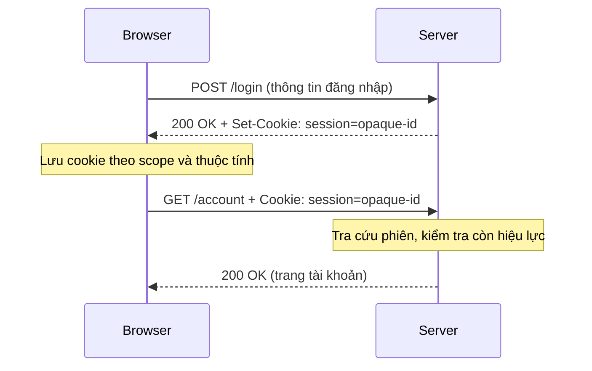
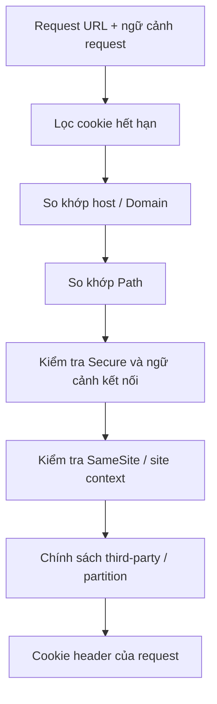

# Cookie là gì? Cơ chế lưu trạng thái và bảo mật phiên trong trình duyệt

## 1. Cookie là gì?

**Cookie HTTP** là một mẩu dữ liệu nhỏ mà server yêu cầu trình duyệt lưu lại, sau đó trình duyệt có thể tự động gửi cookie phù hợp trong những request tiếp theo. Cookie giúp HTTP — vốn không tự duy trì trạng thái giữa các request — hỗ trợ các nhu cầu như đăng nhập, giỏ hàng, tùy chọn ngôn ngữ, phân tích phiên truy cập và ghi nhớ một số thiết lập.

Một luồng cơ bản:

1. Người dùng truy cập website.
2. Server gửi response có header **Set-Cookie** để yêu cầu trình duyệt lưu cookie.
3. Trình duyệt lưu cookie theo các thuộc tính và chính sách hiện hành.
4. Khi người dùng truy cập URL phù hợp, trình duyệt tự chọn cookie được phép gửi trong header **Cookie**.
5. Server đọc cookie, xác định phiên hoặc trạng thái liên quan và trả response.

Cookie là một phần quan trọng của ranh giới bảo mật giữa trình duyệt, origin, site và ứng dụng web. Cookie ảnh hưởng trực tiếp đến xác thực phiên, SameSite, CSRF, CORS và các lớp phòng vệ ứng dụng. Tuy nhiên, cookie chỉ là phương tiện lưu/gửi dữ liệu; **cookie tự nó không chứng minh người dùng có quyền thực hiện một hành động**. Server vẫn phải xác thực, kiểm tra phiên và phân quyền cho từng thao tác.

Bài học thuộc chương **Cookie** của module **SECURITY_APPLICATION_SECURITY_BROWSER_SECURITY**. Mục tiêu là hiểu cơ chế cookie trong HTTP và cách cấu hình chúng để giảm rủi ro chiếm phiên, XSS và CSRF.

Sau bài học, bạn có thể:

- Mô tả luồng Set-Cookie, lưu trữ cookie và gửi Cookie trong request.
- Phân biệt cookie host-only, cookie có Domain và phạm vi Path.
- Giải thích các thuộc tính Expires, Max-Age, Secure, HttpOnly, SameSite và Partitioned.
- Cấu hình cookie phiên theo nguyên tắc ít đặc quyền.
- Hiểu giới hạn của HttpOnly, Secure, SameSite và mối quan hệ với XSS/CSRF.
- Quan sát cookie trong DevTools và kiểm chứng request thực tế.

## 2. Vì sao HTTP cần cookie?

HTTP được thiết kế theo mô hình request/response. Mỗi request thường được xử lý độc lập; server không mặc nhiên biết request hiện tại thuộc về người dùng đã gửi request trước đó.

Ví dụ, người dùng đăng nhập thành công rồi chuyển sang trang hồ sơ. Nếu không có cơ chế liên kết hai request, server phải tìm cách nhận biết request thứ hai thuộc phiên đăng nhập nào.

Cookie cung cấp một cơ chế phổ biến:



Giá trị cookie phiên thường là một **session identifier** ngẫu nhiên, khó đoán. Server dùng identifier đó để tra cứu dữ liệu phiên ở phía server: người dùng nào đăng nhập, thời điểm hết hạn, quyền hiện tại và trạng thái thu hồi.

Cookie không nhất thiết chứa toàn bộ dữ liệu người dùng. Với ứng dụng có phiên server-side, cookie chỉ cần mang một mã phiên ngẫu nhiên. Nếu cookie bị lộ, kẻ tấn công có thể dùng nó như bearer credential cho đến khi phiên hết hạn hoặc bị thu hồi; vì vậy phải bảo vệ cookie và vòng đời phiên.

## 3. Luồng Set-Cookie và Cookie

### 3.1. Server tạo cookie bằng Set-Cookie

Ví dụ response sau khi đăng nhập:

```http
HTTP/1.1 200 OK
Content-Type: application/json
Set-Cookie: __Host-session=K9x...random...; Path=/; Secure; HttpOnly; SameSite=Lax
Cache-Control: no-store
```

Header Set-Cookie yêu cầu trình duyệt lưu cookie tên __Host-session với giá trị phiên. Các thuộc tính phía sau dấu chấm phẩy định nghĩa phạm vi và cách cookie được xử lý.

Server có thể gửi nhiều header Set-Cookie trong cùng một response, mỗi cookie một header riêng:

```http
Set-Cookie: __Host-session=abc; Path=/; Secure; HttpOnly; SameSite=Lax
Set-Cookie: theme=dark; Path=/; Max-Age=2592000; SameSite=Lax
```

Không gộp nhiều Set-Cookie thành một chuỗi phân tách bằng dấu phẩy một cách tùy tiện. Thuộc tính Expires tự chứa dấu phẩy trong định dạng ngày, và Set-Cookie có quy tắc xử lý riêng.

### 3.2. Trình duyệt gửi cookie bằng Cookie

Khi request phù hợp, trình duyệt gửi:

```http
GET /account HTTP/1.1
Host: app.example.com
Cookie: __Host-session=K9x...random...; theme=dark
```

Header Cookie thường chỉ chứa cặp tên/giá trị. Các thuộc tính như Path, Domain, Secure, HttpOnly, SameSite và Expires **không được gửi lại trong header Cookie**. Chúng là metadata trình duyệt dùng để quyết định cookie nào được lưu, truy cập hoặc đính kèm.

Server không nên tin giá trị cookie chỉ vì nó đến từ trình duyệt. Client ngoài trình duyệt có thể tự tạo header Cookie; mọi session ID, token và dữ liệu nhận được vẫn phải được xác minh.

### 3.3. Cookie không giống localStorage hay sessionStorage

| Cơ chế | Tự gửi trong HTTP request? | JavaScript đọc được? | Mục đích thường gặp |
|---|---|---|---|
| Cookie thường | Có, khi phù hợp scope/chính sách | Có thể, trừ HttpOnly | Session, tùy chọn, trạng thái nhỏ |
| localStorage | Không | Có | Dữ liệu lưu lâu phía client |
| sessionStorage | Không | Có | Dữ liệu theo tab/session trang |
| IndexedDB | Không | Có qua API | Dữ liệu client có cấu trúc |

Cookie có thuộc tính HttpOnly có thể bị ẩn khỏi JavaScript nhưng vẫn được trình duyệt tự động gửi đến server. localStorage và sessionStorage không có thuộc tính HttpOnly tương đương; script chạy trong origin có thể đọc dữ liệu, nên không nên lưu session bearer token nhạy cảm ở đó nếu có thể tránh.

## 4. Cookie được lưu và chọn gửi như thế nào?

Trình duyệt không gửi tất cả cookie cho mọi request. Nó chọn các cookie phù hợp với host/domain, path, scheme bảo mật, thời hạn, SameSite, partitioning và các chính sách quyền riêng tư của trình duyệt.

Có thể hình dung quy trình:



Đây là mô hình khái niệm; thuật toán thực tế còn có quy tắc thứ tự, giới hạn lưu trữ, cookie prefix, partition key và chi tiết theo phiên bản trình duyệt.

### 4.1. Domain và host-only cookie

Nếu server đặt cookie mà **không có thuộc tính Domain**, cookie là **host-only**: nó chỉ áp dụng cho host đã tạo cookie.

```http
Set-Cookie: session=abc; Path=/; Secure; HttpOnly
```

Nếu response đến từ app.example.com, cookie host-only chỉ gửi đến app.example.com; nó không tự áp dụng cho api.example.com hoặc admin.example.com.

Nếu server chỉ định:

```http
Set-Cookie: shared=abc; Domain=example.com; Path=/; Secure
```

cookie có thể áp dụng cho example.com và các subdomain phù hợp. Trình duyệt không cho website đặt cookie cho một public suffix như com hoặc co.uk. Dấu chấm đầu trong Domain (ví dụ .example.com) bị bỏ qua theo quy tắc hiện đại; nó không tạo ra một kiểu wildcard khác.

**Khuyến nghị:** Dùng host-only cookie nếu không cần chia sẻ cookie giữa subdomain. Thuộc tính Domain mở rộng phạm vi nơi cookie được gửi, vì thế làm tăng số ứng dụng có thể tác động đến cookie đó.

### 4.2. Path

Path giới hạn các URL path mà trình duyệt xem là phù hợp để gửi cookie:

```http
Set-Cookie: admin_pref=compact; Path=/admin; Secure
```

Cookie này phù hợp với path dưới /admin theo quy tắc path-match, nhưng không phù hợp với /account chỉ vì cùng host.

Path **không phải ranh giới bảo mật đáng tin cậy giữa các ứng dụng**. Các tài liệu cùng host có thể có cách truy cập cookie khác nhau; Path không cách ly process, DOM hoặc quyền. Không dùng Path để bảo vệ cookie bí mật khỏi ứng dụng không tin cậy trên cùng host. Nếu cần cách ly, dùng host/subdomain riêng với thiết kế cookie phù hợp.

### 4.3. Port không thuộc cookie scope

Cookie không được phân tách theo port như origin.

Ví dụ:

```text
http://localhost:8000
http://localhost:9000
```

Hai URL khác origin vì port khác nhau. Nhưng cookie đủ điều kiện cho host localhost có thể được gửi đến cả hai port nếu các thuộc tính khác phù hợp. Vì vậy, không coi việc chạy một ứng dụng ở port khác là cách ly cookie.

Cookie cũng không được ràng buộc với scheme theo cách tạo hai kho cookie độc lập cho HTTP và HTTPS; thuộc tính Secure điều khiển việc gửi qua kênh bảo mật. Hãy dùng HTTPS và Secure cho cookie phiên production.

## 5. Thời hạn: Expires và Max-Age

Cookie có thể là cookie phiên (session cookie) hoặc cookie có thời hạn rõ ràng.

### 5.1. Expires

Expires xác định thời điểm hết hạn theo ngày HTTP-date:

```http
Set-Cookie: remember=1; Expires=Wed, 31 Dec 2026 23:59:59 GMT; Path=/
```

Sau thời điểm hết hạn, trình duyệt không gửi cookie và có thể xóa nó khỏi kho lưu trữ. Đồng hồ máy client, khôi phục session và chính sách lưu trữ có thể ảnh hưởng trải nghiệm; đừng dùng cookie như nguồn thời gian đáng tin cho nghiệp vụ.

### 5.2. Max-Age

Max-Age xác định thời gian tồn tại tính bằng giây:

```http
Set-Cookie: preference=dark; Max-Age=2592000; Path=/
```

2592000 giây tương đương 30 ngày. Max-Age bằng 0 hoặc giá trị âm yêu cầu cookie hết hạn ngay.

Nếu cả Expires và Max-Age được chỉ định, **Max-Age được ưu tiên** trong trình duyệt tuân thủ chuẩn hiện đại.

### 5.3. Session cookie không đồng nghĩa chắc chắn đóng trình duyệt là mất

Cookie không có Expires/Max-Age thường được gọi là session cookie. Nó thường sống trong phiên trình duyệt, nhưng khái niệm "phiên trình duyệt" phụ thuộc implementation. Một số trình duyệt khôi phục session sau khi khởi động lại và có thể phục hồi cả session cookie.

Vì vậy, server vẫn phải đặt thời hạn phiên, hết hạn idle, xoay vòng session ID và thu hồi phiên theo chính sách. Không dựa vào việc người dùng đóng cửa sổ để kết thúc phiên bảo mật.

### 5.4. Xóa cookie

Để xóa cookie, server gửi cookie cùng tên với Max-Age=0 hoặc Expires ở quá khứ. Phải dùng đúng phạm vi Domain/Path đã dùng khi tạo cookie:

```http
Set-Cookie: __Host-session=; Path=/; Max-Age=0; Secure; HttpOnly; SameSite=Lax
```

Nếu cookie ban đầu là cookie host-only Path=/, response xóa phải nhắm cùng tên và phạm vi tương ứng. Nếu tạo nhiều cookie cùng tên ở các path/domain khác nhau, có thể phải xóa từng cookie cụ thể.

## 6. Các thuộc tính bảo mật quan trọng

### 6.1. Secure

Secure yêu cầu trình duyệt chỉ gửi cookie qua kênh được xem là bảo mật, thông thường HTTPS:

```http
Set-Cookie: session=abc; Secure
```

Đối với cookie phiên, nên luôn dùng Secure trong production. Secure giảm nguy cơ cookie bị gửi qua HTTP không mã hóa, nhưng không tự chống XSS, CSRF hay chiếm quyền ở endpoint HTTPS. Cookie Secure không tạo ra một cơ chế toàn vẹn tuyệt đối trước mọi kịch bản tấn công mạng chủ động; toàn bộ ứng dụng nên dùng HTTPS và HSTS để giảm downgrade/mixed transport.

Một số trình duyệt có ngoại lệ phát triển cục bộ cho localhost. Không dùng ngoại lệ đó làm cấu hình production.

### 6.2. HttpOnly

HttpOnly ngăn JavaScript truy cập cookie qua các API như document.cookie:

```http
Set-Cookie: __Host-session=abc; Path=/; Secure; HttpOnly
```

Khi có XSS, script độc không thể đọc trực tiếp giá trị cookie HttpOnly. Tuy nhiên, trình duyệt vẫn có thể tự động gửi cookie trong request do script tạo ra nếu request đáp ứng các điều kiện khác. Vì vậy XSS vẫn có thể:

- Đọc nội dung trang mà script hiện tại được phép truy cập.
- Gửi request thay đổi dữ liệu dưới phiên nạn nhân.
- Lấy dữ liệu API mà người dùng hiện tại được quyền đọc.
- Thao tác giao diện hoặc tạo giao dịch nếu ứng dụng không có xác nhận bổ sung.

**HttpOnly giảm nguy cơ đánh cắp cookie trực tiếp; nó không loại bỏ hậu quả của XSS.**

### 6.3. SameSite

SameSite điều khiển việc cookie có được gửi trong một số ngữ cảnh request cross-site hay không. Ba giá trị phổ biến:

| Giá trị | Hành vi khái quát |
|---|---|
| Strict | Hạn chế cookie trong ngữ cảnh cross-site nghiêm ngặt; có thể làm gián đoạn luồng điều hướng từ website ngoài |
| Lax | Cho phép cookie trong một số điều hướng top-level cross-site bằng phương thức an toàn như GET; thường chặn cookie trong iframe/subresource cross-site |
| None | Cho phép cookie trong ngữ cảnh cross-site nếu các điều kiện khác đáp ứng; trình duyệt hiện đại yêu cầu Secure |

Ví dụ:

```http
Set-Cookie: __Host-session=abc; Path=/; Secure; HttpOnly; SameSite=Lax
```

Nếu không chỉ định SameSite, nhiều trình duyệt hiện đại áp dụng mặc định kiểu Lax. Một số implementation có biến thể tạm thời cho cookie mới tạo trong một khoảng thời gian ngắn. Hãy khai báo rõ thuộc tính thay vì phụ thuộc hành vi mặc định.

SameSite không chặn mọi CSRF:

- Lax vẫn cho phép cookie trong một số top-level navigation dùng GET.
- Một sibling subdomain có thể cùng site nhưng khác origin; request từ nó có thể được phân loại same-site.
- Cookie không phải biện pháp xác thực nguồn duy nhất; server cần CSRF token, kiểm tra Origin/Referer hoặc Fetch Metadata theo mô hình phù hợp.
- Cơ chế chặn third-party cookie có thể chặn cookie ngay cả khi đặt SameSite=None; Secure.

### 6.4. Partitioned

Thuộc tính Partitioned liên quan **CHIPS (Cookies Having Independent Partitioned State)** trong trình duyệt hỗ trợ. Cookie được lưu theo phân vùng gắn với top-level site, giúp một dịch vụ nhúng có trạng thái riêng trong từng site đầu.

```http
Set-Cookie: widget_session=abc; Secure; HttpOnly; SameSite=None; Partitioned; Path=/
```

Ví dụ, cùng một widget thanh toán được nhúng trên hai site đầu khác nhau có thể nhận hai cookie phân vùng riêng. Partitioned không phải cơ chế xác thực và không thay thế CSRF protection. Khả năng hỗ trợ và tương tác với chính sách third-party cookie thay đổi theo trình duyệt; cần kiểm thử môi trường mục tiêu.

## 7. Cookie prefix và cấu hình cookie phiên an toàn

Trình duyệt hiện đại hỗ trợ một số tiền tố tên cookie để áp thêm điều kiện khi lưu cookie. Nổi bật là __Host- và __Secure-.

### 7.1. Prefix __Secure-

Cookie bắt đầu bằng __Secure- phải được đặt từ secure origin và có thuộc tính Secure trong trình duyệt hỗ trợ prefix:

```http
Set-Cookie: __Secure-preference=dark; Secure; Path=/
```

Prefix này không bắt buộc host-only và không tự đặt Path=/; Domain có thể được dùng nếu quy tắc khác cho phép. Vì vậy, nó không mạnh bằng các ràng buộc của __Host- trong việc giới hạn phạm vi host.

### 7.2. Prefix __Host-

Cookie bắt đầu bằng __Host- phải đáp ứng các điều kiện:

- Được đặt từ secure origin.
- Có thuộc tính Secure.
- Có Path=/.
- Không có thuộc tính Domain, tức là host-only.

Ví dụ cookie phiên:

```http
Set-Cookie: __Host-session=RANDOM_SESSION_ID; Path=/; Secure; HttpOnly; SameSite=Lax
```

Các ràng buộc này giúp giảm rủi ro sibling subdomain đặt cookie cùng tên với Domain rộng hơn hoặc tạo cookie có Path hẹp. Trình duyệt không hỗ trợ prefix có thể không áp các bảo đảm tương ứng, nên vẫn cần thiết kế host và kiểm tra session đúng cách.

### 7.3. Một cấu hình khởi đầu cho session cookie

```http
Set-Cookie: __Host-session=RANDOM_OPAQUE_ID; Path=/; Secure; HttpOnly; SameSite=Lax
Cache-Control: no-store
```

Giải thích:

- **Tên __Host-session:** áp dụng ràng buộc host-only và Path=/ khi trình duyệt hỗ trợ prefix.
- **Giá trị ngẫu nhiên:** session identifier khó đoán, được tạo bằng bộ sinh số ngẫu nhiên mật mã.
- **Secure:** chỉ gửi qua kênh bảo mật.
- **HttpOnly:** không cho script đọc trực tiếp cookie.
- **SameSite=Lax:** giảm một số request cookie-bearing cross-site nhưng vẫn hỗ trợ điều hướng top-level thông thường.
- **Không có Expires/Max-Age:** cookie dạng session ở phía browser; server vẫn phải kiểm soát thời hạn thực của phiên.
- **Cache-Control: no-store:** ngăn cache lưu response nhạy cảm theo chính sách HTTP cache; không phải thuộc tính cookie.

Tùy nghiệp vụ, ứng dụng có thể chọn Strict hoặc None. Nếu cần cookie cross-site cho SSO/iframe, hãy thiết kế CSRF protection riêng và kiểm tra chính sách third-party cookie.

## 8. JavaScript và cookie

### 8.1. document.cookie

JavaScript có thể đọc/ghi cookie không có HttpOnly và phù hợp document hiện tại:

```js
// Đọc các cookie JavaScript được phép nhìn thấy.
console.log(document.cookie);

// Ghi một cookie trong phạm vi host/path phù hợp.
document.cookie = "theme=dark; Path=/; Max-Age=2592000; SameSite=Lax";
```

Gán document.cookie không ghi đè toàn bộ cookie store. Mỗi lần gán thường thêm hoặc cập nhật một cookie theo tên và phạm vi phù hợp. JavaScript không thể dùng document.cookie để đọc cookie HttpOnly hoặc tự đặt HttpOnly.

### 8.2. Vì sao không lưu session token trong JavaScript storage?

Nếu session bearer token được lưu trong localStorage hoặc cookie không HttpOnly, XSS có thể đọc và gửi token ra ngoài. Cookie HttpOnly làm giảm khả năng lấy trực tiếp session ID bằng JavaScript.

Tuy nhiên, việc dùng HttpOnly không làm XSS vô hại: script vẫn có thể gửi request dưới phiên hiện tại. Phòng XSS vẫn cần output encoding, sanitization, tránh DOM sink nguy hiểm, CSP và Trusted Types khi phù hợp.

Nếu ứng dụng dùng token trong JavaScript vì yêu cầu kiến trúc, phải đánh giá rủi ro XSS, vòng đời token, refresh/revocation, CSP, bảo vệ thiết bị và phạm vi quyền. Không có nơi lưu trữ client-side nào thay thế được thiết kế phiên an toàn.

### 8.3. Cookie Store API

Một số trình duyệt hỗ trợ Cookie Store API để làm việc bất đồng bộ với cookie, kể cả trong một số ngữ cảnh service worker. API này có giới hạn riêng và không cho JavaScript đọc cookie HttpOnly. document.cookie vẫn phổ biến; hãy chọn API dựa trên khả năng hỗ trợ của trình duyệt mục tiêu.

## 9. Cookie, SOP, CORS và CSRF

Đây là điểm quan trọng nhất khi đánh giá cookie trong bảo mật web: **trình duyệt có thể tự gửi cookie theo ngữ cảnh request**, còn SOP/CORS chủ yếu điều chỉnh quyền đọc dữ liệu.

### 9.1. Cookie không tuân theo ranh giới port của origin

Hai URL:

```text
https://app.example.com:8443
https://app.example.com:9443
```

khác origin vì port khác nhau. Tuy nhiên cookie không có thuộc tính port; nếu host/path/scheme và các chính sách khác phù hợp, cookie có thể được gửi tới cả hai port.

Vì vậy, không đặt ứng dụng có mức tin cậy khác nhau trên cùng hostname ở các port khác nhau rồi kỳ vọng cookie sẽ được cách ly.

### 9.2. CORS không phải CSRF protection

Giả sử người dùng đăng nhập bank.example và truy cập attacker.test. Trang attacker có thể gửi form đến bank.example. Browser có thể gửi request dù JavaScript ở attacker không được đọc response.

CORS có thể ngăn script đọc response; nó không nhất thiết ngăn request được gửi. Vì thế server cần:

- CSRF token được kiểm tra cho hành động thay đổi trạng thái.
- Cookie SameSite phù hợp.
- Kiểm tra Origin/Referer theo chính sách và Fetch Metadata khi thích hợp.
- Không dùng GET cho hành động thay đổi dữ liệu.
- Xác thực và phân quyền từng request.

### 9.3. Ví dụ CSRF token

Server tạo token gắn với session và render vào form:

```html
<form method="post" action="/profile/email">
  <input type="hidden" name="csrf_token" value="RANDOM_SESSION_BOUND_TOKEN">
  <input type="email" name="email">
  <button type="submit">Cập nhật</button>
</form>
```

Server xác minh token với session hiện tại trước khi cập nhật email:

```js
function updateEmail(req, res) {
  const session = requireAuthenticatedSession(req);
  const submittedToken = req.body.csrf_token;

  if (!constantTimeEqual(submittedToken, session.csrfToken)) {
    return res.status(403).send("CSRF validation failed");
  }

  // Kiểm tra dữ liệu email và quyền trước khi lưu.
  return saveEmail(session.userId, req.body.email);
}
```

Đây là mã giả minh họa; hàm xác thực session, so sánh constant-time, kiểm tra input và lưu dữ liệu cần được triển khai đúng trong framework thực tế. Token phải khó đoán, gắn với session/ngữ cảnh và không được chấp nhận chỉ vì client gửi một giá trị bất kỳ.

### 9.4. SameSite và sibling subdomain

Cookie SameSite phân loại theo site, không phải theo origin. Ví dụ app.example.com và upload.example.com có thể same-site nhưng cross-origin. Nếu upload.example.com cho phép người dùng tải HTML độc hại, request từ trang đó đến app.example.com có thể vẫn được xem là same-site.

Không dùng SameSite như ranh giới duy nhất giữa các ứng dụng sibling. Hãy dùng host-only cookie, CSRF token và xác minh nguồn request cho hành động nhạy cảm.

## 10. Vòng đời session và bảo vệ khi đăng nhập

Cookie phiên thường chứa session ID, do đó bảo mật cookie phải gắn với quản lý session ở server.

### 10.1. Tạo session ID an toàn

Session ID nên:

- Được tạo bằng cryptographically secure random number generator.
- Có entropy đủ lớn để chống đoán/brute force.
- Không chứa thông tin cá nhân hoặc quyền theo dạng có thể đọc trực tiếp.
- Được truyền qua HTTPS và lưu trong cookie có Secure, HttpOnly, SameSite phù hợp.
- Được server kiểm tra trạng thái, thời hạn và khả năng thu hồi.

Không tự tạo session ID bằng timestamp, số tăng dần, Math.random hoặc dữ liệu dễ dự đoán.

### 10.2. Session fixation và xoay vòng ID

Sau khi người dùng đăng nhập hoặc nâng quyền, server nên **tạo session ID mới** và vô hiệu hóa ID cũ. Điều này giảm nguy cơ attacker ép nạn nhân dùng session ID mà attacker đã biết trước.

Luồng khái quát:

1. Người dùng gửi thông tin đăng nhập.
2. Server xác thực thành công.
3. Server tạo session ID mới bằng CSPRNG.
4. Server gắn session mới với danh tính/quyền đã xác thực.
5. Server thu hồi session ID trước đăng nhập.
6. Server gửi Set-Cookie với thuộc tính an toàn.

Khi đổi mật khẩu, phát hiện rủi ro, logout hoặc thu hồi quyền, server cần vô hiệu hóa session phù hợp. Xóa cookie ở browser không đủ nếu session phía server vẫn còn hiệu lực.

### 10.3. Logout và thu hồi

Logout nên thực hiện cả hai phía:

- Server đánh dấu session ID hiện tại đã hết hiệu lực hoặc xóa session record.
- Server gửi Set-Cookie có Max-Age=0 cùng tên và scope phù hợp để browser xóa cookie.

Nếu chỉ xóa cookie phía client mà không thu hồi session phía server, cookie bị sao chép trước đó vẫn có thể được dùng. Ngược lại, thu hồi session phía server mới là bước quyết định về quyền truy cập.

### 10.4. Idle timeout và absolute timeout

Server có thể áp dụng:

- **Idle timeout:** phiên hết hạn sau một khoảng không hoạt động.
- **Absolute timeout:** phiên hết hạn sau tổng thời gian tối đa, dù người dùng vẫn hoạt động.
- **Rotation:** thay session ID định kỳ hoặc sau các sự kiện nâng quyền.
- **Revocation:** thu hồi session khi logout, đổi mật khẩu hoặc phát hiện xâm nhập.

Cookie Expires/Max-Age và thời hạn session server-side là hai lớp khác nhau. Cookie còn ở browser không có nghĩa session vẫn hợp lệ; cookie bị xóa cũng không tự động thu hồi session phía server.

## 11. Thực hành quan sát cookie trong DevTools

### Bài A — Quan sát Set-Cookie và Cookie

1. Mở một website thử nghiệm của bạn qua HTTPS hoặc môi trường localhost.
2. Mở DevTools → **Network**.
3. Thực hiện thao tác tạo cookie, chẳng hạn đăng nhập vào môi trường demo.
4. Chọn response tương ứng và xem **Response Headers → Set-Cookie**.
5. Chọn request tiếp theo đến cùng host và xem **Request Headers → Cookie**.
6. Mở tab **Application/Storage → Cookies** để xem Name, Value, Domain, Path, Expires/Max-Age, Secure, HttpOnly và SameSite.

Đối chiếu: các thuộc tính được dùng để chọn cookie không xuất hiện trong header Cookie gửi lên server; request chỉ mang tên/giá trị.

### Bài B — Thử HttpOnly

Tạo cookie thử nghiệm:

```http
Set-Cookie: demo_http_only=secret; Path=/; HttpOnly; SameSite=Lax
```

Sau khi response được xử lý, mở Console và chạy:

```js
console.log(document.cookie);
```

Cookie demo_http_only không xuất hiện trong document.cookie, nhưng có thể thấy trong DevTools Storage và trong request phù hợp. Không dùng giá trị session thật trong bài thực hành.

### Bài C — Thử Path và host-only

Tạo hai cookie trên host thử nghiệm:

```http
Set-Cookie: root_cookie=one; Path=/
Set-Cookie: admin_cookie=two; Path=/admin
```

Truy cập / và /admin/page, quan sát cookie được gửi trong Network. Tiếp theo, thử đặt cookie không có Domain và truy cập subdomain khác để thấy host-only cookie không được chia sẻ sang subdomain.

### Bài D — So sánh SameSite

Nếu có hai site thử nghiệm riêng, cấu hình các cookie:

```http
Set-Cookie: strict_demo=s; Path=/; Secure; SameSite=Strict
Set-Cookie: lax_demo=l; Path=/; Secure; SameSite=Lax
Set-Cookie: none_demo=n; Path=/; Secure; SameSite=None
```

Từ một trang khác site, tạo iframe hoặc điều hướng top-level đến site nhận cookie. Trong DevTools → Network, xem cột **Cookies** và lý do cookie bị chặn nếu có. Kết quả còn phụ thuộc chính sách third-party cookie của trình duyệt, partitioning và loại request.

Không dùng các thử nghiệm này để kết luận mọi trình duyệt có hành vi hoàn toàn giống nhau. Ghi lại browser/version, request type, top-level site và frame ancestry khi so sánh.

## 12. Cấu hình tham khảo và các quyết định theo nghiệp vụ

| Nhu cầu | Cấu hình khởi đầu | Điều cần đánh giá |
|---|---|---|
| Session web thông thường | __Host-session; Secure; HttpOnly; SameSite=Lax; Path=/ | CSRF token, session timeout, rotation, revocation |
| Phiên cần chặn cookie khi điều hướng cross-site | SameSite=Strict | SSO, link từ email, thanh toán, luồng đăng nhập ngoài |
| Cookie cần dùng trong iframe cross-site | SameSite=None; Secure | Third-party cookie restrictions, partitioning, CSRF, xác thực |
| Tùy chọn giao diện ít nhạy cảm | Cookie không HttpOnly nếu client cần đọc | Không lưu bí mật; giới hạn scope và thời hạn |
| Cookie chỉ dành cho host cụ thể | Không đặt Domain | Tránh chia sẻ credential sang sibling subdomain |
| Cookie cho widget embedded cần partition | Partitioned; Secure; SameSite=None | Hỗ trợ browser và thiết kế trạng thái theo top-level site |

Đây là điểm xuất phát để thiết kế, không phải cấu hình bắt buộc cho mọi sản phẩm. Kiểm tra các luồng thực tế như SSO, thanh toán, redirect từ email, iframe đối tác, subdomain và API.

## 13. Những hiểu lầm thường gặp

| Nhận định sai | Cách hiểu đúng |
|---|---|
| "Cookie được gửi cho mọi request." | Browser lọc theo host/domain, path, thời hạn, Secure, SameSite, partitioning và chính sách riêng tư. |
| "Thuộc tính HttpOnly ngăn XSS." | Nó ngăn JavaScript đọc cookie; XSS vẫn có thể gửi request dưới phiên nạn nhân. |
| "Secure nghĩa cookie không thể bị đánh cắp." | Secure hạn chế gửi qua kênh không bảo mật; cần HTTPS/HSTS và bảo vệ các lớp khác. |
| "SameSite thay thế CSRF token." | SameSite giảm một số request cookie-bearing cross-site; không bao phủ mọi ngữ cảnh và sibling subdomain. |
| "CORS ngăn request cross-site." | CORS chủ yếu điều chỉnh quyền đọc response; request có thể vẫn được gửi. |
| "Cookie có Path=/admin là bí mật với /." | Path không phải ranh giới bảo mật giữa các ứng dụng cùng host. |
| "Cookie không Domain được gửi sang mọi subdomain." | Không có Domain là host-only cookie. |
| "Cookie được phân tách theo port." | Cookie không dùng port như SOP; các ứng dụng cùng host ở port khác nhau có thể nhận cookie. |
| "Session cookie chắc chắn biến mất khi đóng browser." | Session restore có thể khôi phục; server phải tự quản lý timeout và revocation. |
| "Xóa cookie là logout hoàn chỉnh." | Phải thu hồi session phía server, rồi mới xóa cookie phía client. |
| "SameSite=None bảo đảm cookie third-party luôn được gửi." | Browser có thể chặn third-party cookie hoặc partition theo chính sách riêng. |
| "Cookie chứa session ID thì server không cần kiểm tra quyền." | Mọi request vẫn cần xác thực session và phân quyền nghiệp vụ. |

## 14. Checklist bảo mật cookie

Khi review cookie phiên hoặc cookie chứa dữ liệu nhạy cảm, hãy kiểm tra:

1. **Transport:** Production dùng HTTPS; cookie phiên có Secure; triển khai HSTS phù hợp.
2. **Script access:** Cookie phiên có HttpOnly; giảm XSS bằng output encoding, CSP và Trusted Types khi thích hợp.
3. **Scope:** Ưu tiên host-only; cân nhắc __Host-; chỉ dùng Domain khi thật sự cần chia sẻ subdomain.
4. **Path:** Không dùng Path như biện pháp cách ly bảo mật.
5. **SameSite:** Chọn Strict/Lax/None theo luồng nghiệp vụ và vẫn có CSRF token.
6. **Lifetime:** Max-Age/Expires hợp lý; server có idle/absolute timeout và cơ chế revoke.
7. **Session ID:** Ngẫu nhiên mật mã, khó đoán, xoay vòng sau đăng nhập/nâng quyền.
8. **Logout:** Thu hồi session server-side và xóa cookie cùng scope.
9. **Cross-site:** Kiểm tra iframe, SSO, third-party cookie, CHIPS và chính sách browser mục tiêu.
10. **Server validation:** Không tin header Cookie do client gửi; xác thực session, phân quyền và kiểm tra CSRF cho mọi thao tác nhạy cảm.
11. **Cache:** Response nhạy cảm có chính sách cache phù hợp, thường là no-store khi cần.
12. **Observability:** DevTools và log server không ghi giá trị cookie/session token nguyên văn; che hoặc loại bỏ credential trong log.

## 15. Câu hỏi ôn tập

1. Cookie giải quyết vấn đề gì trong HTTP?
2. Sự khác nhau giữa Set-Cookie và Cookie là gì?
3. Cookie host-only khác cookie có Domain như thế nào?
4. Vì sao Path không phải ranh giới bảo mật?
5. Cookie có bị phân tách theo port như origin không?
6. Secure và HttpOnly bảo vệ trước những rủi ro nào, và giới hạn của chúng là gì?
7. SameSite=Lax có thể gửi cookie trong trường hợp cross-site nào?
8. Vì sao CORS không thay thế CSRF token?
9. Prefix __Host- yêu cầu những điều kiện gì?
10. Vì sao logout phải thu hồi session phía server?
11. Partitioned cookie giải quyết nhu cầu nào?
12. Vì sao XSS vẫn nguy hiểm khi session cookie có HttpOnly?

**Đáp án định hướng:** (1) Liên kết các request HTTP với trạng thái/phiên. (2) Set-Cookie là response yêu cầu lưu; Cookie là request gửi cặp name/value. (3) Host-only chỉ gửi đến host đặt cookie; Domain có thể chia sẻ xuống subdomain phù hợp. (4) Các tài liệu cùng host không được cách ly an toàn bởi Path. (5) Không. (6) Secure hạn chế truyền qua HTTP; HttpOnly ngăn script đọc trực tiếp, nhưng cả hai không tự chặn CSRF/XSS. (7) Một số top-level navigation cross-site dùng phương thức an toàn như GET. (8) CORS chủ yếu kiểm soát đọc response; request vẫn có thể được gửi. (9) Secure, Path=/, không Domain và secure origin. (10) Cookie bị xóa không làm session ID đã sao chép mất hiệu lực. (11) Lưu cookie riêng theo top-level site cho ngữ cảnh nhúng. (12) Script XSS vẫn có thể thực hiện request với cookie tự động đính kèm.

## 16. Tài liệu tham khảo

- [RFC 6265 — HTTP State Management Mechanism](https://www.rfc-editor.org/rfc/rfc6265): Nền tảng giao thức cookie HTTP.
- [HTTP State Management Mechanism — 6265bis draft](https://datatracker.ietf.org/doc/draft-ietf-httpbis-rfc6265bis/): Các cập nhật về cookie, SameSite và hành vi hiện đại; kiểm tra trạng thái phiên bản tài liệu khi tra cứu.
- [MDN — HTTP cookies](https://developer.mozilla.org/en-US/docs/Web/HTTP/Cookies): Tổng quan cookie, thuộc tính và quản lý phiên.
- [MDN — Set-Cookie](https://developer.mozilla.org/en-US/docs/Web/HTTP/Reference/Headers/Set-Cookie): Cú pháp Set-Cookie, Secure, HttpOnly, SameSite, Domain, Path và prefix.
- [MDN — Document.cookie](https://developer.mozilla.org/en-US/docs/Web/API/Document/cookie): Giới hạn API cookie phía JavaScript.
- [MDN — Cookies Having Independent Partitioned State (CHIPS)](https://developer.mozilla.org/en-US/docs/Web/Privacy/Privacy_sandbox/Partitioned_cookies): Cookie partitioned và thuộc tính Partitioned.
- [OWASP — Session Management Cheat Sheet](https://cheatsheetseries.owasp.org/cheatsheets/Session_Management_Cheat_Sheet.html): Tạo, bảo vệ, xoay vòng và thu hồi session ID.
- [OWASP — Cross-Site Request Forgery Prevention Cheat Sheet](https://cheatsheetseries.owasp.org/cheatsheets/Cross-Site_Request_Forgery_Prevention_Cheat_Sheet.html): CSRF token, SameSite và kiểm tra nguồn request.
- [OWASP — Cross Site Scripting Prevention Cheat Sheet](https://cheatsheetseries.owasp.org/cheatsheets/Cross_Site_Scripting_Prevention_Cheat_Sheet.html): Phòng XSS và giới hạn của các lớp bảo vệ.

**Kết nối với mô hình bảo mật web:** Cookie là cơ chế trình duyệt lưu và tự động gửi dữ liệu theo scope cùng ngữ cảnh request. Origin, site và cookie scope là các khái niệm khác nhau: cookie không bị phân tách theo port, SameSite xét ngữ cảnh site, còn SOP/CORS quản lý quyền truy cập dữ liệu theo origin. Ứng dụng an toàn cần kết hợp cookie flags, quản lý session phía server, CSRF token, phòng XSS và chính sách nhúng tài nguyên phù hợp.
