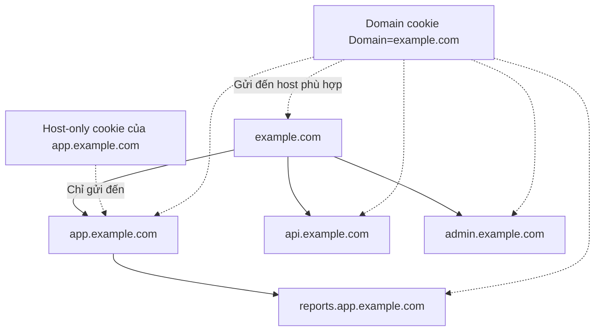

# Host-only cookie: giới hạn cookie vào đúng hostname

## 1. Host-only cookie là gì?

**Host-only cookie** là cookie được trình duyệt gắn với đúng hostname đã phát hành cookie. Khi server gửi header Set-Cookie mà **không có thuộc tính Domain**, trình duyệt lưu cookie với cờ host-only. Cookie chỉ được gửi đến host đó; nó không tự động được gửi đến các subdomain.

Ví dụ, server tại app.example.com gửi:

```http
Set-Cookie: __Host-session=RANDOM_SESSION_ID; Path=/; Secure; HttpOnly; SameSite=Lax
```

Vì header không có Domain, cookie này là host-only cho app.example.com. Nó được gửi đến app.example.com khi các điều kiện khác phù hợp, nhưng không gửi đến api.example.com, admin.example.com hoặc evil.example.com.

Đây là một lựa chọn quan trọng khi bảo vệ phiên đăng nhập. Nhiều tổ chức vận hành nhiều ứng dụng trên các subdomain khác nhau; không phải ứng dụng nào cũng có cùng mức tin cậy. Nếu cookie phiên của ứng dụng A được mở rộng bằng Domain=example.com, trình duyệt có thể gửi cookie đó tới nhiều subdomain. Việc bỏ Domain giúp thu hẹp nơi nhận cookie.

Bài viết thuộc chương **Cookie security** của module **SECURITY_APPLICATION_SECURITY_BROWSER_SECURITY**. Nội dung kết nối host-only cookie với ranh giới origin, cookie, SOP, SameSite, CORS và phòng vệ CSRF, XSS, cookie tossing bằng các thuộc tính và security headers phù hợp.

Sau bài học, bạn có thể:

- Phân biệt host-only cookie với domain cookie.
- Giải thích chính xác vì sao bỏ Domain tạo host-only cookie và vì sao Domain=app.example.com vẫn là domain cookie.
- Dự đoán cookie được gửi đến hostname nào, kể cả subdomain, port và path.
- Hiểu giới hạn của host-only cookie trước CSRF từ sibling subdomain, cookie tossing và XSS.
- Sử dụng prefix __Host- để tăng cường ràng buộc cookie phiên.
- Thiết kế cách tạo, xóa và di chuyển cookie mà không để lại cookie trùng tên ngoài ý muốn.
- Kiểm chứng hành vi bằng DevTools và request thực tế.

## 2. Domain cookie và host-only cookie

### 2.1. Không có Domain nghĩa là host-only

Giả sử response đến từ https://app.example.com:

```http
HTTP/1.1 200 OK
Set-Cookie: session_id=abc123; Path=/; Secure; HttpOnly; SameSite=Lax
```

Trình duyệt lưu cookie với hostname app.example.com và cờ host-only. Khi request đến app.example.com, cookie có thể được gửi nếu Path, Secure, thời hạn, SameSite và các chính sách khác đều cho phép.

Khi request đến api.example.com hoặc admin.example.com, cookie host-only của app.example.com không được gửi.

**Quy tắc cần nhớ:** muốn tạo host-only cookie, hãy **bỏ hẳn thuộc tính Domain**. Không cần viết Domain bằng chính hostname hiện tại.

### 2.2. Có Domain nghĩa là domain cookie

Nếu server gửi:

```http
Set-Cookie: session_id=abc123; Domain=example.com; Path=/; Secure; HttpOnly; SameSite=Lax
```

trình duyệt lưu domain cookie cho example.com. Cookie có thể được gửi đến example.com và các subdomain phù hợp như app.example.com, api.example.com, admin.example.com.

Nếu response đến từ app.example.com và đặt Domain=app.example.com, cookie vẫn là **domain cookie**, không phải host-only cookie. Nó có thể được gửi đến app.example.com và các hostname con bên dưới app.example.com, ví dụ reports.app.example.com.

| Cách đặt cookie từ app.example.com | Loại cookie | Host nhận cookie |
|---|---|---|
| Không có Domain | Host-only | Chỉ app.example.com |
| Domain=app.example.com | Domain cookie | app.example.com và subdomain phù hợp |
| Domain=example.com | Domain cookie | example.com và các subdomain phù hợp |
| Domain=api.example.com | Không hợp lệ từ app.example.com | Host không phải domain-match của nguồn |

Dấu chấm đầu như Domain=.example.com không tạo ra kiểu wildcard riêng trong trình duyệt hiện đại; dấu chấm đó bị bỏ qua. Domain=example.com và Domain=.example.com có cùng ý nghĩa thực tế.

### 2.3. Sơ đồ phạm vi



Sơ đồ thể hiện quy tắc host matching, giả sử các thuộc tính Path, Secure, SameSite, thời hạn và chính sách trình duyệt đều cho phép request.

### 2.4. Domain attribute phải domain-match nguồn đặt cookie

Server không thể đặt cookie cho một domain bất kỳ. Ví dụ app.example.com có thể đặt Domain=example.com vì example.com là domain cha phù hợp. Nhưng nó không thể đặt Domain=other.test hoặc Domain=api.example.net.

Trình duyệt cũng từ chối Domain trỏ đến public suffix như com hoặc co.uk, vì nếu cho phép, một website có thể đặt cookie dùng chung cho quá nhiều website không liên quan.

Không dựa vào kiểm tra chuỗi ở ứng dụng để mô phỏng quy tắc này. Trình duyệt áp dụng thuật toán domain-match và public suffix; ứng dụng nên thu hẹp phạm vi cookie bằng cách bỏ Domain nếu không cần chia sẻ.

## 3. Host-only cookie không phải same-origin cookie

Host-only cookie thường bị nhầm với origin. Hai khái niệm có liên quan nhưng khác nhau.

**Origin** của URL HTTP(S) thông thường gồm scheme + host + port. **Cookie host matching** chủ yếu xét hostname; cookie không có thuộc tính port. Thuộc tính Secure điều khiển việc gửi qua kênh bảo mật, còn SameSite xét ngữ cảnh site.

| Cặp URL | Same-origin? | Host-only cookie của app.example.com? |
|---|---|---|
| https://app.example.com/account | Có cùng origin với URL khác path trên host đó | Có thể gửi |
| https://app.example.com:8443 | Khác origin do port | Có thể gửi nếu các điều kiện khác đạt |
| http://app.example.com | Khác origin do scheme | Cookie Secure không gửi qua HTTP thông thường |
| https://api.example.com | Khác origin và khác host | Không gửi |
| https://reports.app.example.com | Khác origin và khác host | Không gửi |
| https://example.com | Khác origin và khác host | Không gửi |

### 3.1. Port không cô lập cookie

Ví dụ hai ứng dụng cùng chạy trên hostname localhost nhưng port khác nhau:

```text
http://localhost:8000
http://localhost:9000
```

Hai URL khác origin vì port khác. Tuy nhiên cookie không được phân tách theo port. Host-only cookie cho localhost có thể được gửi tới cả hai port nếu các điều kiện khác phù hợp.

Điều này có nghĩa chạy ứng dụng không tin cậy trên một port khác không tạo ra ranh giới cookie. Nếu cần tách biệt phiên giữa các ứng dụng, dùng hostname riêng và cấu hình cookie host-only; tốt hơn nữa là tách biệt miền bảo mật theo kiến trúc.

### 3.2. Scheme không phải khóa cookie độc lập

Cookie không có thuộc tính Scheme. Cookie được đặt từ HTTPS có thể được gửi qua HTTP nếu nó không có Secure và các điều kiện khác cho phép. Với cookie phiên, luôn dùng HTTPS và Secure; HSTS giúp giảm khả năng trình duyệt truy cập nhầm phiên bản HTTP.

Host-only không có nghĩa là cookie chỉ thuộc HTTPS. Host-only chỉ mô tả phạm vi hostname. Secure mới giới hạn việc truyền cookie qua kênh bảo mật.

### 3.3. Path cũng không tạo ranh giới bảo mật

Host-only cookie có thể có Path=/ hoặc Path=/account. Path giới hạn request path được chọn gửi cookie, nhưng không phải ranh giới cách ly an toàn giữa các ứng dụng cùng host.

Các tài liệu cùng hostname có thể tác động đến tài nguyên và trạng thái cùng origin; Path không thay SOP, không cách ly JavaScript, và không nên dùng để giấu cookie bí mật khỏi một ứng dụng khác trên cùng host.

## 4. Vì sao nên ưu tiên host-only cookie?

### 4.1. Giảm phạm vi gửi credential

Giả sử tổ chức có:

- app.example.com: ứng dụng quản lý tài khoản.
- blog.example.com: CMS cho biên tập viên.
- upload.example.com: dịch vụ nhận file người dùng.
- legacy.example.com: ứng dụng cũ chưa được cập nhật thường xuyên.

Nếu cookie phiên của app đặt Domain=example.com, trình duyệt có thể gửi cookie đến tất cả host phù hợp trong cây domain. Khi một subdomain bị xâm nhập hoặc có cấu hình yếu, cookie có thể bị đưa vào request đến host đó.

Nếu cookie là host-only cho app.example.com, trình duyệt không gửi cookie đó đến blog, upload hoặc legacy chỉ vì chúng cùng domain cha.

Đây là nguyên tắc **ít đặc quyền nhất**: chỉ chia sẻ credential tới host thật sự cần nó.

### 4.2. Giảm tác động từ subdomain bị chiếm quyền

Subdomain có thể bị chiếm quyền qua DNS record cũ, dịch vụ SaaS bị gỡ, storage bucket cấu hình sai, ứng dụng thử nghiệm hoặc CMS chứa nội dung không tin cậy. Khi một subdomain bị kiểm soát, attacker có thể:

- Phát hành cookie domain rộng nếu browser chấp nhận Domain=example.com.
- Gửi request same-site đến ứng dụng chính.
- Khởi tạo điều hướng hoặc form tới host ứng dụng.
- Cố tạo cookie trùng tên để gây nhầm lẫn cho parser phía server.

Host-only cookie giảm việc cookie phiên được gửi đến subdomain đó. Nhưng nó **không chặn mọi request từ subdomain sang ứng dụng chính**; phần CSRF cần được xử lý riêng.

### 4.3. Giảm phụ thuộc giữa các ứng dụng

Nếu app và api cần chia sẻ đăng nhập, việc đặt Domain rộng có vẻ thuận tiện. Nhưng nó cũng tạo coupling:

- Cookie được gửi đến nhiều server hơn.
- Các ứng dụng phải thống nhất cách xử lý cookie trùng tên và session.
- Việc đổi tên, xoay vòng, thu hồi cookie ảnh hưởng nhiều hệ thống.
- Một subdomain yếu có thể trở thành điểm vào cho luồng xác thực chung.

Hãy cân nhắc một dịch vụ xác thực trung tâm dùng redirect/OIDC hoặc cơ chế token có audience/scope rõ ràng. Đăng nhập chung không bắt buộc tất cả ứng dụng phải nhận cùng một cookie domain rộng.

## 5. Host-only cookie và prefix __Host-

Host-only cookie có thể được tăng cường bằng prefix **__Host-** trong trình duyệt hỗ trợ cookie prefix.

### 5.1. Các điều kiện của __Host-

Cookie có tên bắt đầu chính xác bằng __Host- phải thỏa các điều kiện chính:

1. Được đặt từ secure origin.
2. Có thuộc tính Secure.
3. Có Path=/.
4. Không có thuộc tính Domain.

Ví dụ:

```http
Set-Cookie: __Host-session=RANDOM_OPAQUE_SESSION_ID; Path=/; Secure; HttpOnly; SameSite=Lax
```

Nếu server thêm Domain=example.com hoặc đặt Path=/account, trình duyệt hỗ trợ prefix sẽ từ chối cookie __Host-session.

Prefix giúp browser thực thi một số ràng buộc mà nếu không có prefix, ứng dụng phải dựa vào quy ước. Đặc biệt, sibling subdomain không thể đặt một cookie __Host-session dùng Domain rộng để đưa cookie đó vào request của app.example.com.

### 5.2. __Host- khác __Secure-

| Prefix | Điều kiện chính | Có bắt buộc host-only? | Có bắt buộc Path=/ ? |
|---|---|---:|---:|
| __Secure- | Secure origin và thuộc tính Secure | Không | Không |
| __Host- | Secure origin, Secure, Path=/, không Domain | Có | Có |

__Secure- cho biết cookie được đặt trong ngữ cảnh bảo mật và có Secure, nhưng vẫn có thể là domain cookie. __Host- áp ràng buộc chặt hơn về hostname và path.

Prefix được trình duyệt kiểm tra theo tên cookie có phân biệt chữ hoa/chữ thường. Trình duyệt cũ không hỗ trợ prefix có thể không áp các điều kiện bổ sung; vẫn cần gửi đúng thuộc tính trong Set-Cookie và kiểm thử browser mục tiêu.

### 5.3. __Host- không thay thế các thuộc tính khác

Prefix __Host- không tự bật HttpOnly, SameSite hay thời hạn. Một cookie __Host-session vẫn cần được cấu hình phù hợp:

```http
Set-Cookie: __Host-session=RANDOM_SESSION_ID; Path=/; Secure; HttpOnly; SameSite=Lax; Max-Age=1800
```

- Secure: hạn chế gửi qua HTTP.
- HttpOnly: ngăn JavaScript đọc trực tiếp cookie.
- SameSite=Lax: giảm một số request cookie-bearing cross-site.
- Max-Age: giới hạn thời gian tồn tại phía browser.
- Path=/ và không Domain: ràng buộc của prefix __Host-.

Server vẫn cần idle timeout, absolute timeout, xoay vòng session ID, thu hồi phiên và kiểm tra quyền cho từng request.

## 6. Host-only cookie và cookie tossing

**Cookie tossing** là nhóm kỹ thuật trong đó một host có thể cố đặt cookie ở phạm vi domain rộng hơn để gây xung đột hoặc mơ hồ với cookie mà ứng dụng chính sử dụng. Nó thường xuất hiện khi nhiều subdomain thuộc các mức tin cậy khác nhau.

### 6.1. Ví dụ cookie trùng tên

Giả sử ứng dụng tại app.example.com đặt host-only cookie:

```http
Set-Cookie: session=APP_SESSION; Path=/; Secure; HttpOnly; SameSite=Lax
```

Một subdomain bị kiểm soát tại evil.example.com có thể thử đặt domain cookie:

```http
Set-Cookie: session=ATTACKER_VALUE; Domain=example.com; Path=/; Secure
```

Request sau đó đến app.example.com có thể chứa cả hai cookie cùng tên vì một cookie được giới hạn ở app.example.com và một cookie có phạm vi example.com. Header Cookie không truyền lại metadata Domain hay host-only flag, nên server thường chỉ nhìn thấy các cặp tên/giá trị.

Ví dụ:

```http
Cookie: session=APP_SESSION; session=ATTACKER_VALUE
```

Thứ tự cookie trong header có quy tắc gửi riêng của browser (trong đó Path dài hơn được ưu tiên trước trong các trường hợp liên quan), nhưng không nên dựa vào thứ tự đó để quyết định cookie xác thực. Framework hoặc middleware có thể chọn giá trị đầu tiên, giá trị cuối cùng hoặc xử lý khác nhau.

**Host-only cookie ngăn cookie phiên của app được gửi đến evil.example.com, nhưng tự nó không ngăn sibling subdomain gửi một cookie domain rộng trùng tên tới app.** Đây là lý do quan trọng để cân nhắc prefix __Host- và cách xử lý cookie trùng tên.

### 6.2. Vì sao __Host- giúp chống cookie tossing?

Nếu cookie xác thực dùng tên __Host-session, sibling subdomain không thể đặt cookie cùng tên với Domain=example.com trong trình duyệt hỗ trợ prefix: việc có Domain vi phạm điều kiện __Host-.

Sibling cũng không thể đặt host-only cookie cho app.example.com, vì host-only cookie chỉ thuộc hostname phát hành response là evil.example.com.

Vì vậy, __Host- làm giảm đáng kể khả năng một sibling subdomain tạo cookie cùng tên có phạm vi gây xung đột. Đây là lớp bảo vệ ở phía trình duyệt; server vẫn cần xử lý cookie duplicate một cách an toàn và không tin dữ liệu cookie không hợp lệ.

### 6.3. Server không thể suy ra host-only từ header Cookie

Khi nhận request, server thường chỉ nhận:

```http
Cookie: __Host-session=RANDOM_SESSION_ID
```

Header này không nói cookie là host-only hay domain cookie, Path nào đã áp dụng hoặc cookie có SameSite gì. Server không nên cố xác định các thuộc tính đó bằng cách phân tích request Cookie.

Hãy cấu hình thuộc tính tại nơi phát Set-Cookie, dùng prefix phù hợp và quản lý session ở server. Nếu nhận nhiều cookie cùng tên, hãy quy định rõ cách xử lý; với cookie xác thực, có thể từ chối request mơ hồ thay vì âm thầm chọn một giá trị.

## 7. Host-only cookie không tự ngăn CSRF

Host-only giới hạn **host đích nhận cookie**, không xác thực **host nguồn khởi phát request**.

Ví dụ app.example.com đặt host-only session cookie. Một trang độc hại tại evil.example.net không nhận được cookie đó cho request gửi đến chính evil.example.net. Tuy nhiên, trang độc vẫn có thể tạo form hoặc điều hướng tới app.example.com. Nếu trình duyệt xem request đó là hợp lệ theo SameSite và các chính sách cookie, host-only cookie có thể được gửi đến app.example.com.

Ngoài ra, evil.example.com là sibling same-site của app.example.com theo schemeful same-site trong trường hợp HTTPS cùng registrable domain. Một request từ sibling có thể là same-site dù khác origin. Host-only cookie của app.example.com vẫn có thể được gửi **đến app.example.com** khi sibling tạo request tới đích này và các điều kiện khác cho phép.

### 7.1. Các lớp phòng vệ CSRF cần phối hợp

- **CSRF token:** token khó đoán, gắn với session/ngữ cảnh và được kiểm tra server-side.
- **SameSite:** chọn Strict/Lax/None theo luồng nghiệp vụ, nhưng không coi là bảo vệ duy nhất.
- **Origin/Referer:** kiểm tra nguồn trên request thay đổi trạng thái theo allowlist chính xác; xử lý rõ header thiếu.
- **Fetch Metadata:** cân nhắc Sec-Fetch-Site, Sec-Fetch-Mode và Sec-Fetch-Dest để chặn request không mong muốn.
- **Method semantics:** không thay đổi trạng thái qua GET; kiểm tra method, content type và quyền nghiệp vụ.
- **Re-authentication/confirmation:** với hành động rủi ro cao, yêu cầu xác nhận phù hợp.

### 7.2. CORS không thay thế CSRF protection

CORS chủ yếu quyết định JavaScript từ origin khác có được đọc response hay không. Một số form và request đơn giản vẫn có thể được gửi cross-origin dù script nguồn không đọc được response.

Nếu ứng dụng chỉ dựa vào việc response không có Access-Control-Allow-Origin để tin rằng không thể có CSRF, ứng dụng vẫn có thể dễ bị tấn công. Server phải kiểm tra token và quyền của thao tác thay đổi trạng thái.

## 8. Host-only cookie và XSS

Host-only cookie không bảo vệ ứng dụng khỏi script độc chạy trong chính hostname được cookie bảo vệ.

Nếu XSS xảy ra tại app.example.com:

- Script độc chạy dưới origin app.example.com.
- Nếu cookie có HttpOnly, script không đọc trực tiếp được giá trị cookie.
- Browser vẫn có thể tự động gửi cookie host-only trong request đến app.example.com.
- Script có thể thao tác DOM, gọi API và thực hiện hành động mà người dùng hiện tại có quyền thực hiện.

Phòng vệ XSS cần output encoding theo ngữ cảnh, sanitization khi cho phép HTML, tránh DOM injection sink nguy hiểm, CSP phù hợp và Trusted Types khi hỗ trợ. Host-only và HttpOnly là lớp giảm tác động, không thay thế phòng XSS.

## 9. Tạo, xóa và di chuyển host-only cookie

### 9.1. Tạo host-only cookie từ server

Ví dụ Node/Express:

```js
app.post("/login", async (req, res) => {
  const user = await authenticate(req.body);
  if (!user) return res.status(401).end();

  const sessionId = await createServerSession(user.id);

  res.cookie("__Host-session", sessionId, {
    path: "/",
    secure: true,
    httpOnly: true,
    sameSite: "lax",
    // Không khai báo domain.
    maxAge: 30 * 60 * 1000,
  });

  res.set("Cache-Control", "no-store");
  return res.status(204).end();
});
```

Tên cookie bắt đầu __Host-, không có domain, path là / và secure là true. Cần xác nhận framework thực sự phát đúng header Set-Cookie; không chỉ nhìn cấu hình object.

Lưu ý đơn vị maxAge khác nhau giữa các framework. Ví dụ trên giả định API res.cookie của Express nhận maxAge theo milliseconds. API framework khác có thể dùng seconds hoặc định dạng khác.

### 9.2. Tạo cookie từ JavaScript

JavaScript có thể đặt cookie không HttpOnly bằng document.cookie:

```js
document.cookie = "theme=dark; Path=/; SameSite=Lax; Max-Age=2592000";
```

Nếu không khai báo Domain, cookie được tạo theo host hiện tại. JavaScript không thể đặt thuộc tính HttpOnly; cookie phiên nên được phát từ server để có thể bật HttpOnly và kiểm soát đầy đủ các thuộc tính.

Không lưu session bearer token trong cookie JavaScript có thể đọc chỉ vì nó host-only. Host-only giới hạn hostname, không ngăn XSS trên chính host đọc cookie không HttpOnly.

### 9.3. Xóa host-only cookie

Để xóa host-only cookie, server cần phát cookie cùng tên và Path phù hợp, không thêm Domain:

```http
Set-Cookie: __Host-session=; Path=/; Max-Age=0; Secure; HttpOnly; SameSite=Lax
```

Việc xóa phải khớp tên, host và Path của cookie cần xóa. Nếu cookie ban đầu là Domain cookie, cần xóa cookie đó bằng phạm vi Domain tương ứng. Nếu có cookie cùng tên ở nhiều Path hoặc Domain, có thể cần phát nhiều header xóa riêng.

### 9.4. Chuyển từ Domain cookie sang host-only cookie

Giả sử hệ thống cũ đã phát:

```http
Set-Cookie: session=OLD_VALUE; Domain=example.com; Path=/; Secure; HttpOnly; SameSite=Lax
```

Hệ thống mới muốn dùng host-only:

```http
Set-Cookie: session=NEW_VALUE; Path=/; Secure; HttpOnly; SameSite=Lax
```

Không nên giả định header thứ hai tự động thay thế mọi domain cookie cũ. Cookie có thể tồn tại song song nếu phạm vi lưu trữ khác nhau. Khi request gửi lên server, hai cookie cùng tên có thể gây mơ hồ.

Quy trình migration nên:

1. Chọn tên cookie mới nếu có thể, ví dụ __Host-session.
2. Phát cookie host-only mới với session ID mới và thu hồi session cũ phía server.
3. Phát header xóa cookie domain cũ bằng đúng Domain và Path cũ.
4. Xử lý thời gian chuyển tiếp, request mang cả cookie cũ và mới, và rollback.
5. Sau thời gian migration, từ chối hoặc bỏ hẳn cookie cũ theo chính sách server.

Nếu đổi tên cookie, không cần dựa vào parser để đoán giá trị nào là cookie mới. Một tên mới giúp tách rõ luồng chuyển đổi.

## 10. Kiểm chứng host-only cookie trong DevTools

### Bài A — Quan sát cookie không có Domain

1. Dùng một server thử nghiệm chạy trên hostname bạn kiểm soát, ví dụ app.example.test.
2. Từ response của app.example.test, phát cookie với Path=/ nhưng bỏ Domain.
3. Mở DevTools → Application/Storage → Cookies.
4. Quan sát Domain/Host hiển thị cho cookie; một số DevTools có cột hoặc dấu hiệu phân biệt host-only.
5. Gửi request tới app.example.test và xem Request Headers → Cookie.
6. Gửi request tới sibling khác, ví dụ api.example.test, rồi xác nhận cookie host-only không xuất hiện ở request đó.

DevTools có thể hiển thị cột Domain theo cách không thể hiện rõ cờ host-only ở mọi phiên bản. Hãy kiểm tra chi tiết cookie hoặc thông tin hostOnly trong công cụ hỗ trợ; đồng thời đối chiếu request thực tế.

### Bài B — So sánh với Domain cookie

Trên app.example.test, phát hai cookie tên khác nhau:

```http
Set-Cookie: host_only_demo=host; Path=/; Secure; SameSite=Lax
Set-Cookie: domain_demo=domain; Domain=example.test; Path=/; Secure; SameSite=Lax
```

Truy cập app.example.test và api.example.test. Kỳ vọng:

- host_only_demo chỉ gửi tới app.example.test.
- domain_demo có thể gửi tới app.example.test và api.example.test.

Điều kiện: cả hai hostname phải được cấu hình để trỏ tới môi trường thử nghiệm và domain suffix phải hợp lệ với chính sách public suffix của browser. Không dùng Domain=example.test nếu bạn không kiểm soát domain này trong môi trường thực.

### Bài C — Kiểm tra port không cô lập cookie

1. Chạy hai HTTP server trên localhost ở port 8000 và 9000.
2. Server ở port 8000 phát cookie không có Domain.
3. Truy cập endpoint ở port 9000 trên cùng hostname localhost.
4. Mở Network và quan sát request có thể mang cookie vừa tạo.

Hai port khác nhau là hai origin khác nhau, nhưng cookie không có thuộc tính port. Thí nghiệm này minh họa vì sao port không phải ranh giới cách ly cookie.

### Bài D — Kiểm tra prefix __Host-

Thử response sau từ HTTPS hostname thử nghiệm:

```http
Set-Cookie: __Host-demo=ok; Path=/; Secure; HttpOnly; SameSite=Lax
```

Sau đó thử lần lượt các biến thể không hợp lệ:

```http
Set-Cookie: __Host-bad1=one; Domain=example.test; Path=/; Secure
Set-Cookie: __Host-bad2=two; Path=/account; Secure
Set-Cookie: __Host-bad3=three; Path=/; HttpOnly
```

Trình duyệt hỗ trợ prefix sẽ từ chối các biến thể thiếu điều kiện: bad1 có Domain, bad2 không có Path=/, bad3 không có Secure. Xem Console/Issues và Storage để xác nhận. Kết quả có thể khác trên trình duyệt cũ không thực thi prefix.

### Bài E — Quan sát cookie trùng tên

Trong môi trường domain thử nghiệm bạn kiểm soát:

1. app.example.test đặt host-only cookie session với Path=/.
2. evil.example.test thử đặt cookie session với Domain=example.test và Path=/.
3. Tạo request từ browser đến app.example.test.
4. Quan sát header Cookie có thể chứa hai cặp cùng tên.
5. Lặp lại với tên __Host-session; thử đặt Domain từ evil.example.test và quan sát browser từ chối cookie có prefix không hợp lệ.

Chỉ thực hiện trên môi trường thử nghiệm. Không thử đặt hoặc ghi đè cookie phiên của website mà bạn không sở hữu.

## 11. Những lỗi thiết kế thường gặp

| Lỗi | Hậu quả | Cách khắc phục |
|---|---|---|
| Đặt Domain=example.com cho mọi cookie | Cookie được gửi tới nhiều subdomain hơn mức cần thiết | Bỏ Domain để tạo host-only cookie |
| Nghĩ Domain=app.example.com là host-only | Cookie vẫn là domain cookie và có thể áp dụng xuống subdomain | Không khai báo Domain |
| Chạy ứng dụng không tin cậy trên port khác cùng host | Cookie có thể vẫn được gửi sang port đó | Tách hostname/miền tin cậy |
| Dùng Path để bảo vệ cookie khỏi ứng dụng khác cùng host | Path không phải ranh giới bảo mật | Dùng host riêng và chính sách origin |
| Chỉ dùng host-only để chống CSRF | Sibling vẫn có thể tạo request tới host đích | CSRF token, SameSite, Origin và Fetch Metadata |
| Không xử lý cookie trùng tên | Framework có thể chọn giá trị không mong muốn | Dùng tên __Host- và từ chối request mơ hồ |
| Xóa cookie nhưng không khớp Domain/Path | Cookie cũ vẫn tồn tại | Xóa đúng phạm vi hoặc migration bằng tên mới |
| Chuyển sang host-only nhưng giữ nguyên tên mà không xử lý cookie cũ | Domain cookie và host-only cookie có thể cùng được gửi | Thu hồi cookie cũ, cân nhắc tên mới |
| Nghĩ HttpOnly khiến XSS vô hại | XSS vẫn có thể thao tác API bằng cookie tự động gửi | Phòng XSS và giới hạn quyền session |
| Dùng Domain rộng cho đăng nhập chung | Tăng coupling và phạm vi lộ credential | Dùng SSO/OIDC hoặc token scope/audience rõ ràng |

## 12. Checklist cấu hình host-only cookie

Trước khi phát hành cookie phiên, hãy kiểm tra:

1. **Host cần nhận cookie:** Xác định hostname chính xác của ứng dụng nhận credential.
2. **Domain:** Nếu không cần chia sẻ subdomain, bỏ thuộc tính Domain hoàn toàn.
3. **Prefix:** Với cookie phiên, cân nhắc tên __Host-session để buộc Secure, Path=/ và không Domain trong browser hỗ trợ.
4. **Transport:** Dùng HTTPS và Secure; triển khai HSTS phù hợp.
5. **Script access:** Bật HttpOnly cho session credential.
6. **Cross-site context:** Chọn SameSite theo nghiệp vụ; không xem SameSite hoặc host-only là CSRF protection đầy đủ.
7. **Path:** Dùng Path=/ cho cookie phiên với __Host-; không dựa vào Path để cách ly ứng dụng.
8. **Port:** Không xem port khác nhau là nơi lưu cookie riêng.
9. **Sibling subdomains:** Đánh giá CMS, upload, preview, tenant, DNS và dịch vụ SaaS trên subdomain.
10. **Cookie collision:** Dùng tên không mơ hồ; xử lý duplicate cookie; cân nhắc __Host-.
11. **Lifecycle:** Có thời hạn, rotation, logout và revoke ở server.
12. **Migration:** Xóa Domain cookie cũ đúng phạm vi và kiểm soát thời gian cookie trùng tên.
13. **Verification:** Xem Set-Cookie, Storage, Request Cookies và lý do browser chặn cookie trong DevTools.
14. **Server-side:** Không tin cookie chỉ vì browser gửi; xác thực session, phân quyền và kiểm tra CSRF cho từng hành động.

## 13. Câu hỏi ôn tập

1. Host-only cookie được tạo bằng cách nào?
2. Tại sao Domain=app.example.com không tạo host-only cookie?
3. Cookie host-only của app.example.com có được gửi đến api.example.com không? Vì sao?
4. Hai ứng dụng ở localhost:8000 và localhost:9000 có chia sẻ khả năng nhận cookie không?
5. Thuộc tính nào giới hạn cookie được gửi qua HTTP không bảo mật?
6. Prefix __Host- yêu cầu những điều kiện gì?
7. Vì sao host-only cookie không tự ngăn CSRF từ sibling subdomain?
8. Cookie tossing có thể gây ra tình huống nào khi hai cookie cùng tên được gửi trong một request?
9. Tại sao server không thể biết cookie có host-only chỉ bằng header Cookie?
10. Khi chuyển từ Domain cookie sang host-only cookie, vì sao cần xóa cookie cũ đúng phạm vi?
11. HttpOnly có ngăn XSS thực hiện request dưới phiên người dùng không?
12. SameSite và host-only khác nhau ở câu hỏi bảo mật nào?

**Đáp án định hướng:** (1) Phát Set-Cookie không có Domain. (2) Có Domain nghĩa là domain cookie, kể cả giá trị trùng hostname hiện tại. (3) Không, host-only chỉ khớp đúng app.example.com. (4) Có thể; cookie không phân tách theo port. (5) Secure. (6) Secure origin, Secure, Path=/, không Domain. (7) Request đích vẫn là app.example.com nên cookie host-only có thể được gửi; SameSite có thể xem sibling là same-site. (8) Server có thể nhận hai cặp cùng tên và parser chọn giá trị khác nhau; dùng __Host- và xử lý duplicate. (9) Header Cookie chỉ chứa tên/giá trị, không chứa metadata. (10) Cookie cũ có phạm vi lưu trữ khác và có thể tiếp tục được gửi. (11) Không; script không đọc trực tiếp cookie nhưng browser vẫn tự gửi cookie trong request. (12) Host-only giới hạn hostname nhận cookie; SameSite giới hạn ngữ cảnh site được gửi cookie.

## 14. Tài liệu tham khảo

- [RFC 6265 — HTTP State Management Mechanism](https://www.rfc-editor.org/rfc/rfc6265): Mô hình cookie, Domain, Path và xử lý cookie trong HTTP.
- [RFC 6265bis — HTTP State Management Mechanism](https://datatracker.ietf.org/doc/draft-ietf-httpbis-rfc6265bis/): Các cập nhật về cookie hiện đại; kiểm tra trạng thái và phiên bản tài liệu khi tra cứu.
- [MDN — Set-Cookie](https://developer.mozilla.org/en-US/docs/Web/HTTP/Reference/Headers/Set-Cookie): Thuộc tính Domain, Path, Secure, HttpOnly, SameSite và cookie prefixes.
- [MDN — HTTP cookies](https://developer.mozilla.org/en-US/docs/Web/HTTP/Cookies): Tổng quan cookie và phạm vi lưu trữ.
- [OWASP — Session Management Cheat Sheet](https://cheatsheetseries.owasp.org/cheatsheets/Session_Management_Cheat_Sheet.html): Quản lý session ID và bảo vệ phiên.
- [OWASP — Cross-Site Request Forgery Prevention Cheat Sheet](https://cheatsheetseries.owasp.org/cheatsheets/Cross-Site_Request_Forgery_Prevention_Cheat_Sheet.html): Phòng CSRF với token, SameSite và kiểm tra nguồn.
- [OWASP — Cross Site Scripting Prevention Cheat Sheet](https://cheatsheetseries.owasp.org/cheatsheets/Cross_Site_Scripting_Prevention_Cheat_Sheet.html): Phòng XSS và giới hạn của HttpOnly.
- [WHATWG HTML — Cookies](https://html.spec.whatwg.org/multipage/dom.html#cookies): Giao diện cookie trong nền tảng web.

**Kết nối với mô hình bảo mật web:** Host-only cookie thu hẹp phạm vi gửi credential về đúng hostname, giúp giảm việc chia sẻ session giữa các subdomain có mức tin cậy khác nhau. Nó không thay origin boundary của SOP, không phân tách theo port, không tự chặn CSRF từ sibling same-site và không ngăn XSS trên chính host. Cấu hình vững chắc kết hợp host-only, prefix __Host-, Secure, HttpOnly, SameSite, CSRF token và quản lý session phía server.
