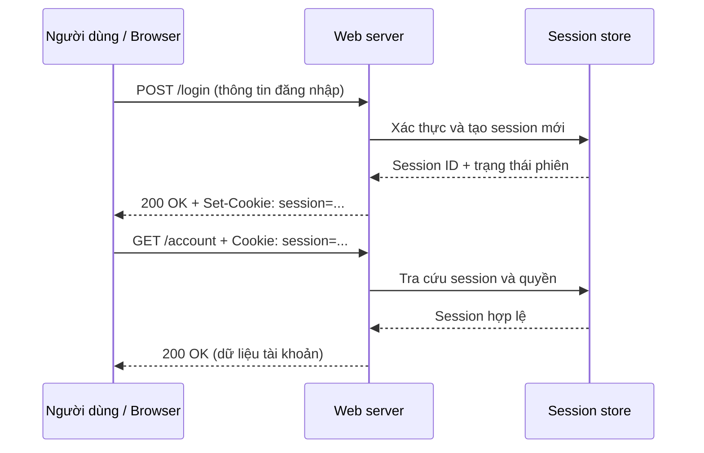
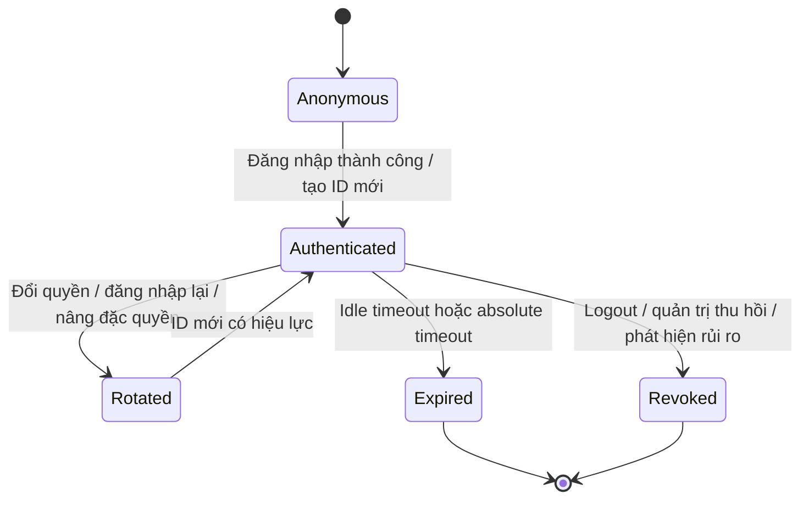

# Cookie phiên — bảo vệ danh tính đăng nhập trong trình duyệt

> **Chương:** Cookie security  
> **Mục tiêu:** Hiểu cookie phiên và session ID, cách browser gửi cookie theo request, cách thiết kế thuộc tính bảo mật, quản lý vòng đời phiên, chống session fixation và session theft, đồng thời kiểm chứng hành vi bằng DevTools.

## 1. Cookie phiên là gì?

Khi người dùng đăng nhập vào một ứng dụng web, máy chủ cần nhận biết những request tiếp theo thuộc về phiên đăng nhập nào. Một cách phổ biến là tạo **session** ở server và gửi cho trình duyệt một cookie chứa mã định danh phiên (**session ID**).

Luồng cơ bản:

1. Người dùng gửi thông tin đăng nhập qua kết nối HTTPS.
2. Server xác thực thông tin và tạo một session mới.
3. Server gửi cookie có session ID qua header `Set-Cookie`.
4. Browser lưu cookie và tự đính kèm vào những request phù hợp.
5. Server đọc session ID, tìm session tương ứng và kiểm tra trạng thái, thời hạn, quyền của người dùng.



Cookie thường chỉ chứa **một giá trị định danh ngẫu nhiên, khó đoán**. Dữ liệu nghiệp vụ như user ID, vai trò, quyền truy cập, thời điểm đăng nhập và trạng thái xác thực nên được quản lý ở server hoặc trong một cấu trúc token được thiết kế đúng. Không đưa mật khẩu, thông tin cá nhân nhạy cảm hoặc toàn bộ hồ sơ người dùng vào cookie chỉ để tránh lưu session phía server.

### Hai nghĩa khác nhau của “session cookie”

Trong tài liệu browser, *session cookie* đôi khi có nghĩa là cookie **không có** `Expires` hoặc `Max-Age`, nên browser coi nó là cookie theo phiên duyệt. Trong ứng dụng, *session cookie* thường chỉ cookie dùng để nhận diện phiên đăng nhập. Hai cách gọi này không hoàn toàn đồng nghĩa:

- Một cookie đăng nhập có thể là browser-session cookie nếu không có thuộc tính hết hạn.
- Một ứng dụng có thể đặt `Max-Age` cho cookie session ID nhưng vẫn quản lý session đăng nhập theo thời hạn riêng ở server.
- Browser session restore có thể khôi phục cookie phiên sau khi mở lại browser; không nên dựa vào việc đóng cửa sổ để bảo đảm session đã bị thu hồi.

**Thời hạn bảo mật của phiên phải được server thực thi.** Việc browser xóa cookie chỉ làm mất bản sao ở client; nó không tự vô hiệu hóa session ID đã bị sao chép hoặc đánh cắp.

## 2. Cookie được gửi khi nào?

Browser quyết định gửi cookie dựa trên thuộc tính và ngữ cảnh request:

- Host-only hoặc `Domain` xác định hostname nào được nhận cookie.
- `Path` giới hạn các đường dẫn request phù hợp.
- `Secure` giới hạn việc gửi qua kết nối bảo mật.
- `SameSite` điều chỉnh việc gửi cookie theo ngữ cảnh same-site/cross-site.
- `Expires` hoặc `Max-Age` quy định thời điểm cookie hết hạn ở browser.
- Chính sách riêng tư của browser có thể chặn hoặc phân vùng cookie bên thứ ba.

Cookie không được phân tách theo port như origin. Hai ứng dụng trên cùng hostname nhưng port khác nhau có thể vẫn tương tác với cookie theo host/path. Vì vậy, không dùng port hoặc `Path` làm ranh giới bảo mật giữa những ứng dụng không tin cậy.

### Host-only cookie và Domain cookie

Nếu server không đặt thuộc tính `Domain`, cookie là **host-only** và chỉ được gửi tới đúng host phát hành nó.

```http
Set-Cookie: session=opaque-id; Path=/; Secure; HttpOnly; SameSite=Lax
```

Nếu đặt `Domain`, cookie có thể được gửi tới domain đó và các subdomain phù hợp:

```http
Set-Cookie: session=opaque-id; Domain=example.com; Path=/; Secure; HttpOnly; SameSite=Lax
```

Cookie domain rộng có thể làm tăng rủi ro giữa các subdomain. Nếu `uploads.example.com` cho phép người dùng lưu nội dung tùy ý, việc chia sẻ cookie phiên nhạy cảm với toàn bộ `example.com` có thể tạo thêm đường tấn công. Chỉ dùng `Domain` khi thực sự cần chia sẻ cookie giữa các host.

Browser thường từ chối `Domain` trỏ đến public suffix như `com` hoặc `co.uk`. Điều này ngăn một website đặt cookie trên hậu tố được nhiều chủ thể dùng chung.

### Path không phải ranh giới tin cậy

Ví dụ:

```http
Set-Cookie: admin-session=opaque-id; Path=/admin; Secure; HttpOnly
```

`Path=/admin` ảnh hưởng request nào được browser đính kèm cookie, nhưng không cô lập an toàn ứng dụng `/admin` khỏi ứng dụng `/shop` trên cùng host. Các ứng dụng cùng origin có thể truy cập nhiều tài nguyên và JavaScript theo SOP; đừng dựa vào Path để tách tenant hoặc dữ liệu bí mật.

## 3. Các thuộc tính bảo mật quan trọng

Một cookie phiên nhạy cảm thường nên bắt đầu từ cấu hình hẹp:

```http
Set-Cookie: __Host-session=opaque-random-id; Path=/; Secure; HttpOnly; SameSite=Lax
```

| Thuộc tính | Tác dụng | Giới hạn |
| --- | --- | --- |
| `Secure` | Chỉ gửi cookie qua kết nối an toàn theo quy tắc cookie | Không tự xác minh người dùng hay chống XSS |
| `HttpOnly` | JavaScript không đọc được giá trị qua `document.cookie` | XSS vẫn có thể gửi request cùng origin bằng phiên của người dùng |
| `SameSite=Lax` | Giảm việc gửi cookie trong nhiều request cross-site | Không thay thế CSRF token và có ngoại lệ điều hướng top-level |
| `SameSite=Strict` | Hạn chế cookie trong ngữ cảnh cross-site nghiêm ngặt hơn | Có thể ảnh hưởng luồng đăng nhập/điều hướng từ liên kết bên ngoài |
| `SameSite=None` | Cho phép cookie trong ngữ cảnh cross-site khi các điều kiện khác thỏa | Cần `Secure`; browser vẫn có thể chặn cookie bên thứ ba |
| `Path=/` | Cookie được gửi tới các đường dẫn phù hợp trên host | Không tạo ranh giới bảo mật giữa ứng dụng cùng host |
| Không có `Domain` | Cookie host-only | Không chia sẻ cookie cho subdomain |

`HttpOnly` đặc biệt hữu ích với session ID: nó giảm khả năng script đọc và lấy trực tiếp giá trị cookie. Nhưng nếu ứng dụng có XSS, script độc hại có thể gọi API bằng browser session hiện có, đọc dữ liệu mà ứng dụng được phép đọc hoặc thực hiện hành động thay người dùng. Vì vậy vẫn phải phòng vệ XSS bằng output encoding, tránh DOM sink nguy hiểm, CSP và Trusted Types khi phù hợp.

### Prefix `__Host-`

Browser hỗ trợ cookie prefix `__Host-` yêu cầu:

- Có `Secure`.
- Có `Path=/`.
- Không có thuộc tính `Domain`.

Ví dụ:

```http
Set-Cookie: __Host-session=opaque-id; Path=/; Secure; HttpOnly; SameSite=Lax
```

Prefix này giúp cookie chỉ gắn với host đã đặt nó, hạn chế một số kiểu cookie tossing từ subdomain. Nó không thay thế việc sinh session ID an toàn, xoay vòng ID và vô hiệu hóa session ở server. Nếu hệ thống cần cookie trên nhiều subdomain, `__Host-` không phù hợp với nhu cầu chia sẻ đó; hãy cân nhắc lại ranh giới tin cậy.

## 4. Sinh session ID an toàn

Session ID là một **bearer credential**: bất kỳ ai nắm được mã hợp lệ và có thể gửi request phù hợp đều có thể bị server nhận diện là phiên đó, trừ khi ứng dụng có thêm cơ chế ràng buộc.

Session ID cần:

1. Được sinh bằng bộ sinh số ngẫu nhiên mật mã (**CSPRNG**).
2. Có entropy đủ lớn để không thể đoán hoặc dò bằng brute force.
3. Không chứa thông tin trực tiếp như email, username, vai trò hay thời gian có thể suy ra.
4. Không được tái sử dụng giữa những người dùng hoặc phiên đăng nhập khác nhau.
5. Được truyền qua HTTPS và không xuất hiện trong URL, log, analytics hay referrer.

Ví dụ giả lập:

```js
import { randomBytes } from "node:crypto";

function createSessionId() {
  return randomBytes(32).toString("base64url");
}

const sessionId = createSessionId();
```

Ví dụ này tạo 32 byte ngẫu nhiên (256 bit) trước khi encode. Hãy dùng API CSPRNG phù hợp với nền tảng; không dùng `Math.random()`, timestamp, số tăng dần hoặc hash của username làm session ID.

Không đưa session ID vào query string:

```text
Không an toàn: https://app.example.com/account?session=opaque-id
An toàn hơn:  cookie gửi qua HTTPS request header
```

URL có thể bị lưu trong browser history, reverse proxy log, server log, analytics và header `Referer`. Cookie với thuộc tính bảo mật phù hợp giảm những kênh rò rỉ này.

## 5. Vòng đời session: tạo, xoay vòng, hết hạn và thu hồi

Cookie là phương tiện mang session ID; server mới là nơi quyết định phiên còn hợp lệ hay không. Một vòng đời điển hình:



### Session fixation và xoay vòng ID

**Session fixation** xảy ra khi kẻ tấn công khiến nạn nhân dùng một session ID mà kẻ tấn công đã biết trước. Nếu ứng dụng giữ nguyên ID đó sau khi người dùng đăng nhập, kẻ tấn công có thể sử dụng cùng ID để chiếm phiên đã xác thực.

Biện pháp quan trọng:

- Tạo session ID mới sau khi đăng nhập thành công.
- Xoay vòng ID khi người dùng nâng quyền, đổi mật khẩu hoặc hoàn thành bước xác thực mạnh.
- Vô hiệu hóa ID cũ sau khi xoay vòng; không để ID cũ tiếp tục truy cập dữ liệu nhạy cảm.
- Không nhận session ID từ URL hoặc tham số do người dùng tự chọn.
- Cookie phiên nên được đặt lại bởi server sau khi xác thực, với thuộc tính bảo mật nhất quán.

Ví dụ khái niệm:

```text
Trước đăng nhập: session ID = anonymous-123
Đăng nhập thành công
Sau đăng nhập:  session ID = random-new-id
ID cũ:          revoked
```

### Idle timeout và absolute timeout

Nên có ít nhất hai loại thời hạn:

- **Idle timeout:** phiên hết hạn nếu không có hoạt động hợp lệ trong một khoảng thời gian.
- **Absolute timeout:** phiên hết hạn sau tổng thời gian tối đa kể từ lúc tạo hoặc xác thực, kể cả khi người dùng vẫn hoạt động.

Ví dụ chính sách minh họa: phiên quản trị hết hạn sau 15 phút không hoạt động và tối đa 8 giờ kể từ lần xác thực. Con số thực tế phải dựa vào độ nhạy cảm, nhu cầu người dùng, rủi ro và chính sách tổ chức.

Không chỉ đặt `Max-Age` dài trên cookie rồi xem đó là session timeout. Server phải kiểm tra thời gian tạo, lần hoạt động cuối, trạng thái thu hồi và điều kiện xác thực của session.

### Logout phải thu hồi ở server

Khi người dùng đăng xuất:

1. Server xác minh request logout và chống CSRF.
2. Server đánh dấu session ID hiện tại là revoked hoặc xóa session tương ứng khỏi session store.
3. Server trả `Set-Cookie` xóa cookie với cùng tên, Domain/host scope và Path đã dùng khi tạo.
4. Ứng dụng xóa dữ liệu giao diện nhạy cảm và tránh cache nội dung tài khoản.

Ví dụ xóa cookie host-only:

```http
Set-Cookie: __Host-session=; Path=/; Max-Age=0; Secure; HttpOnly; SameSite=Lax
```

Xóa cookie ở browser **không đủ** nếu server vẫn chấp nhận session ID cũ. Nếu ID đã bị sao chép, kẻ tấn công có thể tiếp tục gửi nó cho tới khi server hết hạn hoặc thu hồi.

## 6. Session theft: cookie bị đánh cắp thì chuyện gì xảy ra?

Vì session ID là bearer credential, kẻ tấn công lấy được ID có thể thử phát lại session từ một client khác. Một số đường rò rỉ:

- XSS đọc cookie nếu không có `HttpOnly` hoặc lấy dữ liệu từ DOM/storage.
- Malware hoặc extension độc hại có quyền đọc dữ liệu trình duyệt.
- Kết nối không an toàn hoặc cấu hình TLS sai khiến dữ liệu bị lộ trên đường truyền.
- Session ID xuất hiện trong URL, log, screenshot, ticket hỗ trợ hoặc analytics.
- Subdomain không tin cậy ghi đè cookie cùng tên khi cookie domain scope quá rộng.
- Máy dùng chung không đăng xuất hoặc lưu phiên quá lâu.

Các lớp giảm thiểu:

| Biện pháp | Giảm rủi ro |
| --- | --- |
| HTTPS toàn bộ ứng dụng và `Secure` | Ngăn cookie phiên bị gửi qua HTTP thông thường |
| `HttpOnly` | Ngăn JavaScript đọc trực tiếp giá trị cookie |
| `SameSite` + CSRF protection | Giảm request giả mạo sử dụng cookie tự động |
| Host-only cookie / `__Host-` | Thu hẹp phạm vi host và một số rủi ro từ subdomain |
| CSP, Trusted Types, output encoding | Giảm khả năng khai thác XSS |
| Session rotation, idle/absolute timeout | Giảm thời gian và giá trị của session bị lộ |
| Logout/revocation và quản lý thiết bị | Cho phép thu hồi session đã bị nghi ngờ |
| Re-authentication cho hành động nhạy cảm | Giảm hậu quả khi session đang hoạt động bị chiếm |

### Có nên ràng buộc session với IP hoặc User-Agent?

IP và User-Agent có thể thay đổi do mạng di động, VPN, proxy, cập nhật browser hoặc NAT. Ràng buộc cứng vào IP có thể khóa nhầm người dùng hợp lệ, trong khi kẻ tấn công cùng mạng hoặc cùng thiết bị vẫn có thể vượt qua.

Có thể dùng tín hiệu thiết bị/vị trí như **risk signal** để phát hiện bất thường, nhưng không nên coi IP hay User-Agent là bí mật xác thực. Với hành động rủi ro cao, yêu cầu xác thực lại hoặc xác thực mạnh thường có ý nghĩa hơn.

## 7. Cookie phiên và XSS

`HttpOnly` bảo vệ **giá trị cookie khỏi JavaScript**, chứ không làm cho ứng dụng miễn nhiễm với XSS.

Giả sử một trang bị XSS và cookie phiên được đặt:

```http
Set-Cookie: __Host-session=opaque-id; Path=/; Secure; HttpOnly; SameSite=Lax
```

Script độc hại không đọc được `document.cookie` để lấy session ID. Nhưng nó có thể gửi request same-origin:

```js
// Nếu chạy trong origin ứng dụng, browser có thể tự gắn cookie phiên.
fetch("/api/profile", {
  credentials: "same-origin",
});
```

Do đó, XSS vẫn có thể đọc response mà trang được phép đọc hoặc thao tác trong phiên người dùng. Để phòng vệ cần:

- Encode output theo đúng ngữ cảnh HTML, attribute, URL và JavaScript.
- Tránh gán chuỗi không tin cậy vào `innerHTML`; ưu tiên `textContent` hoặc API DOM an toàn.
- Làm sạch HTML khi thực sự cần render nội dung rich text.
- Dùng CSP nghiêm ngặt và Trusted Types khi nền tảng hỗ trợ.
- Giảm quyền và thời hạn session; yêu cầu xác thực lại cho hành động quan trọng.

## 8. Cookie phiên và CSRF

Browser tự động đính kèm cookie phù hợp vào request. Đây là điều tiện lợi cho session, nhưng cũng là nền tảng của **Cross-Site Request Forgery (CSRF)**: website khác có thể khiến browser gửi request đến ứng dụng đang đăng nhập.

Ví dụ một trang độc hại tạo form:

```html
<form action="https://bank.example/transfer" method="POST">
  <input name="to" value="attacker">
  <input name="amount" value="1000">
</form>
```

Nếu endpoint không có CSRF protection, cookie phiên có thể được gửi trong một số ngữ cảnh và server có thể thực hiện giao dịch ngoài ý muốn. Trang độc hại không cần đọc response để gây tác động.

Các lớp phòng vệ thường dùng:

1. **CSRF token:** token gắn với phiên hoặc request, được server xác minh trên thao tác thay đổi trạng thái.
2. **SameSite cookie:** giảm gửi cookie trong nhiều ngữ cảnh cross-site, nhưng không thay thế toàn bộ CSRF protection.
3. **Origin/Referer validation:** kiểm tra nguồn request trên các endpoint phù hợp.
4. **Fetch Metadata:** xem `Sec-Fetch-Site`, `Sec-Fetch-Mode` và các header liên quan như tín hiệu bổ sung.
5. **Phương thức HTTP đúng:** không dùng GET để chuyển tiền, đổi mật khẩu hoặc thay đổi trạng thái.

Không dùng CORS như cơ chế chống CSRF. Một request form đơn giản có thể được gửi mà không cần preflight; CORS chủ yếu giới hạn script đọc response.

## 9. Thiết kế cookie phiên cho nhiều subdomain

Giả sử một hệ thống có:

```text
app.example.com       — giao diện khách hàng
admin.example.com     — quản trị
uploads.example.com   — nội dung người dùng tải lên
api.example.com       — API
```

Các host có thể cùng site nhưng khác origin. Chia sẻ cookie bằng `Domain=example.com` sẽ gửi cookie tới nhiều subdomain, kể cả host có mức tin cậy thấp hơn.

Trước khi chia sẻ cookie, hãy hỏi:

- Có thực sự cần cùng một session trên tất cả subdomain không?
- Subdomain nào nhận nội dung do người dùng kiểm soát?
- Có thể dùng cookie host-only và một luồng SSO/ủy quyền riêng không?
- Cookie có thể bị ghi đè hoặc xung đột tên giữa các ứng dụng không?
- CORS, CSRF và authorization có đang dựa nhầm vào giả định cùng site là cùng tin cậy không?

Với ứng dụng nhạy cảm, cookie host-only thường là lựa chọn khởi đầu tốt hơn. Nếu cần chia sẻ đăng nhập, cân nhắc thiết kế SSO với token ngắn hạn, audience rõ ràng và redirect URI được allowlist, thay vì mở rộng cookie phiên toàn miền mà không đánh giá rủi ro.

## 10. Session store và kiến trúc server

Trong mô hình server-side session, cookie chỉ giữ session ID; dữ liệu phiên nằm trong kho lưu trữ như database hoặc cache chuyên dụng.

Một bản ghi session có thể gồm:

| Trường | Mục đích |
| --- | --- |
| Session ID hoặc hash của ID | Khóa tra cứu phiên |
| User ID | Chủ thể đăng nhập |
| Created at | Thời điểm tạo phiên |
| Last activity | Kiểm tra idle timeout |
| Absolute expiry | Thời hạn tối đa |
| Authenticated at / auth level | Thời điểm và mức xác thực |
| Revoked state | Thu hồi phiên |
| Device/risk metadata | Tín hiệu đánh giá rủi ro, không phải bí mật xác thực |

Trong hệ thống nhiều instance, session store cần được chia sẻ hoặc đồng bộ theo kiến trúc; không dựa vào bộ nhớ của một process nếu request có thể đến server khác. Khi logout hoặc thu hồi, mọi instance cần thấy trạng thái mới trong thời gian phù hợp.

Nếu lưu hash session ID ở database, server có thể giảm hậu quả khi dữ liệu session store bị đọc trái phép. Thiết kế này cần thực hiện nhất quán ở bước tạo, tra cứu và thu hồi; không dùng hash yếu hoặc biến session ID thành giá trị có thể đoán.

Một số hệ thống dùng cookie chứa token được ký thay vì session store. Khi đó cần quản lý expiration, key rotation, revocation, audience, issuer và replay risk. Token có chữ ký hợp lệ không tự động cho phép thu hồi tức thì nếu kiến trúc không có cơ chế revoke hoặc phiên ngắn hạn phù hợp.

## 11. Thực hành: quan sát cookie phiên trong DevTools

Thực hành trên ứng dụng local hoặc staging do bạn kiểm soát, dùng tài khoản thử nghiệm và không ghi session ID thật vào tài liệu.

### Bước 1 — Đăng nhập và xem response

1. Mở DevTools → **Network**.
2. Đăng nhập ứng dụng thử nghiệm.
3. Chọn response của endpoint login.
4. Xem `Set-Cookie`: tên cookie, `Domain`, `Path`, `Secure`, `HttpOnly`, `SameSite` và thời hạn.

Kỳ vọng: cookie phiên có cấu hình phù hợp với ranh giới host và nhu cầu cross-site; session ID không xuất hiện trong URL.

### Bước 2 — Xem cookie được gửi trong request

1. Tải trang tài khoản.
2. Chọn request tới API cùng host.
3. Xem Request Headers hoặc mục Cookies.
4. Kiểm tra cookie có được browser đính kèm và có thông tin blocked reason hay không.

Không chia sẻ screenshot có chứa giá trị cookie hoặc session ID. Nếu cần lưu bằng chứng, che toàn bộ giá trị nhạy cảm.

### Bước 3 — Thử HttpOnly

Trong Console của trang:

```js
console.log(document.cookie);
```

Cookie có `HttpOnly` không xuất hiện trong kết quả. DevTools Application/Storage vẫn có thể hiển thị cookie cho mục đích quản trị/debug, nên đừng nhầm điều đó với quyền của JavaScript trang.

### Bước 4 — Thử SameSite và cross-site

Trong môi trường lab, dùng một trang thử nghiệm ở site khác để gửi request tới ứng dụng. Quan sát:

- Cookie có được gửi không.
- `SameSite` là Strict, Lax hay None.
- Request là điều hướng top-level hay subresource/fetch.
- Browser có chặn third-party cookie hoặc partition cookie không.

Kết quả có thể khác theo browser và chính sách riêng tư. Không thay đổi cookie production chỉ để thực hiện thí nghiệm.

### Bước 5 — Kiểm tra logout và session revocation

1. Đăng nhập, ghi nhận session thử nghiệm mà không sao chép giá trị bí mật.
2. Đăng xuất.
3. Kiểm tra response xóa cookie với đúng scope.
4. Gửi lại request thử nghiệm từ browser; server phải từ chối session cũ dù cookie còn được khôi phục hoặc một bản sao cũ vẫn tồn tại.

Điểm cần xác minh là **server không còn chấp nhận session cũ**, không chỉ là cookie biến mất khỏi tab Application.

## 12. Những lỗi triển khai thường gặp

| Lỗi | Hậu quả | Cách sửa |
| --- | --- | --- |
| Cookie phiên thiếu `Secure` | Có thể bị gửi qua HTTP trong một số điều kiện | Bắt buộc HTTPS và `Secure` |
| Thiếu `HttpOnly` | Script có thể đọc trực tiếp session ID | Bật `HttpOnly`, đồng thời sửa XSS |
| Dùng `SameSite=None` không có `Secure` | Browser hiện đại thường từ chối cookie | Dùng `SameSite=None; Secure` chỉ khi thật sự cần cross-site |
| Cookie `Domain` quá rộng | Tăng rủi ro từ subdomain và cookie tossing | Ưu tiên host-only hoặc `__Host-` |
| Không xoay session ID sau login | Session fixation | Tạo ID mới và thu hồi ID trước |
| Chỉ xóa cookie khi logout | Session ID cũ vẫn có thể được phát lại | Thu hồi ở server và xóa cookie |
| Session không có idle/absolute expiry | Phiên bị lộ có thể dùng quá lâu | Quản lý timeout phía server |
| Đặt session ID trong URL | Lộ qua history, log, referrer | Chỉ truyền bằng cookie/header phù hợp |
| Coi SameSite là CSRF protection duy nhất | Một số request same-site/cross-site vẫn có thể gây tác động | Token, Origin checks, Fetch Metadata và server authorization |
| Tin HttpOnly sẽ chặn mọi tác động XSS | Script vẫn có thể gọi API bằng phiên hiện có | Phòng vệ XSS và giới hạn hành động nhạy cảm |

## 13. Checklist bảo vệ cookie phiên

- Sinh session ID bằng CSPRNG, đủ entropy và không chứa dữ liệu cá nhân.
- Đặt cookie qua HTTPS với `Secure`.
- Bật `HttpOnly` cho session ID.
- Chọn `SameSite` theo luồng nghiệp vụ; không dùng `None` nếu không cần cross-site.
- Ưu tiên host-only cookie; cân nhắc `__Host-` với `Path=/` và không có `Domain`.
- Không coi `Path` hoặc port là ranh giới bảo mật.
- Xoay vòng session ID sau đăng nhập, nâng quyền và xác thực lại.
- Thực thi idle timeout và absolute timeout ở server.
- Thu hồi session phía server khi logout, đổi mật khẩu, thu hồi thiết bị hoặc phát hiện rủi ro theo chính sách.
- Bảo vệ endpoint thay đổi trạng thái bằng CSRF token và kiểm tra quyền.
- Chống XSS bằng encoding, CSP, Trusted Types và API DOM an toàn.
- Không ghi session ID hoặc cookie value vào log, URL, analytics hay ticket.
- Kiểm tra cookie thực tế qua DevTools và kiểm thử trên các browser mục tiêu.

## 14. Câu hỏi tự kiểm tra

1. Cookie phiên và session đăng nhập khác nhau thế nào? Vì sao browser-session cookie không quyết định thời hạn session ở server?
2. Vì sao session ID phải được sinh bằng CSPRNG và không được đặt trong URL?
3. `HttpOnly` ngăn điều gì và không ngăn điều gì khi ứng dụng bị XSS?
4. Host-only cookie khác Domain cookie như thế nào?
5. Vì sao `Path=/admin` không phải ranh giới bảo mật giữa ứng dụng admin và shop cùng host?
6. `__Host-` yêu cầu những thuộc tính nào?
7. Session fixation xảy ra khi nào và vì sao phải xoay ID sau login?
8. Vì sao logout phải thu hồi session phía server?
9. Vì sao `SameSite` không thay thế CSRF token?
10. Idle timeout và absolute timeout giải quyết hai rủi ro nào?

**Ghi nhớ:** Cookie phiên thường mang một session ID ngẫu nhiên để browser gửi lại cho server. Cookie cần được giới hạn bằng `Secure`, `HttpOnly`, `SameSite` và phạm vi host phù hợp; `__Host-` là lựa chọn hữu ích cho cookie host-only. Nhưng bảo vệ phiên còn phụ thuộc vòng đời server: sinh ID an toàn, xoay vòng sau đăng nhập/nâng quyền, timeout, logout/revocation và kiểm tra quyền. Cookie flags giảm rủi ro truyền tải và truy cập, còn phòng vệ XSS, CSRF và xác thực phía server vẫn cần thiết để bảo vệ phiên người dùng.
