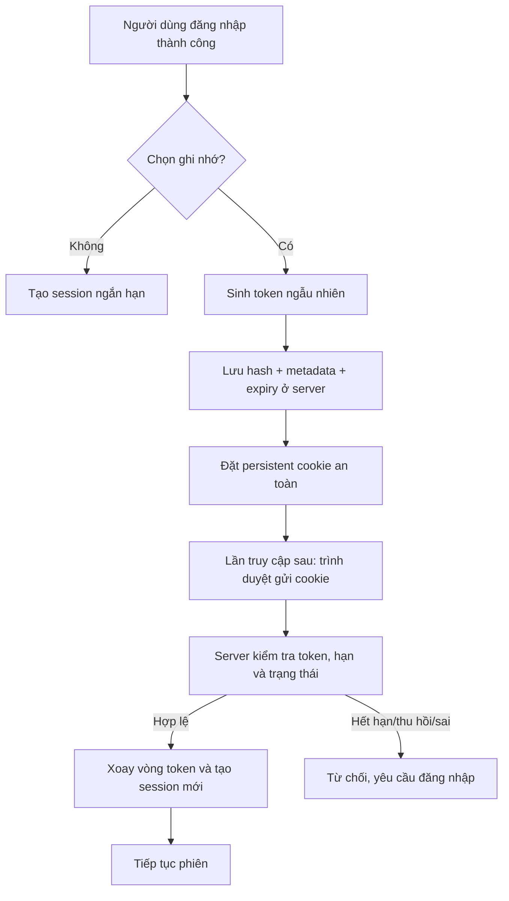

# Persistent cookie: duy trì trạng thái qua nhiều lần truy cập như thế nào?

Cookie là cơ chế để trình duyệt lưu một lượng dữ liệu nhỏ và gửi lại cho máy chủ trong những request phù hợp. Khi người dùng chọn “Ghi nhớ đăng nhập” hoặc một website cần giữ tùy chọn trong nhiều ngày, ứng dụng có thể sử dụng **persistent cookie** (cookie tồn tại lâu dài). Cookie này có thời hạn do thuộc tính `Expires` hoặc `Max-Age` quy định, nên có thể tiếp tục tồn tại sau khi người dùng đóng và mở lại trình duyệt.

Persistent cookie giúp duy trì trạng thái, nhưng cũng kéo dài thời gian một mã nhận diện hoặc mã xác thực có thể bị sử dụng nếu bị đánh cắp. Cần phân biệt thời hạn cookie ở trình duyệt với thời hạn phiên ở máy chủ, hiểu cách cookie được gửi tự động, và thiết kế cơ chế thu hồi, xoay vòng và bảo vệ phù hợp.

Bài học thuộc chương **Cookie security**, trong phạm vi `SECURITY_APPLICATION_SECURITY_BROWSER_SECURITY`: phân tích ranh giới giữa trình duyệt, origin, cookie và ứng dụng web; hiểu Same-Origin Policy, CORS và các cơ chế cách ly; thực hành phòng vệ XSS, CSRF, clickjacking bằng CSP, Trusted Types, security headers và kiểm chứng hành vi thực tế.

## 1. Mục tiêu học tập

Sau bài học, người học có thể:

1. Phân biệt session cookie và persistent cookie.
2. Giải thích `Expires`, `Max-Age` và quy tắc ưu tiên khi cả hai cùng xuất hiện.
3. Thiết kế cookie với `Secure`, `HttpOnly`, `SameSite`, `Domain`, `Path` và tiền tố `__Host-`.
4. Phân biệt tuổi thọ cookie ở trình duyệt với tuổi thọ phiên/token ở máy chủ.
5. Thiết kế chức năng “remember me” bằng token ngẫu nhiên, lưu trữ phía server, xoay vòng và thu hồi.
6. Nhận diện rủi ro CSRF, XSS và quyền truy cập kéo dài do persistent cookie.
7. Kiểm chứng việc tạo, gửi, hết hạn, xóa và thu hồi cookie trong DevTools.

## 2. Session cookie và persistent cookie

Cookie có thể được chia thành hai nhóm theo cách xác định thời hạn:

| Loại | Cách xác định thời hạn | Hành vi thường gặp |
| --- | --- | --- |
| Session cookie | Không có `Expires` hoặc `Max-Age` | Trình duyệt thường giữ cookie trong phiên duyệt hiện tại và xóa khi phiên kết thúc. |
| Persistent cookie | Có `Expires` hoặc `Max-Age` hợp lệ | Trình duyệt có thể giữ cookie qua nhiều lần khởi động cho tới khi hết hạn hoặc bị xóa. |

Ví dụ session cookie:

```http
Set-Cookie: __Host-session=OPAQUE_SESSION_ID; Path=/; Secure; HttpOnly; SameSite=Lax
```

Ví dụ persistent cookie:

```http
Set-Cookie: theme=dark; Max-Age=2592000; Path=/; Secure; SameSite=Lax
```

Cookie `theme` có thời hạn 30 ngày (2.592.000 giây) theo `Max-Age`, nếu trình duyệt chấp nhận và không có chính sách nào xóa nó sớm hơn.

### Session cookie không luôn biến mất khi đóng cửa sổ

Khái niệm “phiên trình duyệt kết thúc” do user agent xác định. Một số trình duyệt có thể khôi phục session sau khi khởi động lại, bao gồm cả session cookie, nếu người dùng bật tính năng khôi phục phiên hoặc trình duyệt phục hồi sau sự cố. Vì vậy:

- Không coi session cookie là bảo đảm rằng cookie bị xóa ngay khi đóng cửa sổ.
- Không dùng việc đóng trình duyệt làm cơ chế thu hồi phiên ở server.
- Nếu phiên đăng nhập phải hết hạn, hãy đặt thời hạn và trạng thái phiên ở máy chủ.

### Persistent cookie không đồng nghĩa với phiên đăng nhập vĩnh viễn

Cookie có thể được lưu 30 ngày, nhưng phiên tương ứng ở server có thể bị thu hồi sau 1 ngày. Khi trình duyệt gửi cookie cũ, server phải kiểm tra trạng thái token/session và từ chối nếu đã hết hạn hoặc bị thu hồi.

Ngược lại, nếu server vẫn coi một token hợp lệ nhưng cookie đã hết hạn ở trình duyệt, trình duyệt không còn tự gửi cookie đó trong request thông thường. Hai lớp thời hạn phải được thiết kế đồng bộ.

## 3. Đặt thời hạn bằng Expires và Max-Age

### Expires: thời điểm tuyệt đối

`Expires` nhận một ngày giờ theo định dạng HTTP-date:

```http
Set-Cookie: preference=compact; Expires=Wed, 25 Nov 2026 12:00:00 GMT; Path=/; Secure; SameSite=Lax
```

Cookie được xem là hết hạn tại thời điểm được chỉ định. Giá trị thời gian phải được định dạng đúng và dùng UTC/GMT. Cách này phụ thuộc vào thời điểm tuyệt đối, nên có thể chịu ảnh hưởng của sai lệch đồng hồ hoặc cách trình duyệt xử lý thời gian.

### Max-Age: thời lượng tính bằng giây

`Max-Age` chỉ định cookie còn hiệu lực trong bao lâu kể từ lúc được tạo/cập nhật:

```http
Set-Cookie: preference=compact; Max-Age=86400; Path=/; Secure; SameSite=Lax
```

`86400` giây tương đương 24 giờ. Đây thường là cách dễ kiểm soát thời lượng hơn khi server muốn đặt tuổi thọ tương đối.

Các trường hợp đặc biệt:

- `Max-Age` lớn hơn 0: cookie có thời hạn theo số giây.
- `Max-Age=0`: cookie hết hạn ngay.
- `Max-Age` âm: cookie được xem là hết hạn ngay.

### Khi cả hai thuộc tính cùng xuất hiện

Nếu response có cả `Expires` và `Max-Age`, **`Max-Age` được ưu tiên** theo quy tắc cookie:

```http
Set-Cookie: preference=compact; Expires=Wed, 25 Nov 2026 12:00:00 GMT; Max-Age=3600; Path=/; Secure; SameSite=Lax
```

Trong ví dụ này, thời lượng một giờ từ `Max-Age` được ưu tiên. Có thể gửi cả hai để hỗ trợ một số môi trường cũ, nhưng phải hiểu rõ quy tắc ưu tiên và tránh tạo ra hai giá trị mâu thuẫn.

### Cookie có thể bị xóa trước thời hạn

Thời hạn do server khai báo là thời hạn tối đa mà cookie được phép tồn tại theo chính sách đó, không phải cam kết lưu trữ tuyệt đối. Trình duyệt hoặc người dùng có thể xóa cookie, chặn cookie, giới hạn dung lượng hoặc áp dụng chính sách quyền riêng tư làm cookie biến mất sớm hơn. Một số trình duyệt cũng áp dụng giới hạn tối đa cho tuổi thọ cookie.

Do đó, ứng dụng phải hoạt động đúng khi cookie không còn, kể cả trước thời hạn đã đặt. Không coi persistent cookie là kho lưu trữ dữ liệu bền vững duy nhất.

## 4. Cookie được gửi theo scope, không theo ý định của JavaScript

Trình duyệt tự chọn cookie phù hợp và đính kèm vào request. Những yếu tố quan trọng gồm:

- Host/domain đích có khớp phạm vi cookie hay không.
- Path request có khớp `Path` của cookie hay không.
- Kết nối có đáp ứng `Secure` hay không.
- Ngữ cảnh request có đáp ứng `SameSite` hay không.
- Cookie còn hạn và được trình duyệt cho phép hay không.

Cookie không được phân chia theo port như origin. Hai dịch vụ trên cùng hostname nhưng khác port có thể nhận cùng cookie nếu các điều kiện scope khác phù hợp.

### Domain: host-only và chia sẻ cho subdomain

Nếu bỏ thuộc tính `Domain`, cookie là **host-only cookie**: chỉ gửi tới đúng host đã đặt cookie. Ví dụ response từ `app.example.com`:

```http
Set-Cookie: session=opaque; Path=/; Secure; HttpOnly; SameSite=Lax
```

Cookie host-only này không tự động được gửi tới `api.example.com`.

Nếu khai báo:

```http
Set-Cookie: shared=opaque; Domain=example.com; Path=/; Secure; HttpOnly; SameSite=Lax
```

cookie có thể được gửi tới `example.com` và các subdomain phù hợp. Việc mở rộng phạm vi như vậy làm tăng số máy chủ có thể nhận cookie. Không thêm `Domain` chỉ để tiện chia sẻ phiên nếu các subdomain có mức độ tin cậy khác nhau.

Trình duyệt từ chối một số Domain không hợp lệ, chẳng hạn public suffix. Tên miền phải được đánh giá theo quy tắc cookie/public suffix chứ không chỉ theo chuỗi hostname.

### Path: giới hạn gửi, không phải ranh giới bảo mật

`Path=/account` khiến cookie được gửi cho các URL path phù hợp với `/account`. Tuy nhiên, `Path` **không phải cơ chế cách ly bảo mật giữa các ứng dụng cùng origin**. Script ở cùng origin có thể có cách truy cập cookie tùy thuộc thuộc tính khác và môi trường; không dùng Path để thay thế subdomain/origin riêng hoặc kiểm soát quyền.

Đối với cookie phiên dùng trên toàn ứng dụng, `Path=/` thường là lựa chọn đơn giản và cần thiết khi sử dụng tiền tố `__Host-`.

## 5. Thuộc tính bảo mật cần có trên persistent cookie

Cookie persistent cần được bảo vệ ít nhất như session cookie. Thời hạn dài hơn làm tăng hậu quả nếu token bị lộ.

| Thuộc tính | Vai trò | Điều không giải quyết được |
| --- | --- | --- |
| `Secure` | Chỉ gửi cookie qua kết nối an toàn theo quy tắc trình duyệt. | Không bảo vệ cookie khỏi script độc hại chạy trong trang hoặc máy chủ bị xâm nhập. |
| `HttpOnly` | Ngăn JavaScript đọc cookie qua `document.cookie`. | Không ngăn XSS gửi request cùng origin với cookie tự động đính kèm. |
| `SameSite` | Giảm việc gửi cookie trong một số request cross-site. | Không ngăn mọi CSRF, đặc biệt giữa các origin cùng site. |
| `Domain` | Xác định host/domain nhận cookie. | Mở rộng Domain có thể làm nhiều subdomain nhận cookie. |
| `Path` | Giới hạn path request được gửi cookie. | Không phải ranh giới bảo mật giữa các ứng dụng cùng origin. |
| `Expires`/`Max-Age` | Giới hạn thời gian lưu cookie ở trình duyệt. | Không tự thu hồi token hoặc phiên ở máy chủ. |

### Cookie phiên theo tiền tố __Host-

Một cookie xác thực có thể dùng dạng:

```http
Set-Cookie: __Host-session=OPAQUE_SESSION_ID; Path=/; Secure; HttpOnly; SameSite=Lax
```

Tiền tố `__Host-` yêu cầu:

1. Có thuộc tính `Secure`.
2. Có `Path=/`.
3. Không có thuộc tính `Domain`.

Nhờ vậy, cookie bị giới hạn vào host đã đặt và khó bị subdomain khác ghi đè bằng cookie cùng tên theo một số kịch bản. Trình duyệt hỗ trợ prefix sẽ từ chối cookie không đáp ứng các điều kiện.

Một số trình duyệt còn hỗ trợ tiền tố `__Host-Http-` với yêu cầu bổ sung `HttpOnly`; khả năng hỗ trợ tùy user agent. Với tính tương thích rộng, `__Host-` cộng với khai báo `HttpOnly` rõ ràng là mẫu dễ áp dụng.

### Chọn SameSite

| Giá trị | Hành vi tổng quát | Khi nào cân nhắc |
| --- | --- | --- |
| `Strict` | Không gửi cookie trong phần lớn ngữ cảnh request cross-site, kể cả nhiều top-level navigation từ site khác. | Tài nguyên nhạy cảm không cần duy trì phiên khi người dùng đi từ liên kết ngoài. |
| `Lax` | Cho phép cookie trong một số top-level navigation an toàn như GET; hạn chế nhiều request cross-site khác. | Mẫu thường dùng cho cookie phiên web nếu luồng sản phẩm phù hợp. |
| `None` | Cho phép cookie trong ngữ cảnh cross-site theo thuộc tính cookie; phải đi cùng `Secure`. | Tích hợp thực sự cần cookie trong iframe/request cross-site, sau khi đánh giá chính sách bên thứ ba. |

SameSite dựa trên **site**, không phải origin. `app.example.com` và `api.example.com` khác origin nhưng thường cùng site khi cùng scheme. Vì vậy `SameSite=Lax` không phải cơ chế chặn toàn bộ request từ subdomain khác.

Một số trình duyệt có hành vi tương thích đặc biệt cho cookie mới tạo mà thiếu thuộc tính SameSite. Không dựa vào mặc định này; hãy khai báo rõ `SameSite=Lax`, `Strict` hoặc `None` theo yêu cầu.

## 6. Persistent cookie và chức năng Remember me

Một mẫu phổ biến là cho phép người dùng giữ trạng thái đăng nhập trong nhiều ngày mà không phải nhập lại mật khẩu mỗi lần. Đây là chức năng **remember me**, nhưng không nên chỉ kéo dài session cookie hiện tại mà bỏ qua vòng đời xác thực.

Thiết kế nên tách:

- **Session cookie:** mã phiên ngắn hạn cho phiên hoạt động hiện tại.
- **Remember-me token:** credential dài hạn, có thể dùng để khôi phục phiên mới sau khi session hết hạn.
- **Server-side record:** trạng thái token, tài khoản, thiết bị/trình duyệt, thời hạn, lần sử dụng và trạng thái thu hồi.

Ví dụ cookie remember-me:

```http
Set-Cookie: __Host-remember=OPAQUE_RANDOM_TOKEN; Max-Age=2592000; Path=/; Secure; HttpOnly; SameSite=Lax
```

Cookie trên có thời hạn tối đa 30 ngày theo yêu cầu của server. Giá trị cookie phải là token ngẫu nhiên khó đoán, không phải password, email, user ID hoặc JSON chứa thông tin người dùng.

### Luồng remember-me tham chiếu



### Token dài hạn phải có entropy và được lưu an toàn

Một thiết kế điển hình:

1. Server sinh token bằng bộ sinh số ngẫu nhiên mật mã (CSPRNG), đủ dài và không thể dự đoán.
2. Trình duyệt chỉ giữ token dạng opaque trong cookie.
3. Server lưu hash của token thay vì lưu giá trị rõ, cùng metadata cần thiết như user ID, thời điểm tạo, thời hạn và trạng thái.
4. Khi token được sử dụng, server xác minh hash và trạng thái rồi **xoay vòng** sang token mới.
5. Token cũ bị vô hiệu hóa. Nếu token cũ được sử dụng lại, hệ thống có thể coi đây là dấu hiệu token bị sao chép và thu hồi nhóm token liên quan.

Không lưu password, password hash, access token của dịch vụ khác hoặc dữ liệu cá nhân không cần thiết trong persistent cookie. Cookie nên mang mã tham chiếu ngẫu nhiên, còn dữ liệu và quyền hạn được quản lý phía server.

### Sliding expiration và absolute expiration

Hai khái niệm thời hạn thường được dùng:

- **Absolute expiration:** thời điểm tối đa mà credential được phép tồn tại kể từ lúc tạo, ví dụ tối đa 30 ngày. Hoạt động liên tục không kéo dài mốc này.
- **Sliding expiration:** khi token được dùng hợp lệ, server có thể gia hạn thời hạn theo chính sách, ví dụ thêm một khoảng thời gian mới.

Nếu chỉ dùng sliding expiration, một token bị đánh cắp có thể được sử dụng liên tục và kéo dài vô hạn. Nên kết hợp thời hạn tuyệt đối, thời hạn không hoạt động, xoay vòng và các điều kiện xác thực lại cho hành động nhạy cảm.

Ví dụ chính sách:

| Điều kiện | Hành động |
| --- | --- |
| Token hợp lệ, còn trong thời hạn | Tạo session mới và xoay vòng token. |
| Token đã quá hạn tuyệt đối | Thu hồi token, yêu cầu đăng nhập lại. |
| Token không hoạt động quá lâu | Thu hồi hoặc yêu cầu xác thực lại. |
| Token cũ bị sử dụng lại sau khi xoay vòng | Đánh dấu nguy cơ bị sao chép; thu hồi token family theo chính sách. |
| Người dùng đổi mật khẩu hoặc bật cơ chế bảo mật mới | Cân nhắc thu hồi remember-me token hiện có. |
| Người dùng đăng xuất khỏi thiết bị | Thu hồi record ở server và xóa cookie trên thiết bị đó. |

## 7. Thu hồi và xóa persistent cookie đúng cách

### Xóa ở trình duyệt

Để xóa cookie, server gửi lại `Set-Cookie` với cùng tên và cùng phạm vi `Path`/`Domain`, đồng thời đặt thời hạn về quá khứ hoặc `Max-Age=0`:

```http
Set-Cookie: __Host-remember=; Max-Age=0; Path=/; Secure; HttpOnly; SameSite=Lax
```

Nếu cookie ban đầu là host-only, không thêm `Domain` khi xóa. Nếu cookie ban đầu có `Domain` cụ thể, phải dùng lại đúng Domain và Path để nhắm tới đúng cookie. Cookie cùng tên nhưng khác Path hoặc Domain có thể là các cookie khác nhau.

### Xóa cookie không đồng nghĩa thu hồi token

Người dùng có thể đã sao chép token, hoặc token có thể tồn tại trong một thiết bị khác. Chỉ gửi cookie rỗng về trình duyệt hiện tại không vô hiệu hóa bản sao ở nơi khác.

Khi đăng xuất hoặc thu hồi remember-me:

1. Đánh dấu token/record tương ứng là revoked ở server.
2. Nếu có token family, thu hồi các token liên quan theo chính sách.
3. Vô hiệu hóa session hiện tại ở server.
4. Gửi `Set-Cookie` hết hạn với đúng tên, Path và Domain.
5. Ghi log sự kiện bằng định danh không nhạy cảm; không ghi token.

Tương tự, đổi mật khẩu hoặc phát hiện rủi ro có thể cần thu hồi tất cả persistent token của tài khoản. Quyết định này nên là một phần của chính sách quản lý phiên, không phụ thuộc trình duyệt tự xóa cookie.

## 8. Persistent cookie và các rủi ro bảo mật

### 8.1. Cookie bị đánh cắp và thời gian khai thác kéo dài

Nếu một persistent cookie chứa bearer token bị đánh cắp, kẻ tấn công có thể sử dụng nó cho đến khi token hết hạn hoặc bị thu hồi. Tuổi thọ càng dài, cửa sổ khai thác càng lớn.

Giảm thiểu:

- Token ngẫu nhiên, opaque, có scope hẹp và thời hạn phù hợp.
- Lưu hash và trạng thái token ở server; xoay vòng khi sử dụng.
- Có chức năng xem/thu hồi thiết bị và đăng xuất mọi phiên.
- Thu hồi khi đổi mật khẩu, phát hiện hành vi bất thường hoặc người dùng yêu cầu.
- Yêu cầu xác thực lại cho thay đổi mật khẩu, thông tin thanh toán và hành động có rủi ro cao.

### 8.2. XSS và HttpOnly

`HttpOnly` ngăn JavaScript đọc giá trị cookie bằng `document.cookie`, giảm khả năng lấy token trực tiếp qua XSS. Nhưng script XSS vẫn có thể gửi request cùng origin; trình duyệt có thể tự đính kèm cookie hợp lệ. Vì vậy `HttpOnly` **không loại bỏ tác động của XSS**.

Kết hợp:

- Output encoding theo ngữ cảnh và DOM API an toàn.
- Sanitization nếu cần hiển thị HTML do người dùng kiểm soát.
- CSP và Trusted Types phù hợp để giảm DOM XSS.
- Kiểm tra quyền ở server cho từng endpoint.
- Không cho phép một request từ trang bị XSS tự động thực hiện thao tác nhạy cảm mà không có kiểm soát bổ sung.

### 8.3. CSRF và cookie tự động gửi

Cookie được gửi tự động theo scope và chính sách trình duyệt. Persistent cookie không cần người dùng nhập lại mật khẩu để trình duyệt gửi nó; do đó nó cũng có thể làm tăng rủi ro CSRF nếu endpoint không được bảo vệ.

Biện pháp:

- `SameSite=Lax` hoặc `Strict` theo nhu cầu luồng sản phẩm; `None` chỉ khi thật sự cần cross-site.
- CSRF token được xác minh ở server cho request thay đổi trạng thái dùng cookie.
- Kiểm tra `Origin` và Fetch Metadata như lớp bổ sung.
- Không dùng GET cho thao tác thay đổi dữ liệu.
- Authentication không thay thế authorization: kiểm tra quyền trên đúng bản ghi và hành động.

### 8.4. Rủi ro từ subdomain

Cookie có `Domain=example.com` có thể được gửi tới nhiều subdomain. Nếu một subdomain do bên thứ ba quản lý, bị chiếm quyền hoặc chứa ứng dụng có mức độ tin cậy thấp, phạm vi chia sẻ cookie có thể gây nguy hiểm.

Ưu tiên host-only cookie và tiền tố `__Host-` cho cookie phiên nhạy cảm. Không dùng `Domain` rộng chỉ để chia sẻ session giữa các ứng dụng; nếu cần SSO, dùng một luồng xác thực được thiết kế rõ ràng.

### 8.5. Third-party cookie và partitioning

Persistent cookie trong iframe bên thứ ba có thể bị chặn, phân vùng hoặc xóa theo chính sách riêng tư của trình duyệt. `SameSite=None; Secure` không bảo đảm cookie luôn được chấp nhận trong mọi môi trường.

Nếu ứng dụng cần duy trì trạng thái trong iframe:

- Xác định rõ top-level site, origin của iframe và loại cookie cần dùng.
- Kiểm thử trong các trình duyệt và chế độ riêng tư mục tiêu.
- Cân nhắc top-level redirect để hoàn tất đăng nhập thay vì phụ thuộc hoàn toàn third-party cookie.
- Chỉ dùng cookie phân vùng (`Partitioned`, khi được hỗ trợ) cho trường hợp tích hợp phù hợp; đây là mô hình lưu trữ theo top-level site, không phải cách chia sẻ cookie đăng nhập toàn cục.

Không nới cookie hoặc yêu cầu người dùng giảm quyền riêng tư chỉ để che lỗi thiết kế tích hợp.

## 9. Kiểm tra cookie bằng DevTools

Có thể kiểm tra cookie trong Chromium DevTools:

1. Mở trang ứng dụng và nhấn `F12`.
2. Vào **Application** → **Storage** → **Cookies** → chọn origin.
3. Quan sát Name, Value, Domain, Path, Expires/Max-Age, Size, HttpOnly, Secure, SameSite và Partition Key nếu trình duyệt hiển thị.
4. Mở **Network**, chọn response đăng nhập và xem `Set-Cookie`.
5. Chọn request tiếp theo tới cùng host/path và kiểm tra cookie có được gửi hay không.

Giá trị cookie có thể được che trong DevTools hoặc giao diện trình duyệt. Không sao chép token thật vào chat, ticket hoặc ảnh chụp màn hình.

### Thí nghiệm thời hạn ngắn

Trong môi trường local do mình kiểm soát, tạo một cookie thử nghiệm:

```http
Set-Cookie: demo-persistent=demo-value; Max-Age=60; Path=/; Secure; HttpOnly; SameSite=Lax
```

Quan sát:

- Cookie có `Max-Age` khoảng 60 giây và có trạng thái persistent.
- Request phù hợp trong thời hạn có thể gửi cookie.
- Sau khi hết hạn, trình duyệt không gửi cookie trong request tiếp theo.
- Nếu xóa cookie thủ công trước thời hạn, request sau cũng không gửi nó.

Để thử trên HTTP localhost, có thể bỏ `Secure` cho cookie demo nếu trình duyệt yêu cầu; nhưng phải ghi nhớ đây không phải cấu hình production. Cookie xác thực thật cần HTTPS và `Secure`.

### Kiểm tra xóa cookie

Sau khi tạo cookie thử nghiệm, trả:

```http
Set-Cookie: demo-persistent=; Max-Age=0; Path=/; Secure; HttpOnly; SameSite=Lax
```

Kiểm tra trong Application rằng cookie đã biến mất hoặc không còn được gửi. Thử thay Path trong response xóa để thấy cookie có thể vẫn tồn tại nếu phạm vi không khớp.

### Kiểm tra thu hồi phía server

Tạo một token thử nghiệm có record ở server. Thực hiện:

1. Dùng token lần đầu và xác nhận server chấp nhận.
2. Thu hồi record ở server nhưng giữ cookie demo trong trình duyệt.
3. Gửi request tiếp theo.
4. Xác nhận server từ chối token đã thu hồi dù trình duyệt vẫn gửi cookie.

Đây là bằng chứng cho thấy **thu hồi phía server mới quyết định credential còn hợp lệ hay không**; thời hạn cookie chỉ kiểm soát việc trình duyệt lưu và gửi nó.

## 10. Checklist thiết kế persistent cookie

| Hạng mục | Câu hỏi | Kết quả mong đợi |
| --- | --- | --- |
| Mục đích | Cookie có thực sự cần tồn tại qua phiên trình duyệt không? | Chỉ dùng persistent cookie khi có yêu cầu sản phẩm rõ ràng. |
| Dữ liệu | Cookie chứa dữ liệu người dùng hay token? | Chỉ lưu mã opaque ngẫu nhiên; dữ liệu và quyền hạn nằm ở server. |
| Thời hạn | `Max-Age`/`Expires` là bao lâu? | Có thời hạn tuyệt đối và chính sách hết hạn không hoạt động. |
| Scope | Có cần `Domain` rộng không? | Ưu tiên host-only; `Path=/` và `__Host-` cho cookie nhạy cảm phù hợp. |
| Transport | Cookie có `Secure` không? | Có trên production HTTPS. |
| JavaScript | Cookie xác thực có `HttpOnly` không? | Có; không dựa vào HttpOnly để thay thế XSS protection. |
| CSRF | `SameSite` và CSRF token đã được thiết kế chưa? | Có bảo vệ độc lập ở server cho endpoint thay đổi trạng thái. |
| Rotation | Token có xoay vòng khi sử dụng không? | Có; token cũ bị vô hiệu hóa và phát hiện reuse theo chính sách. |
| Revocation | Logout/đổi mật khẩu có thu hồi token server-side không? | Có; xóa cookie đúng scope và thu hồi bản sao ở server. |
| Privacy | Trình duyệt có thể chặn hoặc phân vùng cookie không? | Có phương án tích hợp và kiểm thử đa trình duyệt. |
| Logging | Token/cookie có bị ghi vào log không? | Không; chỉ ghi mã tương quan không nhạy cảm. |
| Verification | Có thử hết hạn, xóa, restart và thu hồi không? | Có bằng chứng trong DevTools và log server thử nghiệm. |

## 11. Câu hỏi tự kiểm tra

1. Session cookie và persistent cookie khác nhau ở thuộc tính nào? Vì sao không nên dựa vào việc đóng trình duyệt để thu hồi session?
2. Nếu một `Set-Cookie` có cả `Expires` và `Max-Age`, thuộc tính nào được ưu tiên?
3. Vì sao cookie có `Max-Age=2592000` không đảm bảo phiên đăng nhập ở server tồn tại đủ 30 ngày?
4. `Domain` và `Path` ảnh hưởng phạm vi cookie như thế nào? Vì sao `Path` không phải ranh giới bảo mật?
5. `__Host-` yêu cầu những điều kiện gì và giúp giảm rủi ro nào?
6. Vì sao `HttpOnly` giảm khả năng đánh cắp cookie trực tiếp nhưng không ngăn XSS gửi request có xác thực?
7. Tại sao persistent cookie làm tăng rủi ro CSRF nếu endpoint dựa vào cookie tự động gửi?
8. Remember-me token nên được tạo, lưu, xoay vòng và thu hồi như thế nào?
9. Sliding expiration có thể làm tăng thời gian khai thác token bị đánh cắp ra sao? Vì sao cần absolute expiration?
10. Nếu cookie vẫn xuất hiện trong DevTools sau khi server thu hồi token, vì sao request vẫn có thể bị từ chối?

**Tiêu chí hoàn thành:** người học có thể chọn đúng thời hạn và scope cho persistent cookie, áp dụng các thuộc tính bảo mật, thiết kế remember-me token có rotation/revocation, phân biệt cookie expiry với server-side validity, và chứng minh hành vi tạo–gửi–hết hạn–xóa–thu hồi bằng DevTools cùng kiểm tra phía máy chủ.
