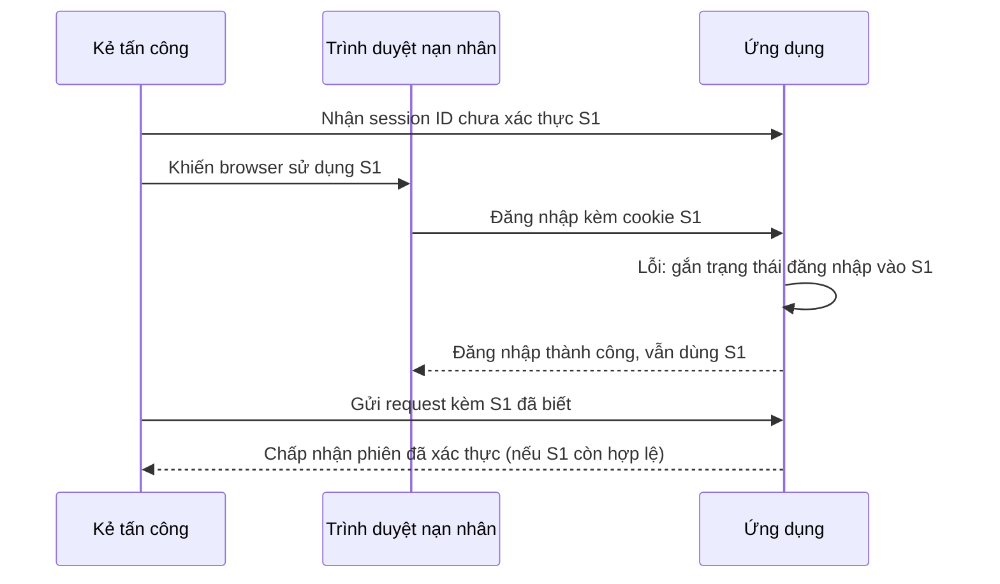
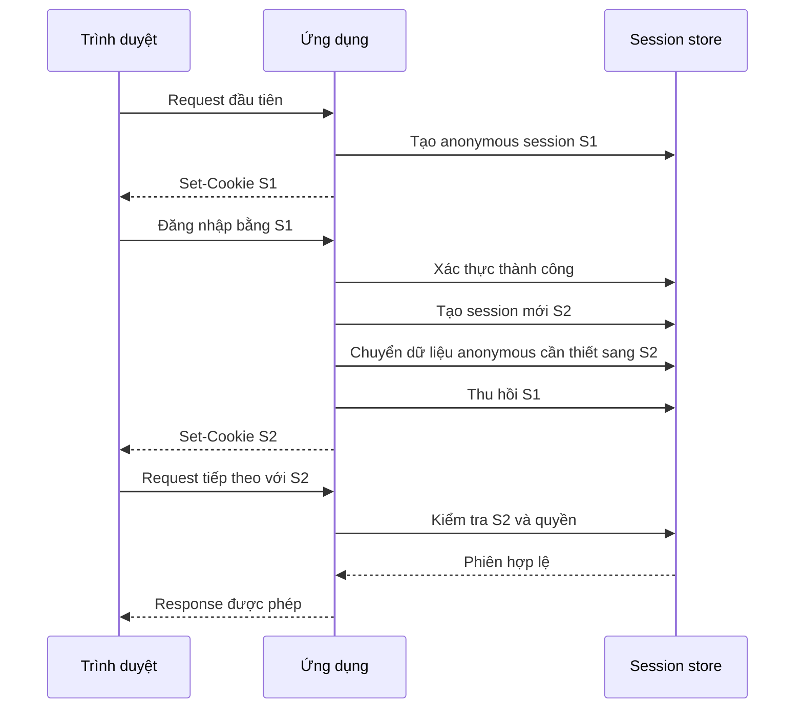

# Cookie fixation: ngăn kẻ tấn công cố định session ID của nạn nhân

## 1. Cookie fixation là gì?

**Session fixation** (cố định phiên) là kiểu tấn công trong đó kẻ tấn công khiến trình duyệt của nạn nhân sử dụng một session identifier (session ID) mà kẻ tấn công đã biết hoặc có thể dự đoán. Nếu ứng dụng tiếp tục sử dụng chính session ID đó sau khi nạn nhân đăng nhập, kẻ tấn công có thể dùng lại ID đã biết để truy cập phiên đã được xác thực.

Trong ứng dụng web, session ID thường được lưu trong cookie:

```http
Set-Cookie: sessionid=opaque-value; Path=/; Secure; HttpOnly; SameSite=Lax
```

Cookie giúp browser tự động gửi session ID tới server trong các request phù hợp. Điều này thuận tiện cho quản lý phiên, nhưng cũng tạo ra một yêu cầu quan trọng: **session ID trước đăng nhập không được tiếp tục trở thành session ID đã xác thực**.

Hãy hình dung tình huống:

1. Kẻ tấn công có được một session ID hợp lệ nhưng chưa đăng nhập, ví dụ một phiên ẩn danh.
2. Kẻ tấn công tìm cách khiến trình duyệt nạn nhân sử dụng session ID đó.
3. Nạn nhân đăng nhập vào ứng dụng.
4. Nếu server gắn trạng thái đăng nhập vào cùng session ID mà không thay ID, kẻ tấn công vẫn biết ID đó.
5. Kẻ tấn công gửi request với session ID đã biết; nếu phiên còn hiệu lực và server chấp nhận, tài khoản có thể bị truy cập trái phép.

**Điểm cốt lõi:** ứng dụng đã chuyển một định danh phiên mà bên tấn công biết từ trạng thái chưa xác thực sang trạng thái đã xác thực. Phòng vệ chính là **tạo session ID mới sau khi xác thực hoặc thay đổi mức đặc quyền, đồng thời vô hiệu hóa session ID cũ**.

Trong module `SECURITY_APPLICATION_SECURITY_BROWSER_SECURITY`, cookie fixation kết nối các khái niệm cookie scope, Domain, host-only, SameSite, HttpOnly, Secure và ranh giới tin cậy của trình duyệt. Thuộc tính cookie rất quan trọng, nhưng việc quản lý vòng đời session ở phía server mới là trọng tâm xử lý lỗi này.

### Kết quả học tập

Sau bài này, người học có thể:

1. Mô tả được luồng session fixation và phân biệt nó với session hijacking.
2. Nhận diện các nguồn khiến session ID bị cố định: URL, cookie injection, subdomain không tin cậy hoặc cơ chế quản lý phiên sai.
3. Giải thích tại sao chỉ bật `HttpOnly`, `Secure` hay `SameSite` chưa đủ.
4. Thiết kế quy trình rotate session ID sau login, MFA và thay đổi quyền.
5. Chọn cookie host-only với prefix `__Host-` khi phù hợp để giảm rủi ro từ subdomain.
6. Viết test xác nhận session ID trước và sau xác thực khác nhau, ID cũ không còn dùng được và phiên đăng xuất bị thu hồi.

## 2. Session ID và vòng đời của một phiên

Một ứng dụng thường có nhiều trạng thái:

| Trạng thái | Ví dụ | Quyền |
| --- | --- | --- |
| Chưa có phiên | Người dùng mới mở trang | Chưa có trạng thái phiên |
| Phiên ẩn danh | Giỏ hàng tạm, ngôn ngữ, bước đăng nhập | Không có quyền tài khoản |
| Đang xác thực | Đã nhập mật khẩu nhưng còn chờ MFA | Chưa được cấp đầy đủ quyền |
| Đã xác thực | Đăng nhập hoàn tất | Quyền theo tài khoản |
| Đã nâng quyền | Xác nhận MFA hoặc thao tác quản trị | Quyền cao hơn, cần ràng buộc lại phiên |
| Đã đăng xuất/hết hạn | Phiên bị thu hồi hoặc hết thời gian | Không được phép truy cập tài nguyên bảo vệ |

Server thường giữ một bản ghi session:

```text
session ID ──> session store
                ├── userId
                ├── authenticated = true/false
                ├── createdAt
                ├── lastActivityAt
                ├── authenticationLevel
                └── expiry / revocation state
```

Session ID nên là một chuỗi opaque, khó đoán, được tạo bằng bộ sinh số ngẫu nhiên mật mã (CSPRNG). Client không cần biết user ID, vai trò hoặc dữ liệu nhạy cảm bên trong session store; nó chỉ giữ một định danh tham chiếu.

Một session ID tốt cần:

- Có đủ entropy để không thể đoán bằng brute force thực tế.
- Không chứa thông tin cá nhân hoặc dữ liệu quyền hạn có thể suy luận.
- Được truyền qua HTTPS.
- Được server kiểm tra trạng thái còn hiệu lực ở mọi request cần xác thực.
- Có vòng đời rõ ràng: cấp phát, rotate, hết hạn, thu hồi và đăng xuất.

Nhiều framework đã cung cấp session middleware và session store. Ưu tiên dùng thư viện đã được duy trì, cấu hình an toàn và API rotate/regenerate chính thức thay vì tự viết thuật toán tạo ID hoặc tự parse session cookie.

## 3. Luồng session fixation

### 3.1. Sơ đồ tấn công khái quát



Sơ đồ mô tả một ứng dụng có lỗi quản lý phiên. Việc kẻ tấn công có thể khiến browser nạn nhân sử dụng ID đã biết phụ thuộc bề mặt tấn công và cấu hình ứng dụng; các kỹ thuật cụ thể có thể khác nhau. Lỗi thiết kế cốt lõi là server **không đổi session ID khi chuyển từ anonymous sang authenticated**.

### 3.2. Vòng đời đúng



Sau đăng nhập, session mới phải được phát hành an toàn. Server không được để session cũ tiếp tục truy cập cùng trạng thái đã xác thực. Nếu cần giữ giỏ hàng hoặc lựa chọn ngôn ngữ của phiên ẩn danh, chỉ chuyển những dữ liệu được phép sang session mới, rồi vô hiệu hóa ID cũ.

## 4. Phân biệt session fixation với session hijacking

Hai kiểu tấn công có thể dẫn đến hậu quả giống nhau nhưng khác điểm khởi đầu:

| Đặc điểm | Session fixation | Session hijacking |
| --- | --- | --- |
| Ý tưởng | Khiến nạn nhân sử dụng session ID mà kẻ tấn công đã biết | Lấy cắp hoặc chiếm quyền sử dụng session ID hợp lệ của nạn nhân |
| Thời điểm ID bị kẻ tấn công biết | Có thể biết trước khi nạn nhân đăng nhập | Thường sau khi phiên đã được tạo/xác thực |
| Lỗi chính thường gặp | Không rotate ID sau khi xác thực hoặc chấp nhận ID do client kiểm soát | Session ID bị lộ qua XSS, mạng không an toàn, log, thiết bị hoặc kênh khác |
| Phòng vệ trọng tâm | Regenerate ID khi xác thực/đổi quyền; không nhận ID từ nguồn không tin cậy | Bảo vệ bí mật session, TLS, XSS defense, cookie flags, phát hiện và thu hồi |

Một ứng dụng có thể gặp cả hai. Ví dụ, XSS có thể giúp kẻ tấn công thao túng cookie hoặc đánh cắp token; cookie Domain quá rộng có thể tạo điều kiện cho subdomain không tin cậy can thiệp. Vì vậy, cần vừa bảo vệ cách session ID được tạo và truyền, vừa quản lý vòng đời của nó đúng cách.

## 5. Các con đường dẫn tới session fixation

### 5.1. Session ID trong URL

Một số hệ thống cũ đưa session ID vào query string hoặc path:

```text
https://app.example.com/login?sessionid=known-value
https://app.example.com;jsessionid=known-value/profile
```

Nếu server chấp nhận session ID từ URL và dùng nó để khôi phục phiên, kẻ tấn công có thể gửi liên kết chứa ID đã biết. URL còn có thể bị ghi vào lịch sử trình duyệt, log server, analytics, bookmark hoặc header Referer tùy chính sách.

**Phòng vệ:** không dùng URL làm phương tiện vận chuyển session ID. Chỉ nhận session token qua cookie được cấu hình an toàn hoặc một cơ chế xác thực được thiết kế rõ ràng. Từ chối tham số session ID không mong đợi; không tự động ưu tiên session ID trong URL khi cookie cũng tồn tại.

### 5.2. Cookie injection từ subdomain

Giả sử ứng dụng đặt session cookie với Domain rộng:

```http
Set-Cookie: session=server-value; Domain=example.com; Path=/; Secure; HttpOnly; SameSite=Lax
```

Cookie có thể được gửi tới các subdomain phù hợp. Nếu một subdomain như `legacy.example.com` hoặc `preview.example.com` bị chiếm quyền, bên tấn công có thể tìm cách đặt cookie cùng tên cho parent domain hoặc tạo cookie gây nhập nhằng. Khi ứng dụng dùng cookie đó như session ID mà không rotate sau đăng nhập, rủi ro fixation tăng lên.

**Phòng vệ:** ưu tiên host-only cookie cho session. Với ứng dụng chạy trên HTTPS, cân nhắc prefix `__Host-` để browser yêu cầu `Secure`, `Path=/` và không có `Domain`. Kiểm kê subdomain, DNS/CNAME và dịch vụ bên thứ ba.

### 5.3. Session ID do client tự chọn

Nếu server cho phép client gửi một giá trị tùy ý và tạo/khôi phục session theo giá trị đó, session ID có thể bị đoán hoặc cố định. Ví dụ thiết kế sai:

```text
Nếu request có ?sid=...:
    dùng sid đó làm session ID
Nếu chưa có session:
    tạo session theo sid client gửi
```

Server phải tự sinh session ID bằng CSPRNG và kiểm soát việc cấp phát. Không cho client tự chọn định danh phiên, kể cả khi giá trị có định dạng giống token ngẫu nhiên.

### 5.4. Không rotate sau login hoặc nâng quyền

Ngay cả khi server tự tạo ID ngẫu nhiên ban đầu, ứng dụng vẫn dễ bị fixation nếu giữ ID đó sau khi người dùng đăng nhập. Rủi ro cũng xuất hiện khi:

- Người dùng hoàn thành MFA.
- Tài khoản chuyển sang vai trò quản trị.
- Người dùng xác nhận lại mật khẩu để thực hiện thao tác nhạy cảm.
- Session ẩn danh được chuyển thành session tài khoản.
- Quy trình đăng nhập liên kết (federated login) hoàn tất.

Rotate session ID tại ranh giới thay đổi trạng thái xác thực hoặc đặc quyền, không chỉ khi người dùng nhập mật khẩu lần đầu.

## 6. Cookie flags giúp gì và không giúp gì?

Cookie flags làm giảm một số bề mặt tấn công, nhưng không thay thế việc regenerate session ID.

| Thuộc tính | Vai trò | Giới hạn đối với fixation |
| --- | --- | --- |
| `Secure` | Chỉ gửi cookie qua kết nối an toàn theo quy tắc browser | Không ngăn subdomain HTTPS không tin cậy cố đặt cookie Domain rộng |
| `HttpOnly` | Không cho JavaScript đọc cookie qua `document.cookie` | Không ngăn browser gửi cookie; không sửa lỗi server giữ nguyên session ID |
| `SameSite` | Hạn chế gửi cookie trong một số ngữ cảnh cross-site | Không ngăn mọi nguồn cùng site hoặc cookie injection; không thay thế session rotation |
| `Domain` | Xác định phạm vi host nhận cookie | Domain rộng làm tăng host có thể nhận và có thể đặt cookie cùng tên |
| `Path` | Giới hạn request path mà cookie được gửi tới | Không phải ranh giới bảo mật mạnh và không ngăn session fixation |
| Prefix `__Host-` | Buộc host-only cookie với Secure và Path root ở browser hỗ trợ | Giảm cookie injection từ subdomain, nhưng server vẫn phải rotate ID |

### 6.1. Cấu hình session cookie khuyến nghị

Với ứng dụng HTTPS trên một host, có thể dùng:

```http
Set-Cookie: __Host-session=<opaque-random-id>; Path=/; Secure; HttpOnly; SameSite=Lax
```

Các điểm cần lưu ý:

- Không có `Domain`, nên cookie là host-only.
- `__Host-` yêu cầu `Secure`, `Path=/` và không khai báo `Domain` trên browser hỗ trợ prefix.
- `HttpOnly` giảm nguy cơ JavaScript đọc trực tiếp session cookie.
- `SameSite=Lax` là lựa chọn thường gặp; ứng dụng cần đánh giá luồng đăng nhập, điều hướng và CSRF để chọn chính sách phù hợp.
- Session ID phải được server tạo mới sau đăng nhập và các lần nâng quyền.

Nếu ứng dụng thật sự cần chia sẻ phiên giữa nhiều subdomain, phải đánh giá kiến trúc và rủi ro từng host. Đừng bỏ prefix `__Host-` hoặc mở rộng Domain chỉ để giải quyết nhanh vấn đề chia sẻ session.

## 7. Quy trình phòng vệ phía server

### 7.1. Trước khi xác thực

- Chỉ server tạo session ID bằng CSPRNG.
- Không nhận session ID qua URL, hidden form field hoặc tham số do client chọn.
- Không tái sử dụng một ID do người dùng cung cấp để tạo phiên mới.
- Nếu tạo anonymous session, chỉ gắn các dữ liệu chưa nhạy cảm và giới hạn quyền của phiên đó.
- Cookie phải có phạm vi hẹp và flags phù hợp.

### 7.2. Khi xác thực thành công

Một luồng đăng nhập an toàn:

1. Kiểm tra thông tin đăng nhập và các bước xác thực cần thiết.
2. Tạo session ID mới bằng session manager/framework.
3. Gắn danh tính người dùng và authentication level vào session mới.
4. Chuyển dữ liệu anonymous hợp lệ nếu nghiệp vụ cần.
5. Thu hồi session ID cũ; bảo đảm ID cũ không thể truy cập trạng thái đã xác thực.
6. Gửi cookie mới qua `Set-Cookie` với flags phù hợp.

Việc rotate và thu hồi nên được thực hiện như một thao tác nhất quán trong session store. Tránh khoảng thời gian mà cả ID cũ và ID mới đều có thể dùng để truy cập cùng phiên đã xác thực.

### 7.3. Khi nâng quyền hoặc thay đổi trạng thái nhạy cảm

Rotate hoặc tái cấp session sau các mốc:

- Hoàn thành MFA hoặc xác thực step-up.
- Chuyển từ tài khoản người dùng sang quyền quản trị.
- Thay đổi mật khẩu, email bảo mật hoặc phương thức xác thực.
- Liên kết hoặc gỡ bỏ tài khoản bên ngoài.
- Hoàn tất quy trình đăng nhập qua nhà cung cấp định danh.

Mục tiêu là không để một session ID có từ trạng thái đặc quyền thấp tiếp tục đại diện cho trạng thái đặc quyền cao.

### 7.4. Khi đăng xuất hoặc thu hồi phiên

Đăng xuất cần:

1. Vô hiệu hóa session ở server hoặc đánh dấu token không còn hiệu lực.
2. Xóa cookie trên browser bằng header `Set-Cookie` có cùng tên và phạm vi host-only/Domain, Path phù hợp.
3. Thu hồi các refresh token hoặc session liên quan nếu chính sách yêu cầu.
4. Đảm bảo request dùng ID cũ bị từ chối.

Chỉ xóa cookie phía browser mà không thu hồi session ở server là chưa đủ: bản sao session ID đã bị lộ vẫn có thể tiếp tục dùng cho tới khi hết hạn.

## 8. Ví dụ triển khai: rotate session sau đăng nhập

Ví dụ dưới đây mô tả **luồng xử lý**, không phụ thuộc framework cụ thể. Tên hàm là minh họa; trong ứng dụng thật, sử dụng API regenerate/rotate chính thức của thư viện session đang dùng.

```js
async function completeLogin(req, res, credentials) {
  const user = await verifyCredentials(credentials);
  if (!user) {
    return res.status(401).json({ error: "invalid_credentials" });
  }

  // Không tiếp tục dùng session ID anonymous hiện tại.
  const previousSessionId = req.session?.id;

  // API minh họa: tạo session ID mới bằng CSPRNG.
  const newSession = await sessionStore.create({
    userId: user.id,
    authenticated: true,
    authenticationLevel: "password",
    createdAt: Date.now()
  });

  // Chỉ chuyển dữ liệu anonymous đã được kiểm tra.
  await migrateAllowedAnonymousData(previousSessionId, newSession.id);

  // Thu hồi ID cũ; ID cũ không được ánh xạ tới session đã đăng nhập.
  if (previousSessionId) {
    await sessionStore.revoke(previousSessionId);
  }

  res.setHeader(
    "Set-Cookie",
    "__Host-session=" + newSession.id + "; Path=/; Secure; HttpOnly; SameSite=Lax"
  );
  return res.json({ authenticated: true });
}
```

**Các điểm cần điều chỉnh trong triển khai thật:**

- Dùng session manager có hỗ trợ regenerate ID và xử lý lỗi/rollback rõ ràng.
- Đảm bảo thao tác tạo session mới và thu hồi session cũ không tạo trạng thái nửa vời.
- Không log session ID hoặc ghi nó vào analytics.
- Không chuyển dữ liệu quyền hạn hoặc trạng thái xác thực từ anonymous session.
- Cấu hình cookie tại một nơi duy nhất để tránh response ghi đè nhiều `Set-Cookie` ngoài ý muốn.
- Không gửi session ID trong response JSON; browser nhận cookie qua header.

### 8.1. Ví dụ middleware/framework

Trong framework có session middleware, hãy tìm API được tài liệu chính thức cung cấp cho thao tác regenerate/rotate. Ví dụ pseudocode:

```js
await session.regenerate();
session.userId = user.id;
session.authenticated = true;
await session.save();
```

Không giả định mọi thư viện đều có đúng tên hàm hoặc cùng semantics. Cần xác nhận rằng:

- Session ID mới thật sự được tạo.
- Session cũ bị vô hiệu hóa hoặc không còn ánh xạ tới trạng thái đăng nhập.
- Cookie mới được phát hành.
- Dữ liệu anonymous chỉ được chuyển theo allowlist.
- Nếu lưu session phân tán, mọi node đều thấy trạng thái thu hồi nhất quán.

## 9. Session fixation trong hệ thống dùng JWT

JWT thường được dùng như bearer token và có thể được lưu trong cookie. Dù không dùng session store truyền thống, rủi ro fixation vẫn có thể xuất hiện nếu ứng dụng chấp nhận token do client cung cấp hoặc giữ nguyên token có trước khi xác thực.

Các nguyên tắc:

- Server phát hành token mới sau khi xác thực; không nâng quyền một token anonymous do client chọn.
- Token phải có chữ ký hợp lệ, issuer/audience/expiry được kiểm tra và thuật toán được cấu hình an toàn.
- Không đặt JWT vào URL hoặc log.
- Nếu cần thu hồi trước `exp`, dùng cơ chế revocation như `jti` denylist, token version hoặc refresh-token rotation tùy kiến trúc.
- Nếu token được lưu trong cookie, vẫn cấu hình `Secure`, `HttpOnly`, `SameSite` và phòng vệ CSRF tương ứng.

JWT tự chứa có thể khó thu hồi hơn session ID tham chiếu tới server-side store. Đừng coi chữ ký JWT là biện pháp chống fixation; chữ ký chỉ chứng minh token được phát hành bởi bên có khóa phù hợp và nội dung chưa bị sửa theo thuật toán đã xác minh.

## 10. Các biện pháp bổ sung

### 10.1. TLS và HSTS

HTTPS bảo vệ cookie trên đường truyền và giảm nguy cơ bị quan sát hoặc sửa đổi bởi bên trung gian. `Secure` giới hạn cookie trên kết nối an toàn; HSTS yêu cầu browser dùng HTTPS cho host trong thời hạn chính sách. Các biện pháp này giúp bảo vệ vận chuyển nhưng **không thay thế rotate session ID**.

### 10.2. Session ID entropy và thời hạn

- Dùng CSPRNG và session ID có entropy đủ lớn (hướng dẫn phổ biến yêu cầu ít nhất 64 bit entropy); thiết kế mới thường chọn 128 bit ngẫu nhiên hoặc hơn cho ID opaque.
- Áp dụng idle timeout và absolute timeout phù hợp với mức nhạy cảm.
- Thu hồi session sau đăng xuất, đổi mật khẩu hoặc sự kiện rủi ro theo chính sách.
- Không tái sử dụng session ID đã thu hồi.

Timeout giảm thời gian khai thác nếu ID bị lộ, nhưng không sửa lỗi fixation trong thời gian session còn hiệu lực.

### 10.3. Giám sát và phát hiện

Có thể ghi nhận sự kiện bảo mật mà không ghi session ID thô:

- Session ID bị rotate sau login/MFA/step-up.
- Đăng nhập mới trên một phiên đã tồn tại.
- Request dùng session đã thu hồi hoặc session cũ.
- Session bất thường theo chính sách phát hiện rủi ro.

Khi cần liên kết log, dùng mã tham chiếu không thể dùng làm bearer credential; không đưa cookie hoặc token vào log ứng dụng, trace, URL hay hệ thống analytics.

Không dựa vào IP hoặc User-Agent binding như lớp chống fixation duy nhất. Người dùng di động, proxy, mạng doanh nghiệp và browser update có thể làm các giá trị này thay đổi; chúng có thể là tín hiệu rủi ro phụ trợ, không phải định danh chắc chắn.

## 11. Thực hành kiểm chứng session rotation

Thực hành trên ứng dụng thử nghiệm do bạn kiểm soát, dùng tài khoản giả và session store riêng. Mục tiêu là kiểm tra **vòng đời session**, không cần triển khai kỹ thuật cố định cookie trên trình duyệt người khác.

### 11.1. Chuẩn bị

Tạo ba endpoint thử nghiệm:

| Endpoint | Hành vi |
| --- | --- |
| `GET /session` | Tạo hoặc trả anonymous session |
| `POST /login` | Xác thực tài khoản giả và rotate session |
| `POST /logout` | Thu hồi session hiện tại và xóa cookie |

Session store cần hỗ trợ tra cứu ID và trạng thái active/revoked. Mọi ID phải được sinh phía server bằng CSPRNG. Không chấp nhận tham số `sid` từ query, path hoặc form.

### 11.2. Ma trận kiểm thử

| Mã | Thao tác | Kết quả kỳ vọng |
| --- | --- | --- |
| FIX-01 | Gọi `GET /session` lần đầu | Server tạo anonymous session S1 |
| FIX-02 | Đăng nhập thành công bằng S1 | Server phát hành S2 khác S1 |
| FIX-03 | Gửi request bảo vệ bằng S2 | Server xác nhận danh tính và cho phép theo quyền |
| FIX-04 | Gửi request bảo vệ bằng S1 | Server từ chối vì S1 đã bị thu hồi hoặc chưa xác thực |
| FIX-05 | Đăng nhập sai | Không nâng quyền anonymous session; không tạo trạng thái authenticated |
| FIX-06 | Hoàn thành MFA | Session được rotate hoặc nâng authentication level theo chính sách |
| FIX-07 | Đăng xuất bằng S2 | Server thu hồi S2 và browser nhận cookie hết hạn |
| FIX-08 | Gửi lại request bằng S2 sau logout | Server từ chối |
| FIX-09 | Gửi `?sid=known-value` | Server bỏ qua hoặc từ chối tham số session ID; không dùng nó làm ID |
| FIX-10 | Đặt cookie cùng tên từ subdomain trong môi trường lab | Cookie session host-only/prefix `__Host-` của ứng dụng không bị thay bằng domain cookie do subdomain đặt |

### 11.3. Quan sát bằng DevTools

1. Mở DevTools → **Application/Storage → Cookies**.
2. Gọi `GET /session`; ghi nhận tên cookie và session ID S1 trong môi trường lab (không đưa ID thật vào báo cáo).
3. Đăng nhập; kiểm tra response có `Set-Cookie` mới và browser lưu ID khác S1.
4. Mở Network, kiểm tra request sau đăng nhập gửi ID mới.
5. Trong môi trường test server-side, gửi lại S1 và xác nhận server từ chối.
6. Đăng xuất, kiểm tra cookie bị xóa và session store đã thu hồi ID.

Trong production, DevTools có thể hiển thị cookie để người dùng kiểm tra, nhưng không chụp hoặc chia sẻ giá trị session thật. Khi lập báo cáo, chỉ ghi “ID đã đổi/không đổi” hoặc dùng giá trị giả đã che.

### 11.4. Pseudocode cho test tự động

```js
describe("session fixation defenses", () => {
  it("rotates the anonymous session and revokes old IDs", async () => {
    const anonymous = await client.get("/session");
    const oldId = readCookie(anonymous, "__Host-session");

    const login = await client.post("/login", validTestCredentials);
    const newId = readCookie(login, "__Host-session");

    expect(newId).toBeTruthy();
    expect(newId).not.toBe(oldId);
    const response = await requestWithSession(oldId, "/account");
    expect(response.status).toBe(401);

    await client.post("/logout");
    const logoutCheck = await requestWithSession(newId, "/account");
    expect(logoutCheck.status).toBe(401);
  });
});
```

Đây là pseudocode vì API test client, cách đọc `Set-Cookie` và cách tạo request riêng phụ thuộc framework. Trong test thật, cần giữ `oldId` và `newId` trong scope của test, kiểm tra session store và đảm bảo các request dùng cookie chính xác.

## 12. Những sai lầm thường gặp

| Nhận định sai | Cách hiểu đúng |
| --- | --- |
| “Cookie có HttpOnly thì không thể bị fixation.” | HttpOnly hạn chế JavaScript đọc cookie; không bảo đảm session ID được rotate |
| “Secure ngăn mọi cách đặt cookie giả.” | Secure bảo vệ việc gửi qua kết nối không an toàn; subdomain HTTPS không tin cậy vẫn có thể là bề mặt cookie injection nếu Domain rộng |
| “SameSite=Strict là đủ.” | SameSite không ngăn mọi nguồn same-site và không sửa lỗi server tái sử dụng ID |
| “Session ID ngẫu nhiên thì không cần đổi sau login.” | ID có thể đã bị kẻ tấn công biết trước; cần rotate tại ranh giới xác thực |
| “Chỉ cần xóa cookie khi đăng xuất.” | Phải thu hồi session phía server; bản sao ID cũ vẫn có thể dùng |
| “Có thể gửi session ID trong URL để tương thích.” | URL dễ lọt vào history, logs, referrer và liên kết; không dùng làm kênh session |
| “Domain cookie giúp mọi subdomain dùng chung phiên an toàn.” | Domain rộng tăng số host nhận cookie và rủi ro từ subdomain không tin cậy |
| “JWT có chữ ký nên không thể fixation.” | Chữ ký không thay thế phát hành token mới, quản lý vòng đời và thu hồi |
| “IP/User-Agent binding là đủ.” | Các giá trị này thay đổi và chỉ nên là tín hiệu phụ trợ |
| “Rotate ID nhưng vẫn để ID cũ hoạt động.” | ID cũ phải bị thu hồi hoặc không còn quyền truy cập trạng thái đã xác thực |

## 13. Tình huống tổng hợp: ứng dụng có anonymous cart và đăng nhập

**Bối cảnh:** cửa hàng trực tuyến tạo anonymous session để lưu giỏ hàng. Người dùng có thể đăng nhập bằng mật khẩu và hoàn thành MFA. Session cookie hiện tại là domain cookie `Domain=example.com`, dùng chung cho `shop.example.com`, `api.example.com` và `preview.example.com`.

Hãy thiết kế lại:

1. Tách anonymous cart state khỏi trạng thái xác thực; không để anonymous session có quyền tài khoản.
2. Chọn cookie host-only cho ứng dụng nếu kiến trúc cho phép; cân nhắc `__Host-session` với `Secure; HttpOnly; Path=/`.
3. Sau khi mật khẩu hợp lệ, tạo session mới; sau MFA, rotate hoặc nâng authentication context theo chính sách và thu hồi phiên cũ.
4. Chỉ chuyển cart items đã validate sang session mới; không chuyển role, user ID hoặc cờ authenticated từ client.
5. Thu hồi phiên cũ và kiểm tra nó không thể truy cập endpoint tài khoản.
6. Khi đăng xuất, revoke server-side và xóa cookie đúng phạm vi.
7. Kiểm tra các subdomain preview/upload/legacy có thể nhận hoặc đặt cookie hay không.
8. Bổ sung CSRF protection cho thao tác thay đổi trạng thái; SameSite chỉ là lớp giảm thiểu bổ sung.

### Mẫu báo cáo

| Tài sản | Rủi ro | Biện pháp | Bằng chứng |
| --- | --- | --- | --- |
| Anonymous session | ID bị cố định trước đăng nhập | Cấp ID từ server, giới hạn quyền, không nhận ID từ URL | S1 được tạo ngẫu nhiên |
| Phiên sau login | Kẻ tấn công biết S1 nhưng dùng được sau login | Rotate S1 → S2 và revoke S1 | S2 khác S1; request S1 bị 401 |
| Phiên sau MFA | ID đặc quyền thấp tiếp tục đại diện quyền cao | Rotate hoặc cập nhật authentication context có kiểm soát | Session trước step-up bị vô hiệu |
| Cookie session | Subdomain nhận hoặc ghi đè cookie | Host-only, prefix `__Host-`, rà soát subdomain | Cookie không gửi sang host khác |
| Logout | Bản sao session ID còn hiệu lực | Revoke server-side và expire cookie | Request dùng ID cũ bị từ chối |

### Tiêu chí hoàn thành

Một thiết kế đạt yêu cầu khi:

- Session ID do server sinh, không do client lựa chọn.
- Session ID mới được cấp sau đăng nhập và các lần nâng quyền cần thiết.
- ID cũ không thể truy cập trạng thái đã xác thực.
- Cookie có phạm vi và flags phù hợp với kiến trúc.
- Đăng xuất thu hồi session ở server.
- Các endpoint nhạy cảm vẫn có xác thực, phân quyền và CSRF protection.
- Có test tự động hoặc bằng chứng kiểm thử cho từng điều kiện.

## 14. Checklist phòng chống cookie fixation

- [ ] Không nhận session ID từ URL, query, path hoặc hidden form field.
- [ ] Server tự sinh ID bằng CSPRNG, đủ entropy và opaque.
- [ ] Rotate session ID sau login thành công.
- [ ] Rotate hoặc tái cấp phiên khi hoàn thành MFA/step-up hoặc nâng quyền.
- [ ] Thu hồi session ID cũ sau rotation.
- [ ] Chỉ chuyển dữ liệu anonymous được allowlist sang phiên mới.
- [ ] Dùng HTTPS, cookie `Secure`, `HttpOnly`, `SameSite` phù hợp.
- [ ] Ưu tiên host-only cookie; cân nhắc prefix `__Host-`.
- [ ] Tránh Domain rộng nếu không có nhu cầu chia sẻ thực sự.
- [ ] Không để session ID xuất hiện trong URL, logs, analytics hoặc referrer.
- [ ] Có idle timeout, absolute timeout và cơ chế revoke.
- [ ] Đăng xuất phải vô hiệu hóa session ở server và xóa cookie đúng phạm vi.
- [ ] Kiểm thử ID cũ bị từ chối sau login, MFA và logout.

### Ghi nhớ

**Cookie fixation xảy ra khi ứng dụng để một session ID mà kẻ tấn công biết trước tiếp tục đại diện cho phiên đã xác thực của nạn nhân.** Phòng vệ quyết định là server tạo ID mới sau đăng nhập và các thay đổi đặc quyền, thu hồi ID cũ và không chấp nhận ID do client kiểm soát. Cookie `Secure`, `HttpOnly`, `SameSite`, host-only và prefix `__Host-` giúp thu hẹp bề mặt tấn công, nhưng không thay thế quản lý vòng đời session. Xác thực, phân quyền, CSRF protection và thu hồi phiên vẫn phải được thực hiện ở phía server.
