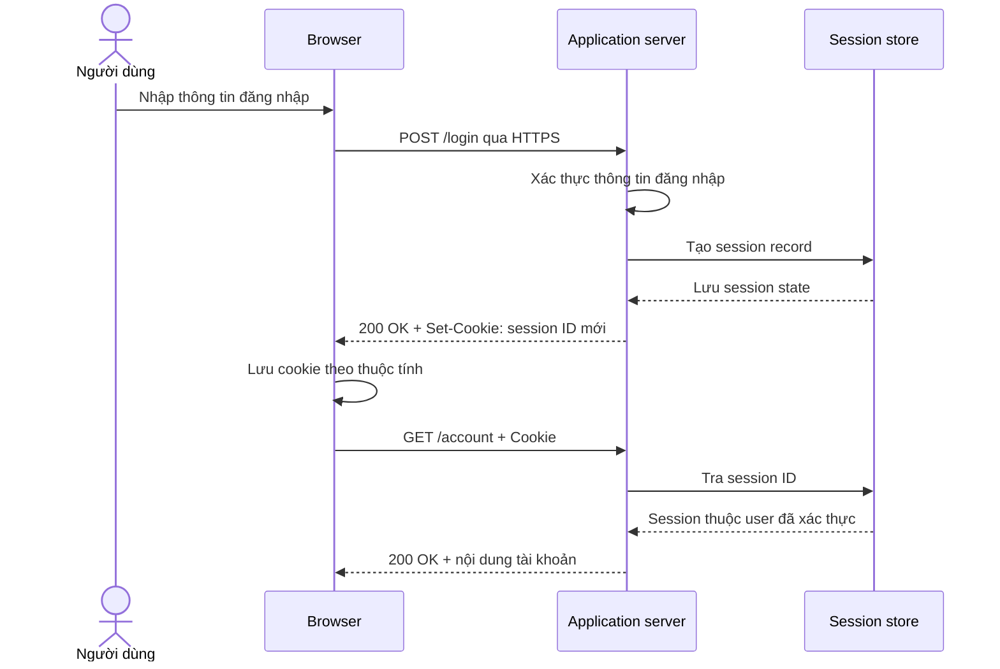
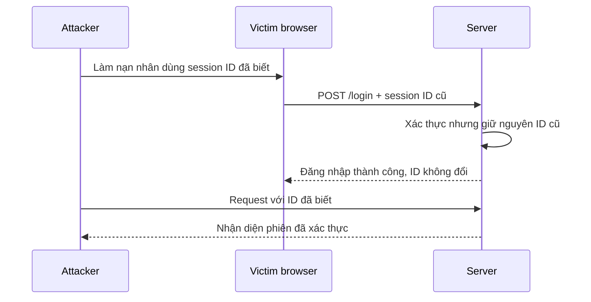

# Session identifier

**Session identifier (session ID)** là một giá trị định danh ngẫu nhiên mà browser gửi lại trong các request tiếp theo để server nhận ra những request thuộc cùng một phiên làm việc. Trong mô hình session phía server, browser giữ session ID (thường trong cookie), còn server giữ trạng thái phiên như người dùng đã xác thực, thời điểm tạo, thời điểm hoạt động gần nhất và các thông tin cần thiết cho phiên.

Session ID thường là **bearer credential**: ai có được giá trị hợp lệ có thể thử sử dụng phiên tương ứng. Vì vậy nó phải khó đoán, được truyền qua kênh bảo mật, không bị lộ trong URL/log và được thu hồi khi phiên kết thúc hoặc có sự kiện bảo mật. Session ID không phải user ID, không phải mật khẩu và không nên chứa thông tin nghiệp vụ có thể đọc trực tiếp.

Bài học thuộc chương **Session trên browser** trong module **Browser Security** (`SECURITY_APPLICATION_SECURITY_BROWSER_SECURITY`). Nội dung phân tích ranh giới giữa browser, origin, cookie và ứng dụng web; liên hệ session identifier với Same-Origin Policy, CORS, cookie, XSS, CSRF và các cơ chế bảo vệ trình duyệt.

## 1. Mục tiêu học tập

Sau bài này, bạn có thể:

1. Giải thích session ID dùng để nối các HTTP request stateless thành một phiên làm việc.
2. Phân biệt session ID, user ID, password, CSRF token và access token.
3. Thiết kế session ID có entropy cao bằng bộ sinh số ngẫu nhiên mật mã (CSPRNG).
4. Mô tả cách browser lưu và gửi session ID qua cookie, cùng vai trò của `Secure`, `HttpOnly`, `SameSite` và `Path`.
5. Phòng session fixation bằng cách tạo session ID mới sau đăng nhập và khi nâng quyền.
6. Thiết kế timeout, logout, thu hồi phiên và xử lý sự cố lộ session ID.
7. Phân tích quan hệ giữa session cookie, XSS, CSRF và chính sách origin/site.
8. Thực hành tạo, kiểm tra, xoay vòng và hủy session ID bằng Node.js.

## 2. Vì sao ứng dụng cần session identifier?

HTTP cơ bản là giao thức không lưu trạng thái giữa hai request. Mỗi request độc lập về mặt giao thức; server không tự biết request tiếp theo đến từ cùng người dùng đã đăng nhập hay một client khác.

Ví dụ người dùng đăng nhập rồi mở trang đơn hàng:

1. Browser gửi thông tin xác thực tới server qua HTTPS.
2. Server xác minh thông tin đăng nhập.
3. Server tạo một session record và một session ID ngẫu nhiên.
4. Server trả session ID cho browser, thường bằng `Set-Cookie`.
5. Browser lưu cookie và tự gửi lại trong các request phù hợp.
6. Server tra session ID, tìm session record và xác định phiên tương ứng với người dùng.



Session ID là chìa khóa để server tra trạng thái phiên; **dữ liệu quyền và trạng thái thực tế được quản lý ở server**. Browser chỉ giữ giá trị định danh cần gửi lại.

### 2.1. Ví dụ session record phía server

Một session record có thể gồm:

| Trường | Ý nghĩa |
| --- | --- |
| `sessionKeyHash` | Hash của session ID dùng làm khóa tra cứu |
| `userId` | Người dùng gắn với phiên |
| `createdAt` | Thời điểm tạo phiên |
| `lastSeenAt` | Thời điểm hoạt động hợp lệ gần nhất |
| `expiresAt` | Thời điểm hết hạn tuyệt đối |
| `authenticationLevel` | Mức xác thực, ví dụ đã qua MFA hay chưa |
| `revokedAt` | Thời điểm phiên bị thu hồi nếu có |

Không cần đưa toàn bộ hồ sơ người dùng, mật khẩu, thông tin thanh toán hoặc quyền nhạy cảm vào session ID. Những dữ liệu cần thiết có thể được lưu trong session store hoặc truy xuất từ hệ thống quản lý danh tính theo chính sách.

## 3. Session ID khác gì các loại định danh khác?

| Giá trị | Mục đích | Có phải bí mật không? | Vai trò |
| --- | --- | --- | --- |
| **User ID** | Định danh tài khoản/người dùng | Thường không phải bí mật xác thực | Cho biết đối tượng nào đang được tham chiếu |
| **Session ID** | Tham chiếu tới một phiên đã được server tạo | **Có**; thường là bearer credential | Chứng minh client đang nắm giá trị phiên hợp lệ |
| **Password** | Bí mật dùng để xác thực người dùng | **Có** | Dùng ở bước đăng nhập; không nên gửi lại ở mọi request |
| **CSRF token** | Chứng minh request thay đổi trạng thái thuộc luồng được ứng dụng cho phép | Cần bảo vệ theo thiết kế; không thay session | Bổ sung chống request giả mạo khi browser tự gửi cookie |
| **Access token** | Credential cho phép truy cập API theo scope/audience/thời hạn | **Có** | Có thể là opaque token hoặc token tự chứa như JWT |
| **Refresh token** | Credential dùng để lấy access token mới | **Có**, thường có vòng đời dài và rủi ro cao | Duy trì đăng nhập theo cơ chế cấp token |

Session ID và user ID không được dùng thay thế nhau. Nếu cookie chứa `user_id=42` và server tin giá trị đó để cấp quyền, người dùng có thể sửa cookie thành ID khác. Một session ID ngẫu nhiên phải được tra cứu ở server; server tự xác định người dùng gắn với phiên.

### 3.1. Session ID là bearer credential

Trong mô hình session cookie, ai gửi được session ID còn hiệu lực có thể được server xem là đang sử dụng phiên đó, trừ khi có thêm cơ chế kiểm tra. Vì thế việc lộ session ID có thể tương đương với việc lộ quyền sử dụng phiên đăng nhập.

Các nguồn rò rỉ thường gặp:

- URL, query string hoặc fragment bị lưu trong browser history, server/proxy log, analytics và `Referer`.
- Log request/response, log debug, crash report hoặc công cụ giám sát ghi lại cookie/header.
- JavaScript độc hại do XSS đọc cookie nếu cookie không có HttpOnly, hoặc thao tác thay người dùng dù cookie đã có HttpOnly.
- Máy tính dùng chung, extension độc hại, malware, bản sao lưu hoặc ảnh chụp màn hình.
- Kết nối không bảo vệ, cấu hình TLS sai hoặc endpoint cho phép downgrade.

Không bao giờ đưa session ID vào URL:

```text
Không an toàn:
https://app.example.com/account?session_id=abc123

Thiết kế phù hợp hơn:
Set-Cookie: __Host-session=<opaque-random-value>; Path=/; Secure; HttpOnly; SameSite=Lax
```

Cookie cũng cần được bảo vệ khỏi log: không ghi giá trị Cookie hoặc Set-Cookie đầy đủ vào log ứng dụng, reverse proxy, APM và hệ thống hỗ trợ.

## 4. Tạo session ID an toàn

### 4.1. Dùng CSPRNG

Session ID cần được tạo bằng **cryptographically secure pseudorandom number generator (CSPRNG)**. Không dùng:

- `Math.random()` trong JavaScript.
- Timestamp, số thứ tự tăng dần hoặc ID database làm session ID.
- User ID, email, username hoặc thông tin có thể suy đoán.
- Hash của dữ liệu dễ đoán như user ID + thời gian.
- UUID/ID ngẫu nhiên từ thư viện không rõ nguồn entropy hoặc không bảo đảm dùng CSPRNG.

Ví dụ với Node.js:

```js
import { randomBytes } from 'node:crypto';

const sessionId = randomBytes(32).toString('base64url');
console.log(sessionId);
```

`randomBytes(32)` tạo 32 byte ngẫu nhiên, tương đương **256 bit entropy** nếu nguồn ngẫu nhiên của hệ điều hành hoạt động đúng. Base64url giúp biểu diễn giá trị trong cookie an toàn hơn so với chuỗi có ký tự phân cách đặc biệt.

OWASP khuyến nghị session ID tùy biến cần có ít nhất 64 bit entropy; trong thiết kế mới, dùng 128 bit trở lên là lựa chọn thực tế tốt. 32 byte ngẫu nhiên cung cấp biên an toàn rộng hơn. Độ dài chuỗi không tự chứng minh entropy: ID dài nhưng được tạo từ timestamp vẫn dễ đoán.

### 4.2. Session ID phải opaque

Session ID nên là một chuỗi ngẫu nhiên không mang ý nghĩa nghiệp vụ. Ví dụ:

```text
Tránh:
session=user-42-admin
session=alice-2026-11-22
session=role_admin_42

Nên dùng:
session=<chuỗi ngẫu nhiên CSPRNG>
```

Server giữ quan hệ session ID → session record. Không mã hóa user ID hoặc role vào cookie rồi tin nội dung đó nếu không có cơ chế xác thực toàn vẹn phù hợp. Ngay cả khi dùng token có chữ ký, cần hiểu rõ xác thực chữ ký, audience, expiration, rotation và revocation.

### 4.3. Có nên lưu session ID dạng hash ở server?

Một lựa chọn phòng thủ là lưu **hash của session ID** trong session store thay vì lưu raw ID:

1. Browser nhận raw session ID.
2. Server tính SHA-256 của giá trị nhận được.
3. Server tra cứu session record bằng hash.
4. Database chỉ lưu hash; nếu dữ liệu session store bị đọc trái phép, attacker không lập tức có raw bearer value từ cột này.

Session ID phải có entropy cao thì hash thông thường như SHA-256 phù hợp cho tra cứu; đây không phải tình huống password yếu cần password hashing chậm. Cách lưu hash không bảo vệ nếu attacker kiểm soát ứng dụng, lấy được raw cookie từ request hoặc có quyền thực thi code trong server.

## 5. Browser lưu session ID trong cookie

Trong ứng dụng web truyền thống, session ID thường được trả bằng response header:

```http
HTTP/1.1 200 OK
Set-Cookie: __Host-session=<opaque-random-value>; Path=/; Secure; HttpOnly; SameSite=Lax
Cache-Control: no-store
```

Các thuộc tính:

| Thuộc tính | Vai trò | Lưu ý |
| --- | --- | --- |
| `Secure` | Chỉ gửi cookie qua kết nối an toàn theo quy tắc browser | Production phải dùng HTTPS |
| `HttpOnly` | Ngăn JavaScript đọc cookie qua `document.cookie` | Không ngăn XSS gửi request trong phiên |
| `SameSite=Lax` | Hạn chế cookie trong một số ngữ cảnh cross-site | Chọn Lax/Strict/None theo luồng sản phẩm; không thay CSRF token trong mọi tình huống |
| `Path=/` | Cho phép cookie gửi tới mọi path trên host phù hợp | Không phải biên giới bảo mật |
| Không có `Domain` | Tạo host-only cookie | Hạn chế cookie được gửi tới các subdomain khác |
| Tiền tố `__Host-` | Yêu cầu Secure, Path=/ và không có Domain ở browser hỗ trợ | Giúp giảm rủi ro cookie bị mở rộng phạm vi domain |

### 5.1. Vì sao không lưu session ID trong localStorage?

`localStorage` cho phép JavaScript cùng origin đọc dữ liệu. Nếu ứng dụng bị XSS, script độc hại có thể đọc session token lưu ở đó và gửi ra ngoài. Cookie HttpOnly giảm khả năng đánh cắp trực tiếp session ID bằng JavaScript.

Tuy nhiên cookie được browser tự động đính kèm theo request phù hợp, nên tạo ra rủi ro **CSRF**. Chọn cookie HttpOnly không loại bỏ XSS: script độc hại vẫn có thể thực hiện thao tác trong phiên đang mở và đọc dữ liệu mà ứng dụng cho phép.

Không có nơi lưu trữ client-side nào tự giải quyết mọi rủi ro. Hãy xác định mô hình đe dọa, bảo vệ XSS, CSRF, quyền API và vòng đời session.

### 5.2. Cookie không phải session store

Cookie chỉ mang session identifier. Trạng thái phiên, danh tính, quyền và thời hạn cần được server quản lý. Nếu browser sửa cookie thành một chuỗi khác, server phải từ chối vì không tìm được session record hợp lệ.

Không gửi dữ liệu quyền hoặc PII trong session ID. Không xem giá trị cookie là bằng chứng duy nhất rằng tài khoản vẫn được phép truy cập; tài khoản có thể đã bị khóa, role có thể đã thay đổi hoặc phiên có thể đã bị thu hồi.

## 6. Session fixation và rotation

**Session fixation** xảy ra khi attacker khiến nạn nhân sử dụng một session ID mà attacker đã biết hoặc có thể dự đoán. Nạn nhân đăng nhập, server tiếp tục dùng cùng ID; attacker sau đó sử dụng ID đó để truy cập phiên đã xác thực.

### Luồng rủi ro



### Phòng vệ: tạo ID mới sau đăng nhập

Sau khi xác thực thành công, server cần **rotate session ID**:

1. Xác minh credential/MFA.
2. Thu hồi hoặc xóa session ID trước xác thực.
3. Tạo session ID mới bằng CSPRNG.
4. Gắn session mới với danh tính đã xác thực.
5. Gửi cookie mới bằng Set-Cookie.
6. Từ chối session ID cũ nếu được sử dụng lại.

Nên rotate session ID khi:

- Đăng nhập thành công.
- Người dùng hoàn tất MFA hoặc nâng mức xác thực.
- Thay đổi quyền hoặc chuyển sang vùng quản trị.
- Sự kiện nhạy cảm làm thay đổi mức tin cậy của phiên.

Không chỉ rotate ở lần đăng nhập đầu tiên rồi giữ ID mãi mãi. Hãy đánh giá lại ranh giới xác thực và privilege escalation.

### 6.1. Ví dụ lỗi fixation trong thiết kế

```js
// Sai: giữ nguyên ID không đáng tin cậy trước đăng nhập.
const sessionId = getSessionIdFromCookie(request);
sessions.set(sessionId, { userId: authenticatedUser.id });
setSessionCookie(response, sessionId);
```

Mẫu đúng về nguyên tắc:

```js
// Sau khi xác thực thành công:
const oldSessionId = getSessionIdFromCookie(request);
if (oldSessionId) {
  await revokeSession(oldSessionId);
}

const newSessionId = randomBytes(32).toString('base64url');
await createSession(newSessionId, authenticatedUser.id);
setSessionCookie(response, newSessionId);
```

Đoạn mã chỉ minh họa luồng. Hệ thống thật cần xử lý atomicity, session store phân tán, lỗi giữa các bước, cookie scope và hủy phiên cũ nhất quán.

## 7. Hết hạn, logout và thu hồi session

Session cần có ít nhất hai giới hạn thời gian:

- **Idle timeout:** thu hồi nếu phiên không hoạt động trong một khoảng thời gian.
- **Absolute timeout:** thu hồi sau tổng thời gian tối đa kể từ khi tạo, kể cả khi người dùng vẫn hoạt động.

Ví dụ chính sách (cần điều chỉnh theo mức rủi ro):

| Loại phiên | Idle timeout tham khảo | Absolute timeout tham khảo |
| --- | --- | --- |
| Ứng dụng nội dung thông thường | 15–30 phút | 8–24 giờ |
| Ứng dụng quản trị | 5–15 phút | 4–8 giờ |
| Thao tác tài chính nhạy cảm | Ngắn hơn, có thể yêu cầu xác thực lại | Theo chính sách nghiệp vụ và quy định |

Đây là ví dụ thiết kế, không phải giá trị bắt buộc cho mọi ứng dụng. Cần xét trải nghiệm người dùng, rủi ro và yêu cầu tuân thủ.

### 7.1. Logout phải thu hồi ở server

Logout không chỉ xóa cookie trong browser. Server phải xóa hoặc đánh dấu session record đã bị thu hồi, sau đó gửi cookie hết hạn:

```http
Set-Cookie: __Host-session=; Path=/; Secure; HttpOnly; SameSite=Lax; Max-Age=0
Cache-Control: no-store
```

Cookie deletion phải khớp name, host/domain và Path của cookie ban đầu. Nếu chỉ xóa cookie nhưng session record vẫn còn, bản sao session ID ở thiết bị khác vẫn có thể hoạt động.

### 7.2. Thu hồi theo sự kiện bảo mật

Server có thể thu hồi một hoặc nhiều session khi:

- Người dùng đổi hoặc reset mật khẩu.
- Người dùng tắt tài khoản hoặc quản trị viên khóa tài khoản.
- Phát hiện session ID bị lộ, đăng nhập bất thường hoặc credential compromise.
- Người dùng chọn “đăng xuất khỏi tất cả thiết bị”.
- Quyền truy cập hoặc mức xác thực thay đổi.

Một số ứng dụng lưu danh sách session theo user để quản lý thiết bị và thu hồi theo từng phiên. Nếu dùng JWT tự chứa không có trạng thái server, thu hồi ngay lập tức phức tạp hơn và thường cần denylist, versioning hoặc thời hạn token ngắn kết hợp refresh token rotation.

## 8. Session identifier, XSS và CSRF

Session ID thường được giữ trong cookie, nên cần phân tích hai hướng tấn công khác nhau.

### 8.1. XSS: đánh cắp hoặc sử dụng phiên

Nếu cookie không có HttpOnly, script do XSS chèn vào có thể đọc `document.cookie` và gửi session ID ra ngoài. HttpOnly giảm rủi ro đọc trực tiếp cookie:

```http
Set-Cookie: __Host-session=<opaque-value>; Path=/; Secure; HttpOnly; SameSite=Lax
```

Nhưng HttpOnly không làm XSS vô hại. Script độc hại vẫn chạy trong origin hợp lệ và có thể:

- Gửi fetch/POST tới API cùng phiên.
- Đọc nội dung DOM và response mà origin được phép đọc.
- Thực hiện thay đổi dữ liệu theo quyền của người dùng.

Phòng vệ XSS vẫn cần encode đầu ra theo ngữ cảnh, DOM API an toàn, sanitize HTML nếu cần, CSP và Trusted Types phù hợp. Không đưa dữ liệu không tin cậy vào `innerHTML`.

### 8.2. CSRF: browser tự gửi cookie

Browser tự đính kèm cookie vào request phù hợp. Website độc hại có thể tìm cách khiến browser gửi request tới ứng dụng đang đăng nhập. Nếu server chỉ kiểm tra session cookie và không xác minh ý định, hành động trái phép có thể xảy ra.

Phòng vệ:

1. CSRF token gắn với phiên hoặc cơ chế chống CSRF tương đương.
2. Cookie SameSite phù hợp (Lax/Strict khi có thể).
3. Kiểm tra Origin/Referer và Fetch Metadata theo chính sách.
4. Không dùng GET cho thay đổi trạng thái.
5. Xác thực và phân quyền ở server; có thể yêu cầu xác thực lại cho thao tác nhạy cảm.

**CORS không thay thế CSRF defense.** Một request có thể được gửi và xử lý dù browser chặn script từ origin khác đọc response. Session ID hợp lệ chỉ cho biết request mang một phiên; nó không chứng minh người dùng đã chủ động thực hiện hành động hiện tại.

## 9. Session cookie và origin/site

Cookie session chịu nhiều ranh giới khác nhau:

| Khái niệm | Vai trò |
| --- | --- |
| Origin | Quyết định nhiều quyền đọc DOM/storage và CORS |
| Site | Dùng trong chính sách SameSite và một số cơ chế chống theo dõi |
| Host-only / Domain | Xác định host nào có thể nhận cookie |
| Path | Lọc request path nào được gửi cookie |
| Secure | Giới hạn cookie theo kết nối an toàn |
| HttpOnly | Hạn chế JavaScript đọc trực tiếp cookie |

Hai subdomain như `app.example.com` và `api.example.com` có thể khác origin nhưng cùng site. Cookie host-only của `api.example.com` không tự gửi tới `app.example.com`; browser có thể gửi cookie tới API khi frontend dùng `credentials: 'include'`, nếu cookie và CORS policy phù hợp.

Không dùng cookie Domain rộng chỉ để chia sẻ session giữa mọi subdomain nếu không thật sự cần. Một subdomain kém tin cậy nhưng cùng site có thể tạo rủi ro CSRF và cookie injection; tách host/origin, dùng host-only cookie và xác minh Origin/CSRF token giúp giảm rủi ro.

## 10. Stateless token có thay session ID không?

Một số kiến trúc dùng **access token** (ví dụ JWT) thay cho session ID tra cứu server-side. Hai mô hình có điểm khác:

| Tiêu chí | Opaque session ID | Self-contained access token |
| --- | --- | --- |
| Nội dung client giữ | Chuỗi ngẫu nhiên không mang ý nghĩa | Claims được ký, có thể đọc nếu không mã hóa |
| Trạng thái | Server tra session store | Server xác minh chữ ký/claims; có thể không cần tra store |
| Thu hồi | Xóa/revoke session record | Khó thu hồi ngay nếu không có denylist/versioning hoặc thời hạn ngắn |
| Quyền cập nhật | Có thể cập nhật server-side session state | Claims đã phát hành thường không tự thay đổi |
| Rò rỉ | Ai có ID hợp lệ có thể sử dụng phiên | Ai có bearer token hợp lệ có thể sử dụng token theo scope/audience |
| CSRF | Nếu cookie tự động gửi thì cần chống CSRF | Nếu token lưu trong cookie tự động gửi vẫn có CSRF; nếu JS gắn Authorization header thì rủi ro CSRF khác nhưng tăng rủi ro XSS lấy token |

JWT không tự động an toàn hơn session ID. Chọn mô hình dựa trên khả năng thu hồi, chia sẻ giữa dịch vụ, yêu cầu vận hành, lưu trữ client và mô hình đe dọa. Đừng tự xây token format hoặc bỏ kiểm tra audience, issuer, expiry và chữ ký.

## 11. Thực hành: tạo, xoay vòng và hủy session ID bằng Node.js

Bài thực hành sử dụng **Node.js 18 trở lên**, không cần package ngoài. Server dùng session store trong RAM để dễ quan sát; dữ liệu sẽ mất khi khởi động lại. Endpoint đăng nhập chỉ **giả lập việc xác thực đã thành công**, không kiểm tra username/password và tuyệt đối không dùng làm hệ thống đăng nhập thật.

### 11.1. Tạo server

Tạo file `session-demo.mjs` trong thư mục thực hành riêng:

```js
import { createServer } from 'node:http';
import { randomBytes, createHash } from 'node:crypto';

const sessions = new Map();
const IDLE_TIMEOUT_MS = 15 * 60 * 1000;
const ABSOLUTE_TIMEOUT_MS = 8 * 60 * 60 * 1000;
const COOKIE_NAME = 'demo_session';

function digest(sessionId) {
  return createHash('sha256').update(sessionId).digest('hex');
}

function readCookie(req, name) {
  const header = req.headers.cookie || '';
  for (const part of header.split(';')) {
    const index = part.indexOf('=');
    if (index < 0) continue;
    const key = part.slice(0, index).trim();
    const value = part.slice(index + 1).trim();
    if (key === name) return value;
  }
  return null;
}

function setSessionCookie(res, sessionId) {
  // Demo HTTP localhost: không có Secure. Production phải dùng HTTPS + Secure.
  res.setHeader('Set-Cookie',
    COOKIE_NAME + '=' + sessionId +
    '; Path=/; HttpOnly; SameSite=Lax; Max-Age=28800');
}

function clearSessionCookie(res) {
  res.setHeader('Set-Cookie',
    COOKIE_NAME + '=; Path=/; HttpOnly; SameSite=Lax; Max-Age=0');
}

function revokeSession(sessionId) {
  if (sessionId) sessions.delete(digest(sessionId));
}

function createSession(userId) {
  const sessionId = randomBytes(32).toString('base64url');
  const now = Date.now();
  sessions.set(digest(sessionId), {
    userId,
    createdAt: now,
    lastSeenAt: now,
  });
  return sessionId;
}

function getSession(req) {
  const sessionId = readCookie(req, COOKIE_NAME);
  if (!sessionId || !/^[A-Za-z0-9_-]{43}$/.test(sessionId)) return null;

  const key = digest(sessionId);
  const session = sessions.get(key);
  if (!session) return null;

  const now = Date.now();
  const idleExpired = now - session.lastSeenAt > IDLE_TIMEOUT_MS;
  const absoluteExpired = now - session.createdAt > ABSOLUTE_TIMEOUT_MS;
  if (idleExpired || absoluteExpired) {
    sessions.delete(key);
    return null;
  }

  session.lastSeenAt = now;
  return { sessionId, session };
}

function sendJson(res, status, data) {
  res.writeHead(status, {
    'Content-Type': 'application/json; charset=utf-8',
    'Cache-Control': 'no-store',
  });
  res.end(JSON.stringify(data));
}

const html = `<!doctype html>
<html lang="vi">
<head><meta charset="utf-8"><title>Session identifier demo</title></head>
<body>
  <h1>Session identifier</h1>
  <button id="login">Giả lập đăng nhập</button>
  <button id="me">Kiểm tra phiên</button>
  <button id="logout">Đăng xuất</button>
  <pre id="output"></pre>
  <script>
    const output = document.querySelector('#output');
    async function call(path, method = 'GET') {
      const response = await fetch(path, { method });
      const body = await response.json();
      output.textContent += method + ' ' + path + ': HTTP ' +
        response.status + ' ' + JSON.stringify(body) + '\\n';
    }
    document.querySelector('#login').onclick = () => call('/login', 'POST');
    document.querySelector('#me').onclick = () => call('/me');
    document.querySelector('#logout').onclick = () => call('/logout', 'POST');
  </script>
</body>
</html>`;

createServer((req, res) => {
  const url = new URL(req.url, 'http://localhost');

  if (req.method === 'GET' && url.pathname === '/') {
    res.writeHead(200, {
      'Content-Type': 'text/html; charset=utf-8',
      'Cache-Control': 'no-store',
    });
    res.end(html);
    return;
  }

  if (req.method === 'POST' && url.pathname === '/login') {
    // DEMO ONLY: giả sử bước xác thực credential đã thành công.
    // Luôn thu hồi ID cũ và cấp ID mới sau xác thực để minh họa rotation.
    const oldId = readCookie(req, COOKIE_NAME);
    revokeSession(oldId);
    const newId = createSession('demo-user-1');
    setSessionCookie(res, newId);
    sendJson(res, 200, { authenticated: true, message: 'Session ID rotated' });
    return;
  }

  if (req.method === 'GET' && url.pathname === '/me') {
    const result = getSession(req);
    if (!result) {
      sendJson(res, 401, { authenticated: false });
      return;
    }
    sendJson(res, 200, {
      authenticated: true,
      userId: result.session.userId,
      createdAt: new Date(result.session.createdAt).toISOString(),
    });
    return;
  }

  if (req.method === 'POST' && url.pathname === '/logout') {
    const sessionId = readCookie(req, COOKIE_NAME);
    revokeSession(sessionId);
    clearSessionCookie(res);
    sendJson(res, 200, { loggedOut: true });
    return;
  }

  sendJson(res, 404, { error: 'Not found' });
}).listen(3000, () => {
  console.log('Open http://localhost:3000');
});
```

### 11.2. Chạy và kiểm tra

Chạy:

```bash
node session-demo.mjs
```

Mở `http://localhost:3000`, sau đó mở DevTools:

1. Nhấn **Kiểm tra phiên** trước đăng nhập: server trả 401.
2. Nhấn **Giả lập đăng nhập**: server tạo session ID ngẫu nhiên và trả Set-Cookie.
3. Nhấn **Kiểm tra phiên**: server tra session store và trả 200 cùng userId demo.
4. Mở **Application/Storage → Cookies → localhost** để quan sát cookie `demo_session`. Vì cookie HttpOnly, JavaScript không đọc được giá trị qua `document.cookie`.
5. Nhấn **Đăng xuất**: server xóa session record và đặt Max-Age=0 cho cookie.
6. Nhấn **Kiểm tra phiên** lần nữa: server trả 401.

Trong Network, kiểm tra response `POST /login` có Set-Cookie và request `GET /me` có Cookie. Không sao chép giá trị session ID vào chat, issue, ảnh chụp màn hình hoặc log chia sẻ.

### 11.3. Quan sát rotation

Trong DevTools → Application/Cookies, ghi nhận rằng cookie được đặt sau khi nhấn đăng nhập. Nếu đăng nhập lại, server thu hồi ID cũ rồi phát ID mới. Session ID cũ không còn ánh xạ tới session record và không được chấp nhận.

Trong production, không log ID cũ/mới để so sánh. Có thể ghi một mã correlation không nhạy cảm hoặc chỉ log sự kiện `session_rotated` cùng user ID đã được kiểm soát.

### 11.4. Giới hạn của demo

- Endpoint `POST /login` giả lập xác thực thành công; không nhận hoặc kiểm tra mật khẩu. Không triển khai như vậy ở production.
- Session store là Map trong RAM, không chia sẻ giữa nhiều process và mất dữ liệu khi server khởi động lại. Production cần session store phù hợp, TTL, khả năng revoke và xử lý concurrency.
- Cookie demo không có Secure vì chạy HTTP localhost. Production phải dùng HTTPS và cookie Secure; có thể dùng tiền tố `__Host-` với Path=/ và không Domain.
- Demo chưa triển khai CSRF token. Ứng dụng thật cần bảo vệ POST/logout và mọi thao tác thay đổi trạng thái bằng CSRF token hoặc cơ chế tương đương, SameSite và kiểm tra Origin/Fetch Metadata phù hợp.
- Demo không thực hiện rate limiting, xác thực lại, MFA hoặc phát hiện đăng nhập bất thường.

## 12. Checklist thiết kế session ID production

1. **Sinh ID bằng CSPRNG:** dùng đủ entropy, ví dụ 32 byte ngẫu nhiên; không dùng timestamp hoặc user ID.
2. **Giữ ID opaque:** không nhúng email, role, user ID hay dữ liệu nhạy cảm vào giá trị cookie.
3. **Truyền qua HTTPS:** cookie Secure, HttpOnly, SameSite phù hợp; cân nhắc host-only và tiền tố `__Host-`.
4. **Không đưa ID vào URL:** loại bỏ khỏi query, fragment, redirect parameter, log và analytics.
5. **Rotate đúng thời điểm:** đăng nhập, hoàn tất MFA, nâng quyền hoặc thay đổi mức tin cậy.
6. **Quản lý timeout:** idle timeout và absolute timeout ở server; không chỉ dựa vào cookie expiration phía browser.
7. **Thu hồi server-side:** logout, password reset, khóa tài khoản, sự cố lộ token và đăng xuất mọi thiết bị.
8. **Bảo vệ session store:** hạn chế quyền truy cập, mã hóa dữ liệu nhạy cảm khi phù hợp, cân nhắc lưu hash ID và không log raw cookie.
9. **Chống XSS và CSRF:** HttpOnly không thay XSS defense; SameSite không thay toàn bộ CSRF defense.
10. **Kiểm tra quyền ở server:** session hợp lệ không đồng nghĩa mọi thao tác đều được phép.
11. **Kiểm soát cache:** không cache trang hoặc response nhạy cảm của session; dùng Cache-Control phù hợp như `no-store` cho nội dung riêng tư.
12. **Giám sát không lộ bí mật:** log tạo/rotate/revoke/timeout bằng event và correlation ID, không log session value.

## 13. Những nhầm lẫn cần tránh

| Nhầm lẫn | Cách hiểu đúng |
| --- | --- |
| “Session ID chính là user ID.” | Session ID là giá trị ngẫu nhiên tham chiếu một phiên; server ánh xạ nó tới user ID. |
| “ID càng dài thì càng an toàn.” | An toàn phụ thuộc entropy và CSPRNG; chuỗi dài từ timestamp vẫn dễ đoán. |
| “HttpOnly làm XSS không thể thao tác phiên.” | HttpOnly ngăn đọc cookie trực tiếp, nhưng XSS vẫn có thể gửi request trong phiên. |
| “SameSite giải quyết mọi CSRF.” | SameSite là một lớp; cần xét subdomain cùng site, luồng đăng nhập và token/Origin validation. |
| “Đổi cookie ở browser là logout.” | Phải thu hồi session record ở server; cookie chỉ là bản sao credential phía client. |
| “Session ID không cần đổi sau đăng nhập.” | Cần rotate sau xác thực và nâng quyền để phòng session fixation. |
| “Đưa session ID vào URL tiện cho mobile.” | URL dễ rò rỉ qua history, log, analytics, screenshot và Referer; dùng cookie hoặc Authorization header phù hợp. |
| “JWT không cần quản lý vòng đời.” | Token vẫn cần expiry, rotation, thu hồi và bảo vệ khỏi rò rỉ; stateless không đồng nghĩa không có trạng thái bảo mật. |
| “Session hợp lệ đồng nghĩa được phép mọi API.” | Server phải kiểm tra authorization và quyền sở hữu tài nguyên trên từng request. |

## 14. Câu hỏi tự đánh giá

**Câu 1.** Vì sao session ID nên được tạo bằng CSPRNG thay vì timestamp hoặc Math.random()?

**Gợi ý trả lời:** Session ID là bearer credential. Attacker không được dự đoán hoặc vét cạn giá trị dễ dàng; CSPRNG cung cấp entropy khó đoán phù hợp cho bí mật xác thực.

**Câu 2.** Tại sao server cần tạo session ID mới sau khi người dùng đăng nhập thành công?

**Gợi ý trả lời:** Để vô hiệu hóa ID trước xác thực và ngăn session fixation, trong đó attacker cố khiến nạn nhân dùng ID mà attacker đã biết.

**Câu 3.** Cookie có HttpOnly có loại bỏ XSS không?

**Gợi ý trả lời:** Không. JavaScript không đọc trực tiếp cookie nhưng script XSS vẫn có thể thao tác API trong phiên và đọc dữ liệu mà origin được phép.

**Câu 4.** Vì sao logout phải xóa session record ở server?

**Gợi ý trả lời:** Cookie có thể đã được sao chép sang thiết bị khác. Nếu server chỉ xóa cookie ở browser hiện tại, bản sao ID vẫn có thể sử dụng session.

**Câu 5.** Session cookie tự động được browser gửi. Rủi ro nào cần được xử lý?

**Gợi ý trả lời:** CSRF. Cần token hoặc cơ chế tương đương, SameSite, kiểm tra Origin/Fetch Metadata và authorization phía server.

**Câu 6.** Lưu SHA-256 của session ID trong database có tác dụng gì?

**Gợi ý trả lời:** Nếu database bị đọc, attacker không trực tiếp nhận raw bearer ID từ session table. Biện pháp này bổ sung phòng thủ; không bảo vệ khi raw ID bị lấy từ request, browser hoặc server đang chạy.

**Câu 7.** Idle timeout và absolute timeout khác nhau như thế nào?

**Gợi ý trả lời:** Idle timeout đo thời gian không hoạt động; absolute timeout giới hạn tổng tuổi phiên kể từ lúc tạo dù người dùng vẫn liên tục hoạt động.

## Tài liệu tham khảo

- OWASP — [Session Management Cheat Sheet](https://cheatsheetseries.owasp.org/cheatsheets/Session_Management_Cheat_Sheet.html).
- OWASP — [Authentication Cheat Sheet](https://cheatsheetseries.owasp.org/cheatsheets/Authentication_Cheat_Sheet.html), [Cross-Site Request Forgery Prevention Cheat Sheet](https://cheatsheetseries.owasp.org/cheatsheets/Cross-Site_Request_Forgery_Prevention_Cheat_Sheet.html).
- MDN — [Using HTTP cookies](https://developer.mozilla.org/en-US/docs/Web/HTTP/Guides/Cookies), [Set-Cookie header](https://developer.mozilla.org/en-US/docs/Web/HTTP/Reference/Headers/Set-Cookie).
- Node.js — [Crypto: randomBytes()](https://nodejs.org/api/crypto.html#cryptorandombytessize-callback), [Crypto: createHash()](https://nodejs.org/api/crypto.html#cryptocreatehashalgorithm-options).
- RFC 6265 — [HTTP State Management Mechanism](https://www.rfc-editor.org/rfc/rfc6265).
