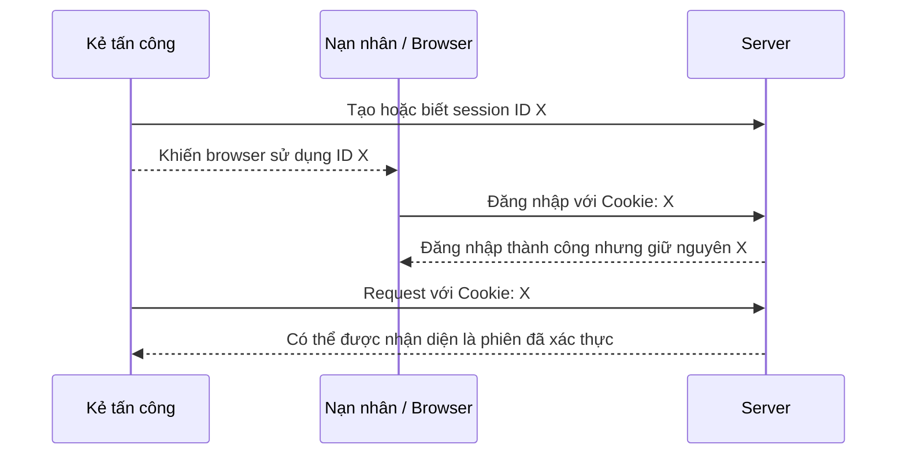
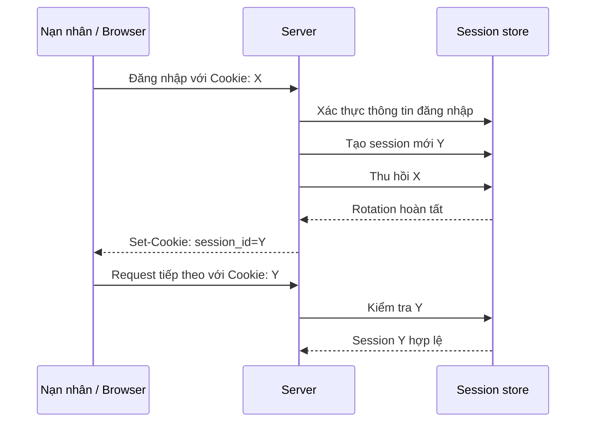

# Session rotation — thay session ID đúng thời điểm để bảo vệ phiên

> **Chương:** Session trên browser  
> **Mục tiêu:** Hiểu session rotation là gì, vì sao cần chống session fixation, khi nào nên xoay session ID, cách vô hiệu hóa ID cũ an toàn, xử lý request đồng thời và đồng bộ session trong hệ thống nhiều máy chủ. Bài học tập trung vào session cookie do browser gửi và session state được server quản lý.

## 1. Session rotation là gì?

Khi người dùng đăng nhập, browser thường gửi một cookie chứa session ID. Server dùng ID này để tìm trạng thái phiên, ví dụ người dùng hiện tại, thời điểm xác thực và quyền được cấp.

**Session rotation** là quá trình thay session ID hiện tại bằng một ID mới, đồng thời chuyển tiếp có chọn lọc trạng thái phiên hợp lệ và vô hiệu hóa ID cũ. Cookie trong browser được cập nhật bằng header Set-Cookie để những request sau sử dụng ID mới.

Ví dụ:

```text
Trước đăng nhập:
  Cookie: session_id=anonymous-id
  Server: anonymous session

Sau đăng nhập thành công:
  Cookie: session_id=new-random-id
  Server: new authenticated session
  old anonymous-id: revoked
```

ID mới phải được tạo bằng bộ sinh số ngẫu nhiên mật mã (CSPRNG). Không lấy ID cũ rồi nối thêm username, timestamp hoặc chuỗi cố định. Rotation tạo ra một **credential phiên mới**, không chỉ thay tên cookie.

Phân biệt ba thao tác:

| Thao tác | Điều gì thay đổi? | Mục đích |
| --- | --- | --- |
| **Session rotation** | Session ID thay đổi; ID cũ bị thu hồi | Chống fixation, giới hạn tác động của credential cũ |
| **Session renewal/extension** | Thời hạn hoặc thời điểm hết hạn được cập nhật | Duy trì phiên theo chính sách idle/absolute timeout |
| **Cookie refresh** | Browser nhận lại cookie hoặc thuộc tính cookie được cập nhật | Đồng bộ cookie expiry/scope; không nhất thiết thay session ID |

Gia hạn cookie mà vẫn giữ nguyên session ID **không phải** rotation.

## 2. Vì sao phải xoay session ID sau khi đăng nhập?

Một session ID là bearer credential: ai có được ID hợp lệ và gửi request trong điều kiện phù hợp có thể bị server nhận diện là phiên đó. Nếu kẻ tấn công biết ID trước khi nạn nhân đăng nhập, việc giữ nguyên ID sau xác thực có thể cho phép kẻ tấn công dùng chính ID đó để truy cập phiên đã đăng nhập.

Đây là **session fixation**:



Rotation đúng cách phá liên kết đó:



Điểm quan trọng là **ID cũ không được tiếp tục đại diện cho phiên đã xác thực**. Chỉ phát Set-Cookie với ID mới nhưng vẫn chấp nhận ID cũ là chưa hoàn tất rotation.

## 3. Khi nào cần rotation?

Nên xoay session ID tại những thời điểm ranh giới tin cậy hoặc mức đặc quyền thay đổi:

| Sự kiện | Có nên rotation? | Lý do |
| --- | --- | --- |
| Đăng nhập thành công | **Có** | Chuyển từ anonymous sang authenticated; ngăn fixation |
| Hoàn tất MFA hoặc step-up authentication | Thường nên | Phiên vừa đạt mức xác thực cao hơn |
| Nâng quyền từ user lên admin | **Có** | Credential cũ không nên tự động mang quyền mới |
| Đổi tài khoản hoặc chuyển sang impersonation | **Có** | Tách danh tính và phạm vi quyền |
| Khôi phục tài khoản/đổi mật khẩu sau sự cố | **Có**, đồng thời xem xét thu hồi các phiên khác | Credential cũ có thể đã bị lộ |
| Phát hiện rủi ro hoặc thiết bị bị xâm phạm | Theo chính sách ứng phó | Thay credential và thu hồi phiên nghi ngờ |
| Gia hạn idle timeout thông thường | Không nhất thiết | Gia hạn thời hạn không làm thay đổi mức tin cậy |
| Mỗi request đọc dữ liệu | Không | Gây race, tải hệ thống và khó đồng bộ nhiều tab |

Không xoay ID trên mọi request. Rotation nên gắn với **sự kiện bảo mật cụ thể**, không phải một bộ đếm request. Xoay liên tục có thể khiến các tab hoặc request song song ghi đè cookie của nhau, tạo lỗi ngẫu nhiên và khó khôi phục.

## 4. Chuyển trạng thái phiên an toàn

Khi rotation, server thường cần giữ một phần dữ liệu phiên hợp lệ, chẳng hạn:

- Ngôn ngữ và tùy chọn giao diện.
- Mã giỏ hàng hoặc trạng thái quy trình không nhạy cảm đã được xác minh.
- Thông tin luồng điều hướng sau đăng nhập, nếu đã được kiểm tra.

Không sao chép mù toàn bộ trạng thái từ anonymous session sang authenticated session. Dữ liệu do client kiểm soát hoặc được lưu trước xác thực có thể chứa:

- Quyền hoặc role do người dùng tự đặt.
- Redirect URL chưa được allowlist.
- CSRF token cũ.
- Thông tin định danh hoặc trạng thái xác thực không còn hợp lệ.
- Dữ liệu chưa được kiểm tra có thể gây lỗi logic nghiệp vụ.

Một cách tiếp cận an toàn:

1. Xác thực người dùng và các điều kiện MFA/step-up nếu có.
2. Tạo session mới với ID ngẫu nhiên mới.
3. Xây dựng trạng thái mới từ dữ liệu server đã xác minh; chỉ chuyển tiếp trường được allowlist.
4. Tạo CSRF token mới hoặc liên kết token với session mới.
5. Thu hồi ID cũ trong cùng giao dịch logic.
6. Chỉ sau khi rotation thành công mới gửi cookie mới cho browser.

Nếu bước tạo session mới thất bại, không được để ID cũ bất ngờ có thêm quyền. Nếu bước thu hồi ID cũ thất bại, cần xử lý như một lỗi rotation và không xác nhận đăng nhập hoàn tất bằng một trạng thái không nhất quán.

## 5. Thứ tự thao tác và tính nguyên tử

Với server-side session store, thao tác rotation nên được thiết kế sao cho server không có trạng thái trung gian mà cả ID cũ và mới cùng được chấp nhận với quyền không rõ ràng.

Một mô hình khái niệm:

```text
BEGIN TRANSACTION
  kiểm tra session cũ và trạng thái xác thực
  tạo ID mới bằng CSPRNG
  ghi session mới với trạng thái đã xác minh
  đánh dấu ID cũ là revoked
COMMIT

Sau commit:
  gửi Set-Cookie chứa ID mới
```

Nếu session store hỗ trợ transaction, dùng transaction hoặc thao tác atomic tương đương để tạo phiên mới và thu hồi phiên cũ. Nếu dùng cache phân tán, cần cơ chế nhất quán phù hợp để mọi instance nhận ra ID cũ đã bị thu hồi.

**Không thu hồi ID cũ trước khi có cách bảo đảm tạo được ID mới**, nếu điều đó có thể khóa người dùng khỏi phiên mà không có đường phục hồi. Ngược lại, cũng không nên duy trì song song hai ID có quyền tương đương trong một khoảng dài chỉ để tránh lỗi đồng bộ.

Thiết kế thực tế phụ thuộc session store và framework. Hãy sử dụng API regenerate/rotate được framework hỗ trợ nếu có, sau đó xác minh hành vi thu hồi và cookie trong môi trường thử nghiệm.

## 6. Mẫu triển khai rotation ở server

Đoạn dưới là **pseudocode Node-style**, minh họa hợp đồng cần có giữa session service và cookie response. Tên hàm của từng framework có thể khác:

```js
async function completeLogin(req, res, user) {
  // 1. Xác thực user đã hoàn tất trước khi gọi hàm này.
  // 2. Chỉ chuyển tiếp dữ liệu không nhạy cảm đã được allowlist.
  const safeState = {
    locale: validateLocale(req.session?.locale),
    cartId: await verifyCartOwnership(req.session?.cartId),
  };

  // rotate() phải tạo ID mới và revoke ID cũ theo thao tác
  // atomic hoặc cơ chế nhất quán tương đương.
  const newSession = await sessionStore.rotate({
    oldSessionId: req.session?.id,
    userId: user.id,
    authLevel: "password",
    state: safeState,
  });

  // Chỉ phát cookie sau khi rotation đã thành công.
  res.setHeader("Set-Cookie", serializeCookie(
    "__Host-session",
    newSession.id,
    {
      path: "/",
      secure: true,
      httpOnly: true,
      sameSite: "Lax",
    }
  ));

  res.statusCode = 204;
  res.end();
}
```

Đây không phải implementation hoàn chỉnh có thể sao chép nguyên xi: `sessionStore.rotate`, `serializeCookie` và các hàm xác minh là API giả định. Trong ứng dụng thực:

- Xác thực thông tin đăng nhập trước khi nâng phiên.
- Chỉ lấy dữ liệu chuyển tiếp từ nguồn đã kiểm soát.
- Không cho client chỉ định session ID mới.
- Gắn CSRF state với session mới và vô hiệu token cũ.
- Xử lý lỗi transaction, timeout và retry rõ ràng.
- Đảm bảo cookie mới có scope và flags phù hợp với ứng dụng.

Nếu dùng Express với middleware session, hãy kiểm tra tài liệu phiên bản middleware về phương thức regenerate session. Không tự gán một ID mới vào object session nếu framework yêu cầu quy trình lưu, destroy hoặc regenerate riêng.

## 7. Cookie mới phải giữ thuộc tính bảo mật

Sau rotation, server cần gửi lại cookie session ID với các thuộc tính cần thiết. Ví dụ cookie host-only:

```http
Set-Cookie: __Host-session=NEW_RANDOM_ID; Path=/; Secure; HttpOnly; SameSite=Lax
```

| Thuộc tính | Tại sao vẫn cần sau rotation? |
| --- | --- |
| **Secure** | Session ID chỉ được gửi qua kết nối HTTPS theo quy tắc cookie |
| **HttpOnly** | JavaScript không đọc trực tiếp được giá trị session cookie |
| **SameSite** | Giảm việc browser gửi cookie trong một số ngữ cảnh cross-site |
| **Host-only / __Host-** | Hạn chế cookie tới đúng host, tránh chia sẻ miền rộng không cần thiết |
| **Path=/** | Đặt phạm vi gửi phù hợp với toàn bộ ứng dụng trên host |

Rotation không sửa một cấu hình cookie yếu. Nếu cookie cũ thiếu HttpOnly hoặc Domain quá rộng, chỉ thay ID mà không sửa flags sẽ giữ nguyên các rủi ro đó.

Nếu cookie cũ có scope khác, việc xóa cookie cũ cần khớp tên, Domain/host scope và Path đã dùng. Cookie host-only và cookie có Domain cùng tên có thể là hai cookie riêng biệt; việc xóa sai scope có thể để lại cookie cũ trong browser.

## 8. CSRF token cũng cần đồng bộ với session rotation

Nhiều ứng dụng tạo CSRF token gắn với session ID hoặc session state. Khi session thay đổi, token cũ không nên được chấp nhận vô thời hạn.

Luồng phù hợp:

1. Session mới được tạo.
2. Server tạo CSRF token mới hoặc dẫn xuất token từ session mới bằng cơ chế an toàn.
3. Form và frontend nhận token mới qua kênh đã xác thực.
4. Server từ chối token gắn với session đã thu hồi.

Nếu rotation chỉ thay cookie nhưng frontend giữ CSRF token cũ, request POST tiếp theo có thể bị từ chối. Đây là lỗi đồng bộ thường gặp khi đăng nhập bằng AJAX hoặc khi nhiều tab cùng mở.

Không đặt CSRF token trong URL. Nếu dùng synchronizer token pattern, giữ token trong HTML hoặc response body phù hợp và kiểm tra ở server. Nếu dùng double-submit cookie, phải hiểu rõ thuộc tính cookie, host scope và cách ràng buộc token với phiên.

CSRF token không phải session ID. Không dùng một giá trị thay thế cho cả hai mục đích.

## 9. Request đồng thời, nhiều tab và response race

Rotation thường xảy ra đúng lúc ứng dụng có nhiều request đang chạy. Ví dụ tab đăng nhập gửi request cập nhật profile đồng thời với request refresh dashboard; một response cũ có thể đến sau response đăng nhập và ghi lại cookie ID cũ.

Một số tình huống:

- Hai request cùng cố rotate một session cũ.
- Request được gửi trước khi đăng nhập nhưng hoàn thành sau khi session đã được nâng quyền.
- Một response chậm chứa Set-Cookie cũ đến sau response chứa ID mới.
- Hai tab cùng thao tác logout/login hoặc đổi tài khoản.

### Vì sao response cũ nguy hiểm?

Cookie được browser cập nhật khi nhận Set-Cookie. Nếu một response đến muộn đặt lại cookie cũ, browser có thể gửi ID đã bị thu hồi ở request sau. Điều này có thể khiến người dùng bị đăng xuất hoặc gặp lỗi phiên.

Server vẫn phải từ chối ID cũ đã thu hồi; không khôi phục ID cũ chỉ để “sửa” lỗi. Để giảm race:

- Thực hiện rotation tại endpoint chuyển trạng thái có kiểm soát.
- Serialize các thao tác auth/rotation cho cùng session nếu kiến trúc cần.
- Không để response của request trước xác thực phát lại Set-Cookie session cũ.
- Dùng session version/generation hoặc trạng thái revoked để nhận biết request cũ.
- Sau rotation, client có thể cần chờ hoàn tất rồi tải lại dữ liệu phiên bằng ID mới.
- Khi có nhiều tab, phát tín hiệu đăng nhập/đăng xuất/rotation qua cơ chế đồng bộ phù hợp, nhưng không truyền session ID qua BroadcastChannel hoặc storage.

Không thể giải quyết race chỉ bằng cách xoay ID trên mọi request; cách đó thường làm xác suất va chạm cao hơn.

## 10. Session rotation trong hệ thống nhiều instance

Khi ứng dụng chạy nhiều server sau load balancer, request đầu có thể tới instance A và request tiếp theo tới instance B. Nếu mỗi instance giữ session trong memory riêng, instance B có thể không biết ID mới hoặc trạng thái thu hồi ID cũ.

Các yêu cầu kiến trúc:

- Session store dùng chung hoặc có cơ chế đồng bộ session nhất quán.
- Rotation ghi ID mới và thu hồi ID cũ theo thao tác atomic/transaction khi có thể.
- Mọi instance kiểm tra trạng thái revoked và expiry trước khi chấp nhận session.
- Cache cục bộ phải có invalidation/versioning phù hợp; không tiếp tục tin bản ghi cũ sau rotation.
- Logging và audit ghi sự kiện rotation mà không ghi session ID thô.

Nếu dùng sticky session, nó có thể giảm việc request đi qua instance khác nhưng **không thay thế** kho session dùng chung và thu hồi nhất quán. Instance có thể restart, người dùng có thể chuyển mạng hoặc load balancer có thể định tuyến lại.

### Lưu hash session ID

Với session ID ngẫu nhiên đủ entropy, server có thể lưu hash hoặc HMAC của ID trong session store và dùng giá trị đã băm để tra cứu. Khi database bị đọc trái phép, kẻ tấn công không trực tiếp lấy được bearer ID từ bản ghi. Thiết kế này cần thống nhất cách tạo lookup key, rotation và revocation; không dùng hash yếu hoặc session ID có thể đoán.

## 11. Rotation và refresh-token rotation có giống nhau không?

Chúng có cùng mục tiêu thay credential cũ bằng credential mới, nhưng không phải một cơ chế:

| Session ID rotation | Refresh-token rotation |
| --- | --- |
| Thay ID phiên browser/server-side session | Thay refresh token dùng để cấp access token mới |
| Thường diễn ra khi đăng nhập, nâng quyền, đổi danh tính hoặc ứng phó rủi ro | Thường diễn ra mỗi lần refresh token được sử dụng |
| Server quản lý session state và revoke ID cũ | Authorization server quản lý token family/rotation state |
| Cookie có thể mang session ID mới | Refresh token có thể nằm trong cookie hoặc nơi lưu trữ khác tùy kiến trúc |

Với refresh token rotation, server thường cấp refresh token mới và vô hiệu token đã dùng. Nếu token cũ được sử dụng lại, đó có thể là dấu hiệu token bị sao chép; hệ thống có thể thu hồi cả token family theo chính sách.

Không áp dụng máy móc refresh-token rotation cho mọi request web session. Chọn cơ chế theo loại credential và mô hình xác thực đang dùng.

## 12. Logout, password change và thu hồi các phiên khác

Rotation thay ID hiện tại. Một số sự kiện cần rộng hơn: thu hồi các session khác đang hoạt động.

| Sự kiện | Hành động khuyến nghị |
| --- | --- |
| Người dùng logout ở thiết bị hiện tại | Revoke session hiện tại, xóa cookie hiện tại |
| Đổi mật khẩu | Revoke hoặc yêu cầu xác thực lại các session khác theo chính sách |
| Tài khoản bị khóa hoặc nghi ngờ bị chiếm | Revoke toàn bộ session liên quan |
| Người dùng chọn “đăng xuất khỏi tất cả thiết bị” | Thu hồi toàn bộ session/token family của tài khoản |
| Nâng quyền admin | Rotate session hiện tại và ghi audit event |

Để thu hồi nhiều session, server cần liên kết session với user ID hoặc một account/session version. Khi version tài khoản tăng, session mang version cũ có thể bị từ chối. Cơ chế này hữu ích trong hệ thống nhiều instance nhưng cần tính đến cache và độ trễ đồng bộ.

Không gửi session ID qua log hoặc API quản trị để người dùng nhận diện thiết bị. Dùng một session/device identifier riêng không phải bearer credential, hoặc hiển thị metadata an toàn như thời điểm đăng nhập và loại thiết bị.

## 13. Thực hành: kiểm chứng session rotation

Thực hiện trên ứng dụng local hoặc staging do bạn kiểm soát, với tài khoản thử nghiệm. Không sao chép session ID thật vào tài liệu, chat hoặc screenshot.

### Bước 1 — Ghi nhận session trước đăng nhập

1. Mở DevTools → Network và Application/Storage.
2. Mở trang đăng nhập khi chưa xác thực.
3. Ghi nhận tên cookie, scope và flags; chỉ ghi nhận rằng ID tồn tại, không lưu giá trị thô.
4. Nếu ứng dụng không tạo anonymous session, ghi nhận trạng thái đó.

### Bước 2 — Đăng nhập

1. Đăng nhập thành công.
2. Chọn response login trong Network.
3. Kiểm tra response có Set-Cookie với session ID mới không.
4. So sánh giá trị trong DevTools cục bộ nếu cần, không chụp hoặc chia sẻ giá trị.
5. Kiểm tra cookie mới có Secure, HttpOnly, SameSite và host scope phù hợp.

**Kỳ vọng:** session ID sau đăng nhập khác ID trước đăng nhập nếu anonymous session đã tồn tại; server không còn chấp nhận ID cũ như phiên đã xác thực.

### Bước 3 — Phát lại ID cũ trong môi trường test

Nếu ứng dụng có công cụ test server-side hoặc môi trường integration, thử request với ID cũ đã được giữ an toàn trong bộ nhớ test. Server phải từ chối hoặc coi nó là session anonymous đã thu hồi, không trả dữ liệu tài khoản.

Không đưa ID cũ vào URL hoặc log để thực hiện phép thử. Dùng HTTP client test cục bộ và bảo vệ output.

### Bước 4 — Kiểm tra CSRF token

Sau đăng nhập, tải form hoặc request mutation và lấy CSRF token mới. Thử token của session cũ trong một test request; server cần từ chối nếu token gắn với phiên đã rotate.

### Bước 5 — Kiểm tra logout

Đăng xuất, xác minh server revoke session và response xóa cookie đúng scope. Thử lại session ID sau logout từ môi trường test; server phải từ chối.

### Bước 6 — Kiểm tra race giữa các tab

1. Mở hai tab dùng cùng session thử nghiệm.
2. Tạo một request chậm ở tab A.
3. Thực hiện login/rotation/logout ở tab B.
4. Để response chậm của tab A hoàn tất.
5. Quan sát cookie có bị ghi đè bằng ID cũ hay không và server xử lý request cũ thế nào.

Kết quả mong đợi: ID cũ không được phục hồi; client có thể cần tải lại hoặc đăng nhập lại, nhưng server không nâng quyền cho credential đã thu hồi.

## 14. Lỗi triển khai thường gặp

| Lỗi | Rủi ro | Cách khắc phục |
| --- | --- | --- |
| Giữ nguyên ID sau login | Session fixation | Regenerate ID sau xác thực |
| Phát cookie ID mới nhưng chấp nhận ID cũ vô thời hạn | Credential cũ vẫn dùng được | Revoke ID cũ ngay theo quy trình nhất quán |
| Copy toàn bộ anonymous session sang authenticated session | Dữ liệu do client kiểm soát có thể mang vào quyền mới | Chỉ chuyển tiếp trường đã allowlist và xác minh |
| Không rotate CSRF token | Token cũ tiếp tục dùng hoặc frontend lỗi | Gắn token với session mới và phát hành lại |
| Xoay ID mỗi request | Race, nhiều tab ghi đè cookie và tăng tải | Xoay theo sự kiện bảo mật |
| Chỉ cập nhật cookie, không cập nhật session store | Browser có ID mới nhưng server không hiểu hoặc ID cũ còn hiệu lực | Đồng bộ rotation và revocation phía server |
| Dùng memory session riêng từng instance | Request tới instance khác bị mất phiên | Shared store hoặc cơ chế đồng bộ đáng tin cậy |
| Response cũ ghi đè cookie mới | Người dùng quay lại ID đã thu hồi | Điều phối auth transition và ngăn stale response phát Set-Cookie |
| Không xử lý lỗi giữa tạo mới và revoke cũ | Hai ID cùng hiệu lực hoặc mất phiên | Transaction/atomic operation và quy trình recovery |
| Coi rotation là logout toàn bộ thiết bị | Các phiên khác có thể vẫn hoạt động | Quản lý session theo tài khoản và revoke theo chính sách |

## 15. Checklist triển khai session rotation

- Sinh ID mới bằng CSPRNG, không cho client tự chọn.
- Rotate ngay sau login thành công và khi mức đặc quyền/danh tính thay đổi.
- Chỉ chuyển tiếp trạng thái phiên đã xác minh và được allowlist.
- Tạo CSRF token mới hoặc ràng buộc lại token với session mới.
- Thu hồi ID cũ; không giữ song song credential cũ và mới với quyền tương đương ngoài thiết kế có chủ đích.
- Cập nhật cookie với flags và scope bảo mật; tránh Domain rộng không cần thiết.
- Thực hiện rotation và revocation atomic hoặc nhất quán trong session store.
- Xử lý request đồng thời, nhiều tab và response Set-Cookie đến muộn.
- Đồng bộ trạng thái giữa các instance và cache.
- Có idle timeout, absolute timeout, logout/revocation và audit event.
- Phân biệt session ID rotation với refresh-token rotation.
- Kiểm thử fixation, replay ID cũ, CSRF token cũ, logout và race condition.

## 16. Câu hỏi tự kiểm tra

1. Session rotation khác cookie refresh và session extension như thế nào?
2. Session fixation xảy ra ra sao nếu server giữ nguyên ID sau login?
3. Vì sao phải tạo ID mới bằng CSPRNG và thu hồi ID cũ?
4. Những sự kiện nào nên kích hoạt rotation ngoài đăng nhập?
5. Vì sao không nên xoay session ID trên mọi request?
6. Vì sao không nên copy toàn bộ anonymous session sang authenticated session?
7. CSRF token cần thay đổi thế nào khi session được rotate?
8. Response cũ đến muộn có thể ảnh hưởng cookie mới như thế nào?
9. Vì sao shared session store và atomic revocation quan trọng với hệ thống nhiều instance?
10. Session ID rotation khác refresh-token rotation ở điểm nào?

**Ghi nhớ:** Session rotation thay bearer credential của phiên bằng một ID ngẫu nhiên mới tại những thời điểm ranh giới tin cậy thay đổi. Để chống session fixation, server phải tạo phiên mới, chỉ chuyển trạng thái đã xác minh, làm mới CSRF token, thu hồi ID cũ và gửi cookie mới với flags phù hợp. Rotation cần nhất quán trong session store và xử lý được request đồng thời, nhiều tab và nhiều instance. Việc đổi cookie ở browser mà không thu hồi credential cũ ở server chưa phải là rotation an toàn.
