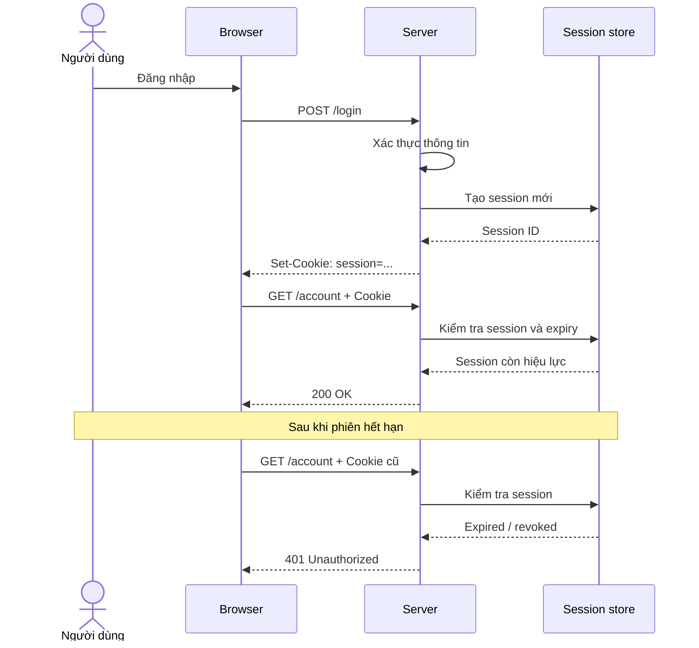
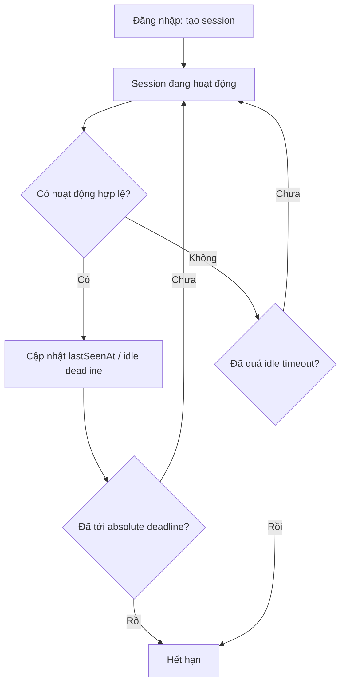
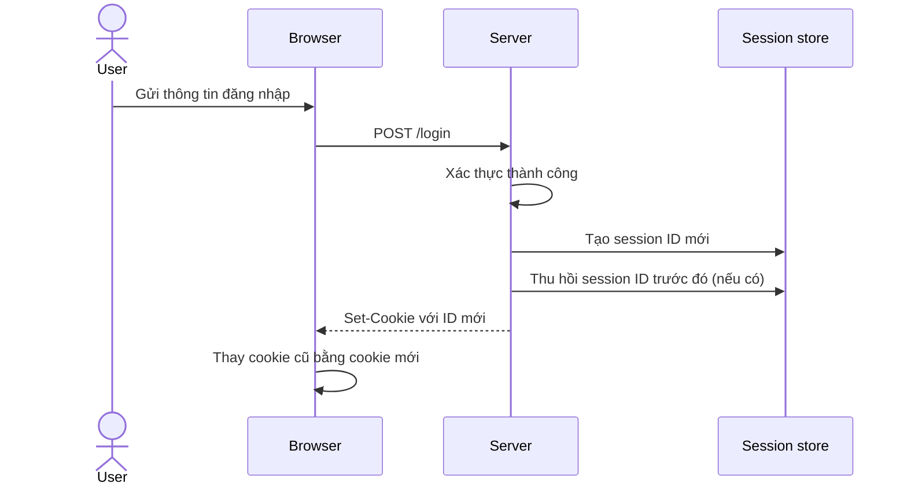

# Session expiry

> **Chương:** Session trên browser  
> **Bài học:** Session expiry — vòng đời và xử lý khi phiên hết hạn  
> **Phạm vi module:** **SECURITY_APPLICATION_SECURITY_BROWSER_SECURITY** — phân tích ranh giới bảo mật giữa trình duyệt, origin, cookie và ứng dụng web để hiểu Same-Origin Policy (SOP), CORS và các cơ chế cách ly; thực hành phòng vệ XSS, CSRF, clickjacking bằng CSP, Trusted Types, security headers và kiểm chứng thực tế.

## Mục tiêu học tập

Sau bài này, bạn có thể:

1. Phân biệt **thời hạn cookie ở browser** với **thời hạn phiên đăng nhập do server quản lý**.
2. Giải thích idle timeout, absolute timeout, sliding expiration và session renewal.
3. Mô tả cách browser gửi cookie, cách server kiểm tra phiên và điều gì xảy ra khi phiên hết hạn.
4. Thiết kế quy trình gia hạn, xoay vòng session ID, refresh token và thu hồi phiên.
5. Xử lý đúng trạng thái hết hạn trên nhiều tab, request đang chạy, API và trang điều hướng.
6. Giảm nguy cơ rò rỉ dữ liệu sau logout hoặc expiry bằng cache policy, kiểm tra quyền và xử lý trang được khôi phục từ back-forward cache.
7. Kiểm thử session expiry bằng DevTools, server log và các kịch bản thời gian.

## 1. Session expiry là gì?

**Session expiry** là thời điểm một phiên đăng nhập không còn được chấp nhận để thực hiện các thao tác cần xác thực. Một phiên có thể hết hạn do không hoạt động trong một khoảng thời gian, vượt quá tuổi thọ tối đa, bị thu hồi bởi người dùng/quản trị viên hoặc bị vô hiệu hóa bởi hệ thống bảo mật.

Ví dụ, người dùng đăng nhập vào ứng dụng tại **https://app.example**. Browser nhận một cookie chứa session identifier (mã định danh phiên). Trong những request phù hợp, browser tự gửi cookie đó. Server dùng mã định danh để tra cứu phiên, xác định người dùng và kiểm tra trạng thái:



Điểm quan trọng: **cookie còn nằm trong browser không chứng minh phiên vẫn hợp lệ**. Cookie chỉ là thông tin browser gửi; server mới là bên quyết định session có còn hiệu lực hay không.

Ngược lại, cookie có thể bị browser xóa hoặc hết hạn trước khi server session hết hạn. Khi đó browser không còn gửi mã định danh cũ, dù bản ghi session trên server có thể vẫn tồn tại cho tới khi được dọn dẹp.

## 2. Hai loại thời hạn khác nhau

Một hệ thống đăng nhập thường có ít nhất hai đồng hồ độc lập:

1. **Cookie lifetime:** thời gian browser lưu và có thể gửi cookie theo thuộc tính cookie.
2. **Server session lifetime:** thời gian server chấp nhận session identifier và trạng thái phiên tương ứng.

### 2.1. Cookie lifetime

Ví dụ server trả:

```http
Set-Cookie: __Host-session=opaque-id; Path=/; Secure; HttpOnly; SameSite=Lax; Max-Age=1800
```

**Max-Age=1800** yêu cầu browser giữ cookie trong 1.800 giây kể từ khi nhận. Nếu dùng **Expires**, server đặt thời điểm hết hạn theo ngày/giờ HTTP.

Cookie không có Expires hoặc Max-Age thường là **session cookie** theo định nghĩa cookie; browser có thể xóa khi phiên browser kết thúc. Nhưng khái niệm browser session không đồng nghĩa với phiên đăng nhập của ứng dụng. Browser có thể khôi phục session cookie qua tính năng khôi phục phiên hoặc có hành vi riêng theo sản phẩm.

Các thuộc tính thường gặp:

| Thuộc tính | Tác dụng | Liên quan expiry |
|---|---|---|
| **Max-Age** | Tuổi thọ cookie tính bằng giây | Browser ngừng lưu/gửi cookie sau thời gian quy định |
| **Expires** | Thời điểm cookie hết hạn | Cookie hết hạn theo thời gian |
| **Secure** | Chỉ gửi cookie qua kết nối bảo mật theo quy tắc browser | Không đặt thời hạn phiên server |
| **HttpOnly** | JavaScript không đọc cookie qua document.cookie | Không tự làm session hết hạn |
| **SameSite** | Điều chỉnh việc gửi cookie theo ngữ cảnh same-site/cross-site | Không thay idle/absolute timeout |
| **Path / Domain** | Xác định phạm vi gửi cookie | Không phải thời hạn và không phải ranh giới session authorization |

Nếu có cả Max-Age và Expires, Max-Age có độ ưu tiên cao hơn trong việc xác định tuổi thọ cookie.

### 2.2. Server session lifetime

Server thường lưu session record có các thông tin như:

- Session ID hoặc khóa tra cứu.
- User ID và trạng thái xác thực.
- Thời điểm tạo phiên.
- Thời điểm hoạt động gần nhất.
- Thời điểm hết hạn tuyệt đối.
- Trạng thái thu hồi hoặc phiên bản bảo mật.
- Thông tin bổ sung cần thiết cho nghiệp vụ, thiết bị hoặc mức xác thực.

Ví dụ dữ liệu minh họa:

```json
{
  "sessionIdHash": "hash-of-random-id",
  "userId": "user-123",
  "createdAt": "2026-11-22T08:00:00Z",
  "lastSeenAt": "2026-11-22T08:18:00Z",
  "absoluteExpiresAt": "2026-11-22T16:00:00Z",
  "revokedAt": null
}
```

Trong hệ thống thực tế, không nên lưu session ID dạng rõ nếu không cần; có thể lưu giá trị băm hoặc định danh tra cứu phù hợp với thiết kế. Bản ghi trên chỉ minh họa các trường thời gian.

Server kiểm tra trạng thái session ở mỗi request cần xác thực, hoặc dùng cơ chế cache/session store có tính nhất quán phù hợp. Nếu bản ghi hết hạn, bị thu hồi hoặc không còn hợp lệ, server từ chối request.

### 2.3. Bảng phân biệt

| Tình huống | Cookie trong browser | Session trên server | Kết quả |
|---|---|---|---|
| Cookie còn hạn, session còn hạn | Còn | Hợp lệ | Request có thể được xác thực |
| Cookie còn hạn, session đã hết hạn | Còn | Expired | Server từ chối; cookie có thể được xóa |
| Cookie đã hết hạn, session còn hạn | Không còn được gửi | Có thể còn | Browser không dùng được session ID cũ |
| Cookie bị xóa thủ công | Không còn | Có thể còn | Người dùng cần đăng nhập lại; session cũ cần cleanup/revoke theo chính sách |
| Session bị thu hồi | Có thể còn | Revoked | Server từ chối ngay cả khi cookie chưa hết hạn |
| Browser đóng | Session cookie thường có thể bị xóa | Có thể còn | Không thể dựa vào việc đóng browser để bảo đảm server session đã bị hủy |

## 3. Ba chiến lược timeout chính

Một hệ thống có thể kết hợp nhiều chính sách timeout. Cần phân biệt mục tiêu của từng loại.

### 3.1. Idle timeout — hết hạn khi không hoạt động

**Idle timeout** giới hạn thời gian kể từ lần hoạt động hợp lệ gần nhất.

Ví dụ:

- Idle timeout: 20 phút.
- Người dùng hoạt động lúc 10:00.
- Không có request được tính là hoạt động sau đó.
- Từ 10:20, session không còn được chấp nhận.

Idle timeout hữu ích khi người dùng bỏ quên máy tính đã đăng nhập. Tuy nhiên, cần định nghĩa rõ request nào được tính là hoạt động. Một request nền, polling hoặc analytics có thể liên tục gia hạn idle timeout dù người dùng không thực sự tương tác.

Không nên gia hạn session chỉ vì bất kỳ request nào cũng tới server. Có thể chỉ cập nhật hoạt động cho request có ý nghĩa và đã được xác thực, đồng thời giới hạn tần suất ghi.

### 3.2. Absolute timeout — tuổi thọ tối đa

**Absolute timeout** giới hạn tổng thời gian của phiên kể từ khi tạo hoặc từ lần xác thực gần nhất theo chính sách.

Ví dụ:

- Absolute timeout: 8 giờ.
- Người dùng vẫn thao tác mỗi 5 phút.
- Idle timeout không bao giờ kích hoạt.
- Nhưng khi đủ 8 giờ kể từ khi tạo phiên, session hết hạn.

Absolute timeout ngăn phiên tồn tại vô hạn chỉ vì người dùng hoặc một tiến trình nền liên tục gửi request.

Với thao tác nhạy cảm, hệ thống có thể yêu cầu xác thực lại sớm hơn, hoặc áp dụng thời hạn riêng cho mức bảo đảm xác thực (authentication assurance).

### 3.3. Sliding expiration — gia hạn theo hoạt động

**Sliding expiration** là cách gia hạn thời hạn idle mỗi khi có hoạt động hợp lệ.

Ví dụ:

- Idle timeout 20 phút.
- Request hợp lệ lúc 10:00 → idle deadline 10:20.
- Request hợp lệ lúc 10:12 → deadline mới 10:32.
- Request hợp lệ lúc 10:28 → deadline mới 10:48.

Nhưng sliding expiration **không nên vượt absolute timeout**. Một mô hình phổ biến:

```text
effective_expiry = min(
  last_valid_activity + idle_timeout,
  session_created_at + absolute_timeout
)
```

Trong đó:

- **last_valid_activity** là thời điểm hoạt động được server chấp nhận.
- **idle_timeout** là giới hạn không hoạt động.
- **session_created_at** là thời điểm tạo phiên.
- **absolute_timeout** là giới hạn tổng tuổi thọ.

### 3.4. Minh họa hai đồng hồ



Đây là logic khái quát. Server cần kiểm tra deadline nhất quán, kể cả khi request đến đồng thời từ nhiều tab hoặc nhiều instance ứng dụng.

## 4. Tính toán expiry ở server

Một cách biểu diễn thời hạn:

```js
function isSessionExpired(session, now) {
  const idleDeadline =
    session.lastSeenAt + session.idleTimeoutMs;

  const absoluteDeadline =
    session.createdAt + session.absoluteTimeoutMs;

  const effectiveDeadline = Math.min(
    idleDeadline,
    absoluteDeadline
  );

  return (
    session.revokedAt !== null ||
    now >= effectiveDeadline
  );
}
```

Đây là pseudocode. Trong hệ thống thực tế, cần xác định kiểu timestamp, múi giờ, độ chính xác và cách xử lý trường dữ liệu thiếu.

### 4.1. Dùng đồng hồ server làm nguồn quyết định

Không tin đồng hồ do JavaScript phía client gửi lên để quyết định session còn hạn hay không. Người dùng có thể chỉnh giờ thiết bị, sửa request hoặc gọi API trực tiếp.

Server nên dùng đồng hồ hệ thống đã đồng bộ (ví dụ NTP) và thống nhất cách lưu timestamp, thường là UTC. Khi có nhiều server instance, cần giảm sai lệch đồng hồ để tránh instance này chấp nhận session trong khi instance khác từ chối.

Client có thể hiển thị thời gian còn lại theo ước tính để cải thiện UX, nhưng **quyết định cuối cùng luôn thuộc server**.

### 4.2. Gia hạn không nên ghi DB ở mọi request

Nếu mỗi request đều cập nhật lastSeenAt, hệ thống có thể tạo lượng ghi lớn. Một số cách tối ưu:

- Chỉ ghi khi đã qua một khoảng thời gian tối thiểu từ lần cập nhật gần nhất.
- Cập nhật nguyên tử trong session store.
- Dùng TTL của session store cho idle expiry nhưng vẫn kiểm tra absolute expiry riêng.
- Dùng cache với invalidation phù hợp nếu session có thể bị thu hồi ngay.
- Tránh race condition khi nhiều request cùng gia hạn.

Không đánh đổi khả năng thu hồi phiên và tính nhất quán chỉ để giảm một lần ghi.

### 4.3. Race condition khi nhiều request đồng thời

Ví dụ hai tab gửi request gần như cùng lúc:

- Request A đọc lastSeenAt cũ.
- Request B đọc cùng giá trị cũ.
- A cập nhật lastSeenAt mới hơn.
- B ghi đè bằng thời điểm cũ hơn do xử lý chậm.

Nếu cập nhật không nguyên tử, idle deadline có thể bị lùi lại hoặc kết quả expiry không nhất quán.

Giải pháp thường dùng là update có điều kiện hoặc phép toán nguyên tử để lastSeenAt chỉ tăng:

```sql
UPDATE sessions
SET last_seen_at = GREATEST(last_seen_at, :now)
WHERE session_id_hash = :session_id_hash
  AND revoked_at IS NULL
  AND absolute_expires_at > :now;
```

Cú pháp và khả năng dùng GREATEST phụ thuộc database. Đây là minh họa về ý tưởng, không phải câu lệnh dùng chung cho mọi hệ quản trị.

## 5. Session expiry và session renewal

Khi phiên gần hết hạn hoặc đã hết hạn, ứng dụng có thể xử lý theo một số cách:

- Hiển thị cảnh báo và yêu cầu người dùng xác nhận tiếp tục.
- Gia hạn session sau khi xác minh người dùng còn quyền.
- Yêu cầu đăng nhập lại.
- Yêu cầu step-up authentication cho thao tác nhạy cảm.
- Thu hồi refresh token hoặc session khi có tín hiệu rủi ro.

### 5.1. Cảnh báo sắp hết hạn

Client có thể nhận metadata không nhạy cảm từ server:

```json
{
  "expiresAt": "2026-11-22T16:00:00Z",
  "reauthenticationRequired": false
}
```

UI có thể hiển thị “Phiên sắp hết hạn”. Tuy nhiên, timestamp này chỉ phục vụ hiển thị. Khi người dùng chọn “Tiếp tục”, server vẫn phải kiểm tra phiên hiện tại và quyết định có gia hạn hay cần xác thực lại.

Không gửi session ID, refresh token hoặc bí mật phiên vào JSON chỉ để client tự đếm ngược.

### 5.2. Sliding renewal

Nếu người dùng hoạt động và session còn hiệu lực, server có thể cập nhật idle deadline. Có thể đồng thời làm mới cookie bằng Set-Cookie để cookie lifetime không ngắn hơn thời gian cần thiết.

Nhưng **gia hạn cookie không tự gia hạn server session**. Tương tự, cập nhật server session không tự làm cookie browser tồn tại lâu hơn. Hai thao tác cần được phối hợp theo chính sách.

### 5.3. Không hồi sinh phiên đã hết hạn

Nếu session đã hết hạn hoặc bị thu hồi, không nên tự động coi request tiếp theo là hoạt động mới để khôi phục phiên cũ.

Luồng an toàn thường là:

1. Server xác định session không còn hợp lệ.
2. Từ chối request cần xác thực.
3. Xóa cookie phiên nếu phù hợp.
4. Yêu cầu đăng nhập lại hoặc xác thực lại.
5. Tạo **session ID mới** sau khi xác thực thành công.

Không tái sử dụng session ID cũ sau khi người dùng đăng nhập lại; tạo session ID mới giúp giảm nguy cơ session fixation.

## 6. Session ID rotation và refresh token

Session expiry thường đi cùng với cơ chế thay mới thông tin xác thực.

### 6.1. Rotate session ID

Session ID nên được thay mới ở những thời điểm quan trọng:

- Sau khi đăng nhập thành công.
- Sau khi nâng quyền hoặc hoàn tất step-up authentication.
- Khi thay đổi mức bảo đảm xác thực.
- Khi phát hiện rủi ro cần xoay vòng thông tin phiên.

Quy trình:



ID phải đủ ngẫu nhiên, khó đoán và được truyền qua cookie có thuộc tính phù hợp. Không đặt ID trong URL vì URL có thể xuất hiện trong lịch sử, log và referrer.

### 6.2. Access token và refresh token

Một số hệ thống dùng access token ngắn hạn cùng refresh token có thời hạn dài hơn:

- **Access token:** dùng để gọi API; hết hạn tương đối nhanh.
- **Refresh token:** dùng để xin access token mới; phải được bảo vệ và có thể bị rotate/revoke.
- **Session/authorization server:** quản lý trạng thái refresh, phát hiện token reuse hoặc thu hồi khi cần.

Một access token hết hạn không nhất thiết có nghĩa người dùng phải đăng nhập lại ngay, nếu refresh token vẫn hợp lệ và chính sách cho phép làm mới. Ngược lại, refresh token bị thu hồi hoặc hết hạn sẽ buộc xác thực lại.

Với refresh token rotation, mỗi lần dùng thành công server phát token mới và vô hiệu hóa token cũ. Nếu token cũ bị dùng lại, hệ thống có thể xem đó là dấu hiệu token bị sao chép và thu hồi cả token family theo chính sách.

Không lưu refresh token dài hạn trong localStorage chỉ vì tiện gọi API. Với ứng dụng web, cân nhắc kiến trúc backend-for-frontend (BFF) hoặc cookie HttpOnly được thiết kế đúng để giảm khả năng JavaScript lấy token.

### 6.3. JWT exp không đồng nghĩa logout ngay

JWT thường có claim exp để xác định thời điểm token không còn hợp lệ. Tuy nhiên, JWT tự chứa có thể vẫn được xác minh cho đến exp nếu server không có cơ chế thu hồi hoặc kiểm tra trạng thái bổ sung.

Nếu cần logout/thu hồi ngay, kiến trúc có thể dùng:

- Access token có thời hạn ngắn.
- Refresh token được lưu và thu hồi phía server.
- Token denylist hoặc session/version check khi cần.
- Rotation và phát hiện reuse.
- Cơ chế thu hồi theo tài khoản hoặc thiết bị.

Không nhầm exp của JWT với cookie expiry hoặc idle timeout của session.

## 7. Khi session hết hạn, server nên phản hồi thế nào?

Cách phản hồi phụ thuộc loại request và hợp đồng ứng dụng.

| Ngữ cảnh | Hành vi phù hợp thường gặp |
|---|---|
| Điều hướng tới trang cần đăng nhập | Có thể redirect tới trang login với đường quay lại đã được allowlist |
| API Fetch/XHR | Trả **401 Unauthorized** với response format rõ ràng |
| Người dùng đã xác thực nhưng thiếu quyền | Trả **403 Forbidden** |
| Refresh token hết hạn/revoked | Yêu cầu đăng nhập lại |
| Session bị thu hồi do bảo mật | Từ chối request, yêu cầu xác thực lại và ghi audit phù hợp |
| CSRF token hết hạn | Trả lỗi CSRF riêng theo hợp đồng; client cần tải lại token/luồng an toàn |

### 7.1. API nên trả 401 thay vì redirect HTML mơ hồ

Ví dụ API:

```http
HTTP/1.1 401 Unauthorized
Content-Type: application/json
Cache-Control: no-store

{"error":"session_expired","reauthenticationRequired":true}
```

Frontend có thể nhận diện lỗi và hiển thị dialog đăng nhập lại.

Nếu API redirect sang trang login HTML rồi trả 200, frontend mong JSON có thể gặp lỗi parse. Đối với API, status 401 và response JSON thường dễ xử lý hơn.

### 7.2. 401 và 403 không giống nhau

- **401 Unauthorized:** request thiếu thông tin xác thực hợp lệ hoặc session đã hết hạn/không còn hợp lệ.
- **403 Forbidden:** server hiểu danh tính hoặc thông tin xác thực nhưng từ chối quyền truy cập theo chính sách.

Không trả 403 cho mọi tình huống expiry nếu client cần biết phải đăng nhập lại. Ngược lại, không dùng 401 để che mọi lỗi phân quyền.

### 7.3. Điều hướng an toàn sau expiry

Nếu trang cần login, tham số quay lại phải được kiểm soát:

```text
/login?returnTo=/account/orders
```

Chỉ cho phép route nội bộ hoặc URL trong allowlist. Không dùng URL bất kỳ do client gửi để tránh open redirect.

Khi đã đăng nhập lại, server nên tạo session mới, xác minh quyền truy cập đích và điều hướng về trang phù hợp.

## 8. Session expiry trên nhiều tab và nhiều request

Người dùng có thể mở cùng ứng dụng trong nhiều tab. Mỗi tab có state giao diện riêng nhưng thường chia sẻ cookie cùng origin.

### 8.1. Cookie được chia sẻ, state UI không tự đồng bộ

Ví dụ:

- Tab A đang hiển thị trang tài khoản.
- Tab B đăng xuất.
- Server thu hồi session và browser xóa cookie.
- Tab A vẫn còn dữ liệu UI đã render trước đó.

Tab A không tự động biến mất nội dung chỉ vì cookie bị xóa. Request tiếp theo của tab A sẽ bị server từ chối, nhưng dữ liệu đã có trong DOM vẫn có thể còn hiển thị cho tới khi UI cập nhật.

Vì vậy, khi logout/expiry:

- Đồng bộ sự kiện đăng xuất giữa các tab nếu cần.
- Xóa dữ liệu nhạy cảm trong state client khi nhận trạng thái logout.
- Khi tab được focus lại, kiểm tra session với server trước khi hiển thị dữ liệu cần bảo vệ.
- Không xem việc ẩn nút hoặc xóa UI là cơ chế phân quyền; API vẫn phải xác minh mỗi request.

### 8.2. Đồng bộ qua BroadcastChannel

Các tab cùng origin có thể trao đổi sự kiện bằng BroadcastChannel:

```js
const channel = new BroadcastChannel('auth-events');

channel.addEventListener('message', (event) => {
  if (event.data?.type === 'SESSION_ENDED') {
    clearSensitiveClientState();
    showLoginRequired();
  }
});

function announceLogout() {
  channel.postMessage({ type: 'SESSION_ENDED' });
  clearSensitiveClientState();
}
```

Đây chỉ là đồng bộ UI. Không dùng message này làm bằng chứng rằng server đã thu hồi phiên; server phải thực hiện logout và thu hồi session thật.

Nếu không có BroadcastChannel, có thể cân nhắc cơ chế storage event hoặc giải pháp đồng bộ khác phù hợp. Cần lưu ý các tab khác origin không chia sẻ cơ chế này như các tab same-origin.

### 8.3. Nhiều request đồng thời cùng gặp expiry

Khi access token hoặc session hết hạn, nhiều request có thể đồng thời nhận 401. Nếu mỗi request tự kích hoạt một lần refresh, hệ thống có thể tạo nhiều refresh request, gây race condition hoặc dùng lại refresh token cũ sau rotation.

Một mô hình phía client là **single-flight refresh**: trong một thời điểm chỉ có một refresh đang chạy; các request khác chờ kết quả đó. Tuy nhiên, logic này chỉ là tối ưu điều phối. Server vẫn phải bảo vệ refresh token rotation và xử lý request retry an toàn.

Pseudo-code minh họa:

```js
let refreshPromise = null;

async function refreshOnce() {
  if (!refreshPromise) {
    refreshPromise = refreshSessionOnServer()
      .finally(() => {
        refreshPromise = null;
      });
  }

  return refreshPromise;
}
```

Không tự retry vô hạn. Chỉ retry request khi có thể bảo đảm không lặp side effect, hoặc dùng idempotency key cho nghiệp vụ cần thiết. Với POST thanh toán/đặt hàng, không tự động gửi lại chỉ vì nhận 401 nếu trạng thái giao dịch chưa được xác định.

## 9. Logout, expiry và thu hồi session

**Logout** là hành động chủ động kết thúc phiên. **Expiry** là phiên hết hiệu lực theo thời gian hoặc chính sách. Cả hai cần được xử lý phía server.

### 9.1. Logout an toàn

Một luồng logout thường gồm:

1. Gửi request logout có xác thực phiên và bảo vệ CSRF phù hợp.
2. Server đánh dấu session là revoked hoặc xóa session record.
3. Server gửi Set-Cookie xóa cookie với cùng phạm vi Path/Domain phù hợp.
4. Browser xóa cookie nếu response được xử lý.
5. Client xóa state nhạy cảm và đồng bộ logout sang tab khác.

Ví dụ:

```http
HTTP/1.1 204 No Content
Set-Cookie: __Host-session=; Path=/; Secure; HttpOnly; SameSite=Lax; Max-Age=0
Cache-Control: no-store
```

Để xóa cookie, thuộc tính phạm vi cần khớp với cookie đã tạo, đặc biệt là Path và Domain nếu có. Với cookie __Host-, cookie phải host-only và Path=/.

**Chỉ xóa cookie ở browser là chưa đủ** nếu session ID bị sao chép trước đó vẫn còn hiệu lực trên server. Thu hồi server-side mới là bước quyết định.

### 9.2. Expiry và cleanup

Server session store có thể dọn record hết hạn theo TTL hoặc background cleanup. Việc cleanup có thể diễn ra trễ; điều đó không có nghĩa server được phép chấp nhận phiên đã hết hạn.

Phân biệt:

- **Logical expiry:** server từ chối session kể từ deadline.
- **Physical cleanup:** bản ghi được xóa khỏi database/cache sau đó.

Luôn kiểm tra deadline và revoked state trước khi cấp quyền, không dựa riêng vào việc record đã bị xóa hay chưa.

### 9.3. Thu hồi tất cả phiên

Người dùng có thể chọn “Đăng xuất khỏi tất cả thiết bị” hoặc server phát hiện tài khoản bị xâm nhập. Cần có cơ chế thu hồi nhiều session:

- Lưu danh sách session đang hoạt động theo user.
- Tăng sessionVersion hoặc thu hồi các session record.
- Thu hồi refresh token family nếu dùng token.
- Đảm bảo cache/session store nhận biết thay đổi kịp thời.
- Ghi audit event không chứa session ID/token dạng rõ.

Nếu dùng JWT stateless, thu hồi ngay thường cần thêm trạng thái phía server hoặc chấp nhận khoảng thời gian token còn hiệu lực. Đây là trade-off kiến trúc cần được nêu rõ.

## 10. Trang nhạy cảm sau expiry: cache, Back và BFCache

Session hết hạn không tự xóa nội dung đã tải và đang nằm trong browser.

### 10.1. Cache-Control cho dữ liệu nhạy cảm

Response chứa tài khoản, thông tin cá nhân hoặc dữ liệu riêng tư thường cần chính sách cache chặt:

```http
Cache-Control: no-store
```

Trong một số thiết kế có thể cần thêm private, nhưng no-store là chỉ thị mạnh hơn yêu cầu cache không lưu response. Cấu hình cụ thể tùy mức nhạy cảm và yêu cầu sản phẩm.

Không dựa vào no-cache như từ đồng nghĩa với no-store: no-cache cho phép lưu nhưng yêu cầu revalidate trước khi tái sử dụng.

### 10.2. Back-forward cache (BFCache)

Browser có thể lưu trạng thái tài liệu để người dùng quay lại nhanh bằng nút Back/Forward. Đây là **BFCache**, khác với HTTP cache thông thường.

Một trang có thể được khôi phục từ BFCache sau khi session hết hạn hoặc đã logout ở tab khác. Khi đó, nội dung DOM cũ có thể xuất hiện mà không có request tải trang mới ngay thời điểm restore.

Với trang nhạy cảm:

- Kiểm tra session lại khi tài liệu được khôi phục từ BFCache nếu chính sách yêu cầu.
- Xử lý sự kiện pageshow và thuộc tính event.persisted để nhận biết trang được khôi phục.
- Xóa/che dữ liệu nhạy cảm khi cần cho tới khi xác minh session.
- Không xem BFCache event là cơ chế bảo mật thay server authorization.

Ví dụ minh họa:

```js
window.addEventListener('pageshow', async (event) => {
  if (event.persisted) {
    const response = await fetch('/api/session', {
      credentials: 'same-origin',
      cache: 'no-store',
    });

    if (!response.ok) {
      clearSensitiveClientState();
      showLoginRequired();
    }
  }
});
```

Đây là ví dụ UX, không phải cơ chế bảo vệ duy nhất. API dữ liệu vẫn phải kiểm tra session ở server; nếu request kiểm tra session có thể bị lỗi mạng, UI cần xử lý trạng thái chưa xác minh thay vì mặc định hợp lệ.

### 10.3. Service worker và cache do ứng dụng quản lý

Service worker có thể lưu response vào Cache Storage theo logic ứng dụng. Cache-Control: no-store cần được xem cùng cách service worker viết code; không tự giả định mọi code cache tùy chỉnh đều tuân theo chính sách HTTP như browser HTTP cache.

Không cache tài liệu hoặc response nhạy cảm trong Cache Storage nếu không có thiết kế rõ về mã hóa, quyền truy cập, invalidation và logout. Khi logout, xóa dữ liệu cache cá nhân phù hợp; nhưng vẫn phải kiểm tra session ở server cho mọi API.

## 11. Rủi ro khi thiết kế session expiry sai

| Lỗi thiết kế | Hậu quả | Biện pháp |
|---|---|---|
| Chỉ dựa vào cookie Max-Age | Cookie còn hạn nhưng session bị thu hồi vẫn có thể bị hiểu nhầm là hợp lệ | Server kiểm tra session state và deadline |
| Không có absolute timeout | Session có thể sống vô hạn do polling hoặc hoạt động nền | Kết hợp idle và absolute timeout |
| Mọi request đều reset idle timeout | Người dùng bỏ máy vẫn có phiên kéo dài vì request nền | Chỉ tính hoạt động hợp lệ, giới hạn gia hạn |
| Client tự quyết định expiry | Người dùng chỉnh đồng hồ hoặc giả request | Server clock là nguồn quyết định |
| Session ID không rotate sau login | Rủi ro session fixation | Tạo ID mới sau xác thực/nâng quyền |
| Logout chỉ xóa cookie | Session ID bị sao chép vẫn có thể dùng | Revoke server-side, sau đó xóa cookie |
| Không kiểm tra authorization sau refresh | Phiên mới có thể truy cập tài nguyên không còn quyền | Phân quyền trên từng request |
| Redirect API sang HTML login | Fetch mong JSON gặp lỗi parse, trạng thái mơ hồ | API trả 401 có cấu trúc |
| Refresh đồng thời từ nhiều tab | Race token rotation, retry lặp | Single-flight client + kiểm soát server |
| Cache trang nhạy cảm | Back có thể hiển thị dữ liệu cũ | Cache policy, BFCache revalidation và server checks |
| Không thu hồi phiên trên thiết bị khác | Kẻ tấn công giữ phiên lâu hơn | Session management và revoke-all |
| Cookie không có Secure/HttpOnly/SameSite phù hợp | Tăng nguy cơ đánh cắp hoặc gửi cookie ngoài ý muốn | Cookie attributes phù hợp và CSRF defense |

## 12. Thực hành A — Quan sát cookie expiry trong DevTools

Thực hiện trên ứng dụng demo do bạn sở hữu.

1. Đăng nhập và mở DevTools → **Application/Storage → Cookies**.
2. Ghi lại tên cookie, Domain, Path, Expires/Max-Age, Secure, HttpOnly và SameSite.
3. So sánh cookie có Max-Age với cookie session (không có Expires/Max-Age).
4. Quan sát response Set-Cookie khi server gia hạn session.
5. Thử xóa cookie bằng DevTools và gọi lại API.
6. So sánh kết quả với trường hợp cookie còn nhưng server đã đánh dấu session expired/revoked.

**Kết quả mong đợi:** cookie tồn tại không bảo đảm server session còn hợp lệ; cookie bị xóa làm browser ngừng gửi mã định danh đó nhưng không tự chứng minh record server đã bị xóa.

## 13. Thực hành B — Kiểm thử idle và absolute timeout

Tạo session test có cấu hình ngắn, ví dụ:

```json
{
  "idleTimeoutSeconds": 60,
  "absoluteTimeoutSeconds": 180
}
```

Thực hiện:

1. Đăng nhập lúc T0.
2. Không gửi request hợp lệ trong hơn 60 giây; gọi endpoint cần xác thực.
3. Ghi nhận server trả 401.
4. Đăng nhập lại; gửi hoạt động hợp lệ mỗi 30 giây để kiểm tra sliding idle timeout.
5. Tiếp tục đến quá 180 giây kể từ T0; xác minh absolute timeout vẫn kết thúc phiên dù có hoạt động.
6. Thử polling nền và xác minh nó có được tính là activity theo chính sách hay không.

Không dùng timeout ngắn trên tài khoản thật hoặc môi trường production.

## 14. Thực hành C — Kiểm tra API response sau expiry

Từ frontend demo:

```js
async function loadAccount() {
  const response = await fetch('/api/account', {
    credentials: 'same-origin',
    cache: 'no-store',
  });

  if (response.status === 401) {
    showLoginRequired();
    return;
  }

  if (response.status === 403) {
    showForbidden();
    return;
  }

  if (!response.ok) {
    showTemporaryError();
    return;
  }

  renderAccount(await response.json());
}
```

Kiểm tra:

- Session hợp lệ: API trả 200.
- Session hết hạn: API trả 401 có mã lỗi rõ ràng.
- Session hợp lệ nhưng không đủ quyền: API trả 403.
- Mạng lỗi: UI thể hiện chưa xác minh được trạng thái, không mặc định người dùng đã logout hoặc còn đăng nhập.

Đảm bảo API thực hiện authorization ở server cho từng request; việc client ẩn dữ liệu không thay thế kiểm tra đó.

## 15. Thực hành D — Logout và nhiều tab

1. Mở ứng dụng demo ở hai tab cùng origin.
2. Đăng nhập ở cả hai tab.
3. Logout ở tab A, server revoke session và xóa cookie.
4. Phát sự kiện logout qua BroadcastChannel.
5. Quan sát tab B xóa state UI.
6. Nếu tắt BroadcastChannel hoặc tab B đang offline, quay lại tab B và gọi API.
7. Xác minh server vẫn từ chối session đã revoke, bất kể UI có nhận sự kiện hay không.

Bài thực hành chứng minh **đồng bộ UI là tiện ích; server-side revocation mới là kiểm soát bảo mật**.

## 16. Thực hành E — BFCache và dữ liệu cũ

Trên một trang demo có dữ liệu nhạy cảm giả lập:

1. Mở trang tài khoản.
2. Điều hướng sang trang khác.
3. Ở tab khác, logout và revoke session.
4. Quay lại bằng nút Back.
5. Quan sát pageshow và event.persisted.
6. Kiểm tra trang có revalidate session trước khi tiếp tục hiển thị/thao tác không.
7. Gọi API dữ liệu và xác minh server trả 401.

Không sử dụng thông tin cá nhân thật. Kết quả BFCache phụ thuộc browser, trang và các điều kiện khiến tài liệu đủ điều kiện được lưu.

## 17. Checklist thiết kế session expiry

| Hạng mục | Câu hỏi cần trả lời |
|---|---|
| Idle timeout | Bao lâu không hoạt động thì phiên hết hạn? Request nào được tính là hoạt động? |
| Absolute timeout | Tuổi thọ tối đa của phiên là bao lâu? |
| Sliding renewal | Khi nào gia hạn? Có vượt absolute deadline không? |
| Cookie lifetime | Max-Age/Expires có phù hợp với session policy không? |
| Cookie attributes | Có Secure, HttpOnly, SameSite và phạm vi host/path hợp lý không? |
| Server state | Có kiểm tra expired/revoked ở mỗi request cần xác thực không? |
| Session rotation | ID có đổi sau login và step-up authentication không? |
| Refresh token | Có rotation, revoke và reuse detection phù hợp không? |
| Multi-tab | Logout/expiry có đồng bộ UI không? |
| API contract | API có trả 401/403 rõ ràng, không redirect HTML bất ngờ không? |
| Cache | Dữ liệu cá nhân có no-store/private phù hợp không? |
| BFCache | Trang khôi phục có kiểm tra lại session khi cần không? |
| Logout | Server revoke trước/đồng thời với xóa cookie không? |
| Revoke all | Có kết thúc được các phiên trên thiết bị khác không? |
| Clock | Các server dùng đồng hồ đồng bộ và một chuẩn timestamp không? |
| Audit | Có ghi nhận login, expiry, revoke mà không log secret không? |

## 18. Câu hỏi tự kiểm tra

**1.** Cookie có Max-Age còn hạn thì server có bắt buộc chấp nhận session không?  
**Đáp án:** Không. Server có thể đã hết hạn hoặc thu hồi session; cookie chỉ là thông tin browser gửi.

**2.** Session cookie (không có Expires/Max-Age) có nghĩa server session sẽ tự hủy khi đóng browser không?  
**Đáp án:** Không. Browser có thể xóa cookie khi session browser kết thúc, nhưng server record cần chính sách expiry/cleanup riêng; browser còn có thể khôi phục session.

**3.** Idle timeout khác absolute timeout như thế nào?  
**Đáp án:** Idle timeout tính từ hoạt động hợp lệ gần nhất; absolute timeout giới hạn tổng tuổi thọ từ mốc tạo/xác thực theo chính sách.

**4.** Sliding expiration có nên gia hạn vô hạn không?  
**Đáp án:** Không. Cần giới hạn bằng absolute timeout hoặc một deadline tối đa khác.

**5.** Có nên tin timestamp do JavaScript gửi để quyết định session còn hạn không?  
**Đáp án:** Không. Server clock là nguồn quyết định; client chỉ hiển thị ước tính.

**6.** Logout chỉ xóa cookie có đủ không?  
**Đáp án:** Không. Session ID đã bị sao chép vẫn có thể hoạt động nếu server chưa thu hồi session.

**7.** API nên trả gì khi session hết hạn?  
**Đáp án:** Thường là 401 với response rõ ràng; 403 dành cho trường hợp đã xác thực nhưng không được phép.

**8.** Vary hoặc SameSite có thay session expiry không?  
**Đáp án:** Không. Chúng giải quyết cache hoặc chính sách gửi cookie, không thay server session lifetime.

**9.** Vì sao cần rotate session ID sau đăng nhập?  
**Đáp án:** Để ngăn tiếp tục sử dụng định danh phiên do kẻ tấn công có thể đã biết trước, giảm rủi ro session fixation.

**10.** Khi tab được khôi phục từ BFCache sau logout, nội dung cũ có thể còn không?  
**Đáp án:** Có. Cần revalidate khi phù hợp, xóa state nhạy cảm và luôn để server kiểm tra quyền ở API.

**11.** JWT có exp đã bảo đảm logout tức thì chưa?  
**Đáp án:** Không. Token có thể vẫn được chấp nhận đến exp nếu không có cơ chế thu hồi hoặc kiểm tra trạng thái bổ sung.

**12.** Nhiều request đồng thời nhận 401 có thể gây vấn đề gì?  
**Đáp án:** Nhiều refresh request cùng chạy có thể đụng nhau trong token rotation hoặc retry side effect; dùng single-flight ở client và kiểm soát rotation phía server.

## Ghi nhớ

**Session expiry là quyết định của server về việc một phiên còn được tin cậy hay không.** Cookie Max-Age/Expires chỉ điều khiển thời gian browser lưu và gửi cookie; idle timeout giới hạn thời gian không hoạt động; absolute timeout giới hạn tổng tuổi thọ; sliding expiration có thể gia hạn idle deadline nhưng không nên vượt absolute deadline.

Khi phiên hết hạn hoặc logout, server cần từ chối request, thu hồi session/token phù hợp và phát phản hồi rõ ràng. Browser cần xóa cookie/state nhạy cảm, xử lý nhiều tab và kiểm tra lại trang được khôi phục từ BFCache khi cần. Kết hợp cookie attributes an toàn, session ID rotation, refresh token rotation, cache policy phù hợp, CSRF protection và authorization ở từng request để bảo vệ vòng đời phiên từ đăng nhập đến khi kết thúc.
