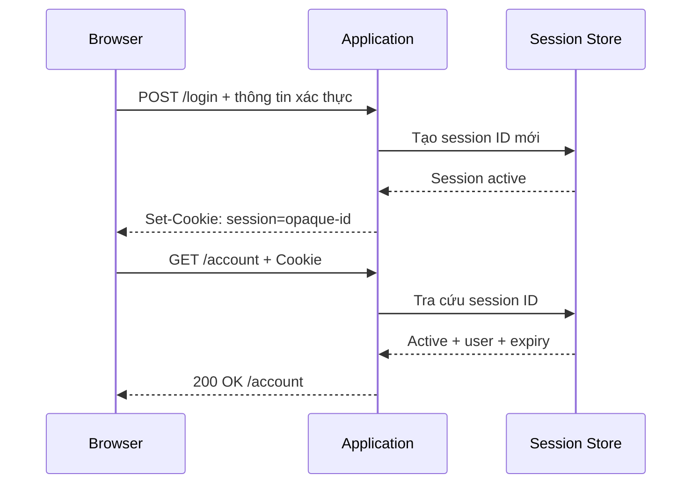
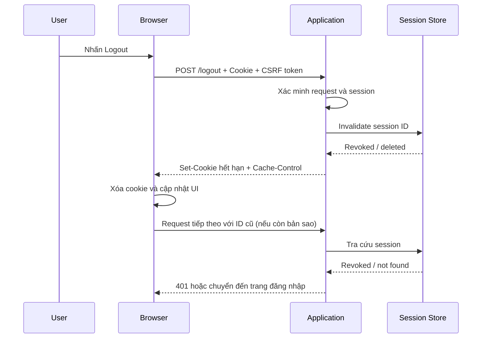
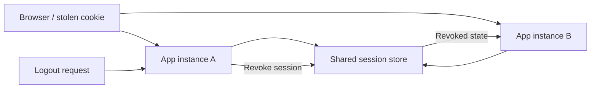

# Session invalidation: thu hồi phiên đăng nhập trên browser và server

## 1. Session invalidation là gì?

**Session invalidation** là quá trình làm cho một phiên đăng nhập hoặc phiên ứng dụng không còn được chấp nhận. Sau khi phiên bị thu hồi, request tiếp theo dùng session identifier cũ phải bị server từ chối, kể cả khi trình duyệt vẫn còn giữ cookie chứa identifier đó.

Một phiên web thường gồm hai phần:

- **Browser side:** cookie hoặc credential mà trình duyệt gửi trong request, thường là một session ID ngẫu nhiên.
- **Server side:** bản ghi hoặc trạng thái phiên, liên kết session ID với người dùng, thời hạn, quyền, trạng thái xác thực và thông tin quản lý phiên.

Vì vậy, xóa cookie và thu hồi phiên là hai thao tác khác nhau. Xóa cookie giúp trình duyệt ngừng gửi credential trong các request tiếp theo. Thu hồi ở server mới làm cho credential cũ mất hiệu lực. Một session ID đã bị sao chép trước đó vẫn có thể được dùng từ thiết bị khác nếu server chưa thu hồi nó.

Bài viết thuộc chương **Session trên browser** của module **SECURITY_APPLICATION_SECURITY_BROWSER_SECURITY**. Nội dung tập trung vào vòng đời phiên, logout, hết hạn, thu hồi từng phiên hoặc tất cả phiên, xử lý cookie, race condition và các kiến trúc session stateful/stateless. Đây là lớp nền để bảo vệ xác thực, cookie, SOP/CORS và phòng CSRF, XSS cùng các hình thức chiếm quyền phiên.

Sau bài học, bạn có thể:

- Phân biệt session invalidation, cookie deletion, session expiration và token expiration.
- Mô tả quy trình logout an toàn ở cả browser và server.
- Thu hồi một phiên, toàn bộ phiên của người dùng hoặc phiên có dấu hiệu bị xâm nhập.
- Thiết kế idle timeout, absolute timeout, rotation và revoke.
- Hiểu giới hạn thu hồi của JWT/stateless access token và vai trò refresh-token rotation.
- Phân tích race condition, cache, nhiều tab và nhiều server instance.
- Kiểm chứng hành vi sau logout bằng DevTools và request thực tế.

## 2. Session hoạt động như thế nào?

HTTP không tự duy trì trạng thái đăng nhập giữa các request. Ứng dụng thường dùng một session identifier ngẫu nhiên để liên kết request hiện tại với trạng thái phiên được lưu ở server.



Server phải kiểm tra session ở mỗi request nhạy cảm. Không nên chỉ kiểm tra rằng cookie có tồn tại hoặc có định dạng hợp lệ. Session ID là bearer credential: bất kỳ ai sở hữu giá trị còn hiệu lực đều có thể thử dùng nó như phiên của người dùng.

### 2.1. Các trạng thái của một phiên

Có thể mô hình hóa vòng đời phiên bằng các trạng thái:

| Trạng thái | Ý nghĩa | Request dùng session ID |
|---|---|---|
| Created | Vừa được tạo, chưa hoàn tất xác thực nếu quy trình có bước trung gian | Chỉ được phép theo luồng đã định |
| Active | Đã xác thực và còn hiệu lực | Có thể được chấp nhận sau kiểm tra |
| Expired | Hết idle timeout hoặc absolute timeout | Phải từ chối |
| Revoked | Bị logout, thu hồi hoặc vô hiệu hóa do rủi ro | Phải từ chối |
| Rotated | ID cũ được thay bằng ID mới | ID cũ phải bị từ chối theo chính sách |
| Compromised | Có dấu hiệu bị lộ hoặc chiếm quyền | Phải thu hồi và xử lý sự cố |

Đây là mô hình nghiệp vụ minh họa; hệ thống có thể lưu trạng thái bằng cột revoked_at, expires_at, version hoặc xóa bản ghi session. Điều quan trọng là quyết định chấp nhận phải được server kiểm soát.

## 3. Invalidate session khác xóa cookie

### 3.1. Chỉ xóa cookie chưa thu hồi session

Giả sử trình duyệt giữ:

```http
Cookie: __Host-session=SESSION_ABC
```

Người dùng nhấn Logout. Nếu server chỉ trả:

```http
Set-Cookie: __Host-session=; Path=/; Max-Age=0; Secure; HttpOnly; SameSite=Lax
```

trình duyệt sẽ xóa cookie phù hợp. Nhưng nếu session SESSION_ABC vẫn còn trong session store, một bản sao cookie đã bị đánh cắp hoặc lưu ở thiết bị khác vẫn có thể sử dụng được.

**Kết luận:** xóa cookie là thao tác phía browser; invalidate session là thao tác phía server. Logout an toàn thường cần thực hiện cả hai.

### 3.2. Chỉ invalidate server nhưng không xóa cookie cũng chưa hoàn chỉnh

Nếu server đánh dấu session ID là revoked nhưng không xóa cookie, browser tiếp tục gửi cookie cũ trong các request. Server phải từ chối chúng, nhưng người dùng có thể gặp lỗi lặp lại, và cookie vô dụng vẫn còn trong storage.

Do đó, logout nên:

1. Xác định phiên hiện tại từ credential.
2. Thu hồi hoặc xóa session ở server.
3. Xóa cookie bằng Set-Cookie cùng tên và scope phù hợp.
4. Trả response không chứa dữ liệu nhạy cảm, với chính sách cache phù hợp.
5. Chuyển giao diện sang trạng thái đã đăng xuất.

### 3.3. Bảng phân biệt

| Thao tác | Nơi thực thi | Tác dụng | Điều nó không bảo đảm |
|---|---|---|---|
| Xóa cookie | Browser qua Set-Cookie hết hạn | Browser ngừng gửi cookie phù hợp | Không vô hiệu hóa bản sao credential ở nơi khác |
| Invalidate server session | Session store hoặc server auth layer | Request dùng session ID cũ bị từ chối | Không tự xóa cookie ở browser |
| Hết hạn cookie | Browser theo Expires/Max-Age | Browser ngừng gửi cookie sau thời hạn | Không bảo đảm server đã hết hạn session |
| Hết hạn session | Server theo idle/absolute timeout | Server từ chối phiên quá hạn | Không tự xóa cookie ở client |
| Thu hồi refresh token | Authorization server/token store | Không thể dùng refresh token cũ để lấy access token mới | Access token đã phát hành có thể còn hiệu lực đến expiry nếu không có kiểm tra revoke |
| Xóa cache client | App/service worker/browser cache theo cơ chế riêng | Giảm khả năng hiển thị dữ liệu cũ trên thiết bị | Không thay thế server-side authorization |

## 4. Quy trình logout an toàn

### 4.1. Luồng logout chuẩn



Server cần thu hồi phiên trước khi báo logout thành công. Nếu session store lỗi hoặc thao tác thu hồi thất bại, không nên trả response như thể phiên đã được thu hồi hoàn toàn. Có thể trả lỗi có kiểm soát và ghi log sự cố; không ghi session ID hoặc cookie nguyên văn.

### 4.2. Logout nên là POST và cần bảo vệ CSRF

Logout làm thay đổi trạng thái phiên, do đó nên dùng POST hoặc phương thức không an toàn khác có bảo vệ CSRF, thay vì GET.

Nếu endpoint logout chỉ dùng GET, một website khác có thể điều hướng browser tới URL đó và ép người dùng đăng xuất ngoài ý muốn. Đây thường là rủi ro về tính sẵn sàng/trải nghiệm, nhưng logout CSRF cũng có thể kết hợp với login CSRF hoặc quy trình nhiều bước để gây nhầm lẫn.

Có thể bảo vệ logout bằng CSRF token, kiểm tra Origin/Referer và Fetch Metadata theo kiến trúc ứng dụng. SameSite cookie giúp giảm một số request cross-site nhưng không phải lớp bảo vệ duy nhất, đặc biệt với sibling subdomain same-site.

### 4.3. Xóa cookie phải khớp scope đã phát hành

Giả sử cookie được phát như sau:

```http
Set-Cookie: __Host-session=abc; Path=/; Secure; HttpOnly; SameSite=Lax
```

Response logout nên xóa cookie cùng tên và các thuộc tính phạm vi tương ứng:

```http
Set-Cookie: __Host-session=; Path=/; Max-Age=0; Secure; HttpOnly; SameSite=Lax
```

Đối với host-only cookie, không thêm Domain trong header xóa. Với cookie cũ có Domain hoặc Path khác, cần phát header xóa đúng phạm vi cũ. Cookie trùng tên ở nhiều Path/Domain có thể cần nhiều thao tác xóa riêng.

Prefix __Host- yêu cầu Secure, Path=/ và không Domain trong trình duyệt hỗ trợ. Không thể dùng tên __Host- để xóa cookie nếu header xóa vi phạm các điều kiện prefix.

## 5. Invalidate một phiên hay tất cả phiên?

Ứng dụng có thể cho phép người dùng đăng xuất khỏi thiết bị hiện tại, đăng xuất khỏi thiết bị khác hoặc thu hồi mọi phiên.

### 5.1. Thu hồi phiên hiện tại

Khi logout thông thường, server lấy session hiện tại từ cookie đã xác thực, thu hồi session ID đó trong store và xóa cookie trên browser đang dùng.

Không nhận session ID cần thu hồi từ body do client tự gửi rồi tin trực tiếp. Server phải xác định phiên từ request đã được xác thực và kiểm tra quyền sở hữu.

### 5.2. Thu hồi tất cả phiên của một người dùng

Một số sự kiện cần vô hiệu hóa nhiều phiên:

- Người dùng chọn "Log out all devices".
- Đổi mật khẩu hoặc reset mật khẩu.
- Tài khoản bị khóa hoặc vô hiệu hóa.
- Phát hiện credential/session bị lộ.
- Thay đổi quyền hoặc yếu tố xác thực quan trọng.
- Quản trị viên thu hồi phiên theo quy trình ứng cứu.

Có thể lưu session theo user ID để duyệt và revoke từng phiên. Một cách khác là dùng **session version / auth epoch** ở cấp tài khoản:

1. Mỗi session lưu auth_version tại thời điểm tạo.
2. User record lưu auth_version hiện tại.
3. Khi cần thu hồi tất cả phiên, tăng auth_version.
4. Mỗi request so sánh version của session với version hiện tại; khác nhau thì từ chối.

Cách version giúp thu hồi hàng loạt mà không cần xóa từng bản ghi, nhưng đòi hỏi đọc version mới đủ nhanh và nhất quán. Nếu cache version quá lâu, phiên cũ có thể còn được chấp nhận trong khoảng cache TTL.

### 5.3. Thu hồi phiên từ thiết bị cụ thể

Giao diện "Your devices" có thể hiển thị danh sách phiên với metadata không nhạy cảm:

- Tên thiết bị hoặc loại trình duyệt suy luận từ User-Agent.
- Thời điểm tạo và hoạt động gần nhất.
- Vị trí ước lượng nếu chính sách privacy cho phép.
- Trạng thái phiên và thời gian hết hạn.
- Nhãn "Thiết bị hiện tại".

Người dùng cần có khả năng revoke một phiên cụ thể. Không hiển thị session ID, refresh token hoặc cookie trong giao diện. Metadata như IP và vị trí chỉ mang tính gợi ý, không phải bằng chứng tuyệt đối về danh tính thiết bị.

## 6. Expiration, idle timeout và absolute timeout

Session invalidation có thể được kích hoạt bởi người dùng, quản trị viên, sự kiện bảo mật hoặc timeout.

### 6.1. Idle timeout

**Idle timeout** giới hạn thời gian không hoạt động. Mỗi request hợp lệ có thể cập nhật last_seen_at; nếu thời gian hiện tại vượt quá khoảng cho phép kể từ hoạt động cuối, server từ chối session.

Ví dụ: phiên hết hạn sau 30 phút không có hoạt động hợp lệ.

Không nên cập nhật last_seen_at chỉ vì request bất kỳ đến server. Cần xác định request nào thể hiện hoạt động người dùng và session vẫn hợp lệ; nếu không, polling hoặc request nền có thể giữ phiên sống vô hạn.

### 6.2. Absolute timeout

**Absolute timeout** giới hạn tổng thời gian sống của phiên kể từ lúc tạo hoặc xác thực lại, bất kể người dùng hoạt động thường xuyên.

Ví dụ: phiên hết hạn tối đa sau 12 giờ kể từ đăng nhập. Nếu muốn tiếp tục, người dùng phải xác thực lại.

### 6.3. Hai timeout cần kết hợp

```text
created_at       last_seen_at                   now
    |------------------|--------------------------|
    |<-- absolute age -------------------------->|
                       |<------ idle age -------->|

Session hợp lệ khi:
  now < absolute_expires_at
  AND now - last_seen_at < idle_timeout
  AND revoked_at IS NULL
```

Cookie Max-Age/Expires có thể được đặt bằng hoặc ngắn hơn giới hạn phù hợp, nhưng server phải tự kiểm tra expiry. Không dùng thời hạn cookie làm nguồn quyết định duy nhất vì client có thể sửa hoặc gửi cookie thủ công.

### 6.4. Sliding expiration và gia hạn cookie

Một số hệ thống gia hạn thời hạn idle khi người dùng hoạt động. Đây là **sliding expiration**. Nó cần có absolute timeout để hoạt động liên tục không giữ phiên mãi mãi.

Khi gia hạn cookie, server cần bảo đảm session vẫn active và không bị revoke. Không gia hạn chỉ vì nhận một session ID có cấu trúc hợp lệ. Nếu có nhiều request đồng thời, cần cập nhật thời hạn an toàn để request cũ không ghi đè trạng thái revoke hoặc kéo dài session đã hết hạn.

## 7. Session rotation và invalidation

**Rotation** là thay session ID bằng ID mới, thường sau đăng nhập, nâng quyền, thay đổi mật khẩu hoặc sự kiện nhạy cảm. ID cũ cần bị vô hiệu hóa theo chính sách.

Luồng an toàn:

1. Xác minh danh tính và quyền hiện tại.
2. Tạo session ID mới bằng bộ sinh số ngẫu nhiên mật mã.
3. Gắn trạng thái session mới với danh tính/quyền đã xác thực.
4. Thu hồi session ID cũ hoặc đánh dấu ID cũ chỉ được chuyển tiếp trong một cửa sổ rất ngắn nếu có lý do tương thích.
5. Gửi cookie mới với thuộc tính an toàn.
6. Không cho session cũ tiếp tục thực hiện thao tác nhạy cảm.

Rotation giúp giảm session fixation và thu hẹp thời gian sử dụng credential cũ. Chỉ đổi cookie ở browser mà không vô hiệu hóa ID cũ không phải rotation an toàn.

## 8. Stateful session và stateless token

### 8.1. Stateful session

Với session stateful, server lưu trạng thái phiên trong database, cache hoặc session store.

Ưu điểm:

- Thu hồi một phiên tương đối trực tiếp bằng cách xóa hoặc đánh dấu revoked.
- Có thể liệt kê các phiên của người dùng.
- Có thể áp idle timeout, absolute timeout và kiểm tra trạng thái theo từng request.
- Thay đổi quyền hoặc thu hồi có thể có hiệu lực nhanh nếu đọc store nhất quán.

Chi phí:

- Cần session store có độ sẵn sàng và hiệu năng phù hợp.
- Nhiều server instance phải dùng kho trạng thái chung hoặc cơ chế đồng bộ.
- Cần xử lý cache, replication và lỗi store.
- Mỗi request có thể cần một lần tra cứu hoặc kiểm tra phiên.

### 8.2. Stateless access token/JWT

Với access token tự chứa (ví dụ JWT), server có thể xác minh chữ ký và claims mà không tra cứu session record mỗi request. Điều này làm việc thu hồi sớm khó hơn: token đã phát hành vẫn có thể hợp lệ cho đến exp nếu resource server chỉ kiểm tra chữ ký và thời hạn.

Các chiến lược thường dùng:

| Chiến lược | Cách hoạt động | Trade-off |
|---|---|---|
| Access token thời hạn ngắn | Token tự hết hạn sau thời gian ngắn | Giảm cửa sổ rủi ro nhưng không thu hồi tức thì |
| Denylist theo jti | Lưu ID token bị revoke, kiểm tra mỗi request | Cần trạng thái server-side, giảm lợi ích stateless |
| Token version/auth epoch | So sánh version của user hoặc session | Cần tra cứu version và xử lý cache |
| Introspection | Resource server hỏi authorization server token còn active không | Có độ trễ/phụ thuộc dịch vụ trung tâm |
| Thu hồi refresh token | Ngăn cấp access token mới | Access token hiện tại có thể còn hiệu lực đến exp |
| Sender-constrained token | Ràng buộc token với khóa hoặc client | Phức tạp hơn; giảm giá trị token bị đánh cắp |

Không tuyên bố "JWT logout" đã thu hồi token chỉ vì browser xóa token khỏi storage. Nếu cần thu hồi tức thì, kiến trúc phải có cơ chế server-side kiểm tra trạng thái hoặc token lifetime rất ngắn với rủi ro được chấp nhận rõ ràng.

### 8.3. Refresh token rotation và token family

Một mô hình phổ biến là access token sống ngắn và refresh token sống dài hơn. Mỗi lần refresh thành công, authorization server cấp refresh token mới và vô hiệu hóa token cũ.

Nếu refresh token cũ được dùng lại sau khi đã xoay vòng, server có thể xem đó là dấu hiệu token bị sao chép. Server nên thu hồi cả **token family** liên quan và yêu cầu xác thực lại, tùy chính sách.

Logout cần thu hồi refresh token hoặc token family ở server, đồng thời xóa cookie chứa refresh token trên browser. Nếu refresh token được lưu trong cookie HttpOnly, endpoint refresh vẫn cần bảo vệ CSRF thích hợp khi cookie tự động được gửi.

## 9. Nhiều server instance và tính nhất quán của invalidation

Một ứng dụng chạy trên nhiều instance cần bảo đảm mọi instance nhìn thấy trạng thái revoke mới nhất.

Ví dụ:



Nếu mỗi instance giữ session state trong memory riêng, logout qua instance A có thể không ảnh hưởng instance B. Khi request tiếp theo được load balancer chuyển sang B, session cũ vẫn có thể được chấp nhận.

Các yêu cầu thiết kế:

- Dùng session store chung hoặc cơ chế revoke event nhất quán.
- Đảm bảo các cache invalidation được truyền đến mọi instance.
- Có TTL ngắn và quy tắc fail-closed phù hợp cho cache session nhạy cảm.
- Không để replica đọc chậm làm phiên revoked vẫn active lâu hơn mức chấp nhận.
- Định nghĩa hành vi khi session store unavailable: với thao tác nhạy cảm, thường không thể chấp nhận session nếu không kiểm tra được trạng thái cần thiết.
- Ghi nhận thời điểm revoke và correlation ID, không ghi raw session ID.

**Fail-open** khi store lỗi có thể giữ quyền truy cập cho phiên đã bị thu hồi. **Fail-closed** có thể làm gián đoạn dịch vụ khi store lỗi. Đây là quyết định rủi ro và availability cần được thiết kế rõ theo độ nhạy của endpoint.

## 10. Race condition và request đang xử lý

Thu hồi session không nhất thiết hủy được một request đã vượt qua kiểm tra xác thực trước thời điểm revoke.

Ví dụ:

1. Request A xác minh session đang active.
2. Người dùng hoặc quản trị viên thu hồi session.
3. Request A tiếp tục xử lý giao dịch và ghi dữ liệu.

Nếu nghiệp vụ yêu cầu revoke có hiệu lực chặt, cần kiểm tra session/version tại thời điểm commit hoặc kết hợp với transaction/locking phù hợp. Với thao tác tài chính hoặc quyền cao, việc xác thực ở đầu request có thể chưa đủ nếu request kéo dài.

Các biện pháp:

- Kiểm tra trạng thái session gần thời điểm thực hiện thao tác nhạy cảm.
- Dùng transaction và điều kiện version/revocation trong câu lệnh cập nhật.
- Dùng idempotency key cho thao tác có thể retry.
- Hủy job nền nếu session/user đã bị revoke khi job thực hiện quyền theo người dùng.
- Phân biệt request đã được chấp thuận trước revoke với request mới sau revoke trong chính sách nghiệp vụ.

Không nên tuyên bố logout đã hủy mọi công việc đang chạy trừ khi hệ thống có cơ chế hủy/kiểm tra riêng.

## 11. Browser state sau logout: tabs, cache và service worker

### 11.1. Nhiều tab dùng chung cookie

Các tab cùng profile browser và cùng cookie scope thường dùng chung cookie. Khi một tab logout và browser nhận Set-Cookie hết hạn, các tab khác sẽ gửi request tiếp theo mà không có cookie đó.

Tuy nhiên, tab khác có thể vẫn hiển thị DOM đã tải trước đó. Điều này không có nghĩa phiên server còn hiệu lực, nhưng dữ liệu nhạy cảm có thể vẫn nhìn thấy trên màn hình hoặc trong bộ nhớ tab.

### 11.2. Thông báo logout giữa các tab

Ứng dụng có thể dùng BroadcastChannel hoặc storage event để thông báo UI giữa các tab:

```js
const channel = new BroadcastChannel("auth-events");

function notifyLogout() {
  channel.postMessage({ type: "LOGOUT" });
}

channel.addEventListener("message", (event) => {
  if (event.data?.type === "LOGOUT") {
    // Chỉ cập nhật UI: xóa state hiển thị và chuyển tới trang đăng nhập.
    // Server vẫn là nơi quyết định session có còn hiệu lực hay không.
    window.location.assign("/login");
  }
});
```

Đây chỉ là đồng bộ trải nghiệm người dùng. Không dùng message giữa các tab làm bằng chứng bảo mật hoặc thay server-side invalidation; tab có thể bị đóng, bị suspend hoặc không nhận message.

### 11.3. Cache-Control cho response nhạy cảm

Trang tài khoản hoặc dữ liệu nhạy cảm thường cần chính sách cache nghiêm ngặt, ví dụ:

```http
Cache-Control: no-store
```

no-store yêu cầu cache HTTP không lưu response. Nó không bảo đảm xóa dữ liệu đã được script sao chép, ảnh chụp màn hình, DOM trong memory, dữ liệu IndexedDB hoặc Cache Storage. Nếu ứng dụng dùng service worker, cần xem xét cách cache API/private pages và xóa cache phù hợp khi logout.

Với dữ liệu nhạy cảm, server vẫn phải kiểm tra session mỗi lần truy cập API. Không dựa vào việc browser sẽ tự xóa nội dung trang sau logout.

### 11.4. Back-forward cache (bfcache)

Browser có thể khôi phục một trang từ back-forward cache để điều hướng quay lại nhanh. Trang được khôi phục có thể hiện lại DOM trước đó. Ứng dụng có thể lắng nghe pageshow và kiểm tra thuộc tính persisted để cập nhật UI hoặc yêu cầu tải lại dữ liệu; nhưng biện pháp quyết định vẫn là server từ chối request với session đã revoke.

Ví dụ cập nhật giao diện khi trang được khôi phục:

```js
window.addEventListener("pageshow", (event) => {
  if (event.persisted) {
    // Kiểm tra lại trạng thái đăng nhập với server.
    // Không dùng dữ liệu DOM được khôi phục làm bằng chứng phiên còn hiệu lực.
    refreshAuthenticatedView();
  }
});
```

Không xem việc ẩn nội dung bằng JavaScript là bảo vệ dữ liệu đã hiển thị trước đó. Nếu yêu cầu bảo mật cao, giảm dữ liệu nhạy cảm giữ trong DOM/client cache và luôn kiểm tra quyền ở server.

## 12. Ví dụ triển khai logout

### 12.1. Pseudocode server-side

Một endpoint logout có thể thực hiện:

```text
POST /logout
  1. Kiểm tra CSRF và request context
  2. Đọc session hiện tại từ cookie
  3. Tra cứu session và xác nhận trạng thái
  4. Đánh dấu revoked / xóa session trong store
  5. Thu hồi refresh token family nếu có
  6. Phát Set-Cookie hết hạn với đúng cookie scope
  7. Trả response no-store
```

Endpoint nên idempotent: gọi logout lần nữa với session đã hết hạn hoặc đã revoke vẫn trả kết quả phù hợp, không tạo ra phiên mới và không làm lộ thông tin session.

### 12.2. Ví dụ Node/Express với express-session

Ví dụ minh họa cho ứng dụng đã cấu hình express-session với cookie tên __Host-session, Path=/, Secure, HttpOnly, SameSite=Lax và không có Domain:

```js
app.post("/logout", requireCsrfProtection, (req, res, next) => {
  const cookieOptions = {
    path: "/",
    secure: true,
    httpOnly: true,
    sameSite: "lax",
  };

  req.session.destroy((error) => {
    if (error) return next(error);

    res.clearCookie("__Host-session", cookieOptions);
    res.set("Cache-Control", "no-store");
    return res.status(204).end();
  });
});
```

Lưu ý:

- express-session phải được cấu hình cookie name là __Host-session; tên mặc định của middleware có thể khác.
- Store được dùng phải hỗ trợ destroy/invalidation đúng cách và chia sẻ giữa các instance.
- Không cấu hình Domain cho cookie __Host-session.
- Tùy phiên bản framework, clearCookie và cách serialize cookie có chi tiết riêng; xác minh response Set-Cookie thực tế trong Network.
- Nếu session ID đã bị sao chép, destroy phải làm cho store không còn chấp nhận ID cũ.
- Nếu ứng dụng dùng refresh token hoặc token family riêng, cần revoke chúng ở authorization server nữa.

Đây là ví dụ triển khai minh họa; cần kiểm tra CSRF middleware, session store và cookie options của phiên bản đang dùng trước khi áp dụng production.

### 12.3. Phản hồi sau logout

Có thể trả 204 No Content hoặc redirect tới trang public. Không nên đưa session ID, cookie hoặc thông tin người dùng nhạy cảm vào URL redirect hay response body.

Nếu redirect, chỉ redirect đến URL nội bộ đã được kiểm tra; tránh open redirect. Trang đăng nhập sau logout nên không hiển thị dữ liệu phiên cũ và không cache thông tin riêng tư.

## 13. Kiểm thử session invalidation

### Bài A — Xác nhận server từ chối session cũ

1. Đăng nhập vào ứng dụng demo qua HTTPS/localhost.
2. Mở DevTools → Network và lưu request authenticated thành công.
3. Ghi nhận cookie name, không sao chép hoặc chia sẻ giá trị session thật.
4. Logout bằng endpoint ứng dụng.
5. Kiểm tra response có Set-Cookie hết hạn đúng tên và scope.
6. Gửi request đến endpoint cần đăng nhập bằng cookie cũ trong môi trường test có kiểm soát.
7. Xác nhận server trả 401/redirect phù hợp và session store đánh dấu revoked hoặc không còn bản ghi.

Mục tiêu: chứng minh credential cũ bị từ chối ở server, không chỉ chứng minh browser đã xóa cookie.

### Bài B — Kiểm tra cookie deletion scope

Tạo cookie thử nghiệm với các scope khác nhau:

```http
Set-Cookie: demo_host=one; Path=/; Secure; HttpOnly
Set-Cookie: demo_path=two; Path=/admin; Secure; HttpOnly
Set-Cookie: demo_domain=three; Domain=example.test; Path=/; Secure; HttpOnly
```

Thử xóa từng cookie với header cùng tên và đúng Domain/Path. Quan sát Storage xem cookie nào còn tồn tại. Thực hiện trên domain test bạn kiểm soát, không dùng session thật.

### Bài C — Kiểm tra nhiều tab

1. Đăng nhập và mở cùng ứng dụng ở hai tab.
2. Giữ một trang có dữ liệu đã tải ở tab thứ hai.
3. Logout từ tab thứ nhất.
4. Quan sát cookie trong Storage và giao diện tab thứ hai.
5. Gọi API yêu cầu xác thực từ tab thứ hai.
6. Xác nhận API từ chối vì session đã revoke, dù DOM cũ có thể vẫn hiển thị cho tới khi UI cập nhật.

Thử bật/tắt BroadcastChannel để phân biệt thông báo UI với quyết định server-side.

### Bài D — Kiểm tra revoke all sessions

1. Đăng nhập trên hai browser profile hoặc hai thiết bị test.
2. Dùng chức năng "Log out all devices" hoặc endpoint admin test để tăng auth version/revoke toàn bộ session.
3. Gửi request từ cả hai profile.
4. Xác nhận mọi session cũ bị từ chối.
5. Đăng nhập lại và xác nhận session mới hoạt động với version hiện tại.

### Bài E — Kiểm tra refresh token rotation

Trong môi trường OAuth/OIDC test:

1. Đăng nhập và nhận access token cùng refresh token.
2. Dùng refresh token một lần để lấy token mới.
3. Thử dùng lại refresh token cũ.
4. Xác nhận authorization server phát hiện reuse theo chính sách và thu hồi token family hoặc từ chối.
5. Logout và thử refresh lần nữa; token đã revoke phải bị từ chối.

Không gửi access token/refresh token thật vào console log, ticket hoặc tài liệu học tập.

## 14. Những lỗi thường gặp

| Nhận định hoặc cách làm sai | Vì sao sai | Cách làm đúng |
|---|---|---|
| Chỉ xóa cookie khi logout | Bản sao session ID vẫn dùng được | Revoke server-side và xóa cookie |
| Chỉ revoke server, không xóa cookie | Browser tiếp tục gửi credential cũ | Xóa cookie cùng scope |
| Dùng GET cho logout | Có thể bị kích hoạt bởi cross-site navigation | Dùng POST và CSRF protection |
| Chỉ dựa vào Max-Age của cookie | Client có thể giữ/sao chép cookie; server session vẫn active | Server tự kiểm tra timeout và revoke |
| Cho rằng JWT bị thu hồi khi xóa khỏi localStorage | Bản sao token vẫn hợp lệ tới exp nếu không có kiểm tra revoke | Denylist, introspection, version hoặc access token ngắn hạn |
| Mỗi instance lưu session trong memory riêng | Logout một instance không cập nhật instance khác | Shared store hoặc cơ chế revoke nhất quán |
| Cho phép request dài hoàn tất mà không kiểm tra lại | Request có thể commit sau thời điểm revoke | Kiểm tra trạng thái gần thời điểm commit cho thao tác nhạy cảm |
| Nghĩ logout tự xóa DOM ở mọi tab | Tab khác có thể giữ nội dung đã tải | Đồng bộ UI, no-store và server authorization |
| Nghĩ no-store xóa mọi bản sao dữ liệu | DOM, screenshot, IndexedDB và app cache vẫn có thể tồn tại | Quản lý client cache riêng, giảm dữ liệu lưu |
| Không xử lý refresh token | Có thể cấp access token mới sau logout | Revoke refresh token/family |
| Ghi session ID vào log | Log trở thành nơi lưu bearer credential | Mask/redact và chỉ ghi correlation metadata |

## 15. Checklist thiết kế invalidation

Trước khi phát hành hệ thống session, hãy kiểm tra:

1. **Credential:** Session ID ngẫu nhiên, khó đoán, không chứa thông tin cá nhân.
2. **Server authority:** Server store là nguồn quyết định phiên active/revoked; cookie chỉ mang identifier.
3. **Logout:** Dùng POST, CSRF protection và revoke server-side trước khi báo thành công.
4. **Cookie deletion:** Cùng tên, host, Domain/Path và prefix requirements; host-only cookie không thêm Domain.
5. **Timeout:** Có idle timeout và absolute timeout ở server.
6. **Rotation:** Đổi session ID sau login, nâng quyền và sự kiện nhạy cảm; vô hiệu hóa ID cũ.
7. **Global revoke:** Có cách thu hồi mọi phiên khi đổi mật khẩu, khóa tài khoản hoặc phát hiện compromise.
8. **Token architecture:** Với JWT, xác định rõ chiến lược revoke, expiry, introspection hoặc token version.
9. **Refresh token:** Rotation, reuse detection và family revocation được triển khai nếu có refresh token.
10. **Distributed systems:** Shared store, cache invalidation, consistency và hành vi fail-closed được xác định.
11. **Concurrency:** Đánh giá request đang chạy, job nền và thời điểm commit sau revoke.
12. **Browser state:** Xử lý nhiều tab, bfcache, service worker, IndexedDB và response cache nhạy cảm.
13. **Observability:** Log sự kiện logout/revoke nhưng không log cookie, session ID hoặc token nguyên văn.
14. **Verification:** Test request bằng session cũ, nhiều tab, nhiều instance và refresh token reuse.

## 16. Câu hỏi ôn tập

1. Vì sao xóa cookie không đồng nghĩa invalidate session?
2. Logout an toàn cần thực hiện những thao tác nào ở browser và server?
3. Vì sao logout nên dùng POST và cần CSRF protection?
4. Cookie deletion cần khớp những thuộc tính phạm vi nào?
5. Khác biệt giữa idle timeout và absolute timeout là gì?
6. Vì sao sliding expiration vẫn cần absolute timeout?
7. Session rotation khác việc ghi cookie mới ở điểm nào?
8. Vì sao JWT stateless khó thu hồi tức thì?
9. Refresh token rotation phát hiện reuse như thế nào?
10. Vì sao session store dùng chung quan trọng khi chạy nhiều instance?
11. Request đã vượt qua kiểm tra session trước khi revoke có thể tiếp tục không?
12. BroadcastChannel có thể thay server-side invalidation không?
13. Cache-Control no-store có xóa dữ liệu DOM hoặc screenshot không?
14. Vì sao logout all devices cần cơ chế version/revoke ở server?

**Đáp án định hướng:** (1) Cookie có thể đã bị sao chép; server vẫn chấp nhận ID nếu chưa revoke. (2) Revoke session, xóa cookie đúng scope, xử lý UI/cache và revoke refresh credential nếu có. (3) Logout thay đổi trạng thái và GET có thể bị điều hướng cross-site kích hoạt. (4) Tên, host, Domain và Path; đồng thời tuân prefix như __Host-. (5) Idle dựa hoạt động gần nhất; absolute dựa tổng thời gian từ lúc tạo/xác thực. (6) Nếu chỉ sliding, hoạt động liên tục có thể kéo dài phiên vô hạn. (7) Rotation phải làm ID cũ mất hiệu lực ở server. (8) Resource server có thể chỉ xác minh chữ ký và exp, không có trạng thái revoke. (9) Token cũ đã dùng lại sau rotation được xem là dấu hiệu sao chép; server có thể revoke cả family. (10) Để mọi instance nhìn thấy trạng thái revoke. (11) Có thể, nếu không kiểm tra lại tại thời điểm commit; cần kiểm soát concurrency cho thao tác nhạy cảm. (12) Không; đó chỉ là đồng bộ UI. (13) Không. (14) Browser không thể xóa cookie trên mọi thiết bị; server phải từ chối mọi session cũ.

## 17. Tài liệu tham khảo

- [OWASP — Session Management Cheat Sheet](https://cheatsheetseries.owasp.org/cheatsheets/Session_Management_Cheat_Sheet.html): Vòng đời session, timeout, rotation và invalidation.
- [OWASP — Authentication Cheat Sheet](https://cheatsheetseries.owasp.org/cheatsheets/Authentication_Cheat_Sheet.html): Re-authentication, logout và quản lý xác thực.
- [OWASP — Cross-Site Request Forgery Prevention Cheat Sheet](https://cheatsheetseries.owasp.org/cheatsheets/Cross-Site_Request_Forgery_Prevention_Cheat_Sheet.html): CSRF token, SameSite và kiểm tra nguồn request.
- [RFC 7009 — OAuth 2.0 Token Revocation](https://www.rfc-editor.org/rfc/rfc7009): Giao thức thu hồi access token và refresh token.
- [RFC 9700 — Best Current Practice for OAuth 2.0 Security](https://www.rfc-editor.org/rfc/rfc9700): Các thực hành bảo mật OAuth hiện đại, gồm refresh token rotation và phát hiện reuse.
- [MDN — Set-Cookie](https://developer.mozilla.org/en-US/docs/Web/HTTP/Reference/Headers/Set-Cookie): Cookie scope và cách hết hạn cookie.
- [MDN — Cache-Control](https://developer.mozilla.org/en-US/docs/Web/HTTP/Reference/Headers/Cache-Control): Các chỉ thị cache như no-store.
- [MDN — Back/forward cache](https://developer.mozilla.org/en-US/docs/Glossary/bfcache): Cách browser khôi phục trang từ back-forward cache.
- [MDN — Broadcast Channel API](https://developer.mozilla.org/en-US/docs/Web/API/Broadcast_Channel_API): Giao tiếp giữa các browsing context cùng origin.

**Kết nối với mô hình bảo mật web:** Session invalidation phải được quyết định ở server. Cookie là credential mà browser gửi; xóa cookie chỉ dọn bản lưu ở một browser, còn revoke làm credential cũ mất hiệu lực ở mọi nơi server kiểm tra trạng thái. Một logout đáng tin cậy kết hợp revoke server-side, xóa cookie đúng scope, CSRF protection, quản lý timeout/rotation, thu hồi refresh token và xử lý dữ liệu/cache ở các tab.
