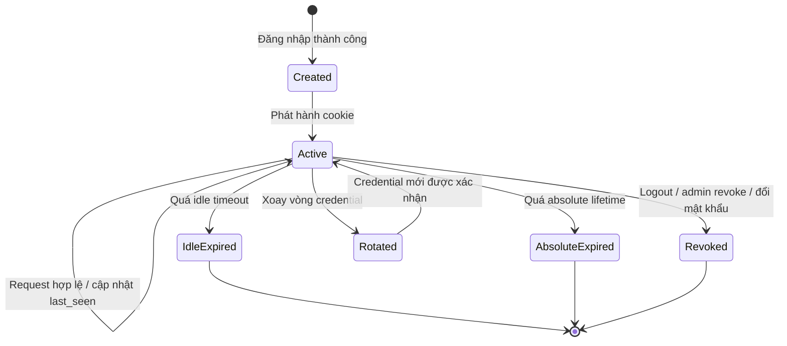
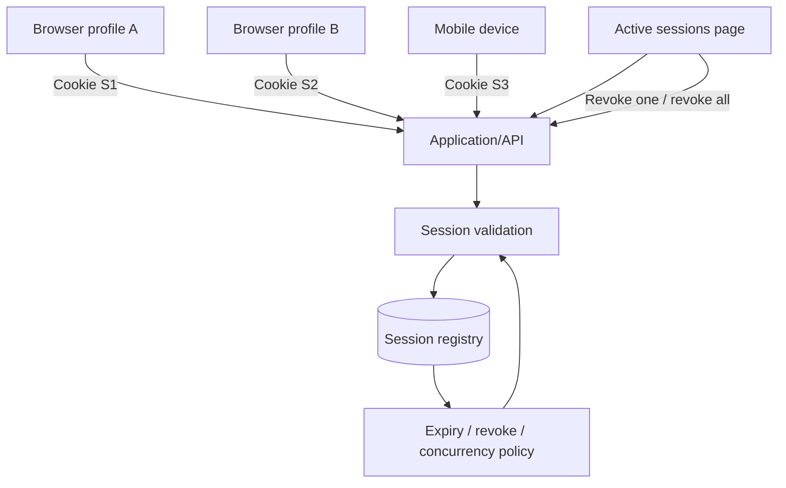

# Concurrent session: quản lý nhiều phiên đăng nhập cùng lúc

Người dùng có thể đăng nhập cùng một tài khoản trên laptop, điện thoại, máy tính bảng và nhiều trình duyệt. Họ cũng có thể mở nhiều tab của cùng ứng dụng. Mỗi trường hợp tạo ra những tương tác khác nhau giữa cookie, trình duyệt và trạng thái phiên ở máy chủ. Nếu ứng dụng không quản lý rõ các phiên đồng thời, người dùng khó biết tài khoản đang được sử dụng ở đâu, còn hệ thống có thể gặp lỗi khi đăng xuất, đổi mật khẩu, xoay vòng token hoặc thu hồi quyền truy cập.

**Concurrent session** (phiên đăng nhập đồng thời) là tình huống một tài khoản có nhiều phiên xác thực còn hiệu lực trong cùng một khoảng thời gian. Ứng dụng cần quyết định có cho phép nhiều phiên hay không, giới hạn số lượng ra sao, theo dõi từng phiên thế nào và thu hồi một hoặc tất cả phiên khi cần.

Bài học thuộc chương **Session trên browser**, trong phạm vi `SECURITY_APPLICATION_SECURITY_BROWSER_SECURITY`: phân tích ranh giới giữa trình duyệt, origin, cookie và ứng dụng web; hiểu Same-Origin Policy, CORS và các cơ chế cách ly; thực hành phòng vệ XSS, CSRF, clickjacking bằng CSP, Trusted Types, security headers và kiểm chứng hành vi thực tế.

## 1. Mục tiêu học tập

Sau bài học, người học có thể:

1. Phân biệt tab, browser profile, thiết bị và phiên xác thực phía máy chủ.
2. Mô tả cách nhiều tab và nhiều trình duyệt dùng cookie/session khác nhau.
3. Lựa chọn chính sách cho phép nhiều phiên, giới hạn số phiên hoặc chỉ cho một phiên hoạt động.
4. Thiết kế session registry phía máy chủ để theo dõi, hết hạn và thu hồi từng phiên.
5. Bảo vệ session ID, xoay vòng sau đăng nhập/nâng quyền và xử lý session fixation.
6. Phân biệt đăng xuất thiết bị hiện tại với đăng xuất mọi thiết bị.
7. Phân tích race condition khi nhiều tab đồng thời refresh token hoặc thay đổi trạng thái phiên.
8. Kiểm thử các tình huống nhiều phiên bằng DevTools và các browser profile riêng.

## 2. Tab không đồng nghĩa với một phiên đăng nhập

Một nhầm lẫn phổ biến là cho rằng mỗi tab trình duyệt tương ứng với một session riêng. Với ứng dụng xác thực bằng cookie, nhiều tab trong cùng browser profile thường chia sẻ cookie jar cho cùng host/domain và cùng origin phù hợp. Vì vậy, nếu tab A đăng nhập và server cập nhật cookie phiên, tab B có thể gửi cookie mới ở request tiếp theo.

| Ngữ cảnh | Cookie/storage thường dùng | Quan hệ với phiên xác thực |
| --- | --- | --- |
| Hai tab cùng profile, cùng origin | Chia sẻ cookie jar; localStorage và IndexedDB cùng origin cũng được chia sẻ | Thường dùng cùng cookie phiên và cùng server session. |
| Hai cửa sổ cùng profile | Thường chia sẻ cookie jar như các tab | Không mặc nhiên là hai phiên đăng nhập độc lập. |
| Hai browser profile riêng | Cookie jar và storage tách biệt | Có thể tạo hai phiên server độc lập cho cùng tài khoản. |
| Hai trình duyệt khác nhau | Cookie jar riêng | Thường tạo hai phiên độc lập. |
| Cửa sổ riêng tư/incognito | Storage riêng với profile thông thường; các cửa sổ riêng tư cùng phiên riêng tư có thể chia sẻ trạng thái theo trình duyệt | Có thể tạo phiên riêng; dữ liệu thường bị xóa khi toàn bộ phiên riêng tư kết thúc. |
| Hai thiết bị khác nhau | Cookie jar riêng trên từng thiết bị | Thường là hai phiên độc lập. |

`sessionStorage` có phạm vi theo top-level browsing context (thường là tab), trong khi cookie, `localStorage` và IndexedDB có quy tắc chia sẻ khác. Không dùng `sessionStorage` để suy ra server đang có bao nhiêu phiên đăng nhập.

### Ví dụ: đăng nhập ở hai tab

Giả sử tab A và tab B cùng mở `https://app.example.com` trong một profile:

1. Tab A gửi thông tin đăng nhập và server tạo session S1.
2. Server trả `Set-Cookie` cho session S1.
3. Cookie được lưu trong profile; tab B gửi request tiếp theo và trình duyệt cũng đính kèm cookie đó.
4. Hai tab thường cùng hoạt động dưới session S1.
5. Nếu tab A đăng xuất và server thu hồi S1, request tiếp theo của tab B phải bị từ chối dù tab B chưa đóng.

Ngược lại, nếu người dùng đăng nhập trên một profile khác, trình duyệt đó có cookie jar riêng. Server có thể tạo session S2 cho cùng user. Đây mới là ví dụ điển hình về hai phiên xác thực đồng thời.

### Một profile có thể chuyển tài khoản

Nếu người dùng đăng nhập tài khoản B trong cùng profile đang có tài khoản A, cookie cùng tên và cùng scope có thể bị thay thế. Các tab A đang mở có thể gửi cookie mới ở request tiếp theo và bất ngờ hoạt động dưới danh tính B. Đây là nguồn gốc của lỗi **account/session confusion**.

Ứng dụng nên:

- Thông báo rõ khi đăng nhập hoặc chuyển tài khoản.
- Xoay session ID khi xác thực thành công và khi thay đổi danh tính.
- Làm mới trạng thái giao diện khi session thay đổi; không giả định tab cũ vẫn thuộc tài khoản trước.
- Kiểm tra quyền ở server trên từng request, không tin dữ liệu user ID lưu trong JavaScript.

## 3. Mô hình phiên phía máy chủ

Cookie nên chứa một mã phiên opaque, ngẫu nhiên và khó đoán. Server dùng mã đó để tra cứu record phiên, danh tính và trạng thái quyền truy cập.

Ví dụ cookie:

```http
Set-Cookie: __Host-session=OPAQUE_RANDOM_SESSION_ID; Path=/; Secure; HttpOnly; SameSite=Lax
```

Không đặt user ID, role, email, thời hạn hay danh sách quyền dưới dạng dữ liệu có thể sửa trực tiếp trong cookie nếu không có thiết kế bảo vệ toàn vẹn phù hợp. Mẫu session opaque giữ trạng thái có thẩm quyền ở server.

### Session registry

Một bảng/collection session có thể lưu các trường:

| Trường | Mục đích |
| --- | --- |
| session_id_hash | Hash của mã phiên; tránh lưu raw session ID khi không cần. |
| user_id | Tài khoản sở hữu phiên. |
| created_at | Thời điểm tạo phiên. |
| last_seen_at | Lần hoạt động gần nhất, có thể cập nhật theo ngưỡng để giảm ghi liên tục. |
| idle_expires_at | Thời điểm hết hạn do không hoạt động. |
| absolute_expires_at | Thời điểm hết hạn tuyệt đối. |
| revoked_at | Thời điểm thu hồi; null nếu chưa thu hồi. |
| auth_time | Thời điểm người dùng xác thực gần nhất. |
| auth_strength | Mức độ xác thực, ví dụ có MFA hoặc xác thực lại gần đây. |
| device_label | Nhãn dễ hiểu cho người dùng, ví dụ “Chrome trên Windows”; không phải định danh đáng tin tuyệt đối. |
| user_agent_summary | Thông tin trình duyệt rút gọn để hỗ trợ nhận diện. |
| last_ip hoặc metadata mạng | Tín hiệu vận hành/rủi ro; có thể thay đổi và cần cân nhắc quyền riêng tư. |
| token_family_id | Nhóm token liên quan nếu dùng refresh token rotation. |

Mỗi request xác thực cần kiểm tra phiên còn tồn tại, chưa bị thu hồi và chưa vượt thời hạn. Không chỉ kiểm tra cookie có mặt hay JWT có chữ ký hợp lệ; cần xác minh phiên/token còn được phép sử dụng theo chính sách hiện tại.

### Mô hình vòng đời



Trạng thái phiên ở server là nguồn quyết định cuối cùng. Cookie có thể còn trong trình duyệt nhưng session đã revoked; server phải từ chối request.

## 4. Chính sách cho phép phiên đồng thời

Không có một chính sách phù hợp với mọi sản phẩm. Cần chọn dựa trên mức độ nhạy cảm của dữ liệu, cách người dùng làm việc và khả năng quản trị thiết bị.

| Chính sách | Hành vi | Ưu điểm | Đánh đổi |
| --- | --- | --- | --- |
| Cho phép nhiều phiên | Mọi thiết bị có thể đăng nhập cùng tài khoản | Trải nghiệm thuận tiện, hỗ trợ làm việc đa thiết bị | Cần quản lý danh sách phiên và thu hồi tốt. |
| Giới hạn tối đa N phiên | Chỉ giữ N phiên; khi vượt giới hạn áp dụng quy tắc đã định | Giảm số credential hoạt động | Cần quyết định phiên nào bị thu hồi và thông báo rõ. |
| Một phiên hoạt động | Đăng nhập mới thu hồi phiên cũ | Hữu ích cho một số hệ thống rủi ro cao hoặc tài khoản dùng chung | Có thể làm gián đoạn người dùng; dễ gây xung đột khi đăng nhập đồng thời. |
| Theo loại thiết bị/ứng dụng | Ví dụ một phiên mobile và một phiên desktop | Phù hợp sản phẩm có chính sách thiết bị riêng | Phân loại thiết bị không tuyệt đối và cần bảo trì. |
| Theo tổ chức/tenant | Giới hạn theo workspace hoặc tenant | Hỗ trợ mô hình doanh nghiệp | Phải xác định rõ phạm vi chính sách và quyền quản trị. |

### Cho phép nhiều phiên

Đây là lựa chọn thường gặp cho ứng dụng tiêu dùng. Server tạo một session record mới cho mỗi lần đăng nhập độc lập. Người dùng có thể xem danh sách phiên đang hoạt động và thu hồi thiết bị lạ.

### Giới hạn N phiên

Khi tạo phiên mới và số phiên hợp lệ vượt N, server cần thực hiện một quy tắc nhất quán, ví dụ:

- Thu hồi phiên ít hoạt động nhất.
- Từ chối đăng nhập mới và yêu cầu người dùng tự thu hồi một phiên.
- Thu hồi phiên cũ nhất sau khi thông báo.

Không nên chỉ đếm số phiên ở client. Hai lần đăng nhập gần như đồng thời có thể cùng đọc số lượng hiện tại rồi cùng tạo session, khiến vượt giới hạn. Việc kiểm tra và tạo/thu hồi cần được thực hiện bằng transaction, lock hoặc thao tác atomic phù hợp ở server.

### Chỉ cho một phiên hoạt động

Nếu chính sách yêu cầu một phiên duy nhất, khi đăng nhập mới:

1. Server xác thực thông tin đăng nhập.
2. Trong thao tác nguyên tử, thu hồi session đang hoạt động của user.
3. Tạo session mới và phát hành cookie mới.
4. Request từ thiết bị cũ bị từ chối ở lần kiểm tra kế tiếp.

Nếu hai đăng nhập xảy ra đồng thời, server cần đảm bảo chỉ một thao tác cuối cùng được chấp nhận theo chính sách. Có thể dùng transaction/row lock hoặc version/session generation ở cấp user. Không dựa vào thứ tự request đến từ trình duyệt.

Không dùng “một session duy nhất” như biện pháp chống mọi hành vi chia sẻ tài khoản. Người dùng có thể đăng nhập lại liên tục, và kẻ tấn công có thể gây gián đoạn bằng cách tạo đăng nhập mới. Kết hợp rate limiting, MFA, cảnh báo và quy trình khôi phục tài khoản.

## 5. Tạo, xoay vòng và xác thực session ID

### Sinh session ID khó đoán

Session ID phải được tạo bằng CSPRNG, có entropy đủ lớn (ví dụ tối thiểu 128 bit ngẫu nhiên; 256 bit là lựa chọn phổ biến), không chứa thông tin nhận diện có thể đoán. Không tạo ID từ timestamp, user ID, email hoặc bộ đếm.

Server nên lưu hash của ID nếu kiến trúc cho phép. Khi request đến:

1. Đọc cookie session từ request.
2. Hash/lookup ID trong session registry.
3. Kiểm tra tồn tại, chưa revoked, chưa idle/absolute expired.
4. Kiểm tra tài khoản còn hoạt động và phiên có quyền phù hợp.
5. Chỉ sau đó mới gắn principal/session vào request context.

Không ghi raw session ID hoặc cookie value vào log. Nếu cần truy vết, dùng session record ID nội bộ hoặc mã tương quan không thể dùng làm credential.

### Xoay vòng khi đăng nhập và nâng quyền

Session ID phải được đổi khi:

- Người dùng đăng nhập thành công.
- Người dùng hoàn tất MFA hoặc bước xác thực bổ sung.
- Quyền hoặc mức độ xác thực của phiên tăng lên.
- Người dùng đổi mật khẩu hoặc phục hồi tài khoản theo chính sách.

Việc này giảm nguy cơ session fixation: kẻ tấn công cố khiến nạn nhân sử dụng một session ID mà kẻ tấn công đã biết trước khi nạn nhân đăng nhập. Sau khi xác thực, session cũ phải bị vô hiệu hóa và cookie mới được phát hành.

### Không tin dấu hiệu thiết bị như bằng chứng danh tính

IP, User-Agent, vị trí gần đúng và tên thiết bị có thể hỗ trợ người dùng nhận ra phiên lạ, nhưng chúng không phải yếu tố xác thực mạnh:

- IP có thể thay đổi do mạng di động, VPN hoặc NAT.
- Nhiều người dùng có thể dùng chung IP.
- User-Agent có thể bị giả mạo hoặc thay đổi sau cập nhật trình duyệt.
- Fingerprinting quá chi tiết có thể tạo rủi ro quyền riêng tư và vẫn không đảm bảo nhận diện duy nhất.

Không tự động thu hồi phiên chỉ vì IP đổi nếu sản phẩm không có chính sách rủi ro phù hợp. Dùng các tín hiệu này để yêu cầu xác thực lại hoặc cảnh báo theo mô hình rủi ro đã đánh giá.

## 6. Hết hạn phiên: idle timeout và absolute lifetime

Hai mốc thời gian cần được phân biệt:

- **Idle timeout:** phiên hết hạn nếu không có hoạt động hợp lệ trong một khoảng thời gian.
- **Absolute lifetime:** phiên hết hạn sau một thời gian tối đa kể từ lúc tạo, dù người dùng vẫn hoạt động.

Ví dụ chính sách:

| Loại tài khoản/hành động | Idle timeout minh họa | Absolute lifetime minh họa |
| --- | --- | --- |
| Ứng dụng nội dung thông thường | 30 phút | 7 ngày |
| Ứng dụng quản trị | 15 phút | 8 giờ |
| Hành động thanh toán/đổi thông tin xác thực | Yêu cầu xác thực lại theo thời điểm | Không chỉ dựa vào phiên đang mở |

Các con số chỉ là ví dụ; thời hạn thật cần dựa trên rủi ro, yêu cầu sản phẩm và chính sách tổ chức.

Không chỉ cập nhật last_seen_at vì một request nền vô nghĩa hoặc tab chạy polling vô hạn. Nên xác định loại hoạt động được tính là hoạt động của người dùng và cập nhật theo ngưỡng để giảm tải. Với thao tác nhạy cảm, yêu cầu xác thực lại gần đây (reauthentication) thay vì kéo dài mọi phiên.

Cookie Max-Age và session expiry ở server phải phối hợp. Nếu cookie sống lâu hơn server session, request có thể nhận 401/redirect đăng nhập dù cookie vẫn tồn tại. Đây là trạng thái hợp lệ nếu server đã thu hồi hoặc hết hạn session.

## 7. Đăng xuất một phiên và đăng xuất mọi phiên

Đây là hai thao tác khác nhau:

### Logout thiết bị hiện tại

Khi người dùng nhấn “Đăng xuất”:

1. Server xác thực session hiện tại.
2. Server đánh dấu session hiện tại revoked hoặc xóa record theo chính sách.
3. Server gửi cookie hết hạn với cùng tên và scope.
4. Các thiết bị/phiên khác của user vẫn hoạt động.

Ví dụ:

```http
Set-Cookie: __Host-session=; Max-Age=0; Path=/; Secure; HttpOnly; SameSite=Lax
```

Xóa cookie chỉ tác động browser hiện tại. Thu hồi phía server mới làm credential đó mất hiệu lực nếu đã bị sao chép sang nơi khác.

### Logout all sessions

Khi người dùng chọn “Đăng xuất khỏi tất cả thiết bị” hoặc đổi mật khẩu theo chính sách:

1. Server thu hồi tất cả session active của user.
2. Thu hồi refresh token family hoặc credential liên quan.
3. Tăng session generation/version của user nếu kiến trúc sử dụng.
4. Gửi thông báo hoặc ghi sự kiện bảo mật phù hợp.
5. Phiên trên các thiết bị khác bị từ chối ở request tiếp theo hoặc khi nhận tín hiệu thu hồi.

Không thể xóa cookie từ xa trực tiếp khỏi một thiết bị offline. Server phải đảm bảo cookie cũ không còn được chấp nhận khi thiết bị kết nối lại.

### Danh sách thiết bị đang đăng nhập

Giao diện quản lý phiên nên hiển thị thông tin vừa đủ:

- Tên trình duyệt/thiết bị đã chuẩn hóa.
- Thời điểm đăng nhập và hoạt động gần nhất.
- Vị trí gần đúng hoặc IP rút gọn nếu thật sự cần và có thông báo quyền riêng tư.
- Nhãn “Phiên hiện tại”.
- Nút thu hồi từng phiên và nút thu hồi tất cả phiên.

Không hiển thị raw session ID, refresh token, cookie hoặc dữ liệu có thể dùng để chiếm phiên. API quản lý phiên phải xác thực user sở hữu và phân quyền server-side; thao tác revoke bằng cookie cần chống CSRF.

## 8. Refresh token rotation và các request đồng thời

Ứng dụng có thể dùng access token ngắn hạn cùng refresh token dài hạn. Khi refresh token được sử dụng, server cấp token mới và vô hiệu hóa token cũ. Điều này giúp phát hiện token bị sao chép nếu token cũ được sử dụng lại.

### Vấn đề khi nhiều tab refresh cùng lúc

Giả sử tab A và tab B cùng dùng refresh token R1:

1. Tab A gửi R1, server xác nhận và phát hành R2.
2. Tab B gần như đồng thời gửi R1.
3. Nếu server đã đánh dấu R1 đã dùng, request B có thể bị xem là reuse.
4. Hệ thống có thể thu hồi cả token family, khiến người dùng bị đăng xuất dù không có kẻ tấn công.

Đây là race condition thực tế trong ứng dụng nhiều tab.

### Cách giảm race condition

- Dùng cơ chế single-flight/lock ở client để chỉ một refresh đang diễn ra trong cùng một profile.
- Các tab khác chờ kết quả refresh hoặc nhận tín hiệu đồng bộ qua BroadcastChannel/cơ chế phù hợp.
- Server thực hiện rotation bằng transaction/atomic compare-and-swap.
- Xác định chính sách cho request trùng lặp rất gần nhau; có thể hỗ trợ idempotency hoặc một khoảng xử lý hẹp theo thiết kế, nhưng không được vô hiệu hóa khả năng phát hiện reuse.
- Khi phát hiện reuse thật, thu hồi token family và yêu cầu xác thực lại.

Client-side lock không đủ làm ranh giới bảo mật vì client có thể bị sửa đổi hoặc request đến từ thiết bị khác. Server vẫn phải đảm bảo tính nguyên tử và trạng thái token chính xác.

### JWT và khả năng thu hồi phiên

JWT access token có chữ ký hợp lệ vẫn có thể còn được chấp nhận cho đến khi hết hạn nếu server không tra cứu trạng thái hoặc kiểm tra phiên. Vì vậy, “logout all” không tự động thu hồi JWT đã phát hành.

| Mô hình | Cách thu hồi | Đánh đổi |
| --- | --- | --- |
| Opaque server-side session | Đánh dấu session record revoked | Cần tra cứu session store hoặc cache nhất quán khi xác thực request. |
| Access JWT ngắn hạn + refresh token server-side | Thu hồi refresh token; access token hết hạn trong thời gian ngắn | Có một khoảng thời gian access token cũ còn hiệu lực. |
| JWT + session/version check | So sánh claim version với trạng thái user/session ở server | Mất một phần tính stateless; cần thiết kế cache invalidation. |
| JWT denylist | Tra cứu jti hoặc token identifier bị thu hồi | Danh sách cần lưu tới hết hạn token; phải kiểm soát dung lượng và consistency. |

Không lưu refresh token trong localStorage chỉ vì muốn chia sẻ giữa các tab. Với ứng dụng browser dùng cookie, cân nhắc cookie HttpOnly; Secure; SameSite và bảo vệ CSRF phù hợp. Nếu dùng bearer token trong JavaScript, phải đánh giá rủi ro XSS và vòng đời token rất kỹ.

## 9. Concurrent session và các rủi ro bảo mật

### Session fixation

Nếu session ID không được xoay sau đăng nhập, kẻ tấn công có thể tìm cách khiến nạn nhân sử dụng ID đã biết trước. Xoay ID sau xác thực, MFA và nâng quyền; vô hiệu hóa ID cũ.

### Session hijacking

Nếu cookie phiên bị đánh cắp qua malware, extension độc hại, XSS hoặc log, kẻ tấn công có thể sử dụng phiên độc lập với tab đang hoạt động của nạn nhân. Dùng HTTPS, Secure, HttpOnly, SameSite, thời hạn hợp lý, rotation và khả năng revoke.

### XSS

HttpOnly ngăn JavaScript đọc cookie trực tiếp, nhưng script XSS vẫn có thể gửi request trong phiên đang hoạt động. Bảo vệ DOM bằng output encoding, API an toàn, CSP và Trusted Types phù hợp; đồng thời kiểm tra authorization ở server.

### CSRF

Cookie được trình duyệt tự động gửi theo scope và chính sách. Mỗi phiên đồng thời đều có thể bị lợi dụng nếu endpoint thay đổi trạng thái không kiểm tra CSRF. Dùng token, kiểm tra Origin/Fetch Metadata và SameSite như lớp bổ sung; không dùng GET để thay đổi dữ liệu.

### Rò rỉ thông tin danh sách phiên

Endpoint /sessions có thể tiết lộ thiết bị, địa chỉ IP, thời gian hoạt động hoặc metadata riêng tư. Chỉ cho user xem phiên của chính mình, không cho client tự truyền user ID tùy ý để truy vấn. Không trả credential hoặc định danh có thể dùng lại.

### Thu hồi không đồng bộ giữa nhiều node

Nếu session store/cache được sao chép trên nhiều node, một node có thể vẫn chấp nhận session vừa bị revoke do cache cũ. Cần xác định thời gian tối đa chấp nhận trạng thái cũ, cơ chế invalidation và mức consistency cho thao tác bảo mật. Với logout all hoặc revoke khẩn cấp, không nên dựa vào cache có TTL dài mà không có cơ chế truyền tín hiệu thu hồi.

## 10. Kiến trúc tham chiếu

Một kiến trúc session registry có thể tổ chức như sau:



Mỗi lần đăng nhập độc lập tạo session record mới theo chính sách. API xác thực cookie bằng registry. Trang quản lý phiên truy vấn các record của user hiện tại và gửi yêu cầu revoke; server xác minh quyền sở hữu, cập nhật trạng thái nguyên tử và phát tín hiệu invalidation tới các node liên quan.

### Pseudo-code xác thực session

```js
async function authenticateRequest(request) {
  const rawSessionId = readCookie(request, '__Host-session');
  if (!rawSessionId) return null;

  const sessionIdHash = hashSessionId(rawSessionId);
  const session = await sessionStore.findByHash(sessionIdHash);
  if (!session) return null;
  if (session.revokedAt) return null;
  if (Date.now() >= session.idleExpiresAt) return null;
  if (Date.now() >= session.absoluteExpiresAt) return null;

  const user = await userStore.findById(session.userId);
  if (!user || user.disabled) return null;

  return { user, session };
}
```

Đây là pseudo-code minh họa; cần xử lý clock source, atomic update, lỗi store, cache và việc cập nhật last_seen_at theo ngưỡng. Không gửi session object hoặc raw ID ra client.

### Pseudo-code thu hồi một phiên

```js
async function revokeSession(currentUser, targetSessionRecordId) {
  const target = await sessionStore.findByRecordId(targetSessionRecordId);

  if (!target || target.userId !== currentUser.id) {
    throw new Error('Session không tồn tại hoặc không được phép');
  }

  await sessionStore.revokeAtomically(target.id, {
    revokedAt: new Date()
  });

  await publishSessionRevocation(target.id);
}
```

Endpoint thực tế phải có authentication, authorization và CSRF protection nếu dùng cookie. Record ID dùng cho giao diện không phải session credential; server vẫn phải kiểm tra user sở hữu record trước khi revoke.

## 11. Thực hành: kiểm chứng nhiều phiên trong browser

Thực hành với tài khoản thử nghiệm trên môi trường local/staging do người học kiểm soát. Không dùng tài khoản production hoặc chia sẻ cookie/token thật.

### 11.1. Chuẩn bị hai browser context

Mở cùng ứng dụng trong:

- Browser profile A (ví dụ profile chính).
- Browser profile B hoặc một trình duyệt khác.

Đăng nhập cùng tài khoản thử nghiệm ở cả hai profile. Mở DevTools → Application/Storage → Cookies và quan sát cookie phiên ở từng profile. Hai profile có cookie jar riêng; giá trị session ID thường khác nhau nếu server tạo phiên độc lập.

### 11.2. Kiểm tra nhiều tab cùng profile

1. Mở tab A và tab B cùng origin trong profile A.
2. Đăng nhập ở tab A.
3. Tải lại tab B và quan sát request Cookie trong Network.
4. Kiểm tra server nhận cùng session record hay không.
5. Đăng xuất ở tab A; thử request API từ tab B.

Kỳ vọng: hai tab thường dùng chung cookie jar và session. Sau khi server revoke session, request tiếp theo từ tab B bị từ chối dù giao diện cũ có thể chưa tự cập nhật.

### 11.3. Kiểm tra revoke một phiên

Nếu ứng dụng có trang quản lý phiên:

1. Đăng nhập ở profile A và B.
2. Mở danh sách phiên trên profile A.
3. Thu hồi phiên tương ứng profile B.
4. Gửi request API từ profile B.
5. Xác nhận server từ chối phiên B, trong khi profile A vẫn hoạt động.

Không nhận diện phiên chỉ dựa vào IP hoặc User-Agent; dùng nhãn thiết bị và metadata để hỗ trợ người dùng, còn thao tác revoke phải gắn với record session ở server.

### 11.4. Kiểm tra logout all

1. Đăng nhập ở ít nhất hai profile.
2. Chọn “Đăng xuất khỏi tất cả thiết bị”.
3. Gửi request mới từ cả hai profile.
4. Xác nhận tất cả session record đã bị revoke hoặc generation/version không còn hợp lệ.
5. Kiểm tra cookie cũ có thể còn trong browser nhưng server không chấp nhận.

### 11.5. Kiểm tra race condition refresh

Trong môi trường thử nghiệm có refresh token rotation:

1. Mở hai tab dùng chung profile.
2. Kích hoạt refresh gần như đồng thời bằng cách hết hạn access token hoặc dùng công cụ test có kiểm soát.
3. Quan sát request refresh, response và trạng thái token family.
4. Xác định liệu một refresh hợp lệ có khiến tab còn lại bị logout nhầm không.
5. Kiểm tra server xử lý atomic rotation, duplicate request và reuse detection.

Không kết luận race chỉ từ hai request có timestamp gần nhau. Cần đối chiếu transaction/state transition ở server. Một request trùng do retry mạng cần được xử lý theo thiết kế idempotency, còn việc sử dụng lại token đã bị đánh cắp vẫn cần phát hiện.

### 11.6. Bằng chứng cần lưu

| Bằng chứng | Cần quan sát |
| --- | --- |
| Cookie ở profile A/B | Cookie jar tách biệt và session cookie tương ứng. |
| Request từ hai tab cùng profile | Cookie/session record thường giống nhau. |
| Server session registry | Mỗi login độc lập tạo record; trạng thái active/revoked rõ ràng. |
| Logout một phiên | Chỉ record mục tiêu bị revoke; phiên khác còn hoạt động. |
| Logout all | Tất cả phiên thuộc user bị revoke; request tiếp theo bị từ chối. |
| Refresh đồng thời | Rotation atomic, xử lý duplicate/race và reuse detection theo chính sách. |

## 12. Checklist thiết kế concurrent session

| Hạng mục | Câu hỏi | Kết quả mong đợi |
| --- | --- | --- |
| Định nghĩa phiên | Tab, profile, thiết bị và server session đã được phân biệt? | Tài liệu sản phẩm nêu rõ mỗi login độc lập tạo/khôi phục phiên thế nào. |
| Chính sách đồng thời | Cho phép nhiều phiên, giới hạn N hay một phiên? | Quy tắc rõ, có xử lý login đồng thời và thông báo người dùng. |
| Session ID | ID có ngẫu nhiên và opaque không? | CSPRNG, entropy đủ, không chứa PII hoặc dữ liệu có thể đoán. |
| Cookie | Cookie có Secure, HttpOnly, SameSite và scope phù hợp? | Ưu tiên host-only và __Host- cho cookie phiên phù hợp. |
| Rotation | ID có đổi sau login/MFA/nâng quyền không? | Session cũ bị vô hiệu hóa, cookie mới được cấp. |
| Expiry | Có idle timeout và absolute lifetime không? | Server kiểm tra cả hai trên request. |
| Registry | Có record theo dõi phiên và trạng thái revoke không? | Server là nguồn quyết định hiệu lực. |
| Logout | Logout hiện tại và logout all có khác nhau rõ không? | Revoke server-side, xóa cookie đúng scope, invalidation nhất quán. |
| Refresh | Nhiều tab refresh đồng thời có race không? | Atomic rotation, đồng bộ client và reuse detection có kiểm soát. |
| CSRF/XSS | Endpoint session management có bảo vệ không? | CSRF protection và XSS defense độc lập. |
| Privacy | Metadata thiết bị/IP có thu thập quá mức không? | Chỉ thu thập cần thiết, hiển thị minh bạch và có thời hạn lưu. |
| Distributed systems | Revoke có lan tới mọi node không? | Có cơ chế invalidation và giới hạn stale state rõ ràng. |
| Audit | Có log đăng nhập, revoke và refresh bất thường không? | Log không chứa raw session ID/token. |

## 13. Câu hỏi tự kiểm tra

1. Vì sao hai tab cùng browser profile thường dùng chung cookie phiên, trong khi hai browser profile riêng có thể có hai session độc lập?
2. sessionStorage khác cookie và localStorage thế nào khi xét nhiều tab?
3. Chính sách cho phép nhiều phiên và chính sách một phiên duy nhất có những đánh đổi nào?
4. Vì sao phải xoay session ID sau đăng nhập và nâng quyền?
5. Logout hiện tại khác logout all sessions ở điểm nào? Vì sao xóa cookie trên một trình duyệt không thu hồi bản sao ở thiết bị khác?
6. Vì sao IP và User-Agent không phải định danh phiên đáng tin cậy?
7. Hai tab cùng refresh một refresh token có thể tạo race condition như thế nào? Server cần bảo vệ thao tác rotation ra sao?
8. Vì sao JWT có chữ ký hợp lệ vẫn có thể được chấp nhận sau khi người dùng chọn logout all?
9. HttpOnly giảm rủi ro nào của XSS và không ngăn được hành vi nào?
10. Làm thế nào để chứng minh một phiên đã bị revoke trên server dù cookie vẫn còn trong DevTools?

**Tiêu chí hoàn thành:** người học có thể phân biệt tab/profile/device với server session, chọn chính sách concurrent session phù hợp, thiết kế registry và vòng đời thu hồi nhất quán, xử lý logout/refresh đồng thời an toàn, và cung cấp bằng chứng từ nhiều browser context cùng trạng thái phía máy chủ.
