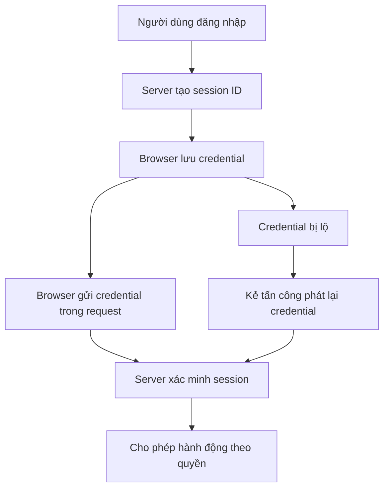

# Session theft

> **Chương:** Session trên browser  
> **Học phần:** Application Security — Browser Security (`SECURITY_APPLICATION_SECURITY_BROWSER_SECURITY`)

Khi người dùng đăng nhập, browser thường giữ một cookie hoặc credential để chứng minh những request tiếp theo thuộc về phiên đã xác thực. Nếu kẻ tấn công lấy được credential này, họ có thể sử dụng nó để mạo danh người dùng mà không cần biết mật khẩu. Đây là **session theft**: đánh cắp thông tin đại diện cho một phiên đã được xác thực.

Session theft đặc biệt nguy hiểm vì nó có thể vượt qua bước đăng nhập ban đầu. Nếu phiên đã được xác thực bằng mật khẩu và MFA, kẻ tấn công sở hữu một session token còn hiệu lực có thể tiếp tục sử dụng phiên đó theo quyền mà server cấp. `HttpOnly`, `Secure`, `SameSite`, CSP và các cơ chế browser giúp giảm một số đường tấn công, nhưng mỗi cơ chế chỉ bảo vệ một phần. Phòng vệ đầy đủ cần kết hợp bảo vệ credential, quản lý vòng đời session, kiểm soát quyền, phát hiện bất thường và khả năng thu hồi nhanh ở server.

## 1. Mục tiêu học tập

Sau bài học, bạn có thể:

1. Giải thích session theft và mô hình bearer credential.
2. Phân biệt session theft với session fixation, CSRF, credential phishing và account takeover.
3. Nhận diện các nguồn làm lộ cookie/session token trong browser, ứng dụng và hạ tầng.
4. Giải thích giới hạn của `HttpOnly`, `Secure`, `SameSite`, CSP và việc ràng buộc session theo IP/user-agent.
5. Thiết kế session ID, cookie, timeout, rotation, revocation và logout an toàn.
6. Đề xuất cơ chế phát hiện, xử lý và điều tra khi session có dấu hiệu bị đánh cắp.
7. Kiểm chứng các giả định bảo mật bằng dữ liệu giả trong môi trường lab.

## 2. Session theft là gì?

Trong mô hình phổ biến, server phát hành một **session identifier** sau khi người dùng đăng nhập. Browser lưu identifier trong cookie và gửi nó trong các request phù hợp. Server dùng giá trị đó để tra cứu phiên đã xác thực.

Nếu session identifier hoạt động như một **bearer credential**, bên nào sở hữu giá trị hợp lệ có thể sử dụng nó cho tới khi session hết hạn, bị thu hồi hoặc bị ràng buộc bởi một cơ chế xác minh bổ sung. Vì vậy, session ID phải được xem như một bí mật tương đương credential đăng nhập trong thời gian nó còn hiệu lực.



Điểm mấu chốt: kẻ tấn công không nhất thiết phải lấy mật khẩu hoặc vượt qua MFA lần nữa. Nếu session đang hoạt động và server chỉ dựa vào possession của bearer token, token bị đánh cắp có thể đủ để truy cập.

## 3. Phân biệt session theft với các khái niệm gần nhau

| Khái niệm | Điều xảy ra | Điểm phân biệt |
| --- | --- | --- |
| **Session theft / hijacking** | Kẻ tấn công lấy credential của phiên hợp lệ và sử dụng nó | Trọng tâm là credential phiên bị lộ hoặc bị chiếm quyền sử dụng |
| **Session fixation** | Kẻ tấn công khiến nạn nhân đăng nhập bằng một session ID mà kẻ tấn công đã biết/kiểm soát | Session ID được thiết lập hoặc giữ nguyên sai cách trước/sau đăng nhập; không nhất thiết phải đánh cắp ID sau khi đăng nhập |
| **CSRF** | Browser của nạn nhân gửi request có cookie tới ứng dụng mà người dùng không chủ ý | Kẻ tấn công có thể không biết cookie và không đọc được response |
| **Credential phishing** | Nạn nhân bị lừa cung cấp mật khẩu, OTP hoặc thông tin xác thực | Có thể dẫn đến đăng nhập trái phép rồi tạo session mới |
| **Account takeover (ATO)** | Kẻ tấn công kiểm soát tài khoản | Là kết quả rộng hơn; có thể bắt nguồn từ session theft, phishing, reset mật khẩu hoặc lỗ hổng khác |
| **Token replay** | Credential/token đã lấy được được gửi lại để sử dụng | Là kỹ thuật thường gặp trong session theft nếu token chưa hết hạn hoặc chưa bị thu hồi |

CSRF không phải session theft: trong CSRF, browser tự gửi cookie mà kẻ tấn công không cần biết giá trị. Ngược lại, session theft thường liên quan tới việc lấy hoặc sử dụng credential ngoài ngữ cảnh browser ban đầu. Hai rủi ro có thể cùng tồn tại trong một ứng dụng.

## 4. Những loại credential có thể bị đánh cắp

Không phải ứng dụng nào cũng dùng một cookie session đơn giản. Credential đại diện cho phiên có thể gồm:

- **Opaque session ID:** chuỗi ngẫu nhiên trỏ tới session record phía server.
- **Access token:** token bearer ngắn hạn, thường được gửi qua `Authorization: Bearer ...` hoặc cookie tùy kiến trúc.
- **Refresh token:** credential có thời hạn dài hơn, dùng để lấy access token mới; cần bảo vệ và quản lý rotation/revocation nghiêm ngặt.
- **Remember-me token:** credential giúp duy trì đăng nhập lâu dài; nếu có thể dùng độc lập để xác thực thì cần được bảo vệ như credential mạnh.
- **Federated login/session artifact:** token hoặc cookie trong luồng OAuth/OIDC/SAML; phải tuân theo quy tắc lưu trữ, audience, issuer, redirect và thời hạn của giao thức.

Không đưa token vào URL query hoặc fragment nếu có thể tránh. URL có thể xuất hiện trong browser history, server/proxy log, analytics, ảnh chụp, clipboard hoặc `Referer` tùy chính sách. Token trong URL cũng dễ bị chia sẻ nhầm.

## 5. Các con đường dẫn tới session theft

### 5.1 XSS và đọc cookie không có HttpOnly

Nếu session cookie không có `HttpOnly`, script chạy trong origin ứng dụng có thể đọc cookie qua `document.cookie` khi cookie phù hợp với API đó. Nếu script XSS lấy được giá trị và đưa ra khỏi origin, kẻ tấn công có thể phát lại credential.

```js
// Ví dụ chỉ để nhận diện rủi ro trong mã nguồn:
const readableCookies = document.cookie;
```

Đoạn mã không phải biện pháp kiểm tra hợp lệ trên tài khoản thật. Trong ứng dụng an toàn, cookie xác thực thường cần `HttpOnly`; tuy nhiên, XSS vẫn có thể dùng browser để gọi API như người dùng. Vì vậy, HttpOnly giảm nguy cơ **đọc và mang session ID đi**, không triệt tiêu khả năng session riding.

### 5.2 Malware hoặc thiết bị người dùng bị xâm nhập

Malware chạy với quyền trên thiết bị có thể tiếp cận dữ liệu browser, bộ nhớ, clipboard, profile hoặc điều khiển phiên đang mở tùy quyền được cấp. Khi thiết bị bị kiểm soát, các thuộc tính cookie không thể bảo vệ hoàn toàn credential khỏi chính môi trường đang sử dụng nó.

Phòng vệ gồm bảo vệ endpoint, cập nhật browser/OS, giới hạn quyền phần mềm, mã hóa thiết bị, quản lý thiết bị doanh nghiệp và phát hiện hành vi bất thường. Không nên tuyên bố `HttpOnly` có thể chống malware đọc dữ liệu browser ở cấp hệ điều hành.

### 5.3 Browser extension có quyền cao

Một extension được cấp quyền đọc/ghi trang hoặc truy cập dữ liệu website có thể nhìn thấy nội dung trang, can thiệp request hoặc đọc dữ liệu theo phạm vi quyền của nó. Extension độc hại hoặc bị chiếm quyền cập nhật có thể vượt ra ngoài giả định bảo vệ của JavaScript thông thường.

Đối với môi trường nhạy cảm, chỉ cài extension được phê duyệt, rà soát quyền, quản lý danh sách extension và sử dụng browser profile riêng cho công việc có mức độ rủi ro cao.

### 5.4 Mạng không an toàn hoặc thiếu HTTPS

Nếu ứng dụng truyền phiên qua HTTP, kẻ có khả năng quan sát hoặc sửa lưu lượng trên đường truyền có thể tìm cách lấy credential. Thuộc tính `Secure` yêu cầu browser chỉ gửi cookie qua kết nối bảo mật phù hợp; HTTPS bảo vệ dữ liệu trên đường truyền tới điểm kết thúc TLS tin cậy.

HTTPS không cứu được ứng dụng nếu TLS kết thúc tại proxy bị xâm nhập, certificate validation bị vô hiệu hóa hoặc endpoint sau TLS làm lộ credential. Cần bảo vệ toàn bộ đường đi, cấu hình TLS, proxy và hệ thống log.

### 5.5 Log, telemetry, crash dump và công cụ hỗ trợ

Cookie, bearer token hoặc header `Authorization` có thể vô tình bị ghi vào:

- Log ứng dụng, reverse proxy, API gateway hoặc WAF.
- APM, tracing, analytics và công cụ ghi lại request/response.
- Crash dump, debug snapshot, HAR file hoặc ảnh chụp DevTools.
- Ticket hỗ trợ, chat, email hoặc tài liệu hướng dẫn có chứa credential.
- Backup, bản export hoặc dữ liệu staging được sao chép từ production.

Không log nguyên giá trị `Cookie`, `Set-Cookie`, `Authorization` hoặc refresh token. Nếu cần tương quan sự kiện, dùng mã định danh session đã băm hoặc một fingerprint không thể dùng để xác thực; giới hạn quyền truy cập và thời gian lưu log.

### 5.6 Phishing và reverse proxy giả mạo

Trang đăng nhập giả có thể đánh cắp mật khẩu và OTP. Một số hình thức phishing trung gian có thể chuyển tiếp phiên xác thực để lấy session sau khi nạn nhân hoàn tất đăng nhập, kể cả khi MFA đã được sử dụng. MFA làm giảm nguy cơ chiếm tài khoản bằng mật khẩu bị lộ, nhưng không tự bảo đảm session đã phát hành không thể bị đánh cắp.

Các biện pháp giảm rủi ro gồm phishing-resistant MFA (ví dụ WebAuthn/passkeys), kiểm tra domain, bảo vệ luồng xác thực, giới hạn session, và cơ chế xác minh bổ sung cho thao tác nhạy cảm. Không dùng OTP SMS/email làm bằng chứng duy nhất rằng mọi session sau đó đều an toàn.

### 5.7 Shared device, profile và thao tác hỗ trợ

Trên máy tính dùng chung, người dùng có thể quên logout, để browser mở khóa hoặc lưu phiên trên profile không được bảo vệ. Người dùng hỗ trợ kỹ thuật cũng có thể vô tình chia sẻ HAR file, cookie hoặc ảnh chụp chứa thông tin xác thực.

Nên dùng profile riêng, khóa màn hình, không lưu đăng nhập trên thiết bị công cộng, logout và thu hồi phiên sau khi sử dụng, đồng thời che credential trước khi gửi dữ liệu chẩn đoán.

## 6. HttpOnly, Secure và SameSite bảo vệ phần nào?

Ba thuộc tính cookie quan trọng thường được dùng cùng nhau:

```http
Set-Cookie: __Host-session=<opaque-id>; Path=/; Secure; HttpOnly; SameSite=Lax
```

| Attribute | Giảm rủi ro | Không ngăn được |
| --- | --- | --- |
| `HttpOnly` | JavaScript trang không đọc trực tiếp giá trị cookie | XSS gọi API bằng phiên hiện tại; malware/extension có quyền cao; server log lộ token |
| `Secure` | Browser không gửi cookie qua HTTP thông thường | Lộ credential ở endpoint/proxy/log bị xâm nhập; XSS dùng cookie qua HTTPS |
| `SameSite` | Giảm gửi cookie trong nhiều ngữ cảnh cross-site | Session theft qua credential đã lấy; request same-site từ subdomain khác origin; mọi dạng CSRF |

`__Host-` prefix (trong browser hỗ trợ) yêu cầu `Secure`, `Path=/` và không có `Domain`, giúp giới hạn cookie vào host phát hành. Đây là biện pháp giảm phạm vi cookie, không phải cơ chế chống replay.

Không có thuộc tính cookie nào biến session ID bearer thành credential không thể bị sử dụng lại. Nếu một bên có được giá trị cookie hợp lệ bằng con đường khác, server vẫn có thể chấp nhận nó cho tới khi phiên bị hết hạn/thu hồi hoặc có thêm ràng buộc xác minh.

## 7. Tại sao HttpOnly không chặn session riding?

Giả sử XSS chạy trong `https://app.example.com` và session cookie có `HttpOnly`. Script không đọc được cookie, nhưng có thể gọi:

```js
const response = await fetch("/api/profile");
const profile = await response.json();
console.log(profile);
```

Browser tự đính kèm cookie phù hợp. Nếu endpoint không có kiểm soát khác, script có thể đọc response mà trang cùng origin được phép đọc. Điều tương tự có thể xảy ra với request thay đổi trạng thái.

Do đó:

- HttpOnly giúp ngăn lấy **giá trị session cookie qua API JavaScript**.
- CSRF token và SameSite giúp giảm việc **website khác** lợi dụng browser gửi request.
- CSP, Trusted Types, output encoding và DOM API an toàn giúp giảm khả năng **script độc hại chạy trong origin**.
- Authorization và kiểm tra nghiệp vụ ở server giới hạn **hành động mà phiên có thể thực hiện**.

Các lớp này xử lý những vấn đề khác nhau và cần phối hợp.

## 8. Token replay và giới hạn của bearer session

Với bearer credential, server chấp nhận token nếu token hợp lệ, chưa hết hạn và chưa bị thu hồi. Kẻ tấn công có token có thể gửi lại từ client khác. Đây là **replay**.

Để giảm thời gian và phạm vi sử dụng credential bị lộ:

- Dùng access token ngắn hạn khi kiến trúc phù hợp.
- Bảo vệ refresh token chặt hơn, xoay refresh token sau mỗi lần sử dụng và phát hiện reuse theo thiết kế.
- Với server-side session, lưu trạng thái active/revoked và có khả năng thu hồi ngay.
- Xoay session ID sau đăng nhập, nâng quyền hoặc sự kiện xác thực quan trọng.
- Thu hồi các phiên cũ khi phát hiện credential bị lộ.
- Cân nhắc sender-constrained token hoặc proof-of-possession như DPoP/mTLS trong kiến trúc hỗ trợ, hiểu rõ chi phí và giới hạn triển khai.

Ràng buộc token với thiết bị hoặc khóa có thể làm replay khó hơn, nhưng không phải giải pháp phổ quát. Browser không tự cung cấp một khóa phần cứng đáng tin cho mọi ứng dụng; DPoP và các cơ chế tương tự cần thiết kế đúng ở client/server và không loại bỏ XSS có khả năng điều khiển client đang hoạt động.

## 9. Thiết kế session ID khó đoán và khó khai thác

Session ID cần:

- Được tạo bằng cryptographically secure random number generator.
- Có entropy đủ lớn; với session ID ngẫu nhiên, thiết kế hiện đại thường dùng tối thiểu khoảng 128 bit entropy trở lên.
- Không chứa username, email, role, timestamp hoặc dữ liệu nhạy cảm có thể suy ra.
- Không tái sử dụng giữa người dùng hoặc giữa các phiên.
- Được truyền qua HTTPS và đặt trong cookie với thuộc tính phù hợp.
- Được server xác minh trạng thái, thời hạn và khả năng thu hồi.

Ví dụ dạng cookie (giá trị chỉ là placeholder):

```http
Set-Cookie: __Host-session=<random-opaque-id>; Path=/; Secure; HttpOnly; SameSite=Lax
Cache-Control: no-store
```

Không tự tạo session ID bằng `Math.random()`, timestamp, UUID không có nguồn ngẫu nhiên phù hợp hoặc chuỗi tuần tự. Dùng thư viện/framework session đã được kiểm chứng và kiểm tra cấu hình entropy, rotation, storage và revocation.

## 10. Vòng đời session và thu hồi

Session theft trở nên nghiêm trọng hơn khi credential bị đánh cắp có thể dùng trong thời gian dài. Một hệ thống cần chính sách vòng đời rõ ràng.

| Cơ chế | Mục đích | Gợi ý thiết kế |
| --- | --- | --- |
| Idle timeout | Giới hạn phiên không hoạt động | Hết hạn sau khoảng không hoạt động theo mức nhạy cảm của ứng dụng |
| Absolute timeout | Giới hạn tổng thời gian sống | Bắt buộc xác thực lại sau thời gian tối đa kể từ khi tạo |
| Rotation | Thay credential cũ bằng credential mới | Sau login, MFA, nâng quyền hoặc sự kiện quan trọng |
| Revocation | Vô hiệu hóa credential bị lộ | Server-side revoke, logout all sessions, thu hồi refresh token |
| Step-up authentication | Xác nhận lại người dùng cho hành động rủi ro cao | Mật khẩu, WebAuthn/passkey hoặc yếu tố phù hợp |
| Device/session management | Cho người dùng xem và kết thúc phiên | Hiển thị thời gian, thiết bị/ước lượng vị trí và khả năng revoke |

Thời hạn cụ thể phụ thuộc loại ứng dụng, mức độ nhạy cảm và quy định áp dụng. Không có một con số timeout phù hợp cho mọi hệ thống. Hệ thống thanh toán, quản trị và dữ liệu y tế thường cần kiểm soát chặt hơn một website nội dung công khai.

### 10.1 Logout và logout all sessions

Logout an toàn cần:

1. Kiểm tra request logout hợp lệ, có CSRF protection nếu dùng cookie tự gửi.
2. Vô hiệu hóa session ở server hoặc thu hồi token theo kiến trúc.
3. Xóa cookie ở browser với đúng tên và phạm vi `Path`/`Domain`.
4. Xóa trạng thái UI tạm và điều hướng về trạng thái chưa đăng nhập.
5. Xử lý các tab khác khi request tiếp theo nhận `401`/`403`.

Xóa cookie mà không thu hồi session phía server không bảo đảm token bị đánh cắp ở nơi khác mất hiệu lực. Chức năng “logout all sessions” nên thu hồi mọi phiên thuộc tài khoản, bao gồm refresh token hoặc credential dài hạn liên quan.

## 11. Phòng vệ theo từng nguồn rò rỉ

| Nguồn rò rỉ | Biện pháp chính |
| --- | --- |
| XSS đọc cookie | HttpOnly; sửa XSS bằng encoding, DOM API an toàn, sanitizer; CSP và Trusted Types |
| XSS dùng phiên | Giảm bề mặt XSS, authorization chặt, step-up cho thao tác nhạy cảm, session lifetime phù hợp |
| HTTP không mã hóa | HTTPS toàn site, cookie Secure, HSTS, TLS/proxy đúng cấu hình |
| Malware/endpoint compromise | Endpoint protection, cập nhật, device management, profile riêng, thu hồi phiên và điều tra thiết bị |
| Extension độc hại | Extension allowlist, rà soát quyền, browser profile tách biệt |
| Log/APM/HAR lộ token | Redact Cookie/Authorization/Set-Cookie, hạn chế truy cập và thời gian lưu, dùng session fingerprint đã băm |
| Phishing/AiTM | WebAuthn/passkeys, domain protection, bảo vệ luồng đăng nhập, session monitoring và step-up |
| Shared device | Không lưu đăng nhập, khóa thiết bị, logout và revoke, dùng browser profile riêng |
| Token replay | TTL ngắn, rotation, revocation, reuse detection và sender-constrained token khi phù hợp |
| Session fixation | Tạo ID mới sau xác thực/nâng quyền; vô hiệu hóa ID cũ |

## 12. Phát hiện session theft

Không có một dấu hiệu đơn lẻ chứng minh session bị đánh cắp. Hệ thống nên kết hợp nhiều tín hiệu và đánh giá theo ngữ cảnh.

Các tín hiệu có thể đáng chú ý:

- Cùng session fingerprint xuất hiện từ hai vùng mạng hoặc thiết bị khác biệt trong thời gian ngắn.
- Thay đổi user-agent hoặc đặc điểm client đột ngột, nhất là đi cùng hành vi lạ.
- Chuỗi hành động nhạy cảm sau một lần đăng nhập hoặc khôi phục phiên bất thường.
- Refresh token bị sử dụng lại sau khi đã xoay và vô hiệu hóa theo chính sách.
- Session tiếp tục hoạt động sau sự kiện người dùng logout/revoke mà server kỳ vọng phải chặn.
- Tăng đột biến request export dữ liệu, đổi thông tin tài khoản, tạo API key hoặc thay đổi MFA.
- Token xuất hiện trong log, ticket hoặc hệ thống giám sát ngoài vùng được phép.

IP address và user-agent là tín hiệu yếu: người dùng có thể đổi mạng, dùng VPN, roaming hoặc browser update; nhiều người dùng có thể chia sẻ NAT. Không tự động khóa tài khoản chỉ vì IP thay đổi. Dùng điểm rủi ro kết hợp hành vi, device signal, thời gian, loại thao tác và xác minh bổ sung.

### 12.1 Ghi log mà không làm lộ session

Không ghi nguyên session ID, cookie hoặc bearer token. Có thể dùng HMAC/fingerprint với secret log riêng để liên kết sự kiện cùng phiên mà không lưu credential có thể phát lại. Bảo vệ khóa HMAC, giới hạn quyền truy cập log và tránh đưa fingerprint vào nơi công khai.

Các trường log hữu ích có thể gồm:

- Session fingerprint đã băm.
- User/account ID nội bộ theo chính sách dữ liệu.
- Thời điểm, endpoint, hành động và kết quả authorization.
- Client/device signal ở mức cần thiết.
- Kết quả rotation, revocation, refresh-token reuse và step-up.
- Correlation/request ID không chứa credential.

## 13. Ứng phó khi nghi ngờ session bị đánh cắp

Khi có dấu hiệu session theft, ưu tiên ngăn credential tiếp tục được sử dụng và giữ bằng chứng cần thiết.

1. **Xác minh tín hiệu:** xác định account, session fingerprint, endpoint, thời điểm và hành động đáng ngờ.
2. **Thu hồi phiên liên quan:** revoke server session hoặc token; nếu chưa xác định được phạm vi, cân nhắc logout all sessions theo chính sách.
3. **Thu hồi refresh token:** đánh dấu token family bị xâm phạm và ngăn phát hành access token mới từ credential đó.
4. **Yêu cầu xác thực lại:** buộc người dùng đăng nhập lại; dùng step-up/WebAuthn cho hành động nhạy cảm khi phù hợp.
5. **Kiểm tra thay đổi tài khoản:** email, mật khẩu, MFA, phương thức khôi phục, thông tin thanh toán, API key và dữ liệu đã export.
6. **Tìm nguồn rò rỉ:** XSS, extension, thiết bị, log/APM, phishing, proxy, backup hoặc quy trình hỗ trợ.
7. **Giữ bằng chứng:** bảo toàn log và timeline theo quy trình ứng phó; không sao chép token thô vào ticket.
8. **Thông báo và khôi phục:** liên hệ người dùng theo quy trình, hỗ trợ đặt lại credential khi cần và theo dõi hành vi sau khôi phục.
9. **Khắc phục nguyên nhân:** sửa XSS, cấu hình cookie/TLS, quy trình log, endpoint hoặc kiểm soát thiết bị đã gây rò rỉ.

Chỉ đổi mật khẩu không nhất thiết thu hồi mọi session đã phát hành. Hệ thống cần có cơ chế server-side revoke session và refresh token độc lập. Với token tự chứa khó thu hồi, cần cân nhắc TTL, denylist, token version hoặc chiến lược rotation phù hợp.

## 14. Các hiểu nhầm thường gặp

| Nhận định sai | Hiểu đúng |
| --- | --- |
| “Có HttpOnly là không thể bị session theft.” | HttpOnly chỉ ngăn script thông thường đọc cookie; malware, extension, log leak và session riding vẫn là rủi ro. |
| “Có Secure thì cookie không thể bị đánh cắp.” | Secure giảm gửi qua HTTP; credential vẫn có thể lộ ở endpoint, browser, log hoặc XSS. |
| “SameSite=Strict chống session hijacking.” | SameSite điều chỉnh gửi cookie theo site; không ngăn replay token đã lấy được. |
| “MFA đã bật nên session không thể bị chiếm.” | MFA bảo vệ quá trình xác thực; session sau xác thực vẫn có thể bị lấy hoặc replay. |
| “Đóng tab là session hết.” | Cookie thường dùng chung giữa tab; server session có vòng đời riêng. |
| “Logout xóa cookie là đủ.” | Cần thu hồi session/token ở server; cookie bị sao chép vẫn có thể tồn tại nơi khác. |
| “IP đổi là chắc chắn session bị đánh cắp.” | VPN, roaming và NAT khiến IP là tín hiệu yếu; cần đánh giá nhiều yếu tố. |
| “Xóa cookie bị lộ là hết rủi ro.” | Cần revoke phía server và điều tra nguồn rò rỉ, token liên quan, hành động đã thực hiện. |
| “CORS ngăn kẻ tấn công gọi API.” | CORS kiểm soát browser chia sẻ response với JavaScript; client khác vẫn có thể gọi API. |

## 15. Thực hành kiểm chứng trong môi trường lab

Chỉ dùng ứng dụng local, tài khoản lab và session ID giả do bạn tự tạo. Không lấy cookie từ website thật, không phát lại session của người khác và không gửi credential ra bên ngoài.

### Bài thử A — Quan sát cookie HttpOnly và cookie có thể đọc

Tạo hai cookie thử nghiệm từ server:

```http
Set-Cookie: lab_visible=demo-a; Path=/; Secure; SameSite=Lax
Set-Cookie: lab_protected=demo-b; Path=/; Secure; HttpOnly; SameSite=Lax
```

Trong Console:

```js
console.log(document.cookie);
```

**Kỳ vọng:** Cookie `lab_visible` có thể xuất hiện; `lab_protected` không xuất hiện. Trong DevTools → Application/Storage, cả hai có thể vẫn hiển thị cùng thuộc tính tương ứng.

### Bài thử B — Chứng minh browser tự gửi HttpOnly cookie

Tạo endpoint `/api/lab-session` chỉ trả dữ liệu giả. Gọi từ trang cùng origin:

```js
const response = await fetch("/api/lab-session");
console.log(response.status, await response.json());
```

Quan sát Network và server log đã redacted.

**Kỳ vọng:** Browser gửi cookie phù hợp dù JavaScript không đọc được giá trị. Server nhận diện phiên lab và trả dữ liệu giả.

### Bài thử C — Thu hồi session ở server

1. Đăng nhập tài khoản lab ở hai tab cùng browser profile.
2. Ghi nhận rằng hai tab có thể dùng cùng authentication session qua cookie.
3. Dùng chức năng logout/revoke để vô hiệu hóa session ở server.
4. Gọi endpoint yêu cầu đăng nhập từ tab còn lại.

**Kỳ vọng:** Request sau khi revoke bị từ chối dù tab thứ hai vẫn mở và có thể còn giao diện cũ. Điều này chứng minh quyết định phiên hợp lệ nằm ở server.

### Bài thử D — Session replay bằng token giả trong lab

Trong một ứng dụng local tối giản, tạo session ID giả có vòng đời ngắn và lưu trạng thái active trong session store. Dùng hai client thử nghiệm do bạn quản lý để gửi cùng một giá trị giả tới endpoint lab. Sau đó revoke record và gửi lại.

**Kỳ vọng:** Khi session active, server nhận diện hai request theo cùng credential bearer; sau khi revoke, cả hai client đều bị từ chối. Không dùng cookie/token production hoặc tài khoản thật trong bài thử này.

### Bài thử E — Timeout và rotation

Thiết lập idle timeout và absolute timeout ngắn trong lab. Đăng nhập, kiểm tra session ID thay đổi sau một sự kiện xác thực lại hoặc nâng quyền, rồi thử dùng ID cũ. Để phiên không hoạt động vượt idle timeout và thử lại.

**Kỳ vọng:** ID cũ bị vô hiệu hóa sau rotation theo thiết kế; server từ chối session đã hết hạn dù cookie vẫn còn trong browser.

## 16. Checklist bảo vệ session

- [ ] Session ID được tạo bằng CSPRNG, có entropy đủ mạnh, opaque và không chứa dữ liệu người dùng.
- [ ] Session cookie dùng `HttpOnly`, `Secure`, `SameSite` phù hợp.
- [ ] Cookie được giới hạn host/path; cân nhắc host-only và `__Host-`.
- [ ] HTTPS được áp dụng toàn bộ luồng; HSTS và TLS/proxy được cấu hình phù hợp.
- [ ] XSS được phòng vệ bằng encoding, DOM API an toàn, CSP, Trusted Types và quản lý dependency.
- [ ] CSRF protection được thiết kế riêng cho request dùng cookie.
- [ ] Session ID được rotate sau login, nâng quyền và sự kiện xác thực quan trọng.
- [ ] Có idle timeout, absolute timeout và server-side revocation.
- [ ] Logout và logout all sessions vô hiệu hóa credential ở server.
- [ ] Refresh token có rotation/reuse detection khi kiến trúc sử dụng refresh token.
- [ ] Credential không xuất hiện trong URL, log, APM, HAR, ticket hoặc analytics.
- [ ] Log dùng fingerprint không thể replay thay vì session ID thô.
- [ ] Có giám sát hành vi bất thường và quy trình xử lý session theft.
- [ ] Thao tác nhạy cảm có step-up authentication phù hợp.
- [ ] Có kiểm thử multi-tab, timeout, revoke, rotation và replay trong lab.

## 17. Câu hỏi tự kiểm tra

1. Vì sao session ID thường được xem như bearer credential?
2. Session theft khác session fixation và CSRF ở điểm nào?
3. HttpOnly ngăn được con đường đánh cắp nào, và vì sao XSS vẫn có thể sử dụng phiên?
4. Vì sao MFA không tự bảo vệ session đã phát hành khỏi replay?
5. Những nguồn nào ngoài `document.cookie` có thể làm lộ session token?
6. Tại sao logout cần thu hồi session ở server thay vì chỉ xóa cookie?
7. Idle timeout và absolute timeout giải quyết hai rủi ro nào?
8. Vì sao IP address/user-agent không nên là bằng chứng duy nhất để kết luận session bị đánh cắp?
9. Khi nghi ngờ refresh token bị reuse, hệ thống nên thu hồi những credential nào?
10. Làm thế nào ghi log để điều tra session theft mà không lưu credential có thể replay?

## 18. Ghi nhớ

Session theft xảy ra khi kẻ tấn công lấy hoặc chiếm quyền sử dụng credential đại diện cho phiên đã xác thực. Session ID bearer bị lộ có thể bị replay cho tới khi hết hạn hoặc bị thu hồi. XSS, malware, extension, phishing trung gian, đường truyền không an toàn, log và thiết bị dùng chung đều có thể là nguồn rò rỉ.

Hãy bảo vệ cookie/token ngay từ nơi phát hành và lưu trữ; dùng HTTPS, `Secure`, `HttpOnly`, `SameSite` phù hợp; phòng vệ XSS/CSRF; tạo session ID ngẫu nhiên; rotate, timeout và revoke ở server; giám sát bất thường; và xác minh lại cho thao tác nhạy cảm. **Cookie attributes giảm một số đường lấy credential; server-side lifecycle và authorization quyết định credential bị lộ còn sử dụng được hay không.**
