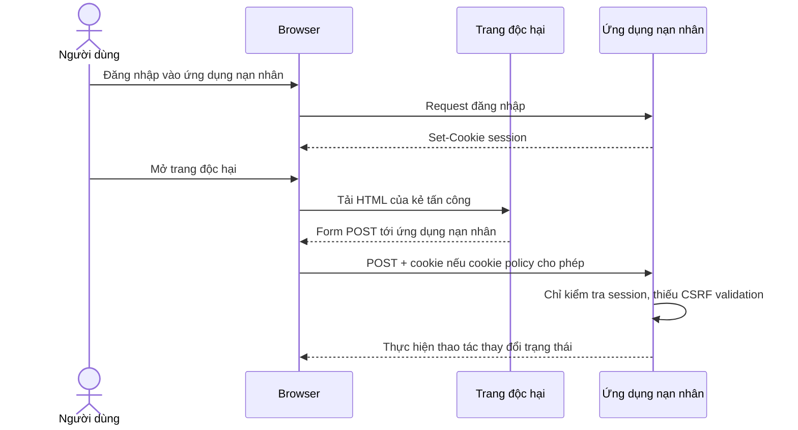

# CSRF là gì?

> **Chương:** CSRF  
> **Chủ đề:** CSRF là gì  
> **Module:** `SECURITY_APPLICATION_SECURITY_BROWSER_SECURITY` — phân tích ranh giới bảo mật giữa trình duyệt, origin, cookie và ứng dụng web để hiểu Same-Origin Policy, CORS và các cơ chế cách ly; thực hành phòng vệ XSS, CSRF, clickjacking bằng CSP, Trusted Types, security headers và kiểm chứng hành vi thực tế.

## Mục tiêu học tập

Sau bài học, bạn có thể:

1. Giải thích **Cross-Site Request Forgery (CSRF)** và vì sao browser có thể gửi request mang session của người dùng mà người dùng không chủ ý thực hiện.
2. Mô tả điều kiện để một cuộc tấn công CSRF thành công và phân biệt khả năng **gửi request** với khả năng **đọc response**.
3. Phân biệt CSRF với XSS, Same-Origin Policy (SOP) và CORS.
4. Nhận diện các bề mặt tấn công như form POST, điều hướng GET làm thay đổi trạng thái, iframe, request same-site và login CSRF.
5. Chọn các lớp phòng vệ phù hợp: CSRF token, kiểm tra Origin/Referer, Fetch Metadata, SameSite cookie và custom request header.
6. Kiểm chứng một tình huống CSRF bằng hai origin localhost, quan sát cookie, request và cách server từ chối request thiếu token.

## 1. CSRF là gì?

**Cross-Site Request Forgery (CSRF)** là kiểu tấn công khiến trình duyệt của người dùng đã đăng nhập gửi một request ngoài ý muốn tới ứng dụng web, kèm thông tin xác thực mà browser tự động quản lý, thường là **session cookie**. Nếu server tin request chỉ vì cookie hợp lệ và không kiểm tra ý định hoặc nguồn của thao tác, server có thể thực hiện hành động dưới danh tính người dùng.

Ví dụ:

- Người dùng đăng nhập vào `https://bank.example.test`; browser lưu session cookie.
- Người dùng mở một website do kẻ tấn công kiểm soát.
- Trang độc hại tạo form gửi POST tới `https://bank.example.test/change-email`.
- Browser có thể tự đính session cookie vào request.
- Nếu server chỉ kiểm tra session cookie mà không có CSRF protection, email tài khoản có thể bị thay đổi.

Kẻ tấn công **không nhất thiết phải biết cookie hoặc đọc được response**. Họ lợi dụng việc browser tự gửi thông tin xác thực theo phạm vi cookie khi request được tạo.

### 1.1. Vì sao session cookie tạo ra bề mặt CSRF?

Cookie session là một dạng *ambient authority*: browser tự đính cookie vào request phù hợp mà không yêu cầu JavaScript hoặc người dùng cung cấp lại cookie trong từng thao tác. Cơ chế này thuận tiện cho đăng nhập, nhưng server cần phân biệt:

- Request có session hợp lệ: browser gửi một phiên đã đăng nhập.
- Request có chủ đích hợp lệ: người dùng thật sự thực hiện thao tác được yêu cầu.

Session cookie chứng minh request đang mang một phiên; nó **không tự chứng minh người dùng chủ ý thực hiện hành động**. CSRF protection giúp server kiểm tra nguồn và ngữ cảnh của request thay đổi trạng thái.

## 2. Một cuộc tấn công CSRF diễn ra như thế nào?

Giả sử server có endpoint:

```http
POST /transfer
Cookie: session_id=<session-cua-nguoi-dung>
Content-Type: application/x-www-form-urlencoded

to=attacker&amount=100
```

Ứng dụng chỉ kiểm tra `session_id` có hợp lệ rồi chuyển tiền. Kẻ tấn công có thể đặt form trên trang khác:

```html
<form action="https://bank.example.test/transfer" method="POST">
  <input type="hidden" name="to" value="attacker">
  <input type="hidden" name="amount" value="100">
  <button type="submit">Xem nội dung</button>
</form>
```

Nút có thể được ngụy trang hoặc form có thể được gửi tự động bằng JavaScript. Khi người dùng đang đăng nhập truy cập trang này, browser có thể gửi form tới ngân hàng kèm cookie session. Server thấy phiên hợp lệ và thực hiện giao dịch nếu không có kiểm tra CSRF.



**Kẻ tấn công không cần đọc response.** Mục tiêu có thể chỉ là làm server thực hiện hành động. SOP có thể ngăn trang độc hại đọc DOM hoặc response của ứng dụng nạn nhân, nhưng không chặn tất cả cách gửi request cross-origin.

## 3. Điều kiện để CSRF thành công

Một tình huống CSRF điển hình có các yếu tố:

1. **Có thao tác nhạy cảm thay đổi trạng thái:** ví dụ đổi email, thêm người nhận, chuyển tiền, đổi mật khẩu, tạo API key hoặc thay đổi cài đặt.
2. **Browser tự gửi thông tin xác thực:** thường là session cookie, HTTP authentication hoặc credential khác được browser tự động gắn vào request.
3. **Kẻ tấn công khiến browser gửi request:** bằng form HTML, navigation, iframe, resource hoặc một cơ chế request khác mà server chấp nhận.
4. **Server thiếu kiểm tra CSRF phù hợp:** server chấp nhận request chỉ vì session hợp lệ mà không xác minh token, nguồn hoặc ngữ cảnh.

Nếu ứng dụng dùng bearer token chỉ được JavaScript lưu trong bộ nhớ và phải chủ động thêm vào `Authorization` header, một trang khác thường không thể tự đọc token đó do SOP. Tuy nhiên, XSS, rò rỉ token, extension độc hại hoặc thiết kế lưu token trong cookie lại tạo rủi ro khác. Không kết luận “dùng token là tự động miễn nhiễm CSRF”; hãy xem credential có được browser tự động gửi hay không.

### 3.1. Request được gửi và response được đọc là hai việc khác nhau

Một form cross-origin có thể gửi request dù JavaScript trang gửi không được đọc response. Cần phân biệt:

- **Request side effect:** server có nhận và xử lý request hay không?
- **Response readability:** JavaScript của origin gửi có được browser cho đọc response hay không?

CORS chủ yếu điều khiển quyền đọc response của JavaScript; nó không phải một cổng xác thực cho mọi request. Vì vậy, lỗi CORS trong Console không chứng minh server chưa nhận request.

## 4. CSRF khác XSS, SOP và CORS thế nào?

| Khái niệm | Bản chất | Mối liên hệ với CSRF |
|---|---|---|
| **CSRF** | Lừa browser gửi request mang quyền của người dùng tới ứng dụng | Khai thác credential tự động được gửi và thiếu kiểm tra nguồn/ý định |
| **XSS** | Chạy script không tin cậy trong origin của ứng dụng | Có thể đọc DOM/token và gửi request cùng origin; thường vượt qua nhiều lớp CSRF nếu script đã chạy |
| **SOP** | Cách ly quyền truy cập DOM/tài nguyên giữa các origin | Ngăn trang tấn công đọc dữ liệu, nhưng không ngăn mọi form/navigation request được gửi |
| **CORS** | Server khai báo origin nào được JavaScript đọc response cross-origin | Không thay CSRF token; một số request vẫn được gửi trước khi response bị chặn |
| **SameSite cookie** | Hạn chế gửi cookie theo ngữ cảnh same-site/cross-site | Giảm một số CSRF cross-site, nhưng không bảo vệ đầy đủ trước request same-site từ subdomain |

### 4.1. CSRF và XSS

CSRF thường xảy ra khi kẻ tấn công ở một site/origin khác khiến browser gửi request tới ứng dụng. XSS xảy ra khi script độc hại chạy **bên trong origin của ứng dụng**.

Nếu attacker đã có XSS trong ứng dụng, script thường có thể:

- Đọc token CSRF được hiển thị trong DOM hoặc trang.
- Gửi request same-origin với token hợp lệ.
- Thao tác giao diện và API dưới phiên người dùng.

Do đó, CSRF token không thay thế phòng vệ XSS. Ứng dụng cần output encoding, sanitizer khi thực sự cho phép HTML, tránh DOM sink nguy hiểm, CSP và Trusted Types khi phù hợp.

### 4.2. CSRF và CORS

Không bật CORS không đồng nghĩa API không nhận request. HTML form có thể gửi những dạng request cross-origin mà không cần preflight. Browser có thể chặn JavaScript đọc response sau đó, nhưng server vẫn có thể đã thực hiện side effect.

Custom header như `X-CSRF-Token` có thể hữu ích vì form HTML thông thường không thể tự đặt header này; JavaScript cross-origin muốn đặt header sẽ cần preflight và server không nên cấp CORS cho origin không tin cậy. Tuy nhiên, backend phải **bắt buộc** header/token đó và không có endpoint thay đổi trạng thái khác vẫn chấp nhận form đơn giản.

## 5. Những dạng tấn công CSRF thường gặp

### 5.1. CSRF qua form POST

Form POST là ví dụ phổ biến vì HTML hỗ trợ gửi form cross-origin:

```html
<form action="https://app.example.test/profile/email" method="POST">
  <input type="hidden" name="email" value="attacker@example.test">
  <button type="submit">Continue</button>
</form>
```

Nếu endpoint chấp nhận session cookie mà thiếu CSRF validation, request có thể được thực hiện.

### 5.2. CSRF qua GET không an toàn

Một số ứng dụng cũ thực hiện thay đổi trạng thái qua GET:

```html

```

Nếu request GET xóa dữ liệu hoặc thay đổi trạng thái, browser có thể gửi request khi tải ảnh hoặc resource. **GET phải là safe method**: không được dùng để chuyển tiền, xóa tài khoản, đổi mật khẩu hoặc thực hiện thao tác thay đổi trạng thái.

### 5.3. CSRF từ sibling subdomain

`https://blog.example.test` và `https://account.example.test` khác origin nhưng thường cùng schemeful site. Nếu subdomain blog bị chiếm quyền, script hoặc form ở đó có thể gửi request tới account. Cookie `SameSite=Strict` hoặc `Lax` có thể vẫn được gửi trong ngữ cảnh same-site.

Đây là lý do không được dùng `SameSite` làm lớp CSRF duy nhất. Cần CSRF token và kiểm tra `Origin` chính xác; xem xét tách nội dung không tin cậy sang site riêng.

### 5.4. Login CSRF

Không phải CSRF nào cũng nhắm vào phiên đã đăng nhập. **Login CSRF** có thể khiến nạn nhân đăng nhập vào tài khoản do kẻ tấn công kiểm soát. Sau đó nạn nhân có thể tải lên dữ liệu, nhập thông tin cá nhân hoặc thêm phương thức thanh toán vào tài khoản của attacker.

Luồng đăng nhập và liên kết danh tính cũng cần bảo vệ state:

- Form đăng nhập có thể dùng CSRF token.
- OAuth/OIDC cần kiểm tra `state`; với OpenID Connect cần kiểm tra `nonce` theo luồng tương ứng.
- Authorization Code Flow với PKCE giúp bảo vệ code exchange, nhưng không làm cho việc kiểm tra `state` trở nên không cần thiết.
- Không tự động liên kết tài khoản chỉ dựa vào dữ liệu callback chưa xác minh.

### 5.5. Logout CSRF và thay đổi cài đặt

Logout, đổi email, đổi số điện thoại, tạo API key hoặc thêm phương thức khôi phục cũng là thao tác có tác động. Dù mức độ nghiêm trọng khác nhau, endpoint thay đổi trạng thái vẫn cần method đúng, CSRF protection và xác nhận phù hợp.

## 6. Các lớp phòng vệ CSRF

Không có một header hoặc cookie đơn lẻ phù hợp cho mọi ứng dụng. Hãy phối hợp nhiều lớp dựa trên loại credential và luồng request.

### 6.1. CSRF token — biện pháp chính cho ứng dụng dùng cookie session

Server tạo một token ngẫu nhiên khó đoán, gắn với session và yêu cầu client gửi token trong thao tác thay đổi trạng thái. Kẻ tấn công có thể khiến browser gửi form, nhưng không thể đọc token từ trang khác origin do SOP.

Ví dụ HTML form:

```html
<form action="/profile/email" method="POST">
  <input type="hidden" name="csrfToken" value="<token-do-server-cap>">
  <input type="email" name="email" required>
  <button type="submit">Cập nhật email</button>
</form>
```

Server xác minh token trong body khớp token của session trước khi thực hiện:

```js
function verifyCsrf(session, submittedToken) {
  if (!session || typeof submittedToken !== 'string') return false;
  if (!/^[a-f0-9]{64}$/i.test(submittedToken)) return false;

  const expected = Buffer.from(session.csrfToken, 'hex');
  const actual = Buffer.from(submittedToken, 'hex');
  return crypto.timingSafeEqual(expected, actual);
}
```

Đoạn code chỉ minh họa so sánh token có độ dài cố định; ứng dụng cần tạo token bằng bộ sinh ngẫu nhiên mật mã, quản lý session an toàn và xử lý lỗi theo framework đang dùng.

**Quy tắc token:**

- Token phải khó đoán, được tạo bằng nguồn ngẫu nhiên mật mã.
- Ràng buộc token với session hoặc danh tính phù hợp; không dùng session ID làm token.
- Không đưa token vào URL, log, analytics hoặc nơi dễ bị lộ qua Referer.
- Xác minh token ở mọi endpoint thay đổi trạng thái dùng cookie.
- Khi thiếu hoặc sai token, từ chối request trước khi thực hiện side effect.
- Tránh so sánh token theo kiểu dễ bị timing leak nếu môi trường yêu cầu so sánh constant-time.

#### Synchronizer token pattern

Đây là mô hình phổ biến cho ứng dụng server-side:

1. Server tạo session và token ngẫu nhiên.
2. Server lưu token trong session.
3. Server render token vào hidden field hoặc cung cấp qua một endpoint cùng origin.
4. Client gửi token lại trong form body hoặc custom header.
5. Server đối chiếu token gửi lên với token của session.

Token có thể tồn tại theo session để thuận tiện nhiều tab, hoặc theo request/form nếu ứng dụng xử lý đúng việc mở nhiều tab và back/forward. Không cần xoay token theo từng request nếu điều đó gây lỗi UX mà không đem lại lợi ích rõ ràng.

### 6.2. Double-submit cookie pattern

Một mô hình khác đặt token trong cookie và yêu cầu client gửi lại cùng token trong request parameter/header:

```http
Set-Cookie: csrf_token=<random-token>; Path=/; Secure; SameSite=Lax
X-CSRF-Token: <same-token>
```

Server so sánh giá trị cookie và giá trị gửi trong header/body. Mô hình đơn giản này cần cẩn trọng với **cookie injection**: subdomain không tin cậy có thể tìm cách đặt cookie cùng tên nếu cookie Domain quá rộng.

Nếu dùng double-submit, ưu tiên biến thể **signed/session-bound double-submit**: token có chữ ký HMAC hoặc được ràng buộc mật mã với session, dùng cookie host-only phù hợp (cân nhắc prefix `__Host-`) và kiểm tra token ở server. Không coi việc hai chuỗi bằng nhau là bằng chứng đủ trong mọi cấu hình.

### 6.3. Kiểm tra Origin và Referer

Với request thay đổi trạng thái, server có thể kiểm tra header `Origin` so với origin hợp lệ:

```js
const allowedOrigin = 'https://app.example.test';

function isAllowedOrigin(req) {
  return req.headers.origin === allowedOrigin;
}
```

So sánh origin đã parse hoặc chuỗi canonical chính xác; không dùng `includes()`, `endsWith()` hoặc kiểm tra prefix lỏng lẻo. Ví dụ `https://app.example.test.attacker.test` không phải origin được phép.

Nếu `Origin` vắng mặt, ứng dụng có thể dùng `Referer` làm tín hiệu dự phòng theo chính sách đã xác định. Header `Referer` có thể bị rút gọn hoặc bị lược bỏ bởi privacy policy, vì vậy endpoint nhạy cảm cần quy tắc fail-closed hoặc phương án token rõ ràng. Không tự động chấp nhận request chỉ vì thiếu header.

### 6.4. Fetch Metadata

Browser hiện đại có thể gửi các header như:

```http
Sec-Fetch-Site: same-origin
Sec-Fetch-Mode: cors
Sec-Fetch-Dest: empty
```

`Sec-Fetch-Site` thường có các giá trị:

| Giá trị | Ý nghĩa |
|---|---|
| `same-origin` | Request cùng origin |
| `same-site` | Request cùng site nhưng khác origin |
| `cross-site` | Request từ site khác |
| `none` | Một số request được người dùng trực tiếp khởi tạo, không có site khởi tạo theo cách thông thường |

Server có thể từ chối request **cross-site** tới endpoint thay đổi trạng thái, đặc biệt khi `Sec-Fetch-Mode`/`Sec-Fetch-Dest` không phù hợp. Tuy nhiên, `same-site` vẫn có thể đến từ sibling subdomain bị chiếm quyền. Với endpoint nhạy cảm, kết hợp Fetch Metadata với token và kiểm tra Origin.

Fetch Metadata là lớp bổ sung, không phải xác thực. Client ngoài browser có thể tự gửi header này; browser cũ có thể không hỗ trợ.

### 6.5. SameSite cookie

Cookie session có thể đặt:

```http
Set-Cookie: __Host-session=<opaque-id>; Path=/; Secure; HttpOnly; SameSite=Lax
```

`Strict` giới hạn cross-site mạnh hơn; `Lax` thường cho phép một số điều hướng top-level GET; `None; Secure` cho phép cookie trong ngữ cảnh cross-site nếu browser chấp nhận. Nhưng:

- Same-site khác same-origin: sibling subdomain có thể vẫn gửi request mang cookie Strict/Lax.
- `SameSite` không ngăn XSS trong chính origin.
- Client ngoài browser không bắt buộc tuân theo SameSite.
- Third-party cookie blocking có thể ảnh hưởng `None; Secure`.

Hãy dùng SameSite như lớp giảm rủi ro, không thay CSRF token.

### 6.6. Custom request header và CORS allowlist

Với API chỉ dành cho JavaScript của frontend tin cậy, server có thể yêu cầu một header tùy chỉnh như `X-CSRF-Token` hoặc `X-Requested-With`. Một form HTML đơn giản không thể đặt custom header; JavaScript cross-origin muốn đặt nó thường cần CORS preflight.

Điều kiện để lớp này hữu ích:

1. Server **bắt buộc** custom header trên mọi endpoint thay đổi trạng thái.
2. CORS chỉ cho phép origin chính xác trong allowlist; không phản chiếu mọi Origin.
3. Server không có fallback chấp nhận form/simple content type cho cùng thao tác.
4. Endpoint vẫn xác thực, phân quyền và kiểm tra CSRF theo mô hình credential.

Không dùng custom header như biện pháp duy nhất nếu API có thể bị gọi bởi nhiều loại client hoặc có endpoint chấp nhận request đơn giản.

## 7. Thiết kế endpoint an toàn

### 7.1. Dùng đúng HTTP method

GET, HEAD và OPTIONS phải an toàn theo ngữ nghĩa HTTP: không tạo thay đổi trạng thái do client yêu cầu. Thao tác thay đổi dữ liệu dùng POST, PUT, PATCH hoặc DELETE và cần CSRF protection khi xác thực dựa trên cookie.

Không đặt hành động thay đổi trạng thái trong query string:

```text
Không an toàn: GET /account/delete?id=42
Phù hợp hơn: POST /account/42/delete + CSRF token
```

Đổi method không tự động chống CSRF; nó giúp loại bỏ các request side effect dễ kích hoạt qua ảnh/link và tạo điểm áp dụng kiểm tra rõ ràng.

### 7.2. Kiểm tra token trước side effect

Thứ tự xử lý nên là:

1. Parse request và giới hạn kích thước body.
2. Xác thực session/token.
3. Kiểm tra CSRF token, Origin/Referer và Fetch Metadata theo policy.
4. Kiểm tra authorization đối với tài nguyên và hành động.
5. Validate dữ liệu.
6. Thực hiện side effect và trả response.

Không cập nhật dữ liệu rồi mới kiểm tra CSRF. Các thao tác chuyển tiền, đổi email, đổi mật khẩu, thêm người nhận hoặc tạo credential có thể cần xác nhận lại danh tính (step-up authentication) và thông báo người dùng.

### 7.3. API dùng bearer token

Nếu API nhận bearer token trong `Authorization` header mà browser không tự động đính token từ một trang khác, bề mặt CSRF thường thấp hơn so với session cookie. Tuy nhiên, vẫn cần:

- Không lưu token nhạy cảm trong nơi dễ bị XSS đọc.
- Kiểm tra CORS nếu frontend khác origin cần đọc response.
- Không fallback sang cookie authentication mà thiếu CSRF protection.
- Bảo vệ refresh token và cookie chứa credential tự động gửi.
- Duy trì authorization, rate limit và validation ở server.

## 8. Thực hành: minh họa CSRF và các lớp bảo vệ

Bài lab dùng Node.js, không cần thư viện ngoài. Ta tạo:

- Ứng dụng **victim** tại `http://localhost:4000`.
- Trang **attacker** tại `http://localhost:3000` hoặc `http://127.0.0.1:3000`.
- Session cookie `SameSite=Lax`, `HttpOnly`, host-only cho `localhost`.
- Ba endpoint: một endpoint cố ý thiếu CSRF protection, một endpoint kiểm tra token và một endpoint kiểm tra Origin chính xác.

Hai port `localhost:3000` và `localhost:4000` là **cross-origin nhưng same-site**. Vì vậy form POST từ trang attacker ở `localhost:3000` vẫn có thể gửi cookie Lax tới victim. Khi đổi attacker sang `127.0.0.1:3000`, request trở thành cross-site và cookie Lax thường bị bỏ qua cho form POST.

> Đây là lab local mô phỏng lỗi để học phòng vệ, không dùng endpoint vulnerable trong sản phẩm thật. Cookie không đặt `Secure` chỉ để chạy trên HTTP loopback; cookie session production phải dùng HTTPS và `Secure`.

### Bước 1 — Tạo file `csrf-lab.cjs`

```js
const http = require('node:http');
const crypto = require('node:crypto');

const sessions = new Map();
const allowedVictimOrigin = 'http://localhost:4000';

function readCookie(req, name) {
  const cookies = (req.headers.cookie || '').split(';');
  for (const part of cookies) {
    const index = part.indexOf('=');
    if (index < 0) continue;
    if (part.slice(0, index).trim() === name) {
      return part.slice(index + 1).trim();
    }
  }
  return null;
}

function readFormBody(req) {
  return new Promise((resolve, reject) => {
    let body = '';
    req.setEncoding('utf8');
    req.on('data', (chunk) => {
      body += chunk;
      if (body.length > 16 * 1024) {
        reject(new Error('Request body quá lớn'));
        req.destroy();
      }
    });
    req.on('end', () => resolve(new URLSearchParams(body)));
    req.on('error', reject);
  });
}

function send(res, status, message, details = {}) {
  res.writeHead(status, {
    'Content-Type': 'text/plain; charset=utf-8',
    'Cache-Control': 'no-store',
    'X-Content-Type-Options': 'nosniff',
  });
  res.end(message + '\n' + JSON.stringify(details, null, 2));
}

function getSession(req) {
  const sid = readCookie(req, 'lab_sid');
  return sid ? sessions.get(sid) : null;
}

function validToken(session, submitted) {
  if (!session || typeof submitted !== 'string') return false;
  if (!/^[a-f0-9]{64}$/i.test(submitted)) return false;
  const expected = Buffer.from(session.csrfToken, 'hex');
  const actual = Buffer.from(submitted, 'hex');
  return crypto.timingSafeEqual(expected, actual);
}

const attackerPage = `<!doctype html>
<html lang="vi">
<head><meta charset="utf-8"><title>CSRF attacker lab</title></head>
<body>
  <h1>Trang mô phỏng attacker</h1>
  <p id="source"></p>
  <p>Chọn một form để gửi request tới victim. Kết quả mở ở tab mới.</p>

  <form action="http://localhost:4000/transfer-vulnerable"
        method="POST" target="_blank">
    <input type="hidden" name="to" value="attacker">
    <input type="hidden" name="amount" value="100">
    <button type="submit">1. Gửi tới endpoint vulnerable</button>
  </form>

  <form action="http://localhost:4000/transfer-token-protected"
        method="POST" target="_blank">
    <input type="hidden" name="to" value="attacker">
    <input type="hidden" name="amount" value="100">
    <button type="submit">2. Gửi tới endpoint cần CSRF token</button>
  </form>

  <form action="http://localhost:4000/transfer-origin-protected"
        method="POST" target="_blank">
    <input type="hidden" name="to" value="attacker">
    <input type="hidden" name="amount" value="100">
    <button type="submit">3. Gửi tới endpoint kiểm tra Origin</button>
  </form>

  <script>
    document.querySelector('#source').textContent =
      'Origin của trang gửi: ' + location.origin;
  </script>
</body>
</html>`;

http.createServer((req, res) => {
  if (req.url === '/') {
    res.writeHead(200, {
      'Content-Type': 'text/html; charset=utf-8',
      'Cache-Control': 'no-store',
    });
    return res.end(attackerPage);
  }
  res.writeHead(404);
  res.end('Not found');
}).listen(3000, '0.0.0.0', () => {
  console.log('Attacker: http://localhost:3000');
  console.log('Attacker: http://127.0.0.1:3000');
});

http.createServer(async (req, res) => {
  if (req.method === 'GET' && req.url === '/login') {
    const sid = crypto.randomBytes(32).toString('hex');
    const csrfToken = crypto.randomBytes(32).toString('hex');
    sessions.set(sid, { csrfToken, actions: 0 });
    res.writeHead(303, {
      'Set-Cookie': 'lab_sid=' + sid +
        '; Path=/; HttpOnly; SameSite=Lax',
      'Location': '/form',
      'Cache-Control': 'no-store',
    });
    return res.end();
  }

  if (req.method === 'GET' && req.url === '/form') {
    const session = getSession(req);
    if (!session) return send(res, 401, 'Hãy mở /login trước');

    const token = session.csrfToken;
    const page = `<!doctype html>
<html lang="vi"><head><meta charset="utf-8"><title>Victim app</title></head>
<body>
  <h1>Ứng dụng victim</h1>
  <p>Session đã đăng nhập. Token CSRF được gắn vào form hợp lệ.</p>
  <form action="/transfer-vulnerable" method="POST">
    <input name="to" value="friend">
    <input name="amount" value="10">
    <button>Gửi tới vulnerable endpoint</button>
  </form>
  <form action="/transfer-token-protected" method="POST">
    <input type="hidden" name="csrfToken" value="__CSRF_TOKEN__">
    <input name="to" value="friend">
    <input name="amount" value="10">
    <button>Gửi với CSRF token</button>
  </form>
  <form action="/transfer-origin-protected" method="POST">
    <input name="to" value="friend">
    <input name="amount" value="10">
    <button>Gửi với kiểm tra Origin</button>
  </form>
  <p><a href="http://localhost:3000/">Mở trang attacker</a></p>
</body></html>`.replace('__CSRF_TOKEN__', token);

    res.writeHead(200, {
      'Content-Type': 'text/html; charset=utf-8',
      'Cache-Control': 'no-store',
    });
    return res.end(page);
  }

  const routes = new Set([
    '/transfer-vulnerable',
    '/transfer-token-protected',
    '/transfer-origin-protected',
  ]);
  if (req.method === 'POST' && routes.has(req.url)) {
    const session = getSession(req);
    const metadata = {
      origin: req.headers.origin || '(missing)',
      secFetchSite: req.headers['sec-fetch-site'] || '(missing)',
      cookiePresent: Boolean(session),
    };
    console.log(req.url, metadata);
    if (!session) return send(res, 401, 'Không có session', metadata);

    let form;
    try {
      form = await readFormBody(req);
    } catch {
      return send(res, 400, 'Body không hợp lệ', metadata);
    }

    if (req.url === '/transfer-token-protected' &&
        !validToken(session, form.get('csrfToken'))) {
      return send(res, 403, 'Từ chối: CSRF token thiếu hoặc không hợp lệ', metadata);
    }

    if (req.url === '/transfer-origin-protected' &&
        req.headers.origin !== allowedVictimOrigin) {
      return send(res, 403, 'Từ chối: Origin không được phép', metadata);
    }

    session.actions += 1;
    return send(res, 200, 'Thao tác demo đã được thực hiện', {
      ...metadata,
      actionNumber: session.actions,
      to: form.get('to'),
      amount: form.get('amount'),
      protection: req.url,
    });
  }

  res.writeHead(404);
  res.end('Not found');
}).listen(4000, '0.0.0.0', () => {
  console.log('Victim: http://localhost:4000/login');
});
```

Chạy:

```sh
node csrf-lab.cjs
```

### Bước 2 — Tạo session hợp lệ

1. Mở `http://localhost:4000/login`. Server tạo session và CSRF token ngẫu nhiên, đặt cookie `lab_sid` rồi chuyển tới `/form`.
2. Trang victim hiển thị các form hợp lệ. Form token-protected có hidden field chứa CSRF token mà server gắn với session.
3. Thử form hợp lệ trên trang victim. Cả token và Origin protection đều cho phép request từ chính `http://localhost:4000`.

### Bước 3 — Gửi request từ origin khác nhưng cùng site

1. Mở `http://localhost:3000/`. Đây là origin khác vì port khác, nhưng vẫn cùng scheme và hostname `localhost` với victim.
2. Nhấn form **1. Gửi tới endpoint vulnerable**. Request POST từ `localhost:3000` tới `localhost:4000` thường mang cookie Lax vì ngữ cảnh là same-site.
3. Endpoint vulnerable chấp nhận session và thực hiện thao tác demo dù người dùng không gửi form từ trang victim.
4. Nhấn form token-protected. Attacker không biết token trong DOM của victim do SOP, nên request thiếu token và bị từ chối.
5. Nhấn form origin-protected. Server thấy Origin là `http://localhost:3000`, không khớp origin victim nên từ chối.

Trong terminal, quan sát `Sec-Fetch-Site: same-site` và cookie session hiện diện. Đây là bằng chứng same-site khác same-origin; SameSite Lax không ngăn request từ sibling origin cùng site.

### Bước 4 — So sánh với request cross-site

1. Mở `http://127.0.0.1:3000/`. Attacker giờ có hostname khác với victim `localhost`.
2. Nhấn form vulnerable lần nữa. Request là cross-site; browser hiện đại thường không gửi cookie `SameSite=Lax` trong form POST cross-site.
3. Endpoint trả 401 vì không có session cookie. Kiểm tra `Sec-Fetch-Site: cross-site` trong terminal nếu browser hỗ trợ.

Điều này cho thấy SameSite giảm một số CSRF cross-site. Nó không thay thế token vì request same-site từ origin không đáng tin vẫn có thể mang cookie.

### Bước 5 — Quan sát SOP và CORS

Form POST điều hướng tab mới tới response của victim. Trang attacker không được phép đọc DOM của victim theo SOP. Tuy nhiên, việc đọc response không cần thiết để gây side effect. Không có CORS allowlist cho attacker cũng không ngăn form POST được gửi.

Thử mở DevTools → Network ở cả hai origin và quan sát:

- Request POST đã được gửi chưa?
- Header Cookie có session không?
- Origin và Sec-Fetch-Site là gì?
- Endpoint nào thực hiện side effect, endpoint nào trả 403?

**Kết quả mong đợi:** vulnerable endpoint nhận request same-site và thực hiện; token-protected và origin-protected từ chối; request cross-site POST từ 127.0.0.1 thường không có Lax cookie.

## 9. Chẩn đoán và checklist phòng vệ

Khi đánh giá một endpoint dùng session cookie, hãy hỏi:

1. Endpoint có thay đổi trạng thái hoặc tạo side effect không?
2. Request dùng cookie/session hoặc credential nào được browser tự động gửi?
3. Endpoint có thể được kích hoạt bằng form, navigation, iframe hoặc request đơn giản không?
4. Server có bắt buộc CSRF token hoặc một cơ chế chống CSRF tương đương không?
5. Server có kiểm tra Origin/Referer chính xác và Fetch Metadata phù hợp không?
6. Cookie có SameSite, Secure, HttpOnly và phạm vi host/domain/path phù hợp không?
7. Các sibling subdomain có đáng tin không? Có nội dung do người dùng/đối tác kiểm soát không?
8. GET có vô tình làm thay đổi trạng thái không?
9. Login, logout, OAuth callback, thanh toán, đổi email và tạo credential có được bảo vệ không?
10. XSS có thể đọc token hoặc thao tác cùng origin không? CSP/Trusted Types và output encoding đã được áp dụng chưa?

| Triệu chứng | Rủi ro có thể | Kiểm tra |
|---|---|---|
| Endpoint POST chỉ kiểm tra session cookie | CSRF | Gửi form từ trang khác và xem server có xử lý không |
| GET làm thay đổi trạng thái | CSRF qua navigation/resource | Chuyển side effect sang method phù hợp và thêm token |
| Cookie Lax nhưng subdomain khác vẫn gửi request thành công | Same-site CSRF | Kiểm tra Sec-Fetch-Site, Origin và token |
| Có CORS error nhưng dữ liệu vẫn thay đổi | Request đã đến server, response bị chặn đọc | Kiểm tra log và side effect ở server |
| Token đặt trong URL | Token có thể rò qua history, log hoặc Referer | Chuyển token vào body/header |
| Double-submit chỉ so sánh hai giá trị cookie/request | Cookie injection hoặc token không ràng buộc session | Dùng signed/session-bound pattern và host-only cookie |
| API tin Sec-Fetch-Site: same-site | Sibling subdomain không đáng tin vẫn được chấp nhận | Kết hợp Origin cụ thể và CSRF token |
| Ứng dụng dùng bearer token nhưng refresh token ở cookie | Refresh endpoint có thể chịu CSRF | Bảo vệ refresh endpoint và cookie như credential tự động gửi |

## 10. Những hiểu lầm thường gặp

| Hiểu lầm | Thực tế |
|---|---|
| “SOP chặn mọi request cross-origin.” | SOP chủ yếu hạn chế quyền đọc/truy cập; form và nhiều request khác vẫn được gửi |
| “CORS tắt là không thể CSRF.” | CORS không ngăn mọi request được gửi; nó chủ yếu điều khiển quyền đọc response |
| “Có SameSite=Lax là đủ.” | Sibling subdomain cùng site vẫn có thể tạo request mang cookie |
| “HttpOnly ngăn CSRF.” | HttpOnly ngăn JavaScript đọc cookie; browser vẫn tự gửi cookie |
| “POST không thể bị CSRF.” | POST form là vector phổ biến |
| “Token CSRF ngăn được XSS.” | XSS cùng origin thường có thể lấy token và gửi request |
| “Header Origin luôn có mặt trong mọi request.” | Tùy loại request/client; cần policy rõ cho trường hợp thiếu và phương án dự phòng |
| “Client ngoài browser phải tuân SameSite.” | SameSite do browser thực thi; client tùy biến có thể tự gửi Cookie |

## 11. Câu hỏi tự kiểm tra

**1.** CSRF khai thác hành vi nào của browser?  
**Trả lời:** Browser tự động đính cookie hoặc credential phù hợp vào request mà trang khác có thể khiến browser gửi.

**2.** Kẻ tấn công có cần đọc response của endpoint để thực hiện CSRF không?  
**Trả lời:** Không. Chỉ cần server nhận và thực hiện side effect; SOP/CORS có thể chặn đọc response nhưng không nhất thiết ngăn request.

**3.** Vì sao form POST từ `localhost:3000` có thể gửi cookie Lax tới `localhost:4000`?  
**Trả lời:** Hai URL khác origin vì port khác nhưng cùng site vì cùng scheme và hostname; SameSite xét site chứ không xét port.

**4.** CSRF token synchronizer được xác minh như thế nào?  
**Trả lời:** Server tạo token ngẫu nhiên, gắn với session, gửi cho trang hợp lệ và so sánh token client gửi lại trước side effect.

**5.** `SameSite=Strict` có ngăn CSRF từ sibling subdomain không?  
**Trả lời:** Không đảm bảo. Sibling subdomain thường cùng site, nên request có thể được xem là same-site dù khác origin.

**6.** Vì sao không dùng GET để xóa tài khoản hoặc chuyển tiền?  
**Trả lời:** GET là safe method và có thể bị kích hoạt bởi link, ảnh, prefetch hoặc navigation; side effect qua GET tạo bề mặt CSRF lớn.

**7.** `Origin` check nên so sánh như thế nào?  
**Trả lời:** So sánh origin chính xác với allowlist đã cấu hình; không dùng substring, suffix hoặc prefix lỏng lẻo.

**8.** CSRF token có chống được XSS không?  
**Trả lời:** Không. Script XSS chạy cùng origin thường có thể đọc token từ DOM và gửi request hợp lệ.

**9.** Double-submit cookie đơn giản có điểm yếu gì?  
**Trả lời:** Nếu attacker có thể tiêm cookie cùng tên, so sánh cookie với request value có thể bị vượt qua; signed/session-bound double-submit an toàn hơn.

**10.** Một API dùng bearer token trong Authorization header có hoàn toàn miễn nhiễm CSRF không?  
**Trả lời:** Không nên khẳng định tuyệt đối. Cần xác nhận token không được browser tự động gửi, không có fallback cookie auth và refresh/session endpoint cũng được bảo vệ.

## Tổng kết

**CSRF** xảy ra khi attacker khiến browser của người đã đăng nhập gửi request mang credential tự động tới ứng dụng và server chấp nhận request thiếu kiểm tra nguồn/ý định. SOP và CORS không chặn mọi request cross-origin; SameSite giúp giảm một số trường hợp nhưng không bảo vệ đầy đủ trước sibling subdomain hoặc XSS. Với ứng dụng dùng cookie session, hãy kết hợp **CSRF token**, kiểm tra Origin/Referer, Fetch Metadata, SameSite cookie, custom header/CORS allowlist khi phù hợp và thiết kế HTTP method đúng. Trên hết, server phải xác thực, phân quyền và kiểm tra CSRF **trước mọi side effect**.
