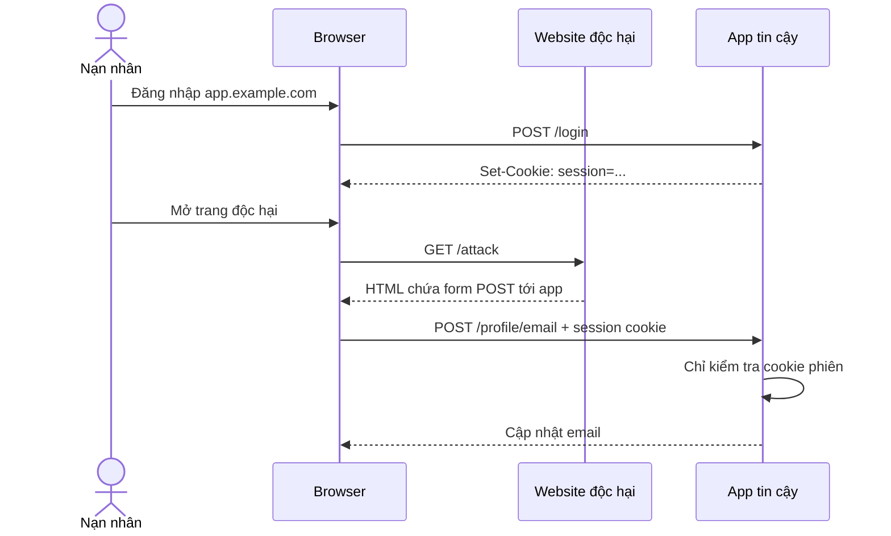
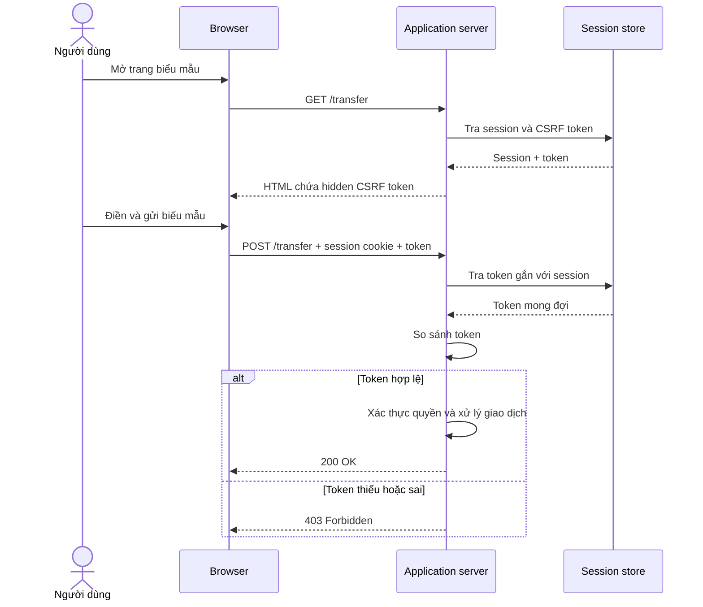

# Synchronizer token

**Synchronizer token pattern** là một cơ chế chống **Cross-Site Request Forgery (CSRF)** dành cho ứng dụng web có trạng thái phiên ở server. Server tạo một token khó đoán, gắn token với session đã xác thực và gửi token tới trang hợp lệ. Khi browser gửi request làm thay đổi trạng thái, ứng dụng phải gửi lại token; server so sánh token nhận được với token đang gắn với session trước khi thực hiện hành động.

Ý tưởng cốt lõi là browser có thể tự động đính kèm session cookie vào request, nhưng một website khác thường không thể đọc token bí mật được nhúng trong trang của ứng dụng đích do Same-Origin Policy. Vì vậy website ngoài có thể tìm cách gửi request kèm cookie, nhưng không có token hợp lệ để vượt qua bước xác minh CSRF.

Bài học thuộc chương **CSRF** trong module **Browser Security** (`SECURITY_APPLICATION_SECURITY_BROWSER_SECURITY`). Nội dung kết nối token với ranh giới browser, origin, cookie và ứng dụng web; phân biệt CSRF với XSS, CORS và xác thực; đồng thời thực hành tạo, truyền, xác minh và xoay vòng token.

## 1. Mục tiêu học tập

Sau bài này, bạn có thể:

1. Giải thích vì sao session cookie tự động được gửi có thể tạo ra lỗ hổng CSRF.
2. Mô tả quy trình Synchronizer Token Pattern từ lúc tạo token đến lúc xác minh request.
3. Tạo token bằng CSPRNG, gắn token với session và quản lý vòng đời token.
4. Chọn cách truyền token an toàn qua hidden form field hoặc custom request header.
5. Xử lý request thiếu token, token sai, token hết hạn hoặc token không thuộc session.
6. Phân biệt synchronizer token với double-submit cookie, SameSite, CORS và authentication.
7. Nhận diện giới hạn của CSRF token khi ứng dụng bị XSS hoặc token bị lộ.
8. Thực hành triển khai cơ chế xác minh token bằng Node.js và kiểm thử hành vi hợp lệ/không hợp lệ.

## 2. CSRF xuất hiện như thế nào?

HTTP request không tự chứng minh rằng người dùng chủ động muốn thực hiện một hành động. Nếu browser đang giữ cookie đăng nhập của `bank.example.com`, browser có thể tự đính kèm cookie khi gửi request tới domain đó nếu cookie và ngữ cảnh request đáp ứng chính sách.

Một website độc hại có thể tạo form tự động gửi tới endpoint thay đổi dữ liệu:

```html
<!-- Minh họa một request giả mạo; không dùng với tài khoản thật. -->
<form action="https://bank.example.com/profile/email" method="POST">
  <input type="hidden" name="email" value="attacker@example.net">
  <button type="submit">Tiếp tục</button>
</form>
<script>
  document.forms[0].submit();
</script>
```

Nếu server chỉ kiểm tra session cookie mà không xác minh request có xuất phát từ luồng hợp lệ, thao tác có thể được thực hiện trong phiên của nạn nhân.

### 2.1. Luồng CSRF không có token



Website độc hại không nhất thiết phải đọc response. Chỉ cần browser gửi request cùng cookie và server thực hiện hành động là đã có thể gây hậu quả.

Luồng minh họa giả định cookie phiên **được phép gửi trong ngữ cảnh request đó**. Ví dụ cookie có thể dùng `SameSite=None; Secure`, request có thể xuất phát từ một subdomain khác origin nhưng cùng site, hoặc ứng dụng có cấu hình/chính sách tương thích cũ. Với cookie `SameSite=Lax`, cross-site POST form thông thường thường không mang cookie trong browser hiện đại. SameSite giúp giảm rủi ro nhưng không thay thế việc đánh giá CSRF toàn bộ luồng và token ở server.

### 2.2. Vì sao CORS không đủ để ngăn CSRF?

**CORS chủ yếu kiểm soát việc JavaScript ở origin khác có được đọc response hay không.** Nó không phải cơ chế chặn mọi request. Form HTML và một số request đơn giản có thể được gửi mà không cần CORS preflight. Vì vậy:

- Không có `Access-Control-Allow-Origin` không chứng minh server chưa nhận request.
- Không đọc được response không đồng nghĩa request không tạo side effect.
- CORS allowlist không thay thế CSRF token, xác thực hay phân quyền.

CSRF token bổ sung bằng chứng rằng request có token được phát qua luồng hợp lệ của ứng dụng.

## 3. Synchronizer Token Pattern hoạt động thế nào?

Server tạo token ngẫu nhiên và lưu token trong session phía server. Khi render trang hoặc cung cấp dữ liệu cho frontend, server gửi token tới browser. Form hoặc JavaScript gửi token trở lại trong request thay đổi trạng thái. Server kiểm tra token trước khi xử lý.



### Các bước chính

1. **Tạo session:** người dùng có session hợp lệ; nếu trang chưa đăng nhập cũng cần bảo vệ, ứng dụng có thể tạo pre-auth session.
2. **Tạo token:** server dùng CSPRNG sinh giá trị khó đoán, không dựa trên user ID hoặc timestamp.
3. **Liên kết token:** lưu token trong session tương ứng, không chấp nhận token chỉ vì nó có định dạng đúng.
4. **Phát token:** đưa token vào HTML form, response JSON same-origin hoặc cơ chế bootstrap phù hợp.
5. **Gửi token:** browser gửi token cùng request thay đổi trạng thái, thường qua hidden field hoặc custom header.
6. **Xác minh:** server lấy token mong đợi từ session và so sánh với token request gửi.
7. **Quyết định:** token hợp lệ mới được đi tiếp tới bước xác thực quyền, validation và nghiệp vụ; token thiếu/sai bị từ chối trước side effect.

### 3.1. Token không phải session ID

| Giá trị | Mục đích | Nơi lưu điển hình |
| --- | --- | --- |
| Session ID | Chỉ tới phiên đăng nhập; thường là bearer credential | Cookie browser; session record phía server |
| Synchronizer CSRF token | Chứng minh request có token do ứng dụng phát cho session | Server-side session và form/page/JS phía client |
| User ID | Định danh người dùng | Session/database hoặc dữ liệu server |
| Access token | Cấp quyền truy cập API theo scope/audience | Theo kiến trúc, có thể ở cookie hoặc Authorization header |

CSRF token không dùng để đăng nhập, không thay thế session ID và không tự cấp quyền truy cập tài nguyên. Server vẫn phải xác thực người dùng và kiểm tra quyền cho từng thao tác.

## 4. Tạo token an toàn

Token cần khó đoán để website ngoài không thể tự tạo token hợp lệ. Dùng **cryptographically secure pseudorandom number generator (CSPRNG)**.

Ví dụ Node.js:

```js
import { randomBytes } from 'node:crypto';

const csrfToken = randomBytes(32).toString('base64url');
```

32 byte ngẫu nhiên cung cấp tối đa 256 bit entropy khi nguồn ngẫu nhiên của hệ điều hành hoạt động đúng. Token Base64url dễ đặt trong HTML form và HTTP header. Độ dài chuỗi không tự chứng minh độ ngẫu nhiên; không dùng `Math.random()`, timestamp, số thứ tự, email hoặc user ID để tạo token.

### 4.1. Gắn token với session

Trong Synchronizer Token Pattern, server lưu token mong đợi trong session:

```js
session.csrfToken = randomBytes(32).toString('base64url');
```

Khi request đến, server:

1. Lấy session từ cookie đã được xác minh.
2. Lấy token mong đợi từ session record.
3. Lấy token gửi trong form field hoặc custom header.
4. Từ chối nếu thiếu, sai định dạng hoặc không khớp.

Token cần được tạo và lưu trong vùng trạng thái mà website khác không thể đọc tùy ý. Không dùng token toàn cục dùng chung cho mọi user hoặc token cố định nhúng trong JavaScript bundle.

### 4.2. Per-session token và per-request token

| Kiểu token | Cách hoạt động | Đánh đổi |
| --- | --- | --- |
| Per-session | Một token được dùng trong suốt phiên hoặc đến khi rotate | Dễ triển khai, hỗ trợ nhiều tab và back button; token có thời gian tồn tại dài hơn |
| Per-request | Token mới cho từng form/request | Giảm cửa sổ tái sử dụng trong một số tình huống; dễ gây lỗi nhiều tab, back button, retry và request đồng thời |

Phần lớn ứng dụng dùng per-session token hoặc token theo một khoảng thời gian/luồng phù hợp. Nếu dùng per-request token, phải thiết kế cơ chế đồng bộ và xử lý retry rõ ràng; không đơn giản rotate token ngay sau mọi request rồi khiến tab khác bị lỗi.

### 4.3. So sánh token

Token nhận từ client cần được so sánh với giá trị mong đợi ở server. Với token có độ dài cố định, có thể dùng hàm so sánh constant-time để giảm rò rỉ qua thời gian thực thi. Trước khi so sánh, kiểm tra định dạng và độ dài giới hạn để tránh xử lý input quá lớn.

Ví dụ Node.js:

```js
import { timingSafeEqual } from 'node:crypto';

function safeTokenEquals(expected, supplied) {
  if (typeof expected !== 'string' || typeof supplied !== 'string') return false;
  const a = Buffer.from(expected, 'utf8');
  const b = Buffer.from(supplied, 'utf8');
  if (a.length !== b.length) return false;
  return timingSafeEqual(a, b);
}
```

Constant-time compare là lớp phòng vệ bổ sung; nó không thay thế CSPRNG, session binding, kiểm soát độ dài, HTTPS và bảo vệ token khỏi rò rỉ.

## 5. Truyền synchronizer token tới browser

Token phải được gửi theo cách website ngoài không thể đọc dễ dàng qua chính sách browser. Hai cách phổ biến:

### 5.1. Hidden field trong HTML form

Server render:

```html
<form method="POST" action="/profile/email">
  <input type="hidden" name="_csrf" value="RANDOM_TOKEN_FROM_SERVER">
  <label>
    Email mới
    <input type="email" name="email" required>
  </label>
  <button type="submit">Lưu</button>
</form>
```

Server lấy `_csrf` từ body, so sánh với token của session. Template engine phải escape giá trị token đúng ngữ cảnh HTML attribute. Không nối chuỗi token vào HTML bằng cách không an toàn.

### 5.2. Custom header cho SPA/fetch

Server có thể cung cấp token trong HTML bootstrap hoặc một endpoint JSON same-origin. JavaScript giữ token trong bộ nhớ trang rồi gửi qua header:

```js
await fetch('/api/profile/email', {
  method: 'POST',
  headers: {
    'Content-Type': 'application/json',
    'X-CSRF-Token': csrfToken,
  },
  body: JSON.stringify({ email: 'new@example.com' }),
});
```

Custom header không tự động bảo đảm an toàn. Server phải xác minh token; không được phản chiếu CORS cho mọi origin hoặc cho phép origin không tin cậy đọc endpoint cấp token.

### 5.3. Không đặt token trong URL

Tránh:

```text
POST /transfer?csrf=secret-token
GET  /account?csrf=secret-token
```

URL có thể xuất hiện trong browser history, access log, proxy log, analytics, screenshot và Referer. Gửi token trong body hoặc custom header qua HTTPS; không ghi raw token vào log.

### 5.4. Không dùng cookie làm nơi duy nhất lưu synchronizer token

Synchronizer Token Pattern dựa vào token mà server giữ trong session và client chủ động gửi lại trong form/header. Nếu chỉ đặt token trong cookie để browser tự gửi cùng request, website ngoài cũng có thể khiến browser gửi cookie đó; cơ chế này gần với double-submit cookie và có giả định bảo mật khác.

Nếu dùng cookie để mang token, cần phân biệt rõ pattern và thiết kế chống cookie injection. Không gọi một cookie tự động gửi là synchronizer token chỉ vì nó có tên `csrf`.

## 6. Xác minh token ở server

Server phải xác minh token trước khi thực hiện side effect. Luồng xử lý đề xuất:

1. Kiểm tra method và route.
2. Xác minh session cookie và trạng thái session.
3. Xác định request thuộc nhóm cần CSRF protection (thường mọi method làm thay đổi trạng thái).
4. Lấy token từ đúng vị trí đã định (form body hoặc header).
5. So sánh token với giá trị gắn với session.
6. Nếu token thiếu/sai, trả lỗi và dừng trước nghiệp vụ.
7. Nếu token đúng, tiếp tục authorization, validation, xử lý nghiệp vụ và ghi log an toàn.

Ví dụ pseudo-code:

```js
async function updateEmail(request, response) {
  const session = await requireAuthenticatedSession(request);
  const suppliedToken = request.headers['x-csrf-token'];

  if (!safeTokenEquals(session.csrfToken, suppliedToken)) {
    return sendJson(response, 403, { error: 'Invalid CSRF token' });
  }

  await requirePermission(session.userId, 'profile:update');
  const input = await parseAndValidateBody(request);
  await changeEmail(session.userId, input.email);
  return sendJson(response, 200, { updated: true });
}
```

Đây là mô hình minh họa. Ứng dụng cần kiểm tra content type, body size, method, session expiry, authorization và quy trình xác minh email mới. Token hợp lệ không có nghĩa dữ liệu đầu vào hợp lệ hoặc user có quyền thực hiện mọi hành động.

### 6.1. Từ chối fail-closed

Các trường hợp nên bị từ chối:

- Không có session hợp lệ khi endpoint yêu cầu đăng nhập.
- Không có CSRF token ở request cần bảo vệ.
- Token không đúng định dạng, quá dài hoặc không khớp.
- Token thuộc session khác.
- Session đã hết hạn hoặc bị thu hồi.
- Request sử dụng method không được endpoint hỗ trợ.

Không tự động bỏ qua CSRF validation vì token bị thiếu, cookie không có hoặc browser gửi header khác dự kiến. Với endpoint không dùng cookie authentication và không dựa vào browser tự động gửi credential, hãy đánh giá threat model riêng thay vì bật/tắt kiểm tra theo phỏng đoán.

GET, HEAD và các request dùng để tải tài nguyên nên giữ tính an toàn theo ngữ nghĩa HTTP: không đổi trạng thái nghiệp vụ. Nếu một endpoint GET thực hiện hành động như xóa, chuyển tiền hoặc thay đổi email, nó tạo bề mặt CSRF dù ứng dụng đã bảo vệ các form POST.

### 6.2. Response lỗi

Server thường trả `403 Forbidden` cho CSRF token thiếu hoặc sai:

```http
HTTP/1.1 403 Forbidden
Content-Type: application/json
Cache-Control: no-store

{"error":"Invalid CSRF token"}
```

Không trả token mong đợi hoặc thông tin session nhạy cảm trong response lỗi. Log sự kiện CSRF thất bại với request ID, route và nguồn thông tin cần thiết, nhưng không log token thô hoặc cookie phiên.

## 7. Vòng đời token: session, login và logout

Token cần theo vòng đời của session:

| Sự kiện | Hành động khuyến nghị |
| --- | --- |
| Tạo pre-auth session | Có thể tạo token để bảo vệ login form nếu threat model yêu cầu |
| Đăng nhập thành công | Rotate session ID; tạo/rotate CSRF token gắn với session mới |
| Hoàn tất MFA hoặc nâng quyền | Cân nhắc rotate token cùng session khi thay đổi mức tin cậy |
| Token hết hạn hoặc session timeout | Từ chối token cũ; yêu cầu tải lại luồng/form hợp lệ |
| Logout | Thu hồi session và token; xóa cookie đúng scope |
| Đổi mật khẩu hoặc thu hồi phiên | Thu hồi session theo chính sách; token của session cũ không còn hợp lệ |

### 7.1. Login CSRF

CSRF cũng có thể nhắm vào **form đăng nhập**. Attacker cố khiến browser của nạn nhân đăng nhập vào tài khoản do attacker kiểm soát. Sau đó nạn nhân có thể vô tình nhập dữ liệu cá nhân hoặc thông tin thanh toán vào tài khoản attacker.

Có thể bảo vệ login flow bằng token gắn với pre-auth session, kiểm tra Origin/Fetch Metadata và các biện pháp phù hợp. Khi đăng nhập thành công, server phải rotate session ID và token; không chuyển nguyên session pre-auth thành session đã xác thực mà giữ nguyên ID.

### 7.2. Nhiều tab và back button

Nếu token theo session, nhiều tab có thể dùng chung token cho đến khi session/token rotate. Khi token rotate, các trang cũ có thể gửi token đã hết hiệu lực và nhận 403. Giao diện nên có cách tải lại form hoặc lấy token mới theo luồng same-origin, đồng thời tránh tự retry một thao tác thay đổi trạng thái nếu không biết request trước đã được xử lý hay chưa.

## 8. Synchronizer token, SameSite, Origin và CORS

Các cơ chế này bổ sung cho nhau nhưng giải quyết các phần khác nhau:

| Cơ chế | Điều nó kiểm soát | Giới hạn |
| --- | --- | --- |
| Synchronizer token | Request có token do ứng dụng phát cho session hay không | XSS cùng origin có thể đọc token và gửi request |
| SameSite cookie | Khi nào browser gửi cookie theo ngữ cảnh site | Subdomain cùng site có thể vẫn được phân loại same-site; không thay mọi CSRF defense |
| Origin / Referer validation | Origin của request browser gửi đến | Cần xử lý header thiếu/khác môi trường; không phải xác thực client tổng quát |
| Fetch Metadata | Ngữ cảnh request như `Sec-Fetch-Site`, `Sec-Fetch-Mode` | Không thay token; client ngoài browser có thể tự tạo header |
| CORS | Quyền JavaScript cross-origin đọc response và một số preflight | Không chặn mọi request; không phải authorization |
| Authorization | Người dùng có quyền thao tác tài nguyên không | Không tự chứng minh request được người dùng chủ động khởi tạo |

Một cấu hình cookie phổ biến:

```http
Set-Cookie: __Host-session=<opaque-session-id>; Path=/; Secure; HttpOnly; SameSite=Lax
```

Kết hợp với CSRF token và kiểm tra Origin/Fetch Metadata tạo nhiều lớp bảo vệ. Tuy nhiên, không nên dựa vào một header hoặc một thuộc tính cookie duy nhất.

## 9. Synchronizer token và Double-Submit Cookie khác nhau thế nào?

Hai pattern thường bị gọi chung là CSRF token nhưng có cách lưu và xác minh khác nhau:

| Tiêu chí | Synchronizer Token | Double-Submit Cookie |
| --- | --- | --- |
| Token mong đợi | Lưu trong session phía server | Được gửi qua cookie và một kênh request khác |
| Server có state token? | Có, gắn với session | Pattern cơ bản không cần lưu token trong session |
| Client gửi lại | Hidden form field hoặc custom header | Cookie tự động gửi + body/header chứa token |
| Điều kiện an toàn | Token bí mật, khó đoán, ràng buộc đúng session | Phải chống cookie injection; bản signed/session-bound cải thiện độ tin cậy |
| Phù hợp | Ứng dụng đã có server-side session | Một số kiến trúc stateless hoặc cần tránh lưu token server-side |

Trong double-submit cơ bản, server so sánh cookie token với token trong header/body. Nếu attacker có thể đặt cookie cùng tên qua subdomain hoặc cơ chế injection, việc so sánh đơn giản có thể bị phá. Signed double-submit token gắn với session hoặc secret phía server có thể giảm rủi ro này.

Không trộn hai pattern một cách mơ hồ. Nếu ứng dụng có session store, synchronizer token thường dễ hiểu: server lưu token trong session, client gửi lại, server so sánh.

## 10. XSS có thể vượt qua CSRF token

CSRF token bảo vệ trước website **khác origin** không đọc được token của ứng dụng. Nhưng nếu attacker đã thực thi JavaScript qua XSS trong chính origin ứng dụng, script đó có thể:

- Đọc token trong DOM hoặc response JSON mà ứng dụng cung cấp.
- Gửi fetch với custom header hoặc form field chứa token.
- Thực hiện hành động trong session người dùng.

Do đó CSRF token **không phải biện pháp phòng XSS**. Cần đồng thời:

1. Dùng `textContent` hoặc template encoding an toàn thay cho `innerHTML` với dữ liệu không tin cậy.
2. Sanitize HTML theo ngữ cảnh khi cần render nội dung rich text.
3. Cấu hình CSP hạn chế nguồn script và inline script; cân nhắc nonce/hash.
4. Dùng Trusted Types để hạn chế một số DOM sink nguy hiểm ở browser hỗ trợ.
5. Bảo vệ cookie bằng HttpOnly, Secure và SameSite phù hợp.
6. Kiểm tra authorization phía server cho từng thao tác.

HttpOnly giúp ngăn JavaScript đọc session cookie trực tiếp nhưng không ngăn XSS đọc CSRF token được render trong trang hoặc sử dụng phiên hiện tại.

## 11. Thực hành: Synchronizer Token Pattern với Node.js

Bài thực hành sử dụng **Node.js 18 trở lên**, không cần package ngoài. Server dùng session store trong RAM, cookie demo và form HTML. Endpoint login giả lập xác thực thành công; đây là môi trường học tập, **không phải hệ thống đăng nhập production**.

### 11.1. Tạo server

Tạo file `csrf-demo.mjs` trong thư mục thực hành riêng:

```js
import { createServer } from 'node:http';
import { randomBytes, createHash, timingSafeEqual } from 'node:crypto';

const sessions = new Map();
const COOKIE = 'demo_session';

function digest(value) {
  return createHash('sha256').update(value).digest('hex');
}

function readCookie(req, name) {
  const header = req.headers.cookie || '';
  for (const part of header.split(';')) {
    const index = part.indexOf('=');
    if (index < 0) continue;
    if (part.slice(0, index).trim() === name) {
      return part.slice(index + 1).trim();
    }
  }
  return null;
}

function safeEqual(expected, supplied) {
  if (typeof expected !== 'string' || typeof supplied !== 'string') return false;
  if (supplied.length > 200) return false;
  const a = Buffer.from(expected, 'utf8');
  const b = Buffer.from(supplied, 'utf8');
  return a.length === b.length && timingSafeEqual(a, b);
}

function createSession(userId) {
  const sessionId = randomBytes(32).toString('base64url');
  const csrfToken = randomBytes(32).toString('base64url');
  sessions.set(digest(sessionId), { userId, csrfToken });
  return { sessionId, csrfToken };
}

function getSession(req) {
  const id = readCookie(req, COOKIE);
  if (!id || !/^[A-Za-z0-9_-]{43}$/.test(id)) return null;
  return sessions.get(digest(id)) || null;
}

function setCookie(res, value) {
  // Demo HTTP localhost: production phải dùng HTTPS và Secure.
  res.setHeader('Set-Cookie',
    COOKIE + '=' + value + '; Path=/; HttpOnly; SameSite=Lax; Max-Age=1800');
}

function clearCookie(res) {
  res.setHeader('Set-Cookie',
    COOKIE + '=; Path=/; HttpOnly; SameSite=Lax; Max-Age=0');
}

function send(res, status, type, body) {
  res.writeHead(status, {
    'Content-Type': type,
    'Cache-Control': 'no-store',
  });
  res.end(body);
}

function sendJson(res, status, data) {
  send(res, status, 'application/json; charset=utf-8', JSON.stringify(data));
}

function parseForm(req) {
  return new Promise((resolve, reject) => {
    let body = '';
    let tooLarge = false;
    req.on('data', chunk => {
      if (tooLarge) return;
      body += chunk.toString('utf8');
      if (Buffer.byteLength(body, 'utf8') > 16_384) {
        tooLarge = true;
        body = '';
      }
    });
    req.on('end', () => {
      if (tooLarge) {
        reject(new Error('Body too large'));
        return;
      }
      resolve(new URLSearchParams(body));
    });
    req.on('error', reject);
  });
}

const html = (token) => `<!doctype html>
<html lang="vi">
<head><meta charset="utf-8"><title>Synchronizer token demo</title></head>
<body>
  <h1>Đổi email bằng synchronizer token</h1>
  <p>Session demo: demo-user-1</p>
  <form method="POST" action="/change-email">
    <input type="hidden" name="_csrf" value="${token}">
    <label>Email mới <input type="email" name="email" required></label>
    <button type="submit">Cập nhật email</button>
  </form>
  <p><a href="/form">Tải lại form/token</a></p>
</body>
</html>`;

createServer(async (req, res) => {
  const url = new URL(req.url, 'http://localhost');

  if (req.method === 'POST' && url.pathname === '/login') {
    // DEMO ONLY: giả lập xác thực thành công.
    const oldId = readCookie(req, COOKIE);
    if (oldId) sessions.delete(digest(oldId));
    const created = createSession('demo-user-1');
    setCookie(res, created.sessionId);
    sendJson(res, 200, { loggedIn: true, next: '/form' });
    return;
  }

  if (req.method === 'GET' && url.pathname === '/form') {
    const session = getSession(req);
    if (!session) {
      send(res, 401, 'text/plain; charset=utf-8', 'Please login first');
      return;
    }
    send(res, 200, 'text/html; charset=utf-8', html(session.csrfToken));
    return;
  }

  if (req.method === 'POST' && url.pathname === '/change-email') {
    const session = getSession(req);
    if (!session) {
      sendJson(res, 401, { error: 'Unauthenticated' });
      return;
    }

    let form;
    try {
      form = await parseForm(req);
    } catch {
      sendJson(res, 400, { error: 'Invalid form body' });
      return;
    }

    const suppliedToken = form.get('_csrf');
    if (!safeEqual(session.csrfToken, suppliedToken)) {
      sendJson(res, 403, { error: 'Invalid CSRF token' });
      return;
    }

    const email = form.get('email') || '';
    if (!/^[^\s@]+@[^\s@]+\.[^\s@]+$/.test(email)) {
      sendJson(res, 400, { error: 'Invalid email' });
      return;
    }

    // DEMO ONLY: ghi nhận hành động thay vì cập nhật tài khoản thật.
    console.log('Email change accepted for demo user:', email);
    sendJson(res, 200, { updated: true, email });
    return;
  }

  if (req.method === 'POST' && url.pathname === '/logout') {
    const id = readCookie(req, COOKIE);
    if (id) sessions.delete(digest(id));
    clearCookie(res);
    sendJson(res, 200, { loggedOut: true });
    return;
  }

  if (req.method === 'GET' && url.pathname === '/') {
    send(res, 200, 'text/html; charset=utf-8', `
      <!doctype html><html lang="vi"><meta charset="utf-8">
      <h1>CSRF demo</h1>
      <button id="login">Giả lập đăng nhập</button>
      <a href="/form">Mở form</a>
      <script>
        document.querySelector('#login').onclick = async () => {
          const response = await fetch('/login', { method: 'POST' });
          const result = await response.json();
          location.href = result.next;
        };
      </script></html>`);
    return;
  }

  sendJson(res, 404, { error: 'Not found' });
}).listen(3000, () => console.log('Open http://localhost:3000'));
```

### 11.2. Chạy và kiểm tra luồng hợp lệ

Chạy:

```bash
node csrf-demo.mjs
```

Mở `http://localhost:3000`:

1. Nhấn **Giả lập đăng nhập** để server tạo session ID và CSRF token mới.
2. Trang chuyển tới `/form`; server render hidden field `_csrf`.
3. Nhập email demo và gửi form.
4. Server lấy session từ cookie, lấy token trong form và so sánh.
5. Nếu token đúng, server trả JSON 200 và ghi nhận hành động demo.

Trong DevTools → Network, mở request POST `/change-email`:

- Request Headers có Cookie session.
- Form Data có `_csrf` và `email`.
- Response 200 nếu token hợp lệ.

Cookie được đặt HttpOnly nên JavaScript không đọc trực tiếp session ID; token được render trong form để browser gửi lại.

### 11.3. Kiểm tra token thiếu hoặc sai

Mở Console trên cùng origin sau khi đăng nhập và thử:

```js
const response = await fetch('/change-email', {
  method: 'POST',
  headers: {
    'Content-Type': 'application/x-www-form-urlencoded',
  },
  body: new URLSearchParams({
    email: 'attacker@example.net',
    _csrf: 'wrong-token',
  }),
});
console.log(response.status, await response.json());
```

Kết quả mong đợi là **403 Forbidden**. Server không ghi nhận hành động thay đổi email. Thử bỏ trường `_csrf` cũng phải bị từ chối.

### 11.4. Kiểm tra request không có token từ origin khác

Một form từ trang khác có thể cố gửi POST tới `http://localhost:3000/change-email`. Nếu cookie được gửi theo chính sách browser, server vẫn tìm được session, nhưng không có token hợp lệ nên từ chối 403.

Để thử trong môi trường local, có thể tạo một trang HTML ở port khác và gửi form tới endpoint demo. Không dùng endpoint chứa dữ liệu hoặc session thật. Quan sát Network và server log để phân biệt:

- Browser có thể gửi POST form.
- Cookie có thể được đính kèm tùy SameSite và ngữ cảnh.
- Server từ chối trước side effect vì token thiếu.

### 11.5. Giới hạn của demo

- Login chỉ giả lập xác thực; không có username/password, MFA hoặc rate limiting.
- Login demo chưa có token cho pre-auth session; ứng dụng thật cần đánh giá và bảo vệ login flow trước login CSRF.
- Session store là Map trong RAM, không phù hợp nhiều process và mất dữ liệu khi restart.
- Cookie demo không có Secure vì dùng HTTP localhost. Production phải dùng HTTPS và Secure.
- Chưa có CSRF token cho logout endpoint; production cần bảo vệ mọi thao tác thay đổi trạng thái, kể cả logout theo threat model.
- Email chỉ được kiểm tra định dạng đơn giản; ứng dụng thật cần validation và xác minh email.
- Demo không xử lý đầy đủ race condition, timeout và distributed session store.

## 12. Checklist triển khai Synchronizer Token Pattern

1. **Dùng CSPRNG:** token đủ entropy, không đoán được và không dùng chung toàn hệ thống.
2. **Gắn với session:** server giữ token mong đợi trong session phía server; không tin token client tự khai.
3. **Truyền qua body/header:** hidden form field hoặc custom header; không đặt token trong URL hay log.
4. **Xác minh trước side effect:** token thiếu/sai phải dừng request và trả lỗi; không tiếp tục nghiệp vụ.
5. **Bảo vệ session cookie:** Secure, HttpOnly, SameSite phù hợp; host-only nếu có thể.
6. **Rotate đúng lúc:** đổi session ID và token sau login/MFA/privilege elevation; thu hồi phiên cũ.
7. **Xử lý nhiều tab:** cân nhắc per-session token và trải nghiệm khi token rotate; không làm form đang mở hỏng bất ngờ.
8. **Kết hợp Origin/Fetch Metadata:** dùng làm lớp bổ sung, không thay token.
9. **Bảo vệ XSS:** token có thể bị XSS cùng origin đọc; CSP, Trusted Types và xử lý DOM an toàn vẫn cần thiết.
10. **Không log bí mật:** không ghi token, session cookie hoặc raw Authorization header.
11. **Bảo vệ mọi hành động:** cập nhật dữ liệu, xóa, đổi mật khẩu, thêm phương thức thanh toán, logout và các thao tác nhạy cảm.
12. **Kiểm thử negative case:** token thiếu, sai, thuộc session khác, session hết hạn, request cross-site và request từ tab cũ.

## 13. Những nhầm lẫn cần tránh

| Nhầm lẫn | Cách hiểu đúng |
| --- | --- |
| “CSRF token chính là session ID.” | Session ID xác định phiên; CSRF token xác minh request thuộc luồng hợp lệ của phiên. |
| “Chỉ cần có cookie là đủ.” | Browser tự gửi cookie; server cần token hoặc cơ chế chống CSRF khác cho thao tác phù hợp. |
| “CORS chặn website khác gửi request.” | CORS chủ yếu kiểm soát quyền đọc response và preflight; một số request vẫn có thể được gửi. |
| “Đặt CSRF token trong cookie là Synchronizer Token Pattern.” | Synchronizer token được lưu trong session server-side và client gửi lại qua body/header. Token cookie thường thuộc double-submit pattern. |
| “Token hợp lệ nghĩa là người dùng có quyền.” | Server vẫn phải xác thực session và authorization theo user/tài nguyên. |
| “HttpOnly ngăn CSRF.” | HttpOnly ngăn JavaScript đọc cookie; không ngăn browser tự gửi cookie. |
| “SameSite thay hoàn toàn token.” | SameSite là lớp giảm rủi ro; subdomain cùng site và các luồng đặc biệt vẫn cần phân tích. |
| “CSRF token ngăn XSS.” | XSS cùng origin có thể đọc token và gửi request; cần phòng XSS riêng. |
| “Một token dùng cho mọi user là đủ.” | Token cần khó đoán và gắn đúng session; token toàn cục không tạo liên kết với phiên người dùng. |
| “Chỉ cần bảo vệ POST.” | Cần bảo vệ mọi method có side effect, kể cả PUT/PATCH/DELETE và endpoint logout hoặc hành động đặc biệt khác. |

## 14. Câu hỏi tự đánh giá

**Câu 1.** Vì sao session cookie hợp lệ vẫn không chứng minh request thay đổi email là do người dùng chủ động gửi?

**Gợi ý trả lời:** Browser có thể tự đính kèm cookie vào request do website khác khởi tạo. Cookie xác định phiên, không chứng minh ý định của người dùng cho hành động cụ thể.

**Câu 2.** Synchronizer token được lưu ở đâu và gửi lại bằng cách nào?

**Gợi ý trả lời:** Server lưu token trong session; client gửi lại trong hidden form field hoặc custom request header.

**Câu 3.** Vì sao token phải được tạo bằng CSPRNG?

**Gợi ý trả lời:** Attacker không được đoán hoặc tự tạo token hợp lệ. Timestamp, user ID và Math.random không cung cấp entropy phù hợp.

**Câu 4.** Preflight CORS thất bại có phải cách thay thế CSRF token không?

**Gợi ý trả lời:** Không. Form và simple request có thể được gửi không cần preflight; CORS không chặn mọi request.

**Câu 5.** XSS cùng origin có thể làm gì với synchronizer token?

**Gợi ý trả lời:** Script XSS có thể đọc token từ DOM/response và gửi request cùng session, nên CSRF token không thay XSS defense.

**Câu 6.** Khi đăng nhập thành công, vì sao cần rotate session ID và token?

**Gợi ý trả lời:** Để ngăn session fixation và bảo đảm token gắn với session đã xác thực mới, không tiếp tục tin trạng thái trước đăng nhập.

**Câu 7.** Vì sao không đưa CSRF token vào query string?

**Gợi ý trả lời:** URL có thể bị lưu trong history, log, analytics, screenshot và Referer; token nên nằm trong body hoặc custom header qua HTTPS.

## Tài liệu tham khảo

- OWASP — [Cross-Site Request Forgery Prevention Cheat Sheet](https://cheatsheetseries.owasp.org/cheatsheets/Cross-Site_Request_Forgery_Prevention_Cheat_Sheet.html).
- OWASP — [Session Management Cheat Sheet](https://cheatsheetseries.owasp.org/cheatsheets/Session_Management_Cheat_Sheet.html), [Cross Site Scripting Prevention Cheat Sheet](https://cheatsheetseries.owasp.org/cheatsheets/Cross_Site_Scripting_Prevention_Cheat_Sheet.html).
- MDN — [Same-origin policy](https://developer.mozilla.org/en-US/docs/Web/Security/Same-origin_policy), [Cross-Origin Resource Sharing (CORS)](https://developer.mozilla.org/en-US/docs/Web/HTTP/Guides/CORS).
- MDN — [Using HTTP cookies](https://developer.mozilla.org/en-US/docs/Web/HTTP/Guides/Cookies), [Fetch Metadata Request Headers](https://developer.mozilla.org/en-US/docs/Glossary/Fetch_metadata_request_header).
- Node.js — [Crypto: randomBytes() and timingSafeEqual()](https://nodejs.org/api/crypto.html).
