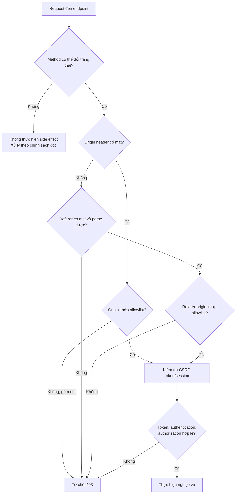

# Origin check: xác minh nguồn request để phòng chống CSRF

## Mục tiêu học tập

Sau bài học, người học có thể:

1. Giải thích vì sao server kiểm tra request header **Origin** để giảm nguy cơ Cross-Site Request Forgery (CSRF).
2. Xác định origin hợp lệ theo **scheme + host + port**, phân biệt origin với site, URL đầy đủ và chuỗi hostname.
3. Thiết kế allowlist origin chính xác, xử lý Origin thiếu, Origin null, giá trị sai định dạng và Referer fallback.
4. Áp dụng kiểm tra cho request thay đổi trạng thái, bảo đảm GET/HEAD/OPTIONS không thực hiện side effect.
5. Phân biệt Origin check với CORS, SameSite cookie, CSRF token, Fetch Metadata và xác thực/phân quyền.
6. Kiểm thử bằng browser DevTools và đánh giá giới hạn khi request đến từ client không phải browser hoặc đi qua reverse proxy.

> **Bối cảnh:** Module Browser Security phân tích ranh giới bảo mật giữa trình duyệt, origin, cookie và ứng dụng web để hiểu SOP, CORS và các cơ chế cách ly. Origin check là một lớp phòng vệ CSRF ở **server**: server xác minh nguồn của request trước khi chấp nhận thao tác dùng credential tự động như cookie. Nó cần phối hợp với session, CSRF token, SameSite và kiểm tra quyền nghiệp vụ.

## 1. Vì sao cần Origin check?

Browser thường tự đính kèm cookie phù hợp khi gửi request tới một website. Đây là hành vi cần thiết để duy trì phiên đăng nhập, nhưng cũng tạo cơ hội cho CSRF:

1. Người dùng đăng nhập tại https://bank.example.test; browser lưu session cookie.
2. Người dùng mở một website do kẻ tấn công kiểm soát, ví dụ https://evil.test.
3. Trang độc hại khiến browser gửi request đến ngân hàng bằng form, navigation hoặc một kiểu request khác.
4. Nếu cookie đủ điều kiện được gửi và server chỉ dựa vào session cookie, request có thể thực hiện hành động dưới phiên của nạn nhân.

Kẻ tấn công thường không cần đọc response. Mục tiêu CSRF là **khiến server thực hiện hành động ngoài ý muốn**; SOP/CORS có thể ngăn script đọc response nhưng không tự bảo đảm request không đến server.

Trong request do browser tạo, header **Origin** cho biết origin của ngữ cảnh khởi tạo request trong những trường hợp browser gửi header này. Server có thể so sánh giá trị đó với danh sách origin được phép trước khi xử lý hành động nhạy cảm.

Origin là một forbidden request header trong Fetch: JavaScript thông thường không được tự đặt hoặc sửa giá trị này; browser tạo header theo ngữ cảnh request. Quy tắc đó không áp dụng cho client ngoài browser, vốn có thể tự gửi một header cùng tên.

Ví dụ:

```http
POST /api/profile/email HTTP/1.1
Host: bank.example.test
Origin: https://app.bank.example.test
Cookie: __Host-session=[REDACTED]
Content-Type: application/json
```

Nếu endpoint chỉ chấp nhận thao tác từ frontend https://app.bank.example.test, server kiểm tra Origin và từ chối request có nguồn không nằm trong allowlist.

**Giới hạn quan trọng:** Origin check chủ yếu bảo vệ threat model request được khởi tạo từ browser của người dùng. Client như curl, Postman hoặc một server khác có thể tự đặt header Origin; server không được coi header này là danh tính người dùng hay bằng chứng xác thực. Authentication và authorization vẫn phải được thực hiện độc lập.

## 2. Origin request gồm những gì?

Với URL HTTP(S) thông thường, origin được xác định bởi bộ ba:

```text
origin = scheme + host + port có hiệu lực

https://app.example.test:8443/account
        └────── host ──────┘ └port┘
└scheme┘
```

Origin của URL https://app.example.test/account?tab=security là:

```http
Origin: https://app.example.test
```

Path, query và fragment không thuộc serialized origin. Port mặc định được chuẩn hóa: https://app.example.test:443 cùng origin với https://app.example.test; HTTP port mặc định là 80.

| Origin trong request | Có khớp https://app.example.test? | Lý do |
| --- | :---: | --- |
| https://app.example.test | Có | Đúng scheme, host và port mặc định |
| https://app.example.test:443 | Có sau chuẩn hóa | Cổng mặc định HTTPS |
| https://app.example.test:8443 | Không | Port khác |
| http://app.example.test | Không | Scheme khác |
| https://admin.example.test | Không | Host khác |
| https://app.example.test.attacker.test | Không | Host giả có phần tiền tố giống |
| https://evil.test | Không | Origin khác |

**Same-site không đồng nghĩa same-origin.** https://app.example.test và https://admin.example.test có thể cùng schemeful site nhưng là hai origin khác nhau. Nếu chỉ kiểm tra chuỗi example.test hoặc chấp nhận mọi subdomain, một subdomain yếu bảo mật có thể trở thành nguồn request được tin cậy ngoài ý muốn.

### Origin header khác Referer

- **Origin:** chỉ biểu diễn origin; không chứa path, query hoặc fragment.
- **Referer:** thường chứa URL của trang giới thiệu, có thể có path và query tùy Referrer-Policy.
- Cả hai đều có thể vắng mặt trong một số request hoặc ngữ cảnh.
- Origin: null là một giá trị được tuần tự hóa cho opaque origin, không phải tên miền hoặc origin tin cậy.

Không so sánh Referer bằng prefix hoặc substring. Nếu dùng làm fallback, parse URL rồi so sánh origin đã chuẩn hóa với allowlist.

## 3. Thuật toán Origin check cho request thay đổi trạng thái

Một chính sách thực tế cho endpoint dùng cookie session có thể thực hiện theo thứ tự:

1. **Xác định request có thể thay đổi trạng thái:** POST, PUT, PATCH, DELETE và các method nghiệp vụ khác. Xử lý method override trước khi đánh giá chính sách.
2. **Đọc Origin:** nếu header tồn tại, so sánh nguyên giá trị serialized origin với allowlist cấu hình. Nếu là null, sai định dạng hoặc không khớp thì từ chối; không fallback sang Referer để cứu một Origin không hợp lệ.
3. **Fallback có kiểm soát:** chỉ khi Origin thực sự không có, có thể đọc Referer, parse URL và so sánh URL.origin với allowlist.
4. **Thiếu cả hai:** với endpoint browser dùng cookie, chính sách nghiêm ngặt thường từ chối hoặc yêu cầu một cơ chế CSRF token độc lập đã được thiết kế rõ. Không tự động cho qua.
5. **Kiểm tra CSRF token và session:** với endpoint nhạy cảm, kiểm tra token nếu kiến trúc yêu cầu, xác thực người dùng và quyền trên tài nguyên/hành động.
6. **Chỉ sau khi các kiểm tra đạt** mới thực hiện nghiệp vụ và thay đổi dữ liệu.



### Không cho GET thay đổi trạng thái

Các method được xem là safe theo HTTP như GET và HEAD phải không gây thay đổi trạng thái nghiệp vụ. Không thiết kế endpoint kiểu:

```http
GET /account/delete
GET /transfer?to=attacker&amount=100
```

Một request GET có thể được kích hoạt bởi link, ảnh, prefetch, crawler hoặc navigation; không nên dựa vào Origin check để hợp thức hóa một endpoint thay đổi dữ liệu qua GET. Chuyển thao tác sang POST/PUT/PATCH/DELETE và bảo vệ CSRF.

OPTIONS thường được dùng cho preflight CORS và không nên thực hiện side effect. Nếu ứng dụng dùng method khác hoặc method override, hãy chuẩn hóa method hiệu lực trước khi áp dụng quy tắc.

TRACE là safe method theo ngữ nghĩa HTTP nhưng thường được tắt trên server production; nếu hệ thống không hỗ trợ TRACE, hãy từ chối method này ở tầng HTTP.

## 4. Xây dựng allowlist origin chính xác

Allowlist phải là cấu hình do server quản lý, ví dụ:

```text
https://app.example.test
https://admin.example.test
```

Chỉ thêm origin có chủ sở hữu, môi trường và nhu cầu nghiệp vụ rõ ràng. Với môi trường production, ưu tiên HTTPS; không tự động thêm localhost, staging, preview deployment, wildcard subdomain hoặc domain do bên thứ ba quản lý.

### So sánh chính xác, không dùng substring

Các cách kiểm tra sau không an toàn:

```js
// SAI: cho phép host giả có hậu tố
origin.endsWith("example.test");

// SAI: chuỗi tin cậy có thể xuất hiện ở bất kỳ vị trí nào
origin.includes("app.example.test");

// SAI: cho phép mọi host bắt đầu bằng chuỗi này
origin.startsWith("https://app.example.test");
```

Ví dụ https://app.example.test.attacker.test không thuộc https://app.example.test. So sánh chuỗi origin hoàn chỉnh với allowlist chuẩn hóa:

```js
const trustedOrigins = new Set([
  "https://app.example.test",
  "https://admin.example.test"
]);

function isTrustedOriginHeader(value) {
  return typeof value === "string" && trustedOrigins.has(value);
}
```

Browser gửi Origin theo dạng serialized origin. Cấu hình allowlist cũng nên dùng cùng dạng chuẩn: scheme, host và port chuẩn hóa, không có path hoặc slash cuối.

**Không suy allowlist từ request Host hoặc X-Forwarded-Host.** Những header này có thể chịu ảnh hưởng từ cấu hình proxy hoặc host-header injection. Origin được phép phải đến từ cấu hình server tin cậy, không phải do client đề xuất rồi server tự chấp thuận.

### Subdomain và port

Nếu chỉ https://app.example.test được phép, không chấp nhận:

- https://old-app.example.test;
- https://user-content.example.test;
- https://app.example.test:8443;
- http://app.example.test.

Một subdomain cùng site vẫn là cross-origin. Chỉ cho phép origin thực sự cần gửi thao tác có cookie; không dùng quy tắc “mọi subdomain cùng domain gốc đều tin cậy”.

## 5. Xử lý Origin thiếu, null và Referer fallback

### Khi Origin có mặt

Nếu header có mặt, đây là nguồn dữ liệu chính cho phép kiểm tra:

| Giá trị | Xử lý khuyến nghị |
| --- | --- |
| Origin nằm trong allowlist | Tiếp tục các bước CSRF token, authentication và authorization |
| Origin không nằm trong allowlist | Từ chối request thay đổi trạng thái |
| Origin: null | Từ chối theo mặc định |
| Giá trị sai định dạng hoặc có nhiều giá trị bất thường | Từ chối và ghi nhận sự kiện đã che dữ liệu nhạy cảm |

Không fallback sang Referer khi Origin hiện diện nhưng không hợp lệ. Nếu làm vậy, request có Origin không được tin có thể được “cứu” bởi một header khác và tạo ra chính sách khó dự đoán.

### Khi Origin không có

Một số request không gửi Origin. Với endpoint browser dùng cookie, có thể dùng Referer như tín hiệu thay thế nếu header được gửi:

```http
Referer: https://app.example.test/settings/profile
```

Server parse URL và so sánh origin:

```js
function isTrustedReferer(value, trustedOrigins) {
  if (typeof value !== "string") return false;

  try {
    const refererUrl = new URL(value);
    return trustedOrigins.has(refererUrl.origin);
  } catch {
    return false;
  }
}
```

Không dùng Referer dạng chuỗi đầy đủ để kiểm tra prefix. Referrer-Policy, proxy và quyền riêng tư có thể làm header bị rút gọn hoặc loại bỏ.

### Khi cả Origin và Referer đều thiếu

Đây là quyết định chính sách, không phải trường hợp được phép tự động. Với endpoint nhạy cảm dùng cookie:

- Có thể **fail closed** và trả 403 nếu ứng dụng chỉ chấp nhận request browser có nguồn kiểm chứng được.
- Nếu cần hỗ trợ client hợp lệ không gửi các header này, thiết kế luồng xác thực riêng, chẳng hạn bearer token không được browser tự đính kèm như cookie, hoặc một CSRF token được kiểm tra server-side.
- Không tạo ngoại lệ rộng “thiếu Origin thì cho qua” cho toàn bộ API.

### Vì sao từ chối Origin null?

Opaque origin từ một số ngữ cảnh như sandboxed iframe có thể được tuần tự hóa thành null. Nhiều opaque origin khác nhau cùng hiển thị null; chuỗi này không xác định một website cụ thể. Cho phép null một cách rộng rãi có thể mở cửa cho nội dung không tin cậy.

Nếu một tích hợp thật sự cần opaque origin, hãy thiết kế giao thức riêng, đánh giá threat model và dùng cơ chế xác minh bổ sung; không thêm null vào allowlist như thể đó là domain.

## 6. Ví dụ middleware Node.js

Ví dụ dưới đây áp dụng Origin check cho các method không safe. Nó so sánh Origin với allowlist, chỉ dùng Referer khi Origin vắng mặt và từ chối khi không xác minh được nguồn:

```js
const trustedOrigins = new Set([
  "https://app.example.test",
  "https://admin.example.test"
]);

const safeMethods = new Set(["GET", "HEAD", "OPTIONS", "TRACE"]);

function isTrustedReferer(value) {
  if (typeof value !== "string") return false;
  try {
    const refererUrl = new URL(value);
    return trustedOrigins.has(refererUrl.origin);
  } catch {
    return false;
  }
}

function hasTrustedRequestOrigin(request) {
  const origin = request.headers.origin;

  // Nếu Origin hiện diện, phải hợp lệ và khớp chính xác.
  // Origin "null" không khớp allowlist và bị từ chối.
  if (origin !== undefined) {
    return typeof origin === "string" && trustedOrigins.has(origin);
  }

  // Chỉ fallback khi Origin thực sự vắng mặt.
  return isTrustedReferer(request.headers.referer);
}

function originCheck(request, response, next) {
  const method = String(request.method || "").toUpperCase();

  // Safe methods không được gây side effect nghiệp vụ.
  if (safeMethods.has(method)) return next();

  if (!hasTrustedRequestOrigin(request)) {
    return response.status(403).json({
      error: "Untrusted request origin"
    });
  }

  return next();
}
```

Đây là middleware minh họa. Khi tích hợp thật:

- Đặt kiểm tra trước controller thực hiện side effect và sau bước cần thiết để xác định method hiệu lực.
- Vẫn bật CSRF token middleware phù hợp với kiến trúc cookie session.
- Vẫn xác thực session và kiểm tra quyền người dùng trên từng tài nguyên.
- Cân nhắc API cho native/mobile/server-to-server: không mặc định chúng có Origin/Referer như browser. Dùng cơ chế authentication riêng và không nới lỏng policy cookie-browser.
- Không ghi cookie hoặc token thật vào log; ghi method, route, kết quả kiểm tra và origin đã được chuẩn hóa khi phù hợp.

## 7. Tích hợp với Spring Security

Trong ứng dụng Spring, Origin check nên được triển khai như một **lớp kiểm tra request** trước khi controller xử lý hành động nhạy cảm. Không tắt CSRF protection mặc định chỉ vì đã thêm kiểm tra Origin.

Mô hình xử lý:

```text
HTTP request
   |
   v
Reverse proxy / HTTPS termination
   |
   v
Spring Security filter chain
   |
   +--> Authentication
   |
   +--> CSRF token validation
   |
   +--> Origin / Referer policy cho unsafe methods
   |
   v
Authorization
   |
   v
Controller và nghiệp vụ
```

Với custom OncePerRequestFilter hoặc RequestMatcher, áp dụng nguyên tắc:

1. Chỉ yêu cầu Origin/Referer cho các request có thể thay đổi trạng thái hoặc endpoint cookie-authenticated nhạy cảm.
2. Nếu Origin tồn tại, so khớp exact origin với cấu hình; không chấp nhận null.
3. Chỉ fallback Referer khi Origin thiếu; parse URI và so sánh scheme, host, port đã chuẩn hóa.
4. Khi cả hai thiếu, từ chối theo policy hoặc yêu cầu một cơ chế CSRF token được hỗ trợ rõ ràng.
5. Đảm bảo filter chạy đúng thứ tự và không bỏ qua các endpoint do cấu hình matcher quá rộng.

Spring Security đã có CSRF support; cấu hình Origin check là **phòng vệ bổ sung**, không thay việc giữ CsrfFilter và token. Khi có nhiều frontend origin, quản lý allowlist tập trung theo môi trường để tránh cấu hình lệch giữa filter, CORS và reverse proxy.

## 8. Origin check khác gì CORS?

Hai cơ chế có thể cùng dùng request header Origin, nhưng mục tiêu khác nhau:

| Cơ chế | Nơi quyết định | Câu hỏi |
| --- | --- | --- |
| **Origin check chống CSRF** | Backend ứng dụng | Request thay đổi trạng thái có xuất phát từ origin browser được phép không? |
| **CORS / ACAO** | Browser dựa trên response header của server | JavaScript từ origin nào được đọc response cross-origin? |
| **SOP** | Browser | Script có được đọc/điều khiển dữ liệu cross-origin không? |

Ví dụ, một form cross-site có thể gửi request POST đơn giản đến server. Browser có thể chặn script đọc response, nhưng server vẫn nhận request. Vì vậy:

- Không dựa vào việc **không trả ACAO** để ngăn CSRF.
- Không coi preflight CORS là CSRF token; request đơn giản có thể không cần preflight.
- Server phải kiểm tra Origin/CSRF token trước khi thực hiện side effect.
- CORS allowlist và CSRF trusted-origin allowlist nên được quản lý nhất quán nhưng có mục đích riêng; origin được phép đọc response chưa chắc được phép thực hiện mọi hành động nghiệp vụ.

## 9. Kết hợp SameSite, CSRF token và Fetch Metadata

Origin check có giá trị khi browser gửi header, nhưng nên kết hợp nhiều lớp:

### SameSite cookie

SameSite=Lax hoặc Strict làm giảm một số request cross-site mang cookie. Tuy nhiên SameSite dựa trên **site**, không phải origin. Subdomain khác nhau có thể same-site nhưng cross-origin; nếu một subdomain không đáng tin được kiểm soát, chỉ dựa vào SameSite có thể chưa đủ.

Cookie session thường nên có Secure, HttpOnly và SameSite phù hợp với luồng sản phẩm. Chỉ dùng SameSite=None; Secure khi thật sự cần cookie trong ngữ cảnh cross-site và đã đánh giá chính sách third-party cookie.

### CSRF token

Với ứng dụng cookie-authenticated, CSRF token vẫn là một biện pháp quan trọng. Server phát token gắn với session hoặc cơ chế double-submit được thiết kế đúng, sau đó xác minh token trên request thay đổi trạng thái.

Không coi một giá trị do client tự gửi là token hợp lệ nếu server không xác minh quan hệ của nó với session/nguồn tin cậy. XSS cùng origin có thể làm suy yếu nhiều cơ chế CSRF vì script có thể đọc trang và gửi request dưới quyền người dùng.

### Fetch Metadata

Browser hỗ trợ Fetch Metadata có thể gửi:

```http
Sec-Fetch-Site: cross-site
Sec-Fetch-Mode: cors
Sec-Fetch-Dest: empty
```

Các giá trị thường gặp của Sec-Fetch-Site:

| Giá trị | Ý nghĩa khái quát |
| --- | --- |
| same-origin | Cùng origin |
| same-site | Cùng site nhưng có thể khác origin |
| cross-site | Khác site |
| none | Request không có site initiator thông thường, ví dụ một số thao tác trực tiếp từ thanh địa chỉ |

Server có thể từ chối request cross-site đến endpoint nhạy cảm nếu luồng sản phẩm không cần hỗ trợ. Nhưng cần xử lý trình duyệt cũ, client không gửi header và các luồng điều hướng hợp lệ. Fetch Metadata là tín hiệu bổ sung, không thay authentication, authorization hoặc CSRF token.

## 10. Reverse proxy, HTTPS và triển khai nhiều môi trường

Origin check thường được thực hiện ở backend, nhưng request có thể đi qua CDN, load balancer hoặc reverse proxy. Audit cần xác định:

- TLS kết thúc ở đâu và backend nhận thông tin scheme từ đâu.
- Proxy có xóa, thêm hoặc ghi đè Origin/Referer hay không.
- X-Forwarded-Proto, Forwarded và các header proxy khác chỉ được tin khi request đến từ proxy đã cấu hình tin cậy.
- Allowlist production không vô tình chứa localhost, preview deployment, staging hoặc domain thử nghiệm.
- Redirect HTTP sang HTTPS không làm thay đổi chính sách origin check; ứng dụng nên buộc HTTPS và dùng HSTS theo chiến lược phù hợp.

**Không tự tạo origin tin cậy từ Host, X-Forwarded-Host hoặc URL do request cung cấp.** Kẻ tấn công có thể tác động những giá trị này nếu proxy/server không được cấu hình đúng. Origin allowlist phải là cấu hình tĩnh hoặc được quản trị từ nguồn tin cậy.

Nếu ứng dụng có nhiều frontend, ghi rõ origin cho từng môi trường và kiểm tra cả port. Không dùng wildcard subdomain nếu chưa chứng minh mọi subdomain đều thuộc cùng ranh giới tin cậy.

## 11. Thực hành kiểm chứng bằng Chrome DevTools

Thực hiện trên ứng dụng thử nghiệm và các origin do bạn kiểm soát.

### Bước 1 — Quan sát Origin của request hợp lệ

1. Mở frontend được phép, ví dụ https://app.example.test.
2. DevTools → Network, bật Preserve log.
3. Thực hiện một thao tác cập nhật hồ sơ trong môi trường test.
4. Chọn request POST/PATCH và xem **Request Headers → Origin**.
5. So sánh giá trị với allowlist cấu hình ở backend; ghi nhận scheme, host và port.

### Bước 2 — Thử nguồn không tin cậy

1. Mở một trang test khác origin do bạn kiểm soát, ví dụ https://evil.test.
2. Tạo form POST đến endpoint test của ứng dụng hoặc kích hoạt một request browser phù hợp.
3. Trong Network, xem request có gửi cookie hay không và giá trị Origin được browser gửi.
4. Xác nhận backend từ chối trước khi thực hiện thay đổi dữ liệu.
5. Kiểm tra server log chỉ ghi thông tin cần thiết và không ghi session cookie/token.

### Bước 3 — Kiểm tra Referer fallback

Trong môi trường test, mô phỏng request không có Origin nhưng có Referer hợp lệ (có thể dùng HTTP client hoặc test tích hợp server). Xác minh server parse URL và so sánh origin, không so prefix path. Thử thêm Referer từ origin giả và xác nhận bị từ chối.

### Bước 4 — Kiểm tra các trường hợp biên

- Origin: null: phải bị từ chối theo policy mặc định.
- Origin có scheme khác: từ chối.
- Origin có port khác: từ chối.
- Host giả như app.example.test.attacker.test: từ chối.
- Origin thiếu và Referer thiếu: thực hiện policy fail-closed hoặc CSRF-token flow đã thiết kế.
- GET/HEAD: không được làm thay đổi dữ liệu nghiệp vụ.

### Ma trận kiểm thử

| Ca kiểm thử | Origin / Referer | Kết quả mong đợi |
| --- | --- | --- |
| Frontend tin cậy gửi POST | Origin chính xác trong allowlist | Qua Origin check; vẫn cần CSRF token/authz nếu policy yêu cầu |
| Website khác site gửi POST | Origin không nằm trong allowlist | 403; không có side effect |
| Subdomain cùng site nhưng không được phép | Origin khác chính xác | 403 |
| Opaque origin | Origin: null | 403 theo mặc định |
| Origin thiếu, Referer hợp lệ | Referer origin nằm trong allowlist | Có thể qua fallback; tiếp tục CSRF token/authz |
| Origin thiếu, Referer giả | Referer origin ngoài allowlist | 403 |
| Cả Origin và Referer thiếu | Không có tín hiệu nguồn | Fail closed hoặc flow token riêng đã quy định |
| GET gọi endpoint đọc | Origin bất kỳ/không có | Không thay đổi trạng thái |
| Client curl tự đặt Origin hợp lệ | Origin có thể giả mạo | Origin check không thay authentication; xác minh authz độc lập |

**Ghi nhớ:** DevTools cho thấy hành vi browser; test bằng curl/Postman giúp kiểm tra logic server nhưng client có thể giả mạo Origin. Cần kiểm tra cả hai mặt và không coi test header giả là bằng chứng browser có thể tự gửi Origin tùy ý từ JavaScript.

## 12. Sai lầm thường gặp

| Sai lầm | Rủi ro | Cách sửa |
| --- | --- | --- |
| Dùng origin.includes("example.test") | Chấp nhận host giả hoặc domain tấn công | So sánh exact serialized origin với allowlist |
| Cho phép mọi subdomain | Subdomain yếu bảo mật có thể gửi request cookie-authenticated | Liệt kê từng origin cần thiết |
| Tin Origin: null | Chấp nhận nhiều opaque context không định danh | Từ chối mặc định |
| Origin không khớp thì fallback Referer | Làm suy yếu quy tắc từ chối | Chỉ fallback khi Origin vắng mặt |
| Thiếu cả Origin và Referer thì cho qua | Mất kiểm tra nguồn request | Fail closed hoặc yêu cầu CSRF token theo policy |
| Lấy allowlist từ Host/X-Forwarded-Host | Host-header injection hoặc cấu hình proxy sai | Dùng cấu hình server tin cậy |
| Chỉ dùng CORS để chống CSRF | Request đơn giản vẫn có thể đến server | Origin check, CSRF token và kiểm tra nghiệp vụ |
| GET thay đổi dữ liệu | Link/image/navigation có thể kích hoạt side effect | Chỉ dùng safe method cho thao tác đọc |
| Origin check thay authorization | Request từ frontend hợp lệ vẫn có thể vượt quyền nghiệp vụ | Kiểm tra role và quyền trên từng tài nguyên |
| Cho rằng curl không thể gửi Origin | Bỏ qua client ngoài browser có thể giả mạo header | Xem Origin là tín hiệu chống CSRF trong browser threat model, không phải auth |
| Tin proxy headers từ mọi nguồn | Kẻ tấn công có thể ảnh hưởng scheme/host | Chỉ tin proxy đã cấu hình và lọc header đầu vào |

## 13. Câu hỏi củng cố

**Câu 1.** Vì sao server nên so sánh Origin với cả scheme, host và port?

**Giải đáp:** Ba thành phần tạo nên tuple origin. Cùng hostname nhưng khác scheme hoặc port vẫn là cross-origin; so sánh hostname đơn lẻ có thể cho phép nhầm nguồn.

**Câu 2.** Nếu request có Origin: null nhưng Referer trông có vẻ hợp lệ, server có nên dùng Referer để cho qua không?

**Giải đáp:** Không theo policy mặc định. Khi Origin hiện diện nhưng không hợp lệ, từ chối; Referer fallback chỉ dành cho trường hợp Origin thực sự vắng mặt.

**Câu 3.** Vì sao không dùng Access-Control-Allow-Origin thay Origin check?

**Giải đáp:** ACAO điều khiển JavaScript có đọc được response cross-origin không. Nó không bảo đảm request gây thay đổi trạng thái không đến server hoặc không được thực hiện.

**Câu 4.** Vì sao SameSite=Lax không thay thế Origin check trong ứng dụng có nhiều subdomain?

**Giải đáp:** SameSite dựa trên site; hai subdomain có thể same-site nhưng cross-origin. Một subdomain không đáng tin vẫn có thể tạo request cùng site trong một số luồng.

**Câu 5.** Một request curl gửi Origin: https://app.example.test có được server coi là request browser đáng tin không?

**Giải đáp:** Không chỉ dựa vào Origin. Client ngoài browser có thể tự đặt header; server vẫn phải xác thực và phân quyền. Origin check nhằm chống request giả mạo trong threat model browser.

## 14. Tổng kết

**Origin check** là lớp kiểm tra nguồn request ở server, đặc biệt hữu ích cho endpoint thay đổi trạng thái sử dụng cookie session. So sánh exact origin theo **scheme + host + port**, chỉ fallback sang Referer khi Origin thực sự thiếu, từ chối null và nguồn không xác định theo policy mặc định. Không dựa vào substring, wildcard subdomain hoặc Host header để xây dựng danh sách tin cậy.

Origin check không thay CORS, CSRF token, SameSite, Fetch Metadata, authentication hoặc authorization. Hãy bảo đảm GET/HEAD không gây side effect, thu hồi/kiểm tra session đúng cách, kiểm thử browser và backend riêng biệt, đồng thời ghi rõ ngoại lệ cho client không phải browser. Mục tiêu là server chỉ thực hiện hành động khi cả **nguồn request, session và quyền nghiệp vụ** đều đáp ứng chính sách.

## Tài liệu tham khảo

1. [Fetch Standard — Origin header](https://fetch.spec.whatwg.org/#origin-header): cách browser tạo và xử lý request Origin.
2. [WHATWG — URL Standard, Origin](https://url.spec.whatwg.org/#origin): tuple origin và opaque origin.
3. [MDN — Origin header](https://developer.mozilla.org/en-US/docs/Web/HTTP/Reference/Headers/Origin): ý nghĩa và định dạng request header Origin.
4. [MDN — Referer header](https://developer.mozilla.org/en-US/docs/Web/HTTP/Reference/Headers/Referer): nguồn, phạm vi và Referrer-Policy.
5. [OWASP — Cross-Site Request Forgery Prevention Cheat Sheet](https://cheatsheetseries.owasp.org/cheatsheets/Cross-Site_Request_Forgery_Prevention_Cheat_Sheet.html): Origin/Referer validation, SameSite và CSRF token.
6. [OWASP — Fetch Metadata Cheat Sheet](https://cheatsheetseries.owasp.org/cheatsheets/Fetch_Metadata_Cheat_Sheet.html): sử dụng Sec-Fetch-Site và các request metadata.
7. [MDN — SameSite cookies](https://developer.mozilla.org/en-US/docs/Web/HTTP/Guides/Cookies#controlling_third-party_cookies_with_samesite): phân biệt site context và cookie behavior.
