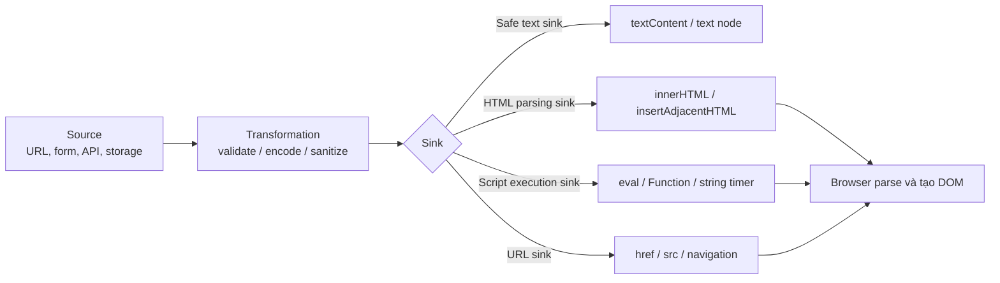

# XSS trong browser: hiểu nguồn dữ liệu, điểm thực thi và cách phòng vệ

## 1. XSS là gì và vì sao browser là ranh giới quan trọng?

**Cross-Site Scripting (XSS)** là lỗ hổng cho phép dữ liệu không đáng tin được trình duyệt diễn giải thành nội dung có thể thực thi hoặc tương tác theo cách ngoài ý muốn, thường là JavaScript chạy trong origin của ứng dụng bị ảnh hưởng. Khi mã độc chạy trong origin tin cậy, browser xử lý nó như mã của chính ứng dụng đó. Nó có thể đọc DOM, truy cập dữ liệu mà trang được phép đọc, thay đổi giao diện, gửi request bằng quyền phiên hiện tại và thực hiện hành động dưới danh nghĩa người dùng.

Ví dụ, người dùng đăng nhập tại `https://app.example.com`. Ứng dụng hiển thị tên hoặc nội dung giới thiệu do người dùng nhập. Nếu dữ liệu đó được chèn vào DOM như HTML mà không được xử lý đúng, browser có thể tạo phần tử hoặc thực thi event handler do kẻ tấn công kiểm soát. Khi đó, script chạy trong origin `app.example.com`, có cùng quyền phía browser như các script hợp lệ của ứng dụng.

XSS không chỉ là “một hộp thoại alert xuất hiện”. Hậu quả thực tế có thể gồm:

- Đọc nội dung trang, thông tin cá nhân và dữ liệu trong Web Storage mà JavaScript của origin được phép truy cập.
- Gửi request tới API trong phiên đăng nhập và thay đổi dữ liệu nếu server cho phép.
- Đánh cắp token lưu trong vùng JavaScript có thể đọc.
- Thao túng giao diện để lừa người dùng nhập thông tin hoặc xác nhận thao tác.
- Gửi thông điệp giả qua các kênh mà ứng dụng tin cậy.
- Tạo điều kiện cho các bước tấn công tiếp theo trong ứng dụng.

Cookie có `HttpOnly` không thể được đọc trực tiếp qua `document.cookie`, nhưng browser vẫn có thể tự gửi cookie đó khi script XSS tạo request phù hợp. Vì vậy `HttpOnly` giảm một kiểu đánh cắp credential, nhưng không loại bỏ khả năng thao tác phiên.

Trong module `SECURITY_APPLICATION_SECURITY_BROWSER_SECURITY`, XSS cần được hiểu cùng ranh giới origin, SOP, cookie, CSP, Trusted Types và các security headers. Bài này tập trung vào cách dữ liệu đi từ nguồn không tin cậy tới DOM hoặc API có thể thực thi; cách chọn phương pháp xử lý phù hợp; và cách kiểm chứng phòng vệ trong browser.

### Kết quả học tập

Sau bài này, người học có thể:

1. Phân biệt reflected XSS, stored XSS và DOM-based XSS.
2. Nhận diện source, transformation và sink trong một luồng dữ liệu phía client.
3. Giải thích vì sao cùng một chuỗi có thể an toàn ở text context nhưng nguy hiểm ở HTML, attribute, URL, CSS hoặc JavaScript context.
4. Dùng DOM API an toàn, contextual output encoding và HTML sanitizer phù hợp.
5. Đánh giá vai trò và giới hạn của CSP, Trusted Types, HttpOnly và SOP.
6. Kiểm thử một luồng XSS bằng DevTools, test case và bằng chứng browser.

## 2. Mô hình nguồn dữ liệu → xử lý → sink

Để phân tích XSS, hãy theo dõi ba phần:

- **Source (nguồn):** nơi dữ liệu không tin cậy đi vào ứng dụng, ví dụ query string, fragment, form, API response, dữ liệu lưu trong database hoặc `postMessage`.
- **Transformation (xử lý):** thao tác biến đổi, validate, encode hoặc sanitize dữ liệu. Việc xử lý phải phù hợp với ngữ cảnh đích.
- **Sink (điểm nhận):** API hoặc vị trí browser diễn giải dữ liệu thành HTML, script, URL, CSS hay hành vi điều hướng.



Không phải mọi source đều nguy hiểm, và không phải mọi sink đều luôn nguy hiểm. Rủi ro xuất hiện khi dữ liệu có thể bị người dùng hoặc bên ngoài kiểm soát được đưa vào sink với ngữ cảnh xử lý không phù hợp.

### 2.1. Các source thường gặp

| Source | Ví dụ | Lưu ý |
| --- | --- | --- |
| Query string | `location.search`, `URLSearchParams` | Có thể do người dùng gửi qua link |
| Fragment | `location.hash` | Không gửi lên server trong HTTP request nhưng JavaScript đọc được |
| Form/input | `input.value`, nội dung rich text | Dữ liệu do người dùng nhập |
| API response | JSON, HTML từ backend hoặc dịch vụ ngoài | Response vẫn có thể chứa dữ liệu do người dùng khác kiểm soát |
| Web Storage | `localStorage`, `sessionStorage` | Dữ liệu có thể tồn tại qua nhiều lần tải trang |
| `postMessage` | `event.data` | Phải xác minh origin, source và schema của thông điệp |
| URL/referrer | `document.referrer`, URL điều hướng | Có thể chứa dữ liệu từ bên ngoài |
| Database | Bình luận, tên hiển thị, mô tả | Dữ liệu đã lưu không tự trở nên đáng tin |

### 2.2. Các sink cần kiểm tra

| Nhóm sink | Ví dụ | Rủi ro |
| --- | --- | --- |
| HTML parser | `innerHTML`, `outerHTML`, `insertAdjacentHTML`, `document.write` | Chuỗi được parse thành DOM; event handler và markup có thể tạo hành vi ngoài ý muốn |
| Script execution | `eval`, `Function`, `setTimeout("...")`, `setInterval("...")` | Chuỗi có thể được diễn giải thành mã JavaScript |
| URL/navigation | `location`, `href`, `src`, `action`, `formAction` | Có thể điều hướng tới host không tin cậy hoặc protocol nguy hiểm |
| DOM attributes | `setAttribute` với tên thuộc tính nguy hiểm | Một số thuộc tính như `onerror` có ngữ nghĩa thực thi |
| CSS | `style` hoặc stylesheet được tạo động | Có thể làm thay đổi giao diện, tải tài nguyên ngoài ý muốn; các browser hiện đại hạn chế nhiều kiểu thực thi CSS cũ |
| Framework escape bypass | `dangerouslySetInnerHTML`, `[innerHTML]`, `v-html` | Bỏ qua cơ chế escape mặc định của framework |

Tìm kiếm các tên API là cách rà soát ban đầu, nhưng chưa đủ kết luận có lỗ hổng. Cần lần theo dữ liệu đến sink và xác định dữ liệu có được kiểm soát, xử lý đúng ngữ cảnh hay không.

## 3. Ba nhóm XSS thường gặp

### 3.1. Reflected XSS

Reflected XSS xảy ra khi dữ liệu trong request được phản ánh ngay vào response hoặc DOM mà không được encode/validate đúng ngữ cảnh. Kẻ tấn công thường tạo một URL chứa dữ liệu độc hại và lừa nạn nhân mở URL đó.

Ví dụ logic không an toàn:

```js
const params = new URLSearchParams(location.search);
const message = params.get("message") || "";
document.querySelector("#result").innerHTML = message;
```

Nếu người dùng mở một URL có query `message` chứa markup hoặc event handler, `innerHTML` sẽ parse chuỗi đó thành DOM. Bản thân `URLSearchParams` chỉ giúp đọc query đúng cấu trúc; nó **không sanitize HTML**.

Phòng vệ:

- Nếu chỉ hiển thị văn bản, dùng `textContent`.
- Nếu cần HTML, dùng sanitizer đáng tin cậy với cấu hình phù hợp.
- Ở server-rendered page, encode output theo đúng HTML context.
- Không tin dữ liệu chỉ vì nó đến từ query string hoặc đã đi qua backend.

### 3.2. Stored XSS

Stored XSS xảy ra khi dữ liệu độc hại được lưu trong database, CMS, log, hồ sơ người dùng hoặc nội dung do người dùng tạo, rồi được hiển thị cho người khác bằng cách không an toàn.

Ví dụ: một người dùng nhập phần giới thiệu cá nhân; server lưu nội dung; trang hồ sơ của mọi người dùng render nội dung đó qua `innerHTML`. Chỉ cần một lần lưu, nhiều người xem có thể bị ảnh hưởng.

Phòng vệ:

- Lưu dữ liệu theo đúng ý nghĩa nghiệp vụ, không cố “sanitize HTML bằng regex” khi nhận input.
- Encode tại thời điểm render theo ngữ cảnh đích.
- Nếu cho phép rich text, sanitize bằng thư viện chuyên dụng và allowlist phần tử/attribute cần thiết.
- Kiểm tra mọi nơi hiển thị cùng dữ liệu: trang hồ sơ, trang quản trị, email HTML, preview, export.
- Khi thay đổi sanitizer hoặc policy, cân nhắc rà soát và làm sạch dữ liệu cũ theo quy trình.

### 3.3. DOM-based XSS

DOM-based XSS xảy ra khi JavaScript phía client lấy dữ liệu từ một source và đưa nó vào sink nguy hiểm. Server có thể chỉ trả một file HTML/JavaScript tĩnh; lỗ hổng nằm trong cách code client xử lý URL hoặc dữ liệu runtime.

Ví dụ:

```js
const value = new URLSearchParams(location.search).get("name") || "";
document.querySelector("#welcome").innerHTML = "Xin chào " + value;
```

Luồng này có source là query parameter và sink là `innerHTML`. Sửa an toàn:

```js
const value = new URLSearchParams(location.search).get("name") || "";
document.querySelector("#welcome").textContent = "Xin chào " + value;
```

DOM-based XSS không phải một loại sink riêng; nó mô tả đường đi dữ liệu trong DOM. Một ứng dụng có thể đồng thời có stored/reflected XSS và luồng DOM-based.

### 3.4. So sánh

| Nhóm | Dữ liệu thường đến từ | Điểm phản ánh/thực thi | Cách phát hiện |
| --- | --- | --- | --- |
| Reflected | Request hiện tại, thường là query/path/form | Server response hoặc DOM của trang trả về | Kiểm tra URL/request và response |
| Stored | Database, CMS, nội dung do người dùng lưu | Trang hiển thị dữ liệu đã lưu | Kiểm tra luồng ghi và tất cả nơi render |
| DOM-based | URL, storage, message, API response | JavaScript client đưa dữ liệu vào DOM/sink | Theo dõi source-to-sink trong mã và DevTools |

## 4. Ngữ cảnh đầu ra: lý do một kiểu encode không đủ

Không có một hàm “escape mọi thứ” an toàn cho tất cả vị trí. Browser có nhiều bộ phân tích: HTML parser, JavaScript parser, URL parser, CSS parser và các ngữ cảnh lồng nhau.

| Ngữ cảnh | Ví dụ đích | Cách xử lý ưu tiên |
| --- | --- | --- |
| HTML text | Nội dung giữa hai thẻ | Template auto-escape hoặc text node/`textContent` |
| HTML attribute thông thường | `title="..."`, `value="..."` | Contextual attribute encoding; dùng DOM property an toàn khi có thể |
| URL attribute | `href`, `src`, `action` | Parse URL, allowlist scheme/host, sau đó đặt thuộc tính |
| JavaScript | Giá trị trong script inline | Tránh nhúng dữ liệu không tin cậy vào script; truyền qua JSON endpoint hoặc DOM data |
| CSS | Giá trị trong style | Không ghép chuỗi CSS từ input; dùng property cụ thể và validate giá trị |
| HTML rich text | Nội dung cần cho phép một tập markup | HTML sanitizer chuyên dụng theo allowlist |
| SVG/MathML | Markup vector hoặc XML-like | Tránh nhận markup không tin cậy; nếu cần, dùng sanitizer hiểu đúng namespace và cấu trúc |

### 4.1. HTML text context

Nếu chỉ muốn hiển thị nội dung:

```js
const comment = userInput;
document.querySelector("#comment").textContent = comment;
```

`textContent` tạo text node. Các ký tự như `<` và `>` được hiển thị như văn bản, không được parse thành phần tử HTML.

### 4.2. Attribute context

Tránh tạo HTML bằng nối chuỗi:

```js
// Không an toàn
container.innerHTML = '<input value="' + userInput + '">';
```

Tạo phần tử và đặt property:

```js
const input = document.createElement("input");
input.value = userInput;
container.replaceChildren(input);
```

Không phải mọi attribute đều là dữ liệu thuần. Các thuộc tính sự kiện như `onclick`, `onerror`, `onload`, thuộc tính URL như `href`/`src` và thuộc tính style có ngữ nghĩa riêng. Không dùng `setAttribute` với tên attribute do người dùng kiểm soát, và không đưa dữ liệu vào event-handler attribute.

### 4.3. URL context

Một URL có thể parse thành công nhưng vẫn nguy hiểm cho tính năng. Ví dụ, `javascript:` không phù hợp cho liên kết ngoài. Hãy kiểm tra protocol và host sau khi parse:

```js
function safeExternalUrl(raw) {
  let url;
  try {
    url = new URL(raw);
  } catch {
    return null;
  }

  if (!["https:", "http:"].includes(url.protocol)) return null;
  if (url.username || url.password) return null;
  return url;
}

const target = safeExternalUrl(userProvidedUrl);
if (target) {
  const link = document.createElement("a");
  link.href = target.href;
  link.textContent = "Mở liên kết";
  link.rel = "noopener noreferrer";
  link.target = "_blank";
  container.append(link);
}
```

Nếu ứng dụng chỉ cần HTTPS, bỏ `http:` khỏi allowlist. Nếu chỉ cho phép một số host, kiểm tra `url.origin` hoặc `url.hostname` với allowlist chính xác. Không dùng `includes("example.com")` để xác minh hostname.

### 4.4. JavaScript context

Không nối dữ liệu không tin cậy vào script inline:

```html
<script>
  const displayName = "USER_INPUT_HERE";
</script>
```

Ngay cả khi gọi `JSON.stringify`, việc nhúng JSON vào HTML script vẫn cần xử lý đúng các ký tự có thể kết thúc script element hoặc làm thay đổi ngữ cảnh. Cách đơn giản hơn là:

- Trả dữ liệu qua endpoint JSON và đọc bằng `fetch`.
- Gắn dữ liệu vào DOM bằng API an toàn.
- Dùng template engine/framework có cơ chế serialize và escape được thiết kế cho ngữ cảnh đó.
- Tránh `eval`, `Function` và timer nhận chuỗi.

### 4.5. CSS context

Không xây dựng style bằng cách nối CSS tùy ý từ input:

```js
// Tránh đưa chuỗi CSS không tin cậy vào style.
element.setAttribute("style", userInput);

// Với thuộc tính màu, kiểm tra giá trị theo allowlist đơn giản.
const allowedColors = new Set(["red", "blue", "green"]);
if (allowedColors.has(userColor)) {
  element.style.color = userColor;
}
```

Nếu tính năng cho phép nhiều kiểu CSS, hãy thiết kế schema dữ liệu và validate từng property/value; không cho người dùng gửi một đoạn stylesheet tùy ý trừ khi có yêu cầu sản phẩm và cơ chế cách ly phù hợp.

## 5. DOM API an toàn và những sink cần tránh

### 5.1. Safe sinks nên ưu tiên

| Nhu cầu | API nên dùng |
| --- | --- |
| Hiển thị text | `textContent`, `createTextNode` |
| Tạo phần tử | `document.createElement` |
| Gắn phần tử | `append`, `appendChild`, `replaceChildren` |
| Đặt giá trị input | `.value` |
| Đặt nhãn | `.textContent` |
| Thay đổi class | `classList.add/remove/toggle` với token cố định |
| Điều hướng | `URL` parser + allowlist + `location.assign`/`href` |
| Dữ liệu JSON | `response.json()` rồi validate schema và render bằng safe sinks |

Ví dụ tạo thẻ bình luận:

```js
function renderComment(container, author, message) {
  const article = document.createElement("article");
  const heading = document.createElement("h3");
  const body = document.createElement("p");

  heading.textContent = author;
  body.textContent = message;

  article.append(heading, body);
  container.append(article);
}
```

### 5.2. Các API cần rà soát kỹ

- `innerHTML`, `outerHTML`, `insertAdjacentHTML`, `document.write`.
- `eval`, `new Function`, `setTimeout`/`setInterval` với đối số chuỗi.
- `javascript:` trong URL có thể điều hướng hoặc kích hoạt từ một số URL sink.
- `srcdoc` của iframe nếu nhận HTML không tin cậy.
- Các framework escape bypass như `dangerouslySetInnerHTML`, `v-html`, `bypassSecurityTrustHtml`.
- Các thư viện template hoặc sanitizer cũ, cấu hình allowlist quá rộng.

Không phải mọi lần dùng `innerHTML` đều là lỗ hổng; nếu đầu vào là hằng số tin cậy hoặc `TrustedHTML` đã được tạo qua policy an toàn, rủi ro khác đi. Tuy nhiên, mọi sink HTML phải có lý do rõ ràng và đường xử lý dữ liệu có thể kiểm chứng.

## 6. Khi nào cần HTML sanitizer?

Nếu sản phẩm cần hiển thị rich text do người dùng tạo, chỉ dùng `textContent` sẽ làm mất định dạng. Khi đó, cần sanitizer HTML chuyên dụng để giữ lại một tập phần tử và thuộc tính được cho phép, đồng thời loại bỏ nội dung có khả năng thực thi.

Một sanitizer tốt cần:

- Hiểu cấu trúc HTML và namespace, không dùng regex thay thế chuỗi.
- Có allowlist phần tử/attribute rõ ràng.
- Xử lý URL trong `href`/`src` bằng chính sách protocol/host.
- Loại bỏ event-handler attributes và nội dung không được phép.
- Được cập nhật thường xuyên khi browser và các dạng markup thay đổi.
- Được cấu hình theo yêu cầu thực tế; không bật toàn bộ SVG/MathML hoặc CSS tùy ý nếu không cần.

Ví dụ minh họa với DOMPurify:

```js
// Cần cài và cập nhật DOMPurify từ nguồn đáng tin cậy.
const clean = DOMPurify.sanitize(untrustedRichText, {
  USE_PROFILES: { html: true }
});

container.innerHTML = clean;
```

Đây chỉ là ví dụ khởi đầu. Nếu nội dung rich text cần liên kết, hình ảnh hoặc style, hãy xem xét policy URL và allowlist tương ứng. Không chỉnh sanitizer theo hướng cho phép thêm nhiều loại markup chỉ để làm một nội dung hiển thị được mà chưa đánh giá rủi ro.

**Sanitize ở đâu?** Có thể sanitize khi lưu hoặc khi render, tùy kiến trúc. Điều quan trọng là mọi đường hiển thị phải được bảo vệ và dữ liệu đã lưu không được mặc định coi là HTML an toàn. Nếu lưu bản đã sanitize, cần biết policy/version đã dùng và có khả năng xử lý lại khi policy thay đổi.

## 7. Content Security Policy (CSP) như lớp giảm thiểu XSS

CSP là chính sách do server gửi cho browser qua response header `Content-Security-Policy`. CSP có thể giới hạn nguồn script, style, ảnh, kết nối, frame và một số hành vi của document. CSP giúp giảm khả năng payload XSS chạy thành công, nhưng **không thay thế sửa source-to-sink không an toàn**.

### 7.1. Một chính sách nền tảng

Ví dụ chính sách theo hướng hạn chế:

```http
Content-Security-Policy: default-src 'self'; script-src 'self' 'nonce-RANDOM_PER_RESPONSE'; object-src 'none'; base-uri 'none'; frame-ancestors 'none'
```

Giải thích:

- `default-src 'self'`: mặc định chỉ cho tải tài nguyên từ cùng origin nếu directive cụ thể không ghi đè.
- `script-src 'self' 'nonce-...'`: cho phép script cùng origin và script có nonce đúng.
- `object-src 'none'`: chặn plugin/object không cần thiết.
- `base-uri 'none'`: không cho tài liệu bị thay đổi base URL bằng thẻ `<base>`.
- `frame-ancestors 'none'`: không cho origin khác nhúng tài liệu này.

Nonce phải được tạo ngẫu nhiên bằng CSPRNG **mới cho từng response**, gắn cùng giá trị vào header và các script được phép. Không hardcode nonce, không tái sử dụng nonce cố định giữa các response. Nếu ứng dụng dùng script inline, phải kiểm kê và chuyển sang nonce/hash phù hợp; tránh thêm `'unsafe-inline'` chỉ để làm ứng dụng chạy.

### 7.2. CSP Report-Only

Khi triển khai CSP cho ứng dụng hiện có, có thể bắt đầu bằng:

```http
Content-Security-Policy-Report-Only: default-src 'self'; script-src 'self' 'nonce-RANDOM_PER_RESPONSE'; object-src 'none'; base-uri 'none'; report-to csp-endpoint
```

Chế độ Report-Only ghi nhận vi phạm nhưng không chặn hành vi. Hãy thu thập báo cáo, xác định script/tài nguyên hợp lệ, sửa ứng dụng và sau đó chuyển sang enforcement. Không đưa dữ liệu nhạy cảm vào report endpoint và phải kiểm soát spam/abuse của endpoint nhận báo cáo.

Với directive `report-to`, cần cấu hình nhóm endpoint tương ứng bằng response header `Reporting-Endpoints` (ví dụ `Reporting-Endpoints: csp-endpoint="https://reports.example.com/csp"`). Nếu cần hỗ trợ browser/cấu hình cũ, đánh giá thêm `report-uri` theo ma trận tương thích của ứng dụng.

### 7.3. CSP không phải bộ lọc HTML

CSP không làm dữ liệu trong DOM trở nên an toàn. Nếu ứng dụng render dữ liệu bằng `innerHTML`, payload vẫn có thể tạo markup và hành vi khác nhau; CSP chỉ có thể chặn một số script hoặc request dựa trên policy. CSP có thể bị cấu hình quá rộng hoặc có ngoại lệ không an toàn. Hãy dùng CSP như lớp phòng thủ bổ sung sau khi đã sửa output handling.

Các điểm cần tránh:

- `'unsafe-inline'` trong `script-src` nếu có thể dùng nonce/hash.
- `'unsafe-eval'` nếu không có nhu cầu được đánh giá.
- Cho phép script từ host bên ngoài quá rộng mà không kiểm soát.
- Tin rằng CSP một mình có thể chặn mọi dạng XSS.

## 8. Trusted Types: kiểm soát đường đi vào DOM sink

**Trusted Types** là cơ chế của browser (trên các trình duyệt hỗ trợ) giúp kiểm soát các DOM sink nhạy cảm bằng cách yêu cầu giá trị được tạo thông qua một policy được khai báo. Thay vì nhận một chuỗi tùy ý cho một số sink như HTML parsing, ứng dụng có thể yêu cầu một kiểu dữ liệu tin cậy như `TrustedHTML`.

Header CSP có thể bật enforcement:

```http
Content-Security-Policy: require-trusted-types-for 'script'; trusted-types app-html
```

Ví dụ minh họa tạo policy dùng sanitizer:

```js
const htmlPolicy = trustedTypes.createPolicy("app-html", {
  createHTML(input) {
    return DOMPurify.sanitize(input, {
      USE_PROFILES: { html: true }
    });
  }
});

const safeHtml = htmlPolicy.createHTML(untrustedRichText);
container.innerHTML = safeHtml;
```

Policy chỉ an toàn khi hàm `createHTML` thực sự làm sạch dữ liệu theo chính sách phù hợp. **Không tạo policy trả lại nguyên input**:

```js
// Sai: policy này chỉ đổi nhãn kiểu dữ liệu, không làm sạch.
const unsafePolicy = trustedTypes.createPolicy("unsafe", {
  createHTML(input) {
    return input;
  }
});
```

Trusted Types không tự sanitize; nó giúp buộc ứng dụng đi qua một điểm kiểm soát. Cần kiểm kê sink, kiểm thử thư viện bên thứ ba và đánh giá mức hỗ trợ của browser mục tiêu. Với browser không hỗ trợ, ứng dụng vẫn phải an toàn nhờ safe sinks, sanitizer và CSP.

## 9. Cookie, SOP và các giới hạn của XSS

Khi script XSS chạy trong origin của ứng dụng, SOP không ngăn script truy cập tài nguyên cùng origin. Đây là lý do XSS có thể nguy hiểm dù SOP đang hoạt động đúng.

| Cơ chế | Tác động trong tình huống XSS |
| --- | --- |
| SOP | Ngăn script từ origin khác đọc trực tiếp DOM/dữ liệu; script XSS đã chạy trong origin ứng dụng có quyền theo origin đó |
| Cookie `HttpOnly` | Ngăn đọc cookie qua JavaScript; browser vẫn gửi cookie trong request phù hợp |
| Cookie `Secure` | Bảo vệ việc gửi cookie qua kết nối không an toàn; không ngăn script XSS trên HTTPS |
| Cookie `SameSite` | Hạn chế một số request cross-site; không chặn script chạy same-origin |
| CORS | Kiểm soát quyền đọc response cross-origin; không bảo vệ dữ liệu same-origin khỏi XSS |
| CSRF token | Phòng request giả mạo từ ngữ cảnh khác; XSS trong origin có thể truy cập nhiều dữ liệu/luồng mà trang hợp lệ dùng |
| CSP | Giảm khả năng script ngoài ý muốn tải hoặc thực thi; cần cấu hình chặt |
| Trusted Types | Giảm đường đưa chuỗi tùy ý vào một số DOM sink |

Không xem `HttpOnly` là biện pháp chống XSS. Nó hữu ích để bảo vệ bí mật cookie khỏi việc đọc trực tiếp, nhưng mã độc vẫn có thể gọi API và đọc response được phép.

## 10. Framework và template engine

Framework hiện đại thường tự động escape dữ liệu nội suy trong template text/attribute context. Cơ chế này hữu ích, nhưng chỉ an toàn khi sử dụng đúng API và không vượt qua escape mặc định.

| Framework/kiểu template | Cơ chế cần lưu ý |
| --- | --- |
| React | JSX text interpolation được escape; `dangerouslySetInnerHTML` bỏ qua cơ chế đó |
| Angular | Template binding có sanitizer theo ngữ cảnh; `bypassSecurityTrust...` có thể bỏ qua kiểm tra |
| Vue | Interpolation dạng `{{ }}` escape text; `v-html` chèn HTML |
| Template server-side | Kiểm tra auto-escaping có bật và đúng context; tránh đánh dấu dữ liệu tùy ý là safe |

Nguyên tắc:

- Không tắt auto-escaping toàn cục.
- Không dùng API bypass cho dữ liệu người dùng.
- Nếu cần HTML, sanitize theo policy và giữ đường sử dụng rõ ràng.
- Không nối chuỗi để tạo HTML/JS/URL.
- Kiểm thử cả trang quản trị, preview, email HTML và export; một sink ở giao diện nội bộ vẫn có thể gây ảnh hưởng nghiêm trọng.

## 11. Kiểm thử XSS trong browser

### 11.1. Lab DOM XSS an toàn

Tạo trang thử nghiệm cục bộ với nội dung:

```html
<!doctype html>
<meta charset="utf-8">
<title>DOM XSS lab</title>
<h1>DOM XSS lab</h1>
<p id="output"></p>
<script>
  const value = new URLSearchParams(location.search).get("message") || "";
  document.querySelector("#output").innerHTML = value;
</script>
```

Mở trang với query chứa markup hiển thị vô hại, ví dụ:

```text
?message=%3Cstrong%3EHello%20browser%3C%2Fstrong%3E
```

Quan sát phần tử `<strong>` được tạo trong tab Elements. Đây là bằng chứng chuỗi đã được parse thành HTML. Đổi `innerHTML` thành `textContent`, tải lại và quan sát chuỗi được hiển thị như văn bản. Bài thử này minh họa HTML injection; để đánh giá XSS thực thi, chỉ dùng payload kiểm chứng vô hại trong một trang lab riêng, không thử trên tài khoản hoặc website của người khác.

Trong chính trang localhost cô lập, có thể xác nhận việc thực thi event handler bằng một payload kiểm thử chỉ hiển thị hộp thoại:

```text
?message=%3Cimg%20src%3Dx%20onerror%3Dalert(1)%3E
```

Nếu ảnh thử không tải được, event handler có thể chạy và hiển thị hộp thoại. Sau khi đổi sink sang `textContent`, cùng giá trị chỉ hiện như văn bản. Không dùng phép thử này trên website đang hoạt động hoặc tài khoản không thuộc quyền kiểm soát của bạn.

### 11.2. Ma trận kiểm thử

| Mã | Source | Sink/đích | Kiểm tra | Kết quả mong muốn |
| --- | --- | --- | --- | --- |
| XSS-01 | Query string | `textContent` | Giá trị chứa ký tự markup | Hiển thị như text |
| XSS-02 | Query string | `innerHTML` trong lab | Giá trị chứa markup vô hại | Xác nhận browser parse thành DOM; sau đó sửa sink |
| XSS-03 | API response | Trang hồ sơ | Nội dung đã lưu có ký tự HTML | Không thực thi khi hiển thị |
| XSS-04 | `postMessage` | DOM | Origin sai hoặc payload sai schema | Bị từ chối |
| XSS-05 | URL người dùng nhập | `href` | Protocol không nằm trong allowlist | Bị từ chối |
| XSS-06 | Rich text | Sanitizer + HTML sink | Thử phần tử/attribute ngoài allowlist | Bị loại bỏ |
| XSS-07 | Script injection path | CSP | Script không có nonce/hash hoặc nguồn không được phép | Browser chặn theo policy |
| XSS-08 | DOM sink | Trusted Types | Gán chuỗi tùy ý vào sink được bảo vệ | Browser hỗ trợ enforcement từ chối |

### 11.3. Dùng DevTools

1. **Elements:** kiểm tra dữ liệu xuất hiện dưới dạng text node hay phần tử HTML.
2. **Console:** xem lỗi CSP, Trusted Types và lỗi JavaScript.
3. **Network:** kiểm tra response HTML, CSP headers và nguồn script được tải.
4. **Sources:** đặt breakpoint tại source và sink; xem giá trị trước/sau xử lý.
5. **Application/Storage:** kiểm tra dữ liệu lưu ở localStorage/sessionStorage; không sao chép token thật vào báo cáo.
6. **Security/Issues:** kiểm tra cảnh báo liên quan đến nội dung hỗn hợp hoặc chính sách browser nếu có.

Khi tìm một sink, lần ngược dữ liệu về source. Khi tìm một source, theo dõi mọi đường dữ liệu đến sink. Một chuỗi đã validate theo schema không đồng nghĩa nó an toàn để dùng trong HTML context.

## 12. Những sai lầm thường gặp

| Nhận định sai | Cách hiểu đúng |
| --- | --- |
| “Chỉ cần lọc `<script>` là hết XSS.” | XSS có nhiều dạng markup, event handler, URL và parser context; cần xử lý đúng ngữ cảnh |
| “Dữ liệu từ API/database là đáng tin.” | Dữ liệu có thể do người dùng khác tạo và lưu; vẫn phải xử lý khi render |
| “`encodeURIComponent` làm HTML an toàn.” | Hàm này encode URL component, không phải HTML sanitizer |
| “`textContent` và `innerHTML` tương đương.” | `textContent` tạo text; `innerHTML` parse HTML |
| “CSP thay thế output encoding.” | CSP là lớp giảm thiểu; phải sửa luồng dữ liệu tới sink |
| “Trusted Types tự làm sạch HTML.” | Trusted Types buộc đi qua policy; policy phải sanitize đúng |
| “HttpOnly ngăn mọi tác động của XSS.” | Script vẫn có thể gửi request bằng phiên hiện tại và đọc response được phép |
| “CORS ngăn script XSS trong ứng dụng.” | CORS điều khiển đọc response cross-origin; XSS chạy cùng origin có quyền same-origin |
| “Framework tự động escape nên không cần kiểm tra.” | API bypass hoặc HTML sink vẫn có thể tạo XSS |
| “Chỉ cần test trang người dùng.” | Trang quản trị, preview, email và export cũng có thể render dữ liệu không tin cậy |

## 13. Tình huống tổng hợp: phần giới thiệu cá nhân

**Bối cảnh:** ứng dụng có trang hồ sơ, cho phép người dùng nhập phần giới thiệu. Nội dung được lưu trong database và hiển thị trên trang hồ sơ công khai. Sản phẩm muốn hỗ trợ định dạng cơ bản như đoạn văn, danh sách và liên kết.

Hãy thiết kế:

1. Xác định source: form nhập liệu, API response và database.
2. Liệt kê tất cả sink: trang hồ sơ, trang quản trị, preview, thông báo/email và export.
3. Chọn chính sách rich text: allowlist phần tử như `p`, `strong`, `em`, `ul`, `ol`, `li`, `a`; quyết định rõ attribute và protocol cho link.
4. Dùng sanitizer HTML được duy trì, cấu hình theo allowlist; từ chối event handler và protocol không hợp lệ.
5. Render bằng sanitizer output; không trộn với `innerHTML` của dữ liệu chưa xử lý.
6. Thêm CSP với nonce/hash và không bật `'unsafe-inline'` chỉ để hỗ trợ nội dung người dùng.
7. Cân nhắc Trusted Types để kiểm soát sink; policy phải gọi sanitizer.
8. Kiểm thử nội dung cũ, dữ liệu từ API và trang quản trị; đảm bảo nội dung hợp lệ vẫn hiển thị.

### Mẫu báo cáo

| Luồng | Rủi ro | Biện pháp | Bằng chứng |
| --- | --- | --- | --- |
| Form → database | Nội dung độc hại được lưu | Validate schema; lưu theo ý nghĩa dữ liệu | Request và bản ghi thử |
| Database → hồ sơ | Stored XSS | Sanitizer + HTML sink được kiểm soát | DOM sau render |
| Query → thông báo | Reflected/DOM XSS | `textContent` | Hiển thị như text |
| URL → link | Protocol/host nguy hiểm | URL parser + allowlist | Test các protocol/host |
| Script ngoài ý muốn | Thực thi payload | CSP nonce/hash | Console và CSP report |
| DOM sink tùy ý | Chuỗi không qua policy | Trusted Types | Browser từ chối gán chuỗi |

### Tiêu chí hoàn thành

Thiết kế đạt khi:

- Dữ liệu plain text được render bằng safe sink.
- Rich text chỉ cho phép markup/attribute đã được duyệt.
- URL được parse và kiểm tra scheme/host theo nhu cầu.
- Không có đường dữ liệu không tin cậy trực tiếp vào script execution sink.
- CSP có hiệu lực và không cần ngoại lệ rộng không được đánh giá.
- Trusted Types (nếu dùng) có policy sanitize thực sự.
- Các trang dùng chung dữ liệu đều được kiểm thử.

## 14. Checklist phòng chống XSS

- [ ] Theo dõi source → transformation → sink cho dữ liệu không tin cậy.
- [ ] Dùng `textContent`/DOM API cho nội dung text.
- [ ] Encode theo đúng HTML, attribute, URL, JavaScript hoặc CSS context.
- [ ] Tránh `innerHTML`, `document.write`, `eval`, `Function` và string timer với dữ liệu không tin cậy.
- [ ] Nếu cần rich text, dùng sanitizer HTML chuyên dụng với allowlist.
- [ ] Parse và allowlist URL protocol/host trước khi đặt vào URL sink.
- [ ] Kiểm tra `postMessage` origin, source và schema.
- [ ] Không tắt auto-escaping của framework hoặc dùng bypass tùy tiện.
- [ ] Triển khai CSP chặt, ưu tiên nonce/hash và thử Report-Only trước.
- [ ] Cân nhắc Trusted Types để kiểm soát DOM sinks.
- [ ] Cấu hình cookie `HttpOnly`, `Secure`, `SameSite` phù hợp nhưng không xem chúng là cách sửa XSS.
- [ ] Kiểm thử dữ liệu lưu cũ, trang quản trị, preview và mọi nơi render lại.

### Ghi nhớ

**XSS xảy ra khi dữ liệu không tin cậy đi vào ngữ cảnh browser có thể diễn giải thành markup hoặc mã thực thi.** Cách phòng vệ chính là giữ rõ ranh giới source-to-sink: dùng safe DOM APIs cho text, contextual encoding cho template, sanitizer cho rich HTML và URL allowlist cho navigation. CSP và Trusted Types là lớp giảm thiểu bổ sung; cookie flags không loại bỏ quyền của script XSS đã chạy trong origin ứng dụng. Mọi luồng dữ liệu hiển thị đều cần được kiểm chứng trong browser.
